# 第2章 进程与线程 · 习题与解析

> 由《第2章 进程与线程》正文摘出；区块标题保留了原书的小节编号。

### 2.1.9 本节习题精选

#### 一、单项选择题

01. 一个进程映像是（）。
A. 由协处理器执行的一个程序
B. 一个独立的程序+数据集
C. PCB 结构与程序和数据的组合
D. 一个独立的程序

02.进程之间交换数据不能通过（）途径进行。
A. 共享文件
B. 消息传递
C. 访问进程地址空间
D. 访问共享存储区

03. 进程与程序的根本区别是（）。
A. 静态和动态特点
B. 是不是被调入内存
C. 是不是具有就绪、运行和等待三种状态
D. 是不是占有处理器

04. 下列关于进程的描述中，最不符合操作系统对进程的理解的是（）。
A. 进程是在多程序环境中的完整程序
B. 进程可以由程序、数据和PCB描述
C. 线程（Thread）是一种特殊的进程
D. 进程是程序在一个数据集合上的运行过程，它是系统进行资源分配和调度的一个独立单元

05. 下列关于并发进程特性的叙述中，正确的是（）。
A. 进程是一个动态过程，其生命周期是连续的
B. 并发进程执行完毕后，一定能够得到相同的结果
C. 并发进程对共享变量的操作结果与执行速度无关
D. 并发进程的运行结果具有不可再现性

06.下列关于进程的叙述中，正确的是（）。
A. 进程获得处理器运行是通过调度得到的
B. 优先级是进程调度的重要依据，一旦确定就不能改动
C. 在单处理器系统中，任何时刻都只有一个进程处于运行态
D. 进程申请处理器而得不到满足时，其状态变为阻塞态

07. 并发进程执行的相对速度是（）。
C. 与进程调度策略有关 A. 由进程的程序结构决定的 算木 B. 由进程自己来控制的
D. 在进程被创建时确定的

08.下列任务中，（）不是由进程创建原语完成的。
A. 申请PCB 并初始化
B. 为进程分配内存空间
C. 为进程分配 CPU
D. 将进程插入就绪队列

09. 下列关于进程和程序的叙述中，错误的是（）。
A. 一个进程在其生命周期中可执行多个程序
B. 一个进程在同一时刻可执行多个程序
C. 一个程序的多次运行可形成多个不同的进程
D. 一个程序的一次执行可产生多个进程

10. 下列选项中，导致创建新进程的操作是（）。I. 用户登录 I. 高级调度发生时. 操作系统响应用户提出的请求 IV. 用户打开了一个浏览器程序
A. 仅I和IV
B. 仅ⅡI和IV
C. I、ⅡI 和IV
D. 全部

11. 操作系统是根据（）来对并发执行的进程进行控制和管理的。
A. 进程的基本状态
B. 进程控制块
C. 多道程序设计
D. 进程的优先权

12. 在任何时刻，一个进程的状态变化（）引起另一个进程的状态变化。
A. 必定
B. 一定不
C. 不一定
D. 不可能

13.在单处理器系统中，若同时存在10个进程，则处于就绪队列中的进程最多有（）个。
A. 1
B. 8
C. 9
D. 10

14.一个进程释放了一台打印机，它可能改变（）的状态。
A. 自身进程
B. 输入/输出进程
C. 另一个等待打印机的进程
D. 所有等待打印机的进程

15. 系统进程所请求的一次I/O操作完成后，将使进程状态从（）。
A. 运行态变为就绪态
B. 运行态变为阻塞态
C. 就绪态变为运行态
D. 阻塞态变为就绪态

16. 一个进程的基本状态可以从其他两种基本状态转变过去，这个基本的状态一定是（)。
A. 运行态
B. 阻塞态
C. 就绪态
D. 终止态

17.在分时系统中，通常处于（）的进程最多。
A. 运行态
B. 就绪态
C. 阻塞态
D. 终止态

18. 并发进程失去封闭性，是指（）。
A. 多个相对独立的进程以各自的速度向前推进
B. 并发进程的执行结果与速度无关
C. 并发进程执行时，在不同时刻发生的错误
D. 并发进程共享变量，其执行结果与速度有关

19.通常用户进程被建立后，（）。
A. 便一直存在于系统中，直到被操作人员撤销
B. 随着进程运行的正常或不正常结束而撤销
C. 随着时间片轮转而撤销与建立
D. 随着进程的阻塞或者唤醒而撤销与建立

20. 进程在处理器上执行时，（）。
A. 进程之间是无关的，具有封闭特性
B. 进程之间都有交互性，相互依赖、相互制约，具有并发性
C. 具有并发性，即同时执行的特性
D. 进程之间可能是无关的，但也可能是有交互性的

21.下列关于父进程和子进程的叙述中，正确的是（）。
A. 为了标志父子关系，可让子进程和父进程拥有相同的PID
B. 父进程和子进程是相互独立的，可以并发执行
C. 撤销子进程时，一定会同时撤销父进程
D. 父进程创建了子进程，要等父进程执行完后，子进程才能执行

22. 若一个进程实体由PCB、共享正文段、数据堆段和数据栈段组成，请指出下列C语言程序中的内容及相关数据结构各位于哪一段中。I. 全局赋值变量（） I. 未赋值的局部变量（）II. 函数调用实参传递值（） IV.用 malloc()要求动态分配的存储区（) V.常量值（如1995、"string"）（） VI. 进程的优先级（）
A. PCB
B. 正文段
C. 堆段
D. 栈段

23. 同一程序经过多次创建，运行在不同的数据集上，形成了（）的进程。
A. 不同
B. 相同
C. 同步 -X
D. 互斥

24. PCB是进程存在的唯一标志，下列（）不属于PCB。 王
A. 进程 ID
B. CPU 状态
C. 堆栈指针
D. 全局变量

25.一个计算机系统中，进程的最大数量主要受到（）限制。
A. 内存大小
B. 用户数目
C. 打开的文件数
D. 外部设备数量

26. 进程创建完成后会进入一个序列，这个序列称为（）。
A. 阻塞队列
B. 挂起序列
C. 就绪队列
D. 运行队列

27. 进程自身决定（）。
A. 从运行态到阻塞态 十算机
B. 从运行态到就绪态
C. 从就绪态到运行态
D. 从阻塞态到就绪态

28. 下列关于原语操作的叙述中，错误的是（）。
A. 操作系统使用原语对进程进行管理和控制
B. 原语在执行过程中不允许被中断
C. 原语在内核态下执行，常驻内存
D. 原语被定义为“原子操作”，意思是其执行速度非常快

29. 下列进程间通信方式中，数据传输速度最快的是（）。
A. 消息传递
B. 信号量
C. 共享内存
D. 管道

30.信箱通信是一种（）通信方式。
A. 直接通信
B. 间接通信
C. 低级通信
D. 信号量

31. 下列关于信号发送和处理的描述中，错误的是（）。
A. 一个进程可以给自己发送信号
B. 操作系统的内核可以给进程发送信号
C. 操作系统的内核对每种信号都有默认处理程序
D. 用户可以对每种信号自定义处理函数

32.下列关于信号的处理的描述中，错误的是（）。
A. 当进程从内核态转换为用户态时，会检查是否有待处理的信号
B. 当进程从用户态转换为内核态时，也会检查是否有待处理的信号
C. 操作系统对某些信号的处理是可以忽略的
D. 操作系统允许进程通过系统调用，自定义某些信号的处理程序

33. 下面的叙述中，正确的是（）。
A. 引入线程后，处理器只能在线程间切换
B. 引入线程后，处理器仍在进程间切换
C. 线程的切换，不会引起进程的切换
D. 线程的切换，可能引起进程的切换

34. 下列关于线程的叙述中，正确的是（）。
A. 线程包含CPU现场，可以独立执行程序
B. 每个线程都有自己独立的地址空间
C. 每个进程只能包含一个线程
D. 同一进程中的线程间通信也必须使用系统调用函数

35. 下面的叙述中，正确的是（）。
A. 线程是比进程更小的能独立运行的基本单位，可以脱离进程独立运行
B. 引入线程可提高程序并发执行的程度，可进一步提高系统效率
C. 线程的引入增加了程序执行时的时空开销
D. 一个进程一定包含多个线程

36. 下面的叙述中，正确的是（）。
A. 同一进程内的线程可并发执行，不同进程的线程只能串行执行
B. 同一进程内的线程只能串行执行，不同进程的线程可并发执行
C. 同一进程或不同进程内的线程都只能串行执行
D. 同一进程或不同进程内的线程都可以并发执行

37.下列选项中，（）不是线程的优点。
C. 提高系统并发性
D. 节增资安性

38.下列关于进程和线程的说法中，正确的是（）。
A. 一个进程可以包含一个或多个线程，一个线程可以属于一个或多个进程
B. 多线程技术具有明显的优越性，如速度快、通信简便、设备并行性高等
C. 由于线程不作为资源分配单位，线程之间可以无约束地并行执行
D. 线程也称轻量级进程，因为线程都比进程小

39. 在下列描述中，（）并不是多线程系统的特长。 算不
A. 利用线程并行地执行矩阵乘法运算
B. Web 服务器利用线程响应 HTTP 请求
C. 键盘驱动程序为每个正在运行的应用配备一个线程，用以响应该应用的键盘输入
D. 基于GUI的调试程序用不同的线程分别处理用户输入、计算和跟踪等操作

40.在进程转换时，下列（）转换是不可能发生的。
A. 就绪态→运行态
B. 运行态→就绪态
C. 运行态→阻塞态
D. 阻塞态→运行态

41. 当（）时，进程从执行状态转换为就绪态。
A. 进程被调度程序选中
B. 时间片到时
C. 等待某一事件
D. 等待的事件发生

42. 两个合作进程（Cooperating Processes）无法利用（）交换数据。
A. 文件系统
B. 共享内存
C. 高级语言程序设计中的全局变量
D. 消息传递系统

43. 以下可能导致一个进程从运行态变为就绪态的事件是（）。
A. 一次 I/O 操作结束
B. 运行进程需做 I/O 操作
C. 运行进程结束
D. 出现了比现在进程优先级更高的进程

44.（）必会引起进程切换。
A. 一个进程创建后，进入就绪态
B. 一个进程从运行态变为就绪态
C. 一个进程从阻塞态变为就绪态
D. 以上答案都不对

45. 进程处于（）时，它处于非阻塞态。
A. 等待从键盘输入数据
B. 等待协作进程的一个信号
C. 等待操作系统分配 CPU 时间
D. 等待网络数据进入内存

46. 一个进程被唤醒，意味着（）。
A. 该进程可以重新竞争CPU
B. 优先级变大
C. PCB 移动到就绪队列之首
D. 进程变为运行态

47. 进程创建时，不需要做的是（）。
A. 填写一个该进程的进程表项
B. 分配该进程适当的内存
C. 将该进程插入就绪队列
D. 为该进程分配 CPU

48.下面关于用户级线程和内核级线程的描述中，错误的是（）。
A. 采用轮转调度算法，进程中设置内核级线程和用户级线程的效果完全不同
B. 跨进程的用户级线程调度也不需要内核参与，控制简单
C. 用户级线程可以在任何操作系统中运行
D. 若系统中只有用户级线程，则CPU的调度对象是进程

49.在内核级线程相对于用户级线程的优点的如下描述中，错误的是（）
A. 同一进程内的线程切换，系统开销小
B. 当内核线程阻塞时，同一进程中的其他内核级线程仍可被调度
C. 内核级线程的程序实体可以在内核态运行
D. 对多处理器系统，核心可以同时调度同一进程的多个线程并行运行

50.下列关于用户级线程相对于内核级线程的优点的描述中，错误的是（）
A. 一个线程阻塞不影响另一个线程的运行
B. 线程的调度不需要内核直接参与，控制简单
C. 线程切换代价小
D. 允许每个进程定制自己的调度算法，线程管理比较灵活

51.下列关于用户级线程的优点的描述中，不正确的是（）。
A. 线程切换不需要切换到内核态
B. 支持不同的应用程序采用不同的调度算法
C. 在不同操作系统上不经修改就可直接运行
D. 同一个进程内的多个线程可以同时调度到多个处理器上执行

52. 下列选项中，可能导致用户级线程切换的事件是（）。
A. 系统调用
B. I/O 请求
C. 异常处理
D. 线程同步

53.下列关于用户级线程的描述中，错误的是（）。
A. 用户级线程由线程库进行管理
B. 用户级线程只有在创建和调度时需要内核的干预
C. 操作系统无法直接调度用户级线程
D. 线程库中线程的切换不会导致进程切换

54. 下面的说法中，正确的是（）。
A. 不论是系统支持的线程还是用户级线程，其切换都需要内核的支持
B. 线程是资源分配的单位，进程是调度和分派的单位
C. 不管系统中是否有线程，进程都是拥有资源的独立单位
D. 在引入线程的系统中，进程仍是资源调度和分派的基本单位

55. 在多对一的线程模型中，当一个多线程进程中的某个线程被阻塞后，（)。
A. 该进程的其他线程仍可继续运行
B. 整个进程都将阻塞
C. 该阻塞线程将被撤销
D. 该阻塞线程将永远不可能再执行

56. 并发性较好的多线程模型有（)。 算机I. 一对一模型 II. 多对一模型 III. 多对多模型
A. 仅I
B. Ⅰ和Ⅱ
C. I和Ⅲ
D. I、ⅡI和ⅢII

57.下列关于多对一模型的叙述中，错误的是（）。
A. 一个进程的多个线程不能并行运行在多个处理器上
B. 进程中的用户级线程由进程自己管理
C. 线程切换会导致进程切换
D. 一个线程的系统调用会导致整个进程阻塞

58.【2010统考真题】下列选项中，导致创建新进程的操作是（）。I. 用户登录成功 ⅡI. 设备分配 Ⅲ. 启动程序执行
A. 仅I和Ⅱ
B. 仅Ⅱ和ⅢII
C. 仅I和ⅢI
D. I、II、III

59.【2011统考真题】在支持多线程的系统中，进程P创建的若干线程不能共享的是（）。
A. 进程P的代码段
B. 进程P中打开的文件
C. 进程P的全局变量
D. 进程P中某线程的栈指针

60.【2012统考真题】下列关于进程和线程的叙述中，正确的是（）。
A. 不管系统是否支持线程，进程都是资源分配的基本单位
B. 线程是资源分配的基本单位，进程是调度的基本单位
C. 系统级线程和用户级线程的切换都需要内核的支持
D. 同一进程中的各个线程拥有各自不同的地址空间

61.【2014统考真题】一个进程的读磁盘操作完成后，操作系统针对该进程必做的是（）。
A. 修改进程状态为就绪态
B. 降低进程优先级
C. 给进程分配用户内存空间
D. 增加进程时间片大小

62.【2014统考真题】下列关于管道（Pipe）通信的叙述中，正确的是（）。
A. 一个管道可实现双向数据传输
B. 管道的容量仅受磁盘容量大小限制
C. 进程对管道进行读操作和写操作都可能被阻塞
D. 一个管道只能有一个读进程或一个写进程对其操作

63.【2015统考真题】下列选项中，会导致进程从运行态变为就绪态的事件是（）。
A. 执行 P(wait)操作
B. 申请内存失败
C. 启动 I/O 设备
D. 被高优先级进程抢占

64.【2018统考真题】下列选项中，可能导致当前进程P阻塞的事件是（）。I. 进程P 申请临界资源Ⅱ. 进程P从磁盘读数据II. 系统将 CPU 分配给高优先权的进程
A. 仅I
B. 仅Ⅱ
C. 仅I、ⅡI
D. I、II、III

65.【2019统考真题】下列选项中，可能将进程唤醒的事件是（）。I. I/O 结束 I. 某进程退出临界区 II. 当前进程的时间片用完
A. 仅I
B. 仅ⅢI
C. 仅I、Ⅱ
D. I、II、III

66.【2019统考真题】下列关于线程的描述中，错误的是（）。
A. 内核级线程的调度由操作系统完成
B. 操作系统为每个用户级线程建立一个线程控制块
C. 用户级线程间的切换比内核级线程间的切换效率高
D. 用户级线程可以在不支持内核级线程的操作系统上实现

67.【2020统考真题】下列关于父进程与子进程的叙述中，错误的是（）。
A. 父进程与子进程可以并发执行
B. 父进程与子进程共享虚拟地址空间
C. 父进程与子进程有不同的进程控制块 育
D. 父进程与子进程不能同时使用同一临界资源

68.【2021统考真题】下列操作中，操作系统在创建新进程时，必须完成的是（）。I. 申请空白的进程控制块Ⅱ. 初始化进程控制块 . 设置进程状态为运行态
A. 仅I
B. 仅I、Ⅱ
C. 仅I、ⅢII
D. 仅II、III

69. 【2022统考真题】下列事件或操作中，可能导致进程P由运行态变为阻塞态的是（）。I. 进程 P读文件 II. 进程P的时间片用完III. 进程P申请外设 IV. 进程 P 执行信号量的 wait()操作
A. 仅I、IV
B. 仅Ⅱ、ⅢI
C. 仅ⅢII、IV
D. 仅I、ⅢII、IV

70. 【2023统考真题】下列操作完成时，导致CPU从内核态转换为用户态的是（）。
A. 阻塞进程
B. 执行 CPU 调度
C. 唤醒进程
D. 执行系统调用

71. 【2023统考真题】下列由当前线程引起的事件或执行的操作中，可能导致该线程由运行态变为就绪态的是（）。
A. 键盘输入
B. 缺页异常
C. 主动出让 CPU
D. 执行信号量的 wait()操作

72.【2024统考真题】下列选项中，操作系统在终止进程时不一定执行的是（）。
A. 终止子进程
B. 回收进程占用的设备
C. 释放进程控制块
D. 回收为进程分配的内存

73. 【2024统考真题】若进程P中的线程T先打开文件，得到文件描述符fd，再创建两个线程Ta和 Tb，则在下列资源中，Ta与 Tb 可共享的是（)。I. 进程P的地址空间 II. 线程 T 的栈 III. 文件描述符 fd
A. 仅I
B. 仅I、III
C. 仅ⅡI、II
D. I、II、III

#### 二、综合应用题

01.【2025统考真题】某系统中进程的虚拟地址空间包括内核区、用户栈、运行时堆、可读/写数据段、只读代码段等区域，其布局如下图所示，图中阴影部分表示未占用区域。现有C语言程序的部分代码如下。

```c
char *ptr;
内核区
void main()
王道
用户栈
int length;
ptr = (char *)malloc(100);
scanf("%s", ptr); 运行时堆
length = strlen(ptr);
可读写数据段
printf("length = %d\n", length);
free(ptr); 只读代码段
```

请回答下列问题。

1）上述程序执行时，其进程控制块位于哪个区域？执行scanf()等待键盘输入时，该进程处于什么状态？

2）main()函数的代码位于哪个区域？其直接调用的哪些函数的功能需通过执行驱动程序实现？

3）变量ptr被分配在哪个区域？若变量length未被分配在寄存器中，则会被分配在哪个区域？ptr 指向的字符串位于哪个区域？

### 2.1.10 答案与解析

#### 一、单项选择题

01. C

进程映像是PCB、程序段和数据的组合，其中PCB是进程存在的唯一标志。

02. C

每个进程包含独立的地址空间，进程各自的地址空间是私有的，只能执行自己地址空间中的程序，且只能访问自己地址空间中的数据，相互访问会导致指针的越界错误（学完内存管理将有更好的认识）。因此，进程之间不能直接交换数据，但可利用操作系统提供的共享文件、消息传递、共享存储区等进行通信。

03. A

动态性是进程最重要的特性，以此来区分文件形式的静态程序。操作系统引入进程的概念，是为了从变化的角度动态地分析和研究程序的执行。

04.A

进程是一个独立的运行单位，也是操作系统进行资源分配和调度的基本单位，它包括PCB、程序和数据以及执行栈区，仅仅说进程是在多程序环境下的完整程序是不合适的，因为程序是静态的，它以文件形式存放在计算机的硬盘内，而进程是动态的。

05. D

并发进程可能因等待资源或因被抢占CPU而暂停运行，其生命周期是不连续的。执行速度会影响进程之间的执行顺序和内存冲突问题，从而导致不同的操作结果。并发进程之间存在相互竞争和制约，导致每次运行可能得到不同的结果，选项D正确。

06. A

选项B错在优先级分静态和动态两种，动态优先级是根据运行情况而随时调整的。选项C错在系统发生死锁时有可能进程全部都处于阻塞态，CPU空闲。选项D错在进程申请处理器得不到满足时就处于就绪态，等待处理器的调度。

07. C

并发进程执行的相对速度与进程调度策略有关，因为进程调度策略决定了哪些进程可以获得处理机，以及获得处理机的时间长短，从而影响进程执行的速度和效率。

08. C

进程创建原语的执行过程:申请空白PCB，并为新进程申请唯一的数字标识符。为新进程分配资源，包括内存、I/O设备等。初始化PCB，将新进程插入就绪队列。从上述过程可以看出，为进程分配CPU不是由进程创建原语完成的，而是由进程调度实现的。

09. B

一个进程可以顺序地执行一个或多个程序，只要在执行过程中改变其CPU状态和内存空间即可，但不能同时执行多个程序，选项B错误，选项A正确。一个程序可以对应多个进程，即多个进程可以执行同一个程序。例如，同一个文本编辑器可以被多个用户或多个窗口同时运行，每次运行都形成一个新进程。一个程序在执行过程中也可产生多个进程。例如，一个程序可以通过系统调用fork()或 create()来创建子进程，从而实现并发处理或分布式计算。选项C和D正确。

10. D

用户登录时，操作系统会为用户创建一个登录进程，用于验证用户身份和提供用户界面。高级调度即作业调度，会从后备队列上选择一个作业调入内存，并为之创建相应的进程。操作系统响应用户提出的请求时，通常会为用户创建一个子进程，用于执行用户指定的任务或程序。用户打开一个浏览器程序时，也是一种操作系统响应用户请求的情况，同样会创建一个新进程。

11. B

在进程的整个生命周期中，系统总是通过其PCB对进程进行控制。也就是说，系统是根据进程的PCB而非任何其他因素来感知到进程存在的，PCB是进程存在的唯一标志。同时PCB常驻内存。A和D选项的内容都包含在进程PCB中。

12. C

一个进程的状态变化可能引起另一个进程的状态变化。例如，一个进程时间片用完，可能引起另一个就绪进程的运行。同时，一个进程的状态变化也可能不会引起另一个进程的状态变化。例如，一个进程由阻塞态转换为就绪态就不会引起其他进程的状态变化。

13. C

在单处理器系统中，不可能出现10个进程都处于就绪态的情况。但9个进程处于就绪态、1个进程处于运行态是可能的。此外还要想到，可能10个进程都处于阻塞态。

14. C

由于打印机是独占资源，当一个进程释放打印机后，另一个等待打印机的进程就可能从阻塞态转到就绪态。当然，也存在一个进程执行完毕后由运行态转换为终止态时释放打印机的情况，但这并不是由于释放打印机引起的，相反是因为运行完成才释放了打印机。

15. D

I/O操作完成之前进程在等待结果，状态为阻塞态；完成后进程等待事件就绪，变为就绪态。

16. C

只有就绪态可以既由运行态转变过去又能由阻塞态转变过去。时间片到时，运行态变为就绪态；当所需要资源到达时，进程由阻塞态转换为就绪态。

17. B

分时系统中处于就绪态的进程最多，这些进程都在争夺CPU的使用权，而CPU的数量是有限的。处于运行态的进程只能有一个或少数几个。处于阻塞态的进程也不会太多，阻塞事件的发生频率不会太高。处于终止态的进程也不多，这些进程已释放资源，不再占用内存空间。

18. D

程序封闭性是指进程执行的结果只取决于进程本身，不受外界影响。也就是说，进程在执行过程中不管是不停顿地执行，还是走走停停，进程的执行速度都不会改变它的执行结果。失去封闭性后，不同速度下的执行结果不同。

19. B

进程有它的生命周期，不会一直存在于系统中，也不一定需要用户显式地撤销。进程在时间片结束时只是就绪，而不是撤销。阻塞和唤醒是进程生存期的中间状态。进程可在完成时撤销，或在出现内存错误等时撤销。

20. D

选项A和B都说得太绝对，进程之间可能具有相关性，也可能是相互独立的。选项C错在“同时”。

21.B

虽然父进程创建了子进程，它们有一定的关系，但仍然是两个不同的进程，拥有各自的PID，选项A错误。父进程和子进程是相互独立的，两个进程能并发执行，且互不影响，选项B正确，选项D错误。撤销一个进程并不一定会导致另一个进程也被撤销，父进程撤销后，子进程可能有两种状态:①子进程一并被终止；②子进程成为孤儿进程，被init进程领养。子进程撤销不会导致父进程撤销，选项C错误。

**22.B、D、D、C、B、A**

C语言编写的程序在使用内存时一般分为三个段:正文段（代码和赋值数据段）、数据堆段和数据栈段。二进制代码和常量存放在正文段，动态分配的存储区存放在数据堆段，临时使用的变量存放在数据栈段。由此，我们可以确定全局赋值变量在正文段赋值数据段，未赋值的局部变量和实参传递在栈段，动态内存分配在堆段，常量在正文段，进程的优先级只能在PCB内。

23. A

进程是程序的一次执行过程，它不仅包括程序的代码，还包括程序的数据和状态。同一个程序经过多次创建，运行在不同的数据集上，会形成不同的进程，它们之间没有必然的联系。

24. D

进程实体主要是代码、数据和PCB。因此，要清楚了解PCB内所含的数据结构内容，主要有四大类:进程标志信息、进程控制信息、进程资源信息、CPU现场信息。由此可知，全局变量与PCB无关，而只与用户代码有关。

25.A

进程的创建和运行需要占用内存空间，包括PCB、代码段、数据段、堆栈等；系统可用内存总量直接决定了可同时存在的最大进程数量，若内存不足，则无法为新进程分配所需空间，选项A正确。用户数目仅影响登录会话数，打开的文件数和外部设备数量分别约束I/O资源的使用。

26. C

我们先要考虑创建进程的过程，当该进程所需的资源分配完成而只等CPU时，进程的状态为就绪态，因此所有的就绪PCB一般以链表方式链成一个序列，称为就绪队列。

27. A

进程在运行过程中，若主动执行如read()、wait()等系统调用，以请求I/O操作或等待资源，会自行触发从运行态到阻塞态的转换，选项A正确。而其他状态的转换均由内核控制:运行态转换为就绪态通常由时间片耗尽或高优先级进程抢占引起，就绪态转换为运行态由调度程序决定，阻塞态转换为就绪态则依赖外部事件（如I/O完成）触发。这些转换均非进程自身所能决定。

28. D

原语是由若干条指令组成的、用于实现某个特定功能的程序段。它与一般的程序的区别如下:它是“原子操作”，即一个操作中的所有动作要么全做，要么全不做，在执行过程中不允许被中断，因此“原子操作”并不是指执行速度快，选项D错误。对进程的管理和控制功能是通过各种原语实现的，如创建原语等。原语是操作系统内核的组成部分，它常驻内存，且在内核态下执行。

29. C

共享内存是最快的进程间数据传输方式，它允许多个进程直接访问同一块物理内存区域，无须内核参与数据拷贝，也避免了用户态与内核态之间的模式切换；而消息传递和管道均需通过内核中转，数据传输过程涉及两次数据拷贝（用户→内核→用户）和两次模式切换，开销显著；信号量并非数据传输机制，仅用于同步与互斥，不能传递数据，故选项C正确。

30. B

信箱通信属于消息传递中的间接通信方式，因为信箱通信借助于收发双方进程之外的共享数据结构作为通信中转，发送方和接收方不直接建立联系，没有处理时间上的限制，发送方可以在任何时间发送信息，接收方也可以在任何时间接收信息。

31. D

有些信号是不能被用户自定义处理函数的，只能执行操作系统默认的处理程序，选项D错误。

32. B

信号的处理时机只会在进程从内核态转换为用户态时。当进程从用户态转换为内核态时，不会检查是否有待处理的信号，选项B错误。操作系统对某些信号的默认处理可能就是忽略。

33. D

在同一进程中，线程的切换不会引起进程的切换。当从一个进程中的线程切换到另一个进程中的线程时，才会引起进程的切换，因此选项A、B、C错误。

34. A

线程的CPU现场是指线程运行时所需的一组寄存器的值，包括程序计数器、状态寄存器、通用寄存器和栈指针等。当线程切换时，操作系统会保存当前线程的CPU现场，并恢复下一个线程的CPU现场。线程是CPU调度的基本单位，当然可以独立执行程序，选项A正确。线程没有自己独立的地址空间，它共享其所属进程的空间，选项B错误。进程可以创建多个线程，选项C错误。同一个进程中的线程间通信可以直接通过它们共享的存储空间，选项D错误。

35. B

线程是进程内一个相对独立的执行单元，但不能脱离进程单独运行，只能在进程中运行。引入线程是为了减少程序执行时的时空开销。一个进程可包含一个或多个线程。

36. D

同一个进程或不同进程内的线程可以并发执行，并发是指多个线程在一段时间内交替执行，而不一定是同时执行的。在多核CPU中，同一个进程或不同进程内的线程可以并行执行，并行是指多个线程在同一时刻同时执行。若实现了并行，则一定也实现了并发。

37. D

线程相比进程的核心优势体现在粒度更细与开销更小上:一个进程可包含多个线程并发执行，显著提升系统并发性；线程不拥有独立的内存空间，仅需少量私有数据结构，资源占用远低于进程；线程切换无须切换地址空间，仅保存和恢复少量上下文，开销更低；但因为线程共享进程资源，一个线程出错可能影响整个进程，无法增强进程安全性，选项D错误。

38. B

一个进程可以包含一个或多个线程，但一个线程只能属于一个进程，选项A错误。线程共享进程的资源，但线程之间不能无约束地并行执行，因为线程之间还需要进行同步和互斥，以免造成数据的不一致和冲突，选项C错误。线程也称轻量级进程，但并不能说所有线程都比进程小，选项D错误。

39. C

整个系统只有一个键盘，而且键盘输入是人的操作，速度比较慢，完全可以使用一个线程来处理整个系统的键盘输入。

40. D

阻塞的进程在获得所需资源时只能由阻塞态转换为就绪态，并插入就绪队列，而不能直接转换为运行态。

41. B

进程的时间片到时间后，系统会暂停其执行，并将其从运行态转换为就绪态，等待下一次被调度，选项B正确。进程被调度程序选中时，从就绪态转换为执行状态；等待某一事件时，进程由执行状态转换为阻塞态；等待的事件发生时，进程由阻塞态转换为就绪态

42. C

不同的进程拥有不同的代码段和数据段，全局变量是对同一进程而言的，在不同的进程中是不同的变量，没有任何联系，所以不能用于交换数据。此题也可用排除法做，选项A、B、D均是课本上所讲的。管道是一种文件。

43. D

进程处于运行态时，它必须已获得所需的资源，在运行结束后就撤销。只有在时间片到时或出现了比现在进程优先级更高的进程时才转变成就绪态。选项A使进程从阻塞态到就绪态，选项B使进程从运行态到阻塞态，选项C使进程撤销。

44. B

进程切换是指CPU调度不同的进程执行，当一个进程从运行态变为就绪态时，CPU调度另一个进程执行，引起进程切换。

45. C

进程有三种基本状态，处于阻塞态的进程由于某个事件不满足而等待。这样的事件一般是I/O操作，如键盘等，或是因互斥或同步数据引起的等待，如等待信号或等待进入互斥临界区代码段等，等待网络数据进入内存是为了进程同步。而等待CPU调度的进程处于就绪态，只有它是非阻塞态。

46. A

当一个进程被唤醒时，这个进程就进入了就绪态，等待进程调度而占有CPU运行。进程被唤醒在某种情形下优先级可以增大，但一般不会变为最大，而由固定的算法来计算。也不会在唤醒后位于就绪队列的队首，就绪队列是按照一定的规则赋予其位置的，如先来先服务，或者高优先级优先，或者短进程优先等，更不能直接占有处理器运行。

47. D

进程创建原语完成的工作是:向系统申请一个空闲PCB，为被创建进程分配必要的资源，然后将其PCB初始化，并将此PCB插入就绪队列，最后返回一个进程标志号。当调度程序为进程分配CPU后，进程开始运行。所以进程创建的过程中不会包含分配CPU的过程，这不是进程创建者的工作，而是调度程序的工作。

48. B

用户级线程的调度仍以进程为单位，各个进程轮流执行一个时间片，假设进程A包含1个用户级线程，而进程B包含100个用户级线程，此时进程A中单个线程的运行时间将是进程 B中各个线程平均运行时间的100倍；内核级线程的调度是以线程为单位的，各个线程轮流执行一个时间片，同样假设进程A包含1个内核级线程，而进程B包含100个内核级线程，此时进程B的运行时间将是进程A的100倍，选项A正确。用户级线程的调度单位是进程，跨进程的线程调度需要内核支持，选项B错误。用户级线程是由用户程序或函数库实现的，不依赖于操作系统的支持，选项C正确。用户级线程对操作系统是透明的，CPU调度的对象仍然是进程，选项D正确。

49. A

在内核级线程中，同一进程中的线程切换，需要从用户态转到内核态进行，系统开销较大，选项A错误。CPU调度是在内核中进行的，在内核级线程中，调度是在线程一级进行的，因此内核可以同时调度同一进程的多个线程在多CPU上并行运行（用户级线程则不行），选项B正确、选项D正确。内核级线程可以在内核态执行系统调用子程序，直接利用系统调用为它服务，因此选项C正确。注意，用户级线程是在用户空间中实现的，不能直接利用系统调用获得内核的服务，当用户级线程要获得内核服务时，必须借助于操作系统的帮助，因此用户级线程只能在用户态运行。

50. A

进程中的某个用户级线程被阻塞，则整个进程也被阻塞，即进程中的其他用户级线程也被阻塞，选项A错误。用户级线程的调度是在用户空间进行的，节省了模式切换的开销，不同进程可以根据自身的需要，对自己的线程选择不同的调度算法，因此选项B、C和D都正确。

51. D

用户级线程是不需要内核支持而在用户程序中实现的线程，不能利用多处理器的并行性，因为操作系统只能看到进程。其余说法均正确。

52. D

本题可用排除法。用户级线程的切换是由应用程序自己控制的，不需要操作系统的干预，操作系统感受不到用户级线程的存在。因此，系统调用、I/O请求和异常处理这些涉及内核态的事件都不会导致用户级线程切换，但会导致内核级线程切换。线程同步是指多个线程之间协调执行顺序的机制，如互斥锁、信号量、条件变量等。当一个线程在等待同步条件时，应用程序可以选择切换到另一个就绪的用户级线程，以提高CPU的利用率。

53. B

用户级线程不依赖于操作系统内核，而是由用户程序自己实现的，选项A正确。用户级线程的创建和调度都是在用户态下实现的，不需要切换到内核态，选项B错误。操作系统只能看到一个单线程进程，而不知道进程内部有多个用户级线程，选项C正确。线程库中线程的切换只涉及用户栈和寄存器等上下文的保存和恢复，不涉及内核栈和页表等内核上下文的切换，选项D正确。

54. C

引入线程后，进程仍然是资源分配的单位。内核级线程是处理器调度和分派的单位，线程本身不具有资源，它可以共享所属进程的全部资源，选项C正确，选项B、D明显错误。至于选项A，可以这样来理解:假如有一个内核进程，它映射到用户级后有多个线程，那么这些线程之间的切换不需要在内核级切换进程，也就不需要内核的支持。

55. B

在多对一的线程模型中，只有一个内核级线程，用户级线程的“多”对操作系统透明，因此操作系统内核只能感知到一个调度单位的存在。因此，该进程的一个线程被阻塞后，该进程就被阻塞，进程的其他线程当然也被阻塞。注意，作为对比，在一对一模型中将每个用户级线程都映射到一个内核级线程，因此当某个线程被阻塞时，不会导致整个进程被阻塞。

56. C

一对一模型和多对多模型能充分利用内核级线程，发挥多处理机的优势，能同时调度同一个进程中的多个线程并发执行，具有较好的并发性。

57. C

多对一模型中的线程切换不会导致进程切换，而是在用户空间进行的。其余说法均正确。

58. C

创建进程的原因主要有:①用户登录；②高级调度；③系统处理用户程序的请求；④用户程序的应用请求。对于说法I，用户登录成功后，系统要为此创建一个用户管理的进程，包括用户桌面、环境等，所有用户进程都会在该进程下创建和管理。对于说法Ⅱ，设备分配是通过在系统中设置相应的数据结构实现的，不需要创建进程，这是操作系统中I/O核心子系统的内容。对于说法Ⅲ，启动程序执行是引起创建进程的典型事件，启动程序执行属于③或④。

59. D

进程是资源分配的基本单位，线程是CPU调度的基本单位。进程的代码段、进程打开的文件、进程的全局变量等都是进程的资源，唯有进程中某线程的栈指针（包含在线程TCB中）是属于线程的，属于进程的资源可以共享，属于线程的栈指针是独享的，对其他线程透明。

60. A

在引入线程后，进程依然是资源分配的基本单位，线程是调度的基本单位，同一进程中的各个线程共享进程的地址空间。在用户级线程中，有关线程管理的所有工作都由应用程序完成，无须内核的干预，内核意识不到线程的存在。

61. A

进程申请读磁盘操作时，因为要等待I/O操作完成，会把自身阻塞，此时进程变为阻塞态；I/O操作完成后，进程得到了想要的资源，会从阻塞态转换到就绪态（这是操作系统的行为）。而降低进程优先级、分配用户内存空间和增加进程的时间片大小都不一定会发生，选择选项A。

62. C

普通管道只允许单向通信，数据只能往一个方向流动，要实现双向数据传输，就需要定义两个方向相反的管道，选项A错误。管道是一种存储在内存中的、固定大小的缓冲区，管道的大小通常为内存的一页，其大小并不是受磁盘容量大小的限制，选项B错误。由于管道的读/写操作都可能遇到缓冲区满或空的情况，当管道满时，写操作会被阻塞，直到有数据读出；而当管道空时，读操作会被阻塞，直到有数据写入，因此选项C正确。一个管道可以有多个读进程或多个写进程对其进行操作，但是这会增加数据竞争和混乱的风险，为了避免这种情况，应使用互斥锁或信号量等同步机制来保证每次只有一个进程对管道进行读或写操作，选项D错误。

63. D

P(wait)操作表示进程请求某一资源，选项A、B和C都因为请求某一资源会进入阻塞态，而选项D只是被剥夺了CPU资源，进入就绪态，一旦得到CPU即可运行。

64. C

进程等待某资源为可用（不包括CPU）或等待输入/输出完成均会进入阻塞态，因此说法I、Ⅱ正确；说法Ⅲ中的情况发生时，进程进入就绪态，故说法Ⅲ错误。

65. C

当被阻塞进程等待的某资源（不包括CPU）可用时，进程将被唤醒。I/O结束后，等待该I/O结束而被阻塞的有关进程会被唤醒，说法Ⅰ正确；某进程退出临界区后，之前因需要进入该临界区而被阻塞的有关进程会被唤醒，说法Ⅱ正确；当前进程的时间片用完后进入就绪队列等待重新调度，优先级最高的进程获得CPU资源从就绪态变成运行态，说法Ⅲ错误。

66. B

应用程序没有进行内核级线程管理的代码，只有一个到内核级线程的编程接口，内核为进程及其内部的每个线程维护上下文信息，调度也是在内核中由操作系统完成的，选项A正确。用户级线程的控制块是由用户空间的库函数维护的，操作系统并不知道用户级线程的存在，用户级线程的控制块一般存放在用户空间的数据结构中，如链表或数组，由用户空间的线程库来管理。操作系统只负责为每个进程建立一个进程控制块，操作系统只能看到进程，而看不到用户级线程，所以不会为每个用户级线程建立一个线程控制块。但是，内核级线程的线程控制块是由操作系统创建的，当一个进程创建一个内核级线程时，操作系统会为该线程分配一个线程控制块，并将其加入内核的线程管理数据结构，选项B错误。用户级线程的切换可以在用户空间完成，内核级线程的切换需要操作系统帮助进行调度，因此用户级线程的切换效率更高，选项C正确。用户级线程的管理工作可以只在用户空间中进行，因此可以在不支持内核级线程的操作系统上实现，选项D正确。

67. B

父进程与子进程当然可以并发执行，选项A正确。父进程可与子进程共享一部分资源，但不能共享虚拟地址空间，在创建子进程时，会为子进程分配资源，如虚拟地址空间等，选项B错误。临界资源一次只能为一个进程所用，选项D正确。进程控制块（PCB）是进程存在的唯一标志，每个进程都有自己的PCB，选项C正确。

68. B

操作系统感知进程的唯一方式是通过进程控制块（PCB），所以创建一个新进程就是为其申请一个空白的进程控制块，并且初始化一些必要的进程信息，如初始化进程标志信息、初始化CPU状态信息、设置进程优先级等。说法I、Ⅱ正确。创建一个进程时，一般会为其分配除CPU外的大多数资源，所以一般将其设置为就绪态，让它等待调度程序的调度。

69. D

进程P读文件时，进程从运行态进入阻塞态，等待磁盘I/O完成，说法Ⅰ正确。进程P的时间片用完，导致进程从运行态进入就绪态，转入就绪队列等待下次被调度，说法Ⅱ错误。进程P申请外设，若外设是独占设备且正在被其他进程使用，则进程P从运行态进入阻塞态，等待系统分配外设，说法Ⅲ正确。进程P执行信号量的wait()操作，若信号量的值小于或等于0，则进程进入阻塞态，等待其他进程用signal()操作唤醒，说法IV正确。 V0

70. D

操作系统通过执行软中断指令陷入内核态执行系统调用，系统调用执行完成后，恢复被中断的进程或设置新进程的CPU现场，然后返回被中断进程或新进程。只有系统调用是用户进程调用内核功能，CPU从用户态切换到内核态，执行完后再返回到用户态。选项A、B、C的操作都是在内核态进行的，执行前后都可能处在内核态，只有中断返回时才切换为用户态。

71. C

在等待键盘输入的操作中，当前线程处于阻塞态，键盘输入完成后，再调出相应的中断服务程序进行处理，由中断服务程序负责唤醒当前线程，选项A错误。当线程检测到缺页异常时，会调用缺页异常处理程序从外存调入缺失的页面，线程状态从运行态转换为阻塞态，选项B错误。当线程的时间片用完后，主动放弃CPU，此时若线程还未执行完，就进入就绪队列等待下次调度，此时线程状态从运行态转换为就绪态，选项C正确。线程执行wait()后，若成功获取资源，则线程状态不变，若未能获取资源，则线程进入阻塞态，选项D错误。

72. A

当操作系统终止进程时，所有的进程资源（如内存空间、进程控制块、设备、打开文件、I/O缓冲区等）都会被释放。有些系统不允许子进程在父进程已终止的情况下存在，对于这类系统，若一个进程终止，则它的所有子进程也终止，这种现象称为级联终止。但是，不是所有操作系统都是这么设计的，因此终止子进程不一定在终止进程时执行。

73. B

线程可理解为轻量级进程，仅拥有一点必不可少、能保证独立运行的资源。例如，在每个线程中都有一个用于控制线程运行的线程控制块（TCB）、用于指示被执行指令序列的程序计数器、保留局部变量、少数状态参数和返回地址等的一组寄存器和堆栈。因此，线程T的栈空间是线程T所独有的，不会被线程Ta和Tb共享。多个线程共享所属进程所拥有的资源，进程P的线程可以访问进程P的全部地址空间和资源（如已打开的文件、定时器、信号量机构等）以及它申请到的I/O设备等。综上所述，Ta和Tb可共享的是进程P的地址空间和文件描述符fd。

#### 二、综合应用题

01. 【解答】

1）进程控制块（PCB）是操作系统内核用于管理进程的核心数据结构，始终位于内核区。当进程执行scanf()等待键盘输入时，因需等待I/O完成而主动放弃CPU，进入阻塞态。

2）main()函数的代码存储在只读代码段中。scanf()和printf()虽为标准库函数，但其底层通过系统调用访问设备（如键盘、终端），最终依赖设备驱动程序完成实际I/O操作。

3）ptr是全局变量，被分配在可读/写数据段；length是main()中的局部变量，若未被优化至寄存器，则分配在用户栈；ptr指向的字符串由malloc()动态分配，位于运行时堆中。

### 2.2.8 本节习题精选

#### 一、单项选择题

01. 中级调度的目的是（）。
A. 提高 CPU 的效率
B. 降低系统开销
C. 提高 CPU 的利用率
D. 节省内存

02.进程从创建态转换到就绪态的工作由（）完成。 Eス
A. 进程调度
B. 中级调度
C. 高级调度
D. 低级调度

03. 下列哪些指标是调度算法设计时应该考虑的？（）I. 公平性 Ⅱ. 资源利用率 III. 互斥性 IV. 平均周转时间
A. I、ⅡI
B. I、ⅡI、IV
C. I、III、IV
D. 全部都是

04. 时间片轮转调度算法是为了（）。
A. 多个用户能及时干预系统 算机
B. 使系统变得高效
C. 优先级较高的进程得到及时响应
D. 需要CPU 时间最少的进程最先做

05.在单处理器系统中，进程什么时候占用处理器及占用时间的长短是由（）决定的。
A. 进程相应的代码长度
B. 进程总共需要运行的时间
C. 进程特点和进程调度策略
D. 进程完成什么功能

06. 在某单处理器系统中，若此刻有多个就绪态进程，则下列叙述中错误的是（）。
A. 进程调度的目标是让进程轮流使用处理器
B. 当一个进程运行结束后，会调度下一个就绪进程运行
C. 上下文切换是进程调度的实现手段
D. 处于临界区的进程在退出临界区前，无法被调度

07. 下列内容中，不属于进程上下文的是（）。
A. 进程现场信息
B. 进程控制信息
C. 中断向量
D. 用户堆栈

08.下列关于进程上下文切换的叙述中，错误的是（）。
A. 进程上下文指进程的代码、数据以及支持进程执行的所有运行环境
B. 进程上下文切换机制实现了不同进程在一个处理器中交替运行的功能
C. 进程上下文切换过程中必须保存换下进程在切换处的程序计数器的值
D. 进程上下文切换过程中必须将换下进程的代码和数据从主存保存到磁盘

09. 在支持页式存储管理和多线程技术的系统中，当一个进程中的线程 $\mathrm {T}_{1}$ 切换到同一个进程中的线程 $\mathrm {T}_{2}$ 执行时，操作系统需要执行的操作是（）。I. 更新程序计数器的值 I. 更新栈基址寄存器的值Ⅲ. 更新页基址寄存器的值 IV. 更新进程打开文件表
A. I、ⅡI、III、IV
B. II、IV
C. I、ⅡI
D. I、III、IV

10.（）有利于CPU繁忙型的作业，而不利于I/O繁忙型的作业。
A. 时间片轮转调度算法
B. 先来先服务调度算法
C. 短作业（进程）优先调度算法
D. 优先级调度算法

11. 下面有关选择进程调度算法的准则中，不正确的是（）。
A. 尽快响应交互式用户的请求
B. 尽量提高处理器利用率
C. 尽可能提高系统吞吐量
D. 适当增长进程就绪队列的等待时间

12. 实时系统的进程调度，通常采用（）调度算法。
A. 先来先服务
B. 时间片轮转
C. 抢占式的优先级高者优先
D. 高响应比优先

13. 支持多道程序设计的操作系统在运行过程中，不断地选择新进程运行来实现CPU的共享，但其中（）不是引起操作系统选择新进程的直接原因。 算
A. 运行进程的时间片用完
B. 运行进程出错
C. 运行进程要等待某一事件发生
D. 有新进程被创建进入就绪态

14. 进程（线程）调度的时机有（）。I. 运行的进程（线程）运行完毕 Ⅱ. 运行的进程（线程）所需资源未准备好Ⅲ.运行的进程（线程）的时间片用完 IV. 运行的进程（线程）自我阻塞V. 运行的进程（线程）出现错误
A. II、III、IV 和 V
B. I和 III
C. II、IV 和 V
D. 全部都是

15. 设有4个作业同时到达，每个作业的执行时间均为2h，它们在一台处理器上按单道式运行，则平均周转时间为（）。
A. 1h
B. 5h
C. 2.5h
D. 8h

16. 若每个作业只能建立一个进程，为了照顾短作业用户，应采用（）；为了照顾紧急作业用户，应采用（）；为了能实现人机交互，应采用（）；而能使短作业、长作业和交互作业用 $\dot{严}$ 都满意，应采用（）。
A. FCFS 调度算法 十算机
B. 短作业优先调度算法
C. 时间片轮转调度算法
D. 多级反馈队列调度算法E. 剥夺式优先级调度算法

17.（）优先级是在创建进程时确定的，确定之后在整个运行期间不再改变。
A. 先来先服务
B. 动态
C. 短作业
D. 静态

18. 现在有三个同时到达的作业 $\mathbf {J}_{1} , \mathbf {J}_{2}$ 和 ${\bf J}_{3} ,$ ，它们的执行时间分别是 $T_{1} ,   T_{2} ,   T_{3}$ ，且 $T_{1} < T_{2} < T_{3}$系统按单道方式运行且采用短作业优先调度算法，则平均周转时间是（）。
A. $T_{1} + T_{2} + T_{3}$
B. $( 3 T_{1} + 2 T_{2} + T_{3} ) / 3$ 教育
C. $(T_{1} + T_{2} + T_{3})/3$
D. $( T_{1} + 2 T_{2} + 3 T_{3} ) / 3$

19. 设有三个作业，其运行时间分别是2h,5h,3h，假定它们同时到达，并在同一台处理器上以单道方式运行，则平均周转时间最小的执行顺序是（）。
A. $\mathrm {J}_{1} , \mathrm {J}_{2} , \mathrm {J}_{3}$
B. $\mathrm {J}_{3} , \mathrm {J}_{2} , \mathrm {J}_{1}$
C. $\mathsf {J}_{2} , \mathsf {J}_{1} , \mathsf {J}_{3}$
D. $\mathrm {J}_{1} , \mathrm {J}_{3} , \mathrm {J}_{2}$

20. 采用时间片轮转调度算法分配CPU时，当处于运行态的进程用完一个时间片后，它的状态是（）状态。
A. 阻塞
B. 运行
C. 就绪
D. 消亡

21. 一个作业8:00到达系统，估计运行时间为1h。若10:00开始执行该作业，其响应比是（）。
A. 2
B. 1
C. 3
D. 0.5

22. 关于优先权大小的论述中，正确的是（）。
A. 计算型作业的优先权，应高于I/O型作业的优先权
B. 用户进程的优先权，应高于系统进程的优先权
C. 在动态优先权中，随着作业等待时间的增加，其优先权将随之下降
D. 在动态优先权中，随着进程执行时间的增加，其优先权降低

23. 下列调度算法中，（）调度算法是绝对可抢占的。
A. 先来先服务
B. 时间片轮转
C. 优先级
D. 短进程优先

24. 作业是用户提交的，进程是由系统自动生成的，除此之外，两者的区别是（）。
A. 两者执行不同的程序段
B. 前者以用户任务为单位，后者以操作系统控制为单位
C. 前者是批处理的，后者是分时的 +算机教
D. 后者是可并发执行，前者则不同

25. 进程调度算法采用固定时间片轮转调度算法，当时间片过大时，就会使时间片轮转调度算法转化为（）调度算法。
A. 高响应比优先
B. 先来先服务
C. 短进程优先
D. 以上选项都不对

26. 有以下的进程需要调度执行（见下表）:

| 进程名 | 到达时间/h | 运行时间/h |
| --- | --- | --- |
| $\mathrm {P}_{1}$ | 0.0 | 9 |
| $\mathrm {P}_{2}$ | 0.4 | 4 |
| $P_{3}$ | 1.0 | 1 |
| $\mathrm {P}_{4}$ | 5.5 | 4 |
| $\overline {{\mathrm {P}_{5}}}$ | 7 | 2 |

1）若用非抢占式短进程优先调度算法，问这5个进程的平均周转时间是多少？2）若采用抢占式短进程优先调度算法，问这5个进程的平均周转时间是多少？
A. 8.62h; 6.34h
B. 8.62h; 6.8h
C. 10.62h; 6.34h
D. 10.62h; 6.8h

27. 有 5 个批处理作业 A, B, C, D, E 几乎同时到达，其预计运行时间分别为 10,6,2, 4, 8，其优先级（由外部设定）分别为3,5,2,1,4，这里5为最高优先级。以下各种调度算法中，平均周转时间为14的是（）调度算法。
A. 时间片轮转（时间片为1）
B. 优先级 IT
C. 先来先服务（按照顺序10,6,2,4,8）
D. 短作业优先

28. 使用抢占式最短剩余时间优先调度算法对下列进程进行调度，总周转时间是（）。

| 进程名 | 到达时间/h | 运行时间/h |
| --- | --- | --- |
| $\overline {{\mathrm {P_{1}}}}$ | 0 | 3 |
| $\overline {{\mathrm {~ P_{2} ~}}}$ | 1 | 1 |
| $P_{3}$ | 2 | 4 |
| $\overline {{\mathrm {~ P_{4} ~}}}$ | 3 | 5 |
| $\boxed {\mathrm {~ P}_{5}}$ | 4 | 2 |

A. 25h
B. 26h
C. 27h
D. 28h

29. 假设系统采用多级反馈队列调度算法，系统中设置了三个不同优先级的队列A、B和C，优先级 $\mathrm {A} \geq \mathrm {B} \geq \mathrm {C}$ ，A的时间片为10ms，B的时间片为20ms，C的时间片为30ms。当t = 0时，进程 $\mathrm {P}_{1}$ 到达， $\mathrm {P_{1}}$ 所需的运行时间为 90ms；当 t = 30ms 时，进程 $\mathrm {P}_{2}$ 到达， $\mathrm {P}_{2}$所需的运行时间为30ms，不考虑任何其他系统开销，进程 $\mathrm {P}_{1}$ 的周转时间为（）。
A. 90ms
B. 100ms
C. 110ms
D. 120ms

30. 分时操作系统通常采用（）调度算法来为用户服务。
A. 时间片轮转
B. 先来先服务
C. 短作业优先
D. 优先级

31. 在进程调度算法中，对短进程不利的是（）。
A. 短进程优先调度算法
B. 先来先服务调度算法
C. 高响应比优先调度算法
D. 多级反馈队列调度算法

32. 假设系统中所有进程同时到达，则使进程平均周转时间最短的是（）调度算法。
A. 先来先服务
B. 短进程优先
C. 时间片轮转
D. 优先级

33. 多级反馈队列调度算法不具备的特性是（）。
A. 资源利用率高
B. 响应速度快
C. 系统开销小
D. 并发度高

34. 下列调度算法中，系统开销最小的调度算法是（）。
A. 高响应比优先调度算法
B. 多级反馈队列调度算法
C. 先来先服务调度算法
D. 时间片轮转调度算法

35. 下列进程调度算法中，可能导致饥饿现象的有（）。I. 先来先服务调度算法 I. 短作业优先调度算法Ⅲ. 优先级调度算法 IV. 时间片轮转调度算法
A. I和Ⅱ
B. II和III
C. II、III 和IV
D. ⅢII

36. 与单处理机调度相比，多处理机调度需要额外考虑的调度目标是（）。I. 负载平衡 Ⅱ. 处理器亲和性 III. 进程周转时间
A. I和Ⅱ
B. ⅡI和ⅢII
C. I和III
D. I、ⅡI和III

37.【2009统考真题】下列进程调度算法中，综合考虑进程等待时间和执行时间的是（）。
A. 时间片轮转调度算法
B. 短进程优先调度算法
C. 先来先服务调度算法
D. 高响应比优先调度算法

38.【2010统考真题】下列选项中，降低进程优先级的合理时机是（）。
A. 进程时间片用完
B. 进程刚完成I/O操作，进入就绪队列
C. 进程长期处于就绪队列
D. 进程从就绪态转换为运行态

39.【2011统考真题】下列选项中，满足短作业优先且不会发生饥饿现象的是（）调度算法。
A. 先来先服务
B. 高响应比优先
C. 时间片轮转
D. 非抢占式短作业优先

40. 【2012统考真题】一个多道批处理系统中仅有 $\mathrm {P}_{1}$ 和 $\mathrm {P}_{2}$ 两个作业， $\mathrm {P}_{2}$ 比 $\mathrm {P_{1}}$ 晚 5ms 到达，它的计算和I/O操作顺序如下。$\mathbf {P}_{1} ;$ 计算 60ms，I/O 80ms，计算 20ms $\mathbf {P}_{2} ;$ 计算120ms，I/O40ms，计算40ms
A. 240ms
B. 260ms
C. 340ms
D. 360ms

41. 【2012统考真题】若某单处理器多进程系统中有多个就绪态进程，则下列关于处理机调度的叙述中，错误的是（）。
A. 在进程结束时能进行处理机调度
B. 创建新进程后能进行处理机调度育
C. 在进程处于临界区时不能进行处理机调度
D. 在系统调用完成并返回用户态时能进行处理机调度

42.【2013统考真题】某系统正在执行三个进程 $\mathrm {P}_{1} , \mathrm {P}_{2}$ 和 $\mathrm {P}_{3}$ ，各进程的计算（CPU）时间和I/O时间比例如下表所示。

| 进程名 | 计算时间 | I/O 时间 |
| --- | --- | --- |
| $\overline {{\mathrm {P_{1}}}}$ | 90% | 10% |
| $\overline{\left\| \mathrm{P}_{2} \right\|}$ | 50% | 50% |
| $\overline {{\mathrm {~ P_{3} ~}}}$ | 15% | 85% |

为提高系统资源利用率，合理的进程优先级设置应为（）。
A. $\mathrm{P}_{1}>\mathrm{P}_{2}>\mathrm{P}_{3}$
B. $\mathrm{P}_{3}>\mathrm{P}_{2}>\mathrm{P}_{1}$
C. $\mathrm{P}_{2}>\mathrm{P}_{1}=\mathrm{P}_{3}$
D. $\mathrm{P}_{1}>\mathrm{P}_{2}=\mathrm{P}_{3}$

43.【2014统考真题】下列调度算法中，不可能导致饥饿现象的是（）。
A. 时间片轮转
B. 静态优先数调度
C. 非抢占式短任务优先
D. 抢占式短任务优先

44.【2016统考真题】某单CPU系统中有输入和输出设备各1台，现有3个并发执行的作业，每个作业的输入、计算和输出时间均分别为2ms,3ms和4ms，且都按输入、计算和输出的顺序执行，则执行完3个作业需要的时间最少是（）。
A. 15ms
B. 17ms
C. 22ms
D. 27ms

45.【2017统考真题】假设4个作业到达系统的时刻和运行时间如下表所示

| 作业号 | 到达时刻t | 运行时间 |
| --- | --- | --- |
| $\mathbf {J}_{1}$ | 0 | 3 |
| $\overline {{\mathrm {J}_{2}}}$ |  | 3 |
| $\overline {{\mathrm {~ J}_{3}}}$ | 1 | 2 |
| $\overline {{\mathrm {J}_{4}}}$ | 3 | 1 |

系统在t=2时开始作业调度。若分别采用先来先服务和短作业优先调度算法，则选中的作业分别是（）。
A. $\mathbf {J}_{2} , \mathbf {J}_{3}$
B. $\mathbf {J}_{1} , \mathbf {J}_{4}$ $\mathbf {J}_{2} , \mathbf {J}_{4}$ D. $\mathbf {J}_{1} , \mathbf {J}_{3}$

46.【2017统考真题】下列有关基于时间片的进程调度的叙述中，错误的是（）。
A. 时间片越短，进程切换的次数越多，系统开销越大
B. 当前进程的时间片用完后，该进程状态由运行态变为阻塞态
C. 时钟中断发生后，系统会修改当前进程在时间片内的剩余时间
D. 影响时间片大小的主要因素包括响应时间、系统开销和进程数量等

47.【2018统考真题】某系统采用基于优先权的非抢占式进程调度策略，完成一次进程调度和进程切换的系统时间开销为1μs。在T时刻就绪队列中有3个进程 $P_{1} 、  P_{2}  和   P_{3}$ 其在就绪队列中的等待时间、需要的CPU时间和优先权如下表所示。

| 进程名 | 等待时间 | 需要的 CPU 时间 | 优先权 |
| --- | --- | --- | --- |
| $\overline {{\mathrm {P_{1}}}}$ | 30μs | 12μs | 10 |
| $\mathrm {P}_{2}$ | $15 \mu \mathrm {s}$ | $24 \mu \mathrm {s}$ | 30 |
| $\overline {{\mathrm {P}_{3}}}$ | $\overline {{\| 18 \mu \mathrm {s} \|}}$ | $36 \mu \mathrm {s}$ | 20 |

若优先权值大的进程优先获得CPU，从T时刻起系统开始进程调度，则系统的平均周转时间为（）。
A. $54 \mu \mathrm {s}$
B. $73 \mu \mathrm {s}$
C. $74 \mu \mathrm {s}$
D. $75 \mu \mathrm {s}$

48. 【2019统考真题】系统采用二级反馈队列调度算法进行进程调度。就绪队列 $\mathrm {Q_{1}}$ 采用时间片轮转调度算法，时间片为10ms；就绪队列 $Q_2$ 采用短进程优先调度算法；系统优先调度 $\mathrm {Q_{1}}$ 队列中的进程，当 $\mathrm {Q_{1}}$ 为空时系统才会调度 $\mathrm {Q}_{2}$ 中的进程；新创建的进程首先进$\wedge  Q_{1};  Q_{1}$ 中的进程执行一个时间片后，若未结束，则转入 $\mathrm {Q}_{2} ,$ 若当前 $\mathrm {Q}_{1} , \mathrm {Q}_{2}$ 为空，系统依次创建进程 $\mathrm {P}_{1} , \mathrm {P}_{2}$ 后即开始进程调度， $\mathrm {P}_{1} , \mathrm {P}_{2}$ 需要的 CPU 时间分别为 30ms 和 20ms，则进程 $\mathrm {~ P_{1} , ~}   \mathrm {~ P}_{2}$ 在系统中的平均等待时间为（）。
A. 25ms
B. 20ms
C. 15ms
D. 10ms

49. 【2020统考真题】下列与进程调度有关的因素中，在设计多级反馈队列调度算法时需要考虑的是（）。I. 各就绪队列的调度算法 I. 就绪队列的数量 I. 就绪队列的优先级 IV. 进程在就绪队列间的迁移条件 育
A. 仅I、Ⅱ妆
B. 仅ⅢII、IV
C. 仅ⅡI、ⅢII、IV
D. I、II、III和 IV

50. 【2021统考真题】在下列内核的数据结构或程序中，分时系统实现时间片轮转调度需要使用的是（）。I. 进程控制块 Ⅱ. 时钟中断处理程序 II. 进程就绪队列 IV. 进程阻塞队列
A. 仅Ⅱ、III
B. 仅I、IV
C. 仅I、ⅡI、ⅢII
D. 仅I、ⅡI、IV

51.【2021统考真题】下列事件中，可能引起进程调度程序执行的是（）。I. 中断处理结束 II. 进程阻塞 I. 进程执行结束 IV. 进程的时间片用完
A. 仅I、II
B. 仅ⅡI、IV
C. 仅ⅢII、IV
D. I、II、III 和 IV

52. 【2022统考真题】进程 $P_{0} 、  P_{1} 、  P_{2}$ 和 $\mathrm {P}_{3}$ 进入就绪队列的时刻、优先级（值越小优先权越高）及CPU执行时间如下表所示。

| 进程名 | 进入就绪队列的时刻 | 优先级 | CPU执行时间 |
| --- | --- | --- | --- |
| $\overline {{\mathrm {P_{0}}}}$ | 0ms | 15 | 100ms |
| $\overline {{\mathrm {P_{1}}}}$ | 10ms | 20 | 60ms |
| $\mathrm {P}_{2}$ | 10ms | 10 | 20ms |
| $\overline {{\mathrm {P}_{3}}}$ | 15ms | 6 | 10ms |

若系统采用基于优先权的抢占式进程调度算法，则从0ms时刻开始调度，到4个进程都运行结束为止，发生进程调度的总次数为（）。
A. 4
B. 5
C. 6
D. 7

53.【2023统考真题】进程 $P_{1} 、  P_{2}$ 和 $P_{3}$ 进入就绪队列的时刻、优先级（值越大优先权越高）和CPU执行时间如下表所示。

| 进程名 | 进入就绪队列的时刻 | 优先级 | CPU执行时间 |
| --- | --- | --- | --- |
| $\overline {{\| \mathrm {P}_{1} \|}}$ | 0ms | 1 | 60ms |
| $\mathrm {P}_{2}$ | 20ms | 10 | 42ms |
| $\mathrm {P}_{3}$ | 30ms | 100 | 13ms |

若系统采用基于优先权的抢占式CPU调度算法，从0ms时刻开始进行调度，则 $P_{1} 、  P_{2}$和 $\mathrm {P}_{3}$ 的平均周转时间为（）。
A. 60ms
B. 61ms
C. 70ms
D. 71ms

54. 【2024统考真题】假设某系统使用时间片轮转调度算法进行CPU调度，时间片大小为5ms，系统共有10个进程，初始时均处于就绪队列，执行结束前仅处于运行态或就绪态。若队尾的进程P所需的CPU时间最短，时间为25ms，不考虑系统开销，则进程P的周转时间为（）。
A. 200ms
B. 205ms
C. 250ms
D. 295ms

55. 【2024统考真题】在支持页式存储管理的系统中，进程切换时操作系统需要执行的操作是（）。I. 更新程序计数器的值 Ⅱ. 更新栈基址寄存器的值 Ⅲ. 更新页表基地址寄存器的值
A. 仅ⅢI
B. 仅I、Ⅱ
C. 仅I、ⅢI
D. I、II、III

56.【2025统考真题】在某基于优先权的进程调度程序中，进程就绪队列采用优先权从高到低的有序单链表实现。若就绪队列长度为n，则就绪队列的插入操作和从就绪队列中选出将要执行进程的操作的时间复杂度分别是（）。
A. O(1), O(1)
B. O(1), O(n)
C. O(n), O(1)
D. O(n), O(n)

57.【2025统考真题】在采用页式虚拟存储管理方式的系统中，当发生进程上下文切换时在下列寄存器中，操作系统不需要更新的是（）。
A. 通用寄存器
B. 页表基址寄存器 机教
C. 程序计数器
D. 内核中断向量表基址寄存器

#### 二、综合应用题

01. 有一个CPU和两台外设 $\mathrm {D}_{1} , \mathrm {D}_{2} ,$ 且在能够实现抢占式优先级调度算法的多道程序环境中，同时进入优先级由高到低的 $\mathrm {P}_{1} , \mathrm {P}_{2} , \mathrm {P}_{3}$ 三个作业，每个作业的处理顺序和使用资源的时间如下。$\mathrm{P}_{1}:\mathrm{D}_{2}(30\mathrm{ms}),\mathrm{CPU}(10\mathrm{ms}),\mathrm{D}_{1}(30\mathrm{ms}),\mathrm{CPU}(10\mathrm{ms})$ $\mathrm{P}_{2}: \mathrm{D}_{1}(20 \mathrm{ms}), \mathrm{CPU}(20 \mathrm{ms}), \mathrm{D}_{2}(40 \mathrm{ms})$ $\mathrm{P}_{3}:\ \mathrm{CPU}\ (30\mathrm{ms}),\ \mathrm{D}_{1}\ (20\mathrm{ms})$

假设忽略不计其他辅助操作的时间，每个作业的周转时间 $T_{1} ,   T_{2} ,   T_{3}$ 分别为多少？CPU和$\mathrm {D}_{1}$ 的利用率各是多少？

02. 有三个作业 A,B, C，它们分别单独运行时的 CPU和I/O 占用时间如下图所示。现在请考虑三个作业同时开始执行。系统中的资源有一个CPU和两台输入/输出设备$\left( \mathrm{I} / \mathrm{O}_{1}  和  \mathrm{I} / \mathrm{O}_{2} \right)$ 同时运行。三个作业的优先级为A最高、B次之、C最低，一旦低优先级的进程开始占用CPU或I/O设备，高优先级进程也要等待到其结束后方可占用。

$$
作业 A  $\begin{array}{c|ccccc}10 & 20 & 30 & 10 & 40 & 20 & 20 \\\hline\mid & \mid & \mid & \mid & \mid & \mid & \mid \\\hline\mathrm{I} / \mathrm{O}_{2} \mathrm{C} \mathrm{P} \mathrm{U} & \mathrm{I} / \mathrm{O}_{1} \text{—} \mathrm{C} \mathrm{P} \mathrm{U} & \mathrm{I} / \mathrm{O}_{1} & \mathrm{C} \mathrm{P} \mathrm{U} & \mathrm{I} / \mathrm{O}_{1} \\\end{array}$ms
$$

$$
\begin{aligned}& 作业   B  \quad \xrightarrow{30 \quad 40 \quad 30 \quad 30 \quad 30} \quad \xrightarrow{30} \quad \xrightarrow{} \quad \xrightarrow{} \quad \xrightarrow{} \quad \xrightarrow{} \quad \xrightarrow{} \quad \xrightarrow{} \quad \xrightarrow{} \quad \xrightarrow{} \quad \xrightarrow{} \quad \xrightarrow{} \quad \xrightarrow{} \quad \xrightarrow{} \quad \xrightarrow{} \quad \xrightarrow{} \quad \xrightarrow{} \quad \xrightarrow{} \quad \xrightarrow{} \quad \xrightarrow{} \quad \xrightarrow{} \quad \xrightarrow{} \quad \xrightarrow{} \quad \xrightarrow{} \quad \xrightarrow{} \quad \xrightarrow{} \quad \xrightarrow{} \quad \xrightarrow{} \quad \xrightarrow{} \quad \xrightarrow{} \quad \xrightarrow{} \quad \xrightarrow{} \quad \xrightarrow{} \quad \xrightarrow{} \quad \xrightarrow{} \quad \xrightarrow{} \quad \xrightarrow{} \quad \xrightarrow{} \quad \xrightarrow{} \quad \xrightarrow{} \quad \xrightarrow{} \quad \xrightarrow{} \quad \xrightarrow{} \quad \xrightarrow{} \quad \xrightarrow{} \quad \xrightarrow{} \quad \xrightarrow{} \quad \xrightarrow{} \quad \xrightarrow{} \quad \xrightarrow{} \quad \xrightarrow{} \quad \xrightarrow{} \quad \xrightarrow{} \quad \xrightarrow{} \quad \xrightarrow{} \quad \xrightarrow{} \quad \xrightarrow{} \quad \xrightarrow{} \quad \xrightarrow{} \quad \xrightarrow{} \quad \xrightarrow{} \quad \xrightarrow{} \quad \xrightarrow{} \quad \xrightarrow{} \quad \xrightarrow{} \quad \xrightarrow{} \quad \xrightarrow{} \quad \xrightarrow{} \quad \xrightarrow{} \quad \xrightarrow{} \quad \xrightarrow{} \quad \xrightarrow{} \quad \xrightarrow{} \quad \quad \xrightarrow{} \quad \xrightarrow{} \quad \quad \xrightarrow{} \quad \quad \xrightarrow{} \quad \quad \xrightarrow{} \quad \quad \quad \xrightarrow{} \quad \quad \quad \mid \quad \quad \quad \quad \quad \xrightarrow{} \quad \quad \quad \quad \mid \quad \quad \quad \quad \quad \quad \mid \quad \quad \quad \quad \quad \mid \quad \quad \quad \quad \quad \mid \quad \quad \quad \quad \mid \quad \quad \quad \quad \mid \quad \quad \quad \mid \quad \quad \quad \quad \mid \quad \quad \quad \mid \quad \quad \quad \mid \quad \quad \quad \mid \quad \quad \quad \mid \quad \quad \quad \mid \quad \quad \quad \mid \quad \quad \quad \mid \quad \quad \quad \mid \quad \quad \quad \mid \quad \quad \quad \mid \quad \quad \quad \mid \quad \quad \quad \mid \quad \quad \quad \mid \quad \quad \quad \mid \quad \quad \quad \mid \quad \quad \quad \mid \quad \quad \quad \mid \quad \quad \quad \mid \quad \quad \quad \quad \mid \quad \quad \quad \mid \quad \quad \quad \mid \quad \quad \quad \quad \mid \quad \quad \quad \mid \quad \quad \quad \quad \mid \quad \quad \quad \quad \mid \quad \quad \quad \mid \quad \quad \quad \quad \mid \quad \quad \quad \quad \mid \quad \quad \quad \quad \mid \quad \quad \quad \quad \mid \quad \quad \quad \quad \quad \mid \quad \quad \quad \quad \mid \quad \quad \quad \quad \mid \quad \quad \quad \quad \quad \mid \quad \quad \quad \quad \quad \mid \quad \quad \quad \quad \quad \mid \quad \quad \quad \quad \quad \mid \quad \quad \quad \quad \quad \quad \mid \quad \quad \quad \quad \mid \quad \quad \quad \quad \quad \quad \quad \mid \quad \quad \quad \quad \quad \mid \quad \quad \quad \quad \quad \quad \mid \quad \quad \quad \quad \quad \quad \quad \mid \quad \quad \quad \quad \quad \mid \quad \quad \quad \quad \quad \quad \quad \quad \mid \quad \quad \quad \ \end{aligned}
$$

$$
\begin{aligned}& 作业   C  \quad \xrightarrow{\begin{array}{c} 40 \quad 20 \quad 20 \quad 70 \\ | \quad | \quad | \quad | \quad | \quad | \quad | \quad | \quad | \quad | \quad | \quad | \quad | \quad | \quad | \quad | \quad | \quad | \quad | \quad | \quad | \quad | \quad | \quad | \quad | \quad | \quad | \quad | \quad | \quad | \quad | \quad | \quad | \quad | \quad | \quad | \quad | \quad | \quad | \quad | \quad | \quad | \quad | \quad | \quad | \quad | \quad | \quad | \quad | \quad | \quad | \quad | \quad | \quad | \quad | \quad | \quad | \quad | \quad | \quad | \quad | \quad | \quad | \quad | \quad | \quad | \quad | \quad | \quad | \quad | \quad | \quad | \quad | \quad | \quad | | \quad | \quad | \quad | | \quad | \quad | | \quad | \quad | | \quad | \quad | | \quad | \quad | | \quad | | \quad | \quad | | \quad | | \quad | \quad | | \quad | | \quad | | \quad | | \quad | | \quad | | \quad | | \quad | | \quad | | \quad | | \quad | | \quad | | \quad | | \quad | | \quad | | \quad | | \quad | | \quad | | \quad | | \quad | | \quad | | \quad | | \quad | | \quad | | \quad | | \quad | | \quad | | \quad | | \quad | | \quad | | \quad | | \quad | | \quad | | \quad | | \quad | | \quad | | \quad | | \quad | | \quad | | \quad | | \quad | | \quad | \quad | | \quad | | \quad | | \quad | | \quad | | \quad | \quad | | \quad | | \quad | | \quad | | \quad | \quad | | \quad | | \quad | \quad | | \quad | | \quad | | \quad | \quad | | \quad | | \quad | \quad | | \quad | | \quad | \quad | | \quad | | \quad | \quad | | \quad | | \quad | \quad | | \quad | | \quad | \quad | | \quad | | \quad | \quad | | \quad | | \quad | \quad | | \quad | | \quad | \quad | | \quad | | \quad | \quad | | \quad | | \quad | \quad | | \quad | | \quad | | \quad | \quad | | \quad | | \quad | | \quad | \quad | | \quad | | \quad | | \quad | \quad | | \quad | \quad | | \quad | | \quad | \quad | | \quad | | \quad | \quad | | \quad | | \quad | \quad | | \quad | | \quad | \quad | | \quad | | \quad | \quad | | \quad | | \quad | \quad | | \quad | | \quad | \quad | | \quad | | \quad | | \quad | \quad | | \quad | | \quad | | \quad | \quad | | \quad | \quad | | \quad | | \quad | | \quad | | \quad | | \quad | | \quad | \quad | | \quad | | \quad | \quad | | \quad | | \quad | | \quad | | \quad | \quad | | \quad | | \quad | | | \quad | \end{array} \end{aligned}
$$

请回答下面的问题:

1）最早结束的作业是哪个？

2）最后结束的作业是哪个？

3）计算这段时间CPU的利用率（三个作业全部结束为止）。

03. 某分时系统中的进程可能出现如下图所示的状态变化，请回答下列问题:

1）根据图示，该系统应采用什么进程调度策略？

2）将图中每个状态变化的可能原因填写在下表中。

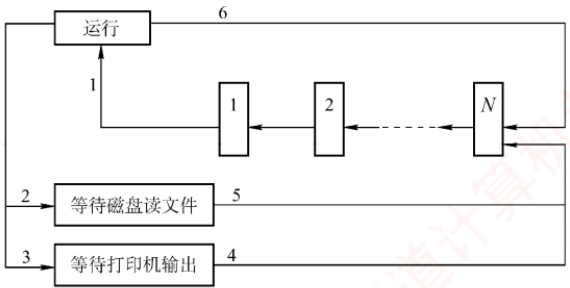

| 变化 | 原 因 |
| --- | --- |
| 1 |  |
| 2 |  |
| 3 |  |
| 4 |  |
| 5 |  |
| 6 |  |

04. 假定要在一台处理器上执行下表所示的作业，且假定这些作业在时刻0以1,2,3,4,5的顺序到达。说明分别使用FCFS、RR（时间片=1）、SJF及非剥夺式优先级调度算法时，这些作业的执行情况（优先级的高低顺序依次为1到5）。 针对上述每种调度算法，给出平均周转时间和平均带权周转时间。 教育

| 作业号 | 执行时间 | 优先级 |
| --- | --- | --- |
| 1 | 10 | 3 |
| 2 | 1 | 1 |
| 3 | 2 | 3 |
| 4 | 1 | 4 |
| 5 | 5 | 2 |

05. 有一个具有两道作业的批处理系统，作业调度采用短作业优先调度算法，进程调度采用抢占式优先级调度算法。作业的运行情况见下表，其中作业的优先数即进程的优先数，优先数越小，优先级越高。

| 作业号 | 到达时间 | 运行时间 | 优先数 |
| --- | --- | --- | --- |
| 1 | 8:00 | 40min | 5 |
| 2 | 8:20 | 30min | 3 |
| 3 | 8:30 | 50min | 4 |
| 4 | 8:50 | 20min | 6 |

1）列出所有作业进入内存的时间及结束的时间（以分为单位）.

2）计算平均周转时间。

06.假设某计算机系统有4个进程，各进程的预计运行时间和到达就绪队列的时刻见下表(相对时间，单位为“时间配额”)。试用可抢占式短进程优先调度算法和时间片轮转调度算法进行调度（时间配额为2)。分别计算各个进程的调度次序及平均周转时间。

| 进程名 | 到达就绪队列时刻 | 预计运行时间 |
| --- | --- | --- |
| $\overline {{\mathrm {P_{1}}}}$ | 0 | 8 |
| $\overline {{\mathrm {P}_{2}}}$ | 1 | 4 |
| $P_{3}$ | 2 | 9 |
| $\overline {{\mathrm {P}_{4}}}$ | 3 | $\overline {{5}}$ |

07. 假设一个计算机系统具有如下性能特征:处理一次中断平均需要500μs，一次进程调度平均需要花费1ms，进程的切换平均需要花费2ms。若该计算机系统的定时器每秒发出120次时钟中断，忽略其他I/O中断的影响，请问: K

1）操作系统将百分之几的CPU时间分配给时钟中断处理程序？

2）若系统采用时间片轮转调度算法，24个时钟中断为一个时间片，操作系统每进行一次进程的切换，需要花费百分之几的CPU时间？

3）根据上述结果，说明为了提高CPU的使用效率，可以采用什么对策。

08. 设有4 个作业 $\mathrm {J}_{1} ,   \mathrm {J}_{2} ,   \mathrm {J}_{3} ,   \mathrm {J}_{4} ,$ 它们的到达时间和计算时间见下表。若这4个作业在一台处理器上按单道方式运行，采用高响应比优先调度算法，试写出各作业的执行顺序、各作业的周转时间及平均周转时间。

| 作业号 | 到达时间 | 计算时间 |
| --- | --- | --- |
| $\left[ \overline {{\mathbf {J}_{1}}} \right]$ | 8:00 | 2h |
| $\overline {{\mathrm {~ J_{2} ~}}}$ | 8:30 | 40min |
| ${\bf J}_{3}$ | 9:00 | 25min |
| $\boxed {\mathbf {\overline {{J_{4}}}}}$ | 9:30 | 30min |

09. 在一个有两道作业的批处理系统中，有一作业序列，其到达时间及估计运行时间见下表。系统作业采用最高响应比优先调度算法[响应比 =(等待时间+估计运行时间)/估计运行时间]。进程的调度采用短进程优先的抢占式调度算法。

| 作业号 | 到达时间 | 估计运行时间/min |
| --- | --- | --- |
| $\overline {{\mathrm {J}_{1}}}$ | 10:00 | 35 |
| $\overline {{\mathrm {J}_{2}}}$ | 10:10 | 30 |
| $\overline {{\mathrm {J}_{3}}}$ | 10:15 | 45 |
| $\overline {{\mathrm {J}_{4}}}$ | 10:20 | 20 |
| $\boxed {\mathrm {~ J}_{5}}$ | 10:30 | 30 |

1）列出各作业的执行时间，即列出每个作业运行的时间片段，如作业i的运行时间序列为10:00—10:40，11:00—11:20，11:30—11:50结束。

2）计算这批作业的平均周转时间。

10.【2016统考真题】某个进程调度程序采用基于优先数（priority）的调度策略，即选择优先数最小的进程运行，进程创建时由用户指定一个nice作为静态优先数。为了动态调整优先数，引入运行时间 cpuTime和等待时间waitTime，初值均为0。进程处于运行态时，cpuTime 定时加 1，且 waitTime 置 0；进程处于就绪态时，cpuTime置 0，waitTime 定时加1。请回答下列问题:

1）若调度程序只将 nice的值作为进程的优先数，即 priority = nice，则可能出现饥饿现象。为什么？ 美

2）使用 nice, cpuTime和 waitTime设计一种动态优先数计算方法，以避免产生饥饿现象并说明 waitTime 的作用。

### 2.2.9 答案与解析

#### 一、单项选择题

01. D

中级调度的主要目的是节省内存，将内存中处于阻塞态或长期不运行的进程挂起到外存，从而腾出空间给其他进程使用。当这些进程重新具备运行条件时，再从外存调入内存，恢复运行。

02. C

进程从创建态转换到就绪态是由高级调度完成的。高级调度（作业调度）的主要任务是从后备队列中选择一个或一批作业，为其创建PCB，分配内存等其他资源，并将其插入就绪队列。

03. B

设计调度算法时应考虑的指标有很多，比较常见的有公平性、资源利用率、平均周转时间、平均等待时间、平均响应时间。互斥性不是调度算法设计时需要考虑的指标，而是一种同步机制，用来保证多个进程访问临界资源时不会发生冲突。

04. A

时间片轮转的主要目的是，使得多个交互的用户能够得到及时响应，使得每个用户以为“独占”计算机的使用，因此它并没有偏好，也不会对特殊进程做特殊服务。时间片轮转增加了系统开销，所以不会使得系统高效运转，吞吐量和周转时间均不如批处理。但其较快速的响应时间使得用户能够与计算机进行交互，改善了人机环境，满足用户需求。

05. C

进程调度的时机与进程特点有关，如进程是CPU繁忙型还是I/O繁忙型、自身的优先级等。但仅有这些特点是不够的，能否得到调度还取决于进程调度策略，若采用优先级调度算法，则进程的优先级才起作用。至于占用处理器运行时间的长短，则要看进程自身，若进程是I/O繁忙型，运行过程中要频繁访问I/O端口，即可能频繁放弃 CPU，所以占用CPU的时间不会长，一旦放弃CPU，则必须等待下次调度。若进程是CPU繁忙型，则一旦占有CPU，就可能运行很长时间，但运行时间还取决于进程调度策略，大部分情况下，交互式系统为改善用户的响应时间，大多数采用时间片轮转调度算法，这种算法在进程占用CPU达到一定时间后，会强制将其换下，以保证其他进程的CPU使用权。因此选择选项C。

06. D

处于临界区的进程也可能因中断或抢占而导致调度。此外，若进程在临界区内请求的是一个需要等待的资源，比如打印机，则它主动放弃CPU，让其他进程运行。

07. C

当一个进程被执行时，CPU的所有寄存器中的值（进程的现场信息）、进程的状态和控制信息以及堆栈中的内容被称为该进程的上下文。中断向量不属于进程上下文的一部分，而是一组指向中断处理程序的指针，存放在内存的固定位置。

08. D

上下文切换发生在操作系统调度一个新进程到处理器上运行的时候。一个重要的上下文信息就是程序计数器（PC）的值，当前进程被打断的PC值作为寄存器上下文的一部分保存在进程现场信息中。进程上下文切换过程中不涉及主存和磁盘的数据交换，选项D错误。

09. C

当线程切换时，操作系统需要保存当前线程的程序计数器的值，并恢复新线程的程序计数器，以便从新线程的正确位置开始执行。在多线程条件下，每个线程拥有各自独立的栈，当线程切换时，需要保存当前线程的栈基址寄存器的值，并加载新线程的栈基址，以便正确管理栈空间。同一个进程中的线程共享进程的虚拟地址空间，因此不需要更新页基址寄存器的值。一个进程所打开的文件也是被这个进程中的所有线程共享的，因此不需要更新进程打开文件表。

10. B

FCFS调度算法比较有利于长作业，而不利于短作业。CPU繁忙型作业是指该类作业需要占用很长的 CPU时间，而很少请求I/O操作，因此CPU繁忙型作业类似于长作业，采用FCFS可从容完成计算。I/O繁忙型作业是指作业执行时需频繁请求I/O操作，即可能频繁放弃CPU，所以占用CPU的时间不会太长，一旦放弃CPU，则必须重新排队等待调度，所以采用SJF比较适合。时间片轮转调度算法对于短作业和长作业的时间片都一样，所以地位也几乎一样。优先级调度有利于优先级高的进程，而优先级和作业时间长度是没有必然联系的。因此选择选项B。

11. D

在选择进程调度算法时应考虑以下几个准则:①公平:确保每个进程获得合理的CPU份额；②有效:使CPU尽可能地忙碌；③响应时间:使交互用户的响应时间尽可能短；④周转时间:使批处理用户等待输出的时间尽可能短；⑤吞吐量:使单位时间处理的进程数尽可能最多。由此可见选项D不正确。

12. C

实时系统必须能足够及时地处理某些紧急的外部事件，因此普遍用高优先级，并用“可抢占”来确保实时处理。

13. D

操作系统选择新进程的直接原因是当前运行的进程不能继续运行。当运行的进程由于时间片用完、运行结束、出错、需要等待事件的发生、自我阻塞等，均可以激活调度程序进行重新调度选择就绪队列的队首进程投入运行。新进程加入就绪队列不是引起调度的直接原因，当CPU正在运行其他进程时，该进程仍需等待。即使是在采用高优先级调度算法的系统中，一个最高优先级的进程进入就绪队列，也需要考虑是否允许抢占，当不允许抢占时，仍需等待。

14. D

进程（线程）调度的时机包括:运行的进程（线程）运行完毕、运行的进程（线程）自我阻塞、运行的进程（线程）的时间片用完、运行的进程（线程）所需的资源没有准备好（会阻塞进程）、运行的进程（线程）出现错误（会终止进程）。因此，说法I、Ⅱ、Ⅲ、IV和V都正确。

15. B

4个作业的周转时间分别是2h,4h,6h,8h，所以4个作业的总周转时间为 $2+4+6+8=20$此时，平均周转时间 = 各个作业周转时间之和/作业数 =20/4= 5 小时。

**16.B、E、C、D**

照顾短作业用户，选择短作业优先调度算法；照顾紧急作业用户，即选择优先级高的作业优先调度，采用基于优先级的剥夺调度算法；实现人机交互，要保证每个作业都能在一定时间内轮到，采用时间片轮转调度算法法；使各种作业用户满意，要处理多级反馈，所以选择多级反馈队列调度算法。

17. D

优先级调度算法分静态和动态两种。静态优先级在进程创建时确定，之后不再改变。

18. B

系统采用短作业优先调度算法，作业的执行顺序为 $\mathrm {J}_{1} , \mathrm {J}_{2} , \mathrm {J}_{3} , \mathrm {J}_{1}$ 的周转时间为 $T_{1}$ ， $\mathbf {J}_{2}$ 的周转时间为$T_{1}   + T_{2}$ ${\bf J}_{3}$ 的周转时间为 $T_{1} + T_{2} + T_{3}$ ，则平均周转时间为 $(T_{1}+T_{1}+T_{2}+T_{1}+T_{2}+T_{3})/3=(3T_{1}+2T_{2}+T_{3})/3$ 0

19. D

在同一台处理器上以单道方式运行时，要想获得最短的平均周转时间，用短作业优先调度算法会有较好的效果。就本题目而言:选项A的平均周转时间 $(2 + 7 + 10)/3h = 19/3h$ ；选项B的平均周转时间 $(3 + 8 + 10)/3 \mathrm{h} = 7\mathrm{h}$ 。选项C的平均周转时间 $(5 + 7 + 10)/3h = 22/3h$ ；选项D的平均周转时间 $(2 + 5 + 10)/3h = 17/3h$ 0

20. C

处于运行态的进程用完一个时间片后，其状态会变为就绪态，等待下一次处理器调度。进程执行完最后的语句并使用系统调用exit请求操作系统删除它或出现一些异常情况时，进程才会终止。

21. C

$$
\frac{等待时间 + 要求服务时间}{要求服务时间}=\frac{2+1}{1}=3
$$

22. D

优先级算法中，I/O繁忙型作业要优于计算繁忙型作业，系统进程的优先权应高于用户进程的优先权。作业的优先权与长作业、短作业或系统资源要求的多少没有必然的关系。在动态优先权中，随着进程执行时间的增加其优先权随之降低，随着作业等待时间的增加其优先权相应上升。

23. B

时间片轮转调度算法是按固定的时间配额来运行的，时间一到，不管是否完成，当前的进程必须撤下，调度新的进程，因此它是由时间配额决定的、是绝对可抢占的。而优先级算法和短进程优先调度算法都可分为抢占式和不可抢占式。

24. B

作业是从用户角度出发的，它由用户提交，以用户任务为单位；进程是从操作系统出发的，由系统生成，是操作系统的资源分配和独立运行的基本单位。

25. B

时间片轮转调度算法在实际运行中也按先后顺序使用时间片，时间片过大时，我们可以认为其大于进程需要的运行时间，即转换为先来先服务调度算法。

26. D

对这类题目，我们可以采用广义甘特图来求解，甘特图的画法在1.2节的习题中已经有所介绍我们直接给出甘特图（见右图），以非抢占为例。

在0时刻，进程 $\mathrm {P}_{1}$ 到达，于是处理器分配给$\mathrm {P}_{1}$ ，因为是不可抢占的，所以 $\mathrm {P_{1}} \mathrm {~  一  ~}$ 旦获得处理器，就会运行直到结束；在时刻9，所有进程已经到达，根据短进程优先调度，会把处理器分配给 $\mathrm {P}_{3}$ ，接下

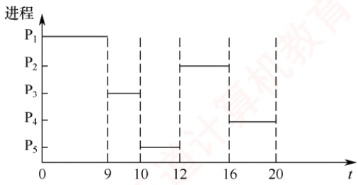

来就是 $\mathrm {P}_{5} ;$ 然后，因为 $\mathrm {P}_{2} , \mathrm {P}_{4}$ 的预计运行时间一样，所以在 $\mathrm {P}_{2}$ 和 $\mathrm {P}_{4}$ 之间用先来先服务调度，优先把处理器分配给 $\mathrm {P}_{2}$ ，最后再分配给 $\mathrm {P}_{4} ,$ ，完成任务。

周转时间=完成时间-作业到达时间，从图中显然可以得到各进程的完成时间，于是 $\mathrm {P}_{1}$ 的周转时间是 $9 - 0 = 9\mathrm{h};\mathrm{~P}_{2}$ 的周转时间是 $16-0.4=15.6\mathrm{h};\mathrm{P}_{3}$ 的周转时间是 $10 - 1 = 9\mathrm{h}; \mathrm{P}_4$ 的周转时间是 $20-5.5=14.5\mathrm{h};\mathrm{P}_{5}$ 的周转时间是 $12 - 7 = 5  h$ 平均周转时间为 $( 9 + 15.6 + 9 + 14.5 + 5 ) / 5 =$ $10 . 62 \mathrm {h}$ 0

同理，抢占式的周转时间也可通过画甘特图求得，而且直观、不易出错。

抢占式的平均周转时间为6.8h。

甘特图在操作系统中有着广泛的应用，本节习题中会有不少这种类型的题目，若读者按照上面的方法求解，则解题时就可以做到胸有成竹。

27. D

当这五个批处理作业采用短作业优先调度算法时，平均周转时间 $2+(2+4)+(2+4+6)+(2+$ $4+6+8)+(2+4+6+8+10)]/5=14$

这道题主要考查读者对各种优先调度算法的认识。若按照18题中的方法求解，则可能要花费一定的时间，但这是值得的，因为可以起到熟练基本方法的效果。在考试中很少会遇到操作量和计算量如此大的题目，所以读者不用担心。

28. C

根据各个进程的到达时间和预计运行时间，画出甘特图如下。由此可知，各个进程的周转时间分别为4h、1h、8h、12h、2h，所以总周转时间为 $4+1+8+12+2=27$

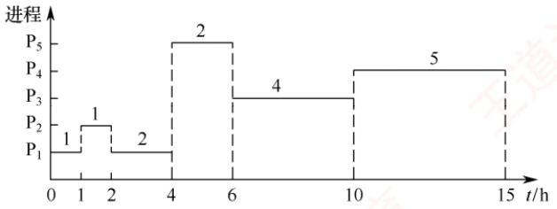

29. D

新进程总是先进入第一级队列的队尾。在0～10ms时段， $\mathrm {P}_{1}$ 在队列A上运行；在10～30ms时段， $\mathrm {P}_{1}$ 在队列B上运行；当 $t = 30 ms$ 时， $\mathrm{P}_{2}$ 进入队列A，因此在30～40ms时段， $\mathrm {P}_{2}$ 在队列A上运行；在40～60ms 时段， $\mathrm {P}_{2}$ 在队列B上运行，此时 $\mathrm {P}_{2}$ 运行结束；最后 $\mathrm {P}_{1}$ 在 60～90ms 和 90～ 120ms时段内，于队列C上运行2个时间片，因此 $\mathrm {P_{1}}$ 的总周转时间为120ms。

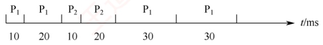

30. A

分时系统需要同时满足多个用户的需要，因此把处理器时间轮流分配给多个用户作业使用即采用时间片轮转调度算法。

31. B

先来先服务调度算法中，若一个长进程（作业）先到达系统，则会使后面的许多短进程（作业）等待很长的时间，因此对短进程（作业）不利。

32. B

短进程优先调度算法具有最短的平均周转时间。平均周转时间=各进程周转时间之和/进程数。因为每个进程的执行时间都是固定的，所以变化的是等待时间，只有短进程优先调度算法能最小化等待时间。

33. C

系统开销小不是多级反馈队列调度算法的特性，而正好相反，该算法需要设置多个就绪队列，并且要在不同的队列之间进行进程的转移和抢占，因此增加了系统开销。

34. C

高响应比优先调度算法需根据进程的等待时间和服务时间来计算响应比；多级反馈队列调度算法涉及多个队列的管理，以及进程在队列之间的转移，它们的系统开销都较大。时间片轮转调度算法虽然简单，但它需要为每个进程分配一个固定的时间片，并且在时间片用完时进行上下文切换，因此它的系统开销也不小。先来先服务调度算法是一种最简单的调度算法，它只需按照进程到达的先后顺序进行调度，无须进行任何优先级调度或时间片的判断和分配，故系统开销最小。

35. B

先来先服务调度算法和时间片轮转调度算法都不会出现饥饿现象，因为它们都是按照进程到达的顺序或固定的时间片来调度的，不会因为进程的特征而忽略某些进程。短作业优先调度算法（也可视为一种特殊的优先级算法）和优先级算法都可能出现饥饿现象，因为它们都是根据进程的服务时间或优先级来调度的，这样就可能导致一些长作业或低优先级的进程长期得不到调度。

36. A

多处理机调度需要额外考虑负载平衡和处理器亲和性两个调度目标。负载平衡是指应尽量让每个CPU都同等地忙碌，处理器亲和性是指应尽量让一个进程运行在同一个CPU上。

37. D

响应比=（等待时间+执行时间）/执行时间。它综合考虑了每个进程的等待时间和执行时间，对于同时到达的长进程和短进程，短进程会优先执行，以提高系统吞吐量；而长进程的响应比可以随等待时间的增加而提高，不会产生进程无法调度的情况。

38. A

选项A中进程时间片用完，可降低其优先级以让其他进程被调度进入执行状态。选项B中进程刚完成I/O，进入就绪队列等待被CPU调度，为了让其尽快处理I/O结果，因此应提高优先级。选项C中进程长期处于就绪队列，为不至于产生饥饿现象，也应适当提高优先级。选项D中进程的优先级不应该在此时降低，而应在时间片用完后再降低。

39. B

响应比=（等待时间+执行时间）/执行时间。高响应比优先调度算法在等待时间相同的情况下，作业执行时间越短，响应比越高，满足短任务优先。随着长作业等待时间的增加，响应比会变大，执行机会也会增大，因此不会发生饥饿现象。先来先服务和时间片轮转不符合短任务优先，非抢占式短任务优先会产生饥饿现象。

40. B

由于 $\mathrm {P}_{2}$ 比 $\mathrm {P}_{1}$ 晚 5ms 到达， $\mathrm {P}_{1}$ 先占用CPU，作业运行的甘特图如下。

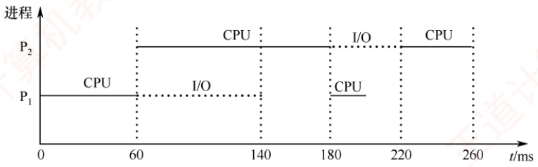

41. C

选项A、B、D显然属于可以进行CPU调度的情况。对于选项C，处于临界区的进程也可能因中断或抢占而导致调度，此外，若进程在临界区内请求的是一个需要等待的资源，比如打印机，则它主动放弃CPU，让其他进程运行。

42. B

为了合理地设置进程优先级，应综合考虑进程的CPU时间和I/O时间。对于优先级调度算法，一般来说，I/O型作业的优先权高于计算型作业的优先权，这是由于I/O操作需要及时完成，它没有办法长时间地保存所要输入/输出的数据，所以考虑到系统资源利用率，要选择I/O繁忙型作业

有更高的优先级。

43. A

采用静态优先级调度且系统总是出现优先级高的任务时，优先级低的任务总是得不到CPU而产生饥饿现象；而短任务优先调度不管是抢占式的还是非抢占的，当系统总是出现新来的短任务时，长任务会总是得不到CPU，产生饥饿现象，因此选项B、C、D都错误。

44. B

这类调度题目最好画图。因CPU、输入设备、输出设备都只有一个，因此各操作步骤不能重叠，画出运行时的甘特图后，就能清楚地看到不同作业间的时序关系，如下图所示。

<table><tr><td>作业\时间</td><td>1</td><td>2</td><td>3</td><td>4</td><td>5</td><td>6</td><td>7</td><td>8</td><td>9</td><td>10</td><td>11</td><td>12</td><td>13</td><td>14</td><td>15</td><td>16</td><td>17</td></tr><tr><td>1</td><td colspan=2>输入</td><td colspan=3>计算</td><td colspan=4>输出</td><td></td><td></td><td></td><td></td><td></td><td></td><td></td><td></td></tr><tr><td>2</td><td></td><td></td><td colspan=2>输入</td><td></td><td colspan=3>计算</td><td></td><td colspan=4>输出</td><td></td><td></td><td></td><td></td></tr><tr><td>3</td><td></td><td></td><td></td><td></td><td colspan=2>输入</td><td></td><td></td><td colspan=3>计算</td><td></td><td></td><td colspan=4>输出</td></tr></table>

45. D

注意，系统是在t=2时开始作业调度的，此时 $\mathbf {J}_{4}$ 还没有到达。FCFS调度算法的特点是作业来得越早，优先级就越高，因此选择 $\mathbf {J}_{1}$ 。SJF调度算法的特点是作业运行时间越短，优先级就越高，因此选择 $\mathbf {J}_{3}$

46. B

进程切换带来系统开销，切换次数越多，开销就越大，选项A正确。当前进程的时间片用完后，其状态由运行态变为就绪态，选项B错误。时钟中断是系统中特定的周期性时钟节拍，操作系统通过它来确定时间间隔，实现时间的延时和任务的超时，选项C正确。现代操作系统为了保证性能最优，通常根据响应时间、系统开销、进程数量、进程运行时间等因素确定时间片大小，选项D正确。

47. D

由优先权可知，进程的执行顺序为 $\mathrm{P}_{2} \rightarrow \mathrm{P}_{3} \rightarrow \mathrm{P}_{1} \text {。} \mathrm{P}_{2}$ 的周转时间为 $1+15+24=40\mu s$ 的周转时间为 $18+1+24+1+36=80\mu s$ 的周转时间为 $30+1+24+1+36+1+12=105\mu s;$ 平均周转时间为 $( 40 + 80 + 105 ) / 3 = 225 / 3 = 75 \mu \mathrm {s}$ ，因此选择选项 $\mathrm {D} ,$

48. C

进程 $\mathrm {P}_{1}$ 和 $\mathrm {P}_{2}$ 依次创建后进入队列 $\mathrm {Q_{1}}$ ，根据时间片调度算法的规则，进程 $\mathrm {P}_{1}$ 和 $P_2$ 将依次被分配10ms的CPU时间，两个进程分别执行完一个时间片后都会被转入队列 $\mathrm {Q}_{2}$ ，就绪队列 $\mathrm {Q}_{2}$ 采用短进程优先调度算法，此时 $\mathrm {P_{1}}$ 还需要 20ms 的 CPU 时间， $\mathrm {P}_{2}$ 还需要10ms的 CPU时间，所以

$\mathrm {P}_{2}$ 会被优先调度执行，10ms后进程 $\mathrm {P}_{2}$ 执行完成，之后 $\mathrm {P}_{1}$ 再调度执行，再过 20ms 后$\mathrm {P_{1}}$ 也执行完成。运行图表述如右。

进程 $P_{1} 、  P_{2}$ 的等待时间分别为图中的虚横线部分，平均等待时 $间 =\left( P_{1}\right.$ 的等待时间 $+ \mathrm {~ P}_{2}$ 的等待时间 $) / 2 = ( 20 + 10 ) / 2 = 15$因此答案选C。

49. D

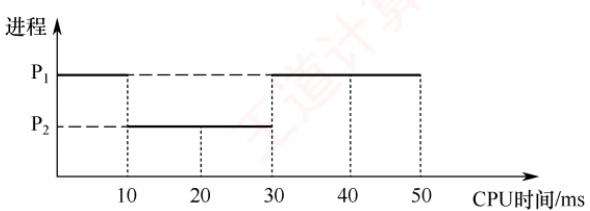

多级反馈队列调度算法需要综合考虑优先级数量、优先级之间的转换规则等，就绪队列的数量会影响长进程的最终完成时间，说法Ⅰ正确；就绪队列的优先级会影响进程执行的顺序，说法Ⅱ正确；各就绪队列的调度算法会影响各队列中进程的调度顺序，说法Ⅲ正确；进程在就绪队列中的迁移条件会影响各进程在各队列中的执行时间，说法IV正确。

50. C

时钟中断处理程序是一种特殊的中断处理程序，它负责在每个时钟周期结束时执行一些操作，如内核中时钟变量的值、当前进程占用CPU的时间、当前进程在时间片内的剩余执行时间。时钟中断处理程序的触发条件是系统定时器（一种可编程的硬件芯片）以固定的频率（称为节拍率）产生一个中断信号，通知CPU进行中断处理。在分时系统的时间片轮转调度中，当时钟中断处理程序检查到当前进程的时间片用完时，就触发进程调度，调度程序从就绪队列中选择一个进程为其分配时间片，并且修改该进程的进程控制块中的进程状态等信息，同时将时间片用完的进程放入就绪队列或让其结束运行，说法I、Ⅱ、Ⅲ正确。阻塞队列中的进程只有被唤醒并进入就绪队列后，才能参与调度，所以该调度过程不使用阻塞队列。

51. D

中断处理阶段运行的是中断处理程序，中断处理结束后，需要返回原程序或重新选择程序运行，而后者需要进行进程调度，例如在时间片轮转调度中，时钟中断处理结束后，若当前进程的时间片用完，则会发生进程调度。当前进程阻塞时，将其放入阻塞队列，若就绪队列不空，则调度新进程执行。进程执行结束会导致当前进程释放CPU，并从就绪队列中选择一个进程获得CPU。进程时间片用完，会导致当前进程让出CPU，同时选择就绪队列的队首进程获得CPU。

52. C

需要注意的是，在0时刻， $\mathrm {P_{0}}$ 获得CPU也是一次进程调度，所以0时刻调度进程 $\mathrm {P_{0}}$ 获得CPU; 10ms时 $\mathrm {P}_{2}$ 进入就绪队列，调度 $\mathrm {P}_{2}$ 抢占获得 CPU；15ms 时 $P_{3}$ 进入就绪队列，调度 $\mathrm {P}_{3}$ 抢占获得CPU；25ms 时 $\mathrm {P}_{3}$ 执行完毕，调度 $\mathrm {P}_{2}$ 获得 CPU；40ms 时 $P_2$ 执行完毕，调度 $\mathrm {P_{0}}$ 获得 CPU；130ms时 $\mathrm {P_{0}}$ 执行完毕，调度 $\mathrm {P}_{1}$ 获得 CPU；190ms 时 $\mathrm {P}_{1}$ 执行完毕，结束；总共调度6次。

53. B

采用抢占式优先级调度算法，三个作业的执行顺序如右图所示。

周转时间 = 完成时间-到达时间。 $\mathrm {P_{1}}$ 的周转时间 $115 - 0 = 115  ms$ $\mathrm {P}_{2}$ 的周转时间 $75 - 20 =$ 55ms; $\mathrm {P}_{3}$ 的周转时间 $43 - 30 = 13  ms$ ，所以平均周转时间 $(115 + 55 + 13)/3 = 61  ms$

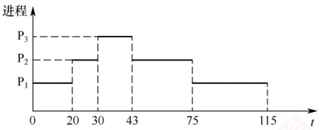

54. C

系统使用时间片轮转调度算法，最初共有10个进程处于就绪队列，进程P处于队尾，时间片大小为5ms。假设当t=0时开始进程调度，就绪队列的前9个进程依次运行一个时间片，则当t = 45ms时调度进程P运行，运行5ms后，当 $t = 50 ms$ 时又开始新一轮循环。进程P所需的CPU时间为25ms，共需5轮循环，其他进程所需的CPU时间都比进程P的长，这5轮循环中其余9个进程都不会运行结束，因此进程P的周转时间为 $50 \times 5 = 250  ms$

55. D

进程切换时，需要进行上下文切换，主要完成:①将当前CPU中各寄存器的内容保存到当前进程的PCB中；②将新进程的现场信息装入CPU的各个寄存器。③将控制转至新进程执行，即更新程序计数器（PC）的值。栈基址寄存器用来指明系统内核栈位置的寄存器，页表基址寄存器用来指明当前进程顶级页表基地址的寄存器，属于进程控制信息。因此，说法I、Ⅱ、Ⅲ均需要更新。

56. C

在该调度系统中，就绪队列采用按优先权从高到低排序的有序单链表实现。插入新进程时，为维持链表的有序性，需要从表头开始顺序查找，直至找到首个优先权不高于待插入进程的结点，并在其前插入；最坏情况下需要遍历整个链表，时间复杂度为O(n)。由于最高优先权的进程始终位于链表头部，调度程序只需访问头结点即可获得下一个待执行的进程，无须额外搜索，因此选择进程的操作时间复杂度为O(1)。

57. D

进程上下文切换需要隔离各进程的执行环境，并确保新进程正确恢复运行，因此必须更新当前进程的上下文。通用寄存器和程序计数器属于典型的进程私有状态:前者保存临时数据，后者指向下一条指令地址，两者都必须在切换时保存和恢复。页表基址寄存器存放当前进程页表的物理起始地址。在页式系统中，每个进程都拥有独立的虚拟地址空间和页表，切换时必须更新该寄存器，以激活新进程的地址映射。内核中断向量表基址寄存器指向操作系统内核维护的中断处理入口表，该表是全局共享的系统资源，用于响应中断和异常，其内容由内核统一管理，不随用户进程变化，因此在进程上下文切换时无须更新。

#### 二、综合应用题

01. 【解答】

抢占式优先级调度算法，三个作业执行的顺序如下图所示。

作业 $\mathrm {P}_{1}$ 的优先级最高，周转时间等于运行时间， $T_{1}   {=}   80 \mathrm {m s}$ ；作业 $P_2$ 的等待时间为10ms，运行时间为80ms，周转时间 $T_{2} = (10 + 80)  ms  = 90  ms$ 作业 $\mathrm {P}_{3}$ 的等待时间为40ms，运行时间为50ms，因此周转时间 $T_{3} = 90 \mathrm {m s}$ 0

三个作业从进入系统到全部运行结束，时间为90ms。CPU与外设都是独占设备，运行时间分别为各作业的使用时间之和。CPU运行时间为 $[(10 + 10) + 20 + 30] \mathrm{ms} = 70 \mathrm{ms}$ $\mathrm {D_{1}}$ 为 $(30 + 20 +$ $20 \mathrm{ms} = 70 \mathrm{ms}$ $\mathrm {D}_{2}$ 为 $(30 + 40) \mathrm{ms} = 70 \mathrm{ms}$ ，因此利用率均为 $70/90=77.8\%$

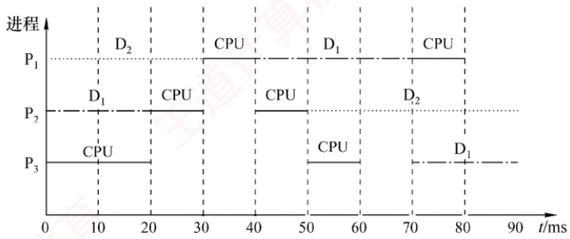

02. 【解答】

作业A、B、C的优先级依次递减，采用不可抢占的优先级调度。

在时刻40，作业C释放CPU，优先级较高的作业A获得 $\mathrm {CPU} ;$ 在时刻 60，作业 A释放CPU，优先级较高的作业 B获得 CPU；在时刻100，作业 B释放 CPU，优先级高的作业 A获得CPU；在时刻110，作业A释放CPU，作业C获得CPU；在时刻130，作业C释放CPU，作业B获得$\mathrm {CPU}$ ；在时刻160，作业B释放CPU，作业A获得CPU。运行图如下所示。

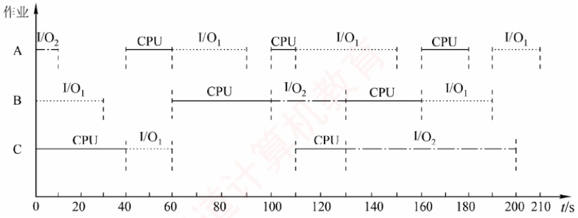

1）最早结束的是作业B。

2）最后结束的是作业A。

3）三个作业从开始到全部执行结束，经历时间为210ms，因为是单CPU系统，CPU运行时间为各个作业的CPU运行时间之和，即 $\left[ \left( 20 + 10 + 20 \right) + \left( 40 + 30 \right) + \left( 40 + 20 \right) \right] \mathrm{ms} = 180 \mathrm{ms}$因此 CPU 的利用率为 180/210 = 85.7%。

03. 【解答】

根据题意，首先由图进行分析，进程由运行态可以直接回到就绪队列的末尾，而且就绪队列中是先来先服务。那么，什么情况才能发生这样的变化呢？只有采用单一时间片轮转的调度系统，分配的时间片用完后，才会发生上述情况。因此，该系统一定采用时间片轮转调度算法，采用时间片轮转调度算法的操作系统一般均为交互式操作系统。由图可知，进程被阻塞时，可以进入不同的阻塞队列，等待打印机输出结果和等待磁盘读取文件。所以，它是一个多阻塞队列的时间片轮转调度算法的调度系统。

具体解答如下。

1）根据题意，该系统采用的是时间片轮转调度算法调度进程策略。

2）可能的变化见下表。

| 变化 | 原 因 |
| --- | --- |
| 1 | 进程被调度，获得CPU，进入运行态 |
| 2 | 进程需要读文件，因I/O操作进入阻塞态 |
| 3 | 进程打印输出结果，因打印机未结束而阻塞 |
| 4 | 打印机打印结束，进程重新回归就绪态，并排在尾部 |
| 5 | 进程所需数据已从磁盘进入内存，进程回到就绪态 |
| 6 | 运行的进程因为时间片用完而让出CPU，排到就绪队列尾部 |

04. 【解答】

1）作业执行情况可以用如下的甘特图来表示。

<table><tr><td colspan="10">1</td><td>2</td><td colspan="2">3</td><td>4</td><td>5</td></tr><tr><td colspan="15">RR:</td></tr><tr><td>1</td><td>2</td><td>3</td><td>4</td><td>5</td><td>1</td><td>3</td><td>5</td><td>1</td><td>5</td><td>1</td><td>5</td><td>1</td><td>5</td><td>1</td></tr><tr><td colspan="15">SJF:                                                                                     X</td></tr><tr><td>2</td><td>4</td><td colspan="2">3</td><td colspan="5">5</td><td colspan="6">1</td></tr><tr><td colspan="15">优先级:</td></tr><tr><td>2</td><td colspan="5">5</td><td colspan="8">1</td><td>3</td></tr></table>

2）各个作业对应于各个算法的周转时间和加权周转时间见下表。

<table><tr><td rowspan=2>算法</td><td>时间类型</td><td> $\mathrm {P_{1}}$ </td><td> $\overline {{| \mathrm {P}_{2} |}}$ </td><td> $\overline {{\mathrm {P}_{3}}}$ </td><td> $\mathrm {P}_{4}$ </td><td> $\mathrm {P}_{5}$ </td><td>平均时间</td></tr><tr><td>运行时间</td><td>10</td><td>1</td><td> $2$ </td><td>1</td><td>5</td><td>3.8</td></tr><tr><td rowspan=2>FCFS</td><td>周转时间</td><td>10</td><td>11</td><td>13</td><td>14</td><td>19</td><td>13.4</td></tr><tr><td>加权周转时间</td><td>1</td><td>11</td><td>6.5</td><td>14</td><td>3.8</td><td>7.26</td></tr><tr><td rowspan=2>RR</td><td>周转时间</td><td>19</td><td>2</td><td>7</td><td>4</td><td>14</td><td>9.2</td></tr><tr><td>加权周转时间</td><td>1.9</td><td>2</td><td>3.5</td><td>4</td><td>2.8</td><td>2.84</td></tr><tr><td rowspan=2>SJF</td><td>周转时间</td><td>19</td><td>1</td><td>4</td><td>2</td><td>9</td><td>7</td></tr><tr><td>加权周转时间</td><td>1.9</td><td>1</td><td>2</td><td>2</td><td>1.8</td><td>1.74</td></tr><tr><td rowspan=2>优先级</td><td>周转时间</td><td>16</td><td>1</td><td>18</td><td>19</td><td>6</td><td>12</td></tr><tr><td>加权周转时间</td><td>1.6</td><td>1</td><td>9</td><td>19</td><td>1.2</td><td>6.36</td></tr></table>

所以，FCFS的平均周转时间为13.4，平均加权周转时间为7.26。

RR的平均周转时间为9.2，平均加权周转时间为2.84。

SJF的平均周转时间为7，平均加权周转时间为1.74。

非剥夺式优先级调度算法的平均周转时间为12，平均加权周转时间为6.36。

**注意**

SJF的平均周转时间肯定是最短的，计算完毕后可以利用这个性质进行检验。

05. 【解答】

1）具有两道作业的批处理系统，内存只存放两道作业，它们采用抢占式优先级调度算法竞争CPU，而将作业调入内存采用的是短作业优先调度。8:00，作业1到来，此时内存和CPU空闲，作业1进入内存并占用CPU；8:20，作业2到来，内存仍有一个位置空闲，因此将作业2调入内存，又由于作业2的优先数高，相应的进程抢占CPU，在此期间8:30作业3到来，但内存此时已无空闲，因此等待。直至8:50，作业2执行完毕，此时作业3、4竞争空出的一道内存空间，作业4的运行时间短，因此先调入，但它的优先数低于作业1，因此作业1先执行。到9:10时，作业1执行完毕，再将作业3调入内存，且由于作业3的优先数高而占用CPU。所有作业进入内存的时间及结束的时间见下表。

| 作业号 | 到达时间 | 运行时间 | 优先数 | 进入内存时间 | 结束时间 | 周转时间 |
| --- | --- | --- | --- | --- | --- | --- |
| 1 | 8:00 | 40min | 5 | 8:00 | 9:10 | 70min |
| 2 | 8:20 | 30min | 3 | 8:20 | 8:50 | 30min |
| 3 | 8:30 | 50min | 4 | 9:10 | 10:00 | 90min |
| 4 | 8:50 | 20min | 6 | 8:50 | 10:20 | 90min |

2）平均周转时间为 $(70+30+90+90)/4=70\min$

06. 【解答】

1）按照可抢先式短进程优先调度算法，进程运行时间见下表。

| 进程名 | 到达就绪队列时刻 | 预计执行时间 | 执行时间段 | 周转时间 |
| --- | --- | --- | --- | --- |
| $\mathrm {P}_{1}$ | 0 | 8 | 0~1;10~17 | 17 |
| $\mathrm {P}_{2}$ | 1 | 4 | 1~5 | 4 |
| $P_{3}$ | 2 | 9 | 17~26 | 24 |
| $P_4$ | 3 | 5 | 5~10 | 7 |

● 时刻 0，进程 $\mathrm {P}_{1}$ 到达并占用处理器运行。

● 时刻 1，进程 $\mathrm {P}_{2}$ 到达，因其预计运行时间短，因此抢夺处理器进入运行， $\mathrm {P}_{1}$ 等待。

● 时刻2，进程 $\mathrm {P}_{3}$ 到达，因其预计运行时间长于正在运行的进程，进入就绪队列等待。

时刻3，进程 $\mathrm {P}_{4}$ 到达，因其预计运行时间长于正在运行的进程，进入就绪队列等待。

● 时刻 5，进程 $\mathrm {P}_{2}$ 运行结束，调度器在就绪队列中选择短进程， $\mathrm {P}_{4}$ 符合要求，进入运行，进程 $\mathrm {P}_{1}$ 和进程 $\mathrm {P}_{3}$ 则还在就绪队列等待。

● 时刻 10，进程 $\mathrm {P}_{4}$ 运行结束，调度器在就绪队列中选择短进程， $\mathrm {P}_{1}$ 符合要求，再次进入运行，而进程 $\mathrm {P}_{3}$ 则还在就绪队列等待。

● 时刻 17，进程 $\mathrm {P}_{1}$ 运行结束，只剩下进程P3，调度其运行。

● 时刻 26，进程 $\mathrm {P}_{3}$ 运行结束。

平均周转时间 $\left[ (17-0)+(5-1)+(26-2)+(10-3) \right] / 4 = 13$

2）时间片轮转调度算法按就绪队列的FCFS进行轮转，在时刻2， $\mathrm {P}_{1}$ 被挂到就绪队列队尾，队列顺序为 $\mathrm {P}_{2} , \mathrm {P}_{3} , \mathrm {P}_{1}$ ，此时 $P_4$ 还未到达。按时间片轮转调度算法的进程时间分配见下表。

| 进程名 | 到达就绪队列时刻 | 预计执行时间 | 执行时间段 | 周转时间 |
| --- | --- | --- | --- | --- |
| $\mathrm {P_{1}}$ | 0 | 8 | $0 \sim 2; 6 \sim 8; 14 \sim 16; 20 \sim 22$ | 22 |
| $\mathrm {P}_{2}$ | 1 | 4 | $2 \sim 4; 10 \sim 12$ | 11 |
| $P_{3}$ | 2 | 9 | 4~6;12~14;18~20;23~25;25~26 | 24 |
| $\mathrm {P}_{4}$ | 3 | 5 | 8~10;16~18;22~23 | 20 |

平均周转时间 $\left[ (22-0)+(12-1)+(26-2)+(23-3) \right] / 4 = 19.25$

07.【解答】

在时间片轮转调度算法中，系统将所有就绪进程按到达时间的先后次序排成一个队列。进程调度程序总是选择队列中的第一个进程运行，且仅能运行一个时间片。在使用完一个时间片后，即使进程并未完成其运行，也必须将处理器交给下一个进程。时间片轮转调度算法是绝对可抢先的算法，由时钟中断来产生。

时间片的长短对计算机系统的影响很大。若时间片大到让一个进程足以完成其全部工作，则这种算法就退化为先来先服务调度算法。若时间片很小，则处理器在进程之间的转换工作会过于频繁，处理器真正用于运行用户程序的时间将减少，系统开销将增大。时间片的大小应能使分时用户得到好的响应时间，同时也使系统具有较高的效率。

**由题目给定条件可知:**

1）每秒产生120个时钟中断，每次中断的时间为 $1 / 120 \approx 8 . 3 \mathrm {m s}$ ，其中中断处理耗时为500μs，那么其开销为 $500\mu s/8.3ms=6\%$ T

2）每次进程切换需要1次调度、1次切换，所以需要耗时 $1 ms  + 2 ms  = 3 ms$ ，每24个时钟为一个时间片， $24 \times 8.3   ms  = 200   ms$ 。一次切换所占CPU的时间比 $3 ms /200 ms =1.5\%$

3）为提高CPU的效率，一般情况下要尽量减少时钟中断的次数，如由每秒120次降低到100次，以延长中断的时间间隔。或将每个时间片的中断数量（时钟数）加大，如由24个中断加大到36个。也可优化中断处理程序，减少中断处理开销，如将每次 $500 \mu \mathrm {s}$ 的时间降低到 $400 \mu \mathrm {s}$ 。若能这样，则时钟中断和进程切换的总开销占CPU的时间比为 $(36 \times 400\mu s +$ $1 \mathrm{ms} + 2 \mathrm{ms}) / (1 / 100 \times 36) \approx 4.8\%$

08.【解答】

作业的响应比可表示为

$$
响应比  = \frac{等待时间  +  要求服务时间}{要求服务时间}
$$

在时刻8:00，系统中只有一个作业 $\mathrm {J}_{1}$ ，因此系统将它投入运行。在 $\mathrm {J_{1}}$ 完成（10:00）时， ${\bf J}_{2} ,$ $\mathbf {J}_{3} , \mathbf {J}_{4}$ 的响应比分别为 $( 90 + 40 ) / 40 , ( 60 + 25 ) / 25 , ( 30 + 30 ) / 30$ ，即3.25,3.4,2，因此应先将 ${\bf J}_{3}$ 投入运行。在 ${\bf J}_{3}$ 完成（10:25）时， $\mathbf {J}_{2} ,   \mathbf {J}_{4}$ 的响应比分别为 $( 115 + 40 ) / 40 , ( 55 + 30 ) / 30$ ，即3.875,2.83，因此应先将 $J_2$ 投入运行，待它运行完毕时（11:05），再将 $\mathrm {J}_{4}$ 投入运行， $\mathrm {J}_{4}$ 的结束时间为11:35。

可见作业的执行次序为 $\mathrm {J}_{1} , \mathrm {J}_{3} , \mathrm {J}_{2} , \mathrm {J}_{4}$ ，各作业的运行情况见下表，它们的周转时间分别为120min，155min, 85min, 125min，平均周转时间为 121.25min。

| 作业号 | 提交时间 | 开始时间 | 执行时间 | 结束时间 | 周转时间 |
| --- | --- | --- | --- | --- | --- |
| 1 | 8:00 | 8:00 | 2h | 10:00 | 120min |
| $2$ | 8:30 | 10:25 | 40min | 11:05 | 155min |
| 3 | 9:00 | 10:00 | 25min | 10:25 | 85min |
| 4 | 9:30 | 11:05 | 30min | 11:35 | 125min |

09.【解答】

上述5个作业的运行情况如下图所示。

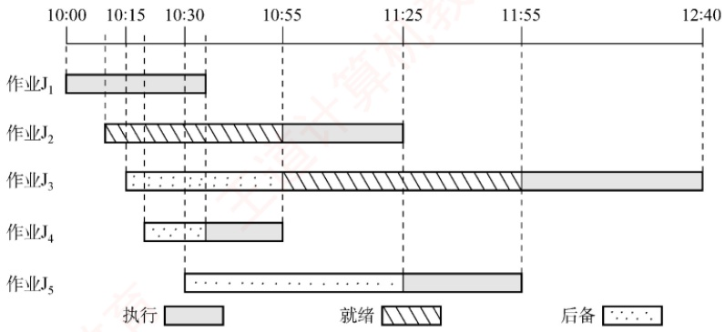

本题涉及作业和进程两方面的调度，一个作业首先需要被调入内存，创建相应的进程，然后竞争CPU，获得CPU的资源来执行。本题的条件是有两道作业的批处理系统，所以内存中同时最多只有两个进程存在，且同时最多只有一个进程能够获得CPU资源。

在10:00，因为只有 $\mathbf {J}_{1}$ 到达，因此将它调入内存，并将CPU调度给它。

在10:10， $\mathbf {J}_{2}$ 到达，因此将 $\mathrm {J}_{2}$ 调入内存，但 $\mathrm {J}_{1}$ 只需再执行25min，因此 $\mathrm {J}_{1}$ 继续执行。

虽然 $\mathbf {J}_{3} , \mathbf {J}_{4} , \mathbf {J}_{5}$ 分别在10:15,10:20和10:30到达，但因当时内存中已存放了两道作业，因此不能马上将它们调入内存。

在10:35， $\mathrm {J}_{1}$ 结束。此时 $\mathbf {J}_{3} , \mathbf {J}_{4} , \mathbf {J}_{5}$ 的响应比根据题意，响应比=(等待时间+估计运行时间)/估计运行时间]分别为65/45,35/20,35/30，因此将 $\mathbf {J}_{4}$ 调入内存，并将CPU分配给内存中运行时间最短者，即 $\mathbf {J}_{4} \mathrm {{_{\circ}}}$

在10:55， $\mathbf {J}_{4}$ 结束。此时 $\mathbf {J}_{3} ,   \mathbf {J}_{5}$ 的响应比分别为85/45,55/30，因此将 ${\bf J}_{3}$ 调入内存，并将CPU分配给估计运行时间较短的 ${\bf J}_{2} ,$

在11:25， ${\bf J}_{2}$ 结束，作业调度程序将 $\mathbf {J}_{5}$ 调入内存，并将CPU分配给估计运行时间较短的 $\mathbf {J}_{5}$

在11:55， $\mathbf {J}_{5}$ 结束，将 CPU分配给 $\mathbf {J}_{3}$

在12:40， $\mathbf {J}_{3}$ 结束。

通过上述分析，可知:

1）作业1的执行时间片段为10:00—10:35（结束）。

作业2的执行时间片段为10:55—11:25（结束）。

作业3的执行时间片段为11:55—12:40（结束）。

作业4的执行时间片段为10:35—10:55（结束）。

作业5的执行时间片段为11:25—11:55（结束）。

2）它们的周转时间分别为35min,75min,145min, 35min, 85min，因此它们的平均周转时间为75min。

10. 【解答】

1）因为采用了静态优先数，当就绪队列中总有优先数较小的进程时，优先数较大的进程一直没有机会运行，所以会出现饥饿现象。

2）一种动态优先数计算方法为 $\mathrm{priority} = \mathrm{nice} + k_{1} \times \mathrm{cpuTime} - k_{2} \times \mathrm{waiftTime}$ ，其中 $k_{1} > 0,\ k_{2} > 0$分别用来调整cpuTime和waitTime在priority中所占的比例。若一个进程的运行时间较长，则其 cpuTime就增加，进而降低其优先级；若一个进程的等待时间较长，则其 waitTime增加，进而会提高其优先级。于是，waitTime就可使长时间等待的进程优先数减少，进而避免出现饥饿现象。

### 2.3.8 本节习题精选

#### 一、单项选择题

01. 下列对临界区的论述中，正确的是（）。
A. 临界区是指进程中用于实现进程互斥的那段代码
B. 临界区是指进程中用于实现进程同步的那段代码
C. 临界区是指进程中用于实现进程通信的那段代码
D. 临界区是指进程中用于访问临界资源的那段代码

02. 不需要信号量就能实现的功能是（）。
A. 进程同步
B. 进程互斥
C. 执行的前驱关系
D. 进程的并发执行

03. 若一个信号量的初值为3，经过多次PV操作后当前值为-1，这表示等待进入临界区的进程数是（）。
A. 1
B. 2
C. 3
D. 4

04.一个正在访问临界资源的进程由于申请等待I/O操作而被中断时，它（）。
A. 允许其他进程进入与该进程相关的临界区
B. 不允许其他进程进入任何临界区
C. 允许其他进程抢占处理器，但不得进入该进程的临界区 千真
D. 不允许任何进程抢占处理器

05. 两个旅行社甲和乙为旅客到某航空公司订飞机票，形成互斥资源的是（）。
A. 旅行社
B. 航空公司
C. 飞机票
D. 旅行社与航空公司

06. 临界区是指并发进程访问共享变量段的（）。
A. 管理信息
B. 信息存储
C. 数据
D. 代码程序

07. 以下不是同步机制应遵循的准则的是（）。
A. 让权等待
B. 空闲让进
C. 忙则等待
D. 无限等待

08.以下（）不属于临界资源。
A. 打印机
B. 非共享数据
C. 共享变量
D. 共享缓冲区

09.以下（）属于临界资源。
A. 磁盘 王道
B. 公用队列
C. 私用数据
D. 可重入的程序代码

10. 在操作系统中，要对并发进程进行同步的原因是（）。
A. 进程必须在有限的时间内完成
B. 进程具有动态性
C. 并发进程是异步的
D. 进程具有结构性

11. 进程A和进程B通过共享缓冲区协作完成数据处理，进程A 负责产生数据并放入缓冲区，进程B从缓冲区读数据并输出。进程A和进程B之间的制约关系是（）。
A. 互斥关系
B. 同步关系
C. 互斥和同步关系
D. 无制约关系

12. 在操作系统中，P, Ⅴ操作是一种（）。 自
A. 机器指令
B. 系统调用命令
C. 作业控制命令
D. 低级进程通信原语

13. P操作可能导致（)。
A. 进程就绪
B. 进程结束
C. 进程阻塞
D. 新进程创建

14. 原语是（）。
A. 运行在用户态的过程 算机
B. 操作系统的内核
C. 可中断的指令序列
D. 不可分割的指令序列

15.（）定义了共享数据结构和各种进程在该数据结构上的全部操作。
A. 管程
B. 类程
C. 线程
D. 程序

16. 用Ⅴ操作唤醒一个等待进程时，被唤醒进程变为（）态。
A. 运行
B. 等待
C. 就绪
D. 完成

17. 在用信号量机制实现互斥时，互斥信号量的初值为（）。
A. 0
B. 1
C. 2
D. 3

18. 用 P,V操作实现进程同步，信号量的初值为（）。
A. -1
B. 0
C. 1
D. 由用户确定

19. 可以被多个进程在任意时刻共享的代码必须是（）。
A. 顺序代码
B. 机器语言代码
C. 不允许任何修改的代码
D. 无转移指令代码

20.一个进程映像由程序、数据及PCB组成，其中（）必须用可重入编码编写。
A. PCB
B. 程序
C. 数据
D. 共享程序段

21.下列关于互斥锁的说法中，正确的是（）。
A. 互斥锁只能用于多线程之间，不能用于多进程之间
B. 互斥锁只能用于多进程之间，不能用于多线程之间
C. 互斥锁可用于多线程或多进程之间，但只能由创建它的线程或进程来加锁和解锁
D. 互斥锁可用于多线程或多进程之间，但只能由对它加锁的线程或进程来解锁

22.在使用互斥锁进行同步互斥时，下列（）情况会导致死锁。
A. 一个线程对同一个互斥锁连续加锁两次
B. 一个线程尝试对一个已加锁的互斥锁再次加锁
C. 两个线程分别对两个不同的互斥锁先后加锁，但顺序相反
D. 一个线程对一个互斥锁加锁后忘记解锁

23. 用来实现进程同步与互斥的PV操作实际上是由（）过程组成的。
A. 一个可被中断的 自
B. 一个不可被中断的
C. 两个可被中断的
D. 两个不可被中断的

24. 对于两个并发进程，设互斥信号量为 mutex（初值为1)，若 mutex=0，则表示（）。
A. 没有进程进入临界区
B. 有一个进程进入临界区
C. 有一个进程进入临界区，另一个进程等待进入 机教育
D. 有一个进程在等待进入

25. 对于两个并发进程，设互斥信号量为 mutex（初值为1)，若mutex=-1，则（）。
A. 表示没有进程进入临界区
B. 表示有一个进程进入临界区
C. 表示有一个进程进入临界区，另一个进程等待进入 王道
D. 表示有两个进程进入临界区

26. 一个进程因在互斥信号量 mutex 上执行 V(mutex)操作而导致唤醒另一个进程时，执行 V操作后 mutex的值为（）。
A. 大于0
B. 小于0
C. 大于或等于0
D. 小于或等于0

27. 一个系统中共有5个并发进程涉及某个相同的变量A，变量A的相关临界区是由（）个临界区构成的。
A. 1
B. 3
C. 5
D. 6

28.下述（）选项不是管程的组成部分。A. 局限于管程的共享数据结构

B. 对管程内数据结构进行操作的一组过程
C. 管程外过程调用管程内数据结构的说明
D. 对局限于管程的数据结构设置初始值的语句

29. 以下关于管程的叙述中，错误的是（）。
A. 管程是进程同步工具，解决信号量机制大量同步操作分散的问题
B. 管程每次只允许一个进程进入管程
C. 管程中 signal 操作的作用和信号量机制中的 V操作相同
D. 管程是被进程调用的，管程是语法范围，无法创建和撤销

30. 对信号量S执行P操作后，使该进程进入资源等待队列的条件是（）。
A. S.value < 0
B. S.value <= 0
C. S.value > 0
D. S.value >= 0

31. 若系统有n个进程，则就绪队列中进程的个数最多有（①）个；阻塞队列中进程的个数最多有（②）个。①
A. n + 1
B. n
C. n-1
D. 1 ②A.n + 1 B. n C. n-1 D. 1

1）假如若干进程对S进行28次P操作和18次V操作后，信号量S的值为0.

2）假如若干进程对信号量S进行了15次P操作和2次Ⅴ操作。请问此时有多少个进程等待在信号量S的队列中？（）
A. 2
B. 3
C. 5
D. 7

$$
\mathrm {P}_{1}
$$

$$
\mathrm {P}_{2} ,
$$

P1 ( ) { P2 ( ) {x=1; //A1 x=-3; //B1 y=2; c=x\*x; z=x+y; 道 print c; //B2 print z; //A2 1

可能打印出的z值有（），可能打印出的c值有（）（其中x为 $\mathrm {P}_{1} , \mathrm {P}_{2}$ 的共享变量)。
A. z = 1,−3; c =-1,9
B. z =−1, 3; c = 1, 9
C. z=−1, 3, 1; c = 9
D. z = 3; c = 1, 9 故育

34. 并发进程之间的关系是（）。机
A. 无关的
B. 相关的
C. 可能相关的
D. 可能是无关的，也可能是有交往的

35. 若系统中有4个进程共享3台打印机，采用信号量机制控制打印机的共享使用，则信号量的取值范围是（）。
A. [−1, 4]
B. [-2, 2]
C. [-1, 3]
D. [-3, 2]

36. 两个进程 $P_{0} 、  P_{1} 互$ 斥的 Peterson 算法描述如下:进程PO 进程P1 flag[0]=1; flag[1]=1; (1); (2); while(flag[1]&&turn==1); while(flag[0]&&turn==0);临界区； 临界区；flag[0]=0; flag[1]=0;其余代码； 其余代码；

其中，(1)和(2)处的代码分别为（）。
A. $\mathrm{tum} = 0, \mathrm{tum} = 0$
B. turn = 0, turn = 1
C. turn = 1, turn = 0
D. turn = 1, turn= 1

37. 在 Peterson算法中，flag 数组的作用是（）。
A. 表示每个线程是否想进入临界区
B. 表示每个线程是否已进入临界区
C. 表示每个线程是否已退出临界区
D. 表示每个线程是否已完成任务

38. 在 Peterson 算法中，turn 变量的作用是（）。
A. 表示轮到哪个线程进入临界区
B. 表示哪个线程先发出访问请求
C. 表示哪个线程后发出访问请求
D. 表示哪个线程已进入临界区

39. 生产者-消费者问题用于解决（）。
A. 多个进程共享一个数据对象的问题
B. 多个进程之间的同步和互斥问题
C. 多个进程共享资源的死锁与饥饿问题
D. 利用信号量实现多个进程并发的问题

40. 所有的消费者必须等待生产者先运行的前提条件是（)。
A. 缓冲区空
B. 缓冲区满
C. 缓冲区不可用
D. 缓冲区半空

41. 下列关于生产者-消费者问题的唤醒操作的说法中，正确的是（ )。I. 生产者唤醒其他生产者 I. 生产者唤醒消费者. 消费者唤醒其他消费者 IV. 消费者唤醒生产者
A. I和Ⅱ
B. ⅢII 和IV
C. Ⅱ和ⅢII
D. I、II、III和IV

42. 在9个生产者、6个消费者共享容量为8的缓冲区的生产者-消费者问题中，互斥使用缓冲区的信号量初始值为（）。
A. 1
B. 6
C. 8
D. 9

43. 消费者进程阻塞在 wait(m)（m是互斥信号量）的条件是（）。I. 没有空缓冲区 II. 没有满缓冲区IⅢ. 有其他生产者已进入临界区 算 IV. 有其他消费者已进入临界区
A. I和Ⅱ
B. III 和IV
C. Ⅰ和I
D. ⅡI 和 IV

44. 在读者-写者问题中，能同时执行的是（）。
A. 读者和写者
B. 不同的写者
C. 不同的读者
D. 都不能

45. 哲学家就餐问题的解决方案如下:

semaphore \*chopstick[5]; semaphore \*seat;哲学家i:P(seat); P(chopStick[i]); P(chopStick[(i+1)%5]);吃饭V(chopStick[i]); V(chopStick[(i+1)%5]); V(seat)

其中，信号量 seat的初值最大为（）。
A. 0
B. 1
C. 4
D. 5

46. 有两个优先级相同的并发程序 $\mathrm {P}_{1}$ 和 $\mathrm {P}_{2} ,$ ，它们的执行过程如下所示。假设当前信号量s1= 0，s2= 0。当前的z=2，进程运行结束后，x, y和z的值分别是（)。

进程 $\mathrm {P}_{1}$ 进程 $\mathrm {P}_{2}$ y:=1; 算机 x:=1 y:=y+2; x:=x+1; z:=y+1; P(s1); V(s1); 道 x:=x+y; P(s2); z:=x+z;

y:=z+y; v(s2); •
A. 5,9,9
B. 5, 9, 4
C. 5, 12, 9
D. 5, 12, 4

47.【2010统考真题】设与某资源关联的信号量初值为3，当前值为1。若M表示该资源的可用个数，N表示等待该资源的进程数，则M,N分别是（）。
A. 0, 1
B. 1,0
C. 1,2
D. 2,0

48.【2010统考真题】进程 $\mathrm {P_{0}}$ 和进程 $\mathrm {P}_{1}$ 的共享变量定义及其初值为:

若进程 $\mathrm {P_{0}}$ 和进程 $\mathrm {P_{1}}$ 访问临界资源的类C代码实现如下:

<div class="docvortex-algorithm" style="white-space: pre-wrap; font-family:monospace;">
void PO() //进程 $\mathrm {P_{0}}$ void P1() //进程 $\mathrm {P}_{1}$
算机
while(true) while(true)
1
flag[0]=true;turn=1; flag[1]=true;turn=0;
首 while(flag[1]&amp;&amp;(turn==1)); while(flag[0]&amp;&amp;(turn==0));
临界区； 临界区；
flag[0]=false; flag[1]=false;
1
</div>

则并发执行进程 $\mathrm {P_{0}}$ 和进程 $\mathrm {P}_{1}$ 时产生的情况是（）。
A. 不能保证进程互斥进入临界区，会出现“饥饿”现象
B. 不能保证进程互斥进入临界区，不会出现“饥饿”现象
C. 能保证进程互斥进入临界区，会出现“饥饿”现象
D. 能保证进程互斥进入临界区，不会出现“饥饿”现象

49. 【2011统考真题】有两个并发执行的进程 $\mathrm {P}_{1}$ 和进程 $\mathrm {P}_{2}$ ，共享初值为1的变量x。 $\mathrm {P}_{1}$ 对x加1， $\mathrm {P}_{2}$ 对x减1。加1和减1操作的指令序列分别如下:

两个操作完成后，x的值（）。
A. 可能为-1 或 3
B. 只能为 1
C. 可能为 0, 1 或 2
D. 可能为-1,0,1 或2

50.【2016统考真题】进程 $\mathrm {P}_{1}$ 和 $\mathrm {P}_{2}$ 均包含并发执行的线程，部分伪代码描述如下所示。

| ∥/进程P1 | ∥/进程P2 |
| --- | --- |
| int x=0; | int x=0; |
| Thread1 () | Thread3 () |
| { int a; | int a; { |
| a=1; x + = 1; | a=x; x + = 3; |
| } |  |
| Thread2() | Thread4() |
| int a; { | int b; { |
| a=2; x + = 2; | b=x; x + = 4; |
| 道 一 | } |

下列选项中，需要互斥执行的操作是（）。
A. a=1与a=2
B. a=x与b=x
C. x += 1与x+ = 2
D. x + = 1 与x+ = 3

51. 【2016 统考真题】使用TSL（Test and Set Lock）指令实现进程互斥的伪代码如下所示。do {while(TSL(&lock)); critical section; lock=FALSE; while(TRUE);

下列与该实现机制相关的叙述中，正确的是（）。
A. 退出临界区的进程负责唤醒阻塞态进程
B. 等待进入临界区的进程不会主动放弃CPU
C. 上述伪代码满足“让权等待”的同步准则
D. while(TSL(&lock))语句应在关中断状态下执行

52.【2016统考真题】下列关于管程的叙述中，错误的是（）。
A. 管程只能用于实现进程的互斥
B. 管程是由编程语言支持的进程同步机制
C. 任何时候只能有一个进程在管程中执行
D. 管程中定义的变量只能被管程内的过程访问

53. 【2018统考真题】属于同一进程的两个线程thread1和 thread2并发执行，共享初值为0的全局变量x。thread1 和 thread2 实现对全局变量x加1 的机器级代码描述如下。

<table><tr><td colspan="3">thread1</td><td colspan="2">thread2</td></tr><tr><td>mov</td><td>R1,X</td><td>∥(x)→R1</td><td>R2,X mov</td><td>∥(x)→R2</td></tr><tr><td>inc</td><td>R1</td><td>∥(R1)+1→R1</td><td>R2 inc</td><td>//(R2)+1→R2</td></tr><tr><td>mov</td><td>X, R1</td><td>∥(R1) →x</td><td>X,R2 mov</td><td>∥(R2)→x</td></tr></table>

在所有可能的指令执行序列中，使x的值为2的序列个数是（）。
A. 1 V
B. 2
C. 3
D. 4

54.【2018统考真题】若x是管程内的条件变量，则当进程执行x.wait()时所做的工作是（)。
A. 实现对变量x的互斥访问
B. 唤醒一个在x上阻塞的进程
C. 根据x的值判断该进程是否进入阻塞态 首计算机
D. 阻塞该进程，并将之插入x的阻塞队列中

55.【2018统考真题】在下列同步机制中，可以实现让权等待的是（）。
A. Peterson 方法
B. swap 指令
C. 信号量方法
D. TestAndSet 指令

56.【2020统考真题】下列准则中，实现临界区互斥机制必须遵循的是（）。I. 两个进程不能同时进入临界区Ⅱ. 允许进程访问空闲的临界资源Ⅲ. 进程等待进入临界区的时间是有限的IV. 不能进入临界区的执行态进程立即放弃CPU
A. 仅I、IV
B. 仅ⅡI、ⅢII
C. 仅I、Ⅱ、I
D. 仅I、III、IV

#### 二、综合应用题

01. 下面是两个并发执行的进程，它们能正确运行吗？若不能请举例说明并改正。

| int x; process_P1 { | process_P2 { |
| --- | --- |
| int $y , z ;$ | 自 int t,u; |
| x=1; | x=0; |
| y=0; | t=0; |
| if(x>=1) | if(x&lt;=1) |
| $y = y + 1$ | t=t+2; |
| $z {=} \gamma ;$ | u=t; |
|  |  |

02. 在一个仓库中可以存放A和B两种产品，要求:

① 每次只能存入一种产品。

②A 产品数量-B 产品数量< M，其中 M是正整数。

③ B $产$ 品数量-A产品数量<N，其中N是正整数。

假设仓库的容量是无限的，试用P,V操作描述产品A和B的入库过程。

03. 面包师有很多面包，由n名销售人员推销。每名顾客进店后按序取一个号，并且等待叫号，当一名销售人员空闲时，就按序叫下一个号。可以用两个整型变量来记录当前的取号值和叫号值，试设计一个使销售人员和顾客同步的算法。

04. 某工厂有两个生产车间和一个装配车间，两个生产车间分别生产A，B两种零件，装配车间的任务是把A，B两种零件组装成产品。两个生产车间每生产一个零件后，都要分别把它们送到专配车间的货架 $\mathrm {F}_{1} , \mathrm {F}_{2}$ 上。 $\mathrm {F}_{1}$ 存放零件A， $\mathrm {F}_{2}$ 存放零件B， $\mathrm {F}_{1}$ 和 $\mathrm {F}_{2}$ 的容量均可存放10个零件。装配工人每次从货架上取一个零件A和一个零件B后组装成产品。请用 P, V 操作进行正确管理。

05. 某寺庙有小和尚、老和尚若干，有一水缸，由小和尚提水入缸供老和尚饮用。水缸可容10桶水，水取自同一井中。水井径窄，每次只能容一个桶取水。水桶总数为3个。每次入缸取水仅为1桶水，且不可同时进行。试给出有关从缸取水、入水的算法描述。

06. 如下图所示，三个合作进程 $\mathrm {P}_{1} , \mathrm {P}_{2} , \mathrm {P}_{3}$ ，它们都需要通过同一设备输入各自的数据a,b,c，该输入设备必须互斥地使用，而且其第一个数据必须由 $\mathrm {P}_{1}$ 进程读取，第二个数据必须由 $\mathrm {P}_{2}$ 进程读取，第三个数据必须由 $\mathrm {P}_{3}$ 进程读取。然后，三个进程分别对输入数据进行下列计算:


$$
\begin{aligned} P_{1}: &  x  =  a  +  b ; \\ P_{2}: &  y  =  a  *  b ; \\ P_{3}: &  z  =  y  +  c  -  a ;\end{aligned}
$$

最后， $\mathrm {P}_{1}$ 进程通过所连接的打印机将计算结果 x, y, z 的值打印出来。请用信号量实现它们的同步。

07. 有桥如右图所示。车流方向如箭头所示。回答如下问题:

1）假设桥上每次只能有一辆车行驶，试用信号灯的P，V操作实现交通管理。

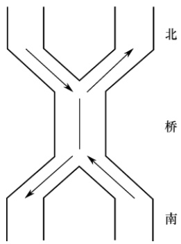

2）假设桥上不允许两车交会，但允许同方向多辆车一次通过（桥

上可有多辆同方向行驶的车)。试用信号灯的P,Ⅴ操作实现桥上的交通管理。

08. 假设有两个线程（编号为0和1）需要去访问同一个共享资源，为避免竞争状态的问题我们必须实现一种互斥机制，使得在任何时候只能有一个线程访问这个资源。假设有如下一段代码:

```txt
bool flag[2]; //flag 数组，初始化为 FALSE
Enter Critical Section(int my thread id,int other thread id) {
while(flag[other thread id]==TRUE); //空循环语句
flag[my thread id]=TRUE;
Exit Critical Section(int my thread id,int other thread id){
flag[my thread id]=FALSE;
```

当一个线程想要访问临界资源时，就调用上述的这两个函数。例如，线程0的代码可能是这样的:

```txt
Enter Critical Section(0,1);
使用这个资源；
Exit Critical Section(0,1);
做其他的事情；
```

试问:

1）以上的这种机制能够实现资源互斥访问吗？为什么？

2）若把Enter\_Critical\_Section()函数中的两条语句互换位置，可能发生死锁吗？

09. 设自行车生产线上有一个箱子，其中有N个位置（N≥3)，每个位置可存放一个车架或一个车轮；又设有3名工人，其活动分别为:

```txt
工人1活动： 工人 2活动： 工人3活动：
do { do { do{箱中取一个车架；
加工一个车架； 加工一个车轮； 箱中取二个车轮；
车架放入箱中； 车轮放入箱中； 组装为一台车；
}while(1) }while(1) }while(1)
```

试分别用信号量与PV操作实现三名工人的合作，要求解中不含死锁。

10. 设P, Q,R共享一个缓冲区，P, Q构成一对生产者-消费者，R既为生产者又为消费者，若缓冲区为空，则可以写入；若缓冲区不空，则可以读出。使用P,Ⅴ操作实现其同步。

11. 理发店里有一位理发师、一把理发椅和n把供等候理发的顾客坐的椅子。若没有顾客理发师便在理发椅上睡觉，一位顾客到来时，顾客必须叫醒理发师，若理发师正在理发时又有顾客来到，且有空椅子可坐，则坐下来等待，否则就离开。试用P,Ⅴ操作实现，并说明信号量的定义和初值。

12. 假设一个录像厅有1,2,3三种不同的录像片可由观众选择放映，录像厅的放映规则如下:

1）任意时刻最多只能放映一种录像片，正在放映的录像片是自动循环放映的，最后一名观众主动离开时结束当前录像片的放映。

2）选择当前正在放映的录像片的观众可立即进入，允许同时有多位选择同一种录像片的观众同时观看，同时观看的观众数量不受限制。

3）等待观看其他录像片的观众按到达顺序排队，当一种新的录像片开始放映时，所有等待观看该录像片的观众可依次序进入录像厅同时观看。用一个进程代表一个观众，要求:用信号量方法PV操作实现，并给出信号量定义和初始值。

13. 设公共汽车上驾驶员和售票员的活动分别如下图所示。驾驶员的活动:启动车辆，正常行车，到站停车；售票员的活动:关车门，售票，开车门。在汽车不断地到站、停车、行驶的过程中，这两个活动有什么同步关系？用信号量和P,V操作实现它们的同步。

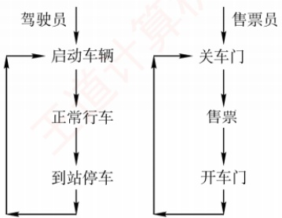

14. 一组进程的执行顺序如下图所示，圆圈 $\mathrm{P}_{1}, \mathrm{P}_{2}, \mathrm{P}_{3}, \mathrm{P}_{4}, \mathrm{P}_{5}, \mathrm{P}_{6}$ 表示进程，弧上的字母a,b, c, d, e, f, g, h 表示同步信号量，请用 P, V 操作实现进程的同步。

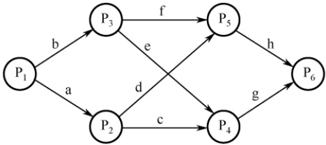

15. 有 3 个进程 P、 $\mathrm {P}_{1}$ $\mathrm {P}_{2}$ 合作处理数据，P从输入设备读数据到缓冲区，缓冲区可存1000个字。 $\mathrm {P}_{1}$ 和 $\mathrm {P}_{2}$ 的功能一样，都是从缓冲区取出数据并计算，再打印结果。请用信号量的P, V操作实现。其中，语句 read()从输入设备读入20 个字到缓冲区；get()从缓冲区取出20个字；comp()计算40个字输出并得到结果的1个字；print()打印结果的 2个字。

16. 假设有3个抽烟者和1个供应者。每个抽烟者不停地卷烟并抽掉它，但要卷起并抽掉一支烟，抽烟者需要有三种材料:烟草、纸和胶水。三个抽烟者中，第一个拥有烟草，第二个拥有纸，第三个拥有胶水。供应者无限提供三种材料，供应者每次将两种材料放到桌子上，拥有剩下那种材料的抽烟者卷一根烟并抽掉它，并给供应者一个信号告诉已完成，此时供应者就将另外两种材料放到桌上，如此重复，让3个抽烟者轮流抽烟。

17.【2009统考真题】三个进程 $\mathrm {P}_{1} , \mathrm {P}_{2} , \mathrm {P}_{3}$ 互斥使用一个包含N（N>0）个单元的缓冲区。 $\mathrm {P}_{1}$每次用 produce()生成一个正整数并用 put()送入缓冲区某一空单元； $\mathrm {P}_{2}$ 每次用 getodd()从该缓冲区中取出一个奇数并用countodd()统计奇数个数； $\mathrm {P}_{3}$ 每次用geteven()从该缓冲区中取出一个偶数并用counteven()统计偶数个数。请用信号量机制实现这三个进程的同步与互斥活动，并说明所定义的信号量的含义（要求用伪代码描述）。

18. 【2011统考真题】某银行提供1个服务窗口和10个供顾客等待的座位。顾客到达银行时，若有空座位，则到取号机上领取一个号，等待叫号。取号机每次仅允许一位顾客使用。当营业员空闲时，通过叫号选取一位顾客，并为其服务。顾客和营业员的活动过程描述如下:

```txt
coBegin
process 顾客i
1
从取号机获取一个号码；
等待叫号；
获取服务；
process 营业员
While (TRUE)
```

```txt
叫号；
为客户服务；
1
} coEnd
```

请添加必要的信号量和P, V [或 wait(), signal()] 操作，实现上述过程中的互斥与同步。要求写出完整的过程，说明信号量的含义并赋初值。

19. 【2013统考真题】某博物馆最多可容纳500人同时参观，有一个出入口，该出入口一次仅允许一人通过。参观者的活动描述如下:

```txt
coBegin
参观者进程i:
进门；
..
参观；
道 ..•
出门;
coEnd
```

请添加必要的信号量和P, V[或 wait(), signal()]操作，以实现上述过程中的互斥与同步。要求写出完整的过程，说明信号量的含义并赋初值。

20.【2014统考真题】系统中有多个生产者进程和多个消费者进程，共享一个能存放1000件产品的环形缓冲区（初始为空）。缓冲区未满时，生产者进程可以放入其生产的一件产品，否则等待；缓冲区未空时，消费者进程可从缓冲区取走一件产品，否则等待。要求一个消费者进程从缓冲区连续取出10件产品后，其他消费者进程才可以取产品。请使用信号量P, V(wait(), signal()）操作实现进程间的互斥与同步，要求写出完整的过程，并说明所用信号量的含义和初值。

21. 【2015统考真题】有A，B两人通过信箱进行辩论，每个人都从自己的信箱中取得对方的问题。将答案和向对方提出的新问题组成一个邮件放入对方的邮箱中。假设A的信箱最多放M个邮件，B的信箱最多放N个邮件。初始时A的信箱中有x个邮件(0<x<M)，B 的信箱中有y个邮件（0<y<N)。辩论者每取出一个邮件，邮件数减1。A和B两人的操作过程描述如下: K

| A{ | B{ |
| --- | --- |
| while(TRUE){ | while(TRUE){ |
| 从A的信箱中取出一个邮件； | 从B的信箱中取出一个邮件； |
| 回答问题并提出一个新问题； | 回答问题并提出一个新问题； |
| 将新邮件放入B的信箱； | 将新邮件放入A的信箱； |
|  |  |
|  |  |

当信箱不为空时，辩论者才能从信箱中取邮件，否则等待。当信箱不满时，辩论者才能将新邮件放入信箱，否则等待。请添加必要的信号量和P,V [或 wait(), signal()] 操作，以实现上述过程的同步。要求写出完整的过程，并说明信号量的含义和初值

22. 【2017统考真题】某进程中有3个并发执行的线程thread1, thread2和 thread3，其伪代码如下所示。

```txt
//复数的结构类型定义 thread1 thread3
typedef struct
王道 cnum w; cnum w;
float a; w = add (x, y) ; w.a = 1;
float b; … w.b = 1;
} cnum; z = add (z, w) ;
cnum x，y，z；∥/全局变量 y = add (y, w) ;
thread2 …
//计算两个复数之和 一
cnum add (cnum p, cnum q) cnum w;
w = add (y, z) ;
cnum s; …
s.a = p.a+q.a;
s.b = p.b+q.b; 王道
return s;
}
```

请添加必要的信号量和P, V[或 wait(), signal()]操作，要求确保线程互斥访问临界资源，并且最大限度地并发执行。

23.【2019统考真题】有n（n≥3）名哲学家围坐在一张圆桌边，每名哲学家交替地就餐和思考。在圆桌中心有m（m≥1）个碗，每两名哲学家之间有一根筷子。每名哲学家必须取到一个碗和两侧的筷子后，才能就餐，进餐完毕，将碗和筷子放回原位，并继续思考。为使尽可能多的哲学家同时就餐，且防止出现死锁现象，请使用信号量的P,V操作[wait() signal()操作]描述上述过程中的互斥与同步，并说明所用信号量及初值的含义。

24.【2020统考真题】现有5个操作A、B、C、D和E，操作C必须在A和B完成后执行，操作E必须在 C 和D 完成后执行，请使用信号量的 wait()、signal()操作（P、V操作）描述上述操作之间的同步关系，并说明所用信号量及其初值。

25.【2021 统考真题】下表给出了整型信号量S的wait()和 signal()操作的功能描述，以及采用开/关中断指令实现信号量操作互斥的两种方法。

| 功能描述 | 方法1 | 方法2 |
| --- | --- | --- |
| Semaphore S; wait (S) { while(S&lt;=0); S=S-1; | Semaphore S; wait (S) { 关中断； while(S&lt;=0); S=S-1; 开中断； | Semaphore S; wait (S) { 道 关中断； while(S&lt;=0){ 开中断； 关中断； } S=S-1; 开中断； |
| signal(S) { S=S+1; | 算机教 signal(S) { 关中断； S=S+1; 开中断； | } signal (S) { 关中断； S=S+1; 开中断； |

请回答下列问题。

1）为什么在 wait()和 signal()操作中对信号量S的访问必须互斥执行？

2）分别说明方法1和方法2是否正确。若不正确，请说明理由。

3）用户程序能否使用开/关中断指令实现临界区互斥？为什么？

26.【2022统考真题】某进程的两个线程T1和T2并发执行A、B、C、D、E和F共6个操作，其中T1执行A、E和F，T2执行B、C和D。下图表示上述6个操作的执行顺序所必须满足的约束:C在A和B完成后执行，D和E在C完成后执行，F在E完成后执行。请使用信号量的 wait()、signal()操作描述T1和T2之间的同步关系，并说明所用信号量的作用及其初值。

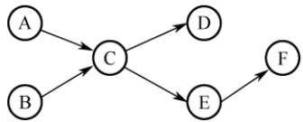

27.【2023 统考真题】现要求学生使用 swap 指令和布尔型变量 lock实现临界区互斥。lock为线程间共享的变量，当 lock 的值为 TRUE时线程不能进入临界区，为 FALSE时线程能够进入临界区。某同学编写的实现临界区互斥的伪代码如下图所示。

```txt
某同学编写的伪代码
bool lock = FALSE; /共享变量
i bool key = TRUE; 进入区
if (key == TRUE)
swap key, lock; //交换 key 和 lock 的值
临界区
i lock = TRUE; 退出区
1
```

(a)

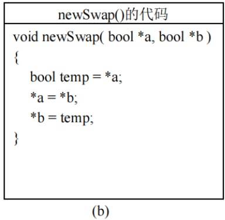

请回答下列问题。

1）图(a)的伪代码中哪些语句存在错误？将其改为正确的语句（不增加语句的条数）。

2）图(b)给出了交换两个变量值的函数newSwap()的代码，是否可以用函数调用语句“newSwap(&key, &lock)”代替指令“swap key, lock”以实现临界区互斥？为什么？

28.【2024统考真题】计算机系统中的进程之间往往需要相互协作来完成一个任务。在某网络系统中，缓冲区B用于存放一个数据分组，对B的操作有 $C_{1} 、  C_{2}$ 和 $\mathrm {C}_{3}$ 。 $\mathrm {C_{1}}$ 将一个数据分组写入 B， $\mathrm {C}_{2}$ 从B中读出一个数据分组， $\mathrm {C}_{3}$ 对 B 中的数据分组进行修改。要求 B为空时才能执行 $\mathrm {C_{1}}$ ，B非空时才能执行 $\mathrm {C}_{2}$ 和 $\mathrm {C}_{3}$ 。请回答下列问题。

1）假设进程 $\mathrm {P}_{1}$ 和 $\mathrm {P}_{2}$ 均需要执行 $\mathrm {C_{11}}$ ，实现 $\mathrm {C_{1}}$ 的代码是否为临界区？为什么？

2）假设B初始为空，进程 $\mathrm {P}_{1}$ 执行 $\mathrm {C_{1}} \mathrm {-}$ 次，进程 $\mathrm {P}_{2}$ 执行 $\mathrm {C}_{2}$ 一次。请定义尽可能少的信号量，并用 wait()、signal()操作描述进程 $\mathrm {P_{1}}$ 和 $\mathrm {P}_{2}$ 之间的同步或互斥关系，说明所用信号量的作用及其初值。

3）设B初始不为空，进程 $\mathrm {P}_{1}$ 和 $\mathrm {P}_{2}$ 各执行 $C_{3}$ 一次。定义尽可能少的信号量，并用 wait() signal()操作描述进程 $\mathrm {P}_{1}$ 和 $\mathrm {P}_{2}$ 之间的同步或互斥关系，说明所用信号量的作用及其初值。

29.【2025统考真题】甲、乙、丙三人一起植树，甲负责挖树坑，乙负责将树苗放入树坑并填土，丙负责为新种的树苗浇水。植树的步骤依次为:挖树坑、放树苗、填土和浇水。

现有铁锹和水桶各1个，铁锹用于挖树坑和填土，水桶用于浇水。当树坑的数量小于3时，甲才可以挖树坑。假设初始时树坑的数量为0，铁锹和水桶均可用。请定义尽可能少的信号量，用wait()、signal()操作描述植树过程中三人之间的同步或互斥关系，并说明所用信号量的作用及其初值。

### 2.3.9 答案与解析

#### 一、单项选择题

01. D

多个进程可以共享系统中的资源，一次仅允许一个进程使用的资源称为临界资源。访问临界资源的那段代码称为临界区。

02. D

在多道程序技术中，信号量机制是一种有效实现进程同步和互斥的工具。进程执行的前趋关系实质上是指进程的同步关系。除此之外，只有进程的并发执行不需要信号量来控制。

03. A

信号量是一个特殊的整型变量，只有初始化和PV操作才能改变其值。通常，信号量分为互斥量和资源量，互斥量的初值一般为1，表示临界区只允许一个进程进入，从而实现互斥。当互斥量等于0时，表示临界区已有一个进程进入，临界区外尚无进程等待；当互斥量小于0时，表示临界区中有一个进程，互斥量的绝对值表示在临界区外等待进入的进程数。同理，资源信号量的初值可以是任意整数，表示可用的资源数，当资源量小于0时，表示所有资源已全部用完，而且还有进程正在等待使用该资源，等待的进程数就是资源量的绝对值。

04. C

进程进入临界区必须满足互斥条件。当进程已进入临界区但尚未离开时，若被迫进入阻塞状态，这是允许的，系统中常出现此类情形。在此状态下，只要其他进程在运行过程中不试图进入该临界区，就应允许其获得CPU并继续执行。该进程所锁定的临界区不允许其他进程访问；若其他进程尝试进入，必将在临界区的“锁”上阻塞，等待该进程下次运行时退出并释放临界区。

05. C

一张飞机票不能售给不同的旅客，因此飞机票是互斥资源，其他因素只是为完成飞机票订票的中间过程，与互斥资源无关。

06. D

所谓临界区，并不是指临界资源，如共享的数据、代码或硬件设备等，而是指访问临界资源的那段代码程序，如P/V操作、加减锁等。操作系统访问临界资源时，关心的是临界区的操作过程，具体对临界资源做何操作是应用程序的事情，操作系统并不关心。

07. D

同步机制的4个准则是空闲让进、忙则等待、让权等待和有限等待。

08. B

临界资源是互斥共享资源，非共享数据不属于临界资源。打印机、共享变量和共享缓冲区都只允许一次供一个进程使用。

09. B

临界资源是指必须互斥访问的资源，若并发使用将导致数据混乱或逻辑错误。磁盘虽为共享设备，但其访问由操作系统统一协调，不构成临界资源；公用队列被多个进程共享，若无互斥控制，同时操作会导致队列结构破坏或数据错乱，属于典型临界资源；私用数据仅限单个进程使用，不存在竞争；可重入的程序代码不含全局状态，允许多进程并发执行，无须互斥。

10. C

同步是指为了完成某项任务而建立的多个进程的相互合作关系，由于并发进程的执行是异步的（按各自独立的、不可预知的速度向前推进），需要保证进程之间操作的先后次序的约束。例如，读进程和写进程对同一段缓冲区的读和写就需要进行同步，以保证正确的执行顺序。

11. C

并发进程因共享资源而产生相互制约，可分为两类:①互斥关系，指进程竞争使用独占资源（互斥资源）所形成的制约；②同步关系，指进程为协同工作而需交换信息、相互等待所形成的制约。本题中，两个进程之间的制约属于同步关系，进程B必须等待进程A将数据写入缓冲区后，才能从中读取数据。同时，缓冲区是共享资源，其访问必须互斥，因此二者也存在互斥关系。

12. D

P、V操作是一种低级的进程通信原语，它是不能被中断的。

13. C

P操作即wait操作，表示等待某种资源直到可用。若这种资源暂时不可用，则进程进入阻塞态。注意，执行P操作时的进程处于运行态。

14. D

原语顾名思义，就是原子性的、不可分割的操作。其严格定义为:由若干机器指令构成的完成某种特定功能的一段程序，其执行必须是连续的，在执行过程中不允许被中断。

15. A

管程定义了一个数据结构和能为并发进程所执行（在该数据结构上）的一组操作，这组操作能同步进程并改变管程中的数据。

16. C

只有就绪进程能获得处理器资源，被唤醒的进程并不能直接转换为运行态。

17. B

互斥信号量的初值设置为1，P操作成功则将其减1，禁止其他进程进入；V操作成功则将其加1，允许等待队列中的一个进程进入。

18. D

与互斥信号量初值一般置1不同，用P,V操作实现进程同步时，信号量的初值应根据具体情况来确定。若期望的消息尚未产生，则对应的初值应设为0；若期望的消息已存在，则信号量的初值应设为一个非0的正整数。

19. C

若代码可被多个进程在任意时刻共享，则要求任意一个进程在调用此段代码时都以同样的方式运行；而且进程在运行过程中被中断后再继续执行，其执行结果不受影响。这必然要求代码不能被任何进程修改，否则无法满足共享的要求。这样的代码就是可重入代码，也称纯代码，即允许多个进程同时访问的代码。

20. D

共享程序段可能同时被多个进程使用，所以必须可重入编码，否则无法实现共享的功能。

21. D

互斥锁可用于多线程或多进程之间，但只有对它加锁的线程或进程才能解锁它。若一个线程或进程试图解锁一个不属于它（加锁）的互斥锁，则返回错误码。

22. C

若两个线程分别对两个不同的互斥锁先后加锁，但顺序相反，则可能导致死锁，这是典型的循环等待现象。例如，线程1先对互斥锁A加锁，然后尝试对互斥锁B加锁；同时，线程2先对B加锁，然后尝试对A加锁，两个线程都在等待对方释放资源，从而无法继续推进。

23. D

P操作和V操作都属于原语操作，不可被中断。

24. B

互斥信号量mutex初值为1，表示临界区初始可用。当mutex=0时，说明一个进程已执行P操作并进入临界区，且因信号量非负，无其他进程在等待；只有当mutex=-1时，才表示一个进程在临界区内，另一个在等待。因此，mutex=0对应有且仅有一个进程进入临界区。

25. C

当有一个进程进入临界区且有另一个进程等待进入临界区时，mutex = -1。当mutex小于0时，其绝对值等于等待进入临界区的进程数。

26. D

由题意可知，系统原来存在等待进入临界区的进程，mutex小于或等于-1，因此在执行V(mutex)操作后，mutex的值小于或等于0。

27. C

这里的临界区是指访问临界资源A的那段代码（临界区的定义）。那么5个并发进程共有5个操作共享变量A的代码段。

28. C

管程由局限于管程的共享变量说明、对管程内的数据结构进行操作的一组过程及对局限于管程的数据设置初始值的语句组成。

29. C

管程的signal操作与信号量机制中的V操作不同，信号量机制中的V操作一定会改变信号量的值S=S+1。而管程中的signal操作是针对某个条件变量的，若不存在因该条件而阻塞的进程，则 signal 不会产生任何影响。

30. A

参见记录型信号量的介绍。此处极易出关于 S.value的概念题，总结如下:① S.value > 0，表示某类可用资源的数量。每次P操作，意味着请求分配一个单位的资源。②S.value≤0，表示某类资源已无可用，且存在因请求该资源而被阻塞的进程，S.value的绝对值表示等待进程数量。一定要看清题目中的陈述是执行P操作前还是执行P操作后。

**31. ①C ②B**

①系统中有n个进程，只要这些进程不都处于阻塞态，则至少有一个进程正在处理器上运行（处理器至少有一个），因此就绪队列中的进程个数最多有n-1个。选项B容易被错选，以为出现了处理器为空、就绪队列全满的情况，实际调度无此状态。

②本题易错选C，阻塞队列有n-1个进程是可能发生的，但不是最多的情况。不少读者会忽略死锁的情况，死锁就是n个进程都被阻塞，因此阻塞队列最多可以有n个进程。

32. B

对S进行了28次P操作和18次V操作，即S-28+18=0，得信号量的初值为10；然后，对信号量S进行了15次P操作和2次V操作，即S-15 +2=10-15+2=-3，S信号量的负值的绝对值表示等待队列中的进程数。所以有3个进程等待在信号量S的队列中。

33. B

本题的关键是，输出语句A2,B2中读取的x的值不同，由于A1,B1执行有先后问题，使得在执行A2, B2前，x的可能取值有两个，即 1,−3；这样，输出 z的值可能是1 + 2 = 3 或(-3)+ 2 = −1；输出 c 的值可能是 1×1 = 1 或(-3)(-3) = 9 。

34. D

并发进程之间的关系没有必然的要求，只有执行时间上的偶然重合，可能无关也可能有交往。

35. C

信号量的初值表示该类资源的总数，因此信号量的初值取3。每分配一个该类资源，信号量减1，当信号量等于0时，表示该类资源刚好被分完；当信号量小于0时，表示还有进程正在等待该类资源，信号量的绝对值就是等待进程的数量。因此，当没有进程使用时，信号量最大为3;当有三个进程正在使用并有一个进程在等待时，信号量最小为-1。

36. C

根据 Peterson 算法的原理，可知(1)和(2)处分别为 turn = 1 和 turn = 0。

37. A

flag数组用于标记各个线程想进入临界区的意愿。当一个线程想要进入临界区时，它将自己对应的flag值置为true；当一个线程退出临界区时，它将自己对应的flag值置为false。这样，若两个进程都争着想进入临界区，则可以让进程将进入临界区的机会谦让给对方。

38. A

turn变量用于指示允许进入临界区的线程编号。当一个线程想要进入临界区时，它将turn置为对方的编号，表示优先让对方先进入。当一个线程检查到对方的flag为true时，表示对方也想进入，这时就需要根据turn来决定谁先进入。若turn等于自己的编号，表示轮到自己进入，则可以直接进入。若turn等于对方的编号，表示轮到对方进入，则需等待对方退出。

39. B

进程并发带来问题不仅包括同步互斥问题，还包括死锁等其他问题。生产者-消费者问题用于解决进程的同步和互斥问题。共享一个数据对象仅涉及互斥访问的问题。

40. A

当缓冲区为空时，消费者进程取产品会被阻塞，此时需等待生产者进程生产新产品。

41. D

生产者和消费者共享缓冲区，每次只允许一个生产者或消费者进入缓冲区，当有一个生产者或消费者进入缓冲区时，其他生产者或消费者就必须阻塞等待。因此，生产者有可能唤醒其他生产者或消费者，消费者也有可能唤醒其他生产者或消费者，四个选项均正确。

42. A

所谓互斥使用某临界资源，是指在同一时间段只允许一个进程使用此资源，所以互斥信号量的初值都为1。

43. B

在生产者-消费者问题中，每次只能有一个生产者或消费者进入缓冲区，需要用一个互斥信号量来控制，当有一个生产者或消费者进入缓冲区时，其他申请进入缓冲区的消费者会被阻塞。

44. C

在读者-写者问题中，写者和写者之间、写者和读者之间必须互斥访问共享对象，读者和读者之间则可以同时访问。

45. C

信号量seat表示桌子上可以坐下的位置数，因为只有五个位置，所以每次只能有四位哲学家同时拿起左边的餐叉，才能保证不会发生死锁，所以 seat的初值应该为4。

46. C

因为进程并发，所以进程的执行具有不确定性，在 $\mathrm {P}_{1} , \mathrm {P}_{2}$ 执行到第一个P,V操作前，应该是相互无关的。现在考虑第一个对 $\mathrm {s}_{1}$ 的 P,V操作，因为进程 $\mathrm {P}_{2}$ 是 $\mathrm {P} ( \mathrm {s}_{1} )$ 操作，所以它必须等待 $\mathrm {P}_{1}$ 执行完 $\mathbf {V} ( \mathbf {s}_{1} )$ 操作后才可继续运行，此时的 $x , y , Z$ 值分别是2,3,4，当进程 $\mathrm {P_{1}}$ 执行完 $\mathbf {V} ( \mathbf {s}_{1} )$ 后便在 $\mathrm {P} ( s_{2} )$上阻塞，此时 $\mathrm {P}_{2}$ 可以运行直到 $\mathrm {V} ( \mathrm {s}_{2} )$ ，此时的 x, y, z 值分别是 5, 3, 9，进程 $\mathrm {P}_{1}$ 继续运行到结束，最终的 x, y, z 值分别为 5, 12, 9。

47. B

信号量表示相关资源的当前可用数量。当信号量 $K   \ge 0$ 时，表示还有K个相关资源可用，所以该资源的可用个数是1。而当信号量 $K \leq 0$ 时，表示有|K|个进程在等待该资源。因为资源有剩余，可见没有其他进程等待使用该资源，所以进程数为0。

48. D

这是Peterson算法的实际实现，保证进入临界区的进程合理安全。该算法为了防止两个进程为进入临界区而无限期等待，设置了变量turn，表示允许进入临界区的编号，每个进程在先设置自己的标志后再设置turn标志，允许另一个进程进入。这时，再同时检测另一个进程状态标志和允许进入标志，就可保证当两个进程同时要求进入临界区时只允许一个进程进入临界区。保存的是较晚的一次赋值，因此较晚的进程等待，较早的进程进入。先到先入，后到等待，从而完成临界区访问的要求。

其实这里可想象为两个人进门，每个人进门前都会和对方客套一句“你走先”。若进门时没别人，则当和空气说句废话，然后大步登门入室；若两人同时进门，则互相先请，但各自只客套一次，所以先客套的人请完对方，就等着对方请自己，然后光明正大地进门。

49. C

x的值最终是多少，取决于最后是哪个进程对x进行了写操作。一个进程一旦拿到了x值，它最后对x写操作的值也就确定了。因此本题只需考虑两个进程拿到x值的所有可能情况。对于进程$\mathrm {P_{1}}$ ，最初取到的x值可能是1，也可能是进程 $\mathrm {P}_{2}$ 完成后更新得到的x值0，因此对于 $\mathrm {P}_{1}$ ，最终写入x的值可能是2（当它最初取到1时）和1（当它最初取到0时）。同理，对于 $\mathrm {P}_{2}$ ，最初取到的x值可能是1，也可能是 $\mathrm {P}_{1}$ 完成后更新得到的x值2，因此对于 $\mathrm {P}_{2} ,$ 最终写入x的值可能是0（当它最初取到1时）和1（当它最初取到2时）。因此，最终的x值可能是0、1或2。

50. C

需要进行互斥的操作是对临界资源的访问，也就是说，不同线程对同一个进程内部的共享变量的访问才有可能需要进行互斥，不同进程的线程、代码段或变量不存在互斥访问的问题，同一个线程内部的局部变量也不存在互斥访问的问题。选项A中的a是线程内部的局部变量，不需要互斥访问。选项D是不同进程的线程代码段，不存在互斥访问的问题。选项B是对进程内部的共享变量x的读操作，不互斥也不影响执行结果，所以不需要互斥访问。选项C是不同线程对同一个进程内部的共享变量的写操作，需要互斥访问（类似于读者-写者问题）。

51. B

使用TSL指令实现进程互斥时，并没有阻塞态进程，等待进入临界区的进程一直停留在执行while(TSL(&lock))的循环中，不会主动放弃CPU，一直处于运行态，直到该进程的时间片用完放弃处理机，转为就绪态，此时切换另一个就绪态进程占用处理机。这不同于信号量机制实现的互斥。由此可知选项A和C错误，选项B正确。TSL指令本身就是原子操作，不需要关中断来保证其不被打断。TSL指令实现原子性的原理是，执行TSL指令的CPU锁住内存总线，以禁止其他 CPU在本指令结束之前访问内存。此外，假如 while(TSL(&lock))在关中断状态下执行，若

TSL(&lock)一直为true，不再开中断，则系统可能因此终止。因此选项D错误。

52. A

管程是由一组数据及定义在这组数据之上的对这组数据的操作组成的软件模块，这组操作能初始化并改变管程中的数据和同步进程。管程不仅能实现进程间的互斥，还能实现进程间的同步，因此选项A错误、B正确；管程具有如下特性:①局部于管程的数据只能被局部于管程内的过程所访问；②一个进程只有通过调用管程内的过程才能进入管程访问共享数据；③每次仅允许一个进程在管程内执行某个内部过程，因此选项C和D正确。

53. B

仔细阅读两个线程代码可知，thread1和thread2均是对x进行加1操作，x的初始值为0，若要使得最终 x = 2，只能先执行完 thread1 再执行 thread2，或先执行完 thread2 再执行 thread1，因此仅有2种可能。

54. D

“条件变量”是管程内部说明和使用的一种特殊变量，其作用类似于信号量机制中的“信号量”，都用于实现进程同步。需要注意的是，在同一时刻，管程中只能有一个进程在执行。若进程A执行了x.wait()操作，则该进程会阻塞，并挂到条件变量x对应的阻塞队列上。这样，管程的使用权被释放，就可以有另一个进程进入管程。若进程B执行了x.signal()操作，则会唤醒x对应的阻塞队列的队首进程。只有一个进程要离开管程时才能调用signal()操作。

55. C

硬件方法实现进程同步时不能实现让权等待；Peterson算法满足有限等待但不满足让权等待；记录型信号量由于引入阻塞机制，消除了不让权等待的情况，选项C正确。

56. C

实现临界区互斥需满足多个准则。“忙则等待”准则，即两个进程不能同时访问临界区，说法Ⅰ正确。“空闲让进”准则，若临界区空闲，则允许其他进程访问，说法Ⅱ正确。“有限等待”准则，即进程应该在有限时间内访问临界区，说法Ⅲ正确。说法I、Ⅱ和Ⅲ是互斥机制必须遵循的原则。说法IV是“让权等待”准则，不一定非得实现，如皮特森算法。

#### 二、综合应用题

01. 【解答】

$\mathrm {P}_{1}$ 和 $\mathrm {P}_{2}$ 两个并发进程的执行结果是不确定的，它们都对同一变量X进程操作，X是一个临界资源，而没有进行保护。例如:

1）若先执行完 $\mathrm {P_{1}}$ 再执行 $\mathrm {P}_{2}$ ，则结果是 $\mathrm{x}=0,\mathrm{y}=1,\mathrm{z}=1,\mathrm{t}=2,\mathrm{u}=2.$

2）若先执行 $\mathrm {P}_{1}$ 到 $\text{"}_{X}=1 \text{"}$ ，然后一个中断去执行完 $\mathrm {P}_{2}$ ，再一个中断回来执行完 $\mathrm {P}_{1}$ ，则结果是 $\mathrm{x}=0, \mathrm{y}=0, \mathrm{z}=0, \mathrm{t}=2, \mathrm{u}=2$

显然，两次执行结果不同，所以这两个并发进程不能正确运行。可将这个程序改为:

```txt
int x;
semaphore S=1; //访问ⅹ的互斥信号量
process_P1 { process_P2 {
int y,z; int t,u;
P (S) ; P (S);
x=1; x=0;
y=0; t=0;
if(x>=1) if(x<=1)
y=y + 1; t=t + 2;
V (S) ; V(S) ;
z=y; 道 u=t;
```

02. 【解答】

使用信号量 mutex控制两个进程互斥访问临界资源（仓库），使用同步信号量 Sa和 Sb（分别代表产品A与B的还可容纳的数量差，以及产品B与A的还可容纳的数量差）满足条件2和条件3。代码如下:

```txt
Semaphore Sa=M-1,Sb=N-1;
Semaphore mutex=1; //访问仓库的互斥信号量
process_A( ) { process B() {
while(1) { while(1) {
P(Sa); P(Sb);
P(mutex); P(mutex);
A 产品入库； 育 B产品入库；
V(mutex); V(mutex);
V(Sb) ; V(Sa);
1 1
```

03. 【解答】

顾客进店后按序取号，并等待叫号；销售人员空闲后也按序叫号，并销售面包。因此同步算法只要对顾客取号和销售人员叫号进行合理同步即可。我们使用两个变量i和j分别记录当前的取号值和叫号值，并各自使用一个互斥信号量用于对i和j进行访问和修改。

```txt
int i=0,j=0;
semaphore mutex_i=1,mutex_j=1;
Consumer () { //顾客 育
进入面包店；
P(mutex_i); //互斥访问i
取号i;
i++;
V(mutex_i); //释放对i的访问
等待叫号i并购买面包；
道
Seller() { //销售人员
while(1){
P(mutex_j); //互斥访问 j
if (j<i) { //号j已有顾客取走并等待
叫号j
j++;
v(mutex_j); //释放对 j 的访问
销售面包；
else{ //暂时没有顾客在等待
V(mutex_j); //释放对 j 的访问
首 休息片刻；
```

04. 【解答】

本题是生产者-消费者问题的变体，生产者“车间A”和消费者“装配车间”共享缓冲区“货架F1”；生产者“车间B”和消费者“装配车间”共享缓冲区“货架F2”。因此，可为它们设置6个信号量:empty1 对应货架F1 上的空闲空间，初值为10；full1对应货架F1 上面的A产品，初值为 0；empty2 对应货架 F2 上的空闲空间，初值为10；full2 对应货架 F2 上面的 B 产品，初值为0；mutex1用于互斥地访问货架F1，初值为1；mutex2用于互斥地访问货架F2，初值为1。

A车间的工作过程可描述为:

```txt
while(1) {
生产一个产品A；
P(empty1); //判断货架 F1 是否有空
P (mutex1); 1/互斥访问货架 F1
将产品 A 存放到货架 F1 上；
V(mutex1); 道 //释放货架 F1
V(full1); //货架 F1 上的零件 A 的个数加 1
```

B车间的工作过程可描述为:

```txt
while(1) {
生产一个产品 B；
P(empty2); //判断货架 F2 是否有空
P (mutex2); //互斥访问货架 F2
将产品 B 存放到货架 F2 上；
V(mutex2); //释放货架 F2
V(full2); //货架 F2 上的零件 B 的个数加 1
```

装配车间的工作过程可描述为:

```txt
while(1) {
P(full1); //判断货架 F1 上是否有产品 A
P (mutex1); //互斥访问货架 F1
从货架F1 上取一个A 产品；
V(mutex1); //释放货架F1
V(empty1); //货架F1上的空闲空间数加1
P(full2); //判断货架 F2 上是否有产品 B
P (mutex2); //互斥访问货架F2
从货架 F2 上取一个 B 产品；
V(mutex2); //释放货架 F2
V(empty2); //货架 F2 上的空闲空间数加 1
将取得的 A 产品和 B 产品组装成产品；
```

05.【解答】

从井中取水并放入水缸是一个连续的动作，可视为一个进程；从缸中取水可视为另一个进程。设水井和水缸为临界资源，引入 well 和 vat；三个水桶无论是从井中取水还是将水倒入水缸都是一次一个，应该给它们一个信号量pail，抢不到水桶的进程只好等待。水缸满时，不可以再放水，设置empty信号量来控制入水量；水缸空时，不可以取水，设置full信号量来控制。本题需要设置5个信号量来进行控制:

```c
semaphore well=1; //用于互斥地访问水井
semaphore vat=1; //用于互斥地访问水缸
semaphore empty=10; //用于表示水缸中剩余空间能容纳的水的桶数
semaphore full=0; //表示水缸中的水的桶数
semaphore pail=3; //表示有多少个水桶可以用，初值为3
//老和尚
while(1) {
P(full);
P(pail);
P(vat); 算机教育
从水缸中打一桶水；
V(vat);
v(empty);
喝水；
V(pail); 首
```

```txt
//小和尚
while(1){
P(empty);
P(pail);
P(well);
从井中打一桶水；
V(well);
P(vat);
将水倒入水缸中；
V(vat);
V(full);
v(pail);
```

06. 【解答】

为了控制三个进程依次使用输入设备进行输入，需分别设置三个信号量S1.S2.S3，其中S1的初值为1，S2和S3的初值为0。使用上述信号量后，三个进程不会同时使用输入设备，因此不必再为输入设备设置互斥信号量。另外，还需要设置信号量Sb,Sy,Sz来表示数据b是否已经输入，以及y,z是否已计算完成，它们的初值均为0。三个进程的动作可描述为:

```txt
P1 ( ) {
P(S1);
从输入设备输入数据 a;
V(S2);
P(Sb);
x=a+b;
P(Sy) ;
P(Sz);
使用打印机打印出 x，y，z 的结果；
P2 ( ) {
P(S2);
从输入设备输入数据b；
V(S3);
V(Sb);
y=a*b;
V(Sy) ;
V(Sy) ; 教
P3 ( ) {
P(S3);
从输入设备输入数据 c；
P(Sy);
z=y+c-a;
V(Sz);
```

07.【解答】

1）桥上每次只能有一辆车行驶，所以只要设置一个信号量bridge就可判断桥是否使用，若在使用中，等待；若无人使用，则执行Ρ操作进入；出桥后，执行Ⅴ操作。

```txt
semaphore bridge=1; //用于互斥地访问桥
NtoS ( ) { //从北向南
通过桥； P(bridge) ; 算
V(bridge);
StoN ( ) { 1/从南向北
```

2）桥上可以同方向多车行驶，需要设置bridge，还需要对同方向车辆计数。为了防止同方向计数中同时申请bridge造成同方向不可同时行车的问题，要对计数过程加以保护，因此设置信号量 mutexSN 和 mutexNS。

```c
int countSN=0; //用于表示从南到北的汽车数量
int countNS=0; //用于表示从北到南的汽车数量
semaphore mutexSN=1; //用于保护 countSN
semaphore mutexNS=1; //用于保护 countNS
semaphore bridge=1; //用于互斥地访问桥
StoN() { //从南向北
P (mutexSN) ;
if(countSN==0)
P(bridge);
countSN++;
0 V (mutexSN) ;
过桥；
P (mutexSN) ;
countSN--;
if(countSN==0)
V(bridge); 育
V (mutexSN) ;
NtoS ( ) { /从北向南
P (mutexNS) ; if(countNS==0) 算
P(bridge);
V (mutexNS); countNS++; 直
过桥；
P (mutexNS) ;
countNS--;
if(countNS==0)
V(bridge) ;
V (mutexNS);
```

08. 【解答】

1）这种机制不能实现资源的互斥访问。考虑如下情形。

① 初始化时，flag数组的两个元素值均为 FALSE。

②线程0先执行，执行 while循环语句时，因为flag[1]为FALSE，所以顺利结束，不会被卡住。假设这时来了一个时钟中断，打断了它的运行。

③线程 1 去执行，执行 while循环语句时，因为 flag[0]为 FALSE，所以顺利结束，不会被卡住，然后进入临界区。

④后来当线程0再执行时，也进入临界区，这样就同时有两个线程在临界区。

总结:不能成功的根本原因是无法保证Enter\_Critical\_Section()函数执行的原子性。我们从上面的软件实现方法中可以看出，对于两个进程间的互斥，最主要的问题是标志的检查和修改不能作为一个整体来执行，因此容易导致无法保证互斥访问的问题。

2）可能出现死锁。考虑如下情形。

①初始化时，flag数组的两个元素值均为FALSE。

②线程0先执行，flag[0]为TRUE，假设这时来了一个时钟中断，打断了它的运行。

③ 线程 1 去执行，flag[1]为 TRUE，在执行 while 循环语句时，因为 flag[0] = TRUE，所以在这个地方被卡住，直到时间片用完。

④线程0再执行时，因为 flag[1]为 TRUE，它也在 while 循环语句的地方被卡住，所以这两个线程都无法执行下去，从而死锁。

09. 【解答】

用信号量与PV操作实现三名工人的合作。

首先不考虑死锁问题，工人1与工人3、工人2与工人3构成生产者与消费者关系，这两对生产/消费关系通过共同的缓冲区相联系。从资源的角度来看，箱子中的空位置相当于工人1和工人2的资源，而车架和车轮相当于工人3的资源。

分析上述解法易见，当工人1推进速度较快时，箱中空位置可能完全被车架占满或只留有一个存放车轮的位置，此时工人3同时取2个车轮将无法得到，而工人2又无法将新加工的车轮放入箱中；当工人2推进速度较快时，箱中空位置可能完全被车轮占满，而此时工人3取车架将无法得到，而工人1又无法将新加工的车架放入箱中。上述两种情况都意味着死锁。为防止死锁的发生，箱中车架的数量不可超过N-2，车轮的数量不可超过N-1，这些限制可以用两个信号量来表达。具体解答如下。

```txt
semaphore empty=N; //空位置
semaphore wheel=0; //车轮
semaphore frame=0; //车架
semaphore s1=N-2; //车架最大数
semaphore s2=N-1; //车轮最大数
工人1活动：
do {
加工一个车架；
P(s1); //检查车架数是否达到最大值
P(empty); //检查是否有空位
车架放入箱；
V(frame); //车架数加 1
}while(1);
工人2活动： 育
do {
加工一个车轮；
P(s2); //检查车轮数是否达到最大值
P(empty); //检查是否有空位
车轮放入箱中；
V(wheel); //车轮数加1
}while(1);
工人3活动：
do {
P(frame); //检查是否有车架
箱中取一车架；
v(empty); //空位数加1
V(s1); //可装入车架数加1
P(wheel); //检查是否有一个车轮
P(wheel); //检查是否有另一个车轮
箱中取二车轮；
V(empty); //取走一个车轮，空位数加1
v(empty); //取走另一个车轮，空位数加1
```

```javascript
V(s2);
V(s2);
组装为一台车；
}while(1);
```

//可装入车轮数加1 //可装入车轮数再加1

10. 【解答】

P, Q 构成消费者-生产者关系，因此设三个信号量 full, empty, mutex。full 和 empty 用来控制缓冲池状态，mutex用来互斥进入。R既为消费者又为生产者，因此必须在执行前判断状态，若empty==1，则执行生产者功能；若full==1，执行消费者功能。

```c
semaphore full=0; //表示缓冲区的产品
semaphore empty=1; //表示缓冲区的空位
semaphore mutex=1; //互斥信号量
Procedure P Procedure Q Procedure R
{
while(TRUE) { while(TRUE){ if(empty==1) {
p(empty); p(full); p(empty) ;
P (mutex) ; P(mutex); P(mutex) ;
道 Product one; consume one; product one;
v (mutex) ; v (mutex) ; v (mutex) ;
v(full); v(empty); v(full);
if(full==1){
p(full);
p (mutex) ;
consume one;
算机教育 v (mutex) ;
v(empty);
```

11. 【解答】

1）控制变量waiting用来记录等候理发的顾客数，初值为0，进来一名顾客时，waiting加1，一名顾客理发时，waiting减1。

2）信号量customers用来记录等候理发的顾客数，并用作阻塞理发师进程，初值为0。

3）信号量barbers用来记录正在等候顾客的理发师数，并用作阻塞顾客进程，初值为0。

4）信号量mutex用于互斥，初值为1。

```javascript
int waiting=0; //等候理发的顾客数
int chairs=n; //为顾客准备的椅子数
算机
semaphore customers=0,barbers=0,mutex=1;
barber () { //理发师进程
while(1) { //理完一人，还有顾客吗？
P(customers); //若无顾客，理发师睡眠 I
P (mutex) ; //进程互斥
waiting=waiting-1; //等候顾客数少一个
V(barbers); //理发师去为一名顾客理发
V (mutex) ; //开放临界区
Cut_hair(); //正在理发
customer() { //顾客进程
P (mutex) ; //进程互斥
if(waiting<chairs) { //若有空的椅子，就找到椅子坐下等待
waiting=waiting+1; //等候顾客数加1
V(customers); 道 //呼唤理发师
```

```javascript
V(mutex); //开放临界区
P(barbers); //无理发师，顾客坐着
get haircut(); //一名顾客坐下等待理发
else
V(mutex); 道 //人满，离开
```

12. 【解答】

电影院一次只能放映一部影片，希望观看的观众可能有不同的爱好，但每次只能满足部分观众的需求，即希望观看另外两部影片的用户只能等待。分别为三部影片设置三个信号量s0,s1,s2，初值分别为1,1,1。电影院一次只能放一部影片，因此需要互斥使用。观看影片的观众有多个，因此必须分别设置三个计数器（初值都是0），用来统计观众个数。当然，计数器是个共享变量，需要互斥使用。

```txt
semaphore s=1,s0=1,s1=1,s2=1;
int count0=0,count1=0,count2=0;
process videoshow1 { //看第一部影片的观众
P(s0);
count0=count0+1;
if(count0==1)
P(s);
V(s0);
看影片； P(s0); 教育
count0=count0-1;
if(count0==0) //没人看了，就结束放映
V(s);
V(s0);
process videoshow2 { 王道 //看第二部影片的观众
P(s1);
count1=count1+1;
if(count1==1)
P(s);
V(s1); 育
看影片；
P(s1);
count1=count1-1;
if(count1==0) //没人看了，就结束放映
V(s);
V(s1) ;
process videoshow3{ //看第三部影片的观众
P(s2);
count2=count2+1;
if(count2==1)
P(s);
V(s2);
看影片； 机教育
P(s2);
Count2=count2-1;
if(count2==0) //没人看了，就结束放映
V(s);
V(s2); 道
```

13. 【解答】

在汽车行驶过程中，驾驶员活动与售票员活动之间的同步关系为:售票员关车门后，向驾驶员发开车信号，驾驶员接到开车信号后启动车辆，在汽车正常行驶过程中售票员售票，到站时驾驶员停车，售票员在车停后开门让乘客上下车。因此，驾驶员启动车辆的动作必须与售票员关车门的动作同步；售票员开车门的动作也必须与驾驶员停车同步。应设置两个信号量S1.S2:S1表示是否允许驾驶员启动汽车（初值为0）；S2表示是否允许售票员开门（初值为0）。

```csv
semaphore S1=0,S2=0;
Procedure driver Procedure Conductor
while(1) 育 while(1)
教 1
P(S1); 关车门；
Start; V(s1);
Driving; 售票；
Stop; P(s2);
V(S2); 开车门；
上下乘客；
```

14. 【解答】

本题是一个典型的利用信号量实现前驱关系的同步问题。

```txt
Semaphore a=b=c=d=e=f=g=h=0; //定义进程执行顺序的信号量
coBegin
process P1() {
执行 P1 的任务；
V(a); //实现先 P1 后 P2 的同步关系
V (b) ; //实现先 P1 后 P3 的同步关系
1
process P2() {
P(a); //检查 P1 是否已运行完成
执行 Ρ2 的任务；
V(c) ; //实现先 P2 后 P4 的同步关系
V (d) ; //实现先 P2 后 P5 的同步关系
1 育
process P3() {
P (b) ; //检查 P1 是否已运行完成
执行 Ρ3 的任务；
V (e) ; //实现先 P3 后 P4 的同步关系
V (f) ; //实现先 P3 后 P5 的同步关系
process P4() {
P (c); //检查 P2 是否已运行完成
P (e); //检查 P3 是否已运行完成
执行 Ρ4 的任务；
V(g); //实现先 P4 后 P6 的同步关系
process P5() {
P (d) ; //检查 P2 是否已运行完成
P (f); //检查 P3 是否已运行完成
执行 Ρ5 的任务；
V(h); //实现先 P5 后 P6 的同步关系
process P6() { 1 道
```

```txt

P(g) ; //检查 P4 是否已运行完成
P(h); //检查 P5 是否已运行完成
执行 P6 的任务；
coEnd
```

15. 【解答】

本题是经典的生产者-消费者问题。把缓冲区的每20个字视为一个基本单位，因此缓冲区共有1000/20=50个空位。设置互斥信号量mutex，用于对缓冲区的访问；还需要设置两个同步信号量:full表示缓冲区已有多少数据，empty表示缓冲区还有多少空位置。

```txt
Semaphore mutex=1; //互斥使用缓冲区
Semaphore ful1=0; //表示缓冲区已有多少个20字数据，初值为0
Semaphore empty=50; //表示缓冲区还有多少个20字空位，初值为50
process P() { process P1/P2(){//P1、P2 完全一样
P(empty); for(int i=0;i<2;++i){
P (mutex); p(full);P(mutex); 算
read(); get( ) ;
V(mutex) : V(mutex);V(empty);
V(full); p(full);P(mutex);
get () ;V (mutex) ;V(empty);
comp ( ) ;
print() ;
```

16. 【解答】

供应者与3个抽烟者分别是同步关系。由于供应者无法同时满足两个或以上的抽烟者，3个抽烟者对抽烟这个动作互斥（或者理解为互斥访问桌子）。显然这里有4个进程。供应者作为生产者向3个抽烟者提供材料。设置信号量offer1.offer2.offer3分别表示烟草和纸组合的资源、烟草和胶水组合的资源、纸和胶水组合的资源，信号量finish用于互斥进行抽烟动作。代码如下:

```c
int num=0; 1/存储随机数
semaphore offer1=0; //定义信号量对应烟草和纸组合的资源
semaphore offer2=0; //定义信号量对应烟草和胶水组合的资源
semaphore offer3=0; //定义信号量对应纸和胶水组合的资源
semaphore finish=0; //定义信号量表示抽烟是否完成
process P1 ( ) { //供应者
while(1) {
num++;
num=num%3;
if(num==0)
V(offer1); //提供烟草和纸
else if(num==1)
百 V(offer2); //提供烟草和胶水 首
else
V(offer3); //提供纸和胶水
任意两种材料放在桌子上；
P(finish);
育
process P2 () { //拥有烟草者
while(1) {
P(offer3); 拿纸和胶水，卷成烟，抽掉； 算机
V(finish);
首
```

```txt

process P3 () { //拥有纸者
while(1) {
P(offer2); 算
拿烟草和胶水，卷成烟，抽掉；
V(finish);
1 道
process P4 () { //拥有胶水者
while(1) {
P(offer1);
拿烟草和纸，卷成烟，抽掉；
V(finish);
1
```

17.【解答】

互斥资源:缓冲区只能互斥访问，因此设置互斥信号量mutex。

同步问题: $\mathrm {P}_{1} ,   \mathrm {P}_{2}$ 因为奇数的放置与取用而同步，设同步信号量 $\mathrm{odd};\ \mathrm{P}_{1},\ \mathrm{P}_{3}$ 因为偶数的放置与取用而同步，设置同步信号量 $even;   \mathrm{P}_{1}, \mathrm{P}_{2}, \mathrm{P}_{3}$ 因为共享缓冲区，设同步信号量empty，初值为$N_{\circ}$ 程序如下:

```txt
semaphore mutex=1; //缓冲区操作互斥信号量
semaphore odd=0,even=0; //奇数、偶数进程的同步信号量
semaphore empty=N; //空缓冲区单元个数信号量
coBegin{
Process P1( )
while(True)
1
x=produce(); //生成一个数
P(empty); //判断缓冲区是否有空单元
P(mutex); //缓冲区是否被占用
Put () ;
V(mutex); //释放缓冲区
if(x%2==0)
V(even) ; //若是偶数，向 P3 发出信号
else
V(odd) ; //若是奇数，向 P2 发出信号
1
Process P2 ()
while(True)
1
P (odd) ; //收到 P1 发来的信号，已产生一个奇数
P(mutex); //缓冲区是否被占用
getodd() ;
V(mutex); //释放缓冲区
V(empty); //向 P1 发信号，多出一个空单元
countodd () ;
1
Process P3 ()
while(True)
P(even) ; //收到 P1 发来的信号，已产生一个偶数
P (mutex) ; //缓冲区是否被占用
geteven () ;
V(mutex) ; //释放缓冲区
V(empty); //向 P1 发信号，多出一个空单元
counteven();
}coEnd
```

18. 【解答】

互斥资源:取号机（一次只有一位顾客取号），因此设置互斥信号量mutex。

同步问题:顾客需要获得空座位等待叫号。营业员空闲时，将选取一位顾客并为其服务。空座位的有无会影响等待顾客的数量，顾客的有无决定了营业员是否能开始服务，因此分别设置信号量empty和full来实现这一同步关系。另外，顾客获得空座位后，需要等待叫号和被服务。这样，顾客与营业员就服务何时开始又构成了一个同步关系，定义信号量service来完成这一同步过程。

```c
semaphore empty=10; //空座位的数量，初值为10
semaphore mutex=1; //互斥使用取号机
semaphore full=0; //已占座位的数量，初值0
semaphore service=0; //等待叫号
coBegin
Process 顾客 i
P(empty); //等空位
道 P(mutex); //申请使用取号机
从取号机上取号；
V(mutex); //取号完毕
V(full); //通知营业员有新顾客
P(service) ; //等待营业员叫号
接受服务； 育
Process 营业员 教
1
while(True) {
P(full); //没有顾客则休息
V(empty); //离开座位
V(service); 1/叫号
为顾客服务；
2
}coEnd
```

19. 【解答】

出入口一次仅允许一人通过，设置互斥信号量mutex，初值为1。博物馆最多可以同时容纳500人，因此设置信号量 empty，初值为500。

```javascript
semaphore empty=500; //博物馆可以容纳的最多人数
semaphore mutex=1; //用于出入口资源的控制
coBegin
参观者进程i:
P(empty); //可容纳人数减1
P(mutex); //互斥使用门
进门;
V(mutex); 参观； 育
P(mutex); //互斥使用门
出门;
V(mutex);
V(empty); //可容纳人数增1
...
coEnd
```

20. 【解答】

这是典型的生产者和消费者问题，只对典型问题加了一个条件，只需在标准模型上新加一个信号量，即可完成指定要求。

设置4个变量 mutex1, mutex2, empty 和 full, mutex1 用于控制一个消费者进程在一个周期(10次）内对缓冲区的访问，初值为1；mutex2用于控制进程单次互斥地访问缓冲区，初值为1；empty代表缓冲区的空位数，初值为1000；full代表缓冲区的产品数，初值为0。伪代码如下:

```txt
semaphore empty=1000; //空缓冲区数
semaphore full=0; //非空缓冲区数
semaphore mutex1=1; //用于实现生产者之间的互斥
semaphore mutex2=1; //用于实现消费者之间的互斥
int in=0;
int out=0;
```

生产者进程

```c
while(TRUE){
produce;
I P(empty);
P (mutex1);
put an item into buf[in];
in=(in+1) mod n;
V(mutex1);
V(full);
```

消费者进程

```txt
while(TRUE){
P(mutex2);
for(int i=0;i<10;i++){
P(full);
get an item from buf[out];
out=(out+1) mod n;
v(empty);
V(mutex2);
Consume;
```

21. 【解答】

本题是一个典型的生产者-消费者问题。A和B既是生产者，又是消费者。首先分析题中的互斥关系，信箱A和信箱B作为生产者-消费者问题中的缓冲区，需要互斥访问，因此设置两个信号量 mutex A和 mutex B。然后分析A和B的同步关系，A有两个动作，分别是从信箱A中取出邮件和将新邮件放入信箱 B，因此设置信号量Full A和 Empty B，用来保证信箱A 中有邮件可以取，信箱B中有空间可以放。B的分析同理。因此本题的所有信号量设置如下:

```txt
semaphore Full_A = x; ∥ Ful1 A 表示A的信箱中的邮件数量
semaphore Empty_A = M-x; ∥ Empty A表示 A的信箱中还可存放的邮件数量
semaphore Full_B = y; // Ful1 B 表示 B 的信箱中的邮件数量
semaphore Empty_B = N-y; ∥ Empty B 表示 B的信箱中还可存放的邮件数量
semaphore mutex_A = 1; ∥ mutex A 用于 A 的信箱互斥
semaphore mutex B = 1; ∥/ mutex B 用于 B 的信箱互斥
```

互斥信号量的PV操作直接放置在对信箱操作的前后。在A取邮件之前需执行P(Full\_A)来检查信箱A 中是否有邮件可取，取出邮件之后需执行V(Empty\_A)，表示新增了一个邮件大小的空间；在A将邮件放入邮箱B之前需执行P(Empty\_B)来检车信箱B 中是否有空间可以放，放完邮件之后需执行V(Full\_B)，表示信箱B增加了一个邮件。B的分析同理。

| while (TRUE) { | B{ while(TRUE) { |
| --- | --- |
| P(Full A); P(mutex A) ; | P(Full B); |
|  | P (mutex B); |
| 从A的信箱中取出一个邮件； | 从B的信箱中取出一个邮件； |
| V(mutex_A); | V(mutex B); |
| V(Empty_A); | V(Empty_B); |
| 回答问题并提出一个新问题； | 回答问题并提出一个新问题； |
| P(Empty_B) ; | P (Empty_A); |
| P(mutex_B) ; | P (mutex_A); |
| 将新邮件放入B的信箱； | 将新邮件放入A的信箱； |
| V(mutex_B) ; | V (mutex_A) ; |
| V(Full_B); | V(Full_A); |
|  |  |

coEnd

22. 【解答】

对于这类问题，做法如下:

首先，找出有可能需要互斥访问的变量，只有全局变量才可能需要互斥访问，也就是说，含全局变量的代码段才可能是临界区。而局部变量是不需要互斥访问的，就算不同的进程之间都有相同名字的局部变量，但对不同的进程来说，它们只认识属于自己的局部变量。

其次，有关互斥的难点不在于找出哪些变量有可能需要互斥访问，而要理解互斥是进程之间对某个变量的互斥，不能脱离具体的进程来谈某个变量需不需要互斥访问。前面说了全局变量有可能需要互斥访问，但也不一定，因为这要看进程对它的操作，因此，一组互斥关系需要指出是哪些进程对哪个变量的互斥。例如，考虑两种情况:第一种情况是，进程1和进程2需要对共享变量C互斥访问，进程1和进程3也需要对变量C互斥访问，这是两组不同的互斥关系，而不能简单地理解为对C的互斥；第二种情况是，进程1、2、3两两之间都需要对变量C互斥访问。这种情况与第一种情况的差别是，第一种情况允许进程2、3对变量C的访问是不互斥的。若题目给出的是第一种情况，而我们采用了第二种情况去解题，则可能有同学认为，我依然满足了题目的要求啊，进程1、2之间以及进程1、3之间对C的访问都是互斥的，但这样降低了并发度，因为第二种情况允许进程2、3对变量C的访问是不互斥的，这也是PV互斥的最大难点，就是在没有准确找准互斥关系的条件下，容易导致程序的并发度降低，从而扣分。

本题的分析如下。

首先，全局变量是x、y、z，只有对这三个变量的访问才可能需要互斥。线程1涉及x、y的访问（只读），线程2涉及y、z的访问（只读)，线程3涉及y、z的访问（读和写）。

其次，找互斥关系，根据什么原则呢？答案是读者-写者原则。读和读之间不需要互斥，读和写之间、写和写之间需要互斥。因此，本题的互斥关系如下:第一对，thread1和thread3之间需要对变量y的访问互斥；第二对，线程2和线程3之间需要对变量y的访问互斥；第三对，线程2和线程3之间需要对变量z访问的互斥。正确找出所有互斥关系后，接下来的操作就很简单。因为有三组互斥关系，所以定义三个互斥信号量，分别为 mutex\_y1=1、mutex\_y2=1和mutex\_z=1，然后分别将它们加到线程代码段的相应位置。例如，在线程1 的 w= add(x, y)和线程3 的 y = add(y, w)

上下用 mutex\_y1 夹住；在线程2的 w = add(y, z)和线程 3的 $z = \mathrm{add}(z, w)$ 上下用 mutex\_y2 夹住；在线程 2 的 w = add(y, z)和线程 3 的 y = add(y, w)上下用 mutex\_z 夹住。

semaphore mutex y1=1； /mutex y1 用于 thread1 与 thread3 对变量y的互斥访问semaphore mutex\_y2=1；/mutex\_y2 用于 thread2 与 thread3 对变量 y的互斥访问semaphore mutex\_z=1； /mutex\_z 用于 thread2 与 thread3 对变量 z 的互斥访问互斥代码如下:

```matlab
thread1 thread2 thread3
cnum w; cnum w; cnum w;
wait ( mutex_y1) ; wait( mutex_y2); w.a = 1;
w = add (x, y); wait( mutex_z); w.b = 1;
signal( mutex_y1); w = add (y, z) ; wait( mutex_z) ;
signal( mutex_z) ; z = add (z, w);
} signal( mutex_y2); signal ( mutex_z);
… wait( mutex_y1);
一 wait( mutex_y2);
y = add (y, w) ;
signal ( mutex_y1);
signal ( mutex_y2);
…
```

23. 【解答】

回顾传统的哲学家问题，假设餐桌上有n名哲学家、n根筷子，那么可以用这种方法避免死锁（本书考点讲解中提供了这一思路）:限制至多允许n-1名哲学家同时“抢”筷子，那么至少会有1名哲学家可以获得两根筷子并顺利进餐，于是不可能发生死锁的情况。

本题可以用碗这个限制资源来避免死锁:当碗的数量m小于哲学家的数量n时，可以直接让碗的资源量等于m，确保不会出现所有哲学家都拿一侧筷子而无限等待另一侧筷子进而造成死锁的情况；当碗的数量m大于或等于哲学家的数量n时，为了让碗起到同样的限制效果，我们让碗的资源量等于n-1，这样就能保证最多只有n-1名哲学家同时进餐，所以得到碗的资源量为min{n-1，m}。在进行PV操作时，碗的资源量起限制哲学家取筷子的作用，所以需要先对碗的资源量进行P操作。具体过程如下:

```lisp
//信号量
semaphore bowl; //用于协调哲学家对碗的使用
semaphore chopsticks[n]; //用于协调哲学家对筷子的使用
for(int i=0;i<n;i++)
chopsticks[i]=1; //设置两名哲学家之间筷子的数量
bowl=min(n-1,m); //bowl≤n-1，确保不死锁
coBegin
while(TRUE) { //哲学家i 的程序
思考；
P(bowl); //取碗
P(chopsticks[i]); //取左边筷子
P(chopsticks[(i+1) %n]); //取右边筷子
就餐；
V(chopsticks[i]);
V(chopsticks[(i+1) %n])
```

```txt
V(bowl);
1
coEnd
```

24. 【解答】

本题是一个典型的利用信号量实现前驱关系的同步问题。首先画出各个操作之间的执行顺序图，可以看出，A、B、D的执行不需要任何前提条件。执行完A和B之后才能执行C，存在两对同步关系:A→C和B→C，设置两个同步变量SAC=0和 SBC=0，完成A和B之后分别执行V(SAC)和 V(SBC)，表示 A 或 B 已完成；执行 C 之前需要执行 P(SAC)和 P(SBC)，检查 A 和 B

是否完成。执行完C和D之后才能执行E，也存在两对同步关系:C→ E和 D→E，因此再设置两个同步变量 SCE= 0和 SDE= 0，完成C 和 D之后分别执行V(SCE)和V(SDE)，表示C或D已完成；执行E之前需要执行 P(SCE)和 P(SDE)，检查C 和 D 是否完成。

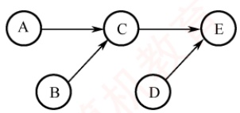

```txt
semaphore SAC = 0; //控制 A 和 C 的执行顺序
semaphore SBC = 0; //控制 B 和 C 的执行顺序
semaphore SCE = 0; //控制 C 和Ε 的执行顺序
semaphore SDE = 0 ; //控制 D 和Ε的执行顺序
```

5个操作可描述为如下。

```c
coBegin
A ( ) {
完成动作 A;
V(SAC); //实现 A、C 之间的同步关系
B ( ) {
完成动作B；
V(SBC); //实现 B、C 之间的同步关系
C ( ) {
//C 必须在 A、B 都完成后才能完成
P(SAC);
P(SBC);
完成动作C；
V(SCE); 育 //实现C、E之间的同步关系
D ( ) {
完成动作D；
V(SDE); //实现D、E之间的同步关系
E ( ) {
//E 必须在完成 C、D 之后执行
P(SCE);
P(SDE)
完成动作E；
coEnd
```

25. 【解答】

1）信号量S 是能被多个进程共享的变量，多个进程都可通过 wait()和 signal()对 S 进行读、写操作。所以，wait()和 signal()操作中对S的访问必须是互斥的。

2）方法1错误。在 wait()中，当S <= 0时，关中断后，其他进程无法修改S的值，while语句陷入死循环。方法2正确。方法2在循环体中有一个开中断操作，这样就可以使其他进程修改S的值，从而避免 while语句陷入死循环。

3）用户程序不能使用开/关中断指令实现临界区互斥。因为开中断和关中断指令都是特权指令，不能在用户态下执行，只能在内核态下执行。

26. 【解答】

本题是一个典型的利用信号量实现前驱关系的同步问题。需要强调的是，只有不同进程之间的操作才需要进行同步。进程T1依次执行A、E、F，进程T2依次执行B、C、D。我们需要分析哪些操作必须在另一个进程的某个操作完成之后才能执行。由图可知，对进程T1来说，E必须在进程T2执行完C后才能执行；对进程T2来说，C 必须在进程T1执行完A后才能执行。因此，有两对同步关系: $\mathrm {A} {\rightarrow} \mathrm {C}$ 和 $\mathrm {C} {\rightarrow} \mathrm {E} \text {。}$ 为了实现这两对同步关系，定义两个同步信号量 $\mathrm {S_{A C}}$ 和 $\mathrm {S_{C E^{\circ}}}$进程T1执行完A后，发出信号 $\mathrm {signal} ( \mathrm {S_{A C}} )$ ，表示A已执行完成；进程T2准备执行C之前，等待信号 $\mathrm {wait} ( \mathrm {S_{A C}} )$ ，检查A是否执行完成。同理，进程T2执行完C后，发出信号 $\mathrm{signal(S_{CE})}$ ，表示C已执行完成；进程T1准备执行E之前，等待信号 $\mathrm {wait} ( \mathrm {S}_{\mathrm {C E}} )$ ，检查C是否执行完成。这样就保证了两个进程之间的同步。

<table><tr><td colspan="2">//描述A、C之间的同步关系 semaphore  $\mathrm {S_{A C}   =   0 ;}$  semaphore  $\mathrm {S_{C E}   =   0 ;}$  //描述C、E之间的同步关系</td></tr><tr><td>T1:</td><td></td></tr><tr><td> $\mathrm {A} ;$ </td><td> $\mathbf {B} ;$ </td></tr><tr><td> $\mathrm {signal} ( \mathrm {S}_{\mathrm {A C}} ) ;$ </td><td> $\mathrm{wait}(\mathrm{S_{AC}});$ </td></tr><tr><td> $\mathrm{width}(S_{\mathrm{CE}});$ </td><td> $C ;$ </td></tr><tr><td> $\mathrm {E} ;$ </td><td> $\mathrm{signal(S_{CE})};$  X</td></tr><tr><td> $\boxed {\mathrm {F} ;}$ </td><td> $\boxed{D ;}$ </td></tr></table>

27.【解答】

1）if语句无法实现对临界区的互斥访问，因为if语句执行后，不论结果如何，线程都能访问临界区。本题使用swap指令和lock变量来实现对临界区的互斥访问，当线程不能进入临界区时，本身并不会主动放弃CPU，因此需要让线程在进入区中循环检查lock值，可以使用 while 循环，当lock 值为 TRUE 时，线程一直执行 while 循环的内容，直到 lock值被修改为FALSE时，线程才能进入临界区，因此将进入区中的语句 $\text{" if} ( key == TRUE )$ swap key, lock”修改为 $\text{" while} ( key  ==  TRUE )   swap key,    block$ 。在退出区中，代表该线程对临界资源的访问已经结束，此时需要将lock值置为FALSE，代表其他线程可以访问临界区，因此将退出区中的语句 $\mathrm{lock} = \mathrm{TRUE}$ 修改为 $\mathrm{lock} = \mathrm{FALSE}$

2）否。因为多个线程可以并发执行 newSwap()，newSwap()执行时传递给形参b的是共享变量lock的地址，在newSwap()中对lock既有读操作又有写操作，并发执行时不能保证实现两个变量值的原子交换，从而导致并发执行的线程同时进入临界区。例如，线程A和线程 B并发执行，初始时 lock 值为 FALSE，当线程A 执行完 $^{*}a =^{*}b$ 后发生了进程调度，切换到线程B 执行，线程B执行完 newSwap 后发生线程切换，此时线程 A和 B 都能进入临界区，不能实现互斥访问。

28. 【解答】

1）代码 $\mathrm {C_{1}}$ 执行对 B的写操作，且 $\mathrm {P}_{1}$ 和 $\mathrm {P}_{2}$ 需要互斥执行 $\mathrm {C_{1}}$ ，因此 $\mathrm {C_{1}}$ 的代码是临界区。

2）有一组互斥关系和一组同步关系。互斥关系为: $\mathrm {P}_{1}$ 和 $\mathrm {P}_{2}$ 需要互斥访问缓冲区B；同步关系为: $\mathrm {P}_{1}$ 执行 $\mathrm {C}_{1}$ 后， $\mathrm {P}_{2}$ 才能执行 $C_{2} 。$ 。缓冲区B初始为空，且最大容量为1，因此可不用定义互斥信号量mutex。因为在缓冲区大小为1的条件下，同步信号量S就可同时保证$\mathrm {P}_{1}$ 和 $\mathrm {P}_{2}$ 互斥访问B，符合题意“尽可能定义少的信号量”的要求。进程 $\mathrm {P}_{1}$ 和 $\mathrm {P}_{2}$ 的同步伪代码如下。

<table><tr><td colspan="2">Semaphore S = 0；//实现进程 P1 与 P2 的同步</td></tr><tr><td>P1</td><td>P2</td></tr><tr><td></td><td></td></tr><tr><td>C1;</td><td>wait(S);</td></tr><tr><td>signal(S);</td><td>C2;</td></tr><tr><td>..</td><td></td></tr></table>

3）缓冲区B初始非空，因此仅需一个互斥信号量 mutex来保证 $\mathrm {P}_{1}$ 和 $\mathrm {P}_{2}$ 互斥访问B即可。进程 $\mathrm {P}_{1}$ 和 $\mathrm {P}_{2}$ 的互斥伪代码如下。

<table><tr><td colspan="2">Semaphore mutex = 1；//实现 P1 与 P2 互斥执行 C3</td></tr><tr><td>P1</td><td>P2</td></tr><tr><td>…</td><td></td></tr><tr><td>wait(mutex);</td><td>wait(mutex);</td></tr><tr><td>C3;</td><td>C3;</td></tr><tr><td>signal(mutex);</td><td>草 signal(mutex);</td></tr><tr><td>...</td><td>.</td></tr></table>

29. 【解答】

本题需协调甲、乙、丙三人的协作过程，并管理共享资源。水桶仅由丙使用，无竞争；铁锹由甲（挖树坑）和乙（填土）共用，需互斥访问，设置一个互斥信号量mutex。本题有三组同步关系:①未被使用的树坑数量必须小于3，甲才可挖新坑；②乙必须在有树坑时才能放树苗并填土；③丙必须在有已填土的树苗时才能浇水。为此，还需定义三个同步信号量:position表示还可挖的树坑配额（允许新增的未使用树坑数量），初值为3；pit表示当前已挖好但尚未被使用的树坑数量，初值为0；tree表示已完成填土、等待浇水的树苗数量，初值为0。

三人操作流程如下:甲先执行wait(position)申请一个树坑配额，成功后获取铁锹挖坑，释放铁锹后执行signal(pit)，通知乙有新树坑可用；乙先执行wait(pit)等待树坑，放树苗后立即执行signal(position)释放一个树坑配额（因可用树坑减少1个），随后在mutex保护下使用铁锹填土，完成后执行 signal(tree)通知丙；丙执行 wait(tree)等待可浇水的树苗，然后浇水。

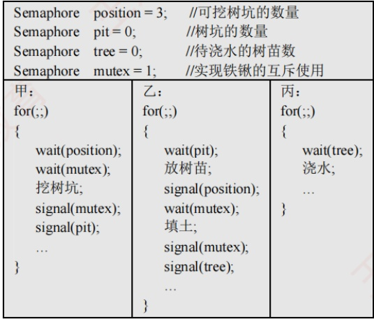

### 2.4.6 本节习题精选

#### 一、单项选择题

01. 下列情况中，可能导致死锁的是（）。
A. 进程释放资源
B. 一个进程进入死循环
C. 多个进程竞争资源出现了循环等待
D. 多个进程竞争使用共享型设备

02.在哲学家进餐问题中，若所有哲学家同时拿起左筷子，则发生死锁，因为他们都需要右筷子才能用餐。为了让尽可能多的哲学家可以同时用餐，并且不发生死锁，可以利用信号量PV操作实现同步互斥，下列说法中正确的是（）。
A. 使用信号量进行控制的方法一定可以避免死锁
B. 同时检查两支筷子是否可用的方法可以预防死锁，但是会导致饥饿问题
C. 限制允许拿起筷子的哲学家数量可以预防死锁，它破坏了“循环等待”条件
D. 对哲学家顺序编号，奇数号哲学家先拿左筷子，然后拿右筷子，而偶数号哲学家刚好相反，可以预防死锁，它破坏了“互斥”条件

03. 下列关于进程死锁的描述中，错误的是（）。
A. 若每个进程只能同时申请或拥有一个资源，则不会发生死锁
B. 若多个进程可以无冲突共享访问所有资源，则不会发生死锁
C. 若所有进程的执行严格区分优先级，则不会发生死锁
D. 若进程资源请求之间不存在循环等待，则不会发生死锁

04.一次分配所有资源的方法可以预防死锁的发生，它破坏死锁4个必要条件中的（）。
A. 互斥
B. 占有并请求
C. 非剥夺
D. 循环等待

05. 系统产生死锁的可能原因是（）。
A. 独占资源分配不当
B. 系统资源不足
C. 进程运行太快
D. CPU 内核太多

06.死锁的避免是根据（）采取措施实现的。
A. 配置足够的系统资源
B. 使进程的推进顺序合理
C. 破坏死锁的四个必要条件之一
D. 防止系统进入不安全状态

07. 死锁预防是保证系统不进入死锁状态的静态策略，其解决办法是破坏产生死锁的四个必要条件之一。下列方法中直接破坏了“循环等待”条件的是（）。
A. 银行家算法
B. 一次性分配策略
C. 剥夺资源法
D. 资源有序分配策略

08. 可以防止系统出现死锁的手段是（）。
A. 用 PV 操作管理共享资源
B. 使进程互斥地使用共享资源
C. 采用资源静态分配策略
D. 定时运行死锁检测程序

09. 某系统中有三个并发进程都需要四个同类资源，则该系统必然不会发生死锁的最少资源
A. 9 是（）。
B. 10
C. 11 道
D. 12

10. 某系统中共有11台磁带机，X个进程共享此磁带机设备，每个进程最多请求使用3台，则系统必然不会死锁的最大X值是（）。
A. 4
B. 5
C. 6
D. 7

11. 若系统中有5个某类资源供若干进程共享，则不会引起死锁的情况是（）。
A. 有6个进程，每个进程需1个资源
B. 有5个进程，每个进程需2个资源
C. 有4个进程，每个进程需3个资源
D. 有3个进程，每个进程需4个资源

12. 解除死锁通常不采用的方法是（）。
A. 终止一个死锁进程
B. 终止所有死锁进程
C. 从死锁进程处抢夺资源
D. 从非死锁进程处抢夺资源

13. 采用资源剥夺法可以解除死锁，还可以采用（）方法解除死锁。
A. 执行并行操作
B. 撤销进程
C. 拒绝分配新资源
D. 修改信号量

14. 在下列死锁的解决方法中，属于死锁预防策略的是（）。
A. 银行家算法
B. 资源有序分配算法土
C. 死锁检测算法
D. 资源分配图化简法

15. 三个进程共享四个同类资源，这些资源的分配与释放只能一次一个。已知每个进程最多需要两个该类资源，则该系统（）。
A. 有些进程可能永远得不到该类资源
B. 必然有死锁 教育
C. 进程请求该类资源必然能得到
D. 必然是死锁

16. 以下有关资源分配图的描述中，正确的是（）。
A. 有向边包括进程指向资源类的分配边和资源类指向进程申请边两类
B. 矩形框表示进程，其中圆点表示申请同一类资源的各个进程
C. 圆圈节点表示资源类
D. 资源分配图是一个有向图，用于表示某时刻系统资源与进程之间的状态

17. 死锁的四个必要条件中，无法破坏的是（）。
A. 环路等待资源
B. 互斥使用资源
C. 占有且等待资源
D. 非抢夺式分配

18. 死锁与安全状态的关系是（）。
A. 死锁状态有可能是安全状态 算机
B. 安全状态有可能成为死锁状态
C. 不安全状态就是死锁状态
D. 死锁状态一定是不安全状态

19. 死锁检测时检查的是（）。
A. 资源有向图
B. 前驱图
C. 搜索树
D. 安全图

20. 某系统采用如下资源分配策略:当一个进程提出资源请求而暂时无法满足时，若当前没有其他进程因等待资源而被阻塞，则该进程自行阻塞；若已有因等待资源而被阻塞的进程，则系统检查所有被阻塞的进程，若其中某些进程所占有的资源恰好是当前申请进程所需的，则立即剥夺这些资源并分配给申请进程。该策略可能导致（）。
A. 系统死锁
B. 系统陷入死循环
C. 进程回退
D. 进程饥饿

21. 系统的资源分配图在下列情况下，无法判断是否处于死锁状态的有（）。I. 出现了环路 II. 没有环路Ⅲ.每种资源只有一个，并出现环路 IV. 每个进程节点至少有一条请求边
A. I、II、III、IV
B. I、ⅢII、IV
C. I、 IV
D. 以上答案都不正确

22. 下列关于死锁的说法中，正确的有（）。I. 死锁状态一定是不安全状态Ⅱ. 产生死锁的根本原因是系统资源分配不足和进程推进顺序非法Ⅲ. 资源的有序分配策略可以破坏死锁的循环等待条件IV. 采用资源剥夺法可以解除死锁，还可以采用撤销进程方法解除死锁
A. I、III
B. II
C. IV
D. 四个说法都对

23.下面是并发进程的程序代码，正确的是（）Semaphore x1=x2=y=1; 道int c1=c2=0;

P1 ( ) P2 () while(1) { P(x1); 算 while(1){ P(x2); if(++c1==1)Ρ(y); if(++c2==1)Ρ(y); V(x1); V(x2); computer(A); 首 computer(B); P(x1) ; P(x2); if(−-c1==0)V(y); if(−-c2==0)V(y); V(x1); V(x2); 1

A. 进程不会死锁，也不会“饥饿”
B. 进程不会死锁，但是会“饥饿”
C. 进程会死锁，但是不会“饥饿”
D. 进程会死锁，也会“饥饿”

24. 有两个并发进程，对于如下这段程序的运行，正确的说法是（）。 ∠4.有网个开反近程，对丁如卜这段柱序的运仃，止硼的说法定（)。

int x,y,z,t,u; P1 ( ) P2 ( ) while(1){ while(1) {x=1; x=0; y=0; t=0; if x>=1 then y=y+1; if x<=1 then t=t+2; z=y; u=t; 1

A. 程序能正确运行，结果唯一
B. 程序不能正确运行，可能有两种结果
C. 程序不能正确运行，结果不确定
D. 程序不能正确运行，可能死锁

25. 一个进程在获得资源后，只能在使用完资源后由自己释放，这属于死锁必要条件的（）。
A. 互斥条件
B. 请求和释放条件
C. 不剥夺条件 道
D. 防止系统进入不安全状态

26. 假设具有 5 个进程的进程集合 $\mathrm{P} = \{\mathrm{P}_0, \mathrm{P}_1, \mathrm{P}_2, \mathrm{P}_3, \mathrm{P}_4 \}$ ，系统中有三类资源 A, B,C，假设在某时刻有如下状态，见下表。

<table><tr><td rowspan=2>进程名</td><td>Allocation</td><td>Max</td><td>Available</td></tr><tr><td>A B C</td><td>A B C</td><td rowspan=6>A B CX y z</td></tr><tr><td> $\mathrm {P_{0}}$ </td><td>0 0 3</td><td>0 0 4</td></tr><tr><td> $\mathrm {P}_{1}$ </td><td>1 0 0</td><td>1 7 5</td></tr><tr><td> $\mathrm {P}_{2}$ </td><td>1 3 5</td><td>2 3 5</td></tr><tr><td> $P_{3}$ </td><td>0 0 2</td><td>0 6 4</td></tr><tr><td> $\mathrm {P}_{4}$ </td><td>0 0 1</td><td>0 6 5</td></tr></table>

系统是处于安全状态的，则 x, y, z 的取值可能是（)。I. 1, 4, 0 II. 0, 6, 2 III. 1, 1, 1 IV. 0,4, 7
A. I、ⅡI、IV
B. I、ⅡI
C. 仅I
D. I、III

27. 死锁定理是用于处理死锁的（）方法。
A. 预防死锁
B. 避免死锁
C. 检测死锁
D. 解除死锁

28. 某系统有m 个同类资源供n个进程共享，若每个进程最多申请k个资源(k≥1)，采用银行家算法分配资源，为保证系统不发生死锁，则各进程的最大需求量之和应（）。
A. 等于 m
B. 等于 m + n
C. 小于 m + n
D. 大于 m + n

29. 采用银行家算法可以避免死锁的发生，这是因为该算法（）。A. 可以抢夺已分配的资源

B. 能及时为各进程分配资源
C. 任何时刻都能保证每个进程能得到所需的资源
D. 任何时刻都能保证至少有一个进程可以得到所需的全部资源

30.用银行家算法避免死锁时，检测到（）时才分配资源。
A. 进程首次申请资源时对资源的最大需求量超过系统现存的资源量
B. 进程已占有的资源数与本次申请的资源数之和超过对资源的最大需求量
C. 进程已占有的资源数与本次申请的资源数之和不超过对资源的最大需求量，且现存资源量能满足尚需的最大资源量
D. 进程已占有的资源数与本次申请的资源数之和不超过对资源的最大需求量，且现存资源量能满足本次申请量，但不能满足尚需的最大资源量

31. 下列各种方法中，可用于解除已发生死锁的是（）。
A. 撤销部分或全部死锁进程
B. 剥夺部分或全部死锁进程的资源
C. 降低部分或全部死锁进程的优先级
D. A 和 B 都可以

32. 假定某计算机系统有两类可使用资源: $\mathbf {R}_{1} \mathrm {~ ( ~} \mathbf {R}_{1}$ 共2个单位）和 $\mathrm{R}_{2} \text {(} \mathrm{R}_{2}$ 共1个单位)，由进程 $\mathrm {P}_{1}$ 和 $\mathrm {P}_{2}$ 共享。两个进程均按如下顺序使用资源:申请 $R_{1} \xrightarrow{}$ 申请 $\mathrm {R}_{2} {\longrightarrow}$ 申请 $\mathrm {R_{1}} {\rightarrow}$ 释放$\mathrm {R_{1}} {\longrightarrow}$ 释放 $\mathrm {R}_{2} {\longrightarrow}$ 释放 $\mathtt {R}_{1}$ ，则在系统运行过程中（）。
A. 不可能产生死锁
B. 有可能产生死锁，因为 $\mathrm {R_{1}}$ 资源不足
C. 有可能产生死锁，因为 $\mathrm {R}_{2}$ 资源不足
D. 只有一种进程执行序列可能导致死锁

33. 在哲学家就餐问题中，若同时存在左撇子和右撇子（将先拿起左侧筷子的人称为左撇子，而将先拿起右侧筷子的人称为右撇子），则不会发生死锁，因为破坏了（）。
A. 互斥条件
B. 请求与保持条件
C. 不剥夺条件
D. 循环等待条件

34. 【2009统考真题】某计算机系统中有8台打印机，由K个进程竞争使用，每个进程最多需要3台打印机。该系统可能发生死锁的K的最小值是（）。
A. 2
B. 3
C. 4
D. 5

35.【2011统考真题】某时刻进程的资源使用情况见下表，此时的安全序列是（）。
A. $\mathrm{P}_{1}, \mathrm{P}_{2}, \mathrm{P}_{3}, \mathrm{P}_{4}$
B. $\mathrm{P}_{1}, \mathrm{P}_{3}, \mathrm{P}_{2}, \mathrm{P}_{4}$
C. $\mathrm{P}_{1}, \mathrm{P}_{4}, \mathrm{P}_{3}, \mathrm{P}_{2}$ 育
D. 不存在

<table><tr><td rowspan=2>进程名</td><td colspan=3>已分配资源</td><td colspan=3>尚需分配</td><td colspan=3>可用资源</td></tr><tr><td> $\mathbf {R_{1}}$ </td><td> $\mathbf {R}_{2}$ </td><td> $\mathbf {R}_{3}$ </td><td> $\mathbf {R_{1}}$ </td><td> $\mathbf {R}_{2}$ </td><td> $\mathbf {R}_{3}$ </td><td> $\mathbf {R_{1}}$ </td><td>R2</td><td>R3</td></tr><tr><td> $\mathrm {P}_{1}$ </td><td>2</td><td>0</td><td>0</td><td>0</td><td>0</td><td>1</td><td rowspan=4>0</td><td rowspan=4>2</td><td rowspan=4>1</td></tr><tr><td> $\mathrm {P}_{2}$ </td><td>1</td><td>2</td><td>0</td><td>1</td><td>3</td><td>2</td></tr><tr><td> $P_{3}$ </td><td>0</td><td>1</td><td>1</td><td>1</td><td>3</td><td>1</td></tr><tr><td> $\mathrm {P}_{4}$ </td><td>0</td><td>0</td><td>1</td><td>2</td><td>0</td><td>0</td></tr></table>

36. 【2012统考真题】假设5个进程 $\mathrm{P}_{0}, \mathrm{P}_{1}, \mathrm{P}_{2}, \mathrm{P}_{3}, \mathrm{P}_{4}$ 共享三类资源 $\mathrm {R}_{1} , \mathrm {R}_{2} , \mathrm {R}_{3}$ ，这些资源总数分别为18,6,22。 $T_{0}$ 时刻的资源分配情况如下表所示，此时存在的一个安全序列是（）。

<table><tr><td rowspan=2>进程名</td><td colspan=3>已分配资源</td><td colspan=3>资源最大需求</td></tr><tr><td> $\mathbf {R_{1}}$ </td><td> $\mathbf {R}_{2}$ </td><td> $\mathbf {R}_{3}$ </td><td> $\mathbf {R_{1}}$ </td><td> $\mathbf {R}_{2}$ </td><td> $\mathbf {R}_{3}$ </td></tr><tr><td> $\mathrm {P_{0}}$ </td><td>3</td><td>2</td><td>3</td><td>5</td><td>5</td><td>10</td></tr><tr><td> $\mathrm {P_{l}}$ </td><td>4</td><td>0</td><td>3</td><td>5</td><td>3</td><td>6</td></tr><tr><td> $P_2$ </td><td>4</td><td>0</td><td>5</td><td>4</td><td>0</td><td>11</td></tr><tr><td> $\mathrm {P}_{3}$ </td><td>2</td><td>0</td><td>4</td><td>4</td><td>2</td><td>5</td></tr><tr><td> $P_4$ </td><td>3</td><td>1</td><td>4</td><td>4</td><td>2</td><td>4</td></tr></table>

A. $\mathrm{P}_{0}, \mathrm{P}_{2}, \mathrm{P}_{4}, \mathrm{P}_{1}, \mathrm{P}_{3}$
B. $\mathrm{P}_{1}, \mathrm{P}_{0}, \mathrm{P}_{3}, \mathrm{P}_{4}, \mathrm{P}_{2}$
C. X $\mathrm{P}_{2}, \mathrm{P}_{1}, \mathrm{P}_{0}, \mathrm{P}_{3}, \mathrm{P}_{4}$
D. $\mathrm{P}_{3}, \mathrm{P}_{4}, \mathrm{P}_{2}, \mathrm{P}_{1}, \mathrm{P}_{0}$

37.【2013统考真题】下列关于银行家算法的叙述中，正确的是（）。
A. 银行家算法可以预防死锁
B. 当系统处于安全状态时，系统中一定无死锁进程
C. 当系统处于不安全状态时，系统中一定会出现死锁进程
D. 银行家算法破坏了死锁必要条件中的“请求和保持”条件

38. 【2014统考真题】某系统有n台互斥使用的同类设备，三个并发进程分别需要3,4,5台设备，可确保系统不发生死锁的设备数n最小为（）。 D. 12

39. 【2015统考真题】若系统 $\mathrm {S}_{1}$ 采用死锁避免方法， $\mathbb {S}_{2}$ 采用死锁检测方法。下列叙述中，正确的是（）。I. $\mathbb {S}_{1}$ 会限制用户申请资源的顺序，而 $\mathbb {S}_{2}$ 不会 算II. $\mathrm{S}_{1}$ 需要进程运行所需的资源总量信息，而 $\mathbb {S}_{2}$ 不需要III. $\mathrm {S}_{1}$ 不会给可能导致死锁的进程分配资源， $而  \;  S_2$ 会 王道计
A. 仅I、ⅡI
B. 仅ⅡI、ⅢII
C. 仅I、ⅢI
D. I、II、III

40.【2016统考真题】系统中有3个不同的临界资源 $\mathrm {R}_{1} ,   \mathrm {R}_{2}$ 和 $\mathtt {R}_{3}$ ，被4个进程 $\mathrm{P}_{1}, \mathrm{P}_{2}, \mathrm{P}_{3}, \mathrm{P}_{4}$共享。各进程对资源的需求为: $\mathrm {P}_{1}$ 申请 $\mathrm {R}_{1}$ 和 $R_{2} ,  P_{2}$ 申请 $\mathtt {R}_{2}$ 和 $\mathrm {R}_{3} , \mathrm {~ P}_{3}$ 申请 $\mathrm {R}_{1}$ 和 $\mathrm {R}_{3} , \mathrm {~ P}_{4}$申请 $\mathtt {R}_{2}$ 。若系统出现死锁，则处于死锁状态的进程数至少是（）。
A. 1
B. 2
C. 3
D. 4

41.【2018统考真题】假设系统中有4个同类资源，进程 $\mathrm {P}_{1} , \mathrm {P}_{2}$ 和 $\mathrm {P}_{3}$ 需要的资源数分别为4,3和1, $\mathrm {P}_{1} , \mathrm {P}_{2}$ 和 $\mathrm {P}_{3}$ 已申请到的资源数分别为2,1和0，则执行安全性检测算法的结果是（）。
A. 不存在安全序列，系统处于不安全状态
B. 存在多个安全序列，系统处于安全状态
C. 存在唯一安全序列 $\mathrm {P}_{3} , \mathrm {P}_{1} , \mathrm {P}_{2}$ ，系统处于安全状态
D. 存在唯一安全序列 $\mathrm {P}_{3} , \mathrm {P}_{2} , \mathrm {P}_{1}$ ，系统处于安全状态

42.【2019统考真题】下列关于死锁的叙述中，正确的是（）。I. 可以通过剥夺进程资源解除死锁 I. 死锁的预防方法能确保系统不发生死锁 算机教育IⅢ. 银行家算法可以判断系统是否处于死锁状态IV. 当系统出现死锁时，必然有两个或两个以上的进程处于阻塞态
A. 仅ⅡI、ⅢI
B. 仅I、ⅡI、IV
C. 仅I、ⅡI、ⅢI
D. 仅I、ⅢII、IV

43.【2020统考真题】某系统中有A、B两类资源各6个，t时刻的资源分配及需求情况如下表所示。

| 进程名 | A 已分配数量 | B已分配数量 | A 需求总量 | B需求总量 |
| --- | --- | --- | --- | --- |
| $\mathrm {P_{1}}$ | 2 | 3 | 4 | 4 |
| $\mathrm {P}_{2}$ | 2 | 1 | 3 | 1 |
| $P_{3}$ | 1 | 2 | 3 | 4 |

t时刻安全性检测结果是（）。
A. 存在安全序列 $P_{1} 、  P_{2} 、  P_{3}$ 计算初
B. 存在安全序列 $P_{2} 、  P_{1} 、  P_{3}$
C. 存在安全序列 $\mathrm{P}_{2} 、 \mathrm{P}_{3} 、 \mathrm{P}_{1}$
D. 不存在安全序列

44.【2021统考真题】若系统中有 $n (n \geqslant 2)$ 个进程，每个进程均需要使用某类临界资源2个，则系统不会发生死锁所需的该类资源总数至少是（）。
A. 2
B. n N
C. n+ 1
D. 2n

45.【2022统考真题】系统中有三个进程 $\mathrm {P_{0}}$ $\mathrm {P}_{1}$ 、 $\mathrm{P}_{2}$ 及三类资源A、B、C。若某时刻系统分配资源的情况如下表所示，则此时系统中存在的安全序列的个数为（）。

<table><tr><td rowspan=2>进程名</td><td colspan=3>已分配资源数</td><td colspan=3>尚需资源数</td><td colspan=3>可用资源数</td></tr><tr><td>A</td><td>B</td><td>C</td><td>A</td><td>B</td><td>C</td><td>A</td><td>B</td><td>C</td></tr><tr><td> $\mathrm {P_{0}}$ </td><td>2</td><td>0</td><td>1</td><td>0</td><td>2</td><td>1</td><td rowspan=3>1</td><td rowspan=3>3</td><td rowspan=3>2</td></tr><tr><td> $\mathrm {P}_{1}$ </td><td>0</td><td>2</td><td>0</td><td>1</td><td>2</td><td>3</td></tr><tr><td> $\mathrm {P}_{2}$ </td><td>1</td><td>0</td><td>1</td><td>0</td><td>1</td><td>3</td></tr><tr><td colspan=10>
B. 2
C. 3</td></tr></table>

#### 二、综合应用题

01. 系统有同类资源m个，供n个进程共享，若每个进程对资源的最大需求量为k，试问:当m, n,k的值分别为下列情况时（见下表），是否会发生死锁？

| 序 号 | m | n | k | 是否会死锁 | 说明 |
| --- | --- | --- | --- | --- | --- |
| 1 | 6 | 3 | 3 |  |  |
| 2 | 9 | 3 | 3 |  |  |
| 3 | 13 | 6 | 3 |  |  |

02. 有三个进程 $\mathrm {P}_{1}$ $\mathrm {P}_{2}$ 和 $\mathrm {P}_{3}$ 并发工作。进程 $\mathrm {P}_{1}$ 需要资源 $\mathbb {S}_{3}$ 和资源 $\mathrm {S_{1} ;}$ 进程 $\mathrm {P}_{2}$ 需要资源 $\mathbb {S}_{2}$和资源 $\mathbf {S}_{1} ;$ 进程 $\mathrm {P}_{3}$ 需要资源 $\mathbb {S}_{3}$ 和资源 $\mathrm{S}_{2} 。$ 问:

1）若对资源分配不加限制，会发生什么情况？为什么？

2）为保证进程正确运行，应采用怎样的分配策略？列出所有可能的方法。

03. 某系统有 $\mathrm {R}_{1} , \mathrm {R}_{2}$ 和 $\mathrm {R}_{3}$ 共三种资源，在 $T_{0}$ 时刻 $\mathrm {P}_{1} , \mathrm {P}_{2} , \mathrm {P}_{3}$ 和 $\mathrm {P}_{4}$ 这四个进程对资源的占用和需求情况见下表，此时系统的可用资源向量为(2,1,2)。试问:

1）系统是否处于安全状态？若安全，则请给出一个安全序列。

2）若此时进程 $\mathrm {P_{1}}$ 和进程 $\mathrm {P}_{2}$ 均发出资源请求向量Request(1,0, 1)，为了保证系统的安全性，应如何分配资源给这两个进程？说明所采用策略的原因。

3）若2）中两个请求立即得到满足后，系统此刻是否处于死锁状态？

<table><tr><td rowspan=3>进程名</td><td colspan=6>资源情况</td></tr><tr><td colspan=3>最大资源需求量</td><td colspan=3>已分配资源数量</td></tr><tr><td> $\mathbf {R_{1}}$ </td><td> $\mathbf {R}_{2}$ </td><td> $\mathbf {R}_{3}$ </td><td> $\mathbf {R_{1}}$ </td><td> $\mathbf {R}_{2}$ </td><td> $\mathbf {R}_{3}$ </td></tr><tr><td> $\mathrm {P_{1}}$ </td><td>3</td><td>2</td><td>2</td><td>1</td><td>0</td><td>0</td></tr><tr><td> $\mathrm {P}_{2}$ </td><td>6</td><td>1</td><td>3</td><td>4</td><td>1</td><td></td></tr><tr><td> $P_{3}$ </td><td>3</td><td>1</td><td>4</td><td>2</td><td>1</td><td>1</td></tr><tr><td> $\mathrm {P}_{4}$ </td><td>4</td><td>2</td><td>2</td><td>0</td><td>0</td><td>2</td></tr></table>

04. 考虑某个系统在下表时刻的状态。

<table><tr><td rowspan=2>进程名</td><td colspan=4>Allocation</td><td colspan=4>Max</td><td colspan=4>Available</td></tr><tr><td>A</td><td>B</td><td>C</td><td>D</td><td>A</td><td>B</td><td>C</td><td>D</td><td>A</td><td>B</td><td>C</td><td>D</td></tr><tr><td> $\mathrm {P_{0}}$ </td><td>0</td><td>0</td><td>1</td><td>2</td><td>0</td><td>0</td><td>1</td><td>2</td><td rowspan=4>1</td><td rowspan=4>5</td><td rowspan=4>2</td><td rowspan=4>0</td></tr><tr><td> $\mathrm {P_{1}}$ </td><td>1</td><td>0</td><td>0</td><td>0</td><td>1</td><td>7</td><td>5</td><td>0</td></tr><tr><td> $\mathrm {P}_{2}$ </td><td>1</td><td>3</td><td>5</td><td>4</td><td>2</td><td>3</td><td>5</td><td>6</td></tr><tr><td> $P_{3}$ </td><td>0</td><td>0</td><td>1</td><td>4</td><td>0</td><td>6</td><td>5</td><td>6</td></tr></table>

使用银行家算法回答下面的问题:

1）Need矩阵是怎样的？

2）系统是否处于安全状态？如安全，请给出一个安全序列。

3）若从进程 $\mathrm {P_{1}}$ 发来一个请求(0,4,2,0)，这个请求能否立刻被满足？如安全，请给出一个安全序列。

05. 假设具有 5 个进程的进程集合 $\mathbf{P} = \{\mathbf{P}_{0}, \mathbf{P}_{1}, \mathbf{P}_{2}, \mathbf{P}_{3}, \mathbf{P}_{4} \}$ ，系统中有三类资源 A, B, C，假设在某时刻有如下状态:

<table><tr><td rowspan=2>进程名</td><td colspan=3>Allocation</td><td colspan=3>Max</td><td colspan=3>Available</td></tr><tr><td>A</td><td>B</td><td>C</td><td>A</td><td>B</td><td>C</td><td>A</td><td>B</td><td>C</td></tr><tr><td> $\mathrm {P_{0}}$ </td><td>0</td><td>0</td><td>3</td><td>0</td><td>0</td><td>4</td><td rowspan=5>1</td><td rowspan=5>4</td><td rowspan=5>0</td></tr><tr><td> $\mathrm {P_{1}}$ </td><td>1</td><td>0</td><td>0</td><td>1</td><td>7</td><td>5</td></tr><tr><td> $\mathrm {P}_{2}$ </td><td>1</td><td>3</td><td>5</td><td>2</td><td>3</td><td>5</td></tr><tr><td> $\mathrm {P}_{3}$ </td><td>0</td><td>0</td><td>2</td><td>0</td><td>6</td><td>4</td></tr><tr><td> $\mathrm {P}_{4}$ </td><td>0</td><td>0</td><td>1</td><td>0</td><td>6</td><td>5</td></tr></table>

当前系统是否处于安全状态？若系统中的可利用资源 Available为(0,6, 2)，系统是否安全？若系统处在安全状态，请给出安全序列；若系统处在非安全状态，简要说明原因。

### 2.4.7 答案与解析

#### 一、单项选择题

01. C

引起死锁的4个必要条件是:互斥、占有并等待、非剥夺和循环等待。本题中，出现了循环等待的现象，意味着可能导致死锁。进程释放资源不会导致死锁，进程自己进入死循环只能产生“饥饿”，不涉及其他进程。共享型设备允许多个进程申请使用，因此不会造成死锁。再次提醒，死锁一定要有两个或两个以上的进程才会导致，而饥饿可能由一个进程导致。

02. C

信号量机制能确保临界资源的互斥访问，不能完全避免死锁，选项A错误。同时检查两支筷子是否可用的方法可以预防死锁，但是会导致资源浪费，因为可能有一些空闲的筷子无法使用，但拿到筷子的哲学家用完餐后，释放筷子，其他哲学家就可以正常用餐，因此不会导致饥饿现象，选项B错误。若限制允许拿起筷子的哲学家数量，则不被允许的哲学家左边的哲学家一定可以拿到两边的筷子，从而破坏“循环等待”条件，选项C正确。对哲学家顺序编号，奇数号哲学家先拿左筷子，然后拿右筷子，而偶数号哲学家刚好相反，则相邻的哲学家总有一个可以拿起两边的筷子，但这破坏的是“循环等待”条件，而不是“互斥条件”，选项D错误。

03. C

进程的执行优先级并不能破坏死锁的四个必要条件。即使有高优先级和低优先级的进程，若它们都请求或占有了不可抢占的资源，且形成了环路等待，则死锁仍可能发生。选项A可以破坏请求并保持条件，选项B可以破坏互斥条件，选项D可以破坏循环等待条件。

04. B

发生死锁的4个必要条件:互斥、占有并请求、非剥夺和循环等待。一次分配所有资源的方法是当进程需要资源时，一次性提出所有的请求，若请求的所有资源均满足，则分配，只要有一项不满足，就不分配任何资源，该进程阻塞，直到所有的资源空闲后，满足进程的所有需求时再分配。这种分配方式不会部分地占有资源，因此打破了死锁的4个必要条件之一，实现了对死锁的预防。但是，这种分配方式需要凑齐所有资源，因此当一个进程所需的资源较多时，资源的利用率会较低，甚至会造成进程“饥饿”。

05. A

系统死锁的可能原因主要是时间上和空间上的。时间上由于进程运行中推进顺序不当，即调度时机不合适，不该切换进程时进行了切换，可能造成死锁；空间上的原因是对独占资源分配不当，互斥资源部分分配又不可剥夺，极易造成死锁。那么，为什么系统资源不足不是造成死锁的原因呢？系统资源不足只会对进程造成“饥饿”。例如，某系统只有三台打印机，若进程运行中要申请四台，则显然不能满足，该进程会永远等待下去。若该进程在创建时便声明需要四台打印机，则操作系统立即就会拒绝，这实际上是资源分配不当的一种表现。不能以系统资源不足来描述剩余资源不足的情形。

06. D

死锁避免是指在资源动态分配过程中用某些算法加以限制，防止系统进入不安全状态从而避免死锁的发生。选项B是避免死锁后的结果，而不是措施的原理。

07. D

资源有序分配策略可以限制循环等待条件的发生。选项A判断是否为不安全状态；选项B破坏了占有请求条件；选项C破坏了非剥夺条件。

08. C

PV操作不能破坏死锁条件，反而可能加强互斥和占有并等待条件。选项B同理。选项C可以破坏请求并保持条件。选项D只能在系统出现死锁时检测，却不能防止系统出现死锁。

09. B

资源数为9时，存在三个进程都占有三个资源，为死锁；资源数为10时，必然存在一个进程能拿到4个资源，然后可以顺利执行完其他进程。

10. B

考虑极端情况:每个进程已经分配了两台磁带机，那么其中任何一个进程只要再分配一台磁带机即可满足它的最大需求，该进程总能运行下去直到结束，然后将磁带机归还给系统再次分配给其他进程使用。因此，系统中只要满足2X+1=11这个条件即可认为系统不会死锁，解得X=5，也就是说，系统中最多可以并发5个这样的进程是不会死锁的。或者，根据死锁公式，资源数大于进程个数乘以“每个进程需要的最大资源数减1”就不会发生死锁，即 $m > n(w - 1)$ ，其中 m是磁带机的数量，n是进程的数量，w是每个进程最多请求的磁带机数量。代入可得 $11 > n ( 3 - 1 )$即 n < 5.5，n是正整数，因此系统必然不会死锁的最大n值是5。

11. A

A项的每个进程只申请一个资源，破坏了请求并保持条件，必然不会发生死锁。或者，根据死锁公式，假设系统共有m个资源，n个进程，每个进程需要k个资源，若满足 $m   >   n ( k   -   1 )$ ，则系统一定不会发生死锁，代入公式可知选项B、C、D均可能发生死锁。

12. D

解除死锁的方法有，①剥夺资源法:挂起某些死锁进程，并抢占它的资源，将这些资源分配给其他的死锁进程；②撤销进程法:强制撤销部分甚至全部死锁进程并剥夺这些进程的资源。

13. B

资源剥夺法允许一个进程强行剥夺其他进程所占有的系统资源。而撤销进程强行释放一个进程已占有的系统资源，与资源剥夺法同理，都通过破坏死锁的“请求和保持”条件来解除死锁。拒绝分配新资源只能维持死锁的现状，无法解除死锁。

14. B

其中，银行家算法为死锁避免算法，死锁检测算法和资源分配图化简法为死锁检测，根据排除法可以得出资源有序分配算法为死锁预防策略。

15. C

不会发生死锁。因为每个进程都分得一个资源时，还有一个资源可以让任意一个进程满足，这样这个进程可以顺利运行完成进而释放它的资源。

16. D

进程指向资源的有向边称为申请边，资源指向进程的有向边称为分配边，选项A张冠李戴；矩形框表示资源，其中的圆点表示资源的数量，选项B错；圆圈节点表示进程，选项C错；选项D的说法是正确的。

17. B

所谓破坏互斥使用资源，是指允许多个进程同时访问资源，但有些资源根本不能同时访问，如打印机只能互斥使用。因此，破坏互斥条件而预防死锁的方法不太可行，而且在有的场合应该保护这种互斥性。其他三个条件都可以实现。

18. D

如右图所示，并非所有不安全状态都是死锁状态，但当系统进入不安全状态后，便可能进入死锁状态；反之，只要系统处于安全状态，系统便可避免进入死锁状态；死锁状态必定是不安全状态。

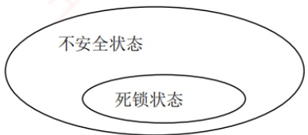

19. A

死锁检测一般采用两种方法:资源有向图法和资源矩阵法。前驱图只是说明进程之间的同步关系，搜索树用于数据结构的分析，安全图并不存在。注意死锁避免和死锁检测的区别:死锁避免是指避免死锁发生，即死锁没有发生；死锁检测是指死锁已出现，要把它检测出来。

20. D

该策略在新进程的资源请求无法满足时，从已阻塞的进程中剥夺其所占的资源，并分配给新进程。由于资源可被剥夺，死锁的“不剥夺条件”被破坏，因此不可能发生死锁；被剥夺资源的进程直接进入阻塞态，并无反复执行或循环调度行为，不会导致系统陷入死循环；策略仅涉及资源的即时重分配，未要求进程撤销操作或回退至先前状态，不构成回退；然而，被剥夺的进程可能因持续被新请求者抢占资源，长期无法获得足够资源以完成执行，从而引发饥饿。

21. C

出现了环路，只是满足了循环等待的必要条件，而满足必要条件不一定会导致死锁，说法I对；没有环路，破坏了循环等待条件，一定不会发生死锁，说法Ⅱ错；每种资源只有一个，又出现了环路，这是死锁的充分条件，可以确定是否有死锁，说法Ⅲ错；即使每个进程至少有一条请求边，若资源足够，则不会发生死锁，但若资源不充足，则有发生死锁的可能，说法IV对。综上所述，选择选项C。

22. D

说法Ⅰ正确。说法Ⅱ正确:这是产生死锁的两大原因。说法Ⅲ正确:在对资源进行有序分配时，进程间不可能出现环形链，即不会出现循环等待。说法IV正确:资源剥夺法允许一个进程强行剥夺其他进程占有的系统资源。而撤销进程强行释放一个进程已占有的系统资源，与资源剥夺法同理，都通过破坏死锁的“请求和保持”条件来解除死锁，因此选择选项D。

23. B

遇到这种问题时千万不要慌张，下面我们来慢慢分析，给读者一个清晰的解题过程。

仔细考察程序代码，可以看出这是一个扩展的单行线问题。也就是说，某单行线只允许单方向的车辆通过，在单行线的入口设置信号量y，在告示牌上显示某一时刻各方向来车的数量c1和c2，要修改告示牌上的车辆数量必须互斥进行，为此设置信号量x1和x2。若某方向的车辆需要通过时，则首先要将该方向来车数量c1或c2增加1，并查看自己是否是第一个进入单行线的车辆，若是，则获取单行线的信号量y，并进入单行线。通过此路段以后出单行线时，将该方向的车辆数c1或c2减1（当然是利用x1或x2来互斥修改），并查看自己是否是最后一辆车，若是，则释放单行线的互斥量y，否则保留信号量y，让后继车辆继续通过。双方的操作如出一辙。考虑出现一个极端情况，即当某方向的车辆首先占据单行线并后来者络绎不绝时，另一个方向的车辆就再没有机会通过该单行线了。而这种现象是由于算法本身的缺陷造成的，不属于因为特殊序列造成的饥饿，所以它是真正的饥饿现象。因为有信号量的控制，所以死锁的可能性没有了（双方同时进入单行线，在中间相遇，造成双方均无法通过的情景）。

①假设 $\mathrm {P}_{1}$ 进程稍快， $\mathrm {P}_{2}$ 进程稍慢，同时运行；② $\mathrm {P}_{1}$ 进程首先进入if条件语句，因此获得了 y 的互斥访问权， $\mathrm {P}_{2}$ 被阻塞；③在第一个 $\mathrm {P}_{1}$ 进程未释放y之前，又有另一个 $\mathrm {P}_{1}$ 进入，c1的值变成2，当第一个 $\mathrm {P}_{1}$ 离开时， $\mathrm {P}_{2}$ 仍然被阻塞，这种情形不断发生；④在这种情况下会发生什么事？$\mathrm {P}_{1}$ 顺利执行， $\mathrm {P}_{2}$ 很郁闷，长期被阻塞。

综上所述，不会发生死锁，但会出现饥饿现象。因此选B。

24. C

本题中两个进程不能正确地工作，运行结果的可能性详见下面的说明。1. x = 1; 5. x = 0; 2. y = 0; 6. t = 0; 3. $\mathrm{If} \; \mathrm{x} >= 1 \; \mathrm{then} \; \mathrm{y} = \mathrm{y} + 1;$ 王道 7. if x <= 1 then t = t + 2; 4. z=y; 8. u = t;

不确定的原因是由于使用了公共变量x，考查程序中与变量x有关的语句共四处，执行的顺序是 $1 \rightarrow 2 \rightarrow 3 \rightarrow 4 \rightarrow 5 \rightarrow 6 \rightarrow 7 \rightarrow 8$ 时，结果是 $y = 1, \; z = 1, \; t = 2, \; u = 2, \; x = 0;$ 并发执行过程是1→ $2 \rightarrow 5 \rightarrow 6 \rightarrow 3 \rightarrow 4 \rightarrow 7 \rightarrow 8$ 时，结果是 $\mathrm{y}=0,\mathrm{~Z}=0,\mathrm{~t}=2,\mathrm{~u}=2,\mathrm{~x}=0$ ；执行的顺序是 $5 \rightarrow 6 \rightarrow 7 \rightarrow 8 \rightarrow$ 1→2→3→4 时，结果是 $y = 1, z = 1, t = 2, u = 2, x = 1$ ；执行的顺序是 $5 \rightarrow 6 \rightarrow 1 \rightarrow 2 \rightarrow 7 \rightarrow 8 \rightarrow 3 \rightarrow 4$ 时，结果是 $y = 1, z = 1, t = 2, u = 2, x = 1$ 。可见结果有多种可能性。

显然，无论执行顺序如何，x的结果只能是0或1，因此语句7的条件一定成立，即 $\mathrm {t} = \mathrm {u} = 2$的结果是一定的；而y=z必定成立，只可能有0,1两种情况，又不可能出现 $\mathrm{x}=1,\mathrm{y}=\mathrm{z}=0$ 的情况，所以总共只有3种结果（答案中的3种）。

25. C

一个进程在获得资源后，只能在使用完资源后由自己释放，即它的资源不能被系统剥夺。

26. C

$$
\mathrm{Need}=\mathrm{Max}-\mathrm{Allocation}=\begin{bmatrix}0&0&4\\1&7&5\\2&3&5\\0&6&4\\0&6&5\end{bmatrix}-\begin{bmatrix}0&0&3\\-1&0&0\\1&3&5\\0&0&2\\0&0&1\end{bmatrix}=\begin{bmatrix}0&0&1\\0&7&5\\1&0&0\\0&6&2\\0&6&4\end{bmatrix}
$$

说法I:根据 need 矩阵可知，当 Available 为(1,4,0)时，可满足 $\mathrm {P}_{2}$ 的需求； $\mathrm {P}_{2}$ 结束后释放资源，

Available 为(2, 7, 5)可以满足 $\mathrm{P}_{0}, \mathrm{P}_{1}, \mathrm{P}_{3}, \mathrm{P}_{4}$ 中任意一个进程的需求，所以系统不会出现死锁，处于安全状态。说法Ⅱ:当Available为(0,6,2)时，可以满足进程 $\mathrm {P_{0}} , \mathrm {P_{3}}$ 的需求；这两个进程结束后释放资源，Available为(0,6,7)，仅可以满足进程4的需求； $\mathrm {P}_{4}$ 结束并释放后，Available为(0,6,8)，此时不能满足余下任意一个进程的需求，因此当前处在非安全状态。说法Ⅲ:当Available为(1,1,1)时，可以满足进程 $\mathrm {P_{0}} , \mathrm {P_{2}}$ 的需求；这两个进程结束后释放资源，Available为(2,4,9)，此时不能满足余下任意一个进程的需求，处于非安全状态。说法 $\mathrm {I V} ;$ 当Available为(0,4,7)时，可以满足 $\mathrm {P_{0}}$ 的需求，进程结束后释放资源，Available为(0,4,10)，此时不能满足余下任意一个进程的需求，处于非安全状态。综上分析:只有说法Ⅰ处于安全状态。

27. C

死锁定理是用于检测死锁的方法。

28. C

按照银行家算法，只要保证系统中进程申请的最大资源数小于或等于 $m$ ，就一定存在一个安全序列。考虑最极端的情况，假如有n-1个进程都申请了1个资源，剩下一个进程申请了m个资源，则各进程的最大需求量之和为 $m   +   n   -   1$ ，此时能保证一定不会发生死锁。

29. D

任何时刻都能保证至少有一个进程可以得到所需的全部资源，这意味着银行家算法可以保证系统中至少存在一个安全序列，使每个进程都能按该顺序得到所需的全部资源并正常结束，不会出现死锁的情况。这也是银行家算法避免死锁的核心思想。

30. C

银行家算法要求，进程运行之前先声明它对各类资源的最大需求量，并保证它在任何时刻对每类资源的请求量不超过它所声明的最大需求量。当进程已占有的资源数与本次申请的资源数之和不超过对资源的最大需求量，并且现存资源量能满足尚需的最大资源量时，才分配资源。

31. D

解除死锁的方法有两种:撤销死锁进程和剥夺死锁进程的资源。降低死锁进程的优先级是无效的方法，因为它不能改变死锁进程对资源的需求和占有，也不能打破循环等待条件。

32. B

当 $\mathrm {P_{1}}$ 和 $\mathrm {P}_{2}$ 各自完成第一步后，均已持有1个 $\mathrm {R_{1}}$ （共2个）， $\mathtt {R}_{1}$ 资源耗尽。无论哪个进程先申请到唯一的 $\mathtt {R}_{2}$ ，其在下一步申请第二个 $\mathtt {R}_{1}$ 时都将因资源不足而阻塞；另一个进程则因无法获

取 $\mathrm {R}_{2}$ 而阻塞。例如，此时 $\mathrm {P_{1}}$ 持有 $\mathrm {R_{1}}$ 和 $\mathtt {R}_{2}$ 并等待 $\mathrm {R_{1}}$ ， $\mathrm {P}_{2}$ 持有 $\mathtt {R_{l}}$ 并等待 $\mathrm{R}_{2}$ ，形成循环等待链，且资源不可剥夺，系统陷入死锁。根本原因在于:每个进程需两次使用 $\mathrm {R}_{1}$ ，而系统仅有2个 $\mathtt {R}_{1}$ 单位，无法满足两个进程在交错执行时各自的第二次 $\mathtt {R}_{1}$ 请求，故死锁源于$\mathrm {R_{1}}$ 资源不足。

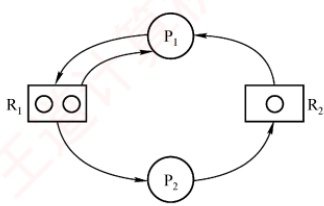

补充分析:若 $\mathtt {R_{l}}$ 无限、 $\mathtt {R}_{2}$ 为1个，则总有一个进程能完成并

释放 $\mathrm {R}_{2}$ ，不会死锁；但若 $\mathrm {R_{1}}$ 为2个、 $\mathrm {R}_{2}$ 无限，则仍可能死锁。例如: $\mathrm {P}_{1}$ 申请到 $\mathtt {R}_{1}$ 、 $\mathtt {R}_{2}$ 后被切换，$\mathrm {P}_{2}$ 申请 $\mathrm {R_{1}}$ $\mathrm {R}_{2}$ ，再申请 $\mathrm {R_{1}}$ 时阻塞； $\mathrm {P_{1}}$ 恢复执行后也因无法获得第二个 $\mathtt {R}_{1}$ 而阻塞。此时，双方互相等待，死锁发生。

33. D

当哲学家中同时存在左撇子（先取左侧筷子）和右撇子（先取右侧筷子）时，各进程请求资源的顺序不再一致，至少有一对相邻哲学家不会同时持有一根筷子并等待对方释放另一根，从而无法形成环形等待链，破坏了死锁的循环等待条件，避免了死锁的发生。

34. C

这类题可用到组合数学中鸽巢原理的思想。考虑最极端的情况，因为每个进程最多需要3台打印机，若每个进程已经占有了2台打印机，则只要还有多的打印机，总能满足一个进程达到3台的条件，然后顺利执行，所以将8台打印机分给K个进程，每个进程有2台打印机，这个情况就是极端情况，K为4。或者，假设M是打印机的数量，K是进程的数量，R是每个进程最多需要打印机的数量。根据死锁公式逆推可得，若 $M \leqslant K(R - 1)$ ，则系统可能发生死锁。将本题的数据代入，得到 $8 \leq K(3 - 1)$ ，即 $K {\geqslant} 4$ ，因此系统可能发生死锁的K的最小值是4。

35. D

本题应采用排除法，逐个代入分析。剩余资源分配给 $\mathrm {P_{1}}$ ，待 $\mathrm {P}_{1}$ 执行完后，可用资源数为(2,2,1)，此时仅能满足 $\mathrm {P}_{4}$ 的需求，排除选项A、B；接着分配给 $\mathrm {P}_{4}$ ，待 $\mathrm {P}_{4}$ 执行完后，可用资源数为(2,2,2),此时已无法满足任何进程的需求，排除选项 $\mathrm {C}_{\circ}$

此外，本题还可以使用银行家算法求解（对选择题来说显得过于复杂）。

36. D

首先求得各进程的需求矩阵 Need 与可利用资源向量 Available:

<table><tr><td rowspan=2>进程名</td><td colspan=3>Need</td></tr><tr><td>R1</td><td>R2</td><td>R3</td></tr><tr><td> $\mathrm {P_{0}}$ </td><td>2</td><td>3</td><td>7</td></tr><tr><td> $\mathrm {P}_{1}$ </td><td>1</td><td>3</td><td>3</td></tr><tr><td> $\mathrm {P}_{2}$ </td><td>0</td><td>0</td><td>6</td></tr><tr><td> $\mathrm {P}_{3}$ </td><td>2</td><td>2</td><td>1</td></tr><tr><td> $\mathrm {P}_{4}$ </td><td>1</td><td>1</td><td>0</td></tr></table>

<table><tr><td rowspan=2>Available</td><td>R1</td><td> $\mathbf {R}_{2}$ </td><td> $\mathbf {R}_{3}$ </td></tr><tr><td>2</td><td>3</td><td>3</td></tr></table>

比较 Need 和 Available 发现，初始时进程 $\mathrm {P}_{1}$ 与 $\mathrm {P}_{3}$ 可满足需求，排除选项A、C。尝试给 $\mathrm {P}_{1}$分配资源时， $\mathrm {P}_{1}$ 完成后 Available 将变为(6, 3,6)，无法满足 $\mathrm {P_{0}}$ 的需求，排除选项B。尝试给 $\mathrm {P}_{3}$ 分配资源时， $\mathrm {P}_{3}$ 完成后Available将变为(4,3,7)，该向量能满足其他所有进程的需求。因此，以 $\mathrm {P}_{3}$开头的所有序列都是安全序列。

37. B

银行家算法是避免死锁的方法，选项A、D错。根据下图，选项B对，选项C错。

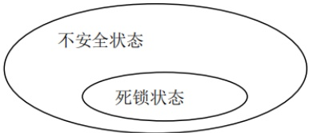

38. B

根据死锁公式，当资源数量大于各个进程所需资源数-1的总和时，不发生死锁，三个进程分别需要3,4,5台设备，即当资源数量大于 $(3 - 1) + (4 - 1) + (5 - 1) = 9$ 时，不发生死锁。而当系统中只有9台设备时，第一个进程分配2台，第二个进程分配3台，第三个进程分配4台，这种情况下，三个进程均无法继续执行下去，发生死锁。当系统再增加1台设备，最后1台设备分配给任意一个进程都可以顺利执行完成，因此保证系统不发生死锁的最小设备数为10。

39. B

死锁的处理采用三种策略:死锁预防、死锁避免、死锁检测和解除。

死锁预防采用破坏产生死锁的4个必要条件中的一个或几个来防止发生死锁。其中之一的“破坏循环等待条件”，一般采用顺序资源分配法，即限制了用户申请资源的顺序，因此说法Ⅰ的前半句属于死锁预防的范畴。此外，银行家算法虽然会通过检测是否存在安全序列来判断申请资源的请求是否合法，但安全序列并不是唯一的，也不是固定的，它只是一种可能的分配方案，而不是一种必须遵循的规则，银行家算法更没有给出固定的申请资源的顺序，因此说法Ⅰ错误。

银行家算法是最著名的死锁避免算法，其中的最大需求矩阵Max定义了每个进程对m类资源的最大需求量，系统在执行安全性算法中都会检查此次资源试分配后，系统是否处于安全状态，若不安全则将本次的试探分配作废。在死锁的检测和解除中，系统为进程分配资源时不采取任何措施，但提供死锁检测和解除的手段，一旦检测到系统发生死锁，就立即采取相应的措施来解除死锁，因此不用关心进程所需的总资源量。说法Ⅱ、Ⅲ正确。

40. C

对于本题，需先画出如右所示的资源分配图。若系统出现死锁，则必然出现循环等待的情况。

从图中可以看出，若出现循环等待的情况，则至少有 $\mathrm {P}_{1}$ 1 $\mathrm {P}_{2} \mathrm {、}$ $\mathrm {P}_{3}$ 三个进程在循环等待环中，在该图中不可能出现两个进程发生循环等待的情况。现在考察 $P_{1} 、  P_{2} 、  P_{3}$ 三个进程形成环路的情况，若此时 $\mathrm{P}_{1}$ 、 $\mathrm {P}_{2}$ $\mathrm {P}_{3}$ 三个进程分别拥有 $\mathrm {R_{1}}$ $\mathtt {R}_{2}$ 和 $\mathtt {R}_{3}$ ，则会形成 $\mathrm {P}_{1}$等待 $\mathrm {P}_{2}$ 释放 $\mathrm {R}_{2} , \mathrm {~ P}_{2}$ 等待 $\mathrm {P}_{3}$ 释放 $\mathrm {R}_{3} , \mathrm {~ P}_{3}$ 等待 $\mathrm {P}_{1}$ 释放 $\mathtt {R_{l}}$ 的循环等待情况。 $P_{1} 、  P_{2} 、  P_{3}$ 三个进程分别拥有 $\mathrm {R}_{2}$ 、 $\mathrm {R}_{3}$ 和 $\mathrm {R_{1}}$ 的情况的分析类

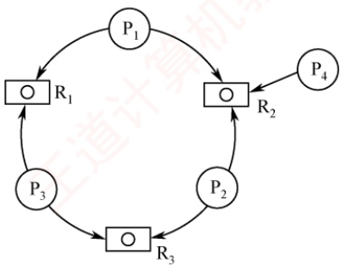

似。以上两种情况都会形成循环等待情况，至少有三个进程陷入死锁状态。若 $\mathrm {P}_{4}$ 事先已获取 $\mathrm {R}_{2}$成功运行，则死锁进程数为3；若 $\mathrm {P}_{4}$ 尚未获取 $\mathrm {R}_{2}$ ，未运行，则死锁进程数为 $4   ,$ 。因此，若系统出现死锁，则处于死锁状态的进程至少是3个。

41. A

由题意可知，仅剩最后一个同类资源，若将其分给 $\mathrm {P_{1}}$ 或 $\mathrm {P}_{2}$ ，则均无法正常执行；若分给 $\mathrm {P}_{3}$则 $\mathrm {P}_{3}$ 正常执行完成后，释放的这一个资源仍无法使 $\mathrm {P}_{1} , \mathrm {P}_{2}$ 正常执行，因此不存在安全序列。

42. B

剥夺进程资源，将其分配给其他死锁进程，可以解除死锁，说法Ⅰ正确。死锁预防是死锁处理策略（死锁预防、死锁避免、死锁检测）中最为严苛的一种策略，破坏死锁产生的4个必要条件之一，可以确保系统不发生死锁，说法Ⅱ正确。银行家算法是一种死锁避免算法，用于计算动态资源分配的安全性以避免系统进入死锁状态，不能用于判断系统是否处于死锁，说法Ⅲ错误。通过简化资源分配图可以检测系统是否为死锁状态，当系统出现死锁时，资源分配图不可完全简化，只有两个或两个以上的进程才会出现“环”而不能被简化，说法IV正确。

43. B

首先求出需求矩阵:

$$
\mathrm{Need}=\mathrm{Max}-\mathrm{Allocation}=\begin{bmatrix}\mathrm{A} & \mathrm{B} & \mathrm{A} & \mathrm{B} & \mathrm{A} & \mathrm{B} \\4 & 4 \\3 & 1 \\3 & 4\end{bmatrix}-\begin{bmatrix}2 & 3 \\2 & 1 \\1 & 2\end{bmatrix}=\begin{bmatrix}2 & 1 \\1 & 0 \\2 & 2\end{bmatrix}
$$

由Allocation 得知当前 Available为(1, 0)。由需求矩阵可知，初始只能满足 $\mathrm {P}_{2}$ 的需求，选项A错误。 $\mathrm {P}_{2}$ 释放资源后 Available变为(3, 1)，此时仅能满足 $\mathrm {P}_{1}$ 的需求，选项C错误。 $\mathrm {P_{1}}$ 释放资源后Available变为(5,4)，可以满足 $\mathrm {P}_{3}$ 的需求，得到的安全序列为 $\mathrm {P}_{2} , \mathrm {P}_{1} , \mathrm {P}_{3}$ ，选项B正确，选项D错误。

44. C

考虑极端情况，当临界资源数为n时，每个进程都拥有1个临界资源并等待另一个资源，会发生死锁。当临界资源数为n+1时，则n个进程中至少有一个进程可以获得2个临界资源，顺利运行完后释放自己的临界资源，使得其他进程也能顺利运行，不会产生死锁。或者，根据死锁公式 $m \geq$ n(r-1)，其中m是系统中临界资源的总数，n是并发进程的个数，r是每个进程所需临界资源的个数。若这个不等式成立，则系统不发生死锁。将本题的数据代入，得到 $m > n(2 - 1)$ ，即只要系统中临界资源的总数至少是n+1，就可避免死锁。

45. B

初始时系统中的可用资源数为<1,3,2>，只能满足 $\mathrm {P_{0}}$ 的需求<0,2,1>，所以安全序列第一个只能是 $\mathbf {P}_{0} ,$ 将资源分配给 $\mathrm {P_{0}}$ 后， $\mathrm {P_{0}}$ 执行完释放所占资源，可用资源数变为 $< 1,3,2 > + < 2,0,1 > = < 3,3,3 >$ 9此时可用资源数既能满足 $\mathrm {P_{1}}$ ，又能满足 $\mathrm {P}_{2} ,$ ，可以先分配给 $\mathrm {P_{1} , ~ P_{1}}$ 执行完释放资源再分配给 $\mathrm{P}_{2};$ 也可以先分配给 $\mathrm {P}_{2}$ ， $\mathrm {P}_{2}$ 执行完释放资源再分配给 $\mathrm {P}_{1} ,$ 。所以安全序列可以是① $\mathrm{P}_{0} 、 \mathrm{P}_{1} 、 \mathrm{P}_{2}$ 或② $\mathbb{P}_{0}$ X $\mathrm {P}_{21}$ $\mathrm {P}_{1}$

#### 二、综合应用题

01. 【解答】

不发生死锁要求，必须保证至少有一个进程得到所需的全部资源并执行完毕， $m \geqslant n(k - 1) + 1$时，一定不会发生死锁。

| 序号 | m | n | k | 是否会死锁 | 说明 |
| --- | --- | --- | --- | --- | --- |
| 1 | 6 | 3 | 3 | 可能会 | $6 < 3(3 - 1) + 1$ |
| 2 | 9 | 3 | 3 | 不会 | $9 > 3(3 - 1) + 1$ |
| 3 | 13 | 6 | 3 | 不会 | $13 = 6(3 - 1) + 1$ |

02. 【解答】

1）可能发生死锁。满足发生死锁的4大条件，例如， $\mathrm {P}_{1}$ 占有 $\mathbb {S}_{1}$ 申请 $\mathbb {S}_{3}$ ， $\mathrm {P}_{2}$ 占有 $\mathrm {S}_{2}$ 申请 $\mathbb {S}_{1}$ $\mathrm {P}_{3}$ 占有 $\mathbb {S}_{3}$ 申请 $\mathrm {S}_{2}$ 0

2）可有以下几种答案。

A. 采用静态分配:因为执行前已获得所需的全部资源，所以不会出现占有资源又等待别的资源的现象（或不会出现循环等待资源的现象）。
B. 采用按序分配:不会出现循环等待资源的现象。
C. 采用银行家算法:因为在分配时，保证了系统处于安全状态。

03. 【解答】

1）利用安全性算法对 $T_{0}$ 时刻的资源分配情况进行分析，可得到如下表所示的安全性检测情况。可以看出，此时存在一个安全序列 $\{\mathrm{P}_{2}, \mathrm{P}_{3}, \mathrm{P}_{4}, \mathrm{P}_{1} \}$ ，所以该系统是安全的。

<table><tr><td rowspan=3>进程名</td><td colspan=13>资源情况</td></tr><tr><td colspan=3>Work</td><td colspan=3>Need</td><td colspan=3>Allocation</td><td colspan=3>Work + Allocation</td><td rowspan=2>Finish</td></tr><tr><td> $\mathrm {R_{1}}$ </td><td> $\mathrm {R}_{2}$ </td><td> $\mathrm {R}_{3}$ </td><td> $\mathrm {R_{1}}$ </td><td> $\mathrm {R}_{2}$ </td><td> $R_{3}$ </td><td> $\mathrm {R_{1}}$ </td><td> $\mathrm {R}_{2}$ </td><td> $R_{3}$ </td><td> $\mathrm {R_{1}}$ </td><td> $\mathrm{R}_{2}$ </td><td> $\mathrm {R}_{3}$ </td></tr><tr><td> $\mathrm {P}_{2}$ </td><td>2</td><td>1</td><td>2</td><td>2</td><td>0</td><td>2</td><td>4</td><td>1</td><td>1</td><td>6</td><td>2</td><td>3</td><td>True</td></tr><tr><td> $P_{3}$ </td><td>6</td><td>2</td><td>3</td><td>1</td><td>0</td><td>3</td><td>2</td><td>1</td><td>1</td><td>8</td><td>3</td><td>4</td><td>True</td></tr><tr><td> $\mathrm {P}_{4}$ </td><td>8</td><td>3</td><td>4</td><td>4</td><td>2</td><td>0</td><td>0</td><td>0</td><td>2</td><td>8</td><td>3</td><td>6</td><td>True</td></tr><tr><td> $\mathrm {P_{1}}$ </td><td>8</td><td>3</td><td>6</td><td>2</td><td>2</td><td>2</td><td>1</td><td>0</td><td>0</td><td>9</td><td>3</td><td>6</td><td>True</td></tr></table>

此处要注意，一般大多数题目中的安全序列并不唯一。

2）若此时 $\mathrm {P}_{1}$ 发出资源请求 Request1(1, 0,1)，则按银行家算法进行检查:$\mathrm{Request_{l}(1,0,1) \leqslant Need_{l}(2,2,2)}$ $\mathrm{Request_{l}(1,0,1) \leqslant Aviallable(2,1,2)}$

试分配并修改相应数据结构，由此形成的进程 $P_1$ 请求资源后的资源分配情况见下表。

<table><tr><td rowspan=2>进程名</td><td colspan=9>资源情况</td></tr><tr><td colspan=3>Allocation</td><td colspan=3>Need</td><td colspan=3>Available</td></tr><tr><td> $P_1$ </td><td>2</td><td>0</td><td>1</td><td>1</td><td>2</td><td>1</td><td rowspan=4>1</td><td rowspan=4>1</td><td rowspan=4>1</td></tr><tr><td> $\mathrm {P}_{2}$ </td><td>4</td><td>1</td><td>1</td><td>2</td><td>0</td><td>2</td></tr><tr><td> $\mathrm {P}_{3}$ </td><td>2</td><td>1</td><td>1</td><td>1</td><td>0</td><td>3</td></tr><tr><td> $\mathrm {P}_{4}$ </td><td>0</td><td>0</td><td>2</td><td>4</td><td>2</td><td>0</td></tr></table>

再利用安全性算法检查系统是否安全，可用资源Available(1,1,1)已不能满足任何进程系统进入不安全状态，此时系统不能将资源分配给进程 $\mathrm {P_{1}}$

若此时进程 $P_2$ 发出资源请求 $\mathrm {Request}_{2} ( 1 , 0 , 1 )$ ，则按银行家算法进行检查:

$$
\mathrm{Request_{2}(1,0,1) \leq Need_{2}(2,0,2)}
$$

$$
\mathrm{Request_{2}(1,0,1) \leq Aviallable(2,1,2)}
$$

试分配并修改相应数据结构，由此形成的进程 $\mathrm {P}_{2}$ 请求资源后的资源分配情况下表:

<table><tr><td rowspan=2>进程名</td><td colspan=9>资源情况</td></tr><tr><td colspan=3>Allocation</td><td colspan=3>Need</td><td colspan=3>Available</td></tr><tr><td> $\mathrm {P_{1}}$ </td><td>1</td><td>0</td><td>0</td><td>2</td><td>2</td><td>2</td><td rowspan=4></td><td rowspan=4>1</td><td rowspan=4>1</td></tr><tr><td> $\mathrm {P}_{2}$ </td><td>5</td><td>1</td><td>2</td><td>1</td><td>0</td><td>1</td></tr><tr><td> $\mathrm {P}_{3}$ </td><td>2</td><td>1</td><td>1</td><td>1</td><td>0</td><td>3</td></tr><tr><td> $\mathrm {P}_{4}$ </td><td>0</td><td>0</td><td>2</td><td>4</td><td>2</td><td>0</td></tr></table>

再利用安全性算法检查系统是否安全，可得到如下表中所示的安全性检测情况。注意表中各个进程对应的 Work + Allocation向量表示在该进程释放资源之后更新的 Work 向量。

<table><tr><td rowspan=2>进程名</td><td colspan=12>资源情况</td></tr><tr><td colspan=3>Work</td><td colspan=3>Need</td><td colspan=3>Allocation</td><td colspan=3>Work + Allocation</td></tr><tr><td> $\mathrm {P}_{2}$ </td><td>1</td><td>1</td><td>1</td><td>1</td><td>0</td><td>1</td><td>5</td><td>1</td><td>2</td><td>6</td><td>2</td><td>3</td></tr><tr><td> $\mathrm {P}_{3}$ </td><td>6</td><td>2</td><td>3</td><td>1</td><td>0</td><td>3</td><td>2</td><td>1</td><td>1</td><td>8</td><td>3</td><td>4</td></tr><tr><td> $\mathrm {P}_{4}$ </td><td>8</td><td>3</td><td>4</td><td>4</td><td>2</td><td>0</td><td>0</td><td>0</td><td>2</td><td>8</td><td>3</td><td>6</td></tr><tr><td> $P_1$ </td><td>8</td><td>3</td><td>6</td><td>2</td><td>2</td><td>2</td><td>1</td><td>0</td><td>0</td><td>9</td><td>3</td><td>6</td></tr></table>

从上表中可以看出，此时存在一个安全序列 $\{\mathrm{P}_{2}, \mathrm{P}_{3}, \mathrm{P}_{4}, \mathrm{P}_{1} \}$ ，因此该状态是安全的，可以立即将进程 $\mathrm {P}_{2}$ 所申请的资源分配给它。

3）若2）中的两个请求立即得到满足，则此刻系统并未立即进入死锁状态，因为这时所有的进程未提出新的资源申请，全部进程均未因资源请求没有得到满足而进入阻塞态。只有当进程提出资源申请且全部进程都进入阻塞态时，系统才处于死锁状态。

04.【解答】

1)

$$
\mathsf{Need}=\mathsf{Max}-\mathsf{Allocation}=\begin{bmatrix}0&0&1&2\\1&7&5&0\\2&3&5&6\\0&6&5&6\end{bmatrix}-\begin{bmatrix}0&0&1&2\\1&0&0&0\\1&3&5&4\\0&0&1&4\end{bmatrix}=\begin{bmatrix}0&0&0&0\\0&7&5&0\\1&0&0&2\\0&6&4&2\end{bmatrix}
$$

2）Work 向量初始化值 = Available(1, 5,2,0)。

系统安全性分析:

<table><tr><td rowspan=3>进程名</td><td colspan=16>资源情况</td></tr><tr><td colspan=4>Work</td><td colspan=4>Need</td><td colspan=4>Allocation</td><td colspan=4>Work + Allocation</td></tr><tr><td>A</td><td>B</td><td>C</td><td>D</td><td>A</td><td>B</td><td>C</td><td>D</td><td>A</td><td>B</td><td>C</td><td>D</td><td>A</td><td>B</td><td>C</td><td>D</td></tr><tr><td> $\mathrm {P_{0}}$ </td><td>1</td><td>5</td><td>2</td><td>0</td><td>0</td><td>0</td><td>0</td><td>0</td><td>0</td><td>0</td><td>1</td><td>2</td><td>1</td><td>5</td><td>3</td><td>2</td></tr><tr><td> $\mathrm {P}_{2}$ </td><td>1</td><td>5</td><td>3</td><td>2</td><td>1</td><td>0</td><td>0</td><td>2</td><td>1</td><td>3</td><td>5</td><td>4</td><td>2</td><td>8</td><td>8</td><td>6</td></tr><tr><td> $P_1$ </td><td>2</td><td>8</td><td>8</td><td>6</td><td>0</td><td>7</td><td>5</td><td>0</td><td>1</td><td>0</td><td>0</td><td>0</td><td>3</td><td>8</td><td>8</td><td>6</td></tr><tr><td> $P_{3}$ </td><td>3</td><td>8</td><td>8</td><td>6</td><td>0</td><td>6</td><td>4</td><td>2</td><td>0</td><td>0</td><td>1</td><td>4</td><td>3</td><td>8</td><td>9</td><td>10</td></tr></table>

因为存在一个安全序列 $< \mathrm{P}_{0}, \mathrm{P}_{2}, \mathrm{P}_{1}, \mathrm{P}_{3} >$ ，所以系统处于安全状态。3)Request1(0, 4, 2, 0) <Need1(0, 7, 5, 0) Request1(0, 4, 2, 0) < Available(1, 5, 2, 0)假设先试着满足进程 $\mathrm {P}_{1}$ 的这个请求，则 Available变为(1,1,0,0)。系统状态变化见下表:

<table><tr><td rowspan=3>进程名</td><td colspan=16>资源情况</td></tr><tr><td colspan=4>Max</td><td colspan=4>Allocation</td><td colspan=4>Need</td><td colspan=4>Available</td></tr><tr><td>A</td><td>B</td><td>C</td><td>D</td><td>A</td><td>B</td><td>C</td><td>D</td><td>A</td><td>B</td><td>C</td><td>D</td><td>A</td><td>B</td><td>C</td><td>D</td></tr><tr><td> $\mathrm {P_{0}}$ </td><td>0</td><td>0</td><td>1</td><td>2</td><td>0</td><td>0</td><td>1</td><td>2</td><td>0</td><td>0</td><td>0</td><td>0</td><td rowspan=4>1</td><td rowspan=4>1</td><td rowspan=4>0</td><td rowspan=4>0</td></tr><tr><td> $\mathrm {P}_{1}$ </td><td>1</td><td>7</td><td>5</td><td>0</td><td>1</td><td>4</td><td>2</td><td>0</td><td>0</td><td>3</td><td>3</td><td>0</td></tr><tr><td> $\mathrm {P}_{2}$ </td><td>2</td><td>3</td><td>5</td><td>6</td><td>1</td><td>3</td><td>5</td><td>4</td><td>1</td><td>0</td><td>0</td><td>2</td></tr><tr><td> $\mathrm {P}_{3}$ </td><td>0</td><td>6</td><td>5</td><td>6</td><td>0</td><td>0</td><td>1</td><td>4</td><td>0</td><td>6</td><td>4</td><td>2</td></tr></table>

再对系统进行安全性分析，见下表:

<table><tr><td rowspan=3>进程名</td><td colspan=16>资源情况</td></tr><tr><td colspan=4>Work</td><td colspan=4>Need</td><td colspan=4>Allocation</td><td colspan=4>Work + Allocation</td></tr><tr><td>A</td><td>B</td><td>C</td><td>D</td><td>A</td><td>B</td><td>C</td><td>D</td><td>A</td><td>B</td><td>C</td><td>D</td><td>A</td><td>B</td><td>C</td><td>D</td></tr><tr><td> $\mathrm {P}_{0}$ </td><td>1</td><td>1</td><td>0</td><td>0</td><td>0</td><td>0</td><td>0</td><td>0</td><td>0</td><td>0</td><td>1</td><td>2</td><td>1</td><td>1</td><td>1</td><td>2</td></tr><tr><td> $\mathrm {P}_{2}$ </td><td>1</td><td>1</td><td>1</td><td>2</td><td>1</td><td>0</td><td>0</td><td>2</td><td>1</td><td>3</td><td>5</td><td>4</td><td>2</td><td>4</td><td>6</td><td>6</td></tr><tr><td> $\mathrm {P_{l}}$ </td><td>2</td><td>4</td><td>6</td><td>6</td><td>0</td><td>3</td><td>3</td><td>0</td><td>1</td><td>4</td><td>2</td><td>0</td><td>3</td><td>8</td><td>8</td><td>6</td></tr><tr><td> $P_{3}$ </td><td>3</td><td>8</td><td>8</td><td>6</td><td>0</td><td>6</td><td>4</td><td>2</td><td>0</td><td>0</td><td>1</td><td>4</td><td>3</td><td>8</td><td>9</td><td>10</td></tr></table>

因为存在一个安全序列 $< \mathrm{P}_{0}, \mathrm{P}_{2}, \mathrm{P}_{1}, \mathrm{P}_{3} >$ ，所以系统仍处于安全状态。所以进程 $\mathrm {P_{1}}$ 的这个请求应该马上被满足。

05. 【解答】

1）根据 Need 矩阵可知，初始 Work 等于 Available 为(1,4, 0)，可以满足进程 $P_2$ 的需求；进程 $\mathrm {P}_{2}$ 结束后释放资源，Work为(2, 7,5)，可以满足 $\mathrm {P_{0}} ,   \mathrm {P_{1}} ,   \mathrm {P_{3}}$ 和 $\mathrm {P}_{4}$ 中任意一个进程的需求，所以系统不会出现死锁，当前处于安全状态。

$$
\mathbf{Need} = \mathbf{Max} - \mathbf{Allocation} = \begin{bmatrix} 0 & 0 & 4 \\ 1 & 7 & 5 \\ 2 & 3 & 5 \\ 0 & 6 & 4 \\ 0 & 6 & 5 \end{bmatrix} - \begin{bmatrix} 0 & 0 & 3 \\ 1 & 0 & 0 \\ 1 & 3 & 5 \\ 0 & 0 & 2 \\ 0 & 0 & 1 \end{bmatrix} = \begin{bmatrix} 0 & 0 & 1 \\ 0 & 7 & 5 \\ 1 & 0 & 0 \\ 0 & 6 & 2 \\ 0 & 6 & 4 \end{bmatrix}
$$

2）若初始 Work = Available 为(0, 6, 2)，可满足进程 $\mathrm {P}_{0} ,   \mathrm {P}_{3}$ 的需求；这两个进程结束后释放资源，Work为(0,6,7)，仅可满足进程 $P_{4}$ 的需求； $\mathrm {P}_{4}$ 结束后释放资源，Work为(0,6, 8)，此时不能满足余下任意一个进程的需求，系统出现死锁，因此当前系统处在非安全状态。

**注意**

在银行家算法中，当实际计算分析系统安全状态时，并不需要逐个进程进行。如本题中，在情况1)下，当计算到进程 $\mathrm {P}_{2}$ 结束并释放资源时，系统当前空闲资源可满足余下任意一个进程的最大需求量，这时已经不需要考虑进程的执行顺序。系统分配任意一个进程所需的最大需求资源，在其执行结束释放资源后，系统当前空闲资源会增加，所以余下的进程仍然可以满足最大需求量。因此，在这里可以直接判断系统处于安全状态。在情况2）下，系统当前可满足进程 $\mathrm {P_{0}} , \mathrm {P_{3}}$ 的需求，所以可以直接让系统推进到 $\mathrm {P_{0}}_{\mathrm {{}_{2}}}$ $\mathrm {P}_{3}$ 执行完并释放资源后的情形，这时系统出现死锁；因为此时是系统空闲资源所能达到的最大值，所以按照其他方式推进，系统必然还是出现死锁。因此，在计算过程中，将每步中可满足需求的进程作为一个集合，同时执行并释放资源，可以简化银行家算法的计算。
