# 第2章 进程与线程

> 来源：27王道《操作系统》高清带书签.pdf（已清理水印、广告与 OCR 噪声）

## 【考纲内容】

（一）进程与线程
进程与线程的基本概念；进程/线程的状态与转换
线程的实现:内核支持的线程，线程库支持的线程

进程与线程的组织与控制

进程间通信:共享内存，消息传递，管道，信号

**（二）CPU调度与上下文切换**

调度的基本概念；调度的目标；

调度的实现:调度器/调度程序（scheduler），调度的时机与调度方式（抢占式/非抢占式），闲逛进程，内核级线程与用户级线程调度

CPU 调度算法

多处理机调度

上下文及其切换机制

（三）同步与互斥

同步与互斥的基本概念

基本的实现方法:软件方法；硬件方法

锁；信号量；条件变量

经典同步问题:生产者-消费者问题，读者-写者问题；哲学家进餐问题

（四）死锁

死锁的基本概念；死锁预防

死锁避免；死锁检测和解除

## 【复习提示】

进程管理是操作系统的核心，也是每年必考的重点。其中，进程的概念、进程调度、信号量机制实现同步与互斥、死锁问题等更是重中之重，必须深入掌握。需要注意的是，本章除常考选择题外，还易出现综合题，尤其是利用信号量实现进程同步、进程调度算法分析及死锁相关问题，均可能作为综合题考查，例如“利用信号量进行进程同步”在历年统考中就频繁出现。

## 2.1 进程与线程简介

在学习本节时，请读者思考以下问题:

1）为什么要引入进程？

2）什么是进程？进程由什么组成？

3）引入进程主要解决了多道程序并发执行中的哪些关键问题？

希望读者带着这些问题进入本节的学习，并在学习过程中多思考，从而更深入地把握核心概念。进程本身是一个抽象的逻辑实体，它并非物理存在的对象，初学者在理解时往往感到困难。为此，在系统阐述相关理论之后，我们将通过直观的例子帮助读者理解。

### 2.1.1 进程的概念和特征

#### 1．进程的概念

在多道程序环境下，允许多个程序并发执行，但并发性破坏了程序原本的封闭性，使其执行过程呈现间断性，并可能导致结果不可再现。为有效描述和控制程序的并发行为，操作系统引入了进程（Process）这一核心概念，以支撑操作系统的两大基本特性:并发性与共享性。

为使每个参与并发执行的程序能独立运行，必须为其配置一个专门的数据结构，称为进程控制块（Process Control Block，PCB）。操作系统通过PCB记录进程的基本信息和运行状态，从而实现对其的控制与管理。通常，程序段、相关数据段和PCB三者共同构成进程实体（也称进程映像）。因此，创建进程的本质是创建其PCB；相应地，撤销进程即释放该PCB及相关资源。

从不同视角出发，进程可有不同的定义，比较典型的定义如下。

1）进程是正在执行的程序实例。

2）进程是程序及其数据从外存加载到内存后，在CPU上运行的过程。

3）进程是具有独立功能的程序在一个特定数据集合上的执行活动。

在传统操作系统中，进程被正式定义为:“进程是进程实体的运行过程，是系统进行资源分配和调度的一个独立单位”。这里所说的“系统资源”不仅包括内存空间、I/O设备等硬件资源，也包括CPU的使用权，而CPU的使用权通常通过时间片的分配来实现。正因进程是资源分配与调度的基本单位，它必然不是静态的程序，而必须是一个动态的、具有生命周期的过程性实体。

#### 2．进程的特征

进程源于多道程序并发执行的需求，与静态的程序有着本质区别。其核心特征如下。

1）动态性。进程是程序的一次执行实例，具有明确的生命周期，包括创建、就绪、运行、阻塞和终止等状态变化。动态性是进程最根本的特征。

2）并发性。多个进程可同时驻留于内存，并在一段时间内交替或并行执行。引入进程的根本目的，正是为了支持程序的并发执行。

3）独立性。进程是能够独立运行、独立获取系统资源，并作为调度基本单位参与CPU竞争的实体。任何未建立PCB的程序，均不能被操作系统调度执行。

4）异步性。进程相互制约，以不可预知的速度向前推进。这种异步性可能导致执行结果不可再现，因此操作系统必须提供相关机制，以协调进程行为，确保执行的正确性。

尽管考试中较少直接考查四大特征，但对其内涵的理解是分析进程调度、同步互斥、死锁等问题的基础。建议读者着重把握各特征的成因、表现及其对系统设计的影响，而非机械记忆。

### 2.1.2 进程的组成

进程是操作系统进行资源分配和调度的基本单位，由三部分共同构成:程序段、数据段和进程控制块（PCB），其中PCB是最核心的组成部分。

#### 1．进程控制块

进程创建时，操作系统为其分配一个PCB；该结构常驻内存，可随时被系统访问，并在进程终止时被回收。PCB是进程存在的唯一标志，系统唯有通过它才能感知并管理进程。

在进程的整个生命期内，系统始终依赖PCB对其进行管理。操作系统通过PCB记录并维护进程的当前状态，以便在需要调度、切换或干预时，能够准确地控制其行为。

具体而言，当操作系统准备调度某个进程运行时，首先从其PCB中读取当前状态、优先级等调度所需信息；一旦该进程被选中，系统便根据PCB中保存的CPU上下文（如寄存器值）恢复其执行现场，并依据其中记录的内存地址找到对应的程序段和数据段。在进程运行过程中，若需与其他进程实现同步、通信，或访问文件，同样需要查询PCB中的相关资源信息。而当进程因某种原因而暂停执行时，其当前的CPU状态会被保存回PCB，以便后续重新调度时能从中断处继续执行。当进程正常结束或被强制终止时，系统将回收其PCB，该进程也随之消亡。由此可见，从创建到终止，系统对进程的所有操作，都离不开对其PCB的访问与更新。

PCB主要包括如表2.1所示的四类信息，各部分的主要说明如下。

表 2.1 PCB 通常包含的内容

| 进程标识信息 | 进程调度信息 | 资源和内存信息 | 处理机状态信息 |
| --- | --- | --- | --- |
| 进程ID（PID） | 进程当前状态 | 代码段指针 | 通用寄存器值 |
| 父进程ID（PPID） | 进程优先级 | 数据段指针 | 程序计数器值 |
| 用户ID（UID） | CPU 占用时间 | 堆栈段指针 | 程序状态字（PSW） |
|  | 等待时间 | 文件描述符列表 | 栈指针（SP） |
|  | 进入内存时间 | I/O 资源清单 |  |
|  | 阻塞原因 |  |  |

1）进程标识信息。用于唯一标识一个进程及其归属关系。进程ID（PID）是系统为每个进程分配的唯一编号；父进程ID（PPID）记录创建该进程的父进程标识符；用户ID（UID）指明进程所属用户，为资源共享与安全保护提供依据。

2）进程调度信息。支持操作系统的调度决策与状态管理。进程当前状态是CPU分配的基本依据；进程优先级决定其抢占CPU的能力；此外，还包括CPU占用时间、等待时间、进入内存时间等统计信息，以及阻塞原因，用于调整调度策略及后续唤醒。

3）资源和内存信息。记录进程所占用的各类系统资源。包括代码段、数据段和堆栈段在内存中的起始地址（或指针）、已打开文件的描述符列表，以及所占用的I/O资源。

4）处理机状态信息。也称CPU上下文，主要包括通用寄存器、程序计数器、栈指针及程序状态字（PSW）等寄存器的值。当进程被切换出CPU时，这些信息必须完整保存到PCB中；再次被调度运行时，系统将其恢复至CPU，从而能从中断处继续执行。

在一个实际系统中，通常同时存在大量进程，有的处于就绪态，有的处于阻塞态，并且阻塞原因各不相同。为高效地进行调度与管理，操作系统需将各进程的PCB以适当方式组织起来。常用的组织方法主要有两种:链接方式和索引方式。在链接方式中，系统将处于相同状态的PCB通过指针链接成一个队列，如就绪队列、阻塞队列；对于阻塞进程，还可根据其阻塞原因（如等待I/O完成、等待信号量等）进一步划分为多个阻塞子队列。在索引方式中，系统为每种状态建立一个索引表（如就绪索引表、阻塞索引表等），表项指向对应状态的PCB。

#### 2．程序段

程序段是进程中可被CPU执行的代码部分。需要指出的是，程序本身是静态的，可被多个进程共享。例如，多个用户同时运行同一个文本编辑器程序时，系统只需在内存中保留一份代码副本，各进程通过各自的PCB指向该共享代码段，从而节省内存空间并提高系统效率。

#### 3．数据段

数据段包含进程运行所需的各种数据，既包括程序处理的原始输入，也包括执行过程中产生的中间结果和最终输出。与程序段不同，每个进程的数据段是私有的，即使多个进程运行同一程序，它们的数据段也彼此隔离。这种设计有效保障了进程间的独立性与安全性。

### 2.1.3 进程的内存映像

当程序被加载运行时，操作系统会为其建立一个虚拟地址空间，该空间的逻辑布局称为进程的内存映像。它反映了进程在运行时代码、数据、堆、栈等部分的组织方式。与磁盘上的静态可执行文件不同，内存映像是动态的。在虚拟内存机制（见3.2节）下，进程的整个地址空间无须全部驻留物理内存，只有在实际访问某一部分时，系统才会通过缺页中断将其从磁盘调入内存。

考点追踪进程虚拟地址空间中各区域的存放内容（2025）

典型的进程虚拟地址空间由以下几个主要区域构成。

#### 1．代码段

代码段是指存放程序的机器指令，即编译后的可执行代码。该段通常是只读的，防止程序运行时意外修改指令，同时也允许多个进程共享同一份代码。代码段通常包含以下几个子区域。

●.init:包含程序启动时由系统自动调用的初始化代码。

●.text:存放主程序的指令。如main()函数、自定义函数编译后的机器指令。

•.rodata:存放只读数据。如字符串常量“Hello World!”。

#### 2．数据段

数据段用于存放全局变量和静态变量（static变量），分为如下两部分。

●.data:存放已初始化（已显式赋初值）的全局变量和静态变量，如 $\mathrm{int}_{\mathrm{X}} = 5;$

• .bss:存放未初始化的全局变量和静态变量，如“int y;”。

#### 3．进程控制块（PCB）

虽然PCB是管理进程的核心数据结构，但它并不属于进程的虚拟地址空间。它由操作系统内核维护，存放在系统内核区中，对用户进程不可见。

#### 4．堆

堆是指程序运行时动态申请内存的区域。通过malloc()等函数从堆中申请内存，不再需要时通过free()释放。堆从低地址向高地址增长，大小不固定，适合存储生命周期不确定的数据。例如，C语言语句 $\mathrm{int}* \mathrm{pr} = (\mathrm{int}*) \mathrm{malloc}(4)$ ”会在堆上分配4字节内存，用于存储一个整数。

#### 5．栈

栈用于支持函数调用，存放局部变量、函数参数、返回地址等临时信息，由系统自动管理。遵循后进先出（LIFO）原则，栈从高地址向低地址扩展。例如，调用函数add(3,5)时，参数3、5和返回地址会被压入栈；函数执行结束后，这些数据被弹出，栈指针自动回退。

#### 6．共享库的存储映射区

共享库用于提供进程所依赖的公共函数代码（如printf()等标准库函数）。它们在运行时被动态映射到进程的地址空间，代码是只读的，且可被多个进程共享，从而节省内存资源。

图2.1所示为一个典型进程在内存中的映像。其中，最高地址处是用户栈，随函数调用向下增长；其下方是共享库的映射区域，用于加载动态库；再往下是堆，由malloc()等函数动态扩展；

堆下方是读/写数据段（.data和.bss）；底部是只读代码段（.init、.text、.rodata）；注意，代码段和数据段的大小在程序加载时就已确定，而堆和栈则可在运行过程中动态扩展和收缩。

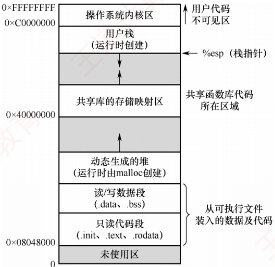

图2.1 一个典型进程在内存中的映像

### 2.1.4 进程的状态与转换

进程在其生命周期中，由于与其他进程的相互制约以及系统运行环境的变化，其状态会不断发生转换。通常，进程具有以下五种状态，其中前三种为基本状态。

1）运行态。进程正在CPU上执行。在单CPU中，任一时刻最多只有一个进程处于运行态。

2）就绪态。进程已获得除CPU外的所有必要资源，一旦获得CPU，便可立即投入运行。系统中可能有多个就绪进程，通常将它们组织成一个队列，称为就绪队列。

**考点追踪》执行中断处理程序时进程的状态（2023）**

3）阻塞态，也称等待态。进程因等待某一事件（如某个资源可用、I/O操作完成等）而暂停运行。此时即使CPU空闲，该进程也无法执行。系统通常将处于阻塞态的进程组织成一个阻塞队列，甚至根据阻塞原因的不同，还可进一步划分为多个子队列。

4）创建态。进程正处于创建过程中，尚未进入就绪态。创建进程包括多个步骤:首先申请一个空白的PCB，并向其中填写用于控制和管理进程的信息；然后为该进程分配运行时所需的资源（如内存空间）；最后，当所有必要资源都已到位，系统将该进程转入就绪态，并插入就绪队列。创建态是一个短暂的中间状态，正常情况下不会长期停留。

5）终止态。进程已完成执行（无论是正常结束还是被强制终止），正在等待系统回收其资源。此时，进程不再参与调度，但其PCB等信息可能暂时保留，直至完成最终清理。

区分就绪态与阻塞态:就绪态是指进程仅缺少CPU，只要获得CPU就可立即运行；而阻塞态是指进程需要其他资源（除CPU外）或等待某一事件。之所以将CPU与其他资源分开，是因为在分时系统的时间片轮转机制中，每个进程分得的时间片很短（通常为几毫秒），因此进程在运行过程中会频繁地在运行态与就绪态之间切换；而其他资源（如外设）的分配或事件（如I/O完成）的发生往往需要较长时间，导致进程进入阻塞态的频率远低于就绪态。由此可见，就绪态和阻塞态在进程生命周期中代表了两种性质完全不同的等待情形。

**考点追踪引起进程状态转换的事件（2014、2015、2018、2023、2025）**

图2.2说明了五种进程状态之间的转换关系。其中，三种基本状态之间的转换如下。

● 就绪态→运行态:处于就绪态的进程被调度程序选中，获得CPU的使用权（例如分配到一个时间片），随即由就绪态转换为运行态。

● 运行态→就绪态:处于运行态的进程在时间片用完后，必须主动让出CPU，从而转回就绪态；此外，在可剥夺式调度系统中，若有更高优先级的进程变为就绪，则当前运行的进程也会被强制切换回就绪态，以便让更高优先级的进程执行。

● 运行态→阻塞态:当运行中的进程通过系统调用请求某项服务（如发起I/O操作），而该请求无法立即满足（需等待I/O完成），进程便会主动进入阻塞态。需注意，并非所有系统调用都会导致阻塞，只有那些需要等待外部事件的操作才会引发状态转换。


图 2.2 5 种进程状态的转换

● 阻塞态→就绪态:当进程所等待的事件发生时（如I/O操作完成），相应的中断处理程序会将其状态由阻塞态修改为就绪态，并重新插入就绪队列，等待下一次调度。

值得注意的是，进程从运行态变为阻塞态是一种主动行为（由自身发起的系统调用触发），而从阻塞态变为就绪态则是一种被动行为，依赖于外部事件的发生或其他进程的协助。

### 2.1.5 进程控制

进程控制的功能是对系统中所有进程进行有效的管理，主要包括创建新进程、撤销已有进程、实现进程状态转换等操作。在操作系统中，这些控制操作通常以原语的形式实现。原语在执行期间不允许被中断，是一个不可分割的基本单位，确保了关键操作的原子性和一致性。

#### 1．进程的创建

**考点追踪父进程与子进程的关系和特点（2020、2024）**

允许一个进程创建另一个进程。创建者称为父进程，被创建的进程称为子进程。子进程在创建时会复制父进程的当前状态，包括程序代码、数据段、堆栈内容、打开的文件描述符、环境变量等。然而，子进程与父进程是相互独立的实体，拥有各自的PCB和虚拟地址空间。

**考点追踪导致创建进程的操作（2010）**

在操作系统中，终端用户登录系统、作业调度启动批处理任务、系统提供服务、用户程序发起应用请求等，都会触发进程的创建。操作系统通过创建原语建立新进程，具体步骤如下。

**考点追踪创建新进程时的操作（2021）**

1）分配唯一标识并申请PCB:为新进程分配唯一的进程标识号（PID），并从系统PCB池中申请一个空白PCB。若PCB资源耗尽，则创建失败，系统返回错误。

2）分配新进程运行所需的资源:如内存、文件、I/O设备等（记录在PCB中）。这些资源或从操作系统获得，或从其父进程继承。

3）初始化PCB:初始化的内容包括:标识信息、处理机状态信息、调度与控制信息和内存与资源信息。通常将新进程设置为最低优先级，除非用户显式提出高优先级要求。

4）插入就绪队列:若系统允许新进程参与调度，则将其PCB插入就绪队列，等待调度。

#### 2．进程的终止

引起进程终止的事件主要包括:①正常结束，表示进程完成其预定任务后主动退出。②异常结束，表示进程在运行过程中发生严重错误，导致无法继续执行。常见原因包括:存储区越界、非法指令、特权指令违规、算术运算错误、I/O故障、运行超时等。③外界于预，由外部实体请求终止进程，如操作员强制终止、操作系统因资源不足或安全策略终止进程、父进程通过系统调用请求终止其子进程。操作系统通过终止原语完成进程的撤销，具体步骤如下。

**考点追踪终止进程时的操作（2024）**

1）根据被终止进程的标识符，检索其PCB，并读取当前状态。

2）若该进程正处于运行态，立即剥夺其CPU，并触发调度程序选择下一个就绪进程。

3）释放该进程占用的所有系统资源，统一归还给操作系统。

4）若系统支持级联终止，则递归终止其所有子孙进程；否则，子孙进程继续运行。

5）将该进程的PCB从所在队列（或链表）中移除，完成清理。

在某些系统中，当一个进程终止时，其所有子孙进程也必须随之终止，这种机制称为级联终止。然而，并非所有操作系统都采用这一策略。以Linux为例，当父进程终止时，其子进程并不会被自动终止，而是由init进程（PID=1）收养，并继续正常运行。

#### 3．进程的阻塞和唤醒

**考点追踪进程阻塞的事件与分析（2018、2022、2023）**

当一个正在运行的进程因等待某个外部事件而暂时无法继续执行时，会主动调用阻塞原语（Block），使自己从运行态转换为阻塞态。常见的等待事件包括:请求系统资源暂时不可用、等待I/O操作完成、等待接收数据、等待信号量等。需要强调的是，阻塞是进程的主动行为，因此只有处于运行态的进程才能执行阻塞操作。阻塞原语的执行过程如下。

1）保存当前进程的CPU现场（如程序计数器、状态寄存器等）到其PCB中。

2）将其PCB中的状态字段修改为阻塞态，并将该PCB插入所等待事件的等待队列中。

3）调用调度程序，从就绪队列中选择另一个进程投入运行，以释放CPU资源。

**考点追踪进程唤醒的事件与分析（2014、2019）**

当被阻塞进程所等待的事件发生时（如I/O操作完成、所需数据到达），由内核的中断处理程序或合作进程调用唤醒（Wakeup）原语，将该进程重新激活。唤醒原语的执行过程如下。

1）在指定事件的等待队列中找到目标进程的PCB。

2）将其从等待队列中移出，并将状态置为就绪态。

3）将该PCB插入就绪队列，等待调度程序在适当时机选中并恢复其执行。

需要注意是，Block与Wakeup是一对作用相反的原语，必须成对使用。若某进程调用了Block进入阻塞态，但系统中没有任何机制调用对应的Wakeup，则该进程将永久停留在阻塞态，无法再被调度执行。因此，在设计并发程序时，必须确保每个阻塞操作都有相应的唤醒路径。

### 2.1.6 进程的通信

进程通信（IPC）是指进程之间的信息交换。根据通信效率和数据量的不同，可分为低级通信和高级通信两类:低级通信主要用于传递控制信息（如同步、互斥），典型代表是PV操作（见2.3节）；高级通信用于高效传输大量数据，主要包括共享存储、消息传递和管道通信、信号等方式。

#### 1．共享存储

进程的地址空间通常是相互隔离的，一个进程不能直接访问另一个进程的内存。因此，若要实现高效的数据交换，操作系统提供了共享存储机制:通过特殊的系统调用，创建一段独立的内存区域，并将其映射到多个进程的虚拟地址空间中，使这些进程都能直接读/写该区域。在共享存储方式中，参与通信的进程通过对这一共享区域进行读/写来交换信息，如图2.3所示。由于多个进程可能并发访问同一块内存，必须由用户程序引入同步互斥机制（如信号量的P、V操作），以避免数据竞争或不一致。需要注意的是，操作系统仅负责分配共享内存区并完成地址映射，并不会自动提供同步保护；具体的读/写逻辑与同步控制，均需由用户程序自行设计和实现。

通俗地理解，可以想象甲和乙之间放着一个公共的大布袋:甲把要传递的物品放进布袋，乙再从里面取出。但乙不能直接伸手去拿甲手里的东西，甲也不能直接取走乙的东西，所有交换都必须通过这个公共区域完成。

#### 2．消息传递

当进程之间没有共享内存，或出于安全等考虑不便使用共享存储时，可采用操作系统提供的消息传递机制进行通信。在消息传递系统中，进程间的数据交换以格式化的消息（Message）为单位，通过操作系统提供的发送原语和接收原语进行。这种方式将通信的底层细节封装在内核中，对用户透明，从而简化了应用程序的设计。消息传递是目前应用最广泛的进程间通信机制，在微内核操作系统中，微内核与服务器之间的交互正是基于消息传递。此外，该机制很好地支持多处理器系统、分布式系统和计算机网络，因此也成为这些环境中的主流通信方式。

消息传递可分为两种基本模式:

1）直接通信方式。发送进程通过发送原语将消息发给指定的接收进程；内核负责将消息从发送方复制到接收方的内核缓冲队列中；接收进程通过接收原语接收消息，如图2.4所示。

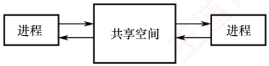

图2.3 共享存储


图 2.4 消息传递

2）间接通信方式。通信双方不直接指定对方，而是通过一个中间实体（通常称为信箱）进行消息交换。发送进程将消息投递到信箱，接收进程从信箱中取出消息。

通俗地理解，甲要向乙传递信息，便写好一封信交给邮差。在直接通信中，邮差将信件直接交到乙本人手中；在间接通信中，乙家门口设有一个邮箱，邮差只需将信投入该邮箱，乙随后自行取阅。无论哪种方式，消息的投递均由邮差（操作系统内核）完成消息的可靠投递。

#### 3．管道通信

**考点追踪管道通信的特点（2014）**

管道通信是一种基于先进先出原则的进程间通信机制，常用于具有亲缘关系的进程（如父子进程）之间，以生产者-消费者模式进行数据交换（见图2.5）。从编程接口上看，管道（Pipe）

表现为一种特殊的共享文件，支持标准的 read()和 write()操作；但从实现上看，它并非存储在磁盘上的文件，而是由操作系统内核维护的一块固定大小的内存缓冲区。

为确保通信的正确性，管道机制必须提供三方面的协调能力:①互斥，指任一时刻只允许一个进程对管道进行读或写操作，防止多个进程并发访问导致数据混乱；②同步，指当管道满时，写进程自动阻塞，直到读进程取走部分数据；当管道空时，读进程自动阻塞，直到写进程向其中写入新数据；③写端关闭检测，当写端关闭后，读端read()返回0，表明无数据可读。

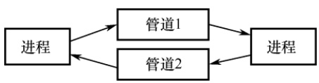

图 2.5 管道通信

在Linux系统中，管道是一种广泛使用的IPC机制。其主要特点包括:

1）固定缓冲区大小。管道使用内核中的环形缓冲区（如64KB），不会像普通文件那样无限制增长。当缓冲区满时，后续的write()调用将被阻塞，直到有足够空间可用。

2）自动阻塞与唤醒。若读进程的消费速度快于写进程，则管道中的数据会被迅速读空。此时，任何read()调用将被阻塞，等待写进程再次写入数据。

管道由父进程通过pipe()系统调用创建。由于子进程在创建时会继承父进程的文件描述符表因此能够通过这些描述符访问同一管道，从而与父进程进行通信。

**注意**

从管道中读取数据是一次性操作，数据一旦被读出，其占用的缓冲区空间即被释放，供后续写入使用；普通管道仅支持单向通信，若需双向通信，则必须创建两个管道，分别用于两个方向的数据传输。

#### 4．信号

信号（Signal）是一种用于通知进程某个事件已发生的机制。不同的系统事件对应不同的信号类型，每类信号对应一个序号。例如，Linux内核实现了约30种信号，编号通常为1～30。

在进程的PCB中，用一个n位向量（如Linux使用一个32位整型变量）记录该进程当前待处理的信号。当向某进程发送一个信号时，内核会将该信号对应的位置为1；一旦该信号被成功处理，对应位即被清零。此外，PCB中还维护另一个n位向量，用于记录被阻塞（屏蔽）的信号。当某一位为1时，表示对应的信号不会被立即处理，而是暂存起来，直到解除阻塞。

信号的发送主要有以下两种方式:

1）内核发送信号。当内核检测到特定的系统事件时，会向相关进程发送相应的信号。例如，若进程执行了非法指令，则内核将向其发送SIGILL信号（序号为4）。

2）由进程发送信号。一个进程可以通过调用kill()函数，请求内核向指定进程（需提供目标进程的PID和信号序号）发送信号。当然，进程也可以向自身发送信号。

当操作系统从内核态返回用户态时（如系统调用结束），会检查当前进程是否存在未被阻塞的待处理信号。若存在，则立即处理其中一个信号（通常优先处理序号较小的信号）。

信号的处理方式有两种:

1）执行默认的信号处理程序。操作系统为每类信号预设了默认操作。例如，收到SIGILL信号的默认操作是终止进程。

2）执行进程自定义的信号处理程序。进程可以为某类信号定义自己的处理函数。例如，可定义收到 SIGILL时输出“hello world”，而不是终止进程。

信号处理程序执行结束后，通常会返回到原程序被中断的位置，继续执行后续指令。

### 2.1.7 线程和多线程模型

#### 1．线程的基本概念

引入进程的目的是使多道程序能够并发执行，从而提高资源利用率和系统吞吐量；而引入线程（Thread）则是为了进一步降低程序并发执行时的时空开销，提升操作系统的并发性能。

考点追踪线程的特点（2019、2011、2024）

线程可被通俗地理解为“轻量级进程”，它是程序执行流的最小单元，也是处理器调度的基本单位。在多线程操作系统中，进程不再作为基本的执行实体，但仍保留与执行相关的状态。所谓进程处于“执行”状态，实际上是指该进程中的某个线程正在运行。线程的主要属性如下。

**（1）轻量级执行实体**

线程本身不拥有独立的系统资源（如地址空间、打开的文件等），但拥有运行所必需的私有数据结构，包括线程ID、程序计数器、寄存器集合和栈。每个线程都具有唯一的标识符和一个线程控制块（TCB），用于记录其执行上下文（如寄存器状态、栈指针等）。

**(2）共享代码段**

同一进程中的多个线程可并发执行相同的程序代码。例如，当多个用户同时访问一个Web服务器时，服务器进程可创建多个线程，各自服务不同的用户请求，显著提升并发能力。

**（3）资源共享**

同一进程内的所有线程共享该进程的代码段、数据段、堆、文件描述符等系统资源。这种机制使得线程间的通信和数据共享非常高效，无须复杂的进程间通信（IPC）机制。

**（4）独立调度单位**

线程是CPU调度和执行的基本单位。在单CPU系统中，多个线程通过时间片轮转等方式轮流使用CPU；在多CPU系统中，不同线程可并行运行于多个CPU核心上。若多个核心同时执行同一进程的不同线程，则能显著缩短该进程的整体处理时间。

**（5）生命周期**

线程从创建开始，经历就绪、运行、阻塞等状态变化，直至最终终止

引入线程后，进程的内涵发生了重要变化:进程成为除CPU外的系统资源分配单位，而线程则成为CPU调度和执行的基本单位。当线程切换发生在同一进程内部时，由于地址空间等资源无须切换，其开销远小于进程切换。接下来，将从多个维度对线程与进程进行比较。

#### 2．线程与进程的比较

**考点追踪进程和线程的比较（2012）**

1）调度。在传统的操作系统中，进程既是资源拥有者，也是独立调度的基本单位，每次调度都需要进行完整的上下文切换，开销较大。引入线程后，线程成为独立调度的基本单位。在同一进程中，线程切换不会引起进程切换；但若从一个进程的线程切换到另一个进程的线程，则仍会触发进程切换。

2）并发性。在支持线程的操作系统中，并发性得到显著增强:不仅进程之间可以并发执行，同一进程内的多个线程也可以并发执行，甚至不同进程中的线程也能并发执行。这种多层次的并发机制有效提升了系统资源利用率和吞吐量。

3）拥有资源。进程是系统资源分配的基本单位；而线程不拥有独立的系统资源，但拥有运行所必需的私有数据结构。同一进程的所有线程共享该进程的地址空间及资源。

4）独立性。每个进程拥有完全独立的地址空间，默认情况下，其他进程无法直接访问其任何内存区域。相应的，一个进程中的线程对其他进程完全不可见。同一进程内的线程则因共享地址空间而紧密协作，旨在提升并发性能。

5）系统开销。创建或撤销进程时，系统需分配或回收PCB、地址空间、I/O资源等，开销显著；而创建或撤销线程仅需分配栈和少量内核对象，开销很小。类似地，进程切换涉及整个地址空间和资源上下文的切换，而线程切换只需保存和恢复寄存器状态。此外，由于同一进程内的线程共享地址空间，它们之间的同步与通信非常容易实现。

6）支持多处理器系统。对于单线程进程，尽管可以在不同时间被调度到任意CPU上运行，但在任一时刻只能在一个CPU上执行。而对于多线程进程，系统可将其中的多个线程同时调度到多个CPU上并行执行，从而真正发挥多核处理器的性能优势。

#### 3．线程的状态与生命周期

由于线程之间共享资源，并存在同步与互斥等制约关系，其执行过程具有明显的间断性。相应地，线程在其生命周期中会经历以下三种基本状态

● 运行态:线程已获得CPU，正在执行。

● 就绪态:线程已具备所有运行条件，只需获得CPU即可立即执行。

阻塞态:线程因等待某一事件（如I/O完成、锁释放等）而暂时无法继续执行。

线程这三种基本状态之间的转换与进程基本状态之间的转换是类似的。

线程具有完整的生命周期:由创建而产生，经调度而执行，最终因终止而消亡。为支持这一过程，操作系统提供了相应的系统调用或库函数。

用户程序启动时，通常仅有一个初始线程在执行，其主要任务是创建其他线程。创建新线程时，需调用线程创建函数，并传入必要的参数，例如:指向线程主函数的入口地址、堆栈大小、调度优先级等。创建成功后，系统返回唯一的线程标识符，供后续操作使用。

操作系统的调度器根据线程的优先级和其他调度策略决定哪个线程获得CPU使用权。调度机制可选用多种方式。当线程被调度到CPU上时，它进入运行态，开始执行其主函数中的代码。在此期间，线程可能会与其他线程进行同步或互斥操作，以确保数据一致性。

线程终止的原因可能有多种。例如，线程正常执行完其主函数；在运行过程中发生未处理的异常而被迫退出；主动调用线程终止函数；或被其他线程通过取消机制强制终止。在大多数操作系统中，线程终止后并不会立即释放其所占用的资源。只有当进程中的其他线程执行了相应的分离操作后，被终止的线程才会与资源分离，其资源才能被系统回收并供其他线程使用。

已被终止但尚未释放资源的线程仍可被其他线程调用，以使其重新恢复运行。

#### 4．线程控制块

**考点追踪 线程的私有资源（2024）**

与进程类似，操作系统为每个线程维护一个线程控制块（Thread Control Block,TCB），用于记录和管理线程的运行信息。TCB通常包含以下内容:①线程标识符（ThreadID）；②寄存器集合，包括程序计数器、状态寄存器和通用寄存器；③线程当前状态，用于描述线程正处于何种状态；④调度优先级；⑤线程局部存储区，用于保存线程私有的数据；⑥堆栈指针，指向该线程的私有栈，用于过程调用时保存局部变量、返回地址等。

同一进程中的所有线程共享该进程的地址空间和全局变量。每个线程拥有独立的私有栈，这些栈位于进程的地址空间内，因此从技术上讲，一个线程可以访问另一个线程的栈内容。然而，这种做法严重违反编程规范，会破坏线程封装性和程序正确性，实际开发中应严格避免。

#### 5．线程的实现方式

**考点追踪两种线程的特点与比较（2019）**

线程的实现可以分为两类:用户级线程（User-Level Thread，ULT）和内核级线程（Kernel-Level Thread，KLT)。其中，内核级线程也称为内核支持的线程。

**（1）用户级线程（ULT）**

通俗地说，用户级线程是指“从用户视角看到的线程”。在该模型中，所有线程管理工作（包括创建、切换、撤销等）均由应用程序在用户空间（用户态）完成，无须操作系统介入。正因如此，操作系统内核完全感知不到这些线程的存在。应用程序只需引入线程库，即可被开发为多线程程序。通常，用户程序启动时仅包含一个初始线程；在执行过程中，该线程可在任意时刻调用线程库提供的创建函数，在同一进程中派生出新的线程。图2.6(a)展示了用户级线程的实现方式。

对于采用用户级线程的系统，调度仍以进程为单位进行。调度器只能感知到进程，无法察觉进程内部的多个用户级线程，因此它仅为整个进程分配一个时间片。例如，假设系统采用时间片轮转调度，每个进程每次获得100ms的CPU时间。若进程A仅包含1个用户级线程，则当该进程获得时间片时，其唯一的线程可独占全部100ms的 CPU时间:而若进程B包含100个用户级线程，则这100ms必须在其内部的100个线程之间分配。倘若进程B内部采用简单的轮转调度，那么每个线程平均仅能获得1ms的CPU时间。由此可见，进程A中的线程所获得的CPU时间是进程B中各线程的100倍。这种差异导致在多线程密集型任务中，不同进程间的线程实际执行效率极不均衡，从而在系统层面体现出明显的调度不公平性。

这种实现方式的优点:①线程切换在用户空间完成，无须切换到内核态，避免了模式切换的开销。②调度策略可由应用程序定制，不同进程可根据自身需求采用不同的线程调度算法。③用户级线程的实现与操作系统无关，线程管理代码属于用户程序的一部分，具有良好的可移植性。

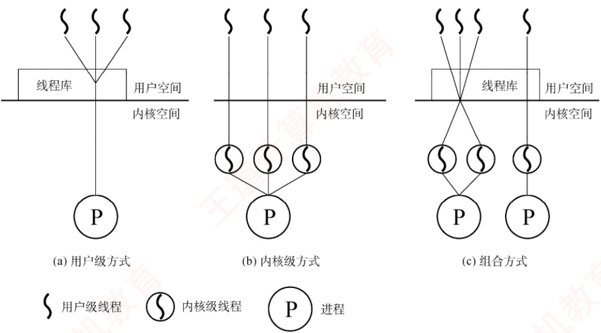

图2.6 用户级线程和内核级线程

其缺点在于:①系统调用的阻塞问题，当某个用户级线程执行一个阻塞型系统调用时，整个进程会被内核挂起，导致进程中的所有线程均被阻塞。②无法发挥多处理器的并行优势，由于内核仅将该进程调度到一个CPU上执行，即使系统配备了多个CPU核心，同一进程中的多个用户级线程也无法同时在不同CPU上并行运行，只能在单个CPU上交替执行。

**（2）内核级线程（KLT）**

在操作系统中，无论是系统进程还是用户进程，都依赖内核的支持运行。内核级线程的管理完全由操作系统内核负责，所有线程相关的操作均在内核空间（内核态）完成。操作系统为每个内核级线程维护一个线程控制块（TCB），内核通过该TCB感知线程的存在并对其进行控制。图2.6(b)展示了内核级线程的实现方式。

这种实现方式的优点:①能发挥多处理器的并行优势，内核可将同一进程中的多个线程同时调度到不同CPU核心上并行执行。②阻塞处理更灵活，若进程中的某个线程因系统调用被阻塞，内核仍可调度该进程中的其他线程运行，或切换到其他进程的线程继续执行。③内核自身可采用多线程技术，从而提升系统服务的并发性和整体效率。

其缺点在于:线程切换需从用户态陷入内核态。由于线程在用户态运行，而调度由内核完成，每次切换都涉及模式转换和上下文保存/恢复，系统开销较大。

**（3）组合方式**

某些系统采用组合方式（混合模型）实现多线程。在该模型中，内核支持多个内核级线程的创建与调度，同时允许用户程序在用户空间管理多个用户级线程。这种方式能结合两种模型的优点，并克服各自的不足:多个线程可在多CPU上并行执行；单个线程阻塞不会导致整个进程挂起；用户级线程切换可在用户空间快速完成，减少内核介入。图2.6(c)展示了这种组合实现方式。根据用户级线程与内核级线程之间的映射关系不同，形成了以下三种典型的多线程模型:

1）多对一模型。将多个用户级线程映射到一个内核级线程，如图2.7(a)所示。线程的调度和

管理在用户空间完成。每个进程仅拥有一个内核级线程，仅当用户线程需要访问内核时，

才将其映射到一个内核级线程上，但每次只允许一个线程进行映射。

优点:线程管理在用户空间进行，无须切换到内核态，因此线程切换的效率较高。

缺点:当任一用户级线程执行阻塞型系统调用时，整个进程都会被内核挂起；在任何时刻最多只能有一个线程与内核交互，无法在多处理器系统中实现并行执行。

(a) 多对一模型

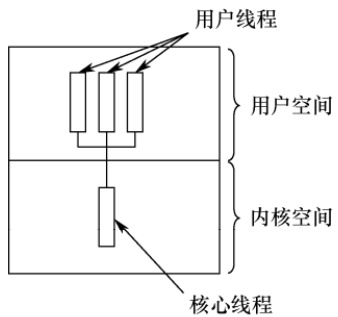

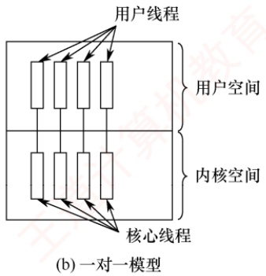

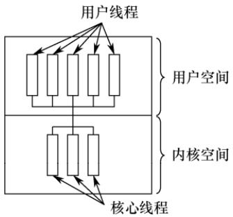

(c) 多对多模型

图2.7 多线程模型

2）一对一模型。将每个用户级线程映射到一个独立的内核级线程，如图2.7(b)所示。进程中的用户级线程与内核级线程一一对应，线程的调度由内核完成，需要切换到内核态。

优点:当某个线程被阻塞时，内核可调度同一进程中的其他线程运行，支持真正的并发执行，且可在多CPU系统上并行运行。

缺点:每创建一个用户线程，系统就必须创建一个对应的内核线程，导致较大的系统开销（如内核TCB占用内存、调度负担增加），限制了系统可支持的最大线程数。

3）多对多模型。将n个用户级线程映射到m个内核级线程，要求n≥m，如图2.7(c)所示。

用户级线程由应用程序在用户空间调度，而内核级线程由内核调度到多个CPU上执行。特点:既克服了多对一模型并发度低的缺陷，又避免了一对一模型资源开销过大的问题。同时兼具两者优点:用户级线程切换高效，且支持多核并行与阻塞隔离。

**（4）线程库（thread library）的实现**

程序员通常通过线程库提供的API来创建和管理线程。线程库的实现主要有两种方式:

①纯用户空间实现:线程库完全位于用户空间，所有代码和数据结构均在用户态。调用库函数仅触发本地过程调用，无须陷入内核。此类实现对应用户级线程模型。

②内核支持实现:线程库的底层依赖操作系统内核。库中的API调用通常会触发系统调用，

由内核完成实际的线程操作。此类实现对应内核级线程模型。

目前广泛使用的三种主流线程库包括:POSIX Pthreads、Windows 线程 API 和 Java 线程 API。Pthreads 是POSIX标准定义的线程 API，其具体实现可基于用户级或内核级线程。Windows 线程API 直接构建于 Windows 内核之上，属于内核级线程实现。Java 线程 API 允许在 Java 程序中直接创建线程。由于JVM运行于宿主操作系统之上，Java线程通常通过调用宿主系统的线程库实现，因此在 Windows 上使用 Windows API，在类 UNIX 系统上则使用 Pthreads。

### 2.1.8 本节小结

本节开头提出的问题的参考答案如下。

**1）为什么要引入进程？**

在多道程序环境下，多个程序并发执行并共享系统资源，导致运行过程中相互制约，表现出间断性、异步性和不可预测性。然而，传统的“程序”仅是一组静态的指令集合，无法反映其在内存中的动态执行行为。例如，无法体现程序何时开始、何时暂停、如何与其他程序交互等。为了准确刻画程序并发执行的动态特性，并为操作系统提供有效的管理机制，进程这一概念被引入。进程是程序并发执行的基本单位，也是操作系统进行资源分配和调度的实体。

**2）什么是进程？进程由什么组成？**

进程是一个具有独立功能的程序在其特定数据集上的一次执行过程。它是一个动态的、活动的实体，不仅包含程序代码，还包含当前的执行状态（如程序计数器的值、处理器寄存器的内容等）。一个进程实体由程序段、相关数据段和PCB三部分构成。其中，PCB是进程存在的唯一标志，操作系统通过PCB感知并控制进程的整个生命周期。

**3）引入进程主要解决了多道程序并发执行中的哪些关键问题？**

引入进程有效解决了多道程序并发执行带来的三大问题:①失去封闭性:在缺乏进程机制的环境中，程序执行易受其他程序于扰（如共享内存被修改），导致行为不可控；进程通过地址空间隔离，为每个程序提供独立、受保护的执行环境，从而恢复一定程度的封闭性。②执行过程的间断性:程序可能因I/O请求、时间片用尽或调度决策而被中断:进程利用PCB保存和恢复执行上下文，确保中断后能准确、连续地继续执行。③结果不可再现性:在并发环境下，相同输入可能因执行顺序不确定而产生不同输出；进程的隔离机制与操作系统的调度策略共同保障了执行的可控性与结果的可再现性。通过为每个程序建立独立的进程实体，操作系统得以高效实现调度、切换、资源分配与保护，显著提升系统资源利用率和并发处理能力。

本节主要围绕“什么是进程”展开阐述，旨在为后续内容奠定概念基础。然而，对于尚未接触过操作系统相关知识的读者而言，“进程”作为一个抽象的动态实体，可能仍显得模糊不清。为了帮助大家更直观地把握其本质，我们引入一个贴近生活的类比。

我们可以将进程类比为“人的生命历程”。首先，人的生命历程是一个动态的、过程性的存在，而非静态的描述；同样，进程也不是一段固定的程序代码，而是一次正在执行的活动。要研究生命历程，必须先明确其主体“人”；对应地，进程的主体是进程映像，它由程序段、数据段和PCB组成。其中，PCB就如同人的“身份标识”，记录了该进程的唯一身份与当前状态。人在一生中会经历多种状态:出生、成长、奋斗、受挫、康复、衰老乃至离世；类似地，进程在其生命周期中也会在创建、就绪、运行、阻塞、终止等状态之间转换。例如，一个人从“充满斗志”（就绪）进入“发奋图强”（运行）；若遭遇挫折，可能陷入“失落”（阻塞）:在他人鼓励下，又可重新“充满斗志”（回到就绪）。这正对应于进程从就绪态转换为运行态，因等待事件而进入阻塞态，待事件发生后再次返回就绪态的典型状态迁移。通过“人生历程”这一过程性视角来理解进程，有助于我们超越对“程序=进程”的误解，真正把握进程作为动态执行实体的核心特征。当然，任何类比都有其局限性。上述比喻虽有助于建立直觉，但不能替代严谨的技术定义。因此，建议读者在借助类比形成初步理解后，回过头来重新阅读本节前文的正式阐述。这种“感性认知→理性回归”的学习路径，往往能带来更深刻、更准确的理解。

这里再给出一些学习计算机科学的建议。许多同学在学习过程中容易陷入一个误区:过于关注定理和公式的应用，而忽视了对基础概念的理解。这一倾向往往源于长期应试训练，毕竟熟练套用公式和定理在考试中见效快、收益明显。然而，公式和定理的应用固然重要，唯有深入理解基础概念，才能真正透彻地掌握一门学科，进而激发兴趣，培养创造性思维。

## 2.2 CPU调度

在学习本节时，请读者思考以下问题:

**1）为什么要进行CPU调度？**

2）结合本章学习到的调度算法，思考哪些调度算法比较适合分时系统和实时系统？

希望读者能够在学习调度算法前，先自己思考一些调度算法，在学习的过程中注意将自己的想法与这些经典的算法进行比对，并学会计算一些调度算法的周转时间。

### 2.2.1 调度的概念

#### 1．调度的基本概念

在多道程序系统中，进程的数量通常远多于CPU的个数，因此多个进程争用CPU的情况在所难免。CPU调度是指按照一定的算法（兼顾公平性与效率），从就绪队列中选择一个进程，并将CPU分配给它运行，从而实现多个进程的并发执行。

CPU调度是多道程序操作系统的基础，也是操作系统设计的核心问题之一。

#### 2．调度的层次

一个作业从提交到完成，通常要经历以下三级调度，如图2.8所示。

**（1）高级调度（作业调度）**

高级调度负责从外存后备队列中按照一定规则挑选一个或多个作业，为其分配内存、I/O设备等必要资源，并创建相应的进程，使其获得参与CPU竞争的资格。简言之，作业调度实现了内存与外存之间的调度。每个作业在整个生命周期中仅被调入一次、调出一次。

传统多道批处理系统普遍配备作业调度；而在分时系统或实时系统中，由于用户进程通常由

交互式命令直接创建，一般不设置独立的作业调度模块。

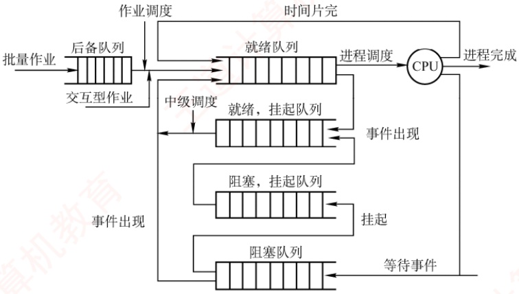

图 2.8 CPU 的三级调度

**（2）中级调度（内存调度）**

中级调度的引入旨在提高内存利用率和系统吞吐量。当系统内存紧张时，它会将某些暂时无法运行的进程（如处于阻塞态且等待时间较长的进程）换出到外存，此时的进程状态称为挂起态。此后，当这些进程具备运行条件且内存有空闲时，中级调度再将其换入内存，恢复为就绪态，并加入就绪队列等待调度。中级调度实际上是存储器管理中的对换功能。

**（3）低级调度（进程调度）**

低级调度按照特定算法从就绪队列中选择一个进程，将CPU分配给它。这是最基础、最频繁的一级调度，在所有操作系统中都必须存在。其调度频率很高，通常每几十毫秒执行一次。

#### 3．三级调度的联系

在三级调度体系中，进程调度是最基本且不可或缺的，而作业调度和中级调度则根据系统类型和设计目标选择性配置。三级调度协同工作，共同完成作业从提交到终止的全过程:

1）作业调度为进程活动做准备，将作业调入内存并创建进程，使其具备参与调度的资格。

2）中级调度起调节作用，通过将暂时无法运行的进程换出至外存（挂起态），或在条件满足时将其重新换入内存（恢复为就绪态），动态调整内存中活跃进程的数量。

3）进程调度驱动实际执行，从就绪队列中选择进程投入运行，是实现并发的核心机制。

4）调度频率依次升高:作业调度频率最低，中级调度次之，进程调度频率最高。

### 2.2.2 进程调度

#### 1. 进程调度任务

进程调度的任务主要包括:

①保存CPU现场信息。调度发生时，需要将当前进程的CPU状态（如程序计数器、通用寄存器等）完整保存至其PCB中，以确保后续能从断点恢复执行。

②选取待运行进程。调度程序依据特定算法（如时间片轮转、优先级调度等），从就绪队列中选取一个进程，将其状态由“就绪态”改为“运行态”

③完成CPU分配。由分派程序将选中进程PCB 中保存的 CPU现场加载到处理器寄存器中，移交CPU控制权，使其从上次断点处恢复执行。

#### 2．调度程序（调度器）

用于实现CPU调度与分派的软件组件称为调度程序，它通常由三部分组成，如图2.9所示。

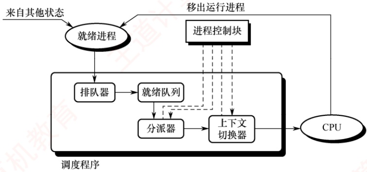

图2.9 调度程序的结构

1）排队器。将系统中所有就绪进程按照特定策略组织成一个或多个就绪队列。每当有进程转换为就绪态时，排队器便将其插入相应的就绪队列，为后续调度选择提供基础。

2）分派器。根据调度算法选定的进程，分派器负责执行实际的CPU分配操作，其主要任务包括:从就绪队列中移出目标进程、触发上下文切换，并将CPU控制权转交给该进程。

3）上下文切换器。在对CPU进行切换时，会发生两对上下文的切换操作:第一对，将当前进程的上下文保存到其PCB中，再装入分派程序的上下文，以便分派程序运行；第二对，移出分派程序的上下文，将新选进程的CPU现场信息装入CPU的各个相应寄存器。

上下文切换需要执行大量load和store指令以保存寄存器内容，因此开销较大。目前已有硬件实现的方法来减少上下文切换时间。通常采用两组寄存器，一组供内核使用，另一组供用户使用。这样，在上下文切换时只需改变指针，使其指向当前所需的寄存器组即可。

#### 3．调度的时机、切换与过程

调度程序是操作系统内核程序。只有当请求调度的事件发生后，才会运行调度程序；而在调度出新的就绪进程之后，才会进行进程切换。理论上，这三个步骤应按顺序执行，但在实际的操作系统内核运行中，即使发生了引发调度的条件，也不一定能够立即进行调度与切换。

考点追踪可以进行CPU调度的事件或时机（2012、2021）

现代操作系统中，通常在以下情况下需要进行进程调度与切换:

1）创建新进程后，父进程和子进程都处于就绪态，因此需要决定是运行父进程还是子进程，调度程序可以合法地选择其中一个先运行。 首

2）进程正常结束或异常终止后，必须从就绪队列中选择某个进程运行；若没有就绪进程，则通常运行一个系统提供的闲逛进程。

3）当进程因I/O请求、信号量操作或其他原因而被阻塞时，必须调度其他进程运行。

4）当I/O设备准备就绪后，发出I/O中断，原先等待I/O的进程由阻塞态转换为就绪态，此时需决定是让该新就绪进程投入运行，还是让中断发生时正在运行的进程继续执行。

此外，在支持抢占的系统中，若更高优先级的进程进入就绪队列，或当前进程的时间片用完，也会触发调度并可能剥夺当前进程的CPU。

进程切换通常紧随调度之后发生，其核心任务是保存原进程的执行现场，并恢复新进程的现场。具体而言，操作系统内核会将原进程的上下文（包括程序计数器、寄存器状态等）保存到其

PCB或内核栈中；随后，从新进程的PCB或内核栈中加载其上下文，更新地址空间相关信息（如页表基址），重置程序计数器，并开始执行新进程。

然而，在以下情况下不能进行进程调度与切换:

1）处理中断的过程中。中断处理逻辑复杂，实现上难以安全地进行进程切换；同时，中断处理属于系统内核工作，逻辑上不隶属于任何用户进程，不应被剥夺CPU资源。

2）执行原子操作的过程中。如加锁、解锁、中断现场的保护与恢复等操作，通常需要屏蔽中断以保证原子性。在此期间，连中断都被禁止，更不应进行进程调度与切换。

若在上述不可调度期间发生了调度条件，系统会设置一个调度请求标志，待当前临界区或中断处理完成后，再根据该标志执行相应的调度与切换操作。 xK

#### 4．进程调度的方式

所谓进程调度方式，是指当某个进程正在CPU上执行时，若有某个更为重要或紧迫的进程需要处理，即有优先级更高的进程进入就绪队列，此时系统应如何分配CPU。

通常有以下两种进程调度方式:

1）非抢占调度方式，也称非剥夺方式。指当一个进程正在CPU上执行时，即使有某个更为重要或紧迫的进程进入就绪队列，系统仍让当前进程继续执行，直到该进程运行完成（例如正常结束或异常终止），或者因发生某种事件（如等待I/O操作、在进程通信或同步中执行了Block原语）而主动进入阻塞态，此时才会将CPU分配给其他进程。

非抢占调度方式的优点是实现简单、系统开销小，适用于早期的批处理系统；但它无法满足分时系统和大多数实时系统对及时响应的要求。

2）抢占调度方式，也称剥夺方式。指当一个进程正在CPU上执行时，若出现更高优先级的就绪进程，调度程序可依据一定策略暂停当前进程，将CPU分配给更紧迫的进程。

抢占调度方式对提高系统吞吐率和响应效率都有明显好处。但“抢占”并不是一种任意的行为，必须遵循一定的原则，主要有优先级、短进程优先和时间片原则等。

#### 5．闲逛进程

当进程切换发生时，若系统中没有就绪进程，操作系统会调度闲逛进程（IdleProcess）运行，它的PID为0。闲逛进程的优先级最低，仅在无其他就绪进程时运行；一旦有新进程进入就绪队列，它会立即让出CPU。其主要任务是在空闲循环中不断检测中断请求。

闲逛进程不占用除CPU外的其他系统资源，也不会因等待事件而被阻塞。

#### 6．两种线程的调度

1）用户级线程调度。由于内核并不知道线程的存在，因此内核仍以进程为单位进行调度，将CPU时间分配给整个进程。当内核将CPU分配给某进程后，由该进程内部的用户级线程库决定具体运行哪个线程。线程切换在同一进程内完成，仅需保存少量寄存器状态，开销极小。但缺点是:若一个线程执行阻塞操作（如I/O），整个进程都会被阻塞。

2）内核级线程调度。内核直接感知并管理每个线程，调度时选择的是特定线程，而非进程。每个线程拥有独立的内核上下文，可被单独赋予时间片；若时间片用完或被更高优先级线程抢占，则该线程会被强制挂起。由于涉及完整的上下文切换、地址空间更新（在跨进程线程间）以及可能的TLB刷新和缓存失效，其切换开销远高于用户级线程，通常高出数倍。

### 2.2.3 调度的目标

不同的调度算法具有不同的特性，因此在选择调度算法时，必须考虑其适用场景与性能表现。为了客观比较CPU调度算法的优劣，人们提出了多种衡量标准，下面介绍主要的几种:

考点追踪作业执行的相关计算（2012、2016、2018、2019、2023、2024）

1）CPU利用率。CPU是计算机系统中最重要且昂贵的资源之一，应尽可能使其保持“忙碌”状态，以提高资源利用效率。其计算公式为

CPU 利用率= CPU 有效工作时间/(CPU 有效工作时间+CPU 空闲等待时间)

**注意**

在计算作业完成时间时，需注意CPU与I/O设备之间、以及不同I/O设备之间可以并行执行。

2）系统吞吐量。表示单位时间内系统完成的作业数量。长作业因占用较多CPU时间，会降低系统的吞吐量；而短作业所需CPU时间较少，有助于提升吞吐量。不同的调度算法对系统吞吐量有显著影响。

3）周转时间。指从作业提交到作业完成所经历的总时间，包括作业等待、在就绪队列中排队、在CPU上执行以及进行I/O操作等所有阶段的时间之和。其计算公式为

$$
周转时间  =  作业完成时间  -  作业提交时间
$$

对于n个作业，平均周转时间定义为

$$
平均周转时间  = (  作业  1  的周转时间  + \cdots +  作业  \; n \;  的周转时间  ) / n
$$

带权周转时间用于衡量作业的相对等待程度，其定义为

$$
带权周转时间 = 作业周转时间 / 作业实际运行时间
$$

相应地，平均带权周转时间定义为

$$
平均带权周转时间  = (  作业  1  的带权周转时间  + \cdots +  作业  n  的带权周转时间  )/n
$$

4）等待时间。等待时间是指进程在就绪队列中等待CPU的总时间。等待时间越长，响应延迟越高，满意度越低。CPU调度算法并不影响作业的实际执行时间或I/O操作时间，仅影响其在就绪队列中的等待时长。因此，在评估调度算法时，等待时间常被作为一项核心指标。

5）响应时间。响应时间是指从用户提交请求到系统首次产生响应所经历的时间。在交互式系统中，用户更关注快速反馈，而非作业整体完成时间，因此响应时间通常比周转时间更具实际意义。理想的调度策略应尽可能缩短响应时间，使其处于用户可接受的范围之内。

需要强调的是，不存在一种调度算法能同时满足所有用户需求和系统目标。设计调度程序时，一方面要满足特定应用场景的要求（如实时任务的快速响应、交互式进程的低延迟），另一方面也要兼顾系统整体效率（如降低平均周转时间），同时还需考虑调度算法自身的实现开销。

### 2.2.4 进程切换

考点追踪进程调度前后CPU模式的变化（2023）

对通常的进程而言，其创建、撤销以及请求由系统设备完成的I/O操作，都是通过系统调用进入内核，再由内核中的相应处理程序予以完成的。进程切换同样是在内核的支持下实现的，因此可以说，任何进程都是在操作系统内核的支持下运行的，是与内核紧密相关的。

**（1）上下文切换**

**考点追踪进程的上下文切换（2024、2025）**

将CPU切换到另一个进程，需保存当前进程的状态，并恢复另一个进程的状态，这个任务称为上下文切换。进程上下文由其PCB表示，包括CPU寄存器的值、进程状态、内存管理信息等。当进行上下文切换时，内核将旧进程的状态保存在其PCB中，然后加载经调度而要执行的新进程的上下文。在切换过程中，进程的运行环境发生实质性的变化。上下文切换的流程如下。

1）挂起当前进程，将其CPU上下文保存到其PCB中。

2）将该进程的PCB移入相应的队列，例如就绪队列，或因等待某事件而进入的阻塞队列。

3）选择另一个进程执行，并更新其PCB中的相关信息。

4）恢复新进程的CPU上下文。

5）跳转到新进程PCB中的程序计数器所指向的位置，开始执行该进程。

**（2）上下文切换的消耗**

上下文切换是一项开销较大的操作，需要执行大量寄存器的保存与恢复指令。尽管单次切换所需的时间仅为微秒量级，但在高负载系统中，若每秒发生数十甚至上百次切换，则累积的CPU时间消耗将十分可观。为减少这一开销，某些处理器架构提供多个寄存器组，通过切换寄存器组指针即可完成上下文切换；但大多数通用处理器仍需完整保存和恢复寄存器状态。

**(3）上下文切换与模式切换**

模式切换（用户态和内核态之间的切换）与上下文切换是两个不同的概念。模式切换发生在同一进程内部，如用户进程因系统调用或中断进入内核态执行，完成后返回用户态继续执行该进程。此过程中，当前进程并未改变，因此不涉及上下文切换。而上下文切换则意味着从一个进程切换到另一个进程，必须保存旧进程的上下文并恢复新进程的上下文。由于该操作涉及内核数据结构（如PCB）的访问与修改，上下文切换只能由内核完成，且整个切换过程运行在内核态。

**注意**

调度和切换的区别:调度是决策行为，即决定将CPU分配给哪个进程；切换是执行行为，即实际完成CPU控制权的转移。通常，先由调度程序做出调度决策，随后触发上下文切换以实现该决策。

### 2.2.5 CPU调度算法

**考点追踪各种调度算法的特点与对比（2009、2011、2014）**

操作系统中存在多种调度算法，有的适用于作业调度，有的适用于进程调度，也有的两者均可适用。下面介绍几种常用的调度算法。

#### 1．先来先服务（FCFS）调度算法

FCFS调度算法是一种最简单的调度算法，既可用于作业调度，也可用于进程调度。

**考点追踪FCFS调度算法的思想（2017）**

在作业调度中，FCFS算法每次从后备作业队列中选择最早进入该队列的一个或多个作业将它们调入内存，分配必要的资源，创建相应的进程，并放入就绪队列。

在进程调度中，FCFS算法每次从就绪队列中选择最早进入该队列的进程，将CPU分配给它，使其投入运行，直到该进程运行完成，或因某种原因而进入阻塞态，此时才会交出CPU。

**考点追踪批处理系统中作业完成时间的分析（2012、2016）**

下面用一个实例来说明FCFS算法的性能。假设系统中有4个作业，它们的提交时间分别是8.0、8.4、8.8和9.0，运行时间依次为2、1、0.5和0.2。若系统采用FCFS算法，则这组作业的平均等待时间、平均周转时间和平均带权周转时间如表2.2所示。

FCFS算法属于非抢占式算法。从表面上看，它对所有作业都是公平的；但若一个长作业先到达系统，则会导致后续的许多短作业长时间等待，因此它不适合作为分时系统和实时系统的主要调度策略。不过，FCFS算法常被结合到其他调度策略中使用。例如，在采用优先级调度的系统中，对于多个具有相同优先级的进程，通常按照FCFS的原则进行调度。

FCFS算法的特点是实现简单，但效率较低。它对长作业较为有利，而对短作业相对不利（与SJF或高响应比优先调度算法相比）。此外，它更有利于CPU繁忙型作业；而对于I/O繁忙型作业，由于其运行过程中会频繁发起I/O请求并进入阻塞状态，本可及时让出CPU以提高系统并发性，但在FCFS调度下，若排在长作业之后，则仍需长时间等待，难以发挥其优势。

表2.2 FCFS 调度算法的性能

| 作业号 | 提交时间 | 运行时间 | 开始时间 | 等待时间 | 完成时间 | 周转时间 | 带权周转时间 |
| --- | --- | --- | --- | --- | --- | --- | --- |
| 1 | 8 | 2 | 8 | 0 | 10 | 2 | 1 |
| 2 | 8.4 | 1 | 10 | 1.6 | 11 | 2.6 | 2.6 |
| 3 | 8.8 | 0.5 | 11 | 2.2 | 11.5 | 2.7 | 5.4 |
| 4 | 9 | 0.2 | 11.5 | 2.5 | 11.7 | 2.7 | 13.5 |

平均等待时间 t = (0 + 1.6 + 2.2 + 2.5)/4 = 1.575；平均周转时间T= (2 + 2.6 + 2.7 + 2.7)/4 = 2.5;平均带权周转时间 W = (1 + 2.6 + 5.4 + 13.5)/4 = 5.625。

#### 2．短作业优先（SJF）调度算法

考点追踪SJF调度算法的思想（2017）

短作业优先（SJF）调度算法是一种按照作业或进程的预计运行时间进行调度的策略。

在作业调度中，SJF算法从后备作业队列中选择一个或多个估计运行时间最短的作业，将它们调入内存，分配资源并创建进程。

在进程调度中，该策略称为短进程优先（SPF），即从就绪队列中选择估计运行时间最短的进程，将CPU分配给它，使其立即执行，直至完成，或因某种事件而阻塞时才释放CPU。

例如，考虑与表2.2中示例相同的一组作业，若系统采用SJF调度算法，则这组作业的平均等待时间、平均周转时间和平均带权周转时间如表2.3所示。

表 2.3 SJF 调度算法的性能

| 作业号 | 提交时间 | 运行时间 | 开始时间 | 等待时间 | 完成时间 | 周转时间 | 带权周转时间 |
| --- | --- | --- | --- | --- | --- | --- | --- |
| 1 | 8 | 2 | 8 | 0 | 10 | 2 | 1 |
| 2 | 8.4 | 1 | 10.7 | 2.3 | 11.7 | 3.3 | 3.3 |
| 3 | 8.8 | 0.5 | 10.2 | 1.4 | 10.7 | 1.9 | 3.8 |
| 4 | 9 | 0.2 | 10 | 1 | 10.2 | 1.2 | 6 |

平均等待时间 t = (0 + 2.3 + 1.4 + 1)/4 = 1.175；平均周转时间 T = (2 + 3.3 + 1.9 + 1.2)/4 = 2.1;平均带权周转时间 W = (1 + 3.3 + 3.8 + 6)/4 = 3.525。

尽管SJF算法在某些指标上表现优异，但它也存在不容忽视的缺点:

考点追踪饥饿现象的含义（2016）

1）对长作业不利。由表2.2与表2.3可知，在SJF调度下，长作业的周转时间明显增加。更严重的是，若一个长作业进入系统的后备队列，而此后不断有新的短作业到达，调度程序将总是优先调度这些短作业，导致长作业长期得不到服务，从而产生饥饿现象（注意:饥饿是由于调度策略导致的无限期等待，与死锁中的环形等待有本质区别）。

2）未考虑作业的紧迫程度。该算法仅依据运行时间长短进行调度，完全忽略了作业的截止时间或紧急性，因此无法保证紧迫性作业被及时处理。

3）作业的“长短”由用户提交的估计值决定，而用户可能有意或无意地低估其作业的实际运行时间，以获取调度优势，从而使算法难以真正实现“短作业优先”的目标。

SPF算法既可以是非抢占式的（默认情况），也可以是抢占式的。在抢占式版本中，当一个新进程到达就绪队列时，若其估计运行时间比当前进程的剩余执行时间更短，则立即暂停当前进程，将CPU分配给新进程。这种抢占式策略也称最短剩余时间优先调度算法。

**注意**

当所有作业同时到达且运行时间已知时，SJF算法的平均等待时间和平均周转时间是最优的。

#### 3．高响应比优先调度算法

高响应比优先调度算法主要用于作业调度，是对FCFS算法和SF算法的一种综合平衡。它在调度决策时同时考虑每个作业的等待时间和估计运行时间。在每次进行作业调度时，系统首先计算后备作业队列中每个作业的响应比，然后选择响应比最高的作业调入内存并执行。

响应比的计算公式为

$$
响应比  = ( 等待时间  +  估计运行时间 ) /  估计运行时间
$$

由该公式可知:①当作业的等待时间相同时，估计运行时间越短，响应比越高，因此有利于短作业，这与SJF算法的特性相似。②当估计运行时间相同时，响应比由等待时间决定，等待时间越长，响应比越高，这体现了FCFS调度的公平性。③对于长作业，其响应比会随着等待时间的增加而不断提高。当等待时间足够长时，即使估计运行时间较长，其响应比也可能超过其他作业，从而被调度执行。这一机制有效避免了长作业因长期得不到服务而产生的饥饿现象。

#### 4．优先级调度算法

考点追踪优先级调度算法的应用分析（2025）

优先级调度算法通过为每个作业或进程分配一个优先级，以反映其紧迫程度。

在作业调度中，优先级调度算法每次从后备作业队列中选择优先级最高的一个或多个作业，将它们调入内存，分配资源并创建进程。

在进程调度中，该算法每次从就绪队列中选择优先级最高的进程，将CPU分配给它，使其投入运行。

根据是否允许抢占，优先级调度算法可分为以下两类:

考点追踪非抢占式优先级调度算法的应用分析（2018）

1）非抢占式优先级调度算法。当一个进程正在CPU上运行时，即使有更高优先级的进程进入就绪队列，系统仍允许当前进程继续执行，直到其因自身原因（如任务完成或等待事件）而让出CPU时，此时将CPU分配给就绪队列中优先级最高的进程。

**考点追踪抢占式优先级调度算法的应用分析（2022、2023）**

2）抢占式优先级调度算法。当一个进程正在CPU上运行时，若有更高优先级的进程进入就绪队列，系统将立即暂停当前进程，将CPU分配给优先级更高的进程。

此外，根据进程创建后其优先级是否可变，优先级又可分为静态与动态两类

**考点追踪静态优先级和动态优先级的分析（2016）**

1）静态优先级。优先级在进程创建时确定，并在其整个运行期间保持不变。确定静态优先级的主要依据包括:进程类型、对资源的需求、用户指定的优先级等。优点是实现简单，系统开销小；缺点是不够灵活，可能出现低优先级进程长期得不到调度的饥饿现象。

**考点追踪调整进程优先级的合理时机（2010）**

2）动态优先级。进程创建时赋予一个初始优先级，但该优先级会随着进程的推进或等待时间的增加而动态调整，以获得更好的调度效果。例如，规定优先级随等待时间的增加而提高，这样，即使初始优先级较低的进程，在等待足够长时间后也能获得CPU调度。在实际系统中，进程优先级的设置通常遵循以下原则:

1）系统进程>用户进程。系统进程负责管理核心资源和服务，通常被赋予更高的优先级。

2）交互型进程>非交互型进程（或前台进程>后台进程）。交互型进程需要快速响应用户输入，因此应优先调度，以保证良好的用户体验。

**考点追踪进程优先级的设置:I/O型和计算型（2013）**

3）I/O型进程>计算型进程。I/O型进程指频繁进行I/O操作的进程，而计算型进程主要消耗CPU时间，很少使用I/O设备。我们知道，I/O设备（如打印机）的处理速度远低于CPU，因此若将I/O型进程的优先级设置得更高，就能让它尽快获得CPU 并启动I/O操作，使I/O设备尽早开始工作，进而提高系统整体吞吐量。

#### 5．时间片轮转（RR）调度算法

**考点追踪时间片轮转调度算法的原理（2021、2024）**

时间片轮转（RR）调度算法主要适用于分时系统，其最大特点是公平性。系统将所有就绪进程按FCFS的原则组织成一个就绪队列。每隔固定的时间间隔（称为时间片，例如30ms），系统会产生一次时钟中断，激活调度程序，将CPU分配给就绪队列的队首进程，并允许其执行一个时间片。当该进程执行完一个时间片后，即使尚未运行完毕，也必须被剥夺CPU，并重新放入就绪队列的末尾，等待下一次调度；而下一个队首进程则获得CPU的使用权。

RR算法的调度时机:①若当前进程在时间片结束前已运行完成，则调度程序会立即被激活，进行进程切换；②若时间片用尽，则由时钟中断处理程序触发调度程序，完成上下文切换。

**考点追踪时间片轮转调度算法的特点（2017）**

在RR算法中，时间片的大小对系统性能有显著影响。时间片过大，大到足以让每个进程在一个时间片内完成运行时，RR算法将退化为FCFS算法，无法满足短作业和交互式用户对快速响应的需求；时间片过小时，虽然部分短作业可能在一个时间片内完成，但会导致系统频繁进行进程调度和上下文切换，大幅增加系统开销，真正用于执行用户程序的CPU时间反而减少。

因此，时间片的长度应合理设置，在响应速度与运行效率之间取得平衡。通常，其取值需综合考虑以下因素:系统的期望响应时间、就绪队列中的进程数量以及系统的处理能力。特别地，在交互式系统中，常以“典型交互”作为参考基准，例如，用户在文本编辑器中输入一个字符，或在终端中按下回车键，这类操作通常只需几十至上百毫秒即可完成。一个较为合理的时间片大小，应略长于一次典型交互所需的时间，这样既能确保大多数交互式进程在单个时间片内完成处理、获得流畅的响应体验，又能有效控制上下文切换频率，避免不必要的系统开销。

#### 6．多级队列调度算法

前述的各种调度算法通常只设置一个就绪队列，采用固定且单一的调度策略，难以满足系统中不同类型进程对调度的不同需求。例如，交互型进程要求快速响应，而批处理进程更关注吞吐量和资源利用率。为兼顾这些差异，多级队列调度算法被提出。

该算法将系统中的就绪进程划分为多个独立的就绪队列，每个队列对应一类具有相似特性的进程（如系统进程、交互型进程、批处理进程等）。每个队列可独立采用适合其特性的调度算法:例如，交互型队列常使用RR算法以保证响应性，而批处理队列可采用FCFS算法或SJF算法以提高吞吐量。更重要的是，各队列本身具有不同的优先级。调度时，系统总是优先调度高优先级队列中的进程；只有当所有高优先级队列均为空时，才会调度低优先级队列中的进程。这种机制确保了关键任务（如系统服务或用户交互）能够及时获得CPU资源。

#### 7．多级反馈队列调度算法（融合了前几种算法的优点）

**考点追踪多级反馈队列调度算法的应用分析（2019）**

多级反馈队列调度算法是时间片轮转调度算法与优先级调度算法的综合与发展（见图2.10）。

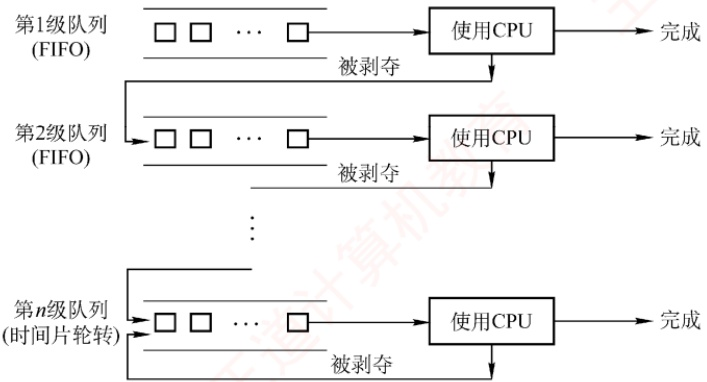

图2.10 多级反馈队列调度算法

通过动态调整进程所处的队列（优先级）和对应的时间片大小，该算法能够兼顾系统的多种目标:既有利于短进程，可提高吞吐量并缩短平均周转时间，又有利于I/O型进程以提升设备利用率和响应速度，同时无须事先知道进程的运行时间。

**考点追踪多级反馈队列调度算法的实现思想（2020）**

多级反馈队列调度算法的实现机制如下。

1）设置多个就绪队列。为每个队列赋予不同的优先级，第1级队列优先级最高，第2级次之，其余队列优先级依次降低。该算法为各级队列分配不同的时间片，优先级越高的队列，时间片越小。例如，第i+1级队列的时间片长度通常是第i级的2倍。

2）每个队列内部采用时间片轮转（RR）调度。新进程创建后，首先被放入第1级队列的末尾。当轮到该进程执行时:若其在当前时间片内完成，则终止并退出系统；若时间片用完仍未完成，则被移至下一级（优先级更低）队列的末尾，等待后续调度。这一过程持续进行，直至进程在某一级队列中完成。通常，最低优先级队列（如第n级）的时间片较长，其行为接近FCFS，但仍采用时间片轮转以保证公平性。

3）按队列优先级调度。调度程序总是优先调度最高优先级队列中的进程执行。具体而言:仅当第1级队列为空时，才调度第2级队列中的进程；仅当第1～i-1级队列均为空时，才会调度第i级队列中的进程。此外，由于新进程总是首先进入第1级队列，因此若当前正在执行的是低优先级队列中的进程，而有新进程进入系统，则系统将立即抢占当前进程，将其放回原队列末尾，同时将CPU分配给新的高优先级进程。

多级反馈队列调度算法的优势主要体现在以下场景中:

1）交互型（终端型）用户:进程通常较短且频繁进行I/O，能在高优先级队列中快速完成。

2）短批处理作业用户:因优先级高、时间片小，可迅速执行完毕，周转时间较短。

3）长批处理作业用户:虽最终降至低优先级队列，但已在高优先级队列中获得部分CPU时间，不会因长期得不到调度而产生饥饿现象，最终仍能完成。

#### 8．基于公平原则的调度算法

前面介绍的调度算法主要关注响应时间、吞吐量或周转时间等性能指标，但通常未将调度公平性作为主要设计目标。本节介绍两种以公平性为核心目标的调度算法。

**（1）保证调度算法**

保证调度算法并不以“优先运行”为目标，而是为每个进程提供可量化的CPU时间分配保证。例如，在包含n个并发进程的系统中，每个进程应获得约1/n的CPU时间。调度器通过动态跟踪各进程的实际CPU使用情况，并据此调整调度顺序，以逐步逼近这一公平目标。

为实现这一目标，系统需具备以下功能:

1）跟踪每个进程自创建以来已获得的CPU时间。

2）计算每个进程应获得的CPU时间，即自进程创建以来的时间除以n。

3）计算每个进程的公平比率，即实际获得的CPU时间与应获得的CPU时间之比。若比率小于1，则表示未达应得份额；若比率大于1，则表示超额占用。

4）调度程序应选择当前比率最小的进程，将CPU分配给它，并让它一直运行，直到它的比率超过最接近它的进程的比率为止。

**(2）公平分享调度算法**

保证调度算法对进程公平，但未必对用户公平。假设各用户拥有的进程数不同，如用户1启动4个进程，而用户2仅启动1个进程，采用RR调度，那么对每个进程而言很公平，但用户1将获得80%的CPU时间，而用户2仅获得20%的CPU时间，显然对用户2有失公平。

公平分享调度算法则保证每个用户获得相同的CPU时间，或按所要求的比例分配。在这种方式下，不论用户启动多少进程，都能确保其获得应得的CPU份额。例如，系统中有两个用户，用户1拥有4个进程A、B、C和D，用户2仅拥有1个进程E，若采用RR调度，为保证两个用户获得相同的CPU时间，可采用如下调度序列:

**AEBECEDEAEBECEDE…**

若用户1应获得的CPU时间是用户2的两倍，则可采用如下调度序列:

**ABECDEABECDE…**

这类调度策略通过按用户权重分配调度机会，从而在用户层面实现公平性。

表2.4总结了本章介绍的主要调度算法特性，建议读者在理解的基础上掌握。

表2.4 几种常见进程调度算法的特点

|  | 先来先服务 | 短作业优先 | 高响应比优先 | 时间片轮转 | 多级反馈队列 |
| --- | --- | --- | --- | --- | --- |
| 能否可抢占 | 否 | 可以 | 否 | 可以 | 队列内算法不一定 |
| 优点 | 公平，实现简单 | 平均等待时间、平均周转时间最优 | 兼顾长短作业 | 兼顾长短作业 | 兼顾长短作业，有较好的响应时间，可行性强 |
| 缺点 | 不利于短作业 | 长作业会饥饿，估计时间不易确定 | 计算响应比的开销大 | 平均等待时间较长，上下文切换浪费时间 | 最复杂 |
| 适用于 | 无 | 批处理系统 | 无 | 分时系统 | 相当通用 |

### 2.2.6 多处理机调度

多处理机系统的进程调度比单处理机系统更为复杂，其调度策略与系统结构有关。根据处理机之间的协作方式，多处理机系统主要分为非对称多处理机和对称多处理机两类。

非对称多处理机（Asymmetric MultiProcessing，AMP）通常采用主从式架构:一个主CPU负责全部调度决策和系统管理，其余从CPU仅执行任务而不参与调度。内核一般运行在主CPU上，从CPU执行由主CPU分配的进程。当某个从CPU空闲时，会向主CPU发送进程请求信号。主CPU维护一个全局就绪队列，只要队列非空，便从中取出一个进程分配给请求的从CPU。该方案实现简单，但主CPU需承担所有调度开销，在高负载下容易成为系统性能瓶颈。

对称多处理机（Symmetric MultiProcessing，SMP）的所有CPU地位对等，均可参与调度。调度程序可将任意就绪进程分配给任意空闲CPU。本节主要讨论SMP系统的调度问题。

#### 1．亲和性和负载平衡

SMP的调度面临两个核心矛盾:处理器亲和性和负载平衡。

当一个进程从一个CPU迁移到另一个CPU上时，应将第一个CPU的缓存设置为无效，然后重新填充第二个CPU的缓存。这种操作的代价较高，因此系统应尽量避免将进程从一个CPU移到另一个CPU，而应尽量让一个进程运行在同一个CPU上，这称为处理器亲和性。

对于SMP系统，应尽量保证所有CPU的负载平衡（也称负载均衡），以便充分利用多处理机的优势。否则，一个或多个CPU会空闲，而其他CPU会处于高负载状态，且有一些进程处于等待状态。负载平衡应设法将负载平均分配到SMP系统的所有CPU上。

然而，负载平衡通常会抵消处理器亲和性带来的好处:保持一个进程运行在同一个CPU上的好处是可以利用它在该CPU的缓存，而将进程从一个CPU迁移到另一个CPU会失去这个好处。因此，在某些系统中，只有当不平衡达到一定程度后，才会触发进程迁移。

#### 2．多处理机调度方案

**方案一:公共就绪队列**

系统中仅设置一个公共就绪队列，所有CPU共享该队列。这种方案能很好地实现负载平衡，因为CPU一旦空闲，就会立刻从公共就绪队列中选择一个进程运行。缺点是各进程可能频繁地在不同的CPU上切换，处理器亲和性不好。

提升处理器亲和性的方法有两种:①软亲和，指由调度程序尽量将一个进程保持在某个CPU上运行，但这个进程也可以迁移到其他CPU上。②硬亲和，指由用户进程通过系统调用，主动请求系统将其绑定到固定的CPU上。例如，Linux系统实现了软亲和，也支持硬亲和的系统调用。

**方案二:私有就绪队列**

系统为每个CPU设置一个私有就绪队列，当CPU空闲时，便从其对应的私有就绪队列中选择一个进程运行。这种方案很好地实现了处理器亲和性，缺点是必须进行负载平衡。

平衡负载的方法通常有两种:①推迁移，指由一个特定的系统程序周期性地检查各CPU的负载，若发现不平衡，则从超载CPU的就绪队列中“推”出部分进程，迁移到空闲CPU的就绪队列，以实现负载平衡。② 拉迁移，指当某个CPU负载很低时，主动从超载CPU的就绪队列中“拉”取部分进程到自己的就绪队列。在实际系统中，推迁移和拉迁移常被结合使用。

### 2.2.7 本节小结

本节开头提出的问题的参考答案如下。

**1）为什么要进行CPU调度？**

若没有CPU调度，则必须等到当前运行的进程执行完毕后，下一个进程才能获得CPU。然而在实际系统中，进程经常需要等待外部设备的输入，而外部设备的速度远低于CPU。若让CPU长时间等待I/O完成，将造成极大的资源浪费。引入CPU调度后，当运行中的进程因等待I/O而阻塞时，系统可将CPU分配给其他就绪进程，从而显著提高CPU的利用率。简言之，CPU调度的目的在于高效、合理地管理和分配计算机的软硬件资源。

2）结合本章学习到的调度算法，思考哪些调度算法比较适合分时系统和实时系统。

在本节介绍的调度算法中，先来先服务调度算法和短作业优先调度算法均无法保证在限定时间内响应用户请求，因此既不适用于分时系统，也无法满足实时系统对及时性和可预测性的要求。优先级调度算法根据任务的紧急程度赋予不同优先级，对高优先级任务优先服务，尤其适合实时系统（通常需配合抢占机制以确保关键任务及时执行）。高响应比优先调度算法、时间片轮转调度算法以及多级反馈队列调度算法，都能保证每个就绪进程在一定时间内获得CPU时间片，并通过轮转方式公平地共享CPU，因此更适合分时系统。

本节主要介绍了CPU调度的概念。操作系统主要管理CPU、内存、文件和设备等资源。当对某类资源的请求超过其可用数量时，就需要进行调度。例如，在单处理器系统中，CPU只有一个，而请求运行的进程却有多个，因此必须通过CPU调度来协调分配。引入调度机制后，随之而来的问题是:如何调度？应优先满足哪些进程？哪些进程需要等待？这正是调度算法所要解决的核心问题；而这些问题的答案，需依据一定的调度准则来确定。调度这一概念贯穿操作系统的始终。读者在后续学习中，还将接触到内存调度、磁盘调度、I/O调度等多种资源调度问题。将这些调度机制与CPU调度进行对比，会发现它们在设计思想上具有异曲同工之妙。

## 2.3 同步与互斥

在学习本节时，请读者思考以下问题:

1）为什么要引入进程同步的概念？

2）不同的进程之间会存在什么关系？

3）当单纯用本节介绍的方法解决这些问题时会遇到什么新的问题吗？

用PV操作解决进程之间的同步互斥问题是这一节的重点，统考中频繁考查这一内容，请读者务必多加练习，掌握好求解该类问题的方法。

### 2.3.1 同步与互斥的基本概念

在多道程序环境下，进程是并发执行的，不同进程之间存在多种相互制约关系。为了协调这些制约关系，引入了进程同步的概念。下面通过一个简单的例子来帮助理解。例如，计算表达式1+2×3，假设系统为此创建两个进程:一个是乘法进程，一个是加法进程。显然，加法进程必须等待乘法进程完成之后才能正确执行。然而，由于操作系统的异步性，若不加以约束，加法进程完全有可能在乘法进程之前运行，从而导致计算结果错误。因此，需要设计一种机制，确保加法进程只能在乘法进程结束后才开始执行，而这种机制正是本节要讨论的问题。

#### 1．临界资源

**考点追踪同步与互斥的相关分析（2016、2021、2023）**

虽然多个进程可以共享系统中的各种资源，但其中许多资源在同一时刻仅允许一个进程访问，这类资源被称为临界资源。常见的临界资源包括物理设备（如打印机）以及被多个进程共享的变量、数据结构等。

**考点追踪临界区和临界资源的分析（2024）**

对临界资源的访问必须以互斥方式进行。在每个进程中，访问临界资源的那段代码称为临界区。为了保证临界资源的正确使用，可将对临界资源的访问过程划分为以下四个部分。

1）进入区。在进入临界区之前，进程需要检查当前是否允许进入。若允许，则设置一个“正在访问临界区”的标志，以阻止其他进程同时进入临界区。

2）临界区。进程中实际访问临界资源的代码段，也称临界段。

3）退出区。在离开临界区时，清除“正在访问临界区”的标志，表示已释放该资源。

4）剩余区。指代码中除上述三部分之外的其余部分。

```javascript
while(true){
entry section; //进入区
critical section; //临界区
exit section; //退出区
remainder section; //剩余区
```

#### 2．同步（直接制约关系）

同步是指为完成某种任务而建立的两个或多个进程，由于需要协调彼此的运行次序，而在执行过程中产生等待或传递信息的制约关系。同步关系源于进程之间的相互合作。

例如，输入进程A通过单缓冲向进程B提供数据。当缓冲区为空时，进程B因无法获得所需数据而被阻塞；一旦进程A将数据送入缓冲区，进程B就会被唤醒。反之，当缓冲区已满时，进程A无法写入新数据，会被阻塞；只有当进程B从缓冲区取走数据后，才会唤醒进程A。

#### 3．互斥（间接制约关系）

互斥是指当一个进程正在临界区中使用临界资源时，其他试图访问该资源的进程必须等待；只有当占用临界资源的进程退出临界区后，其他进程才被允许进入。

例如，在一个只配备一台打印机的系统中，有两个进程A和进程B。如果进程A需要打印，但此时打印机已被分配给进程B，那么进程A必须进入阻塞状态。一旦进程B完成打印并释放打印机，系统便会唤醒进程A，并将其状态由阻塞态转为就绪态。

**考点追踪临界区同步与互斥的设计准则（2020）**

为防止多个进程同时进入临界区，同步机制应遵循以下准则。

1）空闲让进。临界区处于空闲状态时，应允许一个请求进入临界区的进程立即进入。

2）忙则等待。已有进程在临界区内执行时，表明临界资源正在被访问，其他试图进入临界区的进程必须等待，以保证对临界资源的互斥访问。

3）有限等待。对任何请求进程，应保证其在有限时间内能进入临界区，避免无限期等待。

4）让权等待（原则上应该遵循，但非必须）。当进程因无法进入临界区而需要等待时，应主动放弃CPU的使用权，转为阻塞态，而不是在原地循环测试（避免忙等待）。

### 2.3.2 实现临界区互斥的基本方法

考点追踪实现互斥的软/硬件方法的特点（2018）

#### 1．软件实现方法

在进入区设置并检查一些标志，用以表明是否有进程正在临界区中。若已有进程在临界区，则其他进程在进入区通过循环检查的方式等待；当进程离开临界区后，在退出区修改相应的标志，以允许其他进程进入。

**（1）算法一:单标志法**

该算法设置一个公用整型变量turn，用于指示当前允许进入临界区的进程编号，当 $\mathrm{turn} = 0$时，表示允许 $\mathrm {P_{0}}$ 进入临界区；当turn=1时，表示允许 $\mathrm {P}_{1}$ 进入临界区。每当一个进程 $P_i$ 退出临界区时，就将 turn置为 $j (i = 0, j = 1$ 或 $i = 1 , j = 0$ ，即将临界区的使用权转让给另一个进程。

<div class="docvortex-algorithm" style="white-space: pre-wrap; font-family:monospace;">
进程 $\mathbf {P}_{0} ;$ 进程 $\mathrm {P_{1} ;}$
while(turn!=0); while(turn!=1); //进入区
critical section; critical section; //临界区
turn=1; turn=0; 首 //退出区
remainder section; remainder section; //剩余区
</div>

该算法可以保证每次只有一个进程进入临界区。但缺点是:两个进程必须交替进入临界区。若某个进程不再请求进入临界区，则另一个进程也将无法再次进入（违背“空闲让进”准则），造成资源利用不充分。例如，假设 $\mathrm {P_{0}}$ 顺利进入临界区并执行完毕，此时临界区处于空闲状态，但若 $\mathrm {P}_{1}$ 没有进入临界区的打算，而 turn=1一直成立，则 $\mathrm {P_{0}}$ 就无法再次进入临界区。

**(2)算法二:双标志先检查法**

该算法设置一个布尔型数组flag[2]，用来标记各进程是否希望进入临界区。 $\mathrm{f}\mathrm{l}\mathrm{a}\mathrm{g}[i]=\mathrm{true}$ 表示$\mathrm {P}_{i}$ 想进入临界区（i=0或1）。 $\mathrm {P}_{i}$ 进入临界区前，先检查对方是否想进入；若对方想进入，则等待；否则，将自己的flag[i]置为true，然后进入临界区。当 $\mathrm {P}_{i}$ 退出临界区时，将 $\operatorname {flag} [ i ]$ 置为false。

进程 $\mathbf {P}_{0} ;$

进程 $\mathrm {P_{1} ;}$

优点:无须交替进入，允许进程连续使用临界区。缺点:在某些执行顺序下， $\mathrm {P_{0}}$ 和 $\mathrm {P}_{1}$ 可能同时进入临界区。例如，若执行顺序为①②③④，即两个进程都先检查对方的标志（发现为false），然后才设置自己的标志，结果双方都通过检查，从而同时进入临界区（违背“忙则等待”准则）。原因在于“检查对方标志”和“设置自己标志”两个操作不是原子的，中间可能发生进程切换。

**（3）算法三:双标志后检查法**

算法二的问题在于先检查后设置，而这两次操作无法一气呵成。因此，联想到先设置后检查的方法，以避免上述问题。算法三改为先设置自己的标志，再检查对方的标志:进程 $P_i$ 首先将自己的flag[i]置为true，然后检查flag[j]，若flag[j]为true，则等待；否则，进入临界区。

```javascript
进程 P0: 进程P1:
flag[0]=true; ① flag[1]=true; ② //进入区
while(flag[1]); ③ while(flag[0]); 4 //进入区
critical section; critical section; //临界区
flag[0]=false; flag[1]=false; //退出区
remainder section; remainder section; //剩余区
```

然而，这种方案也可能出现问题。例如，若执行顺序为①②③④，即两个进程都先设置了各自的标志，然后分别检查对方的标志，会发现对方也想进入临界区，于是彼此等待，谁也无法进入。此时即使临界区空闲，也没有进程能够进入（违背“空闲让进”准则）；同时，进程可能会长期甚至永远无法获得访问权（违背“有限等待”准则），导致“饥饿”现象。

**（4）算法四:Peterson 算法**

**考点追踪Peterson算法的原理（2010、2018）**

Peterson算法结合了算法一和算法三的思想:利用flag[]数组解决互斥访问问题，利用 turn变量解决“饥饿”问题。若flag[i]=true，则表示 $\mathrm {P}_{i}$ 准备进入临界区；若turn=i，则表示当两个进程同时请求时，优先允许 $\mathrm {P}_{i}$ 进入临界区。具体做法如下:在 $\mathrm {P}_{i}$ 进入临界区之前，先将自己的flag[i]置为true,并将turn置为j(主动将进入机会“谦让”给对方)。随后，通过循环条件while(flag[i] &&turn==j)判断是否需要等待，从而确保双方同时请求进入临界区时，只允许一个进程进入。

<div class="docvortex-algorithm" style="white-space: pre-wrap; font-family:monospace;">
进程 P0: 进程 $\mathrm {P}_{1} ;$
flag[0]=true; flag[1]=true; //进入区
turn=1; turn=0; //进入区
while(flag[1]&amp;&amp;turn==1); while(flag[0]&amp;&amp;turn==0); //进入区
critical section; critical section; //临界区
flag[0]=false; flag[1]=false; //退出区
remainder section; remainder section; //剩余区
</div>

若仅有一个进程请求进入（例如 $\mathrm {P_{0} )}$ ，由于flag[1]为false，其while条件不成立，可直接进入临界区。若两个进程同时请求进入， $\mathrm {P_{0}}$ 将 turn 置为 1， $\mathrm {P_{1}}$ 将turn置为0。由于这两个赋值在运行时是依次完成的，turn的最终值由后执行赋值的进程所决定。而while条件仅在“对方准备进入”且“turn指向对方”时成立，因此总有一个进程的等待条件不成立，从而得以进入临界区。

由此可见，Peterson算法很好地遵循了“空闲让进”“忙则等待”和“有限等待”三条准则。但由于它采用忙等待（在进入区中循环测试），没有遵循“让权等待”准则。尽管如此，在纯软件实现的互斥算法中，Peterson算法是在满足前三条准则方面最完善的方案。

#### 2．硬件实现方法

现代计算机提供了特殊的硬件指令，能够以原子方式对一个字进行检测和修改，或是交换两个字的内容。因此，可利用它们实现临界区的互斥访问。

实际上，管理临界区时，可将共享标志视为一把锁:“锁开”表示允许进入，“锁关”表示需等待，初始时锁为打开状态。每个欲进入临界区的进程必须先测试该锁:若锁已关，则等待，直至其被打开；一旦发现锁开，就应立即上锁，以阻止其他进程进入临界区。显然，若多个进程几乎同时检测到“锁开”，就可能同时进入临界区，因此测试与上锁必须构成一个原子操作。

**（1）中断屏蔽方法**

**考点追踪中断屏蔽实现互斥的原理与分析（2021）**

关中断是实现互斥最简单的方法之一。其做法是:在执行临界区代码之前关闭中断，待临界区执行完毕后再重新开启中断。由于CPU仅在响应中断时才可能发生进程或线程切换，因此在关中断期间，当前进程不会被抢占，从而确保临界区代码不受干扰地连续执行。其典型模式如下:

这种方法的缺点:①限制了CPU的并发执行能力，显著降低系统效率。②对内核而言，在更新关键变量的几条指令期间关中断是可行的，但若将关中断权限开放给用户进程，则存在风险:若某进程关中断后未及时开中断，可能导致系统死锁或崩溃。③不适用于多处理器系统，因为在某一CPU上关中断无法阻止其他CPU上的进程并发访问同一临界区。

**(2)硬件指令方法——TestAndSet 指令**

借助一条名为TestAndSet（简称TS）的硬件指令实现互斥，该指令是原子操作。其功能是:读取指定标志的当前值，并立即将其置为true，然后返回读取到的旧值。功能描述如下:

```txt
boolean TestAndSet (boolean *lock) {
boolean old;
old=*lock; //old 用来存放 lock 的旧值
*lock=true; //将 lock 置为 true
return old; //返回 lock 的旧值 教育
```

**考点追踪TestAndSet指令实现互斥的原理与特点（2016、2018）**

使用TS 指令管理临界区时，需要为每个临界资源设置一个共享布尔变量1ock（可视为一把锁，初值为false）:若lock= true，表示资源已被占用（已加锁）；若lock=false，表示资源空闲（未加锁)。进程在进入临界区前，通过执行TestAndSet(&lock)尝试获取锁:①若返回值为false，则说明lock原为false，即无其他进程在临界区，当前进程成功获得锁，并将lock置为true，从而阻止其他进程进入。②若返回值为true，则说明lock原为true，即已有进程在临界区，当前进程需循环等待，直至持有锁的进程退出临界区并将1ock置为false。典型实现如下:

```txt
while(TestAndSet(&lock)); //尝试获取锁（忙等待）
进程的临界区代码段；
lock=false; //解锁
进程的其他代码；
```

相比软件实现方法，TS指令由硬件保证“检查锁”与“加锁”这两个操作的原子性。相比关中断方法，由于“1ock”是共享变量，该机制适用于多处理器系统。缺点:等待进程会持续执行TS指令，形成忙等待，无法实现“让权等待”，造成CPU资源浪费。

(3）硬件指令方法——Swap 指令

Swap指令的功能是原子地交换两个变量的值。其功能描述如下:

```txt
void Swap(boolean *a, boolean *b){
boolean temp=*a;
*a=*b; 首
*b=temp;
```

**注意**

以上对TS和Swap指令的描述仅为功能示意，实际由硬件逻辑实现，不会被中断。

**考点追踪Swap指令实现互斥的原理与分析（2018、2023）**

使用 Swap指令管理临界区时，需要为每个临界资源设置一个共享布尔变量lock（初值为false）；并在每个进程中定义一个局部布尔变量key，每次尝试进入临界区前将其初始化为true。其工作原理与TS指令本质相同:通过一次原子操作，既获取锁的当前状态，又将锁置为占用。具体过程如下:进程执行 Swap(&lock,&key)后，key 中保存了 lock的旧值。若 key = false，说明此前无进程持有锁，当前进程成功获得访问权；若key=true，说明锁已被占用，进程需继续循环等待。因此，进入临界区的条件是key变为false。典型实现如下:

```txt
boolean key=true;
while(key!=false)
Swap(&lock, &key);
进程的临界区代码段；
lock=false;
进程的其他代码；
```

硬件指令方法实现互斥的优点:①实现简单，正确性易于验证。②支持任意数量的进程，并适用于多处理器系统。③系统中可存在多个临界区，只需为每个临界区分配独立的lock变量。缺点:①等待进程持续执行 Swap指令，形成忙等待，无法实现“让权等待”，造成CPU资源浪费。②锁的获取顺序不确定，可能导致某些进程长期无法获得访问机会，产生“饥饿”现象。

无论是软件还是硬件实现方法，都应重点理解其执行逻辑与同步思想。需注意:上述代码并非实际编程接口，而是描述进程间同步与互斥的抽象模型。在真实操作系统中，这些底层机制已被封装在信号量、互斥锁等高级同步原语中，用户通常无须直接编写忙等待循环。

### 2.3.3 互斥锁

解决临界区问题最简单的工具是互斥锁(mutexlock)。一个进程在进入临界区前调用 acquire()以获得锁；在退出临界区时调用release()以释放锁。每个互斥锁包含一个布尔变量 available，用于表示锁是否可用。若锁可用，则调用acquire()会成功，并将锁置为不可用。当一个进程试图获取不可用的锁时，它将被阻塞，直到锁被释放。其过程描述如下:

```javascript
acquire () { //获得锁的定义
while(!available)
• //忙等待
available=false; //获得锁
release () { //释放锁的定义
available=true; //释放锁
```

acquire()或release()的执行必须是原子操作，因此互斥锁通常采用硬件机制来实现。

上述互斥锁也称自旋锁，其主要缺点是忙等待:当有一个进程在临界区中时，任何其他进程在进入临界区前都必须连续循环调用acquire()。类似的还有前面介绍的单标志法、TS指令和Swap指令。当多个进程共享同一CPU时，这种连续循环显然浪费了CPU周期。因此，自旋锁通常用于多处理器系统，一个线程可以在一个处理器上“旋转”，而不影响其他线程的执行。自旋锁的优点:进程在等待锁期间没有上下文切换；若持有锁的时间较短，则等待代价较低。

本节后面，将研究如何使用互斥锁解决经典同步问题。

### 2.3.4 信号量

信号量机制是一种功能强大的同步机制，既能解决互斥问题，也能处理进程间的同步问题。它仅能通过两个标准原语访问:wait()和signal()。这两个操作也称P操作和V操作。

原语是指完成特定功能且在执行过程中不可被中断的操作序列，通常由硬件实现。例如，前述的 TS 指令和 Swap指令均为硬件实现的原子操作。在单 CPU系统中，也可通过屏蔽中断的方式确保原语执行的原子性。之所以要求原语不可中断，是因为若其对共享变量的操作被中途打断，可能与其他进程的操作交织，从而破坏临界区的互斥性。

**考点追踪信号量的含义（2010）**

#### 1．整型信号量

整型信号量用一个整型变量S表示某类资源的可用数量。与普通整型变量不同，对其操作仅限于三种:初始化、wait操作和 signal操作。其行为可描述如下:

```txt
wait(S) { //相当于进入区（原子操作）
while(S<=0); //若资源数不够，则一直循环等待
S=S-1; //若资源数够，则占用一个资源
signal (S) { //相当于退出区（原子操作）
S=S+1; //使用完后，就释放一个资源
```

在整型信号量机制中，当S≤0时，进程将持续循环测试，处于忙等待状态。这种实现未遵循“让权等待”准则，会浪费CPU时间，尤其是在单CPU系统中效率低下。

#### 2．记录型信号量

为了克服忙等待的缺陷，Dijkstra提出了记录型信号量，它通过阻塞机制实现了“让权等待”。记录型信号量采用结构化数据表示:除整型字段value（表示当前可用资源数）外，还包含一个进程链表L（等待队列），用于链接所有因请求该资源而被阻塞的进程。其定义如下:

```txt
typedef struct{
int value;
struct process *L;

semaphore;
```

考点追踪wait()操作导致线程状态的变化（2023）

考点追踪遵循“让权等待”的互斥方法（2018）

相应的 wait(S)和 signal(S)操作定义如下:

```javascript
void wait(semaphore S) { //相当于申请资源
S.value--;
if(S.value<0) {
add this process to S.L;
block(S.L);
道
```

```txt
void signal(semaphore S) { //相当于释放资源
S.value++;
if(S.value<=0){
remove a process P from S.L;
wakeup(P);
1 道
```

执行wait(S)时，进程首先将 S.value 减1，表示请求一个该类资源。若减1后S.value <0，则表明该类资源已分配完毕，当前进程应调用block原语自我阻塞，主动放弃CPU，并加入等待队列S.L，从而实现“让权等待”。

执行 signal(S)时，进程将 S.value加1，表示释放一个该类资源。若加1后S.value≤0，则说明仍有进程在等待该类资源，此时应调用wakeup原语，从S.L中移出一个进程并将其唤醒。

#### 3．利用信号量实现进程互斥

**考点追踪利用信号量实现互斥的实现（2024）**

为使多个进程能够互斥地访问某一临界资源，可为该资源设置一个互斥信号量S，其初值设为1（表示该资源的可用数量为1）。随后，将各进程中访问该资源的临界区置于P(S)与V(S)操作之间。具体而言，每个进程在进入临界区前必须执行P(S)操作:若此时资源空闲（S=1），则P(S)成功，S被减为0，进程进入临界区；若资源已被占用（S=0），则后续进程执行P(S)时会因S≤ 0而被阻塞，并加入该信号量的等待队列。当进程退出临界区后，执行V(S)操作，将S加1，表示释放资源，并唤醒等待队列中的一个进程（若存在）。其实现如下:

```txt
semaphore S=1; //初始化信号量，初值为1
P1 ( ) {
P (S) ; //申请临界资源，加锁
进程 P1 的临界区；
V(S); //释放临界资源，解锁
P2 ( ) {
P (S) ; //申请临界资源，加锁
进程 P2 的临界区；
V(S) //释放临界资源，解锁
```

在仅有两个进程竞争该资源的情形下，S的取值仅可能为1、0或-1。若S=1，表示两个进程均未进入临界区；若S=0，表示有一个进程正在临界区中；若S=-1，则表示一个进程在临界区，另一个进程因请求资源而阻塞在等待队列中，需等待临界区中的进程执行V(S)后方可被唤醒。

**注意**

①不同的临界资源应配置独立的互斥信号量，避免相互干扰。②P(S)与V(S)必须严格成对出现:缺少P(S)将无法保证互斥访问，缺少V(S)则会导致资源永不释放，使等待进程永久阻塞。③若系统中存在多个同类资源，应将信号量初值设为资源总数，进程申请资源时执行P(S)，释放时执行V(S)。

#### 4．利用信号量实现同步

**考点追踪利用信号量实现同步（2024）**

进程间的同步源于协作需求。在并发执行中，各进程具有异步性，其推进次序不确定。若某一进程的操作依赖于另一进程的执行结果，则必须确保前者在后者之后执行。例如，进程 $\mathrm {P_{1}}$ 与$\mathrm {P}_{2}$ 并发执行，其中 $\mathrm {P}_{2}$ 的语句 y 需要使用 $\mathrm {P}_{1}$ 的语句 x 的执行结果，则必须保证语句 y 在语句 x 之后执行。为此，可引入一个同步信号量S，其初值设为0（可理解为:初始时 $\mathrm {P}_{2}$ 所需的某个资源尚未满足，而该资源只能由 $\mathrm {P}_{1}$ 的执行结果提供）。其实现如下:

```txt
semaphore S=0; I初始化信号量，初值为0
P1 ( ) {
X; //执行语句 x
V (S) ; //通知 P2，x 已完成
P2 ( ) { 教育
P (S) ; //等待x完成
Yi ∥/使用 ⅹ 的结果，执行语句 y
```

该机制的行为取决于两个进程的执行顺序。

若 $\mathrm {P}_{1}$ 先执行V(S):信号量S由0增为1。随后 $\mathrm {P}_{2}$ 执行 P(S)时，由于S = 1，表示此时有可用资源，执行 S--后S = 0，P操作不会调用 block 原语，而是继续执行语句 $y   。$

· 若 $\mathrm {P}_{2}$ 先执行P(S)，信号量S由0减为-1，表示当前无可用资源，因此P操作会调用 block原语，将 $\mathrm {P}_{2}$ 阻塞。当 $\mathrm {P}_{1}$ 完成语句 x 并执行 V(S)后，S 由-1 增为 0，于是 Ⅴ 操作会调用wakeup原语，唤醒等待队列中的 $\mathrm {P}_{2}$ ，使其得以继续执行语句 $\mathrm {y}   ,$

PV操作的用法总结:在同步问题中，若某个行为会提供某种资源，则应在该行为之后V这种资源；若某个行为需要使用这种资源，则应在该行为之前P这种资源。在互斥问题中，P、V操作必须紧夹使用临界资源的那个行为，中间不得插入任何无关代码。

#### 5．利用信号量实现前驱关系

**考点追踪信号量实现前驱关系的应用题（2020、2022）**

信号量还可用于描述程序段之间的前驱关系。图2.11展示了一个前驱关系示例，其中 $\mathrm{S}_{1}, \mathrm{S}_{2}, \cdots, \mathrm{S}_{6}$均为简单的程序段（仅含一条语句），箭头表示执行顺序的约束。

每对前驱关系都对应一个同步问题:后继段必须等待前驱段完成。因此，可为每条前驱边设置一个同步信号量，初值均为0。其使用规则如下:前驱段执行完毕后，执行V操作，通知所有直接后继；后继段开始执行前，执行P操作，等待所有直接前驱完成。以图2.11中的依赖关系为例，需满足: $\mathrm{S}_{1} \rightarrow \mathrm{S}_{2}, \mathrm{S}_{1} \rightarrow \mathrm{S}_{3}, \mathrm{S}_{2} \rightarrow \mathrm{S}_{4}, \mathrm{S}_{2} \rightarrow \mathrm{S}_{5},$ $\mathrm{S}_{3} \rightarrow \mathrm{S}_{6}, \mathrm{S}_{4} \rightarrow \mathrm{S}_{6}, \mathrm{S}_{5} \rightarrow \mathrm{S}_{6},$ 为此，分别定义同步信号量 a12, a13, a24, a25, a36, a46,a56，其中下标ij表示该信号量用于协调 $\mathbb {S}_{i}$ 与 $\mathbb {S}_{j}$ 的前驱关系。各程序段的实现如下:

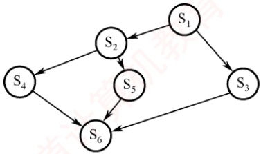

图2.11 前驱关系举例

```txt
semaphore a12=0,a13=0,a24=0,a25=0,a36=0,a46=0,a56=0;
//初始化所有信号量，初值均为0
S1 ( ) {
//执行 S1
V(a12);V(a13); //通知 S2 和 S3：S1 已完成
1 算
S2 ( ) {
P(a12); //等待 S1 完成
... 直 //执行 S2
```

| V(a24);V(a25); |  |
| --- | --- |
| } S3 ( ) { |  |
| P(a13); | //等待 S1 完成 |
| …; | //执行 S3 |
| V(a36); } | //通知 S6:S3 已完成 |
| 王道 S4 ( ) { |  |
| P(a24); | //等待 S2 完成 |
| …; | //执行 S 4 |
| 教育 V(a46); | //通知S6:S4 已完成 |
| } S5 ( ) { | 王道计算机教育 |
| P(a25); | //等待 S2 完成 |
| …; | //执行 S5 |
| V(a56); | //通知 S6:S5 已完成 |
| } S6 () { |  |
| P(a36); | //等待 S3 完成 |
| P(a46); | //等待 S4 完成 |
| P(a56); | //等待 S5 完成 |
|  |  |
| …; | //执行 S6 |

#### 6．分析进程同步和互斥问题的方法步骤

1）关系分析。首先识别参与并发的进程，并厘清其间的关系:互斥关系（多个进程竞争同一临界资源）、同步关系（某进程需等待另一进程的执行结果）、前驱关系（存在明确的执行顺序约束）。每类关系均可映射到前述经典信号量模型。

2）思路梳理。根据各进程的操作流程，确定关键同步点，并初步规划P、V操作的位置。可参考和类比典型场景，如生产者-消费者、读者-写者、前驱图。

3）信号量设置。基于上述分析，定义所需的信号量，明确其语义与初值，并将P、V操作嵌入各进程的适当位置，确保逻辑正确，避免死锁与饥饿，且满足所有约束条件。

### 2.3.5 经典同步问题

考点追踪PV操作的应用题（2009、2011、2013、2014、2015、2017、2019、2025）

#### 1．生产者-消费者问题

**问题描述:**

系统中存在一组生产者进程和一组消费者进程，它们共享一个初始为空、容量为n的缓冲区。生产者每次生产一个产品，并将其放入缓冲区；消费者每次从缓冲区取出一个产品并进行消费。该问题需满足以下约束条件:仅当缓冲区未满时，生产者才能写入产品，否则必须等待；仅当缓冲区非空时，消费者才能读取产品，否则必须等待；缓冲区是临界资源，所有进程必须互斥访问。

**问题分析:**

1）关系分析。由于缓冲区是共享的临界资源，生产者与消费者对缓冲区的访问构成互斥关系；同时，消费者必须等待生产者生成产品后才能消费，二者又存在同步关系。

2）思路梳理。使用一个互斥信号量控制对缓冲区的互斥访问；使用两个计数信号量分别跟踪空缓冲区和满缓冲区的数量；并严格控制P和V操作的执行顺序，以避免死锁。

3）信号量设置。互斥信号量mutex，控制对缓冲区的互斥访问，初值为1；计数信号量empty，记录空缓冲区的数量，初值为n；计数信号量full，记录满缓冲区的数量，初值为0。

生产者-消费者进程的实现如下:

```txt
semaphore empty=n; 厅间缓数 区区
semaphore full=0; //满缓冲区数量
produier()1) { //生产者进程
生产一个产品
P(empty); (要用什么，Ρ一下) //申请一个空缓冲区
P(mutex); (互斥夹紧) //进入临界区
将产品放入缓冲区
V(mutex) ; (互斥夹紧) //退出临界区
V(full); (提供什么，Ⅴ一下) //满缓冲区数加1
consumer () { //消费者进程
while(1) {
P(full); //申请一个满缓冲区
道 P (mutex) ; //进入临界区
从缓冲区中取出一个产品
V(mutex) ; //退出临界区
V(empty); //空缓冲区数加1
消费产品
1 育
```

需特别注意:对 empty和 full的P操作必须置于对 mutex的P操作之前。若顺序颠倒，例如生产者先执行 P(mutex)再执行 P(empty)，则消费者先执行 P(mutex)再执行 P(full)可能导致死锁。试想:当缓冲区已满（empty=0），若生产者先获取mutex，随后因P(empty)而阻塞；此时消费者欲取产品，却因mutex已被生产者持有而无法进入临界区执行P(full)和消费操作。结果，生产者等待消费者释放空位，消费者等待生产者释放mutex，双方互相阻塞，导致死锁。同理，当缓冲区为空（full=0）时，若消费者先获取mutex再执行P(full)，也会因无法继续而阻塞，进而阻止生产者进入临界区放入产品，同样导致死锁。因此，必须先申请资源状态（empty或full），再申请互斥访问（mutex），以确保进程不会在持有互斥锁的同时等待资源，从而避免死锁。

下面再看一个较为复杂的生产者-消费者问题。

**问题描述:**

桌上有一个盘子，最多只能容纳一个水果。爸爸专门向盘中放入苹果，妈妈专门放入橘子；女儿只吃盘中的苹果，儿子只吃盘中的橘子；只有当盘子为空时，爸爸或妈妈才能向其中放入一个水果；只有当盘中有自己所需的水果时，儿子或女儿才能从中取出并食用。

**问题分析:**

1）关系分析。爸爸和妈妈在向盘中放入水果时存在互斥关系；爸爸与女儿、妈妈与儿子之间分别构成同步关系（爸爸放苹果后，女儿才能取用；妈妈放橘子后，儿子才能取用）；儿子与女儿各自等待不同的水果，因此他们之间既无互斥也无同步关系。

2）整理思路。可抽象为两个生产者（爸爸、妈妈）和两个消费者（女儿、儿子），共享一个容量为1的缓冲区。由于不同类型的产品（苹果、橘子）需由不同的消费者消费，故不能仅使用一个full信号量来表示满状态，而需为每种产品设置独立的同步信号量。

3）信号量设置。互斥信号量plate，控制对盘子的互斥访问，初值为1；同步信号量apple，表示盘中是否有苹果，初值为0；同步信号量orange，表示盘中是否有橘子，初值为0。进程的实现如下:

```javascript
semaphore plate=1,apple=0,orange=0;
dad ( ) { //爸爸进程
while(1){ 算机
准备一个苹果
P(plate); //获取对盘子的独占使用权
把苹果放入盘子
V(apple); 王道 //通知女儿：苹果已放入盘中
1
1
mom ( ) { //母亲进程
while(1) {
准备一个橘子
P(plate); //获取对盘子的独占使用权
把橘子放入盘子
V(orange); //通知儿子：橘子已放入盘中
son ( ) { //儿子进程 道
while(1) {
P(orange); //等待盘中有橘子
从盘子中取出橘子
V(plate); //释放盘子，允许他人使用
吃掉橘子
1
一
daughter() { while(1) { 算机教 //女儿进程
P(apple); //等待盘中有苹果
从盘子中取出苹果
吃掉苹果 V(plate); 道 //释放盘子，允许他人使用
```

进程之间的关系如图 2.12 所示。dad()和 daughter()、mom()和 son()必须成对执行。只有当女儿拿走苹果或儿子拿走橘子之后，才会执行V(plate)操作，从而释放盘子供下一次使用。

#### 2．读者-写者问题

**问题描述:**

系统中存在两组并发进程:读者和写者，它们共享一个文件。多个读者可以同时读取文件，不会导致数据不一致；

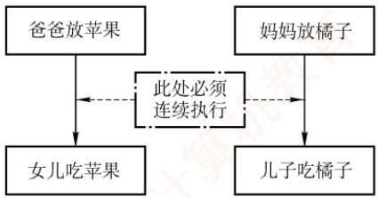

图2.12进程之间的关系

但若任一写者与其他进程（无论是读者还是其他写者）同时访问文件，则可能破坏数据一致性。因此，需满足以下要求:①允许多个读者同时执行读操作；②任一时刻只允许一个写者执行写操作；③写者在完成写操作前，不允许任何其他读者或写者访问文件；④写者开始写操作前，必须等待所有已进入的读者和写者全部退出。

**问题分析:**

1）关系分析。读者与写者之间存在互斥关系；写者与写者之间也存在互斥关系；读者与读者之间无互斥关系，可并发读取。

2）整理思路。写者的实现较为直接:它与所有其他进程互斥，只需用一个互斥信号量控制即可。读者的实现则更为复杂:它既要允许其他读者并发读取，又要阻止写者在读期间介入。为此，引入一个计数器count，用于记录当前正在读文件的读者数量。当第一个读者开始读时，应阻塞后续的写者；当最后一个读者结束读时，才允许写者进入；同时，多个读者对 count 的修改必须互斥。

3）信号量设置。计数信号量count，记录当前读者数量，初值为0；互斥信号量mutex，控制对 count的互斥访问，初值为1；互斥信号量rw，控制对文件的互斥访问，初值为1。进程的实现如下（读者优先）:

```c
int count=0; //记录当前的读者数量
semaphore mutex=1; //控制对 count 的互斥访问
semaphore rw=1; //控制读者与写者对文件的互斥访问
writer() { //写者进程
while(1) {
P(rw); //申请对文件的独占写权限
写文件
V(rw); //释放文件写权限
自
reader () { //读者进程
while(1) {
P(mutex); //互斥访问 count
if(count==0) //若是第一个读者
P(rw); //阻止写者访问文件
count++; //读者数量加1
V(mutex); //释放对 count 的访问
读文件 KlD
P(mutex); //互斥访问 count
count--; //读者数量减1
if(count==0) //若是最后一个读者
V(rw); //允许写者访问文件
V(mutex) ; //释放对 count 的访问
```

上述算法实现的是读者优先策略。只要已有读者在读，后续到来的读者均可立即进入读取，而写者必须等待所有读者全部退出。这种设计可能导致写者长时间等待，甚至出现写者饥饿，即在读者持续到达的情况下，写者可能被无限期推迟。

若需实现写者优先策略:一旦有写者请求写入，就禁止新读者进入，并在当前读者全部退出后立即让写者执行。为此，引入互斥信号量w，用于控制所有进程进入“准备访问文件”阶段的权限:写者先执行P(w)，再执行P(rw)，从而阻止后续读者插队；读者也需先执行P(w)；若此时有写者持有或正在等待w，该读者将被阻塞；读者在更新 count后立即执行 V(w)，因为只要存在活跃读者（count>0），写者已被rw阻塞，提前释放w可避免不必要地阻碍其他写者；写者完成写操作后执行V(w)，释放访问权。这样，w如同“门卫”:当有写者等待时，新读者无法进入；但已在读的读者可正常完成操作，既保障了写者的优先权，又维持了读者之间的并发读取。

```javascript
int count=0; //记录当前的读者数量
semaphore mutex=1; //控制对count 的互斥访问
semaphore rw=1; //控制读者与写者对文件的互斥访问
semaphore w=1; //实现写者优先的关键信号量
writer() { //写者进程
while(1) {
```

```txt

P(w); //申请写者优先权：阻止新读者进入
P(rw); //申请对文件的独占写权限
写文件
V(rw); //释放文件写权限
V(w); //释放写者优先权，允许其他进程进入
1
1
reader() { //读者进程
while(1) {
P(w); //申请进入权限：若无写者等待，则通过
P(mutex); //互斥访问 count
if(count==0) //若是第一个读者
P(rw) ; //阻止写者访问文件
count++; //读者数量加1
V(mutex); //释放对 count 的访问
V(w); //立即释放w，允许其他进程竞争
读文件
P(mutex); //互斥访问 count
count--; //读者数量减1
if(count==0) //若是最后一个读者
V(rw) ; //允许写者访问文件
V(mutex); //释放对 count 的访问
```

上述写者优先策略是相对的，并非绝对优先。该算法通过信号量w阻止新读者在写者等待时进入，从而避免读者无限插队；然而，若多个进程（包括读者和写者）同时阻塞在w上，系统通常按FCFS顺序唤醒，此时先到达的读者仍可能优先于后到的写者获得访问权。因此，该算法本质上是在防止写者饥饿的前提下，对写者给予有限优先，而非严格意义上的写者优先。

读者-写者问题的关键在于使用了受互斥保护的计数器count。因此，面对复杂的同步互斥问题时，可考虑引入此类计数器来动态判断资源状态，这是一种重要的解题思路。

#### 3．哲学家进餐问题

**问题描述:**

一张圆桌旁围坐5名哲学家，每两名相邻哲学家之间放置一根筷子，共5根筷子，每位哲学家面前有一碗米饭，如图2.13所示。哲学家交替进行思考与进餐:思考时互不影响；饥饿时，必须同

时持有左右两根筷子才能开始进餐（筷子需要逐根拿起）；若所需筷子已被他人持有，则必须等待；进餐结束后，立即放下两根筷子，继续思考。

**问题分析:**

1）关系分析。每根筷子被其两侧的哲学家共享，因此对同一根筷子的访问必须互斥。

2）整理思路。共有5个并发进程。本题的关键是如何让一名哲学家安全地获取左右两根筷子，避免死锁或饥饿。直观的解决思路有两种:①尝试同时获取两根筷子，即仅当左右筷子均空闲时才

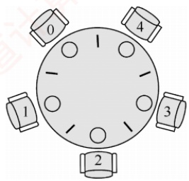

图2.13 5名哲学家进餐

拿起；②对哲学家的行为制定规则，破坏死锁产生的必要条件。

3）信号量设置。定义互斥信号量数组 chopstick[5]，控制对5根筷子的互斥访问，初值均为1。哲学家编号为0～4，哲学家i左侧筷子的编号为i，右侧筷子的编号为(i+1)%5。

一个直观的实现如下（存在死锁风险）:

```javascript
semaphore chopstick[5]={1,1,1,1,1}; //初始化 5 根筷子的信号量
Pi ( ) { //i 号哲学家进程
do { 算
P(chopstick[i]); //拿起左侧筷子
P(chopstick[(i+1)%5]); //拿起右侧筷子
进餐
V(chopstick[i]); //放回左侧筷子
V(chopstick[(i+1)%5]); //放回右侧筷子
思考
} while(1);
```

假设5名哲学家同时饥饿，并几乎同时执行完P(chopstick[i])。此时，每位哲学家各持一根左侧筷子，且均在等待右侧筷子，系统进入循环等待状态，所有进程阻塞，形成死锁。

为防止死锁发生，可对哲学家进程施加一些限制条件:①限制最多4名哲学家同时尝试进餐，确保至少有一人能获得两根筷子，这样在其用餐完毕后释放他的两根筷子，从而使更多的哲学家能够进餐；②对哲学家编号，规定奇数号哲学家先拿左筷、再拿右筷，偶数号则相反，打破循环等待条件；③仅当左右两根筷子均空闲时，才允许哲学家同时拿起。

假设采用第二种方法，当一名哲学家左右两侧的筷子都可用时，才允许他拿起筷子。

```javascript
semaphore chopstick[5]={1,1,1,1,1}; ∥/初始化 5 根筷子的信号量
semaphore mutex=1; //设置取筷子的信号量
Pi ( ) { //i号哲学家的进程
do {
P(mutex) ; //申请取筷子的信号量
P(chopstick[i]); //拿起左侧筷子
P(chopstick[(i+1)%5]); //拿起右侧筷子
V(mutex) ; //释放取筷子的信号量
进餐
V(chopstick[i]); //放回左侧筷子
V(chopstick[(i+1)%5]); //放回右侧筷子
思考
} while(1);
```

哲学家进餐问题是经典的进程同步案例，其本质在于预防循环等待。尽管大部分习题和真题通过消费者-生产者模型或读者-写者问题就能求解，但对哲学家进餐问题仍然要熟悉。考研复习的关键在于反复多次和全面，“偷工减料”是要吃亏的。

### 2.3.6 管程

在信号量机制中，每个访问临界资源的进程都需自行编写P/V操作。分散的同步代码不仅增加了编程复杂度，还极易因操作顺序不当而引发死锁。为简化同步控制，操作系统引入了更高层的抽象机制管程:它将共享资源及其操作封装于一体，自动保证互斥访问，程序员无须显式编写互斥代码；同时，通过条件变量实现灵活的进程同步，有效降低死锁风险。

#### 1．管程的定义

**考点追踪管程的特点（2016）**

系统中的各类硬件资源和软件资源，均可通过数据结构进行抽象描述:即用少量状态信息和一组对资源的操作来表征该资源，而忽略其内部结构与实现细节。

管程正是基于这一思想构建的。它利用一个共享数据结构来表示系统中的共享资源，并将对该数据结构的所有操作封装为一组过程。进程对共享资源的申请、释放等操作，都必须通过调用这些过程来完成。这组过程可根据资源的当前状态决定是否允许访问:若条件满足，则处理请求:否则，将进程阻塞。由此确保任一时刻至多只有一个进程使用该共享资源，从而统一管理所有对共享资源的访问，实现进程互斥。这个由共享数据结构及其操作过程共同组成的资源管理程序，称为管程（monitor）。形式上，管程定义了一个数据结构，以及一组可在该数据结构上被并发进程调用的操作；这些操作不仅能修改管程内部的数据，还能协调进程之间的同步行为。

形式上，一个管程由以下四部分组成。

①管程的名称。

②局部于管程内部的共享数据结构说明。

③对该数据结构进行操作的一组过程（或函数）。

④对共享数据进行初始化的语句。

典型的管程定义如下:

```txt
monitor Demo{ //① 定义一个名称为 Demo 的管程
//②定义共享数据结构，对应系统中的某种共享资源
共享数据结构 S；
//④对共享数据结构初始化的语句
init code() {
S=5; //初始可用资源数为5
take away() { //③操作过程1：申请资源
对共享数据结构S的一系列处理； 何
S--; //可用资源数-1
give_back() { //③操作过程2：归还资源
对共享数据结构s的一系列处理；
S++; //可用资源数+1
```

熟悉面向对象程序设计的读者会发现，管程与类（class）高度相似。

1）封装性:管程将对共享资源的操作封装起来，其内部的共享数据结构只能被管程自身的过程访问。外部进程必须通过调用这些过程才能访问资源。例如，在上例中，申请资源需调用 take\_away()，归还资源则需调用 give\_back()。

2）互斥性:任一时刻仅允许一个进程执行管程内的过程，从而实现互斥访问。若多个进程同时调用 take\_away()或 give\_back()，则只有当前进程完成其所调用的过程后，下一个进程才能开始执行，这一机制确保了对共享数据S的互斥访问。

管程与进程的区别:①进程拥有私有数据结构（如PCB），而管程管理的是公共数据结构（如缓冲区）。②进程执行通用计算任务，而管程专注于同步控制与资源管理。③引入进程是为了实现并发，而引入管程是为了解决共享资源的互斥访问问题。④进程是主动执行的实体，而管程是被动调用的模块，即进程通过调用管程中的过程来操作共享数据。⑤多个进程可并发执行，但对同一管程的多个调用是互斥的，即同一时刻仅一个进程可在该管程内执行。⑥进程具有动态的生命周期（从创建到撤销），而管程是操作系统中的静态资源管理模块，仅供进程调用。

#### 2．条件变量

当一个进程进入管程后，若因条件不满足而需要等待，它必须释放对管程的占用；否则，其他进程将无法进入管程，从而导致系统停滞。为解决这一问题，管程引入了条件变量（condition），将不同的阻塞原因分别抽象为独立的条件变量。通常，一个进程可能因多种条件不满足而被阻塞，因此管程中可以设置多个条件变量。每个条件变量维护一个等待队列，用于记录所有因该条件而阻塞的进程。对条件变量仅支持两种操作:wait 和 signal。

x.wait:当条件变量x所代表的条件不满足时，当前执行管程过程的进程调用x.wait()，将自身加入x的等待队列，并自动释放管程，从而允许其他进程进入。

x.signal:当x所代表的条件发生变化（可能已满足）时，调用x.signal()，唤醒一个因等待该条件而阻塞在x上的进程。

条件变量的定义和使用示例如下:

```txt
monitor Demo{
共享数据结构 S;
condition x; //定义一个条件变量×
init code(){ ... }
take_away() {
if(S<=0) x.wait(); //资源不足，在条件变量×上阻塞等待
资源足够，分配资源，做一系列相应处理；
首 give back() { 道
归还资源，做一系列相应处理；
if(有进程在等待) x.signal()；//唤醒一个阻塞进程
1
```

条件变量与信号量的比较。相似点:wait/signal操作与P/V操作均可实现进程的阻塞与唤醒。不同点:信号量具有整数值，反映可用资源数量；而条件变量不维护数值，仅用于线程排队和通知。在管程中，资源数量由共享变量（如S）显式记录，条件变量只负责同步。

### 2.3.7 本节小结

本节开头提出的问题的参考答案如下。

**1）为什么要引入进程同步的概念？**

在多道程序环境下，多个进程并发执行，彼此之间存在相互制约关系。为协调这些关系，确保进程能够正确、有序地协作或竞争共享资源，操作系统引入了进程同步的概念。

**2）不同的进程之间会存在什么关系？**

进程之间主要存在两种基本的制约关系:同步与互斥。同步是指为完成共同任务而建立的多个进程，在某些关键点上需要协调工作次序，通过等待或传递信息所形成的协作关系。互斥是指当一个进程正在访问临界资源（处于临界区）时，其他进程必须等待；只有当前进程退出临界区后，其他进程才被允许进入，以保证对临界资源的独占访问。

**3）当单纯用本节介绍的方法解决这些问题时会遇到什么新的问题吗？**

当两个或多个进程各自已占用某些资源，又同时请求对方所持有的资源时，可能形成一种互相等待的局面。若无外部干预，这些进程将永久阻塞，无法继续推进，这种现象称为死锁。其形成原因、必要条件、检测方法及解决方案将在下一节中详细介绍。

## 2.4 死锁

在学习本节时，请读者思考以下问题:

1）为什么会产生死锁？产生死锁有什么条件？

2）有什么办法可以解决死锁问题？

学完本节，读者应了解死锁的由来、产生条件及基本解决方法，区分避免死锁和预防死锁。

### 2.4.1 死锁的概念

#### 1．死锁的定义

在多道程序系统中，进程的并发执行显著提高了系统资源的利用率和整体效率。然而，这种并发性也带来了新的问题一—死锁。所谓死锁，是指多个进程因竞争资源而陷入相互等待的僵局:每个进程都在等待其他进程所占有的资源，而这些资源又不会被释放，从而形成一个循环等待链。结果，所有涉及的进程都被永久阻塞；若无外部干预，它们将无法继续推进。

下面通过实例说明死锁现象。

先看一个生活中的类比。假设有一条狭窄的小巷，仅容一辆车通行。若有两辆汽车分别从巷子的两端同时驶入，且双方都坚持前行而不愿倒车，则两车将在巷中对峙，彼此阻挡，谁也无法通过。这种互相等待、互不让步的情形，恰如计算机系统中的死锁。

在计算机系统中，死锁的表现更为典型。例如，某系统中仅配备一台打印机和一台扫描仪。进程 $\mathrm {P}_{1}$ 当前正占有扫描仪，并请求使用打印机；与此同时，进程 $\mathrm {P}_{2}$ 正占有打印机，并请求使用扫描仪。由于每个进程都持有对方所需的资源，且都不主动释放，两个进程便陷入无限期的相互等待之中，无法继续执行。此时，系统就处于死锁状态。

#### 2．死锁与饥饿

一组进程处于死锁状态，是指其中每个进程都在等待某个事件的发生，而该事件只能由组内另一个进程触发，通常表现为等待对方释放其所占有的资源。

与死锁密切相关但本质不同的另一个问题是饥饿，是指某个进程因资源分配策略的不公平性，长期得不到所需资源，从而无法推进其执行。产生饥饿的主要原因是:当多个进程同时竞争同一类资源时，若系统采用的分配策略不能保证“等待时间有上界”（无法确保每个等待进程最终都能获得服务），则某些进程就可能被无限期推迟。例如，当多个进程需要打印文件时，若系统采用“最短作业优先”的打印调度策略，则长文件的打印请求可能因不断有新的短文件到达而始终无法获得服务，最终陷入饥饿状态。需要注意的是，饥饿并不等同于死锁:系统可能仍在正常运行，其他进程可以顺利执行，只是个别进程被持续忽略。

死锁与饥饿的共同点如下:相关进程都无法顺利向前推进。二者的主要区别如下:①涉及的进程数量不同，饥饿可以只影响单个进程；而死锁必须涉及两个或更多的进程，且它们之间存在循环等待关系。②进程所处的状态不同，处于饥饿状态的进程可能处于就绪态（例如，在SPF调度算法中长期得不到CPU），也可能处于阻塞态（例如，长期等待某个I/O设备）；而处于死锁状态的进程则必定处于阻塞态，因为它们正在等待已被其他死锁进程占有的资源。

#### 3．死锁产生的原因

考点追踪单类资源竞争时发生死锁的临界条件的分析（2009、2014）

**（1）系统资源的竞争**

系统中不可剥夺资源（如打印机、磁带机等）的数量通常有限，难以满足所有并发进程的需求。当多个进程竞争这类资源且资源分配策略不当，便可能因相互等待而陷入僵局，进而引发死锁。需要强调的是，死锁的发生与不可剥夺资源的存在密切相关。对于可剥夺资源（如CPU时间片），操作系统可在必要时强制回收，因此单纯因这类资源的竞争一般不会导致死锁。

**(2) 进程推进顺序非法**

即使系统资源充足，若进程请求和释放资源的顺序不合理，则仍可能引发死锁。例如，进程$\mathrm {P_{1}}$ 和 $\mathrm {P}_{2}$ 分别占有资源 $\mathtt {R_{l}}$ 和 $\mathrm {R}_{2}$ ，随后 $\mathrm {P_{1}}$ 申请 $\mathrm{R}_{2}$ 、而 $\mathrm {P}_{2}$ 申请 $\mathrm {R_{1}}$ 。由于双方所需资源均被对方占有，两个进程均被阻塞，且各自保持已占有的资源不放，从而形成死锁。

此外，同步机制使用不当也可能导致死锁。例如，进程A等待进程B发送的消息，而进程B又在等待进程A的消息。此时，尽管未涉及传统硬件资源，但消息通道或同步对象可被视为一种逻辑资源，其相互等待同样会使进程无法继续推进，形成死锁。

#### 4．死锁产生的必要条件

死锁的发生必须同时满足以下四个条件；只要其中任一条件不成立，死锁就不可能发生。

1）互斥条件。进程对所分配的资源（如打印机）要求排他性使用，即在一段时间内，某资源只能被一个进程占有；若有其他进程请求该资源，则必须等待。

2）不可剥夺条件。进程已获得的资源在使用完毕之前，不能被其他进程强行剥夺，只能由该进程主动释放。

3）请求并保持条件。进程在持有至少一个资源的同时，又提出新的资源请求；若该资源已被其他进程占有，则请求进程被阻塞，但对其已占有的资源仍保持不放。

4）循环等待条件。存在一个进程集合 $\left\{\mathrm{P}_{1}, \mathrm{P}_{2}, \cdots, \mathrm{P}_{n} \right\}$ ，其中每个进程 $\mathrm {P}_{i}$ 等待的资源正被下一个进程 $P_{(i+1)\bmod(n+1)}$ 占有，从而形成一个循环等待链，如图2.14所示。

直观上看，循环等待条件似乎与死锁的定义相同，实则不然。

资源分配图中存在环，并不必然意味着死锁。其根本原因在于:当某类资源有多个实例时，即使图中存在环，系统仍可能通过资源重分配打破僵局。例如，在图2.15中，若输出设备有两个实例，进程 $\mathrm {P_{0}}$ 和 $\mathrm{P}_{K} \left( K \notin \{0,1,\cdots,n\} \right)$ 各持有一台。当 $\mathrm {P}_{n}$ 请求一台输出设备时，只要 $\mathrm {P_{0}}$ 或 $\mathrm {P}_{K}$ 任一释放其所持有的设备， $\mathrm {P}_{n}$ 即可获得所需资源，从而解除等待环。

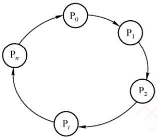

图 2.14 循环等待

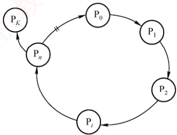

图2.15 满足条件但无死锁

因此，只有当系统中每类资源均仅有一个实例时，资源分配图中的环才成为死锁的充分必要条件；否则，环的存在仅表明系统处于潜在风险状态，未必实际发生死锁。

区分不可剥夺条件与请求并保持条件，通过以下例子说明:若你手中持有一个苹果，他人不能强行将其拿走（使你暂时不吃），这体现了不可剥夺条件；若你已持有一个苹果，又去请求第二个苹果，但在获得第二个苹果前拒绝放下第一个，则体现了请求并保持条件。

#### 5．死锁的处理策略

处理死锁主要有三种策略:一是通过协议预防或避免死锁，确保系统永不进入死锁状态；二是允许死锁发生，但能检测并恢复；三是完全忽略死锁问题，假定其不会出现。其中，第一种策略包含预防死锁和避免死锁两种方法；第二种策略包含检测及解除死锁方法；第三种策略被大多数通用操作系统（如Linux和Windows）所采用。下面简要介绍这些处理方法。

1）预防死锁。通过设置严格的限制条件，破坏死锁的四个必要条件中的一个或多个，从根本上杜绝死锁的可能。 临村

2）避免死锁。在资源动态分配过程中，通过特定算法判断分配后系统是否仍处于安全状态，仅当安全时才允许分配，从而避免进入可能导致死锁的不安全状态。

3）检测及解除死锁。不施加任何预防性限制，允许进程自由申请资源；系统定期运行检测

算法，一旦发现死锁，便采取相应措施（如终止部分进程或剥夺其资源）予以解除。

预防与避免死锁均属于事前防范策略。死锁预防的限制条件较为严格，实现相对简单，但往往导致系统效率和资源利用率较低；死锁避免的限制条件相对宽松，但需在每次资源分配前通过算法判断系统是否仍处于安全状态，实现较为复杂。各类策略的对比如表2.5所示。

表2.5 死锁处理策略的比较

|  | 资源分配策略 | 各种可能模式 | 主要优点 | 主要缺点 |
| --- | --- | --- | --- | --- |
| 死锁预防 | 保守，宁可资源闲置 | 次请求所有资源，资源剥夺，资源按序分配 | 无须运行时检测，实现简单 | 资源利用率低；剥夺可能很频繁；不适用于动态请求 |
| 死锁避免 | 是预防和检测的折中（运行时判断是否可能死锁) | 每次分配前，寻找可能的安全允许顺序 | 无须资源剥夺，资源利用率较高 | 须预知最大资源需求；进程可能因长期不安全而被无限期推迟 |
| 死锁检测 | 宽松，只要允许就分配资源 | 定期检测死锁，发现后采取解除措施 | 不限制资源申请，无启动延迟；支持灵活分配 | 检测与解除带来额外开销；终止或剥夺可能导致工作丢失 |

### 2.4.2 死锁预防

**考点追踪死锁预防的特点（2019）**

预防死锁的发生，只需破坏死锁产生的四个必要条件之一即可。

#### 1．破坏互斥条件

若将原本只能互斥使用的资源改造为允许多个进程共享访问，则可避免死锁。然而，许多资源（如打印机、磁带机等临界资源）本质上不支持并发访问，否则会导致数据不一致或设备冲突。因此，互斥性通常是保障系统正确性的基本要求，破坏该条件在实践中并不可行。

#### 2．破坏不可剥夺条件

当一个已占有某些不可剥夺资源的进程请求新资源而无法满足时，系统强制释放其已占有的所有资源，待后续需要时再重新申请。这意味着，资源被临时剥夺，从而破坏不可剥夺条件。

该策略实现复杂且代价高昂:对于打印机等不可剥夺的外部设备，强制释放可能导致已完成的工作失效，甚至引发设备状态混乱。此外，频繁的申请与释放会显著增加系统开销，延长进程周转时间，降低系统吞吐量。因此，该方法在实际系统中极少采用。

#### 3．破坏请求并保持条件

要求进程在请求新资源时不得持有任何不可剥夺资源。可通过以下方式实现。

1）静态资源分配:进程在运行前一次性申请所需全部资源。若系统无法满足，则进程暂不投入运行。运行期间不再提出新请求，从而避免“请求并保持”行为。

2）动态释放后申请:作为对方法一的改进，进程在获得初期所需资源后即可开始执行；但在运行过程中，必须先释放所有已使用完毕的资源，才能申请新资源。

方法一的优点是实现简单，但存在明显缺点:①资源浪费严重:进程在运行初期即占有全部所需资源，其中部分资源可能仅在运行末期才使用，甚至从未被使用，导致长期闲置；②易引发饥饿现象:由于某些资源长期被其他进程占有，等待这些资源的进程可能迟迟无法启动。

#### 4．破坏循环等待条件

采用资源有序分配法:为系统中每类资源赋予唯一的编号，并规定进程必须按编号递增的顺序请求不同类资源，且同类资源须一次性申请。换言之，进程只有在未持有任何资源，或仅持有较小编号的资源时，才被允许申请更大编号的资源。按此规则，任何已持有大编号资源的进程都无法再申请小编号资源，从而确保资源分配图中不可能出现环，从根本上杜绝死锁。

该方法的缺点:①资源编号需相对稳定，不利于新增设备类型。②尽管在编号时已尽量考虑大多数进程使用资源的顺序，但实际使用资源的顺序仍可能与编号次序不一致，导致资源提前占用而长期闲置，造成浪费。③强制按固定次序申请资源，增加了用户编程的复杂性。

### 2.4.3 死锁避免

死锁避免同样属于事先预防策略，但它并非通过预先施加限制来破坏死锁的必要条件，而是在每次分配资源时，动态判断此次分配是否可能引发死锁。只有在确认不会导致死锁的情况下，系统才予以分配。由于该方法所施加的约束较为宽松，因而能够获得较好的系统性能。

#### 1．系统安全状态

在死锁避免机制中，系统允许进程动态申请资源，但在进行资源分配前，必须先评估此次分配的安全性:若分配后系统仍处于安全状态，则允许分配；否则，进程需等待。

所谓安全状态，是指系统存在某个进程执行序列 $( \mathrm {P}_{1} , \mathrm {P}_{2} , \cdots , \mathrm {P}_{n} )$ ，使得对于序列中的每个进程 $\mathrm {P}_{i}$ ，在其之前的所有进程执行完毕并释放所占资源后，系统仍有足够的可用资源满足 $\mathrm {P}_{i}$ 的尚需资源量（最大需求减去已分配量），从而保证 $\mathrm {P}_{i}$ 能顺利完成。这样的序列称为安全序列（可能存在多个)。若系统无法找到任何一个安全序列，则称系统处于不安全状态。

**考点追踪系统安全状态的分析（2018）**

假设系统中有三个进程 $\mathrm {P}_{1}$ $\mathrm {P}_{2}$ 和 $\mathrm {P}_{3} ,$ ，共有12台磁带机。各进程的最大需求分别为: $\mathrm {P}_{1}$ 需10台， $\mathrm {P}_{2}$ 需4台， $\mathrm {P}_{3}$ 需9台。在 $T_{0}$ 时刻，各进程已分配资源及系统可用资源如表2.6所示。

表 2.6 资源分配

| 进程名 | 最大需求 | 已分配 | 可 用 |
| --- | --- | --- | --- |
| $\mathrm {P_{l}}$ | 10 | 5 | 3 |
| $\mathrm {P}_{2}$ | 4 | 2 |  |
| $P_{3}$ | 9 | 2 |  |

在 $T_{0}$ 时刻，系统处于安全状态，因为存在安全序列 $\left( \mathrm{P}_{2}, \mathrm{P}_{1}, \mathrm{P}_{3} \right)$ :若按此顺序推进进程，每个进程在其轮次均可获得所需资源并顺利完成。具体而言，当前可用资源为3， $\mathrm {P}_{2}$ 尚需2台，可立即满足， $\mathrm {P}_{2}$ 完成后释放其全部4台资源，可用资源变为5； $\mathrm {P}_{1}$ 尚需5台，恰好可满足， $\mathrm {P}_{1}$ 完成后释放10台，可用资源增至10； $\mathrm {P}_{3}$ 尚需7台，可被满足，最终顺利完成。

若在 $T_{0}$ 时刻之后，系统将1台分配给P3，则 $\mathrm {P}_{3}$ 已分配量变为3，可用资源降为2。此时，系统进入不安全状态，因为无法再找到任何安全序列。例如，若将剩余的2台分配给 $\mathrm {P}_{2}$ (其尚需2台）， $\mathrm {P}_{2}$ 可完成并释放4台，可用资源变为4。然而， $\mathrm {P_{1}}$ 尚需5台， $\mathrm {P}_{3}$ 尚需6台（因已分配3台），均无法满足。两个进程相互等待对方释放资源，陷入僵局，最终导致死锁。

系统处于安全状态时，一定不会发生死锁；而处于不安全状态时，死锁可能发生，但并非必然发生。换言之，死锁发生时，系统必定处于不安全状态，但不安全状态不一定会演变为死锁。

#### 2．利用银行家算法避免死锁

**考点追踪银行家算法的特点（2013、2019）**

银行家算法是最著名的死锁避免算法。其基本思想是:将操作系统视为银行家，系统管理的资源视为银行资金，进程请求资源相当于用户申请贷款。每个进程在运行前需声明其对各类资源的最大需求量（且该最大需求量在整个生命周期内不得更改，否则银行家算法的安全性保证失效），且该总量不得超过系统资源总量。当进程在运行中申请资源时，系统首先检查当前是否有足够资源可供分配；若有，则进一步试探:若将这些资源分配给该进程，系统是否仍处于安全状态。只有在确保安全的前提下，才正式分配资源；否则，就让进程等待。

**（1）银行家算法中的数据结构**

假设系统中有n个进程和m类资源，银行家算法需维护以下四个数据结构。

1）可利用资源向量Available:长度为m的向量，其中每个元素代表一类可用的资源数量。$\operatorname {Available} [ j ] = K$ 表示当前系统中有K个 $\mathrm {R}_{j}$ 类资源可用。

2）最大需求矩阵Max: $n {\times} m$ 矩阵，定义系统中每个进程对m类资源的最大需求。 $\operatorname {Max} [ i , j ] =$ K表示进程 $\mathrm {P}_{i}$ 对 $\mathrm {R}_{j}$ 类资源的最大需求数量为 $K_{s}$

3）分配矩阵Allocation:n×m矩阵，定义系统中每类资源当前已分配给每个进程的资源数。$\operatorname {Allocation} [ i , j ] = K$ 表示进程 $\mathrm {P}_{i}$ 当前已获得 $\mathrm {R}_{j}$ 类资源的数量为 $K_{\circ}$

4）需求矩阵Need: $n \times m$ 矩阵，表示每个进程尚需的各类资源数。 $\mathrm {Need} [ i , j ] = K$ 表示进程 $\mathrm {P}_{i}$尚需 $\mathrm {R}_{j}$ 类资源的数量为 $K_{\circ}$ W

上述三个矩阵满足如下关系:

$$
\mathrm{Need}[i, j] = \mathrm{Max}[i, j] - \mathrm{Allocation}[i, j]
$$

通常，题目会给出 Max和Allocation矩阵，解题的第一步即是据此计算出 Need 矩阵。

**（2）银行家算法**

设 Request是进程 $\mathrm {P}_{i}$ 的资源请求向量， $\operatorname {Request}_{i} [ j ] = K$ 表示 $\mathrm {P}_{i}$ 请求K个j类资源。当 $\mathrm {P}_{i}$ 发出资源请求后，系统按以下步骤进行检查:

①合法性检查:若 $\mathrm {Request}_{i} [ j ] \leqslant \mathrm {Need} [ i , j ]$ ，则转向步骤②；否则视为非法请求，因为其申请量已超过预先声明的最大需求。

②资源可用性检查:若 $\mathrm {Request}_{i} [ j ] \leqslant \mathrm {Available} [ j ]$ ，则转向步骤③；否则表示当前资源不足，$\mathrm {P}_{i}$ 必须等待。

③试探性分配:系统尝试将资源分配给 $\mathrm{P}_{i}^{\prime}$ 并更新相关数据结构:

$$
\begin{aligned} & Avalidle [i, j] =  Avalidle [j] -  Request [j] \quad &\# 减少系统可用资源  \quad  反映资源已被分配 \\& Alllocation [i, j] =  Alllocation [i, j] +  Request [j] \quad &\# 增加  \quad &P_i 已分配的资源量 \\& Need [i, j] =  Need [i, j] -  Request [j] \quad &\# 减少  \quad &P_i 尚需的资源量 \end{aligned}
$$

④安全性检查:系统执行安全性算法，判断此次分配后系统是否处于安全状态。若是，则正式确认此次分配；否则，撤销分配，恢复各数据结构的原始值，并让 $\mathrm {P}_{i}$ 等待。

#### 3．安全性算法举例

安全性算法用于判断系统当前是否处于安全状态，其基本思想是:尝试构造一个进程执行序列，使得所有进程都能依次获得所需资源并顺利完成。具体步骤如下。

1）设置两个向量。①工作向量Work:长度为m的向量，表示当前可用的各类资源数，初始时 $\mathrm{Work} = \mathrm{Avalable};$ 完成向量Finish:长度为n的布尔向量，标记各进程能否顺利完成，初始时 Finish[]=false；当进程 $\mathrm {P}_{i}$ 的资源需求可被满足时，令 $\mathrm{Finish}[i] = \mathrm{true}$

2）在尚未完成的进程中，查找一个满足以下两个条件的进程 $P_{i};$

$$
\begin{align*}&\mathsf{Finsh}[i] - \mathsf{false} \quad &\#  尚未加入安全序列  \\&\mathsf{Need}[i] \leq \mathsf{Work} \quad &\#  其尚需的各类资源数均不超过当前可用资源 \end{align*}
$$

若能找到，则执行步骤3）；否则，执行步骤4）。

3）当进程 $\mathrm {P}_{i}$ 获得所需资源后可顺利执行至完成，并释放其所占有的全部资源，故执行:

$$
\begin{aligned} &\mathrm{Work} = \mathrm{Work} + \mathrm{Allocation}[i] \quad \#  释放其已分配的各类资源  \\&\mathrm{Finish}[i] = \mathrm{true} \quad \#  将其加入安全序列 \\ \end{aligned}
$$

随后返回步骤2），继续寻找下一个可完成的进程。

4）若所有进程均满足 $\mathrm{Finish}[i] = \mathrm{true}$ ，则系统处于安全状态；否则系统处于不安全状态。为帮助理解上述流程，下面将通过具体示例完整演示安全性算法的执行过程。

**3. 安全性算法举例**

考点追踪银行家算法的安全序列分析（2011、2012、2018、2020、2022）

假定系统中有5个进程 $\{\mathrm{P}_{0}, \mathrm{P}_{1}, \mathrm{P}_{2}, \mathrm{P}_{3}, \mathrm{P}_{4} \}$ 和 3 类资源{A,B,C}，各类资源的总量分别为10,5, 7，在 $T_{0}$ 时刻的资源分配情况见表2.7。现利用安全性算法，判断系统此时是否处于安全状态。

表2.7 $T_{0}$ 时刻的资源分配表

<table><tr><td rowspan=2>进程名</td><td colspan=3>资源情况</td></tr><tr><td>MaxA B C</td><td>AllocationA B C</td><td>AvailableA B C</td></tr><tr><td> $\mathrm {P_{0}}$ </td><td>7 5 3</td><td>0 1 0</td><td rowspan=5>3 3 2(2 3 0)    HL首</td></tr><tr><td> $\boxed{P_{1}}$ </td><td>3 2 2</td><td>2 0 0(3 0 2)</td></tr><tr><td> $\mathrm {P}_{2}$ </td><td>9 0 2</td><td>3 0 2</td></tr><tr><td> $\mathrm {P}_{3}$ </td><td>2 2 2</td><td>2 1 1</td></tr><tr><td> $\boxed {\mathrm {~ P_{4} ~}}$ </td><td>4 3 3</td><td>0 0 2</td></tr></table>

①首先，由题目给出的 Max矩阵和 Allocation 矩阵，可计算出 Need 矩阵:

$$
\begin{bmatrix} 7 & 5 & 3 \\ 3 & 2 & 2 \\ 9 & 0 & 2 \\ 2 & 2 & 2 \\ 4 & 3 & 3 \\ \end{bmatrix} - \begin{bmatrix} 0 & 1 & 0 \\ 2 & 0 & 0 \\ 3 & 0 & 2 \\ 2 & 1 & 1 \\ 0 & 0 & 2 \\ \end{bmatrix} = \begin{bmatrix} 7 & 4 & 3 \\ 1 & 2 & 2 \\ 6 & 0 & 0 \\ 0 & 1 & 1 \\ 4 & 3 & 1 \\ \end{bmatrix}
$$

由此得到各进程的尚需资源数。

②初始化工作向量 $\mathrm{Work}=\mathrm{Avalable}=(3,3,2)$ 。将 Work 与 Need 矩阵的各行进行比较，寻找满足 $\mathrm{Need}[i] \leqslant \mathrm{Work}$ （各分量均不超过）且 Finish[i]=false的进程。初始时

$$
\begin{aligned} &\mathrm{P}_{1} \rightarrow (1,2,2) < (3,3,2) \\&\mathrm{P}_{3} \rightarrow (0,1,1) < (3,3,2)\\ \end{aligned}
$$

进程 $\mathrm {P}_{1}$ 和 $\mathrm {P}_{3}$ 均满足条件。此处选择 $\mathrm {P}_{1}$ (也可选择 $\mathbf {P}_{3} )$ 作为安全序列的第一个进程。

③将 $\mathrm {P}_{1}$ 加入安全序列，并模拟其顺利完成:释放其所占资源，更新工作向量:

$$
\mathrm{Work}=\mathrm{Work}+\mathrm{Allocation}[1]=(3,3,2)+(2,0,0)=(5,3,2)
$$

同时，标记 Finish[1]=true。

以更新后的Work=(5,3,2)重复上述过程，继续查找下一个可执行的进程。以此类推，整个分析过程如表2.8所示（表中“Work+Allocation”列即为下一步的Work值），最终构造出一个完整的安全序列 $\left\{\mathrm{P}_{1}, \mathrm{P}_{3}, \mathrm{P}_{4}, \mathrm{P}_{2}, \mathrm{P}_{0} \right\}$ ，表明系统在 $T_{0}$ 时刻处于安全状态。

表2.8 $T_{0}$ 时刻的安全序列的分析

<table><tr><td rowspan=3>进程名</td><td colspan=13>资源情况</td></tr><tr><td colspan=3>Work</td><td colspan=3>Need</td><td colspan=3>Allocation</td><td colspan=3>Work+Allocation</td><td rowspan=2>Finish</td></tr><tr><td>A</td><td>B</td><td>C</td><td>A</td><td>B</td><td>C</td><td>A</td><td>B</td><td>C</td><td>A</td><td>B</td><td>C</td></tr><tr><td> $\mathrm {P}_{1}$ </td><td>3</td><td>3</td><td>2</td><td>1</td><td>2</td><td>2</td><td>2</td><td>0</td><td>0</td><td>5</td><td>3</td><td>2</td><td>true</td></tr><tr><td> $\mathrm {P}_{3}$ </td><td>5</td><td>3</td><td>2</td><td>0</td><td>1</td><td>1</td><td>2</td><td>1</td><td>1</td><td>7</td><td>4</td><td>3</td><td>true</td></tr><tr><td> $\mathrm {P}_{4}$ </td><td>7</td><td>4</td><td>3</td><td>4</td><td>3</td><td>1</td><td>0</td><td>0</td><td>2</td><td>7</td><td>4</td><td>5</td><td>true</td></tr><tr><td> $\mathrm {P}_{2}$ </td><td>7</td><td>4</td><td>5</td><td>6</td><td>0</td><td>0</td><td>3</td><td>0</td><td>2</td><td>10</td><td>4</td><td>7</td><td>true</td></tr><tr><td> $\overline {{\mathrm {~ P_{0} ~}}}$ </td><td>10</td><td>4</td><td>7</td><td>7</td><td>4</td><td>3</td><td>0</td><td>1</td><td>0</td><td>10</td><td>5</td><td>7</td><td>true</td></tr></table>

#### 4．银行家算法举例

安全性算法是银行家算法的核心。在典型考题中，通常会给出某个进程的资源请求向量。读者只需执行银行家算法的前三个步骤，即可得到更新后的Allocation和Need矩阵，再参照上例的安全性算法判断系统是否仍处于安全状态，从而决定是否批准该请求。

假设当前系统资源分配及剩余情况如表2.7所示 $( T_{0}$ 时刻的状态）。

1）进程 $\mathrm {P}_{1}$ 发出请求向量Request₁(1,0,2)，系统按银行家算法进行如下检查。

① 合法性检查: $\mathrm{Request_{l}(1,0,2) \leq Need_{l}(1,2,2)}$ ，成立。

②资源可用性检查: $\mathrm{Request_{l}(1,0,2) \leq Avalable_{l}(3,3,2)}$ ，成立。

③试探性分配:系统尝试为 $\mathrm {P_{1}}$ 分配资源，并修改相关数据结构:

$$
\mathrm{Avallable - Avalable - Request_{l} = (2, 3, 0)}
$$

$$
\mathrm{Allocation_{l}} = \mathrm{Allocation_{l}} + \mathrm{Req} \mathrm{west_{l}} = (3, 0, 2)
$$

$$
\mathrm{Need}_{1}=\mathrm{Need}_{1}-\mathrm{Request}_{1}=(0,2,0)
$$

由此形成的资源变化情况如表2.7中的圆括号所示。

④安全性检查:令 $\mathrm{Work}=\mathrm{Avalable}=(2,3,0)$ ，执行安全性算法，过程如表2.9所示。

表2.9 $\mathbf {P_{1}}$ 申请资源时的安全性检查

<table><tr><td rowspan=3>进程名</td><td colspan=13>资源情况</td></tr><tr><td colspan=3>Work</td><td colspan=3>Need</td><td colspan=3>Allocation</td><td colspan=3>Work+Allocation</td><td rowspan=2>Finish</td></tr><tr><td colspan=3>A  B  C</td><td colspan=3>A  B  C</td><td colspan=3>A  B  C</td><td colspan=3>A    B   C</td></tr><tr><td> $\mathrm {P_{1}}$ </td><td>2</td><td>3</td><td>0</td><td>0</td><td>2</td><td>0</td><td>3</td><td>0</td><td>2</td><td>5</td><td>3</td><td>2</td><td>true</td></tr><tr><td> $\mathrm {P}_{3}$ </td><td>5</td><td>3</td><td>2</td><td>0</td><td>1</td><td>1</td><td>2</td><td>1</td><td>1</td><td>7</td><td>4</td><td>3</td><td>true</td></tr><tr><td> $\mathrm {P}_{4}$ </td><td>7</td><td>4</td><td>3</td><td>4</td><td>3</td><td>1</td><td>0</td><td>0</td><td>2</td><td>7</td><td>4</td><td>5</td><td>true</td></tr><tr><td> $\mathrm {P_{0}}$ </td><td>7</td><td>4</td><td>5</td><td>7</td><td>4</td><td>3</td><td>0</td><td>1</td><td>0</td><td>7</td><td>5</td><td>5</td><td>true</td></tr><tr><td> $\mathrm {P}_{2}$ </td><td>7</td><td>5</td><td>5</td><td>6</td><td>0</td><td>0</td><td>3</td><td>0</td><td>2</td><td>10</td><td>5</td><td>7</td><td>true</td></tr></table>

由表可知，存在安全序列 $\left\{\mathrm{P}_{1}, \mathrm{P}_{3}, \mathrm{P}_{4}, \mathrm{P}_{0}, \mathrm{P}_{2} \right\}$ ，系统处于安全状态。因此，可以正式将$\mathrm {P}_{1}$ 所请求的资源分配给它。分配后系统的资源状态如表2.10所示。

表 2.10 为 $\mathbf {P_{1}}$ 分配资源后的有关资源数据

<table><tr><td rowspan=3>进程名</td><td colspan=9>资源情况</td></tr><tr><td colspan=3>Allocation</td><td colspan=3>Need</td><td colspan=3>Available</td></tr><tr><td>A</td><td>B</td><td>C</td><td>A</td><td>B</td><td>C</td><td>A</td><td>B</td><td>C</td></tr><tr><td> $\mathrm {P_{0}}$ </td><td>0</td><td>1</td><td>0</td><td>7</td><td>4</td><td>3</td><td rowspan=5>2</td><td rowspan=5>3</td><td rowspan=5></td></tr><tr><td> $\mathrm {P}_{1}$ </td><td>3</td><td>0</td><td>2</td><td>0</td><td>2</td><td>0</td></tr><tr><td> $\overline {{\mathrm {P}_{2}}}$ </td><td>3</td><td>0</td><td>2</td><td>6</td><td>0</td><td>0</td></tr><tr><td> $\overline {{\mathrm {P}_{3}}}$ </td><td>2</td><td>1</td><td>1</td><td>0</td><td>1</td><td>1</td></tr><tr><td> $\overline {{\mathrm {~ P_{4} ~}}}$ </td><td>0</td><td>0</td><td>2</td><td>4</td><td>3</td><td>1</td></tr></table>

2) $P_4$ 发出请求向量 $\mathrm {Request}_{4}   ( 3 , 3 , 0 )$ ，系统按银行家算法进行检查:

① 合法性检查: $\mathrm{Request_{4}(3,3,0) \leq Need_{4}(4,3,1)}$ ，成立。

②资源可用性检查: $\mathrm{Request_{4}(3, 3, 0) > Avalable(2, 3, 0)}$ ，不成立，让 $\mathrm {P}_{4}$ 等待。

3） $\mathrm {P}_{0}$ 发出请求向量 $\mathrm {Requst}_{0} ( 0 , 2 , 0 )$ ，系统按银行家算法进行检查:

① 合法性检查: $\mathrm{Request_{0}(0,2,0) \leq Need_{0}(7,4,3)}$ ，成立。

②资源可用性检查: $\mathrm{Request_{0}(0,2,0) \leq Aviable(2,3,0)}$ ，成立。

③试探性分配:系统尝试为 $\mathrm {P_{0}}$ 分配资源，并修改相关数据结构:

$$
Available = Available - Reques t_{0} = ( 2 , 1 , 0 )
$$

$$
\mathrm{Allocation_{0}=Allocation_{0}+Reques_{0}=(0,3,0)}
$$

$\mathrm{Need}_{0}=\mathrm{Need}_{0}-\mathrm{Request}_{0}=(7,2,3)$ ，结果如表2.11所示。

表 2.11 为 $\mathbf {P}_{0}$ 分配资源后的有关资源数据

<table><tr><td rowspan=3>进程名</td><td colspan=9>资源情况</td></tr><tr><td colspan=3>Allocation</td><td colspan=3>Need</td><td colspan=3>Available</td></tr><tr><td>A</td><td>B</td><td>C</td><td>A</td><td>B</td><td>C</td><td>A</td><td>B</td><td>C</td></tr><tr><td> $\mathrm {P_{0}}$ </td><td>0</td><td>3</td><td>0</td><td>7</td><td>2</td><td>3</td><td rowspan=5>2</td><td rowspan=5>1</td><td rowspan=5>0</td></tr><tr><td> $\mathrm {P_{1}}$ </td><td>3</td><td>0</td><td>2</td><td>0</td><td>2</td><td>0</td></tr><tr><td> $\mathrm {P}_{2}$ </td><td>3</td><td>0</td><td>2</td><td>6</td><td>0</td><td>0</td></tr><tr><td> $P_{3}$ </td><td>2</td><td>1</td><td>1</td><td>0</td><td>1</td><td>1</td></tr><tr><td> $\mathrm {P}_{4}$ </td><td>0</td><td>0</td><td>2</td><td>4</td><td>3</td><td>1</td></tr></table>

④安全性检查:此时 Available(2,1,0)，无法满足任何进程的尚需资源，系统进入不安全状态，因此拒绝 $\mathrm {P_{0}}$ 的请求，撤销试探性分配，并恢复各数据结构至分配前状态。

### 2.4.4 死锁检测与解除

**考点追踪死锁避免和死锁检测的区分（2015）**

前面介绍的死锁预防和避免算法，都是在为进程分配资源时施加限制条件或进行安全性检查。若系统在资源分配时不采取任何预防或避免措施，则必须提供死锁检测与解除机制。

#### 1．死锁检测

**考点追踪死锁避免和死锁检测对比（2015）**

区分死锁避免与死锁检测。死锁避免要求在进程运行过程中始终确保系统不会进入死锁状态，因此需要预先知道进程从开始到结束的全部资源需求。死锁检测则仅判断当前时刻系统是否已发生死锁，无须预知进程未来的资源请求，只需依据当前的资源分配和请求情况。

**考点追踪多在资源竞争时发生死锁的临界条件分析（2016、2021）**

通常采用资源分配图来检测系统是否处于死锁状态。在资源分配图中:圆圈表示进程，矩形框表示一类资源；若某类资源有多个实例，则在框内用多个圆点表示；请求边（从进程指向资源）表示该进程申请一个单位的该类资源；分配边（从资源指向进程）表示该类资源的一个实例已分配给该进程。在图2.16(a)所示的资源分配图中，进程 $\mathrm {P}_{1}$ 已获得两个 $\mathtt {R}_{1}$ 资源，并请求一个 $R_{2} ; P_{2}$已获得一个 $\mathrm {R_{1}}$ 和一个 $\mathrm{R}_{2}$ ，并请求一个 $\mathrm {R_{1}}$ 。系统中存在环，但尚未确定是否死锁。

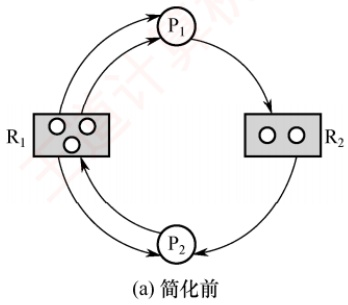

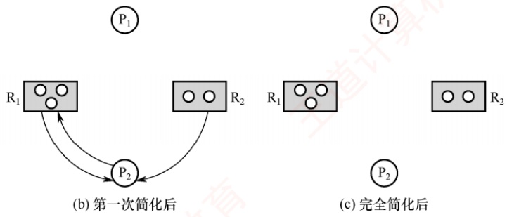

图2.16 资源分配图及其化简过程

通过简化资源分配图可判断系统是否处于死锁状态。简化步骤如下。

1）在资源分配图中，找出当前可继续执行的进程 $\mathrm {P}_{i}$ (其所有资源请求均可被当前空闲资源满足）。空闲资源数量等于该类资源总数减去已分配实例数（资源节点发出的分配边数量）。例如，在图2.16(a)中， $\mathrm {R_{1}}$ 总数为3，出度为3，故无空闲资源； $\mathrm {R}_{2}$ 总数为2，出度为1，故有1个空闲。 $\mathrm {P}_{1}$ 仅请求1个 $\mathrm {R}_{2}$ ，而 $\mathrm{R}_{2}$ 有1个空闲，因此 $\mathrm {P}_{1}$ 可继续执行。将其所有请求边和分配边删除，使之成为孤立节点，得到图2.16(b)所示的情况。

2) $\mathrm {P}_{i}$ 释放的资源可能使其他阻塞进程的请求得以满足，从而转为可执行状态。例如， $\mathrm {P}_{1}$ 释放其占有的 $\mathtt {R_{l}}$ 资源后， $\mathrm {P}_{2}$ 的 $\mathrm {R_{1}}$ 请求即可满足，因而也能继续执行。重复上述过程，若最终能删除图中所有边，则称该图可完全简化，如图2.16(c)所示。

死锁定理:系统处于死锁状态，当且仅当其资源分配图不可完全简化。

#### 2．死锁解除

**考点追踪解除死锁的方式（2019）**

一旦检测出死锁，系统应立即采取措施予以解除。主要方法包括如下几种。

1）资源剥夺法。挂起部分死锁进程，抢占其资源并重新分配给其他死锁进程，以打破死锁环路；但需防止被挂起的进程因长期得不到所需资源而陷入饥饿。

**注意**

在资源分配图中，经死锁定理化简后，仍有边相连的进程即为死锁进程。

2）撤销进程法。强制终止部分或全部死锁进程，并回收其所占资源。终止顺序可依据进程优先级或撤销代价（如资源占有量等）确定。该方法实现简单，但代价可能较高，尤其当进程已接近完成时，一旦被终止，已完成的工作将全部丢失，后续需从头执行。

3）进程回退法。令一个或多个死锁进程回退到之前某个足以回避死锁的状态，并在回退过程中自愿释放其所占资源。系统需记录进程的历史状态并设置还原点，实现较复杂。

### 2.4.5 本节小结

本节开头提出的问题的参考答案如下。

1）为什么会产生死锁？产生死锁有什么条件？

死锁是指多个进程因竞争不可剥夺资源而陷入永久阻塞:每个进程都占有部分资源，同时等待其他进程占有的资源，导致所有相关进程均无法继续推进。死锁的产生必须同时满足以下四个必要条件:①互斥条件，资源在任一时刻只能被一个进程占有；②不可剥夺条件，进程已获得的资源在其使用完毕前不能被强制收回，只能由其主动释放；③请求并保持条件，进程在占有资源的同时可申请新资源，若无法立即获得，则阻塞但不会释放已占有的资源；④循环等待条件，存在一个由多个进程构成的循环等待链，其中每个进程都在等待下一个进程所占有的资源。

**2）有什么办法可以解决死锁问题？**

死锁的处理策略分为三类:①死锁预防，通过限制资源分配方式，破坏死锁的某个必要条件，从而从根本上防止死锁发生；②死锁避免，在动态分配资源的过程中，利用安全性算法判断系统是否仍处于安全状态，仅当分配后系统仍安全时才批准请求，从而避免进入可能导致死锁的状态；③死锁检测与解除，不对资源分配施加限制，而是定期检测系统是否已发生死锁，旦发现死锁，便采取措施予以解除，例如终止部分死锁进程或回滚其操作以释放资源。

## 2.5 本章疑难点

### 1．进程与程序的区别与联系

1）进程是程序及其数据在计算机上的一次执行活动，是一个动态概念；其运行实体是程序，脱离程序，进程便无意义。从静态视角看，进程由程序、数据和进程控制块（PCB）三部分组成；而程序仅是一组有序指令的集合，属于静态实体。

2）进程具有生命周期，动态地创建并消亡，是暂时存在的；程序作为代码的集合，可长期保存，是永久存在的。

3）一个进程在其生命周期中通常执行一个程序，而一个程序可被多个进程并发执行；进程能够创建新进程，而程序本身无法生成新进程。

4）二者的组成不同:进程包含程序、数据和PCB。

### 2．银行家算法的工作原理

银行家算法通过避免系统进入不安全状态来预防死锁。每次进行资源分配时，系统首先检查当前是否有足够资源满足进程的请求；若有，则进行试探性分配，并对分配后的新状态执行安全性检查。若新状态安全，则正式分配资源；否则拒绝该请求，从而确保系统始终处于安全状态。

### 3．进程同步、互斥的区别和联系

并发进程的执行存在两类制约关系:一是竞争使用临界资源，必须互斥访问，体现为竞争关系；二是协同完成任务，在关键点等待对方发出的信号以协调执行，体现为协作关系。
