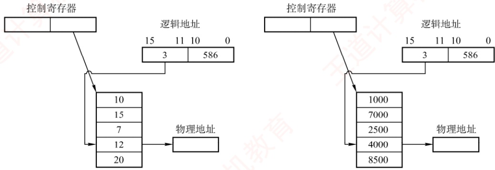
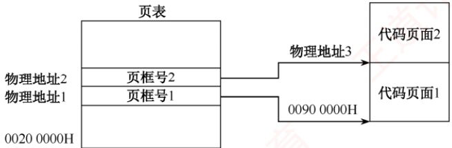
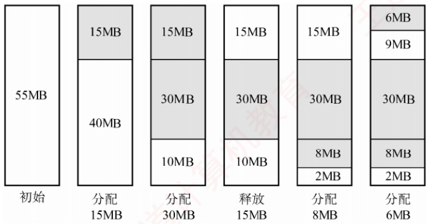
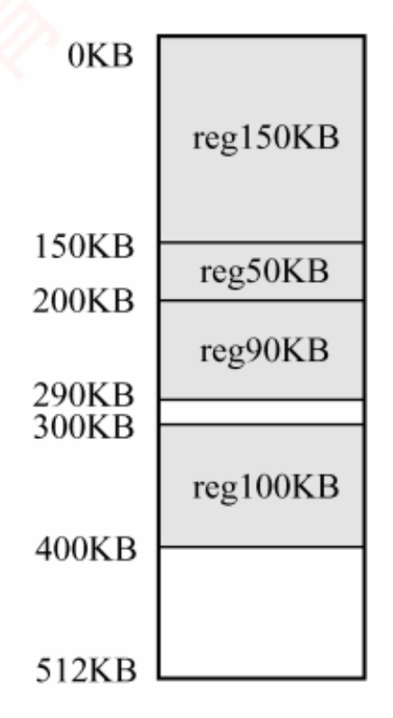
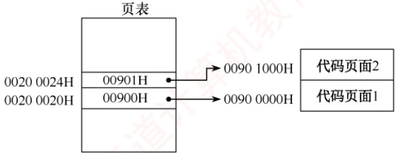
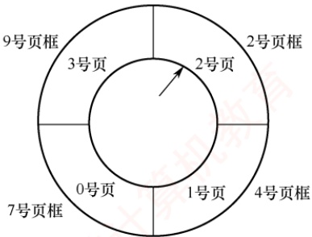
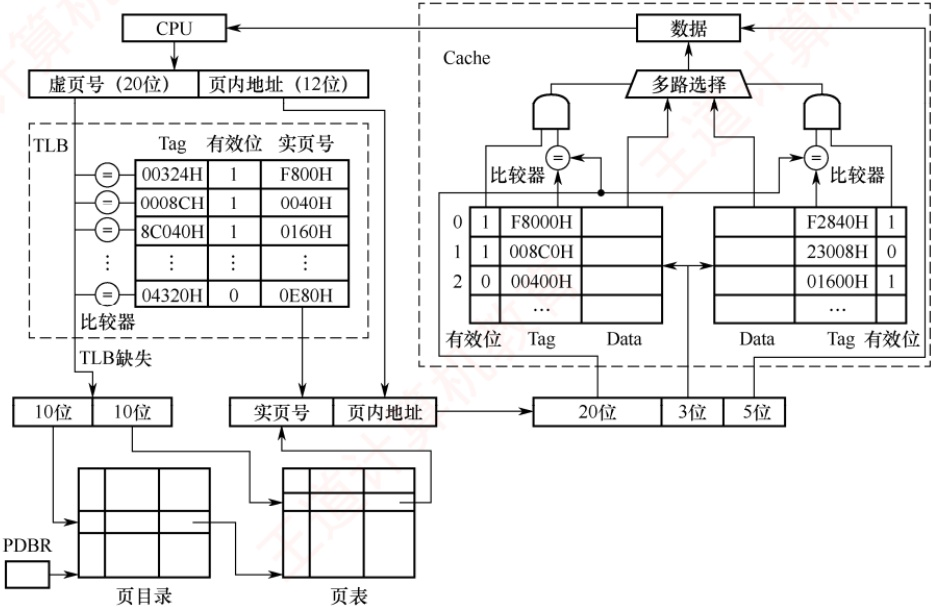

# 第3章 内存管理 · 习题与解析

> 由《第3章 内存管理》正文摘出；区块标题保留了原书的小节编号。

### 3.1.7 本节习题精选

#### 一、单项选择题

01. 下列关于存储管理目标的说法中，错误的是（）。
A. 为进程分配内存空间
B. 回收被进程释放的内存空间
C. 提高内存的利用率
D. 提高内存的物理存取速度

02. 下列关于内存保护的描述中，不正确的是（）。
A. 一个进程不能未被授权就访问另外一个进程的内存空间
B. 内存保护可以仅通过操作系统（软件）来满足，不需要处理器（硬件）的支持
C. 内存保护的方法有界地址保护和上下限地址保护
D. 一个进程不能直接跳转到另一个进程的指令地址中

03.内存保护需要由（）完成，以保证进程空间不被非法访问。
A. 操作系统
B. 硬件机构
C. 操作系统和硬件机构合作
D. 操作系统或者硬件机构独立完成

04. 下列各种存储管理方式中，需要硬件地址变换机构的是（）。I. 单一连续分配 I. 固定分区分配 . 页式存储管理IV. 动态分区分配 V. 页式虚拟存储管理
A. I、III、V
B. II、III、IV
C. III、IV、V
D. II、III、IV、V

05. 在固定分区分配中，每个分区的大小是（）。
A. 随作业长度变化
B. 可以不同但预先固定
C. 相同入妆
D. 可以不同但根据作业长度固定

06. 在动态分区分配方案中，某一进程完成后，系统回收其主存空间并与相邻空闲区合并，为此需修改空闲区表，造成空闲区数减1的情况是（）。
A. 无上邻空闲区也无下邻空闲区
B. 有上邻空闲区但无下邻空闲区
C. 有下邻空闲区但无上邻空闲区
D. 有上邻空闲区也有下邻空闲区

07. 设内存的分配情况如右图所示。若要申请一块40KB的内存空间，采用最佳适应算法，则所得到的分区首址为（）。
A. 100K
B. 190K
C. 330K
D. 410K

08. 某分段存储管理系统中，段表内容如下表所示，逻辑地址的格式为（段号，段内偏移)，则逻辑地址(2,154)对应的物理地址是（)。

<table><tr><td rowspan=9>0100K180K190K280K330K390K410K512K</td><td></td></tr><tr><td>操作系统</td></tr><tr><td></td></tr><tr><td>占用</td></tr><tr><td></td></tr><tr><td>占用</td></tr><tr><td></td></tr><tr><td>占用</td></tr><tr><td></td></tr></table>

| 段 号 | 段首址 | 段长 |
| --- | --- | --- |
| 0 | 120K | 40K |
| 1 | 760K | 30K |
| 2 | 480K | 20K |
| 3 | 370K | 20K |

A. 120K + 2
B. 480K + 154
C. 30K + 154
D. 480K + 2

09. 动态重定位是在作业的（）中进行的。
A. 编译过程
B. 装入过程
C. 链接过程
D. 执行过程

10.下列关于程序装入的动态重定位方式的描述中，错误的是（）。
A. 系统将程序装入内存后，程序在内存中的位置可能发生移动
B. 系统为每个进程分配一个重定位寄存器
C. 被访问单元的物理地址 = 逻辑地址 + 重定位寄存器的值
D. 逻辑地址到物理地址的映射过程在进程执行时发生

11. 动态重定位的过程依赖于（）。I. 可重定位装入程序 Ⅱ. 重定位寄存器 III. 地址变换机构 IV. 目标程序
A. I和ⅡI
B. Ⅱ和I
C. I、ⅡI和III
D. I、II、III 和 IV

12. 为保证一个程序在主存中被改变存放位置后仍能正确执行，应采用（）。
A. 静态重定位
B. 动态重定位
C. 动态分配
D. 静态分配

13.下面的存储管理方案中，（）方式可以采用静态重定位。
A. 固定分区
B. 可变分区
C. 页式
D. 段式

14. 对重定位存储管理方式，应（）。A. 在整个系统中设置一个重定位寄存器

B. 为每道程序设置一个重定位寄存器
C. 为每道程序设置两个重定位寄存器
D. 为每道程序和数据都设置一个重定位寄存器

15. 在可变分区管理中，采用拼接技术的目的是（）。
A. 合并空闲区
B. 合并分配区
C. 增加主存容量
D. 便于地址转换

16. 某页式存储管理系统中，按字节编址，页表内容如下表所示。若页的大小为4KB，则地址转换机构将逻辑地址4097转换成的物理地址为（）。（地址均用十进制表示。）

| 页 号 | 页框号 |
| --- | --- |
| 0 | 2 |
| 1 | 1 |
| 3 | 0 |
| 4 | 5 |

A. 8193
B. 4097
C. 2049
D. 1025

17. 不会产生内部碎片的存储管理是（）。
A. 分页式存储管理
B. 分段式存储管理
C. 固定分区式存储管理
D. 段页式存储管理

18. 多进程在主存中彼此互不干扰的环境下运行，操作系统是通过（）来实现的。
A. 内存分配
B. 内存保护
C. 内存扩充
D. 地址映射

19. 在动态分区分配存储管理中，随着时间的推移，会产生越来越多的小碎片，可通过紧凑技术解决，即操作系统不时地对进程进行移动和整理，则适合采用（）装入技术。
A. 绝对装入
B. 静态重定位
C. 动态重定位
D. 静态重定位和动态重定位

20. 在动态分区分配存储管理中，不需要对空闲区链进行排序的分配算法是（）。
A. 首次适应法
B. 最佳适应法
C. 最差适应法
D. 都不需要

21. 分区管理中采用最佳适应分配算法时，把空闲区按（）次序登记在空闲区表中。
A. 长度递增
B. 长度递减
C. 地址递增
D. 地址递减

22. 首次适应算法的空闲分区（）。
A. 按大小递减顺序连在一起
B. 按大小递增顺序连在一起
C. 按地址由小到大排列
D. 按地址由大到小排列

23. 为了提高搜索空闲分区的速度，在大、中型系统中往往采用基于索引搜索的动态分区分配算法，以下不属于基于索引搜索的动态分区分配算法的是（）。
A. 快速适应算法
B. 伙伴系统
C. 哈希算法
D. 最佳适应算法

24. 内存存储管理由连续分配方式发展为页式管理方式的主要动力是（）。
A. 提高内存利用率
B. 提高系统吞吐量
C. 满足用户的需要
D. 更好地满足多道程序的需要

25. 页式存储管理中的页表是由（）建立的。
A. 编译程序
B. 用户程序
C. 链接程序
D. 操作系统

26. 在段式存储管理中，共享段表是用来实现（）的。
A. 多个进程共享同一段代码或数据
B. 多个进程共享同一段物理内存空间
C. 多个进程共享同一段逻辑地址空间
D. 多个进程共享同一段号

27. 在段式存储管理中，若一个进程有n个段，则该进程需要（）个段表。
A. n
B. n+1
C. 1
D. 2

28. 采用分页或分段管理后，提供给用户的物理地址空间为（）。
A. 分页支持更大的物理地址空间
B. 分段支持更大的物理地址空间
C. 不能确定
D. 一样大

29. 分页系统中的页面是为（）。
A. 用户所感知的 王道
B. 操作系统所感知的
C. 编译系统所感知的
D. 装配程序所感知的

30. 在页式存储管理中，页表的始地址存放在（）中。
A. 物理内存
B. 页表
C. 快表（TLB）
D. 页表寄存器

31. 在页式存储管理中，当CPU形成一个有效地址时，查找页表的工作是由（）实现的。
A. 操作系统
B. 页表查询程序
C. 硬件
D. 存储管理进程

32. 采用段式存储管理时，一个程序如何分段是在（）时决定的。
A. 分配主存
B. 用户编程
C. 装作业
D. 程序执行

33.下面的（）方法有利于程序的动态链接。
A. 分段存储管理
B. 分页存储管理
C. 可变式分区管理
D. 固定式分区管理

34. 当前编程人员编写好的程序经过编译转换成目标文件后，各条指令的地址编号起始一般定为（①），称为（②）地址。①
A. 1
B. 0 IP D. CS ② A. 绝对 B. 名义
C. 逻辑
D. 实

35. 可重入程序是通过（）方法来改善系统性能的。
A. 改变时间片长度
B. 改变用户数
C. 提高对换速度
D. 减少对换数量

36. 操作系统实现（）存储管理的代价最小。
A. 分区
B. 分页
C. 分段
D. 段页式

37. 动态分区也称可变式分区，它是系统运行过程中（）动态建立的。
A. 在作业装入时
B. 在作业创建时
C. 在作业完成时
D. 在作业未装入时

38.在页式存储管理中选择页面的大小，需要考虑下列（）因素。I. 页面大的好处是页表项比较少 算机教Ⅱ. 页面小的好处是可以减少由内碎片引起的内存浪费Ⅲ. 影响磁盘访问时间的主要因素通常不是页面大小，所以使用时优先考虑较大的页面
A. I和ⅢI
B. Ⅱ 和III
C. I和Ⅱ
D. I、II和ⅢII

39. 某个操作系统对内存的管理采用页式存储管理方法，所划分的页面大小（）。
A. 要根据内存大小确定
B. 必须相同
C. 要根据 CPU 的地址结构确定
D. 要依据外存和内存的大小确定

40. 引入段式存储管理方式，主要是为了更好地满足用户的一系列要求。下面选项中不属于这一系列要求的是（）。
A. 提高内存利用率 C. 共享和保护 算机
B. 方便编程 D. 动态链接和增长

41. 对主存储器的访问，（)。
A. 以块（页）或段为单位
B. 以字节或字为单位
C. 随存储器的管理方案不同而异
D. 以用户的逻辑记录为单位

42. 以下存储管理方式中，不适合多道程序设计系统的是（）。
A. 单用户连续分配
B. 固定式分区分配
C. 可变式分区分配
D. 分页式存储管理方式

43. 在分页存储管理中，主存的分配（）。
A. 以页框为单位进行
B. 以作业的大小进行
C. 以物理段进行
D. 以逻辑记录大小进行

44. 在段式分配中，CPU每次从内存中取一次数据需要（）次访问内存。
A. 1
B. 3
C. 2
D. 4

45. 在段页式分配中，CPU每次从内存中取一次数据需要（）次访问内存。
A. 1 K
B. 3
C. 2
D. 4

46. 采用段页式存储管理时，内存地址结构是（）。
A. 线性的
B. 二维的
C. 三维的
D. 四维的

47. 在段页式存储管理中，地址映射表是（）。
A. 每个进程一张段表，两张页表
B. 每个进程的每个段一张段表，一张页表
C. 每个进程一张段表，每个段一张页表
D. 每个进程一张页表，每个段一张段表

48. 操作系统采用分页存储管理方式，要求（）。
A. 每个进程拥有一张页表，且进程的页表驻留在内存中
B. 每个进程拥有一张页表，但只有执行进程的页表驻留在内存中
C. 所有进程共享一张页表，以节约有限的内存空间，但页表必须驻留在内存中
D. 所有进程共享一张页表，只有页表中当前使用的页面必须驻留在内存中，以最大限度地节省有限的内存空间

49. 在分段存储管理方式中，（)。
A. 以段为单位，每段是一个连续存储区
B. 段与段之间必定不连续
C. 段与段之间必定连续
D. 每段是等长的

50.下列关于段式存储管理的叙述中，错误的是（）。
A. 段是逻辑结构上相对独立的程序块，因此段是可变长的
B. 按程序中实际的段来分配主存，所以分配后的存储块是可变长的
C. 每个段表项必须记录对应段在主存的起始位置和段的长度
D. 分段方式对低级语言程序员和编译器来说是透明的 首

51. 段页式存储管理汲取了页式管理和段式管理的长处，其实现原理结合了页式和段式管理的基本思想，即（）。
A. 用分段方法来分配和管理物理存储空间，用分页方法来管理用户地址空间
B. 用分段方法来分配和管理用户地址空间，用分页方法来管理物理存储空间
C. 用分段方法来分配和管理主存空间，用分页方法来管理辅存空间
D. 用分段方法来分配和管理辅存空间，用分页方法来管理主存空间

52. 以下存储管理方式中，会产生内部碎片的是（）。I. 分段虚拟存储管理 I. 分页虚拟存储管理I. 段页式分区管理 首 IV. 固定式分区管理

A. I、ⅡI、I
B. III、IV
C. 仅ⅡI
D. II、III、IV

53. 下列关于页式存储管理的论述中，正确的是（）。I. 若关闭TLB，则每存取一条指令或一个操作数都至少要访存2次Ⅱ. 页式存储管理不会产生内部碎片Ⅲ. 页式存储管理中的页面是用户所能感知的IV. 页式存储方式可以采用静态重定位
A. I、II、IV
B. I、IV
C. 仅I
D. 全都正确

54. 在某分页存储管理系统中，地址结构长18位，其中11\~17位为页号，0\~10位为页内偏移量，则主存的最大容量为（）KB，主存可分为（）个页。若有一作业依次放入2、3、7号物理块，相对地址1500处有一条指令“storer1,2500”，该指令地址所在页的页号为0，则指令的物理地址为（），指令数据的存储地址所在页的页框号为（）。
A. 256、256、5596、3
B. 256、128、5596、3
C. 256、128、5596、7
D. 256、128、3548、7

55. 在某页式存储管理的系统中，主存容量为1MB，被分成256 个页框，页框号为0,1,2,… 255。某作业的地址空间占用4页，其页号为0,1,2,3，被分配到主存的第2,4,1,5号页框中，则作业中的2号页在主存中的始址是（）。
A. 1
B. 1024
C. 2048
D. 4096

56.下列关于分页和分段的描述中，正确的是（）。
A. 分段是信息的逻辑单位，段长由系统决定
B. 引入分段的主要目的是实现离散分配并提高内存利用率
C. 分页是信息的物理单位，页长由用户决定
D. 页面在物理内存中只能从页面大小的整数倍地址开始存放

57. 在采用页式存储管理的系统中，逻辑地址空间大小为256TB，页表项大小为8B，页面大小为4KB，则该系统中的页表应该采用（）级页表。
A. 2
B. 3
C. 4
D. 5

58. 若对经典的页式存储管理方式的页表做出稍微改造，允许不同页表的页表项指向同一个页帧，则可能的结果有（）。I. 可以实现对可重入代码的共享Ⅱ. 只需修改页表项，就能实现内存“复制”操作II. 容易发生越界访问 IV. 可以实现进程间通信
A. I、ⅡI、IV
B. II、III
C. I、II、ⅢII
D. 仅I

59.【2009统考真题】分区分配内存管理方式的主要保护措施是（）。
A. 界地址保护
B. 程序代码保护
C. 数据保护
D. 栈保护

60.【2009统考真题】一个分段存储管理系统中，地址长度为32位，其中段号占8位，则最大段长是（）。
A. $2^{8} \mathrm {B}$
B. $2^{16} \mathbf {B}$
C. $2^{24} \mathrm {B}$
D. $2^{32} \mathbf {B}$

61. 【2010统考真题】某基于动态分区存储管理的计算机，其主存容量为55MB（初始为空)，采用最佳适配（Best Fit）算法，分配和释放的顺序为:分配15MB，分配30MB，释放15MB，分配8MB，分配 6MB，此时主存中最大空闲分区的大小是（）。
A. 7MB
B. 9MB
C. 10MB
D. 15MB

62. 【2010统考真题】某计算机采用二级页表的分页存储管理方式，按字节编址，页大小为$2^{10} \mathbf {B}$ ，页表项大小为2B，逻辑地址结构为

|  | 页 号 |  |
| --- | --- | --- |
|  |  |  |

逻辑地址空间大小为 $2^{16}$ 页，则表示整个逻辑地址空间的页目录表中包含表项的个数至少是（）。
A. 64
B. 128
C. 256
D. 512

63. 【2011统考真题】在虚拟内存管理中，地址变换机构将逻辑地址变换为物理地址，形成该逻辑地址的阶段是（）。
A. 编辑
B. 编译
C. 链接
D. 装载

64.【2014统考真题】下列选项中，属于多级页表优点的是（）。
A. 加快地址变换速度
B. 减少缺页中断次数
C. 减少页表项所占字节数
D. 减少页表所占的连续内存空间

65.【2016统考真题】某进程的段表内容如下所示。

| 段长 | 内存起始地址 | 权限 | 状态 |
| --- | --- | --- | --- |
| 100 | 6000 | 只读 | 在内存 |
| 200 | 一 | 读写 | 不在内存 |
| 300 | 4000 | 读写 | 在内存 |

访问段号为2、段内地址为400的逻辑地址时，进行地址转换的结果是（）。
A. 段缺失异常
B. 得到内存地址 4400
C. 越权异常
D. 越界异常

66. 【2017统考真题】某计算机按字节编址，其动态分区内存管理采用最佳适应算法，每次分配和回收内存后都对空闲分区链重新排序。当前空闲分区信息如下表所示。

| 分区始址 | 20K | 500K | 1000K | 200K |
| --- | --- | --- | --- | --- |
| 分区大小 | 40KB | 80KB | 100KB | 200KB |

回收始址为60K、大小为140KB的分区后，系统中空闲分区的数量、空闲分区链第一个分区的始址和大小分别是（）。
A. 3, 20K, 380KB
B. 3, 500K, 80KB
C. 4, 20K, 180KB
D. 4, 500K, 80KB XTIS

67.【2019统考真题】在分段存储管理系统中，用共享段表描述所有被共享的段。若进程 $\mathrm {P}_{1}$和 $\mathrm {P}_{2}$ 共享段S，则下列叙述中，错误的是（）。
A. 在物理内存中仅保存一份段S的内容
B. 段S在 $\mathrm {P}_{1}$ 和 $\mathrm {P}_{2}$ 中应该具有相同的段号 道计算机
C. $P_1$ 和 $\mathrm {P}_{2}$ 共享段S在共享段表中的段表项
D. $\mathrm {P}_{1}$ 和 $\mathrm {P}_{2}$ 都不再使用段S时才回收段S所占的内存空间

68.【2019统考真题】某计算机主存按字节编址，采用二级分页存储管理，地址结构如下:

|  |  |  |
| --- | --- | --- |

虚拟地址 2050 1225H对应的页目录号、页号分别是（）。
A. 081H, 101H
B. 081H, 401H
C. 201H, 101H
D. 201H, 401H

69.【2019统考真题】在下列动态分区分配算法中，最容易产生内存碎片的是（）。
A. 首次适应算法
B. 最坏适应算法
C. 最佳适应算法
D. 循环首次适应算法

70.【2021统考真题】在采用二级页表的分页系统中，CPU页表基址寄存器中的内容是（）。

A. 当前进程的一级页表的起始虚拟地址
B. 当前进程的一级页表的起始物理地址
C. 当前进程的二级页表的起始虚拟地址
D. 当前进程的二级页表的起始物理地址

71. 【2023 统考真题】进程 R 和S 共享数据 data，若 data 在 R 和S 中所在页的页号分别为 p1和p2，两个页所对应的页框号分别为f1和f2，则下列叙述中，正确的是（)。
A. p1 和 p2 一定相等，f1 和 f2 一定相等
B. p1 和 p2 一定相等，f1 和 f2 不一定相等
C. p1 和 p2 不一定相等，f1 和 f2 一定相等
D. p1 和 p2 不一定相等，f1 和 f2 不一定相等

72. 【2024统考真题】下列算法中，每次回收分区时仅合并大小相等的空闲分区的是（）。
A. 伙伴算法
B. 最佳适应算法
C. 最坏适应算法
D. 首次适应算法

#### 二、综合应用题

01. 某系统的空闲分区见下表，采用动态分区管理策略，现有如下作业序列:96KB，20KB 200KB。若用首次适应算法和最佳适应算法来处理这些作业序列，则哪种算法能满足该作业序列请求？为什么？

| 分区号 | 大小 | 始址 |
| --- | --- | --- |
| 1 | 32KB | 100K |
| 2 | 10KB | 150K |
| 3 | 5KB | 200K |
| 4 | 218KB | 220K |
| 5 | 96KB | 530K |

02. 某操作系统采用段式管理，用户区主存为512KB，空闲块链入空块表，分配时截取空块的前半部分（小地址部分）。初始时全部空闲。执行申请、释放操作序列reg(300KB)，reg(100KB), release(300KB), reg(150KB), reg(50KB), reg(90KB)后: 1）采用最先适配，空块表中有哪些空块？（指出大小及始址）2）采用最佳适配，空块表中有哪些空块？（指出大小及始址）3）若随后又要申请80KB，针对上述两种情况会产生什么后果？这说明了什么问题？

03. 下图给出了页式和段式两种地址变换示意（假定段式变换对每段不进行段长越界检查即段表中无段长信息)。

1）指出这两种变换各属于何种存储管理。

2）计算出这两种变换所对应的物理地址。

04. 在一个段式存储管理系统中，其段表见下表A。试求表B中的逻辑地址所对应的物理地址。

表A 段表

| 段 号 | 内存始址 | 段长 |
| --- | --- | --- |
| 0 | 210 | 500 |
| 1 | 2350 | 20 |
| 2 | 100 | 90 |
| 3 | 1350 | 590 |
| 4 | 1938 | 95 |

表B 逻辑地址

| 段 号 | 段内位移 |
| --- | --- |
| 0 | 430 |
| 1 | 10 |
| 2 | 500 |
| 3 | 400 |
| 4 | 112 |
| 5 | 32 |

05. 页式存储管理允许用户的编程空间为 32个页面（每页1KB），主存为16KB。如有一用户程序为10页长，且某个时刻该用户程序页表见下表。

| 逻辑页号 | 物理块号 |
| --- | --- |
| 0 | 8 |
| 1 | 7 |
| 2 | 4 |
| 3 | 10 |

若分别遇到三个逻辑地址 0AC5H，1AC5H,3AC5H处的操作，计算并说明存储管理系统将如何处理。

06. 在某页式管理系统中，假定主存为64KB，分成16个页框，页框号为0,1,2,…，15。设某进程有4页，其页号为0,1,2,3，被分别装入主存的第9,0,1,14号页框。

1）该进程的总长度是多大？

2）写出该进程每页在主存中的始址。

3）若给出逻辑地址(0,0),(1,72),(2, 1023),(3,99)，请计算出相应的内存地址（括号内的第一个数为十进制页号，第二个数为十进制页内地址)。

07. 某操作系统存储器采用页式存储管理，页面大小为64B，假定一进程的代码段的长度为702B，页表见表A，该进程在快表中的页表见表B。现进程有如下访问序列:其逻辑地址为八进制的0105,0217,0567,01120,02500。试问给定的这些地址能否进行转换？

表A 进程页表

| 页 号 | 页帧号 | 页 号 | 页帧号 |
| --- | --- | --- | --- |
| 0 | F0 | 6 | F6 |
| 1 | F1 | 7 | F7 |
| 2 | F2 | 8 | F8 |
| 3 | F3 | 9 | F9 |
| 4 | F4 | 10 | F10 |
| 5 | F5 | 6 | F6 |

表B快表

| 页 号 | 页帧号 |
| --- | --- |
| 0 | F0 |
| 1 | F1 |
| 2 | F2 |
| 3 | F3 |
| 4 | F4 |

08.在某页式系统中，假设在查找主存页表的过程中不发生缺页的情况，请回答:

1）若对主存的一次存取需1.5μs，问实现一次页面访问时存取时间是多少？

2）若系统有快表且其平均命中率为85%，而页表项在快表中的查找时间可忽略不计，试问此时的存取时间为多少？

09. 在页式、段式和段页式存储管理中，假设不发生缺页异常，当访问一条指令或数据时，各需要访问内存几次？其过程如何？假设一个页式存储系统具有快表，多数活动页表项都可以存在其中。若页表存放在内存中，内存访问时间是1μs，检索快表的时间为0.2μs，若快表的命中率是85%，则有效存取时间是多少？若快表的命中率为50%，则有效存取时间是多少？

10. 在一个分页存储管理系统中，地址空间分页（每页1KB），物理空间分块，设主存总容量是256KB，描述主存分配情况的位示图如下图所示（0表示未分配，1表示已分配），此时作业调度程序选中一个长为5.2KB的作业投入内存。试问:

1）为该作业分配内存后（分配内存时，首先分配低地址的内存空间），请填写该作业的页表内容。

2）页式存储管理有无内存碎片存在？若有，会存在哪种内存碎片？为该作业分配内存后，会产生内存碎片吗？若产生，则大小为多少？

3）假设一个64MB内存容量的计算机，采用页式存储管理（页面大小为4KB），内存分配采用位示图方式管理，请问位示图将占用多大的内存？

| 1 1 1 1 1 1 1 1 1 1 1 1 |
| --- |
| 1 1 1 1 1 0 1 11 1 1 1 0 0 0 1 1 |
| 1 1 0 0 0 0 0 0 0 0 0 0 1 1 1 |
| 1 1 1 1 1 0 0 0 0 1 0 0 0 1 0 1 |
| 0 1 0 1 1 0 1 1 0 1 1 0 1 1 0 1 |
| 1 0 0 0 0 0 0 0 0 0 0 0 0 0 0 0 |
| 0 1 1 1 1 1 1 0 0 0 0 0 0 0 0 0 |
| 1 ... mm |
|  |

| 页号 | 块号（从0开始编址） |
| --- | --- |
|  |  |
|  |  |
|  |  |
|  |  |
|  |  |

11. 【2013统考真题】某计算机主存按字节编址，逻辑地址和物理地址都是32位，页表项大小为4B。请回答下列问题: TA

1）若使用一级页表的分页存储管理方式，逻辑地址结构为

| 页号（20位） | 页内偏移量（12位） |
| --- | --- |

则页的大小是多少字节？页表最大占用多少字节？

2）若使用二级页表的分页存储管理方式，逻辑地址结构为

| 页目录号（10位） | 页表索引（10位） | 页内偏移量（12位） |
| --- | --- | --- |
|  |  |  |

设逻辑地址为LA，请分别给出其对应的页目录号和页表索引的表达式

3）采用1）中的分页存储管理方式，一个代码段的起始逻辑地址为00008000H，其长度为8 KB，被装载到从物理地址 0090 0000H开始的连续主存空间中。页表从主存00200000H开始的物理地址处连续存放，如下图所示（地址大小自下向上递增）。请计算出该代码段对应的两个页表项的物理地址、这两个页表项中的页框号，以及代码页面2的起始物理地址。

### 3.1.8 答案与解析

#### 一、单项选择题

01. D

内存的物理存取速度是由硬件决定的，而不是由操作系统管理的。操作系统可以通过虚拟内

存、缓存等技术提高数据的逻辑存取速度，但不能改变内存的物理特性。

02. B

内存保护需要硬件和软件的配合，不能仅靠操作系统来实现。通常需要在CPU中设置上下限寄存器、重定位寄存器、界地址寄存器等寄存器，以记录进程在内存中的合法范围。

03. C

内存保护是内存管理的一部分，是操作系统的任务，但是出于安全性和效率考虑，必须由硬件实现，所以需要操作系统和硬件机构的合作来完成。

04. C

硬件地址变换机构一般用于动态重定位的情况。而单一连续分配和固定分区分配采用的是静态重定位，不需要硬件地址变换机构，而由装入程序或操作系统来完成地址转换。因此，只有页式存储管理、动态分区分配和页式虚拟存储管理需要硬件地址变换机构。

05. B

在固定分区分配中，每个分区的大小是在系统启动时就确定了的，不会随着作业的长度而变化。分区的大小可以不同，也可以相同，但是一旦确定，就不会改变。

06. D

将上邻空闲区、下邻空闲区和回收区合并为一个空闲区，因此空闲区数反而减少了一个。而仅有上邻空闲区或下邻空闲区时，空闲区数并不减少。

07. C

最佳适配算法是指，每次为作业分配内存空间时，总是找到能满足空间大小需要的最小空闲分区给作业，可以产生最小的内存空闲分区。从图中可以看出应选择大小为60KB的空闲分区，其首地址为 330K。

08. B

段号为2，其对应的首地址为480K，段长度为20K，大于154，所以逻辑地址(2,154)对应的物理地址为 480K + 154。

09. D

静态装入是指在编程阶段就把物理地址计算好。可重定位是指在装入时把逻辑地址转换成物理地址，但装入后不能改变。动态重定位是指在执行时再决定装入的地址并装入，装入后有可能换出，所以同一个模块在内存中的物理地址是可能改变的，在作业运行过程中，当执行到一条访存指令时，再把逻辑地址转换为主存的物理地址，实际上是通过地址变换机构实现的。

10. B

动态重定位允许程序在内存中移动，系统中只有一个重定位寄存器，每次切换进程时，都要保存和恢复该寄存器的值，不会为每个进程分配一个重定位寄存器，选项B错误。

11. C

可重定位装入程序在重定位的过程中执行，重定位寄存器（也称基址寄存器）用于存放进程的基地址，地址变换机构用于将指令中的逻辑地址与重定位寄存器中的基地址相加得到物理地址。目标程序是装入内存后执行的，动态重定位不依赖于目标程序。

12. B

动态重定位可以在程序加载或运行时，根据程序的实际存放位置，对程序中的地址进行修改，使其与物理地址相符。静态重定位只能在程序加载时进行一次地址修改，若程序在运行过程中改变了存放位置，则会出错。动态分配和静态分配是指内存的分配方式，与重定位无关。

13. A

静态重定位只能对程序中的地址进行一次修改，而不能动态调整。在固定分区方式中，作业装入内存后位置不会改变，且作业在内存中占用连续的存储空间，因此可以采用静态重定位。其余三种方案均可能在运行过程中改变程序在内存中的位置，不能采用静态重定位。

14. A

为使地址转换不影响到指令的执行速度，必须有硬件地址变换结构的支持，即需在系统中增设一个重定位寄存器，用它来存放程序（数据）在内存中的始址。在执行程序或访问数据时，真正访问的内存地址由相对地址与重定位寄存器中的地址相加而成，这时将始址存入重定位寄存器，之后的地址访问即可通过硬件变换实现。因为系统处理器在同一时刻只能执行一条指令或访问数据，所以为每道程序（数据）设置一个寄存器没有必要（同时也不现实，因为寄存器是很昂贵的硬件，而且程序的道数是无法预估的），而只需在切换程序执行时重置寄存器内容。

15. A

在可变分区管理中，回收空闲区时采用拼接技术对空闲区进行合并。

16. B

逻辑地址4097对应的页号为4097/4096=1，页内偏移量为4097%4096=1。由页表可知，页号1对应的页框号也是1，页大小为4KB，因此转换成的物理地址为1×4K+1=4097。

17. B

分页式和段页式存储管理均以固定大小的页框为单位分配内存，进程末页通常无法填满页框，从而产生内部碎片；固定分区式因分区大小固定，当进程小于分区时，剩余空间同样形成内部碎片。而分段式按逻辑段动态分配内存，为每个段分配恰好满足其长度的连续空间，不会因分配粒度固定而导致空间浪费，因此不产生内部碎片（但可能因段间空隙产生外部碎片）。

18. B

多进程的执行通过内存保护实现互不干扰，如页式管理中有页地址越界保护，段式管理中有段地址越界保护。

19. C

绝对装入在编译时直接将程序的逻辑地址转换成物理地址:静态重定位虽然允许将装入模块装入内存的任何位置，但不允许进程在内存中移动；动态重定位在程序执行时才产生真正的物理地址，它允许进程在内存中移动，但需要一个重定位寄存器的支持。

20. A

首次适应法从空闲区链的链首开始顺序查找，找到一个大小满足要求的空闲分区，根据作业的大小，从该分区中划出一块内存空间分配给请求者，余下的空闲分区仍然留在空闲链中。这种算法不需要对空闲区链进行排序，只需按地址递增的顺序链接即可。

21. A

最佳适应算法要求从剩余的空闲分区中选出最小且满足存储要求的分区，空闲区应按长度递增登记在空闲区表中。

22. C

首次适应算法的空闲分区按地址递增的次序排列。

23. D

基于顺序搜索的分配算法有首次适应算法、循环首次适应算法、最佳适应算法和最坏适应算法；基于索引搜索的分配算法有快速适应算法、伙伴系统和哈希算法。

24. A

连续分配要求为进程分配连续内存，易产生内部碎片和外部碎片，导致空闲内存无法有效利用，内存利用率较低。页式管理采用离散分配方式，将内存和进程地址空间划分为相等大小的页框与页面，分配时无须物理连续，可充分利用零散空闲块，显著提升内存利用率。

25. D

页表是由操作系统在程序装入内存时建立的，根据进程的逻辑地址空间和物理地址空间的对应关系，为每个页设置一个页表项，记录其对应的物理页框号、有效位等信息。

26. A

在段式存储管理中，若有些段可被多个进程共享，则可用一个单独的共享段表来描述这些段，而不需要在每个进程的段表中都保存一份。共享段表的作用是实现多个进程共享同一段代码或数据，这样既能节省内存空间，又能便于实现对共享段的更新和维护。多个进程共享同一段物理内存空间并不需要用到共享段表，只需在各自的段表中指向相同的物理地址即可。多个进程共享同一段逻辑地址空间是不可能的，因为每个进程的逻辑地址空间都是相互独立的。在段式存储管理中，并不要求各个进程中相同功能的段必须有相同的段号。

27. C

不管进程有多少个段，系统都为每个进程建立一张段表，每个段表项对应进程中的一段。

28. C

页表和段表同样存储在内存中，系统提供给用户的物理地址空间为总空间大小减去页表或段表的长度。因为页表和段表的长度不能确定，所以提供给用户的物理地址空间大小也不能确定。

29. B

分页管理是在硬件和操作系统层面实现的，对用户、编译系统、装配程序等上层是不可见的。

30. D

页表的功能由一组专门的存储器实现，其始址放在页表基址寄存器（PTBR）中。这样才能满足在地址变换时能够较快地完成逻辑地址和物理地址之间的转换。

31. C

在页式存储管理中，CPU将虚拟地址分解为页号和页内偏移量，然后通过硬件中的页表寄存器和内存管理单元（MMU），将页号转换为物理地址，再拼接上页内偏移量，得到最终的内存物理地址。这一过程是由硬件自动完成的，不需要操作系统或其他软件的干预。

32. B

分段是指在用户编程时，将程序按照逻辑划分为几个逻辑段。

33. A

程序的动态链接与程序的逻辑结构相关，分段存储管理将程序按照逻辑段进行划分，因此有利于其动态链接。其他的内存管理方式与程序的逻辑结构无关。

**34. ①B、②C**

编译后一个目标程序所限定的地址范围称为该作业的逻辑地址空间。换句话说，地址空间仅指程序用来访问信息所用的一系列地址单元的集合。这些单元的编号称为逻辑地址。通常，编译地址都是相对始址“0”的，因此逻辑地址也称相对地址。

35. D

可重入程序主要是通过共享来使用同一块存储空间的，或通过动态链接的方式将所需的程序段映射到相关进程中去，其优点是减少了对程序段的调入/调出，因此减少了对换数量。

36. A

实现分页、分段和段页式存储管理需要特定的数据结构支持，如页表、段表等。为了提高性能，还需要硬件提供快存和地址加法器等，代价高。分区存储管理是满足多道程序设计的最简单的存储管理方案，特别适合嵌入式等微型设备。

37. A

动态分区时，在系统启动后，除操作系统占据一部分内存外，其余所有内存空间是一个大空闲区，称为自由空间。若作业申请内存，则从空闲区中划出一个与作业需求量相适应的分区分配给该作业，将作业创建为进程，在作业运行完毕后，再收回释放的分区。

38. C

页面较大时，页表项较少，但页内碎片较大；页面较小时，页内碎片较小，但页表项增多。此外，页面大小直接影响磁盘访问次数:页面过小会导致缺页频繁，大幅增加I/O次数和总访问时间；页面过大会加剧内部碎片。因此，页面大小需要在页表开销、内存浪费与I/O效率之间权衡。

39. B

页式管理中很重要的一个问题是页面大小如何确定。确定页面大小有很多因素，如进程的平均大小、页表占用的长度等。而一旦确定，所有的页面就是等长的（一般取2的整数幂倍），以便易于系统管理。

40. A

段式存储管理按程序逻辑结构划分段，段名与段长由用户定义，便于编程；各段作为独立逻辑单位，支持共享、按段保护、动态增长（如数据段扩展）和动态链接（运行时按需加载）。而提高内存利用率并非段式管理的目标:因其段长不固定，易产生外部碎片，内存利用率通常较低。高效利用内存恰好是分页式管理的优势，通过固定页框离散分配，可有效消除外部碎片。

41. B

这里是指主存的访问，不是主存的分配。对主存的访问是以字节或字为单位的。例如，在页式管理中，不仅要知道块号，还要知道页内偏移量。

42. A

单用户连续分配管理方式只适用于单用户、单任务的操作系统，不适用于多道程序设计。

43. A

在分页存储管理中，逻辑地址分配是按页为单位进行分配的，而主存的分配即物理地址分配是以内存块为单位分配的。

44. C

在段式分配中，取一次数据时先从内存查找段表，再拼成物理地址后访问内存，共需要2次内存访问。 LK xK

45. B

在段页式分配中，取一次数据时先从内存查找段表，再访问内存查找相应的页表，最后拼成物理地址后访问内存，共需要3次内存访问。

46. B

虽然段页式存储管理的内存地址结构分为段号、段内页号和页内地址三部分，但分页是操作系统的行为，用户不用指出页内偏移量的位数；而分段之间是独立的，且段长不定长，需指出段号所占的位数。因此，当采用段页式存储管理时，内存地址结构仍然是二维的。而在分页存储管理中，作业地址空间是一维的，即单一的线性地址空间，程序员只需要一个整数来表示地址。简言之，确定一个地址需要几个参数，作业地址空间就是几维的。

47. C

段页式系统中，进程首先划分为段，每段再进一步划分为页。

48. A

在多个进程并发执行时，所有进程的页表大多数驻留在内存中，在系统中只设置一个页表寄存器（PTR），它存放页表在内存中的始址和长度。平时，进程未执行时，页表的始址和页表长度存放在本进程的PCB中，当调度到某进程时，才将这两个数据装入页表寄存器中。每个进程都有一个单独的逻辑地址，有一张属于自己的页表。

49. A

在分段存储管理方式中，以段为单位进行分配，每段是一个连续存储区，每段不一定等长，段与段之间可连续，也可不连续。

50. D

分段方式对低级语言程序员和编译器是可见的，因为低级语言程序员可以按照程序的逻辑结构划分段，并给每个段命名；编译器也需要对各个段生成逻辑地址。

51. B

段页式存储管理兼有页式管理和段式管理的优点，采用分段方法来分配和管理用户地址空间，采用分页方法来管理物理存储空间。但它的开销要比段式和页式管理的开销大。

52. D

只要是固定的分配就会产生内部碎片，其余的都会产生外部碎片。若固定和不固定同时存在(例如段页式），则仍视为固定。分段虚拟存储管理:每段的长度都不一样（对应不固定），所以会产生外部碎片。分页虚拟存储管理:每页的长度都一样（对应固定），所以会产生内部碎片。段页式分区管理:既有固定，又有不固定，以固定为主，所以会有内部碎片。固定式分区管理:很明显固定，会产生内部碎片。综上分析，说法Ⅱ、Ⅲ、IV会产生内部碎片。

53. C

说法Ⅰ正确:关闭TLB后，每当访问一条指令或存取一个操作数时都要先访问页表(内存中)，得到物理地址后，再访问一次内存进行相应操作。说法Ⅱ错误:记住，凡是分区固定的都会产生内部碎片，而无外部碎片。说法Ⅲ错误:页式存储管理对于用户是透明的。说法IV错误:静态重定位是在程序运行之前由装配程序完成的，必须分配其要求的全部连续内存空间。而页式存储管理方案是将程序离散地分成若干页（块），从而可以将程序装入不连续的内存空间，显然静态重定位不能满足其要求。

54. B

地址结构长18位，所以主存的最大容量为 $2^{18} = 256\mathrm{KB}$ ；页内偏移量占11位，所以页面大小为 $2^{11}   =   2048 \mathrm {B}$ ；页号占7位，所以主存页数为 $2^{7}   =   128$ 个。该指令的相对地址为1500，小于一个页面的大小，所以该指令存放在2号物理块中，物理地址为 $2 \times 2048 + 1500 = 5596$ ，指令数据的存放地址为2500，大于一个页面的大小，所以指令数据存放在3号物理块中。

55. D

主存容量为1MB，分为256个页框，页框大小为 $1 \mathrm{MB} / 256 = 4 \mathrm{KB}$ ，作业中的2号页被分配到主存的1号页框中，因此其在主存中的始址为 $1 \times 4096 = 4096$

56. D

分段是指将逻辑地址空间划分为若干不等长的单元，称为段。段长由用户根据信息的性质和逻辑结构决定，而不由系统决定，引入分段的主要目的是更好地满足用户的需求，实现程序的模块化和保护。实现离散分配并提高内存利用率是引入分页的主要目的。

57. C

逻辑地址空间大小为 $256 \mathrm {T B} = 2^{48} \mathrm {B}$ ，逻辑地址有48位，页面大小为 $4 \mathbf {K} \mathbf {B} = 2^{12} \mathbf {B}$ ，页内偏移量2占12位，剩余36位表示页表索引，页表项大小为8B，一个页面能存放 $4\mathrm{K}\mathrm{B}{\div}8=2^{9}$ 个页表项，因此可用9位来表示某一级的页表索引， $36 \div 9 = 4$ ，所以共需要采用4级页表。

58. A

让不同页表的页表项指向同一个页帧，可以共享该页帧的代码，若代码是可重入的（如编辑软件、编译软件等），则这种方法可以节省大量的内存空间。实现内存“复制”操作时，不需要将页面的内容逐字节复制，而只需将页表中指向该页面的指针复制到目的地址的页表项中。越界保护是通过界地址寄存器实现的，说法Ⅲ是干扰项。当多个进程需要通信时，可以采用共享内存的方式，它们是通过让各个进程页表的页表项指向相同的页帧实现的。

59. A

每个进程都拥有自己独立的进程空间，若一个进程在运行时所产生的地址在其地址空间之外，则发生地址越界，因此需要进行界地址保护，即当程序要访问某个内存单元时，由硬件检查是否允许，若允许，则执行，否则产生地址越界中断

60. C

分段存储管理的逻辑地址分为段号和位移量两部分，段内位移的最大值就是最大段长。地址长度为32位，段号占8位，因此位移量占 $32 - 8 = 24$ 位，因此最大段长为 $2^{24} \mathrm {B}$

61. B

最佳适配算法是指每次为作业分配内存空间时，总是找到能满足空间大小需要的最小空闲分区给作业，可以产生最小的内存空闲分区。下图显示了这个过程的主存空间变化。

图中，灰色部分为分配出去的空间，白色部分为空闲区。这样，容易发现，此时主存中最大空闲分区的大小为9MB。

62. B

页大小为 $2^{10} \mathbf {B}$ ，所以页内偏移量占10位，又因为页表项大小为2B，一页可以存放 $2^{9}$ 个页表项，所以页号占9位，根据逻辑地址空间共有 $2^{16}$ 页可知，页目录号加页号共占16位，页目录号占7位，所以页目录表中包含表项的个数至少是 $2^{7}   = 128$

63. C

编译后的程序需要经过链接才能装载，而链接后形成的目标程序中的地址也就是逻辑地址。以C语言为例:C程序经过预处理→编译→汇编→链接产生了可执行文件，其中链接的前一步是产生可重定位的二进制目标文件。C语言采用源文件独立编译的方法，如程序main.c,file1.c,file2.c, file1.h, file2.h在链接的前一步生成了main.o, file1.o, file2.o,这些目标模块的逻辑地址都从0开始，但只是相对于该模块的逻辑地址。链接器将这三个文件、libc和其库文件链接成一个可执行文件，从而形成整个程序的完整逻辑地址空间。

例如，file1.o的逻辑地址为0～1023，main.o的逻辑地址为0～1023，假设链接时将 file1.o链接在main.o之后，则链接之后file1.o对应的逻辑地址应为1024～2047。

64. D

多级页表不仅不会加快地址的变换速度，还会因为增加更多的查表过程，使地址变换速度减慢；也不会减少缺页中断的次数，相反，若访问过程中多级的页表都不在内存中，则会大大增加缺页的次数，并不会减少页表项所占的字节数，而多级页表能够减少页表所占的连续内存空间，即当页表太大时，将页表再分级，把每张页表控制在一页之内，减少页表所占的连续内存空间。

65. D

分段系统的逻辑地址A到物理地址E之间的地址变换过程如图3.15所示。

①从逻辑地址A 中取出前几位为段号 S，后几位为段内偏移量W，注意段式存储管理的题目中，逻辑地址一般以二进制数给出，而页式存储管理的题目中，逻辑地址一般以十进制数给出，读者要注意具体问题具体分析。

② 比较段号 S和段表长度M，若 $S {\geqslant} M ,$ 则产生越界异常，否则继续执行。

③ 在段表中查询段号对应的段表项，段号 S对应的段表项地址 = 段表始址 F + 段号 S段表项长度。取出段表项中该段的段长C，若 $W {\geqslant} C ,$ 则产生越界中断，否则继续执行。

④取出段表项中该段的基址b，计算 $E = b + W$ ，用得到的物理地址E去访问内存。

题目中段号为2的段长为300，小于段内地址400，因此发生越界异常，选项D正确。

66. B

回收始址为60K、大小为140KB的分区时，它与表中第一个分区和第四个分区合并，成为始址为20K、大小为380KB的分区，剩余3个空闲分区。在回收内存后，算法会对空闲分区链按分区大小由小到大进行排序，表中的第二个分区排第一。

67. B

段的共享是通过两个作业的段表中相应表项指向被共享的段的同一个物理副本来实现的，因此在内存中仅保存一份段S的内容，选项A正确。段S对进程 $P_{1} 、  P_{2}$ 来说，使用位置可能不同，所以在不同进程中的逻辑段号可能不同，选项B错误。段表项存放的是段的物理地址（包括段始址和段长度），对共享段S来说物理地址唯一，选项C正确。为了保证进程可以顺利使用段S，段S必须确保在没有任何进程使用它（可在段表项中设置共享进程计数）后才能被删除，选项D正确。

68. A

题中给出的是十六进制地址，首先将它转化为二进制地址，然后用二进制地址去匹配题中对应的地址结构。转换为二进制地址和地址结构的对应关系如下图所示。

$$
2050\;1225\; H  = \underbrace{0010\;0000\;01}_{页目录号} \underbrace{01\;0000\;0001}_{页号} \underbrace{0010\;0010\;0101}_{页内偏移}
$$

前10位、11～20位、21～32位分别对应页目录号、页号和页内偏移。把页目录号、页号单独拿出，转换为十六进制时缺少的位数在高位补零，00001000 0001，0001 0000 0001分别对应081H，101H，选项A正确。

69. C

最佳适应算法总是匹配与当前大小要求最接近的空闲分区，但是大多数情况下空闲分区的大小不可能完全和当前要求的大小相等，几乎每次分配内存都会产生很小的难以利用的内存块，所以最佳适应算法最容易产生最多的内存碎片。

70. B

在多级页表中，页表基址寄存器存放的是顶级页表的起始物理地址，所以存放的是一级页表的起始物理地址。

71. C

进程R和S共享数据data，说明它们都映射了同一个共享内存段，于是这个段在物理内存中的位置（页框号）必然相同，但这两个段在不同进程的地址空间中的位置（页号）可以不同。因

此，p1和p2不一定相等，f1和f2一定相等。

72. A

伙伴算法在回收一个大小为 $2^{i}$ 的空闲分区时，会检查其伙伴分区（地址相邻、大小同为 $2^{i}$的分区）是否也空闲。若是，则将两者合并为一个大小为 $2^{i + 1}$ 的空闲分区；随后，继续检查新生成的 $2^{i + 1}$ 分区是否存在同大小的伙伴，若有，则再次合并，以此类推。因此，伙伴算法在一次回收过程中可能触发多次合并，但每次合并仅发生在两个大小相等且互为伙伴的空闲分区之间。

#### 二、综合应用题

01. 【解答】

采用首次适应算法时，96KB大小的作业进入4号空闲分区，20KB大小的作业进入1号空闲分区，这时空闲分区如下表所示。

| 分区号 | 大小 | 始址 |
| --- | --- | --- |
| 1 | 12KB | 120K |
| 2 | 10KB | 150K |
| 3 | 5KB | 200K |
| 4 | 122KB | 316K |
| 5 | 96KB | 530K |

此时再无空闲分区可以满足200KB大小的作业，所以该作业序列请求无法满足

采用最佳适应算法时，作业序列分别进入5,1,4号空闲分区，可以满足其请求。分配处理之后的空闲分区表见下表:

| 分区号 | 大小 | 始址 |
| --- | --- | --- |
| 1 | 12KB | 120K |
| 2 | 10KB | 150K |
| 3 | 5KB | 200K |
| 4 | 18KB | 420K |

02. 【解答】

1）最先适配的内存分配情况如下图中的(a)所示。

> 说明：原 PDF 第 220 页该公式为公式排版，OCR 公式模型识别失败（输出重复乱码），此处直接嵌入原图，未作内容推断。

(a)

<table><tr><td>0KB</td><td rowspan="2">reg150KB</td></tr><tr><td>150KB</td></tr><tr><td rowspan="2">240KB</td><td>reg90KB</td></tr><tr><td></td></tr><tr><td>300KB</td><td>reg100KB</td></tr><tr><td rowspan="2">400KB 450KB 512KB</td><td>reg50KB</td></tr><tr><td></td></tr></table>

(b)

内存中的空块为:

第一块:始址290K，大小10KB；第二块:始址400K，大小112KB。

2）最佳适配的内存分配情况如上图中的(b)所示。内存中的空块为:

第一块:始址240K，大小 60KB；第二块:超始地址450K，大小 62KB。

3）若随后又要申请80KB，则最先适配算法可以分配成功，而最佳适配算法则没有足够大的空闲区分配。这说明最先适配算法尽可能地使用了低地址部分的空闲区域，留下了高地址部分的大的空闲区，更有可能满足进程的申请。

03. 【解答】

1）由题图所示的逻辑地址结构可知:页或段的最大个数为 $2^{5} = 32$ 。若左图是段式管理，则段始址12加上偏移量586，远超第1段的段始址15，超过第4段的段始址20，所以左图是页式变换，而右图满足段式变换。对于页式管理，由逻辑地址的位移量位数可知，一页的大小为2KB。

2）对图中的页式地址变换，其物理地址为 $12 \times 2048 + 586 = 25162$ ；对图中的段式地址变换，其物理地址为 $4000+586=4586$ 0

04. 【解答】

1）由段表知，第0段内存始址为210，段长为500，因此逻辑地址(0,430)是合法地址，对应的物理地址为 $210 + 430 = 640$ 0

2）由段表知，第1段内存始址为2350，段长为20，因此逻辑地址(1，10)是合法地址，对应的物理地址为 $2350+10=2360$ 0

3）由段表知，第2段内存始址为100，段长为90，逻辑地址(2,500)的段内位移500超过了段长，因此为非法地址。

4）由段表知，第3段内存始址为1350，段长为590，因此逻辑地址(3,400)是合法地址，对应的物理地址为 $1350+400=1750$ 0

5）由段表知，第4段内存始址为1938，段长为95，逻辑地址(4,112)的段内位移112超过了段长，因此为非法地址。

6）由段表知，不存在第5段，因此逻辑地址(5,32)为非法地址。

05. 【解答】

页面大小为1KB，所以低10位为页内偏移地址；用户编程空间为32个页面，即逻辑地址高5位为虚页号；主存为16个页面，即物理地址高4位为物理块号。

逻辑地址 0AC5H转换为二进制表示是00010101100 0101B，虚页号为2(00010B)，映射至物理块号4，因此系统访问物理地址12C5H(01 00101100 0101B)。

逻辑地址1AC5H转换为二进制表示是00110101100 0101B，虚页号为6(00110B)，不在页面映射表中，会产生缺页中断，系统进行缺页中断处理。

逻辑地址3AC5H转换为二进制表示是011101011000101B，页号为14，而该用户程序只有10页，因此系统产生越界中断。

**注意**

当将十六进制地址转换为二进制地址时，我们可能习惯性地写为16位，这是容易犯错的细节。例如，题中的逻辑地址为15位，物理地址为14位。逻辑地址0AC5H的二进制表示为000101011000101B，对应物理地址12C5H的二进制表示为01001011000101B。这一点应该引起注意。

06. 【解答】

1)页面的大小为(64/16)KB=4KB，该进程共有4页，所以该进程的总长度为 $4 \times 4 \mathrm{KB} = 16 \mathrm{KB}$

2）页面大小为4KB，因此低12位为页内偏移地址；主存分为16块，因此内存物理地址高4位为主存块号。

页号为0的页面被装入主存的第 9块，因此该地址在内存中的始址为1001 0000 0000 0000B，即 9000H。

页号为1 的页面被装入主存的第0 块，因此该地址在内存中的始址为 0000 0000 0000

0000B，即 0000H。

页号为 2 的页面被装入主存的第 1 块，因此该地址在内存中的始址为 0001 0000 0000 0000，即1000H。

页号为 3 的页面被装入主存的第14 块，因此该地址在内存中的始址为1110 0000 0000 0000，即E000H。

3）逻辑地址为(0,0)，因此内存地址为(9,0)=1001000000000000B，即9000H。逻辑地址为(1,72)，因此内存地址为(0,72)= 0000 0000 0100 1000B，即 0048H。逻辑地址为(2,1023)，因此内存地址为(1,1023)= 0001 0011 1111 1111，即13FFH。逻辑地址为(3,99)，因此内存地址为(14,99)= 1110 0000 0110 0011，即 E063H。

07.【解答】

要注意题目中的逻辑地址使用哪种进制的数给出，若是十进制，则一般通过整数除法和求余得到页号和页内偏移，若用其他进制给出，则一般转换成二进制，然后按照地址结构划分为页号部分和页内偏移部分，再把页号和页内偏移计算出来。

页面大小为64B，因此页内位移为6位，进程代码段长度为702B，因此需要11个页面，编号为0～10。

1）八进制逻辑地址0105的二进制表示为001000101B。逻辑页号为1，此页号可在快表中查找到，得页帧号为F1；页内位移为5，因此物理地址为(F1,5)。

2）八进制逻辑地址0217的二进制表示为010001111B。逻辑页号为2，此页号可在快表中查找到，得页帧号为F2；页内位移为15，因此物理地址为(F2,15)。

3）八进制逻辑地址0567的二进制表示为101110111B。逻辑页号为5，此页号不在快表中，在内存页表中可以查找到，得页帧号为F5；页内位移为55，因此物理地址为(F5,55)。

4）八进制逻辑地址01120的二进制表示为001001010000B。逻辑页号为9，此页号不在快表中，在内存页表中可以查找到，得页帧号为F9;页内位移为16,因此物理地址为(F9,16)。

5）八进制逻辑地址02500的二进制表示为010101000000B。逻辑页号为21，此页号已超过页表的最大页号10，因此产生越界中断。

**注意**

根据题中条件无法得知逻辑地址位数，所以在其二进制表示中，其位数并不一致，只是根据八进制表示进行转换。若已知逻辑地址空间大小或位数，则二进制表示必须保持一致。

08. 【解答】

页表在主存时，实现一次存取需要访问主存两次:第一次是访问页表，获得所需访问数据所在页面的物理地址；第二次才是根据这个物理地址存取数据。

1）因为页表在主存，所以CPU必须访问主存两次，即实现一次页面访问的存取时间是

$$
1.5 \times 2 = 3\mu s
$$

2）系统增加快表后，在快表中找到页表项的概率为85%，所以实现一次页面访问的存取时间为

$$
0.85 \times (0 + 1.5) + (1 - 0.85) \times 2 \times 1.5 = 1.725 \mu  s
$$

09. 【解答】

1）在页式存储管理中，访问指令或数据时，首先要访问内存中的页表，查找到指令或数据所在页面对应的页表项，然后根据页表项查找访问指令或数据所在的内存页面。需要访问内存2次。段式存储管理同理，需要访问内存2次。段页式存储管理，首先要访问内存中的段表，然后访问内存中的页表，最后访问指令或数据所在的内存页面，需要访问内存3次。

对于比较复杂的情况，如多级页表，若页表划分为N级，则需要访问内存 $N + 1$ 次。若系统中有快表，则在快表命中时，只需要访问内存1次。

2）按1）中的访问过程分析，有效存取时间为

$$
(0.2 + 1) \times 85\% + (0.2 + 1 + 1) \times (1 - 85\%) = 1.35\mu s
$$

**3）同理可计算得**

$$
(0.2 + 1) \times 50\% + (0.2 + 1 + 1) \times (1 - 50\%) = 1.7\mu s
$$

从结果可以看出，快表的命中率对访存时间影响非常大。当命中率从85%降低到50%时，有效存取时间增加0.35μs。因此在页式存储系统中，应尽可能地提高快表的命中率，从而提高系统效率。N

10. 【解答】

1）位示图是利用二进制的一位来表示磁盘中一个盘块的使用情况，其值为 $\text{"}0 \text{"}$ 时表示对应盘块空闲，为“1”时表示已分配，地址空间分页，每页为1KB，则对应的盘块大小也为1KB，主存总容量为256KB，可分成256个盘块，长5.2KB的作业需要占用6页空间，假设页号与物理块号都从0开始，则根据位示图可得到如下页表内容:

| 页 号 | 块 号 |
| --- | --- |
| 0 | 21 |
| 1 | 27 |
| 2 | 28 |
| 3 | 29 |
| 4 | 34 |
| 5 | 35 |

2）页式存储管理中有内存碎片的存在，会存在内部碎片。为该作业分配内存后，会产生内存碎片，因为此作业大小为5.2KB，占6页，前5页满，最后一页只占0.2KB的空间，因此内存碎片的大小为 $1\mathrm{KB}-0.2\mathrm{KB}=0.8\mathrm{KB}$

3）64MB内存，一页大小为4KB，共可分成 $64\mathrm{K} \times 1\mathrm{K} / 4\mathrm{K} = 2^{14}$ 个物理盘块，在位示图中每个盘块占1位，共占 $2^{14}$ 位空间，因为1B=8位，所以此位示图共占2KB空间的内存。

11. 【解答】

1）因为主存按字节编址，页内偏移量是12位，所以页大小为 $2^{12}\mathrm{B}=4\mathrm{KB}$页表项数为 $2^{32}/4K = 2^{20}$ ，因此该一级页表最大为 $2^{20} \times 4\mathrm{B} = 4\mathrm{MB}$

2)页目录号可表示为(((unsigned int)(LA))>>22) & 0x3FF。这里采用的方法是逻辑右移 22 位，再和3FF（10个1）进行逻辑与运算，得到10位的页目录号。这种方法虽然效率较高，但比较难想到，采用 $\mathrm {L A} / 2^{22}$ 的写法来取高10位的页目录号也是可以的。页表索引可表示为(((unsigned int)(LA))>>12)& 0x3FF。这里也可采用 $\mathrm{(LA/2^{12})\%2^{10}}$ 的方法来获取中间10位的页表索引号。

3）代码页面1的逻辑地址为00008000H，表明其位于第8个页处，对应页表中的第8个页表项，所以第8个页表项的物理地址=页表始址 +8×页表项的字节数 $=0020\;0000\mathrm{H}+$ $8 \times 4 = 0020\ 0020\mathrm{H}$ 。由此可得如下图所示的答案。

### 3.2.11 本节习题精选

#### 一、单项选择题

01. 下列关于存储管理的叙述中，正确的是（）。
A. 存储保护的目的是限制内存的分配
B. 在内存为M、有N个用户的分时系统中，每个用户占用M/N的内存空间
C. 在虚拟内存系统中，只要磁盘空间无限大，作业就能拥有任意大的编址空间
D. 实现虚拟内存管理必须有相应硬件的支持

02. 请求分页存储管理中，若把页面尺寸增大一倍而且可容纳的最大页数不变，则在程序顺序执行时缺页中断次数会（）。
A. 增加
B. 减少
C. 不变
D. 可能增加也可能减少

03.进程在执行中发生了缺页中断，经操作系统处理后，应让其执行（）指令。
A. 被中断的前一条
B. 被中断的那一条
C. 被中断的后一条
D. 启动时的第一条

04. 虚拟存储技术是（）。
A. 补充内存物理空间的技术
B. 补充内存逻辑空间的技术
C. 补充外存空间的技术
D. 扩充输入/输出缓冲区的技术

05.下列关于虚拟存储器的论述中，正确的是（）。
A. 作业在运行前，必须全部装入内存，且在运行过程中也一直驻留内存
B. 作业在运行前，不必全部装入内存，且在运行过程中也不必一直驻留内存
C. 作业在运行前，不必全部装入内存，但在运行过程中必须一直驻留内存
D. 作业在运行前，必须全部装入内存，但在运行过程中不必一直驻留内存

06. 以下不属于虚拟内存特征的是（）。
A. 一次性
B. 多次性
C. 对换性
D. 虚拟性

07. 为使虚存系统有效地发挥其预期的作用，所运行的程序应具有的特性是（）。
A. 该程序不应含有过多的I/O操作
B. 该程序的大小不应超过实际的内存容量
C. 该程序应具有较好的局部性 首计算机
D. 该程序的指令相关性不应过多

08.（）是请求分页存储管理方式和基本分页存储管理方式的区别。
A. 地址重定向
B. 不必将作业全部装入内存
C. 采用快表技术
D. 不必将作业装入连续区域

09. 通常所说的“存储保护”的基本含义是（）。
A. 防止存储器硬件受损
B. 防止程序在内存丢失
C. 防止程序间相互越界访问
D. 防止程序源码被人偷窃

10. 在页式虚拟存储管理中，程序的链接方式必然是（）。
A. 静态链接
B. 装入时动态链接
C. 运行时动态链接
D. 不确定哪种链接方式

11. 虚拟地址指的是（）。

A. 程序访问内存时使用的地址
B. 访问内存总线上的地址
C. 内存与磁盘交换数据时使用的地址
D. 寄存器的地址

12. 在采用页式虚拟存储管理和固定分配局部置换策略的系统中，数组采用行优先存储，页框大小为512B。某个进程中有如下代码段（该代码段已提前读入内存）:int a[128][128]; for(int i=0;i<128;i++) $\mathrm{for} (\mathrm{int} \quad \mathrm{j}=0 ; \quad \mathrm{j}<128 ; \quad \mathrm{j}++)$ a[j][i]=0;

系统为该进程分配的数据区只有1个页框，则执行该代码会发生（）次缺页中断。
A. 1
B. 2
C. 128
D. 16384

13. 假设某个进程分配有4个页框，每个页框大小为128个字（一个整数占一个字）。进程的代码段正好可以存放在一页中，而且总是占用0号页框。数据会在其他3个页框中换进或换出。数组X为按行优先存储，则执行该进程会发生（）次缺页中断。int X[64][64]; $\begin{aligned} & for   (\texttt{int} \texttt{j}=0 ; \texttt{j}<64 ; \texttt{j}++) \\&\quad  for   (\texttt{int} \texttt{i}=0 ; \texttt{i}<64 ; \texttt{j}++) \\&\quad \texttt{X}[\texttt{i}] [\texttt{j}]=0 ;\\ \end{aligned}$
A. 32
B. 1024
C. 2048
D. 其他都不对

14. 在配置了TLB 的页式虚拟存储管理的系统中，假设TLB的命中率约为75%，忽略访问TLB的时间，并且使用二级页表，则每次存取的平均访存次数是（）。
A. 1.25
B. 1.5
C. 1.75
D. 2

15.下面关于请求页式系统的页面调度算法中，说法错误的是（）。
A. 一个好的页面调度算法应减少和避免抖动现象
B. FIFO算法实现简单，选择最先进入主存储器的页面调出
C. LRU算法基于局部性原理，首先调出最近一段时间内最长时间未被访问过的页面
D. CLOCK算法首先调出一段时间内被访问次数多的页面

16. 考虑页面置换算法，系统有m个物理块供调度，初始时全空，页面引用串长度为p，包含了n个不同的页号，无论用什么算法，缺页次数不会少于（）。
A. m
B. p
C. n
D. min(m, n)

17. 在请求分页存储管理中，若采用FIFO算法，则当可供分配的页帧数增加时，缺页中断的次数（）。
A. 减少
B. 增加 首
C. 无影响
D. 可能增加也可能减少

18. 设主存容量为1MB，外存容量为400MB，计算机系统的地址寄存器有32位，那么虚拟存储器的最大容量是（）。
A. 1MB
B. 401MB
C. $1 \mathrm{MB} + 2^{32} \mathrm{MB}$
D. $2^{32} \mathbf {B}$

19. 一台机器有32 位虚拟地址和16位物理地址，若页面大小为512B，采用单级页表，则页表共有（）个页表项。
A. $2^{7}$
B. $2^{16}$ $2^{23}$ D. $2^{32}$

20. 在某分页存储管理的系统中，逻辑地址为16位，页面大小为1KB，第0,1,2,3号页依次存放在3,7,11,10号页框中，则逻辑地址0A6FH对应的物理地址为（）。

A. 1E6FH
B. 2E6FH
C. DE6FH
D. EE6FH

21. 在决定页面大小时，选择较小的页面是为了减少（）。
A. 页表大小
B. 缺页次数
C. I/O 开销
D. 页内碎片

22. 某虚拟存储器系统采用页式内存管理，使用LRU页面置换算法，考虑页面访问地址序列18178272183821317137。假定内存容量为4个页面，开始时是空的，则页面失效次数是（）。
A. 4
B. 5
C. 6
D. 7

23. LRU页面置换算法软件实现开销高的直接原因是（)。
A. 需要硬件的特殊支持
B. 需要特殊的中断处理程序
C. 需要在页表中标明特殊的页类型
D. 需维护访问历史并遍历查找

24. 在虚拟存储器系统的页表项中，决定是否会发生页故障的是（)。
A. 有效位
B. 修改位
C. 页类型
D. 保护码

25.在页面置换策略中，（）策略可能引起抖动。
A. FIFO
B. LRU
C. 没有一种
D. 所有

26.虚拟存储管理系统的基础是程序的（）理论。
A. 动态性
B. 虚拟性
C. 局部性
D. 全局性

27. 请求分页存储管理的主要特点是（）。
A. 消除了内部碎片
B. 扩充了内存
C. 便于动态链接
D. 便于信息共享

28. 在请求分页存储管理的页表中增加了若干项信息，其中修改位和访问位供（）参考。
A. 分配页面
B. 调入页面
C. 置换算法
D. 程序访问

29. 下列关于驻留集和工作集的表述中，正确的是（）。I. 驻留集是进程已装入内存的页面的集合Ⅱ. 工作集是某段时间间隔内，进程运行所需要访问页面的集合Ⅲ. 工作集是驻留集的子集
A. I
B. I、ⅡI
C. ⅡI、ⅢI
D. I、Ⅱ、Ⅲ

30. 在配置了 TLB 的页式虚拟存储管理的系统中，假设访问内存需要lμs，查询 TLB 需要0.2μs。已知 TLB 和内存的访问是串行的，请问在 TLB 命中率为 85%和 50%时，系统的平均访问时间分别是多少？（）
A. 1.5μs, 1.8μs
B. 1.35μs, 1.7μs
C. 1.6μs, 1.7μs
D. 1.35μs, 1.8μs

31. 下列选项中，（）不是页面换进换出效率的影响因素。
A. 页面置换算法
B. 已修改页面写回磁盘的频率
C. 磁盘数据读入内存的频率
D. CPU 与内存交换的速度

32. 允许进程在所有页框中选择一个页面替换，而不管该页框是否已分配给其他进程的置换方法是（）。
A. 局部置换
B. 全局置换
C. 进程外置换
D. 进程内置换

33. 在页面置换算法中，存在 Belady现象的算法是（）。
A. 最佳页面置换算法（OPT）
B. 先进先出置换算法（FIFO）
C. 最近最久未使用算法（LRU）
D. 最近未使用算法（NRU）

34. 页式虚拟存储管理的主要特点是（）。
A. 不要求将作业装入主存的连续区域
B. 不要求将作业同时全部装入主存的连续区域
C. 不要求进行缺页中断处理
D. 不要求进行页面置换

35. 提供虚拟存储技术的存储管理方法有（）。
A. 动态分区存储管理
B. 页式存储管理
C. 请求段式存储管理 道
D. 存储覆盖技术

36. 内存映射可以将一个文件映射到进程的虚拟地址空间的某个区域，实现文件磁盘地址和进程虚拟地址空间的映射关系，下列说法中正确的是（）。
A. 内存映射文件是将整个文件内容一次性加载到内存中的一种方式
B. 内存映射文件只适用于读取文件，不支持对文件进行写操作 教育
C. 内存映射文件可以通过修改内存中的数据来实现对文件的写操作
D. 由于进程的虚拟地址空间是独立的，内存映射文件不支持多进程映射到同一文件

37.在虚拟分页存储管理系统中，若进程访问的页面不在主存中，且主存中没有可用的空闲帧时，则系统正确的处理顺序为（）。
A. 决定淘汰页→页面调出→缺页中断→页面调入 王道
B. 决定淘汰页→页面调入→缺页中断→页面调出
C. 缺页中断→决定淘汰页→页面调出→页面调入
D. 缺页中断→决定淘汰页→页面调入→页面调出

38. 已知系统为32位实地址，采用48位虚拟地址，页面大小为4KB，页表项大小为8B。假设系统使用纯页式存储，则要采用（）级页表，页内偏移（）位。
A. 3, 12
B. 3, 14
C. 4, 12
D. 4, 14

39. 下列说法中，正确的是（）。I. 先进先出（FIFO）页面置换算法会产生 Belady现象II. 最近最少使用（LRU）页面置换算法会产生Belady现象Ⅲ.在进程运行时，若其工作集页面都在虚拟存储器内，则能够使该进程有效地运行，否则会出现频繁的页面调入/调出现象IV. 在进程运行时，若其工作集页面都在主存储器内，则能够使该进程有效地运行，否则会出现频繁的页面调入/调出现象 0
A. I、III
B. I、IV
C. II、III
D. II、IV

40. 测得某个采用按需调页策略的计算机系统的部分状态数据为:CPU利用率为20%，用于交换空间的磁盘利用率为97.7%，其他设备的利用率为5%。由此判断系统出现异常，这种情况下（）能提高系统性能。
A. 安装一个更快的硬盘
B. 通过扩大硬盘容量增加交换空间
C. 增加运行进程数
D. 加内存条来增加物理空间容量

41. 假定有一个请求分页存储管理系统，测得系统各相关设备的利用率为:CPU的利用率为10%，磁盘交换区的利用率为99.7%，其他I/O设备的利用率为5%。下面（）措施将显著地改进CPU 的利用率。I. 增大内存的容量 I. 增大磁盘交换区的容量Ⅲ. 减少多道程序的度数 IV. 增加多道程序的度数V. 使用更快速的磁盘交换区 VI. 使用更快速的 CPU
A. I、II、III、IV
B. I、III
C. II、III、V
D. II、VI

42. 在请求分页存储管理系统中，为了提高TLB命中率，可行的方法是（）。I. 增大 TLB 容量 Ⅱ. 采用多级页表 Ⅲ. 提高页面大小 IV. 降低页面大小

A. Ⅰ 和Ⅲ
B. Ⅰ 和IV
C. XⅠ、Ⅱ和Ⅲ
D. Ⅱ和Ⅲ

43. 【2011统考真题】在缺页处理过程中，操作系统执行的操作可能是（）。I. 修改页表 II. 磁盘 I/O Ⅲ. 分配页框
A. 仅I、ⅡI
B. 仅ⅡI
C. 仅Ⅲ
D. I、ⅡI和II

44.【2011统考真题】当系统发生抖动时，可以采取的有效措施是（）。I. 撤销部分进程 II. 增加磁盘交换区的容量Ⅲ. 提高用户进程的优先级
A. 仅I
B. 仅ⅡI
C. 仅Ⅲ
D. 仅I、Ⅱ

45.【2012统考真题】下列关于虚拟存储器的叙述中，正确的是（）。
A. 虚拟存储只能基于连续分配技术
B. 虚拟存储只能基于非连续分配技术
C. 虚拟存储容量只受外存容量的限制
D. 虚拟存储容量只受内存容量的限制

46. 【2013统考真题】若用户进程访问内存时产生缺页，则在下列选项中，操作系统可能执行的操作是（）。I. 处理越界错 II. 置换页 I. 分配内存
A. 仅I、ⅡI
B. 仅ⅡI、ⅢII
C. 仅I、III
D. I、ⅡI和ⅢII

47.【2014统考真题】下列措施中，能加快虚实地址转换的是（）。I. 增大快表（TLB）容量 I. 让页表常驻内存III. 增大交换区（swap）
A. 仅I
B. 仅ⅡI
C. 仅I、ⅡI
D. 仅ⅡI、ⅢI

48. 【2014统考真题】在页式虚拟存储管理系统中，采用某些页面置换算法会出现 Belady异常现象，即进程的缺页次数会随着分配给该进程的页框个数的增加而增加。下列算法中，可能出现 Belady异常现象的是（）。I. LRU 算法 II. FIFO 算法 III. OPT 算法
A. 仅Ⅱ
B. 仅I、Ⅱ
C. 仅I、ⅢII
D. 仅ⅡI、III

49. 【2015统考真题】在请求分页系统中，页面分配策略与页面置换策略不能组合使用的是（）。
A. 可变分配，全局置换
B. 可变分配，局部置换
C. 固定分配，全局置换
D. 固定分配，局部置换

50. 【2015统考真题】系统为某进程分配了4个页框，该进程已访问的页号序列为2,0,2,9. 3,4,2,8,2,4,8,4,5。若进程要访问的下一页的页号为7，则依据LRU算法，应淘汰页的页号是（）。
A. 2
B. 3
C. 4
D. 8

51.【2016统考真题】某系统采用改进型CLOCK算法，页表项中字段A为访问位，M为修改位。A=0表示页最近没有被访问，A=1表示页最近被访问过。M=0表示页未被修改过，M=1表示页被修改过。按(A,M)所有可能的取值，将页分为(0, 0),(1, 0),(0,1)和(1,1)四类，则该算法淘汰页的次序为（)。
A. (0, 0), (0, 1), (1, 0), (1, 1)
B. (0, 0), (1, 0), (0, 1), (1, 1)
C. (0, 0), (0, 1), (1, 1), (1, 0)
D. (0, 0), (1, 1), (0, 1), (1, 0)

52.【2016统考真题】某进程访问页面的序列如下所示（注意，抖动和工作集已从最新大纲中删除）。…, 1, 3, 4, 5, 6, 0, 3, 2, 3, 2, ▲ 0, 4, 0, 3, 2, 9, 2, 1, … t 时间

若工作集的窗口大小为6，则在t时刻的工作集为（）。

A. {6, 0, 3, 2}
B. {2, 3, 0, 4}
C. {0, 4, 3, 2, 9}
D. {4, 5, 6, 0, 3, 2}

53. 【2019统考真题】某系统采用LRU页置换算法和局部置换策略，若系统为进程P预分配了4个页框，进程P访问页号的序列为0,1,2,7,0,5,3,5,0,2,7,6，则进程访问上述页的过程中，产生页置换的总次数是（）。
A. 3
B. 4
C. 5
D. 6

54.【2020统考真题】下列因素中，影响请求分页系统有效（平均）访存时间的是（）。I. 缺页率 II. 磁盘读/写时间 I.内存访问时间IV. 执行缺页处理程序的 CPU 时间 I
A. 仅Ⅱ、
B. 仅I、IV
C. 仅I、III、IV
D. I、ⅡI、III和IV

55. 【2021统考真题】某请求分页存储系统的页大小为4KB，按字节编址。系统给进程P分配2个固定的页框，并采用改进型CLOCK算法，进程P页表的部分内容见下表。

| 页框号 | 存在位1:存在，0:不存在 | 访问位1:访问，0:未访问 | 修改位1:修改，0:未修改 |
| --- | --- | --- | --- |
| … | … | … | … |
| 20 H | 0 | 0 | 0 |
| 60H | 1 | 1 X | 0 |
| 80 H | 1 | 1x | 1 |
| … | … | ... | … |

若P访问虚拟地址为02A01H的存储单元，则经地址变换后得到的物理地址是（）。
A. 00A01H
B. 20A01H
C. 60A01H
D. 80A01H

56.【2022统考真题】某进程访问的页b不在内存中，导致产生缺页异常，该缺页异常处理过程中不一定包含的操作是（）。
A. 淘汰内存中的页
B. 建立页号与页框号的对应关系
C. 将页b从外存读入内存
D. 修改页表中页b对应的存在位

57.【2022统考真题】下列选项中，不会影响系统缺页率的是（）。
A. 页置换算法
B. 工作集的大小
C. 进程的数量
D. 页缓冲队列的长度

58.【2023统考真题】对于采用虚拟内存管理方式的系统，下列关于进程虚拟地址空间的叙述中，错误的是（）。
A. 每个进程都有自己独立的虚拟地址空间 王道
B. C 语言中 malloc()函数返回的是虚拟地址
C. 进程对数据段和代码段可以有不同的访问权限
D. 虚拟地址空间的大小由内存和硬盘的大小决定

59. 【2025统考真题】某页式虚拟存储管理系统采用固定分配局部置换的LRU算法。若系统为进程P分配了3个页框，P从某时刻开始的页访问序列为0,1,2,0,5,1,4,3,0,2,3，2,0，且0,1,2三个页己在内存中，则完成上述页序列的访问时，系统执行缺页异常处理程序的次数为（）。
A. 5
B. 6
C. 7
D. 8

60.【2025统考真题】在页式虚拟存储管理系统中，确定进程正常运行所需的最少页框数时，下列因素中需要考虑的是（）。
A. 代码段长度
B. 进程的虚拟地址空间大小
C. 物理内存大小
D. 指令系统支持的寻址方式

61.【2025统考真题】下列关于内存映射文件（memory-mapped files）机制的叙述中，正确的是（）。I. 可实现进程之间的通信 Ⅱ. 可实现页到磁盘块的映射Ⅲ. 将文件映射到进程的虚拟地址空间 IV. 将文件映射到系统的物理地址空间
A. 仅I、ⅢI
B. 仅I、IV
C. 仅Ⅱ、ⅢII
D. 仅I、Ⅱ、ⅢI

#### 二、综合应用题

01. 假定某操作系统存储器采用页式存储管理，一个进程在相联存储器中的页表项见表A，不在相联存储器的页表项见表B。

表A 相联存储器中的页表

|  | 页 号 | 帧 号 页 |
| --- | --- | --- |
|  | 0 | fl |
|  | 1 | f2 |
|  | 2 | f3 |
|  | 3 | f4 |

表B 内存中的页表

| 页 号 | 页帧号 |
| --- | --- |
| 4 | f5 |
| 5 | f6 |
| 6 | f7 |
| 7 | f8 |
| 8 | f9 |
| 9 | f10 |

注:只列出不在相联存储器中的页表项。

假定该进程长度为320B，每页32B。现有逻辑地址（八进制）为101,204,576，若上述逻辑地址能转换成物理地址，说明转换的过程，并指出具体的物理地址；若不能转换，则说明其原因。

02. 某分页式虚拟存储系统，用于页面交换的磁盘的平均访问及传输时间是20ms。页表保存在主存中，访问时间为1μs，即每引用一次指令或数据，需要访问内存两次。为改善性能，可以增设一个关联寄存器，若页表项在关联寄存器中，则只需访问一次内存。假设80%的访问的页表项在关联寄存器中，剩下的20%中，10%的访问（总数的2%）会产生缺页。请计算有效访问时间。

03. 在页式虚存管理系统中，假定驻留集为m个页帧（初始所有页帧均为空)，在长为p的引用串中具有n个不同页号（n>m)，对于FIFO、LRU两种页面置换算法，试给出页故障数的上限和下限，说明理由并举例说明。

04. 在一个请求分页存储管理系统中，一个作业的页面走向为4,3,2,1,4,3,5,4,3,2,1,5,当分配给作业的物理块数分别为3和4时，试计算采用下述页面置换算法时的缺页率(假设开始执行时主存中没有页面)，并比较结果。

1）最佳置换算法。

2）先进先出置换算法。

3）最近最久未使用算法。

05. 一个页式虚拟存储系统，其并发进程数固定为4个。最近测试了它的CPU利用率和用于页面交换的磁盘的利用率，得到的结果就是下列3组数据中的一组。针对每组数据，说明系统发生了什么事情。增加并发进程数能提升CPU的利用率吗？页式虚拟存储系统有用吗？

1）CPU 利用率为13%；磁盘利用率为 97%。

2）CPU利用率为 87%；磁盘利用率为 3%。

3）CPU利用率为13%；磁盘利用率为 3%。

06. 现有一请求页式系统，页表保存在寄存器中。若有一个可用的空页或被置换的页未被修改，则它处理一个缺页中断需要8μs；若被置换的页已被修改，则处理一缺页中断因增加写回外存时间而需要20μs，内存的存取时间为1μs。假定70%被置换的页被修改过，为保证有效存取时间不超过2μs，可接受的最大缺页中断率是多少？

07. 已知系统为32位实地址，采用48位虚拟地址，页面大小为4KB，页表项大小为8B，每段最大为 4GB。

1）假设系统使用纯页式存储，则要采用多少级页表？页内偏移多少位？

2）假设系统采用一级页表，TLB命中率为98%，TLB访问时间为10ns，内存访问时间为100ns，并假设当TLB访问失败时才开始访问内存，问平均页面访问时间是多少？3）若是二级页表，则页面平均访问时间是多少？

4）上题中，若要满足访问时间小于120ns，则命中率至少需要为多少？

5）若系统采用段页式存储，则每个用户最多可以有多少个段？段内采用几级页表？

08. 在一个请求分页系统中，采用LRU页面置换算法时，假如一个作业的页面走向为1,3,2，1,1,3,5,1,3,2,1,5，当分配给该作业的物理块数分别为3和4时，试计算在访问过程中发生的缺页次数和缺页率。

09.一个进程分配给4个页帧，见下表（所有数字均为十进制，均从0开始计数）。时间均为从进程开始到该事件之前的时钟值，而不是从事件发生到当前的时钟值。请回答:

| 虚拟页号 | 页帧 | 装入时间 | 最近访问时间 | 访问位 | 修改位 |
| --- | --- | --- | --- | --- | --- |
| 2 | 0 | 60 | 161 | 0 | 1 |
| 1 | 1 | 130 | 160 | 0 | 0 |
| 0 | 2 | 26 | 162 | 1 | 0 |
| 3 | 3 | 20 | 163 | 1 | 1 |

1）当进程访问虚页4时，产生缺页中断，请分别用FIFO（先进先出）、LRU（最近最少使用）、改进型CLOCK算法，决定缺页中断服务程序选择换出的页面。

2）在缺页之前给定上述的存储器状态，考虑虚页访问串4,0,0,0,2,4,2,1,0,3,2，若使用LRU页面置换算法，分给4个页帧，则会发生多少缺页？

10. 在页式虚拟管理的页面置换算法中，对于任何给定的驻留集大小，在什么样的访问串情况下，FIFO与LRU置换算法一样（被替换的页面和缺页情况完全一样）？

11. 某系统有4 个页框，某个进程的页面使用情况见下表，问采用 FIFO、LRU、简单CLOCK和改进型 CLOCK 算法，将替换哪一页？

| 页 号 | 装入时间 | 上次引用时间 | R | M |
| --- | --- | --- | --- | --- |
| 0 | 126 | 279 | 0 | 0 |
| 1 | 230 | 260 | 1 | 0 |
| 2 | 120 | 272 | 1 | 1 |
| 3 | 160 | 280 | 1 | 1 |

其中，R是读标志位，M是修改标志位。

12. 有一个矩阵intA[100,100]以行优先方式进行存储。计算机采用虚拟存储系统，物理内存共有三页，其中一页用来存放程序，其余两页用于存放数据。假设程序已在内存中占一页，其余两页空闲。若每页可存放200个整数，则程序1、程序2执行的过程中各会发生多少次缺页？每页只能存放100个整数时，会发生多少次缺页？以上结果说

明了什么问题？

程序1: 程序2: for(i=0; i<100; i++) for(j=0; j<100; j++) for(j=0; j<100; j++) for(i=0; i<100; i++) A[i,j]=0; A[i,j]=0;

13. Gribble公司正在开发一款64位的计算机体系结构，也就是说，在访问内存时，最多可以使用64位的地址。假设采用的是虚拟页式存储管理，现在要为这款机器设计相应的地址映射机制。

1）假设页面的大小是4KB，每个页表项的长度是4B，而且必须采用三级页表结构，每级页表结构中的每个页表都必须正好存放在一个物理页面中，请问在这种情形下，如何实现地址的映射？具体来说，对于给定的一个虚拟地址，应该将它划分为几部分，每部分的长度分别是多少，功能是什么？另外，采用这种地址映射机制后，可以访问的虚拟地址空间有多大？（提示:64位地址并不一定全部用上。）

2）假设每个页表项的长度变成了8B，而且必须采用四级页表结构，每级页表结构中的页表都必须正好存放在一个物理页面中，请问在这种情形下，系统能够支持的最大的页面大小是多少？此时，虚拟地址应该如何划分？

14. 某设备TLB 的分页管理系统按字节编址，虚拟地址为 32位，物理地址为24 位，页面大小为4KB，页表项大小为4B，采用二级页表，TLB命中率为98%，TLB的访问时间为10ns，内存的访问时间为100ns，处理一次缺页中断的时间为10ms。请回答:

1）物理地址中的页框号占多少位？虚拟地址中的一级页号和二级页号各占多少位？系统的页表基址寄存器中存放的内容是什么？一级页表页表项中的内容是什么？

2）若访问一级页表和二级页表的过程中均不发生缺页，则系统进行地址转换的平均时间是多少？

3）若访问一级页表不发生缺页，访问二级页表的缺页率为10%，则系统进行地址转换的平均时间是多少？

15.【2009统考真题】请求分页管理系统中，假设某进程的页表内容如下表所示。

| 页 号 | 页框号 | 有效位（存在位） |
| --- | --- | --- |
| 0 | 101H | 1 |
| 1 | 一 | 0 |
| 2 | 254H | 1 |

页面大小为4KB，一次内存的访问时间是100ns，一次快表（TLB)的访问时间是10ns，处理一次缺页的平均时间为10⁸ns(已含更新TLB和页表的时间)，进程的驻留集大小固定为2，采用最近最少使用（LRU）置换算法和局部淘汰策略。假设:①TLB初始为空；②地址转换时先访问TLB，若TLB未命中，则再访问页表（忽略访问页表后的TLB更新时间）；③有效位为0表示页面不在内存，产生缺页中断，缺页中断处理后，返回到产生缺页中断的指令处重新执行。设有虚地址访问序列 2362H，1565H，25A5H，请问:

1）依次访问上述三个虚拟地址，各需多少时间？给出计算过程。

2）基于上述访问序列，虚地址1565H的物理地址是多少？请说明理由。

16. 【2010统考真题】设某计算机的逻辑地址空间和物理地址空间均为64KB，按字节编址。若某个进程最多需要6页（Page）数据存储空间，页的大小为1KB，则操作系统采用固定分配局部置换策略为此进程分配4 个页框（Page Frame)，见下表。在装入时刻 260前，该进程的访问情况也见下表（访问位即使用位）。

| 页 号 | 页框号 | 装入时刻 | 访问位 |
| --- | --- | --- | --- |
| 0 | 7 | 130 | 1 |
| 1 | 4 | 230 | 1 |
| 2 | 2 | 200 | 1 |
| 3 | 9 | 160 | 1 |

当该进程执行到时刻260时，要访问逻辑地址为17CAH的数据。回答下列问题:

1）该逻辑地址对应的页号是多少？

2）若采用先进先出（FIFO）置换算法，则该逻辑地址对应的物理地址是多少？要求给出计算过程。若采用时钟（Clock）置换算法，则该逻辑地址对应的物理地址是多少？要求给出计算过程。设搜索下一页的指针沿顺时针方向移动，且当前指向2号页框，如右图所示。

17.【2012统考真题】某请求分页系统的页面置换策略如

下:从0时刻开始扫描，每隔5个时间单位扫描一轮驻留集（扫描时间忽略不计）且本轮未被访问过的页框将被系统回收，并放入空闲页框链尾，其中内容在下一次分配之前不清空。当发生缺页时，若该页曾被使用过且还在空闲页链表中，则重新放回进程的驻留集中；否则，从空闲页框链表头部取出一个页框。

忽略其他进程的影响和系统开销。初始时进程驻留集为空。目前系统空闲页的页框号依次为 32,15,21,41。进程P依次访问的<虚拟页号，访问时刻>为<1,1>, <3,2>,<0,4>, <0, 6>, <1, 11>, <0, 13>, <2, 14>。请回答下列问题:

1）当虚拟页为<0,4>时，对应的页框号是什么？

2）当虚拟页为<1，11>时，对应的页框号是什么？说明理由。

3）当虚拟页为<2,14>时，对应的页框号是什么？说明理由。

4）这种方法是否适合于时间局部性好的程序？说明理由。

18. 【2015统考真题】某计算机系统按字节编址，采用二级页表的分页存储管理方式，虚拟地址格式如下所示:

| 10位 | 10位 | 12位 |
| --- | --- | --- |
| 页目录号 | 页表索引 | 页内偏移量 |

请回答下列问题:

1）页和页框的大小各为多少字节？进程的虚拟地址空间大小为多少页？

2）若页目录项和页表项均占4B，则进程的页目录和页表共占多少页？写出计算过程。

3）若某指令周期内访问的虚拟地址为0100 0000H和01112048H，则进行地址转换时共访问多少个二级页表？说明理由。

19.【2017统考真题】假定2017年题44给出的计算机M采用二级分页虚拟存储管理方式，虚拟地址格式如下:

| 页目录号（10位） | 页表索引（10位） | 页内偏移量（12位） |
| --- | --- | --- |
|  |  |  |

请针对2017年题43的函数f1和题44中的机器指令代码，回答下列问题

1）函数f1的机器指令代码占多少页？

2）取第一条指令（pushebp）时，若在进行地址变换的过程中需要访问内存中的页目录和页表，则会分别访问它们各自的第几个表项（编号从0开始）？

> ①本题信息关联了2017年计算机组成原理的两道统考真题（2.3.5节、4.3.5节），需要结合复习。

3）M的I/O采用中断控制方式。若进程P在调用f1前通过scanf()获取n的值，则在执行scanf()的过程中，进程P的状态会如何变化？CPU是否会进入内核态？

20.【2018统考真题】某计算机采用页式虚拟存储管理方式，按字节编址，CPU进行存储访问的过程如下图所示，回答下列问题。

1）某虚拟地址对应的页目录号为6，在相应的页表中对应的页号为6，页内偏移量为8，该虚拟地址的十六进制表示是什么？

2）寄存器PDBR用于保存当前进程的页目录始址，该地址是物理地址还是虚拟地址？进程切换时，PDBR的内容是否会变化？说明理由。同一进程的线程切换时，PDBR的内容是否会变化？说明理由。

3）为了支持改进型CLOCK算法，需要在页表项中设置哪些字段？

21.【2020统考真题】某32位系统采用基于二级页表的请求分页存储管理方式，按字节编址，页目录项和页表项长度均为4B，虚拟地址结构如下所示。

| 页目录号（10位） | 页号（10位） | 页内偏移量（12位） |
| --- | --- | --- |
|  |  |  |

某 C程序中数组 a[1024][1024]的起始虚拟地址为1080 0000H，数组元素占 4B，该程序运行时，其进程的页目录起始物理地址为00201000H，请回答下列问题。

1）数组元素a[1][2]的虚拟地址是什么？对应的页目录号和页号分别是什么？对应的页目录项的物理地址是什么？若该目录项中存放的页框号为00301H，则a[1][2]所在页对应的页表项的物理地址是什么？

2）数组a在虚拟地址空间中所占的区域是否必须连续？在物理地址空间中所占的区域是否必须连续？

3）已知数组a按行优先方式存放，若对数组a分别按行遍历和按列遍历，则哪种遍历方式的局部性更好？

22.【2024统考真题】某计算机按字节编址，采用页式虚拟存储管理方式，虚拟地址和物理地址的长度均为32位，页表项的大小为4B，页大小为4MB，虚拟地址结构如下。

|  |  |
| --- | --- |

进程P的页表起始虚拟地址为 B8C0 0000H，被装载到从物理地址 6540 0000H 开始的连续主存空间中。请回答下列问题，要求答案用十六进制表示。

1）CPU在执行进程P的过程中，访问虚拟地址1234 5678H时发生了缺页异常，经过缺页异常处理和MMU地址转换后得到的物理地址是BAB4 5678H。在此次缺页异常处理过程中，需要为所缺页分配页框并更新相应的页表项，该页表项的虚拟地址和物理地址分别是什么？该页表项中的页框号更新后的值是什么？

2）进程P的页表所在页的页号是什么？该页对应的页表项的虚拟地址是什么？该页表项中的页框号是什么？

### 3.2.12 答案与解析

#### 一、单项选择题

01. D

选项A、B显然错误。编址空间大小由虚拟地址位数决定，与磁盘容量无关。虚拟内存管理必须依赖硬件支持，如地址变换机构、缺页中断机构及存储管理单元等，仅靠软件无法实现。

02. B

对于顺序执行程序，缺页中断的次数等于其访问的页帧数。因为页面尺寸增大，存放程序需要的页帧数就减少，所以缺页中断的次数也会减少。

03. B

缺页中断是访存指令引起的，说明所要访问的页面不在内存中，进行缺页中断处理并调入所要访问的页后，访存指令显然应该重新执行。

04. B

虚拟存储技术并未实际扩充内存、外存，而是采用相关技术相对地扩充主存。

05. B

在非虚拟存储器中，作业必须全部装入内存且在运行过程中也一直驻留内存；在虚拟存储器中，作业不必全部装入内存且在运行过程中也不用一直驻留内存，这是两者的主要区别之一。

06. A

多次性、对换性和离散性是虚拟内存的特征，一次性则是传统存储系统的特征。

07. C

虚拟存储技术基于程序的局部性原理。局部性越好，虚拟存储系统越能更好地发挥作用。

08. B

请求分页存储管理方式和基本分页存储管理方式的区别是，前者采用虚拟技术，因此开始运行时，不必将作业全部一次性装入内存，而后者不是。

09. C

通常所说的“存储保护”的基本含义是防止程序间相互越界访问。存储保护可以保证多个程序在共享主存时不相互覆盖或非法访问，从而保证系统的正常运行和安全性。

10. C

在页式虚拟存储管理中，程序的逻辑地址和物理地址是不一致的，而且物理地址是在程序运行时才确定的，因此，程序的链接也必须在运行时进行，不能在装入时或编译时进行。运行时动态链接是一种在程序执行过程中，根据需要动态地将目标模块装入内存并进行链接的技术。

11. A

程序访问内存时使用的是虚拟地址，操作系统负责将其转换为物理地址。

12. D

数组大小为128×128，int 型数据占4B，一个页框可以存放一行数据。当访问 a[0][0]时，发生第一次缺页中断，此时调入第一行数据；之后访问a[1][0]，又发生缺页中断。每访问一个元素，都发生一次缺页中断，共有 $128 \times 128 = 16384$ 个元素，因此共发生16384次缺页中断。

13. C

数组大小为64×64，一个页框可以存放两行数据。当访问X[0][0]时，发生第一次缺页中断，此时调入前两行数据，之后访问 X[1][0]，不发生缺页中断，因为已被调入内存；当访问 X[2][0]时，又发生缺页中断；同理，访问X[3][0]时不发生缺页中断。不难发现，每访问两个元素就发生一次缺页中断，共有64×64=4096个元素，因此共发生2048次缺页中断。

14. B

若TLB命中，则访问TLB就能得到物理地址；若TLB未命中，则需要2次访存，依次访问一级页表和二级页表，才能得到物理地址，最后用物理地址在内存中存取数据。平均访存次数= TLB 命中率×1 + (1- TLB 命中率) $\times 3 = 0.75 \times 1 + (1 - 0.75) \times 3 = 1.5$

15. D

CLOCK算法选择将最近未使用的页面置换出去，因此也称NRU算法。

16.C

无论采用什么页面置换算法，每种页面第一次访问时不可能在内存中，必然发生缺页，所以缺页次数大于或等于n。

17. D

请求分页存储管理中，若采用FIFO算法，则可能产生当驻留集增大时页故障数不减反增的Belady异常。然而，还有另外一种情况。例如，页面序列为1,2,3,1,2,3，当页帧数为2时产生6次缺页中断，当页帧数为3时产生3次缺页中断。所以在请求分页存储管理中，若采用FIFO算法，则当可供分配的页帧数增加时，缺页中断的次数可能增加，也可能减少。

18. D

进程的虚拟地址空间寻址由系统的地址结构决定，这就决定了虚拟存储器的最大容量，而与主存和外存的容量没有必然联系，因此虚拟地址空间为 $2^{32} \mathrm {B}$ 。比如，在64位系统环境下，虚拟存储技术使得进程可用地址空间达24B，但外存显然是达不到这个大小的。

19. C

页面大小为512B，页内偏移量占9位，虚拟地址占32位，页号占23位，因此页表共有 $2^{23}$个页表项。页表项数量与物理地址的位数没有必然关系。

20. B

页面大小为1KB，页内偏移量占10位，页号占6位，将0A6FH展开为二进制，得到逻辑页号为2（000010），存放在11号（001011）页框中，拼接上页内偏移量得到物理地址为2E6FH。

21. D

页面越小，页表项数量越多，页表所占的空间就更大；页面越小，缺页率越高；页面越小换入换出的次数就越多，I/O操作更频繁。页面越小，页内浪费的空间越少，内存利用率越高。

22. C

利用LRU算法时的置换如下图所示。

| 访问页面 | 1 | 8 | 1 | 7 | 8 | 2 | 7 | 2 | 1 | 8 | 3 | 8 | 2 | 1 | 3 | 1 | 7 | 1 | 3 | 7 |
| --- | --- | --- | --- | --- | --- | --- | --- | --- | --- | --- | --- | --- | --- | --- | --- | --- | --- | --- | --- | --- |
| 物理块1 | 1 | 1 |  | 1 |  | 1 |  |  |  |  | 1 |  |  |  |  |  | 1 |  |  |  |
| 物理块2 |  | 8 |  | 8 |  | 8 |  |  |  |  | 8 |  |  |  |  |  | 7 |  |  |  |
| 物理块3 |  |  |  | 7 |  | 7 |  |  |  |  | 3 |  |  |  |  |  | 3 |  |  |  |
| 物理块4 |  |  |  |  |  | 2 |  |  |  |  | 2 |  |  |  |  |  | 2 |  |  |  |
| 缺页否 | √ | √ |  | √ |  | √ |  |  |  |  | √ |  |  |  |  |  | √ |  |  |  |

分别在访问第1、2、4、6、11、17个页面时产生中断，共产生6次中断。

23. D

LRU算法要求在缺页时选择淘汰最近最久未使用的页面。若采用纯软件实现，则需为每个驻留页面维护其访问历史信息，并在每次缺页时遍历所有页帧以确定替换目标，时间复杂度为O(n)，开销显著。选项A并非开销高的原因，而是为降低该软件开销而引入的硬件手段。换言之，正因软件实现开销过高，才需借助硬件辅助。选项B和C与LRU算法的机制无关。

24. A

页表项中的合法位信息显示本页面是否在内存中，即决定了是否会发生页面故障。

25. D

抖动是进程的页面置换过程中，频繁的页面调度（缺页中断）行为，所有的页面调度策略都不可能完全避免抖动。

26. C

基于局部性原理:当程序装入时，不必将其全部读入内存，而只需将当前需要执行的部分页或段读入内存，就可让程序开始执行。在程序执行过程中，若需执行的指令或访问的数据尚未在内存(称为缺页或缺段）中，则由处理器通知操作系统将相应的页或段调入内存，然后继续执行程序。由于程序具有局部性，虚拟存储管理在扩充逻辑地址空间的同时，对程序执行时内存调换的代价很小

27. B

请求分页存储管理就是为了解决内存容量不足而使用的方法，它基于局部性原理实现了以时间换取空间的目的。它的主要特点自然是间接扩充了内存。

28. C

当需要置换页面时，置换算法根据修改位和访问位选择调出内存的页面。

29. B

驻留集是指分配给进程的物理页面的集合。工作集是指在某段时间内，进程实际要访问的页面的集合。工作集不一定是驻留集的子集，因为有些工作集中的页面可能还未被调入内存，或已被换出内存。只有当工作集完全包含在驻留集中时，才能保证进程不发生缺页中断。

30. B

平均访存时间 = 命中率 ×快表访问时间 + 不命中率 ×(快表访问时间+ 页表访问时间) + 内存访问时间。当 TLB 命中率为 85%时，平均访存时间 = 0.85×0.2 + 0.15×(1 + 0.2)+ 1 = 1.35μs。当TLB 命中率为 50%时，平均访存时间 = 0.5×0.2 + 0.5×(1 + 0.2) + 1 = 1.7μs。

31. D

页面置换算法影响进程运行过程中的缺页率，从而影响页面换进换出的开销。若建立一个已修改页面的链表，则对每个要被换出的页面（已修改），系统可暂不把它们写回磁盘，而等被换出页面数量达到一定值时，才集中写回磁盘，从而减少页面换出的开销。当已修改页面链表中暂未写回磁盘的页面再使用时，就不需从磁盘中调入，而直接从该链表上获取，从而减少页面换进的开销。CPU与内存交换的速度，不是页面换进换出效率的影响因素。

32. B

这种置换方法是全局置换，它不受驻留集大小的限制，可以从任何页框中选择一个页面置换。

33. B

FIFO是队列类算法，有Belady现象；选项C、D均为堆栈类算法，理论上可以证明不会出现 Belady 现象。

34. B

页式虚拟存储管理的主要特点是，不要求将作业同时全部装入主存的连续区域，一般只装入

10%～30%。不要求将作业装入主存连续区域是所有离散式存储管理（包括页式存储管理）的特点；页式虚拟存储管理需要进行缺页中断处理和页面置换。

35. C

虚拟存储技术是基于页或段从内存的调入/调出实现的，需要有请求机制的支持。

36. C

内存映射文件将一个文件映射到进程的虚拟地址空间的某个区域，让进程可以按读/写内存的方式来读/写文件，选项C正确。内存映射文件不是一次性加载整个文件，而是按需加载文件的部分，这样既节省空间，又方便处理大文件。虽然进程的虚拟地址空间是独立的，但操作系统可以通过页表将对应的虚拟地址空间映射到相同的物理内存，很方便实现多个进程共享同一文件。

37. C

根据缺页中断的处理流程，产生缺页中断后，首先去内存寻找空闲物理块，若内存没有空闲物理块，则使用页面置换算法决定淘汰页面，然后调出该淘汰页面，最后再调入该进程欲访问的页面。整个流程可归纳为缺页中断→决定淘汰页→页面调出→页面调入。

38. C

页面大小为4KB，因此页内偏移为12位。系统采用48位虚拟地址，因此虚页号48-12=36位。采用多级页表时，最高级页表项不能超出一页大小；每页能容纳的页表项数为4KB/8B=512= 29，36/9=4，因此应采用4级页表，最高级页表项正好占据一页空间，所以本题选择选项C。

39. B

FIFO算法可能产生Belady现象，例如页面走向为1,2,3,4,1,2,5,1,2,3,4,5时，当分配3帧时产生9次缺页中断，分配4帧时产生10次缺页中断，说法Ⅰ正确。最近最少使用法不会产生Belady现象，说法Ⅱ错误。若页面在内存中，则不会产生缺页中断，即不会出现页面的调入/调出，而不是虚拟存储器（包括作为虚拟内存那部分硬盘），所以说法错误、说法IV正确。

40. D

用于交换空间的磁盘利用率已达97.7%，其他设备的利用率为 5%，CPU的利用率为20%，说明在任务作业不多的情况下交换操作非常频繁，因此判断物理内存严重短缺。

41. B

说法Ⅰ正确:增大内存容量可为进程分配更多页框，从而降低缺页率，减少页面换入/换出操作，有效提升CPU利用率。说法Ⅱ错误:磁盘交换区利用率高达99.7%，表明系统已陷入抖动；此时性能瓶颈源于频繁的页面置换，而非交换区容量不足，因此扩大其容量无效。说法Ⅲ正确:减少多道程序度可降低并发进程数量，缓解内存竞争，进而抑制抖动，使CPU获得更多有效计算时间。说法IV错误:若增加多道程序度，则会引入更多的进程，进一步加剧内存压力，导致页面置换更加频繁，系统性能显著恶化。说法V错误:即使采用更快的磁盘交换区，由于页面置换的频率并未降低，系统仍会将大量时间耗费在I/O操作上，CPU利用率难以改善。说法VI错误:当前CPU利用率仅为10%，说明其大部分时间处于空闲等待状态，瓶颈在于I/O而非计算能力，因此提升CPU速度无济于事。

42. A

增大TLB容量可以提高TLB命中率，因为可以缓存更多的地址映射。采用多级页表对TLB命中率没有影响。提高页面大小可用较少的页面覆盖更大的地址空间，从而减少页表项，因此可以提高TLB命中率。反之，降低页面大小则会降低TLB命中率。

43. D

缺页中断产生后，需要在内存中找到空闲页框并分配给需要访问的页（可能涉及页面置换），之后缺页中断处理程序调用设备驱动程序做磁盘I/O，将位于外存上的页面调入内存，调入后需要修改页表，将页表中代表该页是否在内存的标志位（或有效位）置为1，并将物理页框号填入相应位置，必要时还需要修改其他相关表项等。

44. A

在具有对换功能的操作系统中，通常把外存分为文件区（用于存放文件）和对换区（用于存放从内存换出的进程）。抖动是指刚刚被换出的页很快又要被访问，为此又要换出其他页，而该页又很快被访问，如此频繁地置换页面，以致大部分时间都花在页面置换上，导致系统性能下降。撤销部分进程可以减少所要用到的页面数，防止抖动。对换区大小和进程优先级都与抖动无关。

45. B

当采用连续分配方式时，会使相当一部分内存空间都处于暂时或“永久”的空闲状态，造成内存资源的严重浪费，也无法从逻辑上扩大内存容量，因此虚拟内存的实现只能建立在离散分配的内存管理的基础上。有以下三种实现方式:请求分页；请求分段；请求段页式。虚存的实际容量受外存和内存容量之和限制，虚存的最大容量是由计算机的地址位数决定的。

46. B

用户进程访问内存时缺页，会发生缺页中断。发生缺页中断时，系统执行的操作可能是置换页面或分配内存。越界检查发生在查询页表之前，而此处产生了缺页中断，说明已经正常进行到查询页表的阶段，系统此时没有产生越界错，因此不会进行越界出错处理。

47. C

虚实地址转换是指逻辑地址和物理地址的转换。增大快表容量能把更多的表项装入快表，会加快虚实地址转换的速度；让页表常驻内存可以省去一些不在内存中的页表从磁盘上调入的过程，也能加快虚实地址转换；增大交换区对虚实地址转换速度无影响，因此说法I、Ⅱ正确。

48. A

只有 FIFO 算法会导致 Belady 异常。

49. C

对各进程进行固定分配时页面数不变，不可能出现全局置换。而选项A、B、D是现代操作系统中常见的3种策略。

50. A

可以采用书中常规的解法思路，也可以采用便捷法。对页号序列从后往前计数，直到数到4（页框数）个不同的数字为止，这个停止的数字就是要淘汰的页号（最近最久未使用的页），题中为页号2。

51. A

改进型CLOCK算法执行的步骤如下。

1）从指针的当前位置开始，扫描帧缓冲区。在这次扫描过程中，对使用位不做任何修改。选择遇到的第一个帧（A=0,M=0）用于替换。

2）若第1）步失败，则重新扫描，查找（A=0,M=1）的帧。选择遇到的第一个这样的帧用于替换。在这个扫描过程中，对每个跳过的帧，将其使用位设置成0。

3）若第2）步失败，则指针将回到它的最初位置，并且集合中所有帧的使用位均为0。重复第1）步，并在有必要时重复第2）步，这样将可以找到供替换的帧。

因此，该算法淘汰页的次序为(0, 0),(0, 1),(1, 0),(1, 1)。

52. A

在任意时刻t，都存在一个集合，它包含所有最近k次（该题窗口大小为6）内存访问所访问过的页面。这个集合w(k,t)就是工作集。题中最近6次访问的页面分别为6,0,3,2,3,2，去除重复的页面，形成的工作集为{6,0,3,2}。

53. C

最近最久未使用（LRU）算法每次执行页面置换时会换出最近最久未使用过的页面。第一次访问5页面时，会把最久未被使用的1页面换出，第一次访问3页面时，会把最久未访问的2页面换出。具体的页面置换情况如下图所示。

| 访问页面 | 0 | 1 | 2 | 7 | 0 | 5 | 3 | 5 | 0 | 2 | 7 | 6 |
| --- | --- | --- | --- | --- | --- | --- | --- | --- | --- | --- | --- | --- |
| 物理块1 | 0 | 0 | 0 | 0 | 0 | 0 | 0 | 0 | 0 | 0 | 0 | 0 |
| 物理块2 |  | 1 | 1 | 1 | 1 | 5 | 5 | 5 | 5 | 5 | 5 | 6 |
| 物理块3 |  |  | 2 | 2 | 2 | 2 | 3 | 3 | 3 | 3 | 7 | 7 |
| 物理块4 |  |  |  | 7 | 7 | 7 | 7 | 7 | 7 | 2 | 2 | 2 |
| 缺页否 | √ | √ | √ | √ |  | √ | √ |  |  | √ | √ | √ |

需要注意的是，题中问的是页置换次数，而不是缺页次数，所以前4次缺页未换页的情况不考虑在内，答案为5次，因此选择选项C。

54. D

说法Ⅰ影响缺页中断的频率，缺页率越高，平均访存时间越长；说法Ⅱ和IV影响缺页中断的处理时间，中断处理时间越长，平均访存时间越长；说法Ⅲ影响访问页表和访问目标物理地址的时间，所以说法I、Ⅱ、Ⅲ和IV均正确。

55. C

页面大小为4KB，低12位是页内偏移。虚拟地址为02A01H，页号为02H，02H页对应的页表项中存在位为0，进程P分配的页框固定为2，且内存中已有两个页面存在。根据Clock算法，选择将3号页换出，将2号页放入60H页框，经过地址变换后得到的物理地址是60A01H。

56. A

缺页异常需要从磁盘调页到内存中，将新调入的页与页框建立对应关系，并修改该页的存在位，选项B、C、D正确；若内存中有空闲页框，则不需要淘汰其他页，选项A错误。

57. D

页置换算法会影响缺页率，例如，LRU算法的缺页率通常要比FIFO算法的缺页率低，排除选项A。工作集的大小决定了分配给进程的物理块数，分配给进程的物理块数越多，缺页率就越低，排除选项B。进程的数量越多，对内存资源的竞争越激烈，每个进程被分配的物理块数越少，缺页率也就越高，排除选项C。页缓冲队列是将被淘汰的页面缓存下来，暂时不写回磁盘，队列长度会影响页面置换的速度，但不会影响缺页率。

58. D

虚拟地址空间的大小由底层的虚拟内存管理机制和操作系统决定，通常在不同的操作系统中有所不同，与内存和硬盘的大小没有关系，内存和硬盘的大小仅决定虚拟存储器实际可用容量的最大值，选项D错误。选项A、C显然正确。在进程的虚拟地址空间中，有专门用来存放动态分配的变量的堆区，通过调用malloc()函数动态地分配该空间，选项B正确。

59. B

系统为进程P分配3个页框，记为A、B、C，初始时页面0、1、2已在内存中。采用固定分配局部置换的LRU算法，访问页面序列时，各页框内容及缺页情况如下表所示。

|  | 初始 | #0 | #1 | #2 | #0 | #5 | #1 | #4 | #3 | #0 | #2 | #3 | 2 | 0 |
| --- | --- | --- | --- | --- | --- | --- | --- | --- | --- | --- | --- | --- | --- | --- |
| 页框A | #0 | #0 | #0 | #0 | #0 | #0 | #0 | #4 | #4 | #4 | #2 | #2 |  |  |
| 页框B | #1 | #1 | #1 | #1 | #1 | #5 | #5 | #5 | #3 | #3 | #3 | #3 |  |  |
| 页框C | #2 | #2 | #2 | #2 | #2 | #2 | #1 | #1 | #1 | #0 | #0 | #0 |  |  |
| 是否缺页 |  |  |  |  |  | 是 | 是 | 是 | 是 | 是 | 是 |  |  |  |

初始状态:页框A、B、C分别存放#0、#1、#2。第5次访问#5:不在内存，缺页，此时最近使用顺序为#0→#2→#1（#1为最久未用），淘汰最久未使用的#1，换入#5。第6次访问#1:不在内存，缺页，淘汰最久未用的#2，换入#1。第7次访问#4:缺页，淘汰#0，换入4。第8次访问#3:缺页，淘汰#5，换入#3。第9次访问#0:缺页，淘汰#1，换入#0。第10次访问#2:缺页，淘汰#4，换入#2。后续访问#3、#2、#0均命中。共发生6次缺页异常。

60. D

在页式系统中，进程正常运行所需的最少页框数并不由代码段长度、虚拟地址空间大小或物理内存容量决定，而取决于单条指令在取指和执行过程中可能同时访问的最大页面数。该数量由指令系统支持的寻址方式直接决定:取指阶段至少需访问存放指令的页面；执行阶段则因寻址方式不同而异。寄存器寻址无须访问内存，直接寻址需访问一个数据页面，而间接寻址可能需先后访问两个页面（分别存放形式地址和实际操作数）。若一条指令最多涉及k个不同的页面，则系统至少需要为其分配k个页框，否则将因频繁缺页而导致颠簸，甚至无法完成该指令的执行。因此，确定最少页框数的关键因素是指令系统的寻址方式。

61. A

内存映射文件机制将文件内容映射到进程的虚拟地址空间，使进程能够像访问内存一样直接读/写文件数据，而底层I/O（如页面的按需加载与换出）由操作系统自动处理，从而简化文件操作。当多个进程映射同一文件时，它们通过共享内核页缓存读/写相同的数据，从而高效实现进程间通信。需要明确的是，该机制本身仅建立文件与进程虚拟地址空间之间的关联，并不直接实现“页到磁盘块的映射”，这一映射由操作系统的虚拟内存管理系统（如页表、缺页中断机制）统一维护，属于通用虚拟存储机制的功能。此外，映射目标始终是进程的虚拟地址空间，物理地址由操作系统动态分配并对进程完全透明，进程无法感知或直接访问。因此，只有说法Ⅰ和Ⅲ准确描述了内存映射文件机制直接提供的功能。

#### 二、综合应用题

01. 【解答】

一页的大小为32B，逻辑地址结构为:低5位为页内位移，其余高位为页号。

101（八进制）=001000001（二进制），则页号为2，在相联存储器中，对应的页帧号为f3，即物理地址为(f3,1)。

204（八进制）=010000100（二进制），则页号为4，不在相联存储器中，查内存的页表得页帧号为f5，即物理地址为(f5,4)，并用其更新相联存储器中的一项。

576（八进制）=101111110（二进制），则页号为11，已超出页表范围，即产生越界中断。

02. 【解答】

1）80%的访问的页表项在关联寄存器中，访问耗时1μs。

2）18%的访问的页表项不在关联寄存器中，但在内存中，耗时(1+1)μs。

3）2%的访问产生缺页中断，访问耗时 $( 1 \mu \mathrm {s} + 1 \mu \mathrm {s} + 20 \mathrm {m s} )$

从而有效访问时间为 $80\% \times 1 + 18\% \times 2 + 2\% \times (1 \times 2 + 20 \times 1000) = 401.2 \mu  s$

03.【解答】

发生页故障的原因是，当前访问的页不在主存，需要将该页调入主存。此时不管主存中是否已满（已满则先调出一页），都要发生一次页故障，即无论怎样安排，n个不同的页号在首次进入主存时必须要发生一次页故障，总共发生n次，这是页故障数的下限。虽然不同的页号数为n小于或等于总长度 $p$ (访问串可能有一些页重复出现)，但驻留集 $m \leq n$ ，所以可能有某些页进入主存后又被调出主存，当再次访问时又发生一次页故障的现象，即有些页可能出现多次页故障。最差的情况是每访问一个页号时，该页都不在主存中，这样共发生 $p$ 次故障。

因此，对于FIFO、LRU算法，页故障数的上限均为 $p ,$ 下限均为 $n_{\circ}$ 例如，当 $m = 3, p = 12,$ $n = 4$ 时，有访问串111223334444，则页故障数为4，这是下限n的情况。又如，有访问串123412341234，则页故障数为12，这是上限 $p$ 的情况。

04. 【解答】

1）根据页面走向，使用最佳置换算法时，页面置换情况见下表。

物理块数为3时:

| 走向 | 4 | 3 | 2 | 1 | 4 | 3 | 5 | 4 | 3 | 2 | 1 | 5 |
| --- | --- | --- | --- | --- | --- | --- | --- | --- | --- | --- | --- | --- |
| 块1 | 4 | 4 | 4 | 4 | 4 | 4 | 4 | 4 | 4 | 2 | 2 | 2 |
| 块2 |  | 3 | 3 | 3 | 3 | 3 | 3 | 3 | 3 | 3 | 1 | 1 |
| 块3 |  |  | 2 | 1 | 1 | 1 | 5 | 5 | 5 | 5 | 5 | 5 |
| 缺页 | √ | √ | √ | √ |  |  | √ |  |  | √ | √ |  |

缺页率为7/12。

物理块数为4时:

| 走向 | 4 | 3 | 2 | 1 | 4 | 3 | 5 | 4 | 3 | 2 | 1 | 5 |
| --- | --- | --- | --- | --- | --- | --- | --- | --- | --- | --- | --- | --- |
| 块1 | 4 | 4 | 4 | 4 | 4 | 4 | 4 | 4 | 4 | 4 | 1 | 1 |
| 块2 |  | 3 | 3 | 3 | 3 | 3 | 3 | 3 | 3 | 3 | 3 | 3 |
| 块3 |  |  | 2 | 2 | 2 | 2 | 2 | 2 | 2 | 2 | 2 | 2 |
| 块4 |  |  |  | 1 | 1 | 1 | 5 | 5 | 5 | 5 | 5 | 5 |
| 缺页 | √ |  | √ | √ |  |  | √ |  |  |  | √ |  |

缺页率为6/12。

由上述结果可以看出，增加分配作业的内存块数可以降低缺页率。

2）根据页面走向，使用先进先出页面置换算法时，页面置换情况见下表。物理块数为3时:

| 走 向 | 4 | 3 | 2 | 1 | 4 | 3 | 5 | 4 | 3 | 2 | 1 | 5 |
| --- | --- | --- | --- | --- | --- | --- | --- | --- | --- | --- | --- | --- |
| 块1 | 4 | 4 | 4 | 1 | 1 | 1 | 5 | 5 | 5 | 5 | 5 |  |
| 块2 |  | 3 | 3 | 3 | 4 | 4 | 4 | 4 | 4 | 2 | 2 |  |
| 块3 |  |  | 2 | 2 | 2 | 3 | 3 | 3 | 3 | 3 | 1 |  |
| 缺页 | √ | √ | V | √ | √ | √ | √ |  |  | √ | √ |  |

缺页率为9/12。

物理块数为4时:

| 走向 | 4 | 3 | 2 | 1 | 4 | 3 | 5 | 4 | 3 | 2 | 1 | 5 |
| --- | --- | --- | --- | --- | --- | --- | --- | --- | --- | --- | --- | --- |
| 块1 | 4 | 4 | 4 | 4 | 4 | 4 | 5 | 5 | 5 | 5 | 1 | 1 |
| 块2 |  | 3 | 3 | 3 | 3 | 3 | 3 | 4 | 4 | 4 | 4 | 5 |
| 块3 |  |  | 2 | 2 | 2 | 2 | 2 | 2 | 3 | 3 | 3 | 3 |
| 块4 |  |  |  | 1 | 1 | 1 | 1 | 1 | 1 | 2 | 2 | 2 |
| 缺页 | √ | √ | √ | √ |  |  | √ | √ | √ | √ | √ | √ |

缺页率为10/12。

由上述结果可以看出，对先进先出算法而言，增加分配作业的内存块数反而使缺页率上升，即出现Belady现象。

3）根据页面走向，使用最近最久未使用页面置换算法时，页面置换情况见下表。

物理块数为3时:

| 走向 | 4 | 3 | 2 | 1 | 4 | 3 | 5 | 4 | 3 | 2 | 1 | 5 |
| --- | --- | --- | --- | --- | --- | --- | --- | --- | --- | --- | --- | --- |
| 块1 | 4 | 4 | 4 | 1 | 1 | 1 | 5 | 5 | 5 | 2 | 2 | 2 |
| 块2 |  | 3 | 3 | 3 | 4 | 4 | 4 | 4 | 4 | 4 | 1 | 1 |
| 块3 |  |  | 2 | 2 | 2 | 3 | 3 | 3 | 3 | 3 | 3 | 5 |
| 缺页 |  | √ | √ | V | √ | √ | √ |  |  | √ | √ | √ |

缺页率为10/12。

物理块数为4时:

| 走 向 | 4 | 3 | 2 | 1 | 4 | 3 | 5 | 4 | 3 | 2 | 1 | 5 |
| --- | --- | --- | --- | --- | --- | --- | --- | --- | --- | --- | --- | --- |
| 块1 | 4 | 4 | 4 | 4 | 4 | 4 | 4 | 4 | 4 | 4 | 4 | 5 |
| 块2 |  | 3 | 3 | 3 | 3 | 3 | 3 | 3 | 3 | 3 | 3 | 3 |
| 块3 |  |  | 2 | 2 | 2 | 2 | 5 | 5 | 5 | 5 | 1 | 1 |
| 块4 |  |  |  | 1 | 1 | 1 | 1 | 1 | 1 | 2 | 2 | 2 |
| 缺页 | √ | √ | √ | √ |  |  | √ |  |  | √ | √ | √ |

缺页率为 8/12。

由上述结果可以看出，增加分配作业的内存块数可以降低缺页率。

05. 【解答】

1）系统出现“抖动”现象。这时如果再增加并发进程数，那么反而会恶化系统性能。页式虚拟存储系统因“抖动”现象而未能充分发挥功用。

2）系统正常。不需要采取什么措施。

3）CPU没有充分利用。应该增加并发进程数。

06.【解答】

在缺页中断处理完成，调入请求页面后，还需1μs的存取访问，即

1）当未缺页时，直接访问内存，用时1μs。

2）当缺页时，若未修改，则用时 $8 \mu \mathrm {s} + 1 \mu \mathrm {s} \mathrm {。}$

3）当缺页时，而且修改了，则用时 $20\mu s + 1\mu s$

设最大缺页中断率为p,有 $(1 - p) \times 1 \mu \mathrm{s} + (1 - 70\%) \times p \times (1 \mu \mathrm{s} + 8 \mu \mathrm{s}) + 70\% \times p \times (1 \mu \mathrm{s} + 20 \mu \mathrm{s}) = 2 \mu \mathrm{s}$即 $1\mu s+(1-70\%)\times p\times8\mu s+70\%\times p\times20\mu s=2\mu s$ ，解得 $p \approx 0.061 = 6.1\%$

07.【解答】

1）页面大小为4KB，因此页内偏移为12位。系统采用48位虚拟地址，因此虚页号为48-12=36位。采用多级页表时，最高级页表项不能超出一页大小；每页能容纳的页表项数为 $4\mathrm{KB}/8\mathrm{B}=512=2^{9},\ 36/9=4$ ，因此应采用4级页表，最高级页表项正好占据一页空间。

2）系统进行页面访问操作时，首先读取页面对应的页表项，有98%的概率可以在TLB中直接读取到，然后进行地址转换，访问内存读取页面；若TLB未命中，则要通过一次内存访问来读取页表项。页面平均访问时间为

$$
98\% \times (10 + 100) + (1 - 98\%) \times (10 + 100 + 100) = 112 ns
$$

3）二级页表的平均访问时间计算同理:

$$
98\% \times (10 + 100) + (1 - 98\%) \times (10 + 100 + 100 + 100) = 114  ns
$$

4）设快表命中率为p，则应满足

$$
p \times (10 + 100) + (1 - p) \times (10 + 100 + 100 + 100) \leq 120 ms
$$

解得 $p \geq 95\%$ 0

5）系统采用48位虚拟地址，每段最大为4GB，因此段内地址为32位，段号为48-32=16位。每个用户最多可以有 $2^{16}$ 段。段内采用页式地址，与1）中计算同理，(32-12)/9，取上整为3，因此段内应采用3级页表。

**注意**

在采用多级页表的页式存储管理中，若快表命中，则只需一次访问内存操作即可存取指令或数据，这一点需要注意和理解。以本题1)中假设的条件为例，不考虑分段时，需要4级页表。若快表未命中，则要从虚拟地址的高位起，每9位逐级访问各级页表，第5次才能访问到指令或数据所在的内存页面。

若快表命中，则首先考虑快表中的实际内容:快表存放经常被访问的页面对应的页表项，页表项中是完整的48-12 =36位页面号，所以根据快表可以直接对虚拟地址进行转换。因此多级页表中，快表命中时同样只需要一次访问内存操作。根本原因在于，快表提供了进行地址转换的完整的页面号，而不是某一级的页面号。

08.【解答】

1）物理块数为3时，缺页情况见下表:

<table><tr><td>访问串</td><td>1</td><td>3</td><td>2</td><td>1</td><td>1</td><td>3</td><td>5</td><td>1</td><td>3</td><td>2</td><td>1</td><td>5</td></tr><tr><td rowspan=3>内存</td><td>1</td><td>1</td><td>1</td><td>1</td><td>1</td><td>1</td><td>1</td><td>1</td><td>1</td><td>1</td><td>1</td><td>1</td></tr><tr><td></td><td>3</td><td>3</td><td>3</td><td>3</td><td>3</td><td>3</td><td>3</td><td>3</td><td>3</td><td>3</td><td>5</td></tr><tr><td></td><td></td><td>2</td><td>2</td><td>2</td><td>2</td><td>5</td><td>5</td><td>5</td><td>2</td><td>2</td><td>2</td></tr><tr><td>缺页</td><td>√</td><td>√</td><td>√</td><td></td><td></td><td></td><td>√</td><td></td><td></td><td>√</td><td></td><td>√</td></tr></table>

缺页次数为6，缺页率为6/12=50%。

2）物理块数为4时，缺页情况见下表:

<table><tr><td>访问串</td><td>1</td><td>3</td><td>2</td><td>1</td><td>1</td><td>3</td><td>5</td><td>1</td><td>3</td><td>2</td><td>1</td><td>5</td></tr><tr><td rowspan=4>内存</td><td>1</td><td>1</td><td>1</td><td>1</td><td>1</td><td>1</td><td>1</td><td>1</td><td>1</td><td>1</td><td>1</td><td></td></tr><tr><td></td><td>3</td><td>3</td><td>3</td><td>3</td><td>3</td><td>3</td><td>3</td><td>3</td><td>3</td><td>3</td><td>3</td></tr><tr><td></td><td></td><td>2</td><td>2</td><td>2</td><td>2</td><td>2</td><td>2</td><td>2</td><td>2</td><td>2</td><td>2</td></tr><tr><td></td><td></td><td></td><td></td><td></td><td></td><td>5</td><td>5</td><td>5</td><td>5</td><td>5</td><td>5</td></tr><tr><td>缺页</td><td>√</td><td>√</td><td>√</td><td></td><td></td><td></td><td>√</td><td></td><td></td><td></td><td></td><td></td></tr></table>

缺页次数为4，缺页率为4/12=33%。

**注意**

当分配给作业的物理块数为4时，注意到作业请求页面序列中只有4个页面，可以直接得出缺页次数为4，而不需要按表列出缺页情况。

09. 【解答】

1）FIFO算法:最先进入的页帧号应最先替换，因此访问虚页4发生缺页时，应置换3号页帧中的3号虚页，因为它是最先进入存储器的。

LRU算法:应置换1号页帧中的1号虚页，因为它是最久未被访问和修改过的，又是最先进入存储器的。 xK

改进型CLOCK算法:第一轮扫描淘汰访问位和修改位都为0的页面，因此淘汰1号页面。

2）采用LRU算法时缺页情况如下表，缺页次数为3次。

| 页访问串 | 当前状态 | 4 | 0 | 0 | 0 | 2 | 4 | 2 | 1 | 0 | 3 | 2 |
| --- | --- | --- | --- | --- | --- | --- | --- | --- | --- | --- | --- | --- |
| 标记 |  | * |  |  |  |  |  |  |  |  |  |  |
| $\mathbf {M_{1}}$ | 2 | 2 | 2 | 2 | 2 | 2 | 2 | 2 | 2 | 2 | 2 | 2 |
| $\mathbf {M}_{2}$ | 1 | 4 | 4 | 4 | 4 | 4 | 4 | 4 | 4 | 4 | 3 | 3 |
| $\mathbf {M}_{3}$ | 0 | 0 | 0 | 0 | 0 | 0 | 0 | 0 | 0 | 0 | 0 | 0 |
| M4 | 3 | 3 | 3 | 3 | 3 | 3 | 3 | 3 | 1 | 1 | 1 | 1 |

10. 【解答】

由于驻留集大小任意，现要求两种算法的替换页面和缺页情况完全一样，就意味着要求FIFO与LRU的置换选择一致。FIFO替换最早进入主存的页面，LRU替换上次访问以来最久未被访问的页面，这两个页面一致。就是说，最先进入主存的页面在此次缺页之前不能再被访问，这样该页面也就同时是最久未被访问的页面。

例如，合法驻留集大小为4时，对访问串1,2,3,4,1,2,5，当5号页面调入主存时，应在1,2. 3,4页中选择一个替换，FIFO选择1，LRU选择3。原因在于1号页面虽然最先进入主存，但因为其进入主存后又被再次访问，所以它不是最久未被访问的页面。若去掉对1号页面的第二次访问，则FIFO与LRU的替换选择就会相同。同理，当5号页面调入主存后，若再访问新的6号页面，则2号页面会遇到同样的问题。因此，以此类推，访问串中的所有页面号都应不同，但要注意到，连续访问相同页面时不影响后面的替换选择，所以对访问串的要求是:不连续的页面号均不相同。

11. 【解答】

1）FIFO算法选择最先进入内存的页面进行替换。由表中装入时间可知，第2页最先进入内存，因此FIFO算法将选择第2页替换。

2）LRU算法选择最近最长时间未使用的页面进行替换。由表中的上次引用时间可知，第1页是最长时间未使用的页面，因此LRU算法将选择第1页替换。

3）简单CLOCK算法从上一次位置开始扫描，选择第一个访问位为0的页面进行替换。由表中的R（读）标志位可知，依次扫描2,0（按装入顺序），页面0未被访问，扫描结束，因此简单CLOCK算法将选择第0页替换。

4）改进型CLOCK算法从上一次的位置开始扫描，首先寻找未被访问和修改的页面。由表中的R（读）标志位和M（修改）标志位可知，只有页面0满足R=0和M=0，因此改进型CLOCK算法将选择第0页替换。

12. 【解答】

程序1按行优先的顺序访问数组元素，与数组在内存中存放的顺序一致，每个内存页面可存放200个数组元素。这样，程序1每访问两行数组元素就产生一次缺页中断，所以程序1的执行过程会发生50次缺页。

程序2按列优先的顺序访问数组元素，每个内存页面存放两行数组元素，因此程序2每访问两个数组元素就产生一次缺页中断，整个执行过程会发生5000次缺页。

若每页只能存放100个整数，则每页仅能存放一行数组元素，同理可以计算出:程序1的执行过程产生100次缺页；程序2的执行过程产生10000次缺页。

以上说明缺页的次数与内存中数据存放的方式及程序执行的顺序有很大关系；同时说明，当缺页中断次数不多时，减小页面大小影响并不大，但缺页中断次数很多时，减小页面大小会带来很严重的影响。

13. 【解答】

1）页面大小为4KB，每个页表项大小为4B，因此在每个页表当中，共有1024个页表项，对每个层次的页表来说，都满足这一点，这样每级页表的索引均为10位，因为页面大小为4KB，所以页内偏移地址为12位。逻辑地址被划分为5个部分:

空闲 一级索引二级索引三级索引页内偏移

可访问的虚拟地址空间大小为 $2^{42} \mathbf {B} = 4 \mathbf {T} \mathbf {B}$

2）假定一个页面的大小为 $2^{Y}$ ，即页内偏移地址为Y位，每个页面可以包含 $2^{Y} / 8 = 2^{( Y - 3 )}$ 个页表项，因此每级页表的索引位为Y-3位，共有4级页表，所以 $4(Y - 3) + Y \leqslant 64, \; Y \leqslant 15.2$因此Y=15。所以最大的页面大小为 $2^{15}  B  = 32  KB$

总结:求解这类题目的关键是清楚地划分逻辑地址，清楚地划分了逻辑地址的每个部分，这类题目就很容易求解。

14. 【解答】

1）页面大小为4KB，所以页内偏移量占12位，物理页框号占24-12=12位，页表项大小为4B，所以每个页面能存放 $4\mathrm{KB}/4\mathrm{B}=1\mathrm{K}$ 个页表项，因此二级页号和一级页号各占10位。页表基址寄存器中存放的是当前进程的一级页表的起始物理地址，一级页表页表项中的内容是此页表项对应的二级页表所在的物理页框号。

2）TLB的命中率为98%，若TLB命中，则地址转换时间为10ns。若TLB未命中，则还要分别查找一级页表和二级页表，且均未缺页，所以地址转换时间为210ns。地址转换的平均时间为 $10 \times 98\% + 210 \times 2\% = 14  ns$

3）若TLB未命中且一级页表命中，但二级页表缺失，则处理缺页中断后再访问TLB，所以地址转换时间为 220ns + 10ms。地址转换的平均时间为 $10ns \times 98\% + 210ns \times 2\% \times 90\% +$ $(220ns + 10ms) \times 2\% \times 10\% \approx 20014ns$

15. 【解答】

1）根据页式管理的工作原理，应先考虑页面大小，以便将页号和页内位移分解出来。页面大小为4KB，即 $2^{12}$ ，得到页内位移占虚地址的低12位，页号占剩余高位。可得三个虚地址的页号P如下（十六进制的一位数字转换成二进制的4位数字，因此十六进制的低三位正好为页内位移，最高位为页号）:2362H:P=2，访问快表10ns，因初始为空，访问页表100ns得到页框号，合成物理地址后访问主存100ns，共计 $10ns + 100ns + 100ns = 210ns$ 0 1565H:P=1，访问快表10ns，落空，访问页表100ns落空，进行缺页中断处理 $10^{8} \mathrm {{n s}}$ ，访问快表10ns，合成物理地址后访问主存100ns，共计 $10ns + 100ns + 10^{8}ns + 10ns + 100ns =$ 100000220ns。25A5H:P=2，访问快表，因第一次访问已将该页号放入快表，因此花费10ns便可合成物理地址，访问主存100ns，共计 $10 ns  + 100 ns  = 110 ns$

2）当访问虚地址1565H时，产生缺页中断，合法驻留集为2，必须从页表中淘汰一个页面，根据题目的置换算法，应淘汰0号页面，因此1565H的对应页框号为101H。由此可得1565H的物理地址为101565H。

16. 【解答】

1）因为该计算机的逻辑地址空间和物理地址空间均为 $64\mathrm{KB}=2^{16}\mathrm{B}$ ，按字节编址，且页的大小为 $1  K  = 2^{10}$ ，所以逻辑地址和物理地址的地址格式均为

|  |  |
| --- | --- |
|  |  |

17CAH=0001011111001010B，可知该逻辑地址的页号为 $000101\mathrm{B} = 5$

2）采用FIFO算法，与最早调入的页面即0号页面置换，其所在的页框号为7，于是对应的物理地址为 0001 1111 1100 1010B = 1FCAH。

3）采用CLOCK算法，首先从当前位置（2号页框）开始顺时针寻找访问位为0的页面，当指针指向的页面的访问位为1时，就将该访问位清零，指针遍历一周后，回到2号页框，此时2号页框的访问位为0，置换该页框的页面，于是对应的物理地址为000010111100 $1010B = 0BCAH$ 0

17. 【解答】

1）页框号为21。因为起始驻留集为空，而0页对应的页框为空闲链表中的第三个空闲页框(21)，其对应的页框号为21。

2）页框号为32。理由:因 $11 \geq 10$ ，因此发生第三轮扫描，页号为1的页框在第二轮已处于

空闲页框链表中，此刻该页又被重新访问，因此应被重新放回驻留集中，其页框号为32。

3）页框号为41。理由:因为第2页从来没有被访问过，它不在驻留集中，因此从空闲页框链表中取出链表头的页框41，页框号为41。

4）合适。理由:程序的时间局部性越好，从空闲页框链表中重新取回的机会越大，该策略的优势越明显。

18.【解答】

1）页和页框大小均为4KB。进程的虚拟地址空间大小为 $2^{32} / 2^{12}   =   2^{20}$ 页。

2) $( 2^{10} {\times} 4 ) / 2^{12}$ (页目录所占页数) $+ ( 2^{20} {\times} 4 ) / 2^{12}$ （页表所占页数）=1025页。页目录占用的物理页面数= (页目录项数×页目录项大小)/物理页面大小 $(2^{10} \times 4)/2^{12} = 1$ 页。虚拟地址空间中的高20位表示有多少个页面，所以进程的页面数为 $2^{20}$ ，因此页表总大小为 $2^{20} {\times} 4 \mathrm {B}$存放页表需要 $(2^{20} \times 4)/2^{12} = 1024$ 页。因此，页目录和页表共占 $1+1024=1025$

3）需要访问一个二级页表。因为虚拟地址01000000H和01112048H的最高10位的值都是4，访问的是同一个二级页表。

19.【解答】

1）函数f1的代码段中，所有指令的虚拟地址的高20位相同，因此f1的机器指令代码在同一页中，仅占用1页。页目录号用于寻找页目录的表项，该表项包含页表的位置。页表索引用于寻找页表的表项，该表项包含页的位置。

2）push ebp指令的虚拟地址的最高10位（页目录号）为00 0000 0001，中间10位（页表索引）为0000000001，所以取该指令时访问了页目录的1号表项，在对应的页表中访问了1号表项。

3）在执行scanf()的过程中，进程P因等待输入而从执行态变为阻塞态。输入结束时，P被中断处理程序唤醒，变为就绪态。P被调度程序调度，变为运行态。CPU状态会从用户态变为内核态。

20.【解答】

1）由图可知，地址总长度为32位，高20位为虚页号，低12位为页内地址，且虚页号高10位为页目录号，低10位为页号。展开成二进制表示为

$$
\underbrace{0000\ 0001\ 10}_{页目录号} \underbrace{00\ 0000\ 0110}_{页号} \underbrace{0000\ 0000\ 1000}_{页内地址}  B
$$

因此十六进制表示为01806008H。

2）PDBR为页目录基址地址寄存器（Page-Directory Base Register），其存储页目录表物理内存基地址。进程切换时，PDBR的内容会变化；同一进程的线程切换时，PDBR的内容不会变化。每个进程的地址空间、页目录和PDBR的内容存在一一对应的关系。进程切换时，地址空间发生了变化，对应的页目录及其始址也相应变化，因此需要用进程切换后当前进程的页目录始址刷新PDBR。同一进程中的线程共享该进程的地址空间，其线程发生切换时，地址空间不变，线程使用的页目录不变，因此PDBR的内容也不变。

3）改进型CLOCK算法需要用到使用位和修改位，所以需要设置访问字段（使用位）和修改字段（脏位）。

21. 【解答】

1)

①页面大小 $2^{12}\mathrm{B}=4096\mathrm{B}=4\mathrm{KB}$ 。每个数组元素4B，每个页面可以存放 $4\mathrm{KB}/4\mathrm{B}=1024$个数组元素，正好是数组的一行，数组a按行优先方式存放。10800000H的虚页号为

10800H，因此 a[0]行存放在虚页号为10800H的页面中，a[1]行存放在页号为10801H的页面中。a[1][2]的虚拟地址为10801 000H+4×2=10801 008H。

②转换为二进制00010000100000000001000000001000，根据虚拟地址结构可知，对应的页目录号为042H，页号为001H。

③进程的页目录表始址为00201000H，每个页目录项长4B，因此042H号页目录项的物理地址是 0020 1000H+ 4×42H= 00201108H。

④页目录项存放的页框号为00301H，二级页表的始址为00301 000H，因此a[1][2]所在页的页号为 001H，每个页表项4B，因此对应的页表项物理地址是 00301 000H + 001H×4 = 00301 004H。

2）根据数组的随机存取特点，数组a在虚拟地址空间中所占的区域必须连续，因为数组a不止占用一页，相邻逻辑页在物理上不一定相邻，所以数组a在物理地址空间中所占的区域可以不连续。

3）由1）可知每个页面正好可以存放一整行的数组元素，“按行优先方式存放”意味着数组的同一行的所有元素都存放在同一个页面中，同一列的各个元素都存放在不同的页面中，因此数组a按行遍历的局部性较好。

22.【解答】

1）页表项的虚拟地址为B8C0 0000H+48H<<2= B8C0 0120H。页表项的物理地址为 6540 0000H + 48H << 2= 6540 0120H。相应页表项中的页框号为 BAB4 5678H>> 22 =2EAH。

2）进程P的页表所在页的页号为 B8C0 0000H >> 22 = 2E3H。页表项的虚拟地址为 B8C0 0000H+2E3H<<2=B8C0 0B8CH。页表项中的页框号为6540 0000H>> 22= 195H。

注意，符号“<<”表示左移操作，符号“>>”表示右移操作。将二进制数左移1位，与“乘以2”的效果等价。页表项中的页框号为物理地址的前10位可以通过右移22位得到。
