# 第3章 内存管理

> 来源：27王道《操作系统》高清带书签.pdf（已清理水印、广告与 OCR 噪声）

## 【考纲内容】

（一）内存管理基础
内存管理概念:逻辑地址与物理地址空间，地址变换，内存共享，内存保护，内存分配与回收

连续分配管理方式；页式管理；段式管理；段页式管理

（二）虚拟内存管理

虚拟内存基本概念；请求页式管理；页框分配与回收；页置换算法

内存映射文件（Memory-Mapped Files）；虚拟存储器性能的影响因素及改进方式

## 【复习提示】

内存管理和进程管理是操作系统的核心内容，需要重点复习。本章围绕分页机制展开:通过分页管理方式在物理内存大小的基础上提高内存的利用率，再进一步引入请求分页管理方式，实现虚拟内存，使内存脱离物理大小的限制，从而提高处理器的利用率。

## 3.1 内存管理概念

在学习本节时，请读者思考以下问题:

1）为什么要进行内存管理？

2）多级页表解决了什么问题？又会带来什么问题？

在学习经典的内存管理方法之前，也建议读者先尝试独立思考，提出自己的内存管理设想，并在后续学习中与经典方案进行比较。本节内容循序渐进，后一种方法通常旨在克服前一种方法的不足。希望读者勤于思考，深入比较各类方法的异同，并着重掌握页式管理。

### 3.1.1 内存管理的基本原理和要求

内存管理是操作系统中最核心、也最复杂的机制之一。尽管现代计算机的主存容量持续增长，但仍无法同时容纳所有用户进程及其所需的程序与数据。因此，操作系统必须对有限的物理内存进行合理划分，并实施高效的动态分配策略。所谓内存管理（MemoryManagement），正是指操作系统对内存空间的组织、分配、回收以及地址映射等一系列操作。

在多道程序环境下，有效的内存管理尤为重要。它不仅提升了内存的利用率，简化了用户对存储资源的使用，还能在逻辑上扩展内存空间。具体而言，内存管理的主要功能包括:

● 内存空间的分配与回收。操作系统需实时跟踪内存使用状态，记录空闲区域，为新创建的进程分配所需空间，并在进程终止后及时回收其所占用的内存。

● 地址转换。用户程序使用的是逻辑地址（也称虚拟地址），而实际访问内存时必须使用物理地址。操作系统需提供机制，将逻辑地址动态转换为对应的物理地址。

● 内存空间的扩充。通过虚拟存储技术，使进程能够使用远大于物理内存容量的地址空间。

● 内存共享。允许多个进程安全地访问同一块物理内存区域，常用于共享库或进程间通信。

● 存储保护。确保各进程只能访问自身被授权的内存区域，防止相互干扰或非法破坏。

上述功能的实现依赖于内存管理的基本原理，其中逻辑地址与物理地址的区别尤为关键。此处仅作初步介绍，详细机制将在后续结合具体管理方法深入展开。

#### 1．程序的链接与装入

创建进程时，首先需要将程序和数据装入内存。如图3.1所示，将用户源程序转换为可在内存中执行的程序，通常需经过以下三个步骤:

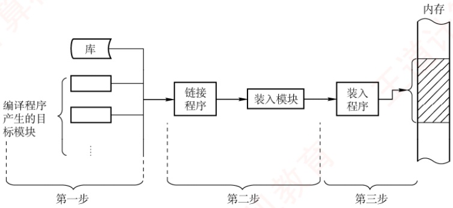

图3.1 将用户程序变为可在内存中执行的程序的步骤

**考点追踪编译、链接和装入阶段的工作内容（2011）**

1）编译。由编译程序将用户源代码翻译成若干目标模块。

2）链接。由链接程序将这些目标模块及其所需的库函数合并，形成一个完整的装入模块。

3）装入（加载）。由装入程序将该装入模块载入内存，并启动其执行。

#### 2．逻辑地址与物理地址

**考点追踪进程虚拟地址空间的特点（2023）**

编译后的每个目标模块通常从0号单元开始编址，这种地址称为该模块的相对地址（或逻辑地址）。链接程序将多个目标模块合并为一个完整的可执行程序时，依次将各模块的相对地址拼接成一个统一的、从0开始编址的逻辑地址空间（或虚拟地址空间）。以32位系统为例，该逻辑地址空间的范围为 $0 {\sim} 2^{32} {- 1}$ 。进程运行时所使用的地址均为逻辑地址；用户程序和程序员只需关注逻辑地址，而底层的内存管理机制对其完全透明。不同进程可以拥有相同的逻辑地址，因为它们各自拥有独立的逻辑地址空间，这些地址会被映射到主存的不同位置。

物理地址空间是指主存中所有物理存储单元的集合，它是地址转换的最终目标。无论进程执行指令还是访问数据，最终都必须通过物理地址从主存中读取或写入信息。在早期系统中，程序装入内存时需将逻辑地址转换为物理地址，这一过程称为地址重定位；而在现代支持虚拟内存的系统中，该转换由内存管理单元（MMU）在硬件层面于运行时自动完成。

具体而言，现代操作系统为每个进程维护一张页表，用于记录逻辑页到物理页框的映射关系。当进程访问某个逻辑地址时，MMU会依据当前进程的页表，将其动态转换为相应的物理地址。整个过程对用户程序完全透明，构成了虚拟内存系统的基础。

#### 3．程序的链接

链接程序的作用是将编译生成的目标模块及其所需的库函数合并，形成一个完整的装入模块，以便后续装入内存并执行。根据链接发生的时机不同，可分为以下三种方式。

**（1）静态链接**

在程序运行之前，将各目标模块及其所需的库函数链接成一个完整的装入模块（可执行文件），此后不再拆分，这种链接方式称为静态链接。链接过程中需完成两项关键操作。

①地址调整。各目标模块在编译后均以0为起始地址，链接时需根据其在装入模块中的实际位置，将内部地址统一加上相应的偏移量。例如，若模块A的长度为L，且链接后模块B紧邻在模块A之后存放，则原本从0开始编址的模块B在合并后的装入模块中将从地址L处开始，其内部所有地址均需加上偏移量L。

②外部符号解析。将模块间引用的外部符号（如函数名）替换为确定的地址。若模块A中包含语句CALLB，其中B为指向模块B入口的外部调用符号，则链接程序会将其解析为模块B在装入模块中的起始地址L，并将CALLB 中的符号B替换为地址L。

**(2）装入时动态链接**

装入时动态链接是指:将用户源程序编译后生成的一组目标模块，在装入内存时采用边装入边链接的方式。具体而言，当装入某个目标模块时，若遇到对外部模块的调用，则装入程序会立即查找并装入相应的外部目标模块，并替换其中的外部符号。其优点如下。

①便于修改和更新。静态链接需将所有目标模块预先装配成一个完整的装入模块，若其中任一模块需要修改或更新，则必须重新生成整个装入模块。若采用装入时动态链接方式，则各目标模块独立存放，只需替换被修改的模块，无须重建整个程序。

②便于实现对目标模块的共享。在静态链接方式下，每个应用程序都包含其所依赖目标模块的完整副本，无法实现共享。而在装入时动态链接方式下，操作系统可将同一个目标模块链接到多个应用程序中，从而实现多个程序对该目标模块的共享。

**（3）运行时动态链接**

运行时动态链接是对装入时动态链接的改进，在程序执行过程中，仅当需要调用某个尚未装入内存的目标模块时，操作系统才动态加载并链接该模块。具体而言，系统会查找该模块，将其装入内存，并完成符号解析，使其可被当前进程调用；而程序运行中未使用的模块，则既不会被装入内存，也不会进行链接。其优点是既能加快程序的装入过程，又可节省内存空间。

#### 4．程序的装入

将一个装入模块载入内存时，主要有以下三种方式。

**（1）绝对装入**

绝对装入仅适用于单道程序环境。由于内存中始终只有一个程序，其驻留位置在编译前即可确定，因此编译程序可以直接生成使用绝对地址的目标代码；装入程序只需按这些地址将程序和数据载入内存。此时，程序中的逻辑地址与实际物理地址完全一致，无须任何修改。

程序中通常使用的是符号地址（如变量名、函数名），由编译器或汇编器在编译或汇编阶段将其转换为绝对地址；当然，绝对地址也可由程序员直接指定，但这种方式缺乏灵活性。

**(2)可重定位装入**

在多道程序环境下，编译程序无法预知目标模块在内存中的具体位置，因此经编译和链接生成的装入模块通常从地址0开始编址，程序中的地址均为相对于模块起始位置的逻辑地址。此时应采用可重定位装入方式，它可根据内存的具体情况，将装入模块装入内存的适当位置。

装入时，系统根据内存当前的空闲情况，为该模块分配一块连续的内存区域，并将整个模块载入其中。随后，一次性将所有逻辑地址修改为对应的物理地址。这一地址转换过程称为重定位。由于转换在装入时完成，且在程序运行期间不再改变，故称静态重定位，如图3.2(a)所示。

进程必须在装入前一次性获得其所需的全部内存空间；若内存不足，则无法装入。一旦装入，进程在整个运行期间既不能移动位置，也不能动态申请额外内存，限制了内存管理的灵活性。

**（3）动态运行时装入**

为克服静态重定位的局限，支持程序在内存中的移动，需采用动态重定位方式。装入程序将装入模块载入内存后，并不立即转换地址，而是将地址转换推迟到指令实际执行时进行。为此，系统借助一个重定位寄存器，用于存放该模块在内存中的起始物理地址。程序中保留的仍是逻辑地址，而实际物理地址则由硬件在运行时动态计算得出，如图3.2(b)所示。

动态重定位的优点:支持程序在内存中移动，便于操作系统进行紧凑，从而有效减少外部碎片；提高内存分配的灵活性，允许在运行期间根据需要动态调整进程的内存布局。

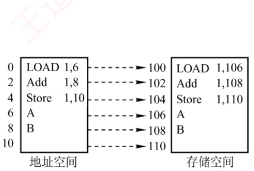

(a) 静态重定位

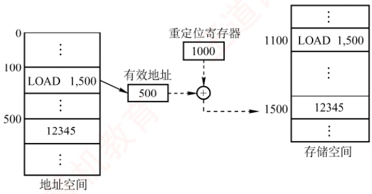

(b) 动态重定位

图3.2 重定位类型

#### 5．内存保护

**考点追踪分区分配内存保护的措施（2009）**

为确保各进程拥有独立的内存空间，内存保护机制需在内存分配前防止用户进程破坏操作系统，同时避免用户进程相互干扰。常用方法主要有以下两种。

1）在CPU中设置一对上、下限寄存器，分别存放用户进程在内存中的下限和上限地址，每当CPU访问一个地址时，硬件自动将其与这两个寄存器的值进行比较，以判断是否越界。

2）采用重定位寄存器（也称基地址寄存器）和界地址寄存器（也称限长寄存器）实现越界检查。重定位寄存器存放进程在内存中的起始物理地址，界地址寄存器存放进程地址空间的长度。内存管理部件首先将逻辑地址与界地址寄存器的值进行比较，若未越界，则将逻辑地址加上重定位寄存器的值，得到物理地址，并据此访存，如图3.3所示。

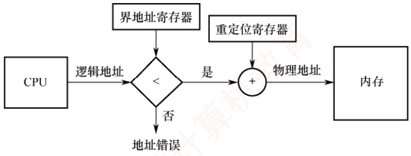

图3.3 重定位寄存器和界地址寄存器的硬件支持

重定位寄存器与界地址寄存器的作用不同:重定位寄存器用于“加”，即将逻辑地址加上其值，得到物理地址；界地址寄存器用于“比”，即将逻辑地址与其值比较，判断是否越界。

重定位寄存器与界地址寄存器的加载必须通过特权指令完成，仅操作系统内核具备此权限。这一机制可确保寄存器内容只能由内核修改，用户程序无法篡改，从而有效保障内存的安全。

#### 6．内存共享

并非所有进程的内存空间都适合共享，只有只读区域才可以被共享。可重入代码（也称纯代码）是一种允许多个进程同时访问但不允许被任何进程修改的代码。在实际执行时，每个进程需配备独立的私有数据区，用于存放运行过程中可能修改的数据；程序仅对私有数据区进行写操作，而共享的代码段始终保持不变。例如，考虑一个可同时容纳40个用户的多用户系统，所有用户同时运行同一个文本编辑程序。该程序包含160KB的代码区和40KB的数据区。若不共享代码，则系统共需(160KB+40KB)×40=8000KB的内存；若代码为可共享代码，则无论采用分页系统还是分段系统，整个系统只需保留一份副本，此时所需内存仅为 $160\mathrm{KB}+40\mathrm{KB}\times40=1760\mathrm{KB}$

在分页系统中，假设页面大小为4KB，则代码区占用40个页面，数据区占用10个页面。为实现代码共享，每个进程的页表中需设置40个页表项，均指向同一组共享代码页的物理页框；此外，每个进程还需为其私有数据区建立10个页表项，指向各自的数据页。

在分段系统中，由于以段为单位进行管理，只需为共享代码段设置一个段表项，记录共享代码段的起始地址和段长（160KB）。每个进程的段表中包含对该共享段的引用。由此可见，分页与分段均可有效支持内存共享，区别在于共享的粒度和管理机制。

此外，在第2章中介绍过基于共享内存的进程通信机制，由操作系统提供同步与互斥支持。本章后续还将介绍另一种内存共享的实现方式一一内存映射文件。

#### 7．内存分配与回收

操作系统的演进持续推动内存管理的发展。随着系统从单道向多道程序发展，单一连续分配逐渐被固定分区分配所取代。然而，固定分区难以适应作业大小的动态变化，因此又被动态分区分配所替代。为进一步提升内存利用率，连续分配方式最终让位于离散分配方式（如页式存储管理）。此外，为满足用户在编程和使用上的更高需求（如支持程序的逻辑结构、实现段级共享与保护等），分段存储管理应运而生，而这些功能恰是其他分配方式难以有效支持的。

### 3.1.2 连续分配管理方式

连续分配方式是指为一个用户程序分配一个连续的内存空间。例如，若某用户程序需要100MB的内存，则系统便会在内存中为其分配一块连续的100MB区域。

连续分配方式主要包括单一连续分配、固定分区分配和动态分区分配。

#### 1．单一连续分配

在单一连续分配方式中，内存被划分为系统区和用户区。系统区仅供操作系统使用，通常位于低地址部分；用户区则仅允许一道用户程序运行，即该程序独占整个用户区。

这种方式的优点是结构简单、无外部碎片，且无须内存保护机制，因为内存中始终只有一道程序。缺点是仅适用于单用户、单任务的操作系统，存在内部碎片，且内存利用率极低。

#### 2．固定分区分配

固定分区分配是最简单的一种多道程序存储管理方式。它将用户内存空间划分为若干大小固定的分区，每个分区仅能容纳一道作业。当有空闲分区时，系统可从外存的后备作业队列中选择一个合适大小的作业装入该分区，并反复执行这一过程。在划分分区时，有两种方法:

● 分区大小相等。程序过小会造成空间浪费，过大则无法装入，缺乏灵活性。

· 分区大小不等。划分为多个较小分区、适量中等分区和少量大分区，以提高适应性。

为便于内存的分配与回收，系统维护一张分区使用表，通常按分区大小排序。各表项包含对应分区的始址、大小及状态（是否已分配），如图3.4所示。分配时，系统检索该表，寻找一个满足作业大小要求且尚未分配的分区，将其分配给待装入程序，并将对应表项的状态置为“已分配”；若找不到合适分区，则拒绝分配。回收时，只需将对应表项的状态置为“未分配”即可。

| 分区号 | 大小/KB | 始址/KB | 状态 |
| --- | --- | --- | --- |
| 1 | 12 | 20 | 已分配 |
| 2 | 32 | 32 | 已分配 |
| 3 | 64 | 64 | 已分配 |
| 4 | 128 | 128 | 未分配 |

(a) 分区使用表

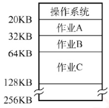

(b) 存储空间分配情况

图3.4 固定分区说明表和内存分配情况

该方式存在两个问题:①若作业大于所有分区，则无法装入；②若作业小于分区大小，则仍需占用整个分区，造成内部未被利用的空间，即内部碎片。固定分区方式虽无外部碎片，但因每个分区仅能由一个作业独占，无法支持多个进程共享同一内存区域，故内存利用率较低。

#### 3．动态分区分配

**（1）动态分区分配的基本原理**

动态分区分配也称可变分区分配，是指在进程装入内存时，按其实际需求动态分配一块大小恰好匹配的连续内存空间，因此系统中分区的数量和大小随进程的装入与释放而动态变化。

如图3.5所示，系统拥有64MB内存空间，其中低 8MB固定分配给操作系统，其余为用户可用区域。初始时装入前三个进程后，仅剩4MB空闲，不足以容纳进程4。为腾出空间，操作系统换出进程2，并换入较小的进程4；因其所需内存更少，释放出一个6MB的空闲块。随后，当需要重新换入进程2时，因剩余空间仍不足，操作系统又换出进程1，再换入进程2。

动态分区分配在初期运行良好，但随着进程频繁装入与释放，内存中会逐渐积累大量分散的小空闲块，导致可用内存总量虽足，却难以满足较大进程的需求，内存利用率随之下降。这些散布在已分配分区之间、无法利用的小空闲块称为外部碎片，与固定分区中因分区内部未用完而产生的内部碎片形成鲜明对比。外部碎片可通过紧凑技术缓解:操作系统周期性地移动进程，将所有空闲块合并为一个连续区域；然而，该操作要求系统支持动态重定位，且开销较大。其原理类似于Windows系统中的磁盘碎片整理，但后者作用于外存文件系统，而前者作用于主存。

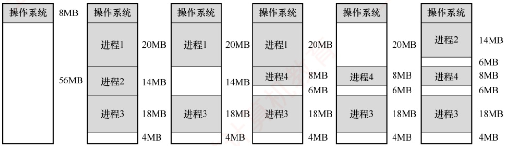

图 3.5 动态分区分配

**考点追踪动态分区分配的内存回收方法（2017）**

在动态分区分配中，系统维护一张空闲分区链（表），通常按起始地址排序。分配内存时，系统检索该链，寻找一个满足请求大小的空闲分区:若其尺寸大于所需，则从中分割出请求大小的空间分配给进程，剩余部分（如果不小于最小分配单位）仍保留在空闲分区链中。回收内存时，系统根据回收分区的起始地址，在空闲分区链中确定插入位置，并依据相邻情况执行合并操作，具体可分为四种情形:①回收区与前一空闲分区相邻，两者合并，更新前一分区的大小；②回收区与后一空闲分区相邻，两者合并，更新后一分区的起始地址和大小；③回收区与前后两个空闲分区均相邻，三者合并，更新前一分区的大小，并删除后一分区的表项；④回收区不与任何空闲分区相邻，为其新建一个表项，记录起始地址和大小，并插入空闲分区链。

上述三种连续分配方式有一个共同特点:用户程序在主存中均以连续方式存放。

**(2）基于顺序搜索的分配算法**

将作业装入主存时，需依据特定的分配算法从空闲分区链（表）中选出一个大小合适的分区分配给该作业。根据分区检索方式的不同，动态分区分配算法可分为顺序分配算法和索引分配算法。其中，顺序分配算法通过依次遍历空闲分区链，查找第一个满足作业大小要求的分区。

常见的顺序分配算法有以下四种。

**考点追踪各种动态分区分配算法的特点（2019、2024）**

1）首次适应（FirstFit）算法。空闲分区按地址递增次序排列。分配时从链首开始顺序查找，找到第一个满足请求的空闲分区，从中划出所需空间分配给作业，余下部分仍留在链中。该算法优先利用低地址分区，从而保留高地址的大空闲区，有利于后续大作业装入；但低地址容易积累小碎片，且每次分配均需从链首开始查找，增加了查找开销。

2）邻近适应（NextFit）算法。也称循环首次适应算法，由首次适应算法改进而来。不同之处在于:分配时从上次查找结束的位置开始继续循环搜索，而非每次都从链首开始。该算法减少了对低地址区域的重复扫描，但往往导致大空闲区在内存中分布不均，难以有效支持后续大作业的装入，因此其整体性能通常不如首次适应算法。

**考点追踪最佳适应算法的分配过程（2010）**

3）最佳适应（BestFit）算法。空闲分区按容量递增次序排列。分配时，顺序查找第一个能满足作业大小的空闲分区（最小的可用分区）进行分配。尽管名为“最佳”，该算法虽能尽量保留较大的空闲分区，但每次分配都会在原分区中留下极小的剩余块。随着时间推移，这些小块难以被利用，产生大量外部碎片，实际性能通常较差。

4）最坏适应（WorstFit）算法。空闲分区按容量递减次序排列。分配时，选择第一个满足要求的空闲分区（最大的可用分区），从中分割出所需空间。与最佳适应算法相反，该算法试图通过避免生成小碎片来提升内存利用率，但由于总是切割最大的空闲区，系统很快难以满足大作业的内存需求，因此性能同样不佳。

综合来看，首次适应算法在实现开销、碎片控制与大作业支持之间取得了较好的平衡:其查找过程简单高效，回收分区时无须对空闲链重新排序，且能有效保留高地址的大空闲区。

**(3）基于索引搜索的分配算法**

当系统规模较大时，空闲分区链可能很长，采用顺序搜索算法效率较低。为此，大中型系统常采用基于索引的分配算法，索引分配算法的思想是:根据空闲分区的大小进行分类，对每一类大小相同的空闲分区建立独立的空闲分区链，并通过一张索引表统一管理这些链。分配时，依据请求大小在索引表中定位对应链表，获取其头指针，从而快速取得一个空闲分区。

常见的索引分配算法有以下三种。

1）快速适应（QuickFit）算法。根据系统中进程常用的空间大小，预先将空闲分区划分为若干固定尺寸的类别。分配过程分为两步:①根据作业长度，在索引表中找到能容纳它的最小类别链表；②从该链表头部取下第一个空闲分区进行分配。优点是查找效率高、不会产生内存碎片；缺点是回收时难以有效合并分区，算法比较复杂，开销较大。

**考点追踪伙伴关系的概念（2024）**

2）伙伴系统（BuddySystem）。规定所有分区大小均为 $2^{k}$ （k为正整数）。当需要为进程分配大小为n的内存时（满足 $2^{i - 1} < n \leq 2^i$ ，首先在大小为 $2^{i}$ 的空闲分区链中查找。若存在，则直接分配；否则，依次在大小为 $2^{i + 1} , 2^{i + 1} ,$ …的链中查找，直至找到一个可用分区。随后，将该分区不断二分，直至得到所需大小的块，其余部分按大小加入对应的空闲链。在伙伴系统中，每个大小为 $2^{k}$ 的分区都有一个唯一的伙伴分区:与它大小相同、地址相邻（首尾相接）的另一个分区。回收时，若某空闲分区与其伙伴也为空闲，则合并为一个大小为 $2^{k + 1}$ 的分区，并继续向上尝试合并，直至无法合并为止。

3）哈希算法。以空闲分区大小为关键字，建立哈希函数，构建一张哈希表，每个表项记录对应空闲分区链的头指针。分配时，根据所需分区大小，通过哈希函数计算出其在哈希表中的位置，从而快速获取相应的空闲分区链。

在连续分配方式中，即使系统拥有超过1GB的空闲内存，只要其中不存在连续的1GB空间，需要该大小内存的作业便无法装入运行，这正是外部碎片导致的问题。为了克服这一限制，操作系统引入了非连续分配方式:将进程的地址空间划分为多个单元，并允许这些单元分散地装入内存中互不相邻的区域，从而彻底摆脱对外部连续空间的依赖。该机制能有效利用零散的空闲内存，显著提升内存利用率；但与此同时，系统必须额外维护各逻辑单元与其物理位置之间的映射关系，因而带来了一定的存储开销。根据所划分单元的大小是否固定，非连续分配方式可分为分页存储管理与分段存储管理。进一步，若作业运行前需要一次性装入全部单元，则称为基本分页或基本分段；若支持按需动态装入，则相应地称为请求分页与请求分段。

### 3.1.3 基本分页存储管理

固定分区会产生内部碎片，动态分区会产生外部碎片，这两种方式对内存的利用率都较低。为提高内存利用率并彻底消除外部碎片，操作系统引入了分页存储管理:将物理内存划分为若干大小相等的固定单元，称为页框（或页帧、物理块）；同时将进程的逻辑地址空间划分为与页框大小相同的单元，称为页面（或页）。系统以页框为单位为进程分配内存。

从形式上看，分页类似于等长的固定分区，但其本质不同:固定分区按作业整体分配，而分页将进程和内存均按固定大小的单元划分，使得内存分配以页为单位进行。因此，分页管理不会产生外部碎片。然而，由于页面大小固定，当进程的某一页未被完全填满时，其对应的页框中会留下未使用的空间，形成页内碎片（内部碎片），每个进程平均产生的页内碎片约为半页。

#### 1．分页存储的几个基本概念

**（1）页面和页面大小**

进程的逻辑地址空间被划分为若干页面，每个页面有一个编号，称为页号，从0开始；物理内存中的每个页框也有一个编号，称为页框号（或物理块号），同样从0开始。通过建立页号到页框号的映射，系统为进程的每个页面分配物理内存。

为便于地址转换，页面大小通常取2的整数次幂。页面大小应适中:若页面过小，则进程的页面数量增多，导致页表过长，不仅占用大量内存，还会增加地址转换开销，降低页面换入/换出的效率；若页面过大，则页内碎片增多，同样会降低内存利用率。

> ①本章后面的内容与《计算机组成原理考研复习指导》一书的3.6节高度相关，建议结合复习。

**(2）地址结构**

考点追踪分页系统的逻辑地址结构（2009、2010、2013、2015、2017、2024）

在分页存储管理中，逻辑地址由两部分组成:页号P和页内偏移量W，如图3.6所示。

| 31 |  | 12 |  |
| --- | --- | --- | --- |
| 页号P |  | 页内偏移量W |  |

图3.6 某分页系统的 32 位逻辑地址结构

以 32位地址为例，若页面大小为 $2^{12} \mathrm {B}$ （4KB），则低12位（0～11位）为页内偏移量，高20位（12～31位）为页号，最多可支持 $2^{20}$ 个页面。

**(3）页表**

为实现逻辑地址到物理地址的转换，系统为每个进程建立一张页表（PageTable）。页表是一个按页号顺序排列的数组，每个页表项记录对应页面所驻留的物理页框号，以及相关状态信息（如有效位、访问位等）。进程执行时，通过页号索引页表，即可获得该页所在的物理块号，从而完成地址映射，如图3.7所示。因此，页表的作用是实现从页号到页框号的映射。

(a)逻辑空间

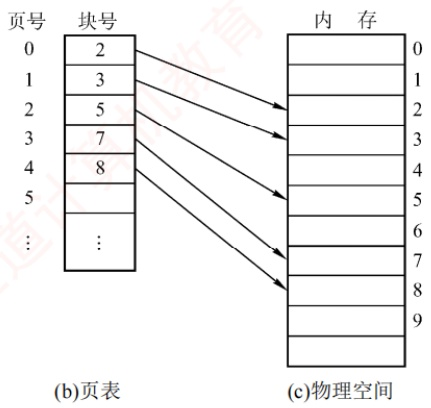

图 3.7 页表的作用

#### 2．基本地址变换机构

地址变换机构的任务是将逻辑地址转换为内存中的物理地址，这一过程借助页表实现。图3.8展示了分页存储管理系统中的地址变换机构。

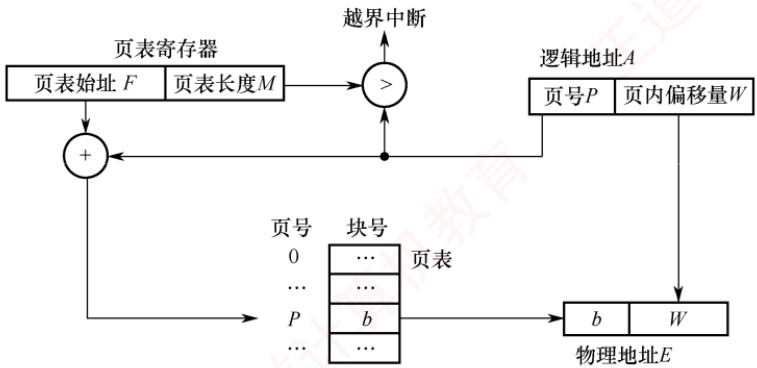

图3.8 分页存储管理系统中的地址变换机构

**注意**

在页表中，页表项按页号顺序连续存放，因此页号作为索引是隐含的，无须在页表项中显式存储。

为提高地址变换速度，系统设置一个页表寄存器（PTR），存放页表在内存中的始址F和页表长度M。由于寄存器造价昂贵，单CPU系统中通常只设置一个PTR。进程未执行时，其页表始址和长度保存在该进程的PCB中；当进程被调度执行时，操作系统将这些信息装入PTR。

设页面大小为L，逻辑地址A到物理地址E的变换过程如下。

考点追踪页式系统的地址变换过程（2013、2021、2024）

**考点追踪页表项地址的计算与分析（2024）**

①根据逻辑地址计算页号 $P = \lfloor A / L \rfloor$ 、页内偏移量 $W = A \% L$ C

②判断页号是否越界，若页号 $P \geq  页$ 表长度M，则产生越界中断；否则，继续执行。

③根据页号P查找页表，找出对应页表项中的物理块号。页表项地址=页表始址F+页号P×页表项长度，取出该页表项中的物理块号b。

④计算物理地址 $E = b L + W ,$ ，并据此访问内存（注意，物理地址=页面在内存中的始址+页内偏移量，页面在内存中的始址=块号×块大小）。

上述地址变换过程由MMU硬件自动完成的。例如，若页面大小 $L = 1 \mathrm {K B}$ ，则页号2对应的物理块号 $b   = 8$ ，逻辑地址 $A = 2500$ 的物理地址E的计算过程如下: $P=2500/1K=2$ $W=2500\%1\mathrm{K}=$ 452，故物理地址 $E = 8 \times 1024 + 452 = 8644$ 0

若逻辑地址以二进制形式给出，则页号和页内偏移可直接通过截取高位和低位获得，效率更高。正因页面大小固定，逻辑地址可视为一维线性地址，因而仅需一个整数即可确定其位置。

页表项大小不是随意规定的，而是有所约束的。页表项大小如何确定？

页表项需能表示所有可能的物理页框号。以32位地址空间、按字节编址、页面大小为4KB为例，物理内存最多包含 $2^{32}\mathrm{B}/4\mathrm{KB}=2^{20}$ 个页框，因此需要 $\log_{2}2^{20}=20$ 位来表示页框号。由于内存按字节编址，为保证页表项能够指向所有页面，页表项大小至少为 $\left[20/8\right]=3\mathrm{B}$ 。但出于对齐和扩展考虑（如加入有效位、访问位等），实际系统通常将页表项设为4B。

分页管理面临两个主要挑战:①每次访存都需要进行地址转换，若转换速度不够快，则会显著降低系统性能；②页表本身占用内存空间，若页表过大，则会降低内存利用率。正是这些问题，推动了后续优化技术的发展，如快表（TLB）和多级页表。

#### 3．具有快表的地址变换机构

由前述地址变换过程可知，若页表全部存放在内存中，则每次访问内存（无论是取指令还是读/写数据）至少需两次访存:第一次访问页表以获取物理块号，第二次根据形成的物理地址访问目标内容。显然，这种方式会显著降低系统性能。为此，现代地址变换机构增设了一个具有并行查找能力的高速缓冲存储器一一快表（TLB），用于缓存当前活跃的若于页表项，以加速地址变换。相应地，主存中的完整页表常被称为慢表。具有快表的地址变换机构如图3.9所示。

**考点追踪具有快表的地址变换的性能分析（2009）**

在具有快表的分页机制中，地址变换过程如下。

①CPU给出逻辑地址后，硬件自动提取页号，并将其与快表中所有页号并行比较。

②若命中（找到匹配的页号），则直接从快表中取出对应的物理块号，与页内偏移量拼接形成物理地址。此时，仅需一次访存即可。

③若未命中（未找到匹配的页号），则需访问内存中的页表，读取相应的页表项以获得其物理块号，再拼接形成物理地址并访问内存，共需两次访存。同时，系统会将该页表项装入快表，以便后续可能的重复访问；若快表已满，则按特定置换算法淘汰一个旧项。

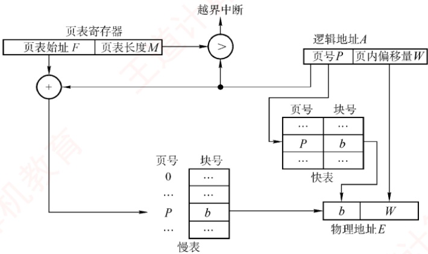

图3.9 具有快表的地址变换机构

在程序具有良好局部性的前提下，快表命中率通常可达90%以上，因此分页机制带来的性能开销可控制在10%以内。快表的有效性基于著名的局部性原理，这一原理将在3.2节中介绍。

#### 4．两级页表

引入分页管理后，进程执行时无须将所有页面调入内存，但仍需将整个页表驻留内存。然而，页表本身可能非常庞大。以32位逻辑地址空间、页面大小为4KB、页表项大小为4B为例:页内偏移占 $\log_{2} 4 \mathrm {K} = 12$ 位，页号占20位，因此每个进程的页表最多包含 $2^{20}$ 个页表项，仅页表就需占用 $2^{20} \times 4\mathrm{B} / 4\mathrm{KB} = 1\mathrm{K}$ 个页。若还要求页表连存放，则显然不切实际。

**考点追踪 多级页表的特点和优点（2014）**

解决上述问题的思路是将页表本身也视为可分页的对象，具体体现为两个方面:①对页表采用离散分配，不再要求其连续存放，而是通过一张专门的索引表记录各页表页在内存中的位置，从而消除对连续内存空间的需求；②仅将当前活跃的部分页表项调入内存，其余仍驻留磁盘，按需调入（虚拟内存的思想），从而有效缓解页表占用过多内存的问题。

不难发现，这一方案与最初引入页表以解决进程地址空间离散分配的思路如出一辙:本质上，就是为已离散化的页表再建立一层页表，称为外层页表（或页目录）。仍以上述条件为例:当采用两级分页时，将原页表按页面大小（4KB）进行分页。由于每页可容纳 $4\mathrm{KB}/4\mathrm{B}=1024$ 个页表项，而总页表项数为 $2^{20}$ ，故需 $2^{20}/2^{10}=2^{10}=1024$ 个页表页，对应外层页表包含1024个表项，恰好占用一页（4KB）。由此自然形成了如图3.10所示的逻辑地址结构。

| 一级页号或页目录号10位 | 二级页号或页号10位 | 页内偏移12位 |
| --- | --- | --- |

图3.10 逻辑地址空间的格式

**考点追踪两级页表的逻辑地址结构及相关分析（2010、2013、2015、2017—2019）**

两级页表是在普通页表结构上再加一层页表，其结构如图3.11所示。

在页表的每个表项中，存放的是进程某页对应的物理块号。例如，0号页存放在1号物理块中，1号页存放在5号物理块中。在外层页表的每个表项中，存放的是某个页表分页的物理起始地址。例如，0号页表页存放在3号物理块中。

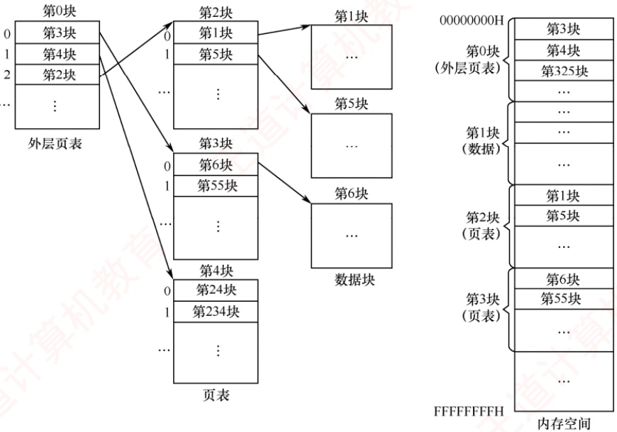

图 3.11 两级页表结构示意图

通过外层页表和内层页表的协同作用，可实现从逻辑地址到物理地址的变换。

考点追踪二级页表的页表基址寄存器中的内容（2018、2021）

考点追踪二级页表中的地址变换过程（2015、2017）

为方便地址变换，系统增设一个外层页表寄存器（也称页目录基址寄存器），用于存放外层页表的起始地址。地址变换过程如下。

①用逻辑地址中的页目录号作为索引，访问外层页表，获取对应内层页表的物理起始地址。

②用逻辑地址中的二级页号作为索引，访问该页表，得到目标页面的物理块号。

③将物理块号与页内偏移量拼接，形成物理地址，并据此访问内存单元。

在无快表的情况下，此过程需三次访存。

对于更大的地址空间（如64位），两级页表远远不够。例如，若逻辑地址为64位、页面大小为4KB，则页号占52位。若每页仍可存放1024个页表项，则需约6级页表才能覆盖整个地址空间。然而，实际系统通常将虚拟地址限制为48位，从而采用三级或四级页表即可高效管理，既满足应用需求，又避免硬件过度复杂化。建立多级页表的根本目的，是通过按需分配页表页避免为未使用的地址空间预留大量无用的页表项，进而显著节省内存开销。

### 3.1.4 基本分段存储管理

分页管理方式是从计算机的角度出发设计的，旨在提高内存利用率和系统性能，其地址转换由硬件自动完成，对用户完全透明。而分段管理方式则从用户和程序员的实际需求出发，旨在支持方便编程、信息保护与共享、动态增长以及动态链接等高级功能。

#### 1．分段

分段系统将用户进程的逻辑地址空间划分为若干大小不等的段。例如，一个进程可包含主程序段、子程序段、栈段和数据段，共划分为5个段。每个段内部从0开始编址，并分配一段连续的地址空间（段内连续，段间不要求连续）。由于地址空间被组织为多个具有明确语义的段，整个进程的逻辑地址结构呈现出二维特性:由段号和段内偏移共同确定一个地址。

**考点追踪分段系统的逻辑地址结构分析（2009）**

分段存储管理的逻辑地址由段号S和段内偏移量W两部分组成。在图3.12中，段号占16位，段内偏移量也占16位，则一个进程最多可拥有 $2^{16} = 65536$ 个段，最大段长为64KB。

<table><tr><td>31</td><td></td><td>15</td><td></td></tr><tr><td colspan="2">段号S</td><td colspan="2">段内偏移量W</td></tr></table>

图3.12 分段系统中的逻辑地址结构

在页式系统中，逻辑地址中的页号与页内偏移量对用户透明；而在分段系统中，段号和段内偏移量必须由用户显式提供一—这一工作在高级语言中由编译程序自动完成。

#### 2．段表

每个进程都拥有一张段表，用于实现逻辑段到物理内存区的映射。段表中每个段对应一个段表项，记录该段在内存中的基址（起始地址）和段长（长度）。段表的内容如图3.13所示。

| 段 | 段 | 长 |  |
| --- | --- | --- | --- |
| 号 |  |  |  |

图 3.13 段表的内容

运行时，系统通过查找段表，即可定位每段在内存中的实际位置，其映射过程见图3.14。

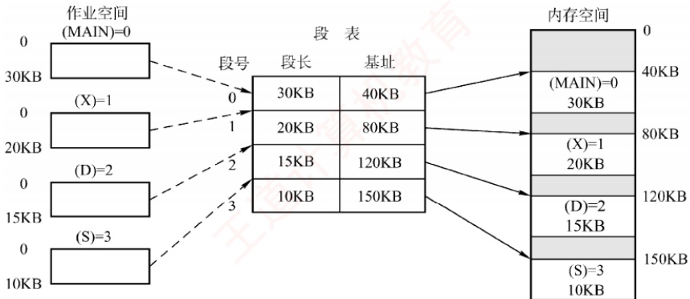

图3.14 利用段表实现物理内存区映射

由于段表项连续存放且长度相同，段号可作为隐含索引，无须额外存储。例如，在某32位分段系统中，段号为16位，段内偏移量为16位（段长字段为16位，对应最大段长64KB），物理地址为32位（可寻址4GB内存）。因此，每个段表项至少需要16（段长）+32（基址）=48位，即6B。若段表首地址为M，则第K号段对应的段表项位于地址 $M + K \times 6$ 处。

#### 3．地址变换机构

分段系统的地址变换过程如图3.15所示。为实现从逻辑地址到物理地址的变换，系统设置了一个段表寄存器，用于存放段表始址F和段表长度M。段式存储管理的地址变换过程如下。

考点追踪段式系统的地址变换过程（2016）

① 从逻辑地址 A 中分离出段号S和段内偏移量 $W_{\circ}$

②判断段号是否越界:若段号S≥段表长度M，则产生段号越界中断，否则继续执行。

③根据段号S查找段表，段表项地址 =段表始址F +段号S×段表项长度。取出该段表项中该段的段长C，若 $W \geqslant C ,$ ，则产生段内越界中断；否则，继续执行。

④取出段表项中该段的基址b，计算物理地址 $E = b + W ,$ ，并据此访问内存。

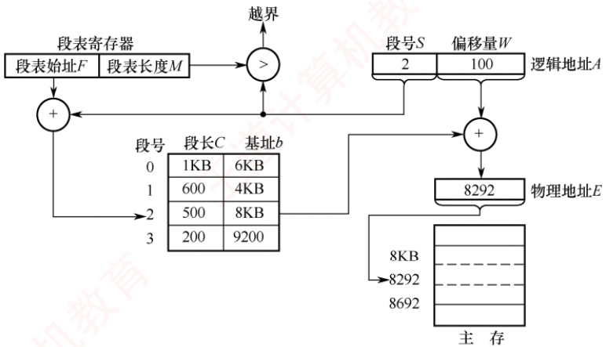

图 3.15 分段系统的地址变换过程

#### 4．分页和分段的对比

分页与分段均为非连续分配方式，均需通过地址映射机构实现地址变换。然而，二者在概念上有本质区别，主要体现在以下三个方面:

1）页是系统管理内存的物理单位，分页的主要目的是提高内存利用率，完全由系统实现，对用户透明；段是用户程序的逻辑单位，分段的主要目的是满足编程、共享、保护等需求，由编译器根据程序结构划分，对用户可见。

2）页的大小固定，由系统决定。段的长度不固定，取决于程序的逻辑结构。

3）分页系统的地址空间是一维的，程序员只需提供单一的线性地址；分段系统的地址空间是二维的，程序员在引用地址时，必须同时指定段名（或段号）和段内偏移量。

#### 5．段的共享与保护

**考点追踪页、段共享的原理和特点（2019、2023）**

在分页系统中，虽然也能实现共享，但远不如分段系统方便。若一段共享代码占N个页框，则每个共享进程的页表中都需建立N个页表项，分别指向这N个页框。而在分段系统中，无论该段多大，只需在每个进程的段表中设置一个段表项指向该共享段，因此实现共享极为便捷。

为支持段共享，系统可维护一张共享段表，其中每个共享段对应一个表项，记录其段号、段长、内存起始地址、存在位、外存起始地址以及共享进程计数count。当某进程不再使用该段时，count减1；仅当count=0时，系统才回收该段所占的内存空间。值得注意的是，同一共享段在不同进程中可以具有不同的段号，各进程通过各自的段号即可访问同一物理段①。

不能被修改的代码称为可重入代码（或纯代码），它允许多个进程并发执行。为确保共享代码的完整性，系统通常将此类代码置于只读段中。同时，每个进程需配备私有的局部数据区，专门用于存放执行过程中可能变化的数据，从而有效避免对共享代码段的任何写操作。

与分页管理类似，分段系统的保护机制主要包括两类:①地址越界保护，将逻辑地址中的段号与段表长度比较，若段号≥段表长度，则产生越界中断；将段内偏移与段表项中的段长比较，若偏移≥段长，则同样触发越界中断。②存取控制保护，通过段表项中的访问权限位防止非法访问。

> ①对于段共享的实现，在汤小丹老师的旧版教材中采用的方法是配置共享段表；但是，在新版教材中采用的方法是在每个进程的段表中设置一个段表项，指向被共享的同一个物理段。2019年的统考真题考查的是前述方法。

### 3.1.5 段页式存储管理

分页存储管理能有效提高内存利用率，而分段存储管理能反映程序的逻辑结构，并有利于段的共享与保护。将二者各自的优势有机结合，便形成了段页式存储管理方式。

在段页式系统中，进程的地址空间首先被划分为若干逻辑段，每段拥有唯一的段号；随后，每个段被进一步划分为若干大小固定的页。内存空间的管理仍采用分页方式，即划分为与页面大小相同的物理块，内存分配以物理块为单位，如图3.16所示。

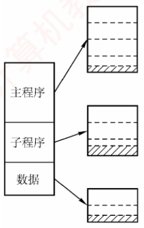

(a) 程序的段页划分

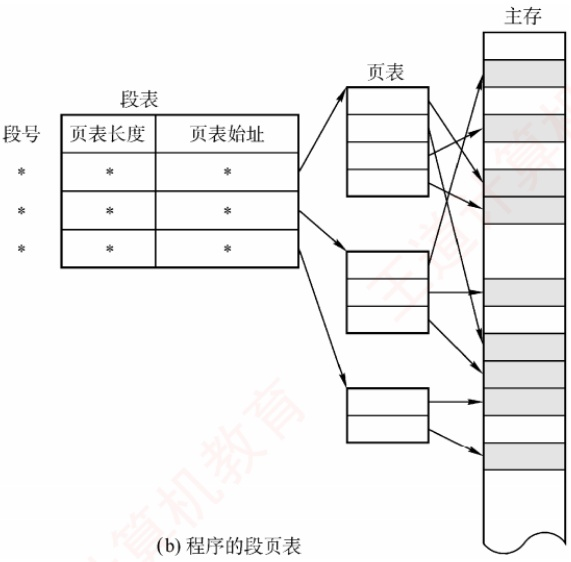

图 3.16 段页式管理方式

进程的逻辑地址由三部分组成:段号S、页号P和页内偏移量W，如图3.17所示。

| 段号S | 页号P | 页内偏移量W |
| --- | --- | --- |
|  |  |  |

图3.17 段页式系统的逻辑地址结构

为实现地址变换，系统为每个进程建立一张段表，每个段对应一个段表项，记录该段的页表始址和页表长度（段号作为段表索引，无须显式存储）。每个段还对应一张页表，其每个页表项记录对应页的物理块号（页号作为页表索引，亦无须存储）。此外，系统设置一个段表寄存器，用于存放当前进程段表的起始地址和段表长度，既用于段表寻址，也用于段号越界检查。

**注意**

在段页式存储管理中，每个进程仅有一张段表，但可能有多张页表（每个段一张）。

段页式存储管理的地址变换过程如下。

①根据逻辑地址中的段号S，通过段表寄存器定位段表，并查得该段对应页表的起始地址；

②系统利用页号P访问该页表，获取物理块号；

③将物理块号与页内偏移量W拼接，形成物理地址。

如图3.18所示，在无快表的情况下，每次基于逻辑地址的内存访问需三次访存。为加速查找，可引入快表（TLB），其表项包含关键字（段号、页号）及对应的物理块号和保护信息。

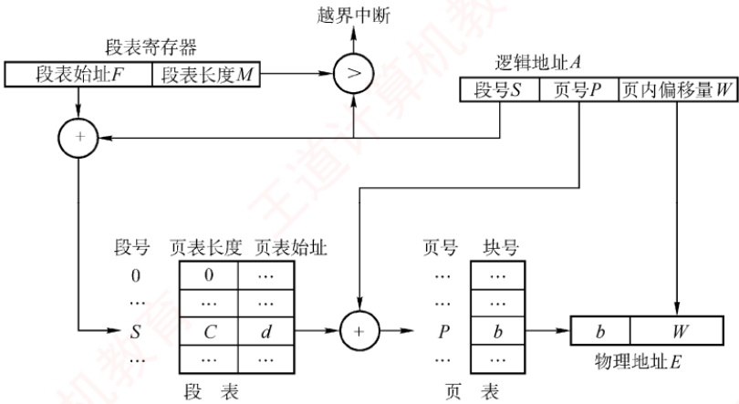

图3.18 段页式系统的地址变换机构

对用户而言，程序仍按段组织，页的划分由系统自动完成且完全透明。正因如此，段页式管理的地址空间是二维的——这与分段系统一致，而分页机制对用户不可见。

### 3.1.6 本节小结

本节开头提出的问题的参考答案如下。

**1）为什么要进行内存管理？**

在单道程序系统中，系统一次仅运行一个程序，内存分配极为简单一一只需将全部内存（或固定分区）分配给当前进程。引入多道程序设计后，多个进程并发执行并共享主存。若缺乏有效管理，则不同进程的地址空间可能重叠或相互覆盖，导致数据被意外修改，破坏程序正确性，严重影响并发可靠性。因此，为支持多道程序安全、高效地并发运行，必须进行内存管理。

**2）多级页表解决了什么问题？又会带来什么问题？**

多级页表解决了逻辑地址空间较大时，单级页表过长、占用内存过多的问题。通过分级组织页表，系统只需将当前使用的各级页表驻留内存，从而既减少内存占用，又避免对大块连续内存的需求。然而，采用多级页表也会带来性能开销:在无快表（TLB）的情况下，一次地址变换需逐级访问多级页表，导致多次内存访问，进而增加访存延迟。

无论是段式、页式还是段页式管理，读者只需掌握三个关键问题:①逻辑地址结构，②页（段）表项结构，③寻址过程。搞清这三点，便掌握了各类存储管理方式的核心机制。再次提醒注意区分逻辑地址结构与表项结构。

## 3.2 虚拟内存管理

在学习本节时，请读者思考以下问题:

1）为什么要引入虚拟内存？

2）虚拟内存空间的大小由什么因素决定？

3）虚拟内存是怎么解决问题的？会带来什么问题？

读者要掌握虚拟内存解决问题的思想，了解各种置换算法的优劣，掌握虚实地址的变换方法。

### 3.2.1 虚拟内存的基本概念

#### 1．传统存储管理方式的特征

3.1 节讨论的各种内存管理策略，都是为了将多个进程同时保留在内存中，以支持多道程序设计。它们具有以下两个共同特征。 美

1）一次性。作业必须一次性全部装入内存后才能开始运行。这会带来两个问题:①当作业过大而无法全部装入内存时，该作业将无法运行；②当大量作业请求运行时，由于内存不足以容纳所有作业，只能让少数作业先运行，导致系统并发度下降。

2）驻留性。作业一旦装入内存，便一直驻留其中，其任何部分都不会被换出，直至作业运行结束。然而，运行中的进程常因等待I/O而被阻塞，可能长时间处于等待状态。

由上述分析可知，许多在程序运行中暂未使用或暂时不用的代码和数据仍占据大量内存空间，而一些急需运行的作业却因内存不足无法装入，显然造成了宝贵内存资源的浪费。

#### 2．局部性原理

要真正理解虚拟内存技术的思想，首先必须了解著名的局部性原理。从广义上讲，快表、页高速缓存及虚拟内存技术都属于缓存技术，这个技术所依赖的原理就是局部性原理。局部性原理既适用于程序结构，又适用于数据结构。局部性原理表现在以下两个方面。

**考点追踪页面置换算法的时间局部性分析（2012）**

1）时间局部性。程序中的某条指令或某个数据项一旦被访问，不久之后很可能再次被访问。这主要是由于程序中存在大量的循环和重复操作。

2）空间局部性。一旦程序访问了某个存储单元，在不久之后，其附近的存储单元也很可能被访问。这是因为指令通常按顺序存放并顺序执行，而数据（如向量、数组、表等）也一般以连续或簇聚的方式存储。

时间局部性通过将近期使用的指令和数据保存在高速缓存中，并借助多级缓存层次结构加以利用；空间局部性则通过采用较大容量的缓存，并集成预取机制到缓存控制逻辑中实现。虚拟内存技术正是基于局部性原理，将外存作为内存的透明扩展，有效缓解物理内存不足的问题。

#### 3．虚拟存储器的定义和特征

**考点追踪虚拟存储器的特点（2012）**

基于局部性原理，在程序装入时，仅需将当前运行所需的少数页面（或段）装入内存，其余部分暂留外存，即可启动程序执行。在程序执行过程中，若所访问的信息不在内存中，则操作系统会自动将其从外存调入内存，然后继续执行程序，这一机制称为请求调页（或请求调段）。当内存空间不足时，操作系统又会将暂时不用的信息换出到外存，以腾出空间存放即将调入的内容，这一机制称为页面置换（或段置换）。正是通过这两种机制的协同工作，系统为用户提供了一个逻辑上远大于物理内存的地址空间，称为虚拟存储器。

之所以称为“虚拟”存储器，是因为该存储器并非真实存在的物理实体，而是操作系统通过部分装入、请求调入和置换功能（均对用户透明）所构造的一种逻辑抽象。用户程序可像使用大容量内存一样运行，而无须关心物理内存的实际大小。虚拟存储器有以下三个主要特征。

1）多次性。作业无须在运行前一次性全部装入内存，而是可以分多次动态调入。只需将当前需要执行的程序和数据装入内存即可开始运行，后续所需部分在访问时按需调入。

2）对换性。作业在运行过程中无须常驻内存，操作系统可根据需要，将暂不使用的程序或数据换出至外存对换区，并在后续需要时再换入内存，从而实现内存的高效利用。

3）虚拟性。从用户视角看，内存容量被逻辑扩充，呈现出远大于实际物理内存的可用空间。虚拟性正是虚拟存储器的本质特征和根本目标，其实现依赖于多次性与对换性。

#### 4．虚拟内存技术的实现

虚拟内存技术允许将一个作业分多次调入内存。若采用连续分配方式，则会导致相当一部分内存空间处于暂时甚至“永久”的空闲状态，不仅造成内存资源的严重浪费，也无法从逻辑上扩充内存容量。因此，虚拟内存的实现必须建立在离散分配的内存管理方式基础之上。

目前，虚拟内存主要有以下三种实现方式:

● 请求分页存储管理。

● 请求分段存储管理。

● 请求段页式存储管理。

无论采用哪种方式，均需一定的硬件支持，主要包括以下几个方面:

● 足够容量的内存和外存，用于存放程序的当前部分与后备部分。

● 页表机制（或段表机制），作为地址映射的关键数据结构。

·中断机构，用于在用户程序访问尚未调入内存的部分时，触发缺页（或缺段）中断。

地址变换机构，负责在程序运行过程中动态地将逻辑地址转换为物理地址。

### 3.2.2 请求分页管理方式

请求分页系统建立在基本分页系统的基础之上，为支持虚拟存储器功能，增加了请求调页和页面置换功能:在该系统中，只需将当前需要的一部分页面装入内存，便可启动作业运行。在作业运行过程中，若所访问的页面不在内存中，则系统将通过请求调页功能将其从外存调入；而当内存空间不足时，则通过页面置换功能将暂时不用的页面换出到外存。由于每次换入和换出的基本单位均为长度固定的页面，其实现比以长度可变的段为单位的请求分段系统更简单；正因其实现简洁且效率较高，请求分页成为目前最常用的一种虚拟存储器实现方式。

为了实现请求分页，系统必须提供一定的硬件支持。除需要足够容量的内存和外存外，还需具备页表机制、缺页中断机构以及地址变换机构。

#### 1．页表机制

相比于基本分页系统，请求分页系统中的页表需提供更多信息，以支持请求调页和页面置换。具体而言，操作系统必须能够:①判断某页是否已调入内存；②若尚未调入，则还需获知该页在外存中的存放位置；③在页面置换时，依据访问特征选择合适的换出页面；④对于要换出的页面，还需知道其是否被修改过，以决定是否需写回外存。为此，请求分页的页表项在基本结构基础上增加了四个字段，如图3.19所示。

| 页号 | 物理块号 | 状态位P | 访问字段A | 修改位M | 外存地址 |
| --- | --- | --- | --- | --- | --- |

图3.19 请求分页系统中的页表项

各新增字段的说明如下:

● 状态位P（存在位）。标记该页是否已调入内存，供地址变换时判断是否触发缺页中断。

● 访问字段A。记录本页在一段时间内的访问次数，或记录自上次访问以来的时间间隔，供页面置换算法选择换出页面时参考。

● 修改位M（脏位）。标记该页调入内存后是否被修改过，以决定换出时是否需写回外存。

● 外存地址。指示该页在外存中的存放位置（通常为物理块号），供调页时将其读入内存。

#### 2．缺页中断机构

考点追踪缺页处理的过程及效率分析（2011、2013、2014、2020、2022）

考点追踪缺页异常导致进程状态的变化（2023）

在请求分页系统中，当进程访问的页面尚未调入内存时，硬件会自动触发缺页中断，由操作系统的缺页中断处理程序处理:将所需页面从外存调入内存（必要时先换出一页）。具体而言，若内存中有空闲页框，则分配一个页框，将所缺页面从外存装入，并更新页表中相应的表项；若无空闲页框，则需先由页面置换算法选择一个页面淘汰，若该页在内存中被修改过，则必须将其写回外存，否则可直接丢弃。由于页面调入通常涉及较长时间的磁盘I/O操作，系统在此期间可能会调度其他进程运行；待所需页面调入完成后，重新执行引发缺页的那条指令。

缺页中断作为一种内中断，其处理过程与其他中断类似，也需经历保护CPU现场、分析中断原因、转入中断处理程序、恢复CPU现场等步骤。然而，它具有以下两个显著特点:

● 在指令执行期间触发，由当前指令的地址访问直接引发，而非在指令执行完毕之后。

● 一条指令在执行过程中可能引发多次缺页中断。例如，在执行指令 copy A to B 时，若该指令本身及其两个操作数各自跨越两个页面，则最多可能引发6次缺页中断。

#### 3．地址变换机构

在基本分页系统地址变换机构的基础上，请求分页系统为支持虚拟存储器，增加了缺页中断触发机制。请求分页系统的地址变换过程如图3.20所示。

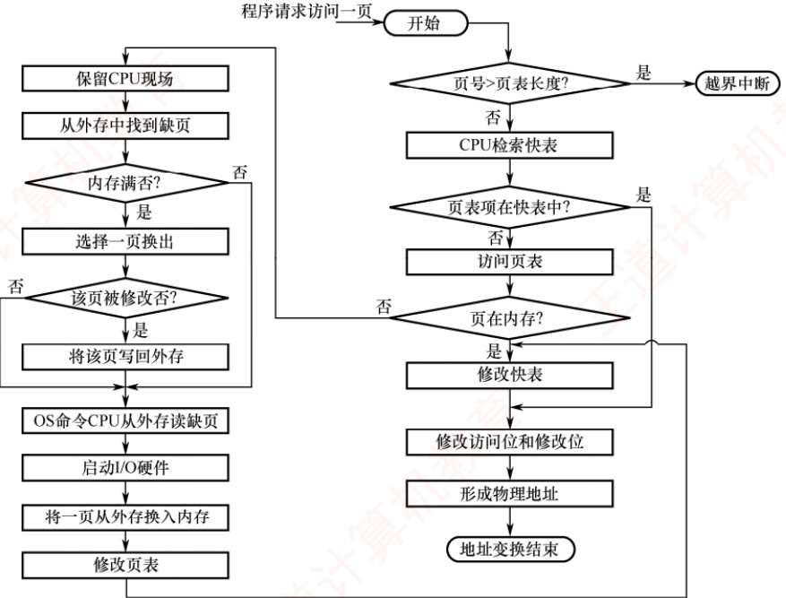

图3.20 请求分页中的地址变换过程

**考点追踪分页系统的地址变换过程及分析（2009、2010、2014、2024）**

请求分页系统的地址变换过程如下。

①首先检索快表，若命中，则从相应表项中取出该页的物理块号，并置访问位为1，以供置换算法换出页面时参考。对于写操作，还需置修改位为1。

②若快表未命中，则需访问页表。若该页已在内存中（状态位=1），则从相应表项中取出物理块号，并将该页表项装入快表；若快表已满，则按置换算法淘汰一项。

③若页面不在内存，则触发缺页中断。操作系统接管后，将所需页面从外存调入内存（必要时先换出一页），并更新页表和快表。随后，重新执行地址变换以获取物理块号。

④将获得的物理块号与页内地址拼接，形成物理地址，用于访存。

### 3.2.3 页框分配

在为进程分配内存时，主要涉及以下问题:①为保证进程能正常运行，所需最小页框数的确定；②为每个进程分配页框时，所分配的页框是固定的还是可变的；③在为不同进程分配页框时，是采用平均分配还是按进程大小比例分配。本节将围绕这些问题展开讨论。

#### 1．最小页框数与驻留集

**（1）最小页框数**

**考点追踪最小物理块数的确定原则（2025）**

最小页框数（也称最小物理块数）是指能保证进程正常运行所需的最少页框数量。若系统为进程分配的页框数少于此值，则进程将无法执行。进程应获得的最小页框数与计算机的硬件结构有关，具体取决于指令的格式、功能和寻址方式。例如，对于采用单地址指令和直接寻址的简单机器，最小页框数为2:一个用于存放指令，另一个用于存放数据。若支持间接寻址，则至少需要3个页框:分别用于存放指令、指针和数据。对于功能较强的机器，若一条指令及其两个操作数各自跨越两个页面，则在最坏情况下，该指令执行过程中可能涉及6个不同的页面。因此，应至少为每个进程分配6个页框，以确保这些页面能同时驻留内存，顺利完成指令执行。

**(2)驻留集大小**

在页式虚拟存储系统中，进程启动时既不需要、也不可能将其所有页面装入内存。因此，操作系统必须决定为该进程分配多少页框一一这一集合即称为该进程的驻留集。驻留集大小的选择需在系统并发度与缺页开销之间进行权衡，具体体现在以下两个方面:

1）驻留集过小，内存中可容纳的进程数量增多，有助于提高多道程序的并发度；但每个进程获得的页框过少，将导致缺页率显著升高，CPU需耗费大量时间处理缺页中断。

2）驻留集过大，当分配给进程的页框数超过某一阈值后，继续增加页框对缺页率的改善趋于平缓，不仅浪费内存资源，还会因可用页框总量减少而降低系统的整体并发能力。

#### 2．内存分配策略

在请求分页系统中，可采取两种内存分配策略，即固定和可变分配策略。在进行置换时，也可采取两种策略，即全局和局部置换。于是可组合出以下三种适用的策略。

**考点追踪页面分配与置换策略的名称（2015）**

**（1）固定分配局部置换**

所谓固定分配，是指为每个进程分配固定数量的页框，并在其运行期间保持不变。所谓局部置换，是指当进程发生缺页时，只能从该进程自身已分配的页框中选择一页换出，再将所缺页面调入，从而维持其驻留集大小恒定。该策略的难点在于:若初始分配的页框太少，则进程将频繁缺页；若分配过多，则不仅浪费内存资源，还会减少系统可容纳的并发进程数。

**注意**

理论上可形成四种组合，但由于固定分配要求进程的页框数量保持不变，而全局置换会导致进程的页框数量发生变化，二者互斥，因此实际可行的策略仅有三种。

**(2）可变分配全局置换**

所谓可变分配，是指初始时为每个进程分配一定数量的页框，并在运行期间根据需要动态调整。所谓全局置换，是指当进程发生缺页时，系统首先从空闲页框队列中取出一个页框分配给该进程，并将所缺页面调入；若空闲页框已耗尽，则允许从内存所有页框中选择一个换出，而不论其归属哪个进程。该方法比固定分配局部置换更为灵活，能够动态扩充进程的驻留集以更好地适应运行需求。然而，由于每次缺页都会为其分配新页框，若缺乏有效调控，则某些活跃进程的驻留集可能持续膨胀，不断抢占其他进程的页框，进而削弱系统的多道程序并发能力。

**(3）可变分配局部置换**

系统初始为每个进程分配一定数量的页框；当某进程发生缺页时，仅允许从其自身已分配的页框中选择一页换出，因此不会影响其他进程的运行。此外，系统还根据进程的缺页率动态调整其驻留集大小:若缺页率过高，表明当前页框不足，则为其增加若于页框；若缺页率过低，说明存在资源冗余，则可适当回收部分页框，但需确保不会引发缺页率的显著上升。该策略在有效抑制进程频繁调页的同时，兼顾了系统的多道程序并发能力。尽管其实现机制较为复杂、运行开销较大，但相比因频繁换入/换出所消耗的磁盘I/O与CPU资源，这一开销无疑是值得的。

页面分配策略曾在2015年统考选择题中出现过，考查的正是这三种策略的名称。不少考生因误判其为非重点内容，复习时一带而过，最终在考试中失分。而在这种基础题上失分，实属可惜。再次提醒读者，考研成功的秘诀在于“全面”和“反复多次”。

#### 3．页框调入算法

在采用固定分配策略时，系统需将空闲页框分配给各进程，常见的分配算法如下。

1）平均分配算法，将系统中所有可供分配的页框平均分配给各个进程。

2）按比例分配算法，根据进程的逻辑地址空间大小按比例分配页框。

3）优先权分配算法，为重要或紧迫的进程分配更多页框。通常的做法是将所有可分配页框分为两部分:一部分按比例分配给各进程，另一部分则依据进程的优先权动态分配。

#### 4．调入页面的时机

为确定系统将进程运行时所缺页面调入内存的时机，可采用以下两种调页策略。

1）预调页策略。根据局部性原理，一次调入若干相邻页面通常比逐页调入更高效。然而，若预调入的页面大多未被访问，则会造成内存浪费。因此，系统可尝试预测进程近期可能访问的页面并预先调入，但目前预测成功率仅约50%。鉴于预测效果有限，该策略主要用于进程首次调入时，由程序员显式指定应优先加载的页面。

2）请求调页策略。当进程在运行中访问的页面不在内存时，便会触发缺页中断，由系统将其所需页面调入内存。这种策略调入的页面必然会被访问，且实现相对简单，因此当前的虚拟存储器大多采用此策略。其缺点是每次仅调入一页，导致磁盘I/O开销较大。预调页本质上是在进程运行前完成页面加载，而请求调页则是在运行期间动态调入。

#### 5．从何处调入页面

请求分页系统中的外存分为两部分:用于存放文件的文件区和用于存放换出页面的对换区，也称交换区。对换区采用连续分配方式，而文件区采用离散分配方式，因此对换区的磁盘I/O速度通常快于文件区。这样，系统在发生缺页时，调入页面的来源可分为以下三种情况。

1）系统拥有足够的对换区空间。此时可将所有页面从对换区调入，以提高调页速度。为此，需在进程运行前，将与该进程相关的文件从文件区复制到对换区。

2）系统对换区空间不足。对于不会被修改的页面，直接从文件区调入；当换出此类页面时因其内容未变，无须写回磁盘。而对于可能被修改的页面，换出时必须保存到对换区，后续调入时也需从对换区读取，从而兼顾效率与正确性。

3）UNIX方式。与进程相关的文件始终保留在文件区。因此，未运行过的页面从文件区调入；曾经运行过但已被换出的页面则存放在对换区，后续调入时从对换区读取。若多个进程共享同一页面，则只要该页面已在内存中，其他进程便可直接复用，无须重复调入。

#### 6．如何调入页面

当进程访问的页面不在内存中时（页表项的存在位为0），CPU会触发缺页中断。中断响应后，系统转入缺页中断处理程序。该程序首先通过页表项获取该页在外存中的地址，然后判断内存是否已满:若内存未满，则分配一个空闲页框，发起磁盘I/O将所缺页面调入，并更新页表项:填写物理块号，置存在位为1；若内存已满，则先按某种置换算法选出一页准备换出。若该页的修改位为0，则直接丢弃；若修改位为1，则需先将其写回对换区，再释放该页框。随后，将所缺页面调入该页框，并更新页表项，置存在位为1。调入完成后，进程即可通过更新后的页表生成正确的物理地址。整个页面调入过程对用户完全透明，由操作系统自动完成。

### 3.2.4 页面置换算法

进程运行时，若其访问的页面不在内存中，需将其调入，但内存又无空闲页框，则必须从内存中换出一页至外存。选择换出哪一页的算法称为页面置换算法。由于页面的换入与换出均涉及磁盘I/O，开销较大，因此，一个好的页面置换算法应致力于降低缺页率。

考点追踪各种页面置换算法的特点（2014）

常见的页面置换算法有以下四种。

#### 1．最佳（OPT）算法

最佳页面置换算法在发生缺页时，选择淘汰以后永不使用或在最长时间内不再被访问的页面，从而在理论上获得最低的缺页率。然而，由于操作系统无法预知未来的页面访问序列，该算法在实际系统中无法实现。尽管如此，OPT算法仍具有重要的理论意义，常用于评价其他算法。

假定系统为某进程分配了三个物理块，并给定如下页面访问序列:

$$
7 , 0 , 1 , 2 , 0 , 3 , 0 , 4 , 2 , 3 , 0 , 3 , 2 , 1 , 2 , 0 , 1 , 7 , 0 , 1
$$

进程运行时，首先将页面7,0,1依次装入内存。当访问页面2时，发生缺页中断。根据OPT算法，选择未来最久才被再次访问的页面（页面7的下一次访问在第18次，远晚于其他页面）淘汰。随后访问页面0时，因其已在内存中，不产生缺页。访问页面3时再次缺页，此时页面1的下次访问（第14次）最晚，故将其淘汰……以此类推，具体过程如图3.21所示。

| 访问页面 | 7 | 0 | 1 | 2 | 0 | 3 | 0 | 4 | 2 | 3 | 0 | 3 | 2 | 1 | 2 | 0 | 1 |  | 7 | 0 |  |
| --- | --- | --- | --- | --- | --- | --- | --- | --- | --- | --- | --- | --- | --- | --- | --- | --- | --- | --- | --- | --- | --- |
| 物理块1 | 7 | 7 | 7 | 2 |  | 2 |  | 2 |  |  | 2 |  |  |  | 2 |  |  |  | 7 |  |  |
| 物理块2 |  | 0 | 0 | 0 |  | 0 |  | 4 |  |  | 0 |  |  |  | 0 |  |  |  | 0 |  |  |
| 物理块3 |  |  | 1 | 1 |  | 3 |  | 3 |  |  | 3 |  |  |  | 1 |  |  |  | 1 |  |  |
| 缺页否 | √ | √ | √ | √ |  | √ |  | √ |  |  | √ |  |  |  | √ |  |  |  | √ |  |  |

图3.21利用最佳置换算法时的置换图

可见，整个过程中共发生9次缺页中断，其中6次触发页面置换（不算初始装入）。

#### 2．先进先出（FIFO）算法

先进先出页面置换算法选择淘汰最早进入内存的页面。该算法实现简单，将内存中的页面按调入时间组织成一个队列，需要换出时直接移除队首页面。然而，FIFO算法未利用局部性原理，与进程实际运行规律不符，最早装入的页面仍可能被频繁访问，因此性能通常较差

考点追踪FIFO算法的应用分析（2010）

仍用上面的例子，采用FIFO算法进行置换。当访问页面2时发生缺页，淘汰最早进入的页面7。随后访问页面3时再次缺页，此时将2,0,1中最先进入的页面0换出……以此类推，具体过程如图3.22所示。可见，共发生15次缺页中断，其中12次触发页面置换。

| 访问页面 | 7 | 0 |  | 2 | 0 | 3 | 0 | 4 | 2 | 3 | 0 | 3 | 2 | 1 | 2 | 0 | 1 | 7 | 0 |  |
| --- | --- | --- | --- | --- | --- | --- | --- | --- | --- | --- | --- | --- | --- | --- | --- | --- | --- | --- | --- | --- |
| 物理块1 | 7 | 7 | 7 | 2 |  | 2 | 2 | 4 | 4 | 4 | 0 |  |  | 0 | 0 |  |  | 7 | 7 | 7 |
| 物理块2 |  | 0 | 0 | 0 |  | 3 | 3 | 3 | 2 | 2 | 2 |  |  | 1 | 1 |  |  | 1 | 0 | 0 |
| 物理块3 |  |  | 1 | 1 |  | 1 | 0 | 0 | 0 | 3 | 3 |  |  | 3 | 2 |  |  | 2 | 2 | 1 |
| 缺页否 | √ | √ | √ | √ |  | √ | √ | √ | √ | √ | √ |  |  | √ | √ |  |  | √ | √ | √ |

图 3.22 FIFO 算法的置换图

值得注意的是，FIFO算法存在一种反直觉现象:当为进程分配的物理块数增加时，缺页次数反而可能上升，这一现象称为Belady异常。其根本原因在于FIFO仅依据调入时间决策，而忽略了页面的实际使用情况。例如，页面访问需列为3,2,1,0,3,2,4,3,2,1,0,4，当分配3个物理块时，缺页次数为9次；当分配4个物理块时，缺页次数反而增至10次，如图3.23所示。

<table><tr><td colspan=13>访问页面    3    2    1    0   3   2   4    3   2   1   0    4</td></tr><tr><td>物理块1</td><td>3</td><td>3</td><td>3</td><td>0</td><td>0</td><td>0</td><td>4</td><td></td><td></td><td>4</td><td>4</td><td></td></tr><tr><td>物理块2</td><td></td><td>2</td><td>2</td><td>2</td><td>3</td><td>3</td><td>3</td><td></td><td></td><td>1</td><td>1</td><td></td></tr><tr><td>物理块3</td><td></td><td></td><td>1</td><td>1</td><td>1</td><td>2</td><td>2</td><td></td><td></td><td>2</td><td>0</td><td></td></tr><tr><td>缺页否</td><td>√</td><td>√</td><td>√</td><td>V</td><td>√</td><td>√</td><td>√</td><td></td><td></td><td>√</td><td>√</td><td></td></tr><tr><td>物理块1*</td><td>3</td><td>3</td><td>3</td><td>3</td><td></td><td></td><td>4</td><td>4</td><td>4</td><td>4</td><td>0</td><td>0</td></tr><tr><td>物理块2*</td><td></td><td>2</td><td>2</td><td>2</td><td></td><td></td><td>2</td><td>3</td><td>3</td><td>3</td><td>3</td><td>4</td></tr><tr><td>物理块3*</td><td></td><td></td><td>1</td><td>1</td><td></td><td></td><td>1</td><td>1</td><td>2</td><td>2</td><td>2</td><td>2</td></tr><tr><td>物理块4*</td><td></td><td></td><td></td><td>0</td><td></td><td></td><td>0</td><td>0</td><td>0</td><td>1</td><td>1</td><td>1</td></tr><tr><td>缺页否</td><td></td><td>√</td><td>√</td><td>√</td><td></td><td></td><td>√</td><td>√</td><td>√</td><td>√</td><td>√</td><td>√</td></tr></table>

图 3.23 Belady 异常

只有 FIFO 算法可能出现 Belady 异常，而 OPT 算法和 LRU 算法永远不会出现此类异常。

#### 3．最近最久未使用（LRU）算法

LRU算法选择淘汰最近最长时间未使用的页面，其基本思想是:若某页面在过去一段时间内未被使用，则在近期未来很可能也不会被访问。为实现这一策略，系统需为每个页面维护一个访问字段，记录其自上次被访问以来所经历的时间，淘汰页面时选择该值最大的页面。

**考点追踪 LRU算法的应用分析（2009、2015、2019、2025）**

仍用上面的例子采用LRU算法进行置换，如图3.24所示。首次访问页面2时发生缺页，将最近最久未使用的页面7换出；随后访问页面3时再次缺页，将最近最久未使用的页面1换出。

| 访问页面 | 7 | 0 | 1 | 2 | 0 | 3 | 0 | 4 | 2 | 3 | 0 | 3 | 2 | 1 | 2 | 0 | 1 | 7 | 0 | 1 |
| --- | --- | --- | --- | --- | --- | --- | --- | --- | --- | --- | --- | --- | --- | --- | --- | --- | --- | --- | --- | --- |
| 物理块1 | 7 | 7 | 7 | 2 |  | 2 |  | 4 | 4 | 4 | 0 |  |  | 1 |  | 1 |  | 1 |  |  |
| 物理块2 |  | 0 | 0 | 0 |  | 0 |  | 0 | 0 | 3 | 3 |  |  | 3 |  | 0 |  | 0 |  |  |
| 物理块3 |  |  | 1 | 1 |  | 3 |  | 3 | 2 | 2 | 2 |  |  | 2 |  | 2 |  | 7 |  |  |
| 缺页否 | √ |  | 7 | √ |  | √ |  | 1 |  | √ | 7 |  |  | √ |  | √ |  | 1 |  |  |

图 3.24 LRU 页面置换算法时的置换图

由图可见，前5次缺页处理的结果与OPT算法相同，但这仅是巧合，并无必然联系。实际上，LRU算法根据页面过去的使用情况来判断，是“向前看”的；而OPT算法则根据页面未来的使用情况来判断，是“向后看”的。而页面过去与未来的走向之间并无必然联系。

OPT算法的性能最好，但无法实现。FIFO算法实现简单，但忽略局部性，性能较差。LRU算法性能接近OPT算法，具有良好的实际效果，但其实现通常需要硬件支持，开销较大。

#### 4．时钟（CLOCK）算法

LRU算法的性能接近OPT算法，但其实现开销较大。因此，操作系统的设计者尝试了许多算法，试图以较小的开销接近LRU算法的性能，这类算法统称为CLOCK算法的变体。

**（1）简单的 CLOCK 算法**

**考点追踪类CLOCK算法的过程分析（2012）**

简单的CLOCK算法为每个页面设置一个访问位，当某页首次被装入内存或被访问时，其访问位被置为1。系统将所有页框组织成一个循环队列，并维护一个替换指针，指向当前检查位置。发生缺页且需置换时，算法按以下规则操作:若指针所指页面的访问位为0，则直接淘汰该页；若为1，则将其置为0，指针顺移至下一页面，给予该页一次“宽恕”机会一—即暂不淘汰，待后续轮询时再行判断。由于指针在队列中循环移动，形如时钟指针，故称CLOCK算法。又因其仅依据“最近是否被使用”这一粗略信息进行决策，也被称为最近未用（NRU）算法。

考点追踪CLOCK算法的应用分析（2010）

假设页面访问需列为7,0,1,2,0,3,0,4,2,3,0,3,2,1,3,2，采用简单 CLOCK算法，分配4个页框，每个页框记录（页面号，访问位），具体过程如图3.25所示。

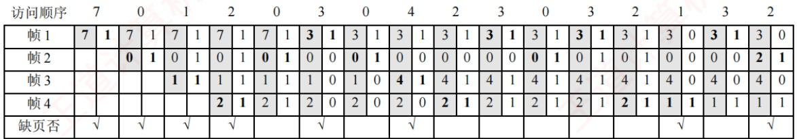

图 3.25 CLOCK 算法时的置换图

初始阶段，页面7,0,1,2依次调入，访问位均置为1。随后访问0，已存在，访问位保持为1。访问3时发生第5次缺页，此时替换指针位于帧1，而所有页框的访问位均为1。算法遂完整扫描一圈，将各帧访问位清零，指针回到最初的位置（帧1），故淘汰帧1中的页面7，装入页面3，访问位置为1，如图3.26(a)所示。接着访问0，已存在，访问位置为1。访问4时发生第6次缺页，替换指针指向帧2（上次替换位置的下一帧)，帧2的访问位为1，将其置0后继续扫描；帧3的访问位为0，故淘汰帧3中的页面2，装入页面4，如图3.26(b)所示。此后访问2,3,0,3,2，均已存在，每次访问均将对应帧的访问位置为1。当访问1时发生第7次缺页，此时替换指针指向帧4，且所有帧的访问位均为1，算法再次完成一轮扫描并将访问位清零，故淘汰帧4中的页面2。后续访问3，已存在，访问位置为1。最后访问2时发生第8次缺页，替换指针指向帧1，帧1的访问位为1，将其置0后继续扫描，帧2的访问位为0，故淘汰帧2中的页面0，装入页面2。

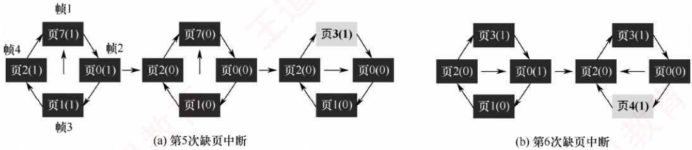

图3.26 缺页中断时替换指针扫描示意图

（2) 改进型 CLOCK 算法

考点追踪改进CLOCK算法的思想（2018）

考点追踪改进CLOCK算法的应用分析（2016、2021）

将一个页面换出时，若该页已被修改，则需将其写回磁盘；若未被修改，则无须写回。可见，修改过的页面置换代价更高。为降低I/O开销，改进型CLOCK算法在访问位（A）的基础上，引入修改位（M），综合考虑页面的使用情况与置换代价。在选择淘汰页时，优先考虑既未被访问过又未被修改的页面。根据（A,M）的组合，页面可分为以下四类:

●1类（A=0,M=0）:最近未被访问，且未被修改，是最佳的淘汰页。

●2类（A=0,M=1）:最近未被访问，但已被修改，是次佳的淘汰页。

● 3类（A=1,M=0）:最近已被访问，但未被修改，可能再次被访问。

●4类（A=1,M=1）:最近已被访问，且已被修改，可能再次被访问。

内存中的每一页必属于这四类页面之一。进行页面置换时，算法采用与简单CLOCK类似的循环扫描机制，区别在于该算法需同时检查访问位与修改位，具体步骤如下。

①从当前指针位置开始，进行第一轮扫描，寻找A=0且M=0的1类页面，将第一个找到的1类页面作为淘汰页。此轮扫描不修改任何访问位A。

②若第①步失败，则进行第二轮扫描，寻找A= 0且M=1的2类页面，将第一个找到的2类页面作为淘汰页。此轮扫描中，将所有经过的页面的访问位A置为0。

③若前两步均失败（所有页面A=1），则将指针复位至起始位置，并将所有帧的访问位清零，随后重复第①步；若仍无1类页面，则执行第②步。此时必能找到可淘汰页面。

改进型CLOCK算法优于简单CLOCK算法之处在于:优先淘汰未修改的页面，从而降低磁盘I/O开销。但为定位合适的淘汰页，可能需多轮扫描，算法本身的运行开销相应增加。

操作系统中的页面置换算法普遍遵循一个原则:尽可能保留近期访问过的页面，优先淘汰未访问过的页面。简单CLOCK算法仅依据访问位判断页面是否“被访问过”；而改进型CLOCK算法则在此基础上进一步细化:对“未访问过”的页面，优先换出其中未修改者；即使所有页面均“被访问过”，仍优先选择未修改者换出，以最小化磁盘写回成本。

### *3.2.5 抖动和工作集

#### 1．抖动

在页面置换过程中，最糟糕的情形是:刚刚换出的页面马上又要换入内存，而刚刚换入的页面又立即被换出。这种频繁的页面调度行为称为抖动（也称颠簸）。

**考点追踪 抖动的处理措施（2011）**

系统发生抖动的根本原因在于:分配给进程的物理块数量过少，无法满足其正常运行的基本需求，导致进程在执行过程中频繁触发缺页中断，不得不反复请求系统将所缺页面调入内存。此时，磁盘I/O频率急剧上升，进程的大部分时间都消耗在页面的换入与换出操作上，几乎无法完成有效计算，进而造成CPU利用率急剧下降，甚至趋近于零。

抖动是虚拟存储系统中的严重性能问题，必须加以解决。由于抖动的发生直接源于系统为进程分配的页框数（驻留集）过少，于是又提出了工作集的概念，用以动态指导页框分配。

#### 2．工作集

工作集是指在某段时间间隔内，进程实际访问过的页面集合。通常，工作集W可由时间t和工作集窗口尺寸共同确定。例如，某进程对页面的访问序列如下: 七

$$
\begin{array}{c}1,4,\underbrace{\left| \overline{2,3,5,3,2,} \right|}_{\begin{array}{c}\bullet \\\uparrow \\t_{1}\end{array}}2,1,1,1,3,4,5,4,\underbrace{\left| \overline{4,2,1,1,3,} \right|}_{\begin{array}{c}\bullet \\\uparrow \\t_{2}\end{array}}3, \\\end{array}
$$

**考点追踪工作集的应用分析（2016）**

假设工作集窗口尺寸4设置为5，则在 $t_{1}$ 时刻，进程的工作集为{2,3,5}；在 $t_{2}$ 时刻，工作集为{1,2,3,4}。在实际应用中，工作集窗口通常设置得较大，对于局部性较好的程序，其工作集大小一般远小于窗口尺寸4。由于工作集反映了进程在随后一段时间内很可能频繁访问的页面集合，因此驻留集的大小不应小于工作集的大小，否则进程在运行过程中将频繁发生缺页。

### 3.2.6 页框回收

本节为2025年大纲新增考点。实际上，2012年统考真题第45题已涉及页框回收，其将页框回收的过程描述为“被系统回收的页框，放入空闲页框链尾，其中内容在下一次分配之前不清空”，这一描述正是页面缓冲算法中空闲页面链表的定义。因此，本节主要介绍页面缓冲算法。页框回收算法较为复杂，且主流操作系统教材通常未系统介绍相关内容，其细节多见于深入剖析Linux内核的图书，而408考试中出现的概率也极低，因此本书不做介绍。

#### 1．页面缓冲算法

在页式虚拟存储系统中，页面换入/换出的开销对系统性能影响显著。

影响页面换入/换出效率的主要因素有如下几种。

1）页面置换算法的选择。一个好的置换算法可有效降低进程运行过程中的缺页率，从而减少页面换入/换出的频率，显著提升系统性能。

2）已修改页面写回磁盘的频率。对于已被修改的页面（脏页），换出时必须写回磁盘。若采用“每次换出即写回”的策略，则会导致频繁的磁盘I/O操作。

3）磁盘内容读入内存的频率。若每次访问缺失页面都需从磁盘重新读取，则会引发高频率的磁盘I/O，进而增加页面换入的开销。

页面缓冲算法在原页面置换算法的基础上增设一个修改页面链表，保存已修改且需要被换出的页面，等被换出的页面数量达到一定值时，再批量写回磁盘，以减少页面换出的开销。

为显著降低页面换入/换出的频率，系统在内存中维护如下两个专用链表。

1）空闲页面链表（也称空闲页框链表）。当进程需要读入一个页面时，系统从该链表头部取出一个页框，并将目标页面装入其中。若某未被修改的页面需要被换出，则系统并不将其写回磁盘，而直接将其所在的物理页框挂在空闲链表的末尾。这些页框中仍保留着原有数据。若后续有进程访问相同页面，则可直接从空闲链表中取下该页框复用，从而避免从磁盘重新读入，有效减少页面换入开销。

2）修改页面链表。当进程需要将一个已修改的页面换出时，系统不会立即写回磁盘，而是将其所在的页框挂在该链表的末尾。待链表中积累足够数量的脏页后，再批量写回磁盘。这样不仅降低了写回频率，也减少了因数据缺失而需重新读盘的次数。

上述通过链表管理物理页框、延迟实际I/O的机制，即为页框回收的过程。

页面缓冲算法的优点:①显著降低页面换入/换出频率，大幅减少磁盘I/O开销；②即使采用简单的置换策略（如FIFO），也能获得良好性能，且无须特殊硬件支持，实现简单高效。

#### 2．页框回收

当系统可分配的内存不足时，就必须回收部分页框，但并非所有页框都可回收。属于内核的大部分页框（如内核栈、内核代码段、内核数据段、大部分内核使用的页框）均不可回收；而由进程使用的页框（如进程代码段、进程数据段、进程堆栈、进程访问文件时映射的文件页、进程间共享内存所占用的页框）则大多可以回收。

在Linux内核中，设置了一个负责页面换出的守护进程kswapd，它定期检查内存使用情况。当空闲页框数量低于特定阈值时，便主动发起页框回收操作。之所以不能等到空闲页框完全耗尽才启动回收，是因为释放某些页框（如脏页）通常需要先将其写回磁盘，而该I/O操作本身往往需要临时页框作为缓冲区。若此时系统已无空闲页框，则既无法分配I/O缓冲区，也无法完成页面释放，从而可能导致内核陷入内存分配死锁，甚至引发系统崩溃。

Linux系统采用3.1.2节介绍的“伙伴算法”对内存中不同长度的连续空闲页框进行统计和管理。该算法将连续的空闲页框组织为“空闲块”，并按其大小（所含连续页框的数量）分组。分配页框是一个“化整为零”的过程，会产生外部碎片；因此，系统必须具备将零碎页框重新合并为较大连续块的能力。Linux通过伙伴算法的逆操作实现页框回收:当一个页框被释放时，系统首先检查其是否存在大小相等的伙伴空闲块；若存在，则将二者合并为一个大小翻倍的新空闲块;随后继续向上检查该新块是否能与其更高一级的伙伴再次合并，直至无法再合并为止。

### 3.2.7 内存映射文件

**考点追踪内存映射文件的原理与特点（2025）**

内存映射文件（Memory-Mapped Files）是操作系统向应用程序提供的一种系统调用机制，它在磁盘文件与进程的虚拟地址空间之间建立直接映射关系，与虚拟内存机制紧密相关。

进程通过该系统调用，将一个文件映射到其虚拟地址空间的某一区域，此后便可像访问内存一样读/写文件。这种功能将一个文件当作内存中的一个大字符数组来访问，而无须调用传统的文件I/O接口，显然更为便捷。磁盘文件的读/写由操作系统负责完成，对进程而言是透明的。映射时并不会立即加载文件内容，而是在进程首次访问某页面时，才按需将其一页一页地调入内存；当进程退出或显式解除文件映射时， 存；当进程退出或显式解除文件映射时，

所有被修改的页面才会被写回磁盘文件。

进程可通过共享内存实现高效通信。实践中，这种共享内存往往正是通过将同一文件映射到多个通信进程的虚拟地址空间来实现的。此时，尽管各进程的虚拟地址空间相互独立，但操作系统会通过页表将它们对应的虚拟页映射到相同的物理页（见图3.27）。因此，当一个进程在共享

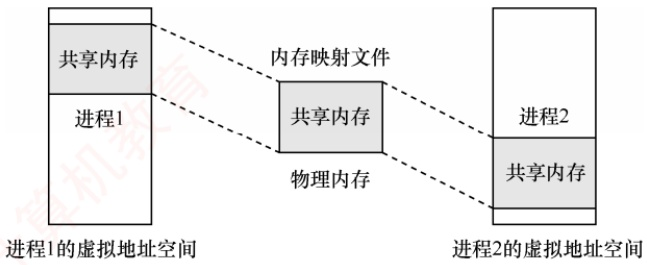

图 3.27 采用内存映射I/O的共享内存

区域执行写操作后，另一个进程在其映射区域执行读操作时，能够立即看到更新结果—因为二者访问的是同一块物理内存，数据必然一致，无须额外的复制或同步机制。

由此可见，内存映射文件带来的好处主要有:①使程序员的编程更为简单，已建立映射的文件，可直接按内存方式进行读/写；②便于多个进程共享同一个磁盘文件。

### 3.2.8 虚拟存储器性能影响因素

**考点追踪请求分页系统性能的影响因素分析（2020、2022）**

缺页率是影响虚拟存储器性能的核心因素，而缺页率又受页面大小、分配给进程的物理块数、页面置换算法、写回磁盘的频率以及程序的局部化程度等多方面影响。

根据局部性原理，页面较大时，单次装入可覆盖更多局部访问区域，从而降低缺页率；而页面较小时，缺页率则相对较高。较小的页面虽能减少页内碎片、提高内存利用率，但会导致每个进程所需页面数量增多，导致页表过长，占用大量内存。较大的页面虽可缩短页表长度，却会增大页内碎片。因此，页面大小的设计需在碎片控制与页表开销之间取得合理平衡。

分配给进程的物理块数越多，缺页率通常越低。然而，当物理块数量超过某一阈值后，继续增加块数对缺页率的改善趋于平缓。因为此时进程的活跃页面已基本常驻内存，缺页主要由非活跃页面引发，而这些页面本就无须长期驻留。若再分配更多物理块，则不仅收益甚微，反而造成内存资源浪费。因此，只需确保活跃页面常驻内存，即可将缺页率有效控制在可接受范围内。

好的页面置换算法能有效降低运行过程中的缺页率。例如，LRU、CLOCK等算法通过预测未来访问行为，优先保留可能被再次访问的页面，从而提升内存命中率，加快页面访问速度。

对于已修改的页面(脏页)，换出时必须写回磁盘。若采用“每换出一页即写回”的策略，则会频繁触发磁盘I/O，效率极低。为此，系统引入已修改换出页面链表:当脏页被换出时，暂不写回磁盘，而是挂入该链表；待积累足够数量后，再批量写回磁盘，从而显著减少磁盘I/O次数，降低页面换出开销。此外，若某进程在这些页面尚未写回磁盘前再次访问它们，则可直接从链表中复用，无须重新从外存调入，进一步减少页面换入频率与I/O开销。

程序编写的局部化程度越高，执行时的缺页率就越低。例如，若数组采用按行存储，则访问时应尽量按行顺序进行，避免按列访问破坏空间局部性，从而导致缺页率异常升高。

### 3.2.9 地址翻译的示例

考虑到408统考越来越注重学科综合能力的考查，本节结合《计算机组成原理》中Cache的相关内容，分析虚实地址的变换过程。对于不参加统考的读者，可酌情跳过；对于参加统考但尚未复习该部分内容的读者，建议先完成相关章节的学习，再回过头来学习本节。

设某系统满足以下条件:

• 配置一个 TLB 和一个 data Cache;

● 存储器以字节为编址单位；

● 虚拟地址为 14位；

• 物理地址为 12 位；

• 页面大小为 64B;

• TLB 采用四路组相联结构，共16个条目:

● data Cache采用物理寻址、直接映射方式，行大小为4B，共16组。

要求分析对虚拟地址 0x03d4, 0x00f1 和 0x0229的访问过程。

系统以字节编址，页面大小为64B，故页内偏移占log264=6位。虚拟地址共14位，故虚拟页号为14-6=8位；物理地址共12位，故物理页号为12-6=6位。TLB采用四路组相联，共

16个条目，因此组数为16/4=4，组索引占1og24=2位，虚拟页号的低2位作为组索引、高6位作为 TLB 标记。data Cache 行大小为 4B，故物理地址中最低 log24 = 2 位为块内偏移；Cache 共16组，因此接下来的1og₂16=4位为组索引，剩余高6位为标记。地址结构如图3.28所示。

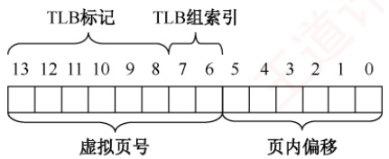

(a) 虚拟地址

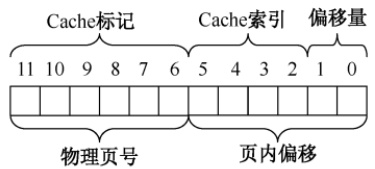

(b) 物理地址

图 3.28 地址结构

TLB、部分页表及 data Cache的内容分别见表 3.1、表 3.2 和表 3.3。

表3.1 TLB

<table><tr><td>索引</td><td>标记位</td><td>物理页号</td><td>有效位</td><td>标记位</td><td>物理页号</td><td>有效位</td></tr><tr><td rowspan=2>0</td><td>03</td><td>一</td><td>0</td><td>09</td><td>OD</td><td>1</td></tr><tr><td>00</td><td>一</td><td>0</td><td>07</td><td>02</td><td>1</td></tr><tr><td rowspan=2>1</td><td>03</td><td>2D</td><td>1</td><td>02</td><td>一</td><td>0</td></tr><tr><td>04</td><td>一</td><td>0</td><td>0A</td><td>一</td><td>0</td></tr><tr><td rowspan=2>2</td><td>02</td><td>一</td><td>0</td><td>08</td><td>一</td><td>0</td></tr><tr><td>06</td><td>一</td><td>0</td><td>03</td><td>一</td><td>0</td></tr><tr><td rowspan=2>3</td><td>07</td><td>一</td><td>0</td><td>03</td><td>OD</td><td>1</td></tr><tr><td>0A</td><td>34</td><td>1</td><td>02</td><td>一</td><td>0</td></tr></table>

表3.2 部分页表

| 虚拟页号 | 物理页号 | 有效位 | 虚拟页号 | 物理页号 | 有效位 |
| --- | --- | --- | --- | --- | --- |
| 00 | 28 | 1 | 08 |  | 0 |
| 01 | 一 | 0 | 09 | 17 | 1 |
| 02 | 33 | 1 | 0A | 09 | 1 |
| 03 | 02 | 1 | 0B | 一 | 0 |
| 04 | 一 | 0 | 0C | 一 | 0 |
| 05 | 16 | 1 | OD | 2D | 1 |
| 06 | - | 0 | OE | 11 | 1 |
| 07 | 一 | 0 | OF | OD | 1 |

表 3.3 data Cache 内容

| 索引 | 标记位 | 有效位 | 块0 | 块1 | 块2 | 块3 | 索引 | 标记位 | 有效位 | 块0 | 块1 | 块2 | 块3 |
| --- | --- | --- | --- | --- | --- | --- | --- | --- | --- | --- | --- | --- | --- |
| 0 | 19 | 1 | 99 | 11 | 23 | 11 | 8 | 24 | 1 | 3A | 00 | 51 | 89 |
| 1 | 15 | 0 | 一 | 一 | 1 | 一 | 9 | 2D | 0 | 一 | 一 | 一 | 一 |
| 2 | 1B | 1 | 00 | 02 | 04 | 08 | A | 2D | 1 | 93 | 15 | DA | 3B |
| 3 | 36 | 0 | 一 | 一 | 一 | 一 | B | 0B | 0 | 一 | 一 | 一 | 一 |
| 4 | 32 | 1 | 43 | 6D | 8F | 09 | C | 02 | 0 |  | 一 |  | 一 |
| 5 | OD | 1 | 36 | 72 | F0 | 1D | D | 16 | 1 | 04 | 96 | 34 | 15 |
| 6 | 31 | 0 | 一 | 一 | 一 | 一 | E | 13 | 1 | 83 | 77 | 1B | D3 |
| 7 | 16 | 1 | 11 | C2 | DF | 03 | F | 14 | 0 | 一 | 一 | 1 | 一 |

首先将十六进制的虚拟地址0x03d4,0x00f1和0x0229转换为二进制形式，如表3.4所示。

表3.4 虚拟地址结构

<table><tr><td>虚拟地址</td><td colspan=6>TLB 标记</td><td colspan=2>组索引</td><td colspan=6></td></tr><tr><td></td><td>13</td><td>12</td><td>11</td><td>10</td><td>9</td><td>8</td><td>7</td><td>6</td><td>5</td><td>4</td><td>3</td><td>2</td><td>1</td><td>0</td></tr><tr><td>0x03d4</td><td>0</td><td>0</td><td>0</td><td>0</td><td>1</td><td>1</td><td>1</td><td>1</td><td>0</td><td>1</td><td>0</td><td>1</td><td>0</td><td>0</td></tr><tr><td>0x00fl</td><td>0</td><td>0</td><td>0</td><td>0</td><td>0</td><td>0</td><td>1</td><td>1</td><td>1</td><td>1</td><td>0</td><td>0</td><td>0</td><td>1</td></tr><tr><td>0x0229</td><td>0</td><td>0</td><td>0</td><td>0</td><td>1</td><td>0</td><td>0</td><td>0</td><td>1</td><td>0</td><td>1</td><td>0</td><td>0</td><td>1</td></tr><tr><td></td><td colspan=8>虚拟页号</td><td colspan=6>页内偏移</td></tr></table>

由表3.4可得各地址的虚拟页号、组索引及TLB标记。接下来需判断对应页面是否已在主存中；若在主存中，则进一步确定其物理地址。

• 对于0x03d4:组索引为3，TLB标记为0x03。查TLB第3组，存在标记为03且有效位为1的项，TLB命中。对应物理页号为0x0d（001101），拼接页内偏移010100，得物理地址为0x354（001101010100）。

●对于0x00f1:组索引为3，TLB标记为0x00。查TLB第3组，无匹配项，TLB未命中，转而查询页表。虚拟页号为0x03，页表第3行有效位为1，表明页面在主存中。物理页号为0x02（000010），拼接页内偏移110001，得物理地址为0x0b1（000010110001）。

• 对于0x0229:组索引为0，TLB标记为0x02。查TLB第0组，无匹配项。再查页表，虚拟页号为0x08，对应页表项有效位为0，页面不在主存中，触发缺页中断。

获得主存中页面的物理地址后，需通过该地址访问数据，此时应检查其内容是否在Cache中，物理地址结构如表3.5所示。

表3.5 物理地址结构

<table><tr><td>物理地址</td><td colspan=6>Cache 标记</td><td colspan=4>Cache 索引</td><td colspan=2>偏 移</td></tr><tr><td></td><td>11</td><td>10</td><td>9</td><td>8</td><td>7</td><td>6</td><td>5</td><td>4</td><td>3</td><td>2</td><td>1</td><td>0</td></tr><tr><td>0x354</td><td>0</td><td>0</td><td>1</td><td>1</td><td>0</td><td>1</td><td>0</td><td>1</td><td>0</td><td>1</td><td>0</td><td>0</td></tr><tr><td>0x0b1</td><td>0</td><td>0</td><td>0</td><td>0</td><td>1</td><td>0</td><td>1</td><td>1</td><td>0</td><td>0</td><td>0</td><td>1</td></tr><tr><td></td><td colspan=6>物理页号</td><td colspan=6>页内偏移</td></tr></table>

• 对于 0x354:Cache 组索引为 5，标记为 0x0d。查 Cache索引为 5 的行，标记为 0d 且有效位为1，Cache命中。偏移为0（块0），故虚拟地址0x03d4对应的数据为36H。

• 对于 0x0b1:Cache组索引为 0xc，标记为 0x02。查 Cache索引为 0xc 的行，有效位为0，Cache未命中，需从主存中读取物理页号为0x2、偏移为0x31处的数据。

上述示例涵盖了从虚拟地址到Cache查找过程中可能出现的典型情形。完整的地址翻译与数据访问流程如下:首先查询TLB；若TLB未命中，则需访问页表以完成虚实地址转换。在此过程中，若发现所需页面尚未调入主存（页表项无效），则触发缺页中断，从外存调入该页面。随后，利用所得物理地址访问Cache；若Cache未命中，则进一步从主存读取所需数据

### 3.2.10 本节小结

本节开头提出的问题的参考答案如下。

**1）为什么要引入虚拟内存？**

上一节提到，多道程序并发执行使进程共享处理器和内存。随着并发进程数量的增加，每个进程获得的处理器时间会相对平滑地减少；然而，若同时运行的进程过多，则内存需求将急剧上升，当某个进程无法获得足够的内存时，甚至无法被加载运行。因此，在物理内存扩展受限的情况下，有必要通过其他方式在逻辑上扩充内存容量，虚拟内存技术由此应运而生。

**2）虚拟内存（虚存）空间的大小由什么因素决定？**

虚拟内存空间的大小主要由虚拟地址的位数决定。例如，若虚拟地址为32位，且存储器按字节编址，则虚存空间最大为 $2^{32} \mathrm {B}$ ，即4GB。系统试图定义超过4GB的虚拟地址空间时，由于32位地址最多只能寻址4GB，超出部分将无法被访问。

**3）虚拟内存是怎么解决问题的？会带来什么问题？**

虚拟内存利用外存空间在逻辑上扩充内存容量，通过页面的换入/换出机制，使系统能够运行总规模远超物理内存的多个进程。然而，该机制也引入额外开销:每次缺页均需访问外存，导致平均访存时间增加；采用不合适的页面置换算法，还可能引发频繁缺页，降低系统性能。

本节学习了4种页面置换算法，要将它们与处理机调度算法区分开。当然，二者存在内在联系:它们都属于资源调度机制，核心思想是依据某种准则，决定将有限资源分配给哪个请求者。处理机调度的准则包括优先级、响应比、时间片等；而页面置换则聚焦于页面的使用历史，如是否被访问过、近期是否经常使用。事实上，操作系统中几乎每类资源都有相应的调度策略。读者若能以“调度”为线索串联各类算法，则有助于构建对操作系统整体架构的系统性理解。

## 3.3 本章疑难点

分页管理方式和分段管理方式在很多地方是相似的，比如在内存中都是不连续的、都有地址变换机构来进行地址映射等。但两者也存在许多区别，表3.6列出了两种方式的对比。

表3.6 分页管理方式和分段管理方式的比较

|  | 分页 | 分段 |
| --- | --- | --- |
| 目的 | 分页仅是系统管理上的需要，是为实现离散分配方式，以提高内存的利用率。而不是用户的需要 | 段是信息的逻辑单位，它含有一组意义相对完整的信息。分段的目的是能更好地满足用户的需要 |
| 长度 | 页的大小固定且由系统决定，由系统将逻辑地址划分为页号和页内地址两部分，是由机器硬件实现的 | 段的长度不固定，决定于用户所编写的程序，通常由编译程序在编译时根据信息的性质来划分 |
| 地址空间 | 分页的程序地址空间是一维的，即单一的线性地址空间，程序员利用一个记忆符即可表示一个地址 | 分段的程序地址空间是二维的，程序员在标识一个地址时，既需给出段名，又需给出段内地址 |
| 碎片 | 有内部碎片，无外部碎片 | 有外部碎片，无内部碎片 |
