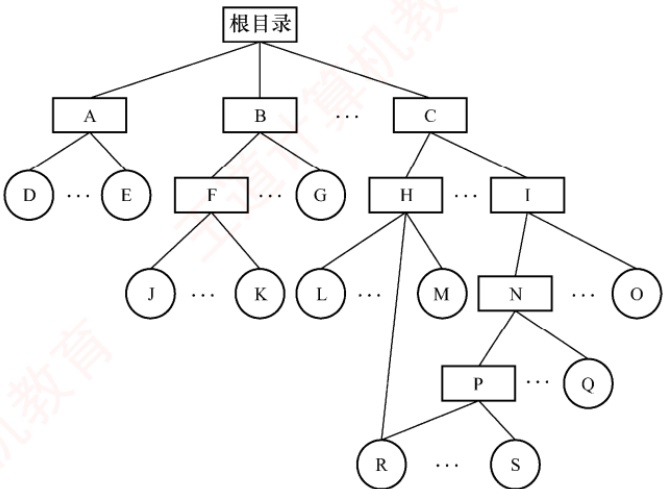
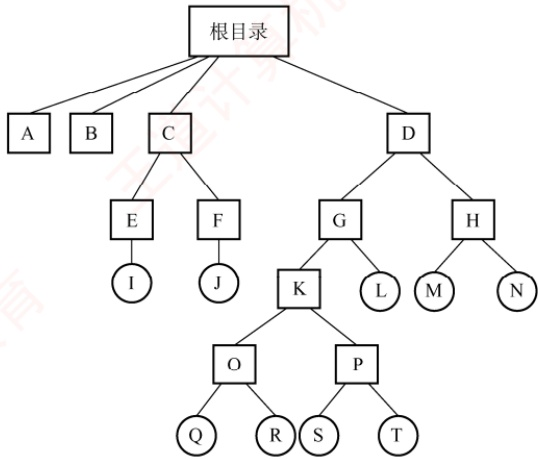
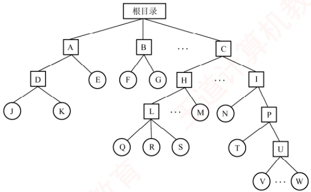
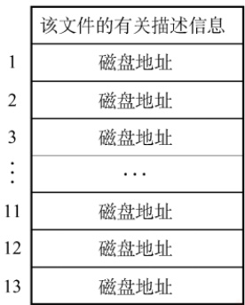
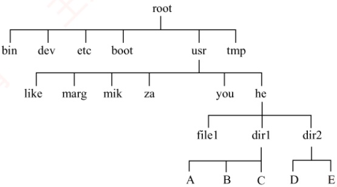
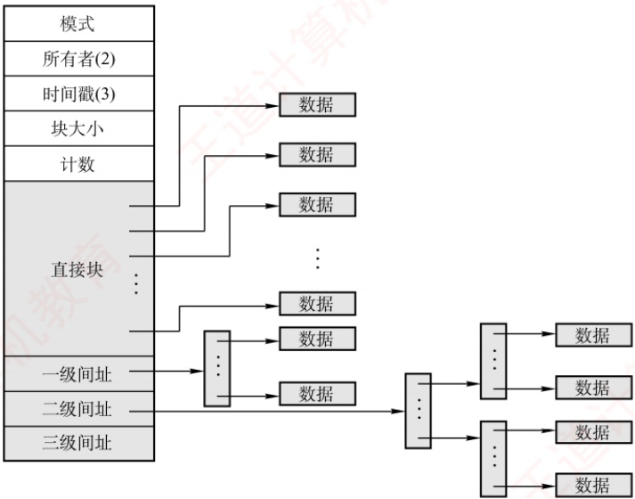
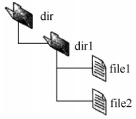
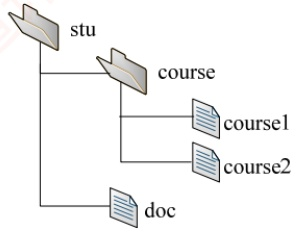

# 第4章 文件管理 · 习题与解析

> 由《第4章 文件管理》正文摘出；区块标题保留了原书的小节编号。

### 4.1.5 本节习题精选

#### 单项选择题

01. UNIX操作系统中，输入/输出设备视为（）。
A. 普通文件
B. 目录文件
C. 索引文件
D. 特殊文件

02. 下列说法中，（）属于文件的逻辑结构的范畴。
A. 连续文件
B. 系统文件
C. 链接文件
D. 流式文件

03. 文件的逻辑结构是为了方便（）而设计的。
A. 存储介质特性
B. 操作系统的管理方式
C. 主存容量
D. 用户

04.下列关于逻辑结构为索引文件的索引表的叙述中，（）是正确的。
A. 索引表中每条记录的索引项可以有多个
B. 对索引文件存取时，必须先查找索引表
C. 索引表中含有索引文件的数据及其物理地址
D. 建立索引的目的之一是减少存储空间

05. 有一个顺序文件含有10000条记录，平均查找的记录数为5000个，采用索引顺序文件结构，则最好情况下平均只需约查找（）次记录。
A. 1000
B. 10000 K
C. 100
D. 500

### 4.1.6 答案与解析

#### 单项选择题

01. D

UNIX操作系统中，所有设备都被视为特殊的文件，因为UNIX操作系统控制和访问外部设备的方式和访问一个文件的方式是相同的。

02. D

逻辑文件有两种:无结构文件（流式文件）和有结构式文件。连续文件和链接文件都属于文件的物理结构，而系统文件是按文件用途分类的。

03. D

文件结构包括逻辑结构和物理结构。逻辑结构是用户组织数据的结构形式，数据组织形式来自需求，而物理结构是操作系统组织物理存储块的结构形式。

因此说，逻辑文件的组织形式取决于用户，物理结构的选择取决于文件系统设计者针对硬件结构（如磁带介质很难实现链接结构和索引结构）所采取的策略（选项A和B）。

04. B

索引文件由逻辑文件和索引表组成，对索引文件存取时，必须先查找索引表。索引项只包含每条记录的长度和在逻辑文件中的起始位置。每条记录都有一个索引项，因此提高了存储代价。

05. C

采用索引顺序文件时，最好情况是有 $\sqrt{10000} = 100$ 组，每组有100条记录，则查找100组平均需要100/2= 50次，组内查找平均需要100/2=50次，共需要50+50=100次。注意，严格来说，索引表查找和组内查找的准确平均次数都是(1+100)/2=50.5，不过在操作系统教材中，往往直接忽略前面的1，因此本类题中也不会同时出现100和101两个选项。

### 4.2.11 本节习题精选

#### 一、单项选择题

01. 当文件被打开时，需要将磁盘索引节点拷贝到内存的索引节点，下列属于内存索引节点中有而磁盘索引节点中没有的内容是（）。
A. 访问计数值
B. 文件物理地址
C. 文件长度
D. 文件类型

02. 目录文件存放的信息是（）。
A. 某一文件存放的数据信息
B. 某一文件的文件目录
C. 该目录中所有数据文件目录
D. 该目录中所有子目录和数据文件的目录

03. FAT32的文件目录项不包括（）。
A. 文件名
B. 文件访问权限说明
C. 文件控制块的物理位置
D. 文件所在的物理位置

04. 有些操作系统中将文件描述信息从目录项中分离出来，这样做的好处是（）。
A. 减少读文件时的 I/O 信息量
B. 减少写文件时的 I/O 信息量
C. 减少查找文件时的I/O信息量
D. 减少复制文件时的I/O 信息量

05.下列选项中，（）不是为了提升文件系统性能的操作。
A. 目录项分解
B. 文件高速缓存
C. 磁盘调度算法
D. 异步I/O

06. 在访问文件时，需要根据文件名对目录文件进行检索，其检索性能主要由（）决定。I. 文件大小 II. 目录项数量 I. 目录项的大小IV. 目录项在目录中的位置0
A. I、Ⅱ和ⅢII
B. II、III 和 IV
C. I、IⅢ和IV
D. I、Ⅱ和IV

07. 在计算机中，不允许两个文件名重名主要指的是（）。
A. 不同磁盘的不同目录下
B. 不同磁盘里的同名目录下
C. 同一个磁盘的不同目录下
D. 同一个磁盘的同一目录下

08. 文件系统实现按名存取主要是靠（）实现的。
A. 查找位示图
B. 查找文件目录
C. 查找作业表
D. 地址转换机构

09. 在一个文件系统中，FCB占64B，盘块大小为1KB，采用一级目录。假定文件目录中有3200个目录项，则查找一个文件平均需要（）.次访问磁盘 D. 200 IT

10. 在一个采用索引节点的文件系统中，目录项分为文件名和索引节点编号两部分，文件名和索引节点编号各占8B，盘块大小为1KB，采用一级目录，假定文件目录中有3200个目录项，则读入一个文件的索引节点平均需要（）次访问磁盘。
A. 25
B. 26
C. 51
D. 52

11.下列关于目录检索的论述中，正确的是（）
A. 散列法具有较快的检索速度，因此现代操作系统中都用它替代传统的顺序检索方法
B. 在利用顺序检索法时，对树形目录应采用文件的路径名，且应从根目录开始逐级检索
C. 在利用顺序检索法时，只要路径名的一个分量名未找到，就应停止查找
D. 利用顺序检索法查找完成后，即可得到文件的物理地址

12.一个文件的相对路径名是从（）开始，逐步沿着各级子目录追溯，最后到指定文件的整个通路上所有子目录名组成的一个字符串。
A. 当前目录
B. 根目录
C. 多级目录
D. 二级目录

13. 文件系统采用多级目录结构的目的是（）。
A. 减少系统开销
B. 节省存储空间
C. 解决命名冲突
D. 缩短传送时间

14. 若文件系统中有两个文件重名，则不应采用（）。
A. 单级目录结构
B. 两级目录结构
C. 树形目录结构
D. 多级目录结构

15. 用磁带做文件存储介质时，文件只能组织成（）。
A. 顺序文件
B. 链接文件
C. 索引文件
D. 目录文件

16. 以下不适合随机存取的外存分配方式是（）。
A. 连续分配
B. 链接分配
C. 索引分配
D. 以上都适合

17. 在以下文件的物理结构中，不利于文件长度动态增长的是（）
A. 连续结构
B. 链接结构
C. 索引结构
D. 散列结构

18.若文件的物理结构采用连续分配，则FCB中有关文件的物理位置的信息应包括（）。I. 首块地址 II. 文件长度 III. 索引表地址
A. 仅I
B. I、ⅡI
C. II、III
D. I、III

19. 在磁盘上，最容易导致存储碎片发生的物理文件结构是（）。
A. 隐式链接
B. 顺序存放
C. 索引存放
D. 显式链接

20. 物理文件的组织方式是由（）确定的。
A. 应用程序
B. 主存容量
C. 外存容量
D. 操作系统

21. 文件系统为每个文件创建一张（），存放文件数据块的磁盘存放位置。
A. 打开文件表
B. 位图
C. 索引表
D. 空闲盘块链表

22. 下列有关文件组织管理的描述中，错误的是（）。

A. 记录是对文件进行存取操作的单位，一个文件中各记录的长度可以不等
B. 采用链接分配的文件，它的物理块必须连续排列
C. 创建一个文件时，可以分配连续的区域，也可以分配不连续的物理块
D. Hash结构文件的优点是能够实现物理块的动态分配和回收

23. 逻辑文件存放到存储介质上时，采用的组织形式与（）有关。
A. 逻辑文件结构
B. 存储介质特性
C. 主存储器管理方式
D. 设备分配方式

24. 某500个盘块的文件的目录项已调入内存（若为索引分配，其索引块也在内存中）。若需要在文件中增加一块，下列分配方式中磁盘I/O次数最多的是（）。
A. 连续分配
B. 隐式链接分配
C. 显式链接分配
D. 索引分配

25. 设有一个记录文件，采用隐式链接分配方式，逻辑记录的固定长度为100B，在磁盘上存储时采用记录成组分解技术。盘块长度为512B。若该文件的目录项已经读入内存，则对第22个逻辑记录完成修改后，共启动了磁盘（）次。
A. 3
B. 4
C. 5
D. 6

26. 设某文件为链接文件，它由5个逻辑记录组成，每个逻辑记录的大小与磁盘块的大小相等，均为512B，并依次存放在50,121,75,80,63号磁盘块上。若要存取文件的第1569逻辑字节处的信息，则应该访问（）号磁盘块。
A. 3
B. 80
C. 75
D. 63

27. 某文件共有8个记录L1\~L8，采用隐式链接分配，每个记录及链接指针占一个磁盘块，主存中的磁盘缓冲区的大小与磁盘块的大小相等。假设文件目录已读入内存。为了在L5和L6之间插入一个记录Lx’（已在内存中），需要进行的磁盘操作有（）。
A. 4 次读盘和2 次写盘
B. 5 次读盘和1 次写盘
C. 5 次读盘和 2 次写盘
D. 4 次读盘和1 次写盘

28. 某文件系统采用显示链接分配方式组织文件，磁盘块大小为4KB，一个簇包含两个磁盘块，操作系统以簇为单位进行盘块分配。已知系统支持的最大文件长度为512MB，若FAT的每个表项仅存放簇号，则FAT表占用的空间大约是（）。
A. 64KB
B. 128KB
C. 512KB
D. 1024KB

29. 某文件共有3个记录，每个记录占1个磁盘块，在1次读文件的操作中，为了读出最后1个记录，不得不读出其他2个记录。由此可知该文件所采用的物理结构是（）。
A. 连续分配
B. 索引分配
C. 链接分配
D. 连续分配或链接分配

30. 某文件存放在100个数据块中，假设管理文件所必需的文件控制块、索引块或索引信息都驻留在内存中。那么若（），则不需要做任何磁盘I/O操作。
A. 采用连续分配，将最后一个数据块搬到文件头部
B. 采用单级索引分配，将最后一个数据块插入文件头部
C. 采用隐式链接分配，将最后一个数据块插入文件头部
D. 采用隐式链接分配，将第一个数据块插入文件尾部

31. 某文件有100个盘块（数据块），假设管理文件所必需的文件控制块、所有索引块都已调入内存。若需要在文件的第45个盘块后插入数据，则物理结构采用（）时开销最大。
A. 连续分配
B. 链接分配
C. 一级索引分配
D. 多级索引分配

32. 某文件系统使用类似于Linux的 inode存储结构，文件块和磁盘块的大小都是4KB，磁盘地址是32位，现在一个文件包含10个直接指针和1个一级间接指针，则这个文件所占用的磁盘块数量最多是（）块（不考虑索引块）。
A. 128
B. 512
C. 1024
D. 1034

33. 文件系统采用两级索引分配方式。若每个磁盘块的大小为1KB，每个盘块号占4B，则该系统中单个文件的最大长度是（）。
A. 64MB
B. 128MB
C. 32MB
D. 以上都错误

34. 某文件系统的物理结构采用三级索引分配方式，每个磁盘块的大小为1024B，每个盘块索引号占用4B，则该文件系统支持的最大文件的尺寸接近（）。
A. 8GB
B. 16GB
C. 32GB
D. 2TB

35.下列各种操作系统内核相关的数据结构中，可以不用数组实现的是（）。
A. 文件分配表
B. 页表
C. 调度器的就绪队列
D. 中断向量表

36. 文件系统在创建一个文件时，为它建立一个（）。
A. 文件目录项
B. 目录文件
C. 逻辑结构
D. 逻辑空间

37.打开文件操作的主要工作是（）。
A. 把指定文件的目录项复制到内存指定的区域
B. 把指定文件复制到内存指定的区域
C. 在指定文件所在的存储介质上找到指定文件的目录项
D. 在内存寻找指定的文件

38. 某用户程序发起open()系统调用，下列对该过程的描述中最准确的是（）。
A. open()调用必然导致文件 I/O
B. open()调用的参数含有需要打开的文件的文件名
C. open()调用完成后，系统打开文件表将增加一个表目
D. open()调用的参数的文件名不同时，必然会打开不同的文件实体

39. 关闭文件操作的主要工作是（）。
A. 将文件的最新信息从内存写回磁盘
B. 将文件当前的控制信息从内存写回磁盘
C. 将位示图从内存写回磁盘
D. 将超级块当前的信息从内存写回磁盘

40. 读文件操作的正确次序应该是（）。I. 向设备驱动程序发出I/O请求，完成数据交换工作 教育I. 按存取控制说明检查访问的合法性Ⅲ. 根据目录项中该文件的逻辑和物理组织形式，将逻辑记录号转换成物理块号IV. 按文件描述符在打开文件表中找到该文件的目录项
A. ⅡI、IV、I、I
B. IV、II、III、I
C. IV、III、ⅡI、I
D. ⅡI、IV、I、III

41.下列关于文件与文件系统的说法中，错误的是（）。I. 一个文件在同一系统中、不同的存储介质上的复制文件，应采用同一种物理结构Ⅱ. 对一个文件的访问，常由用户访问权限和用户优先级共同限制Ⅲ. 文件系统采用树形目录结构后，对于不同用户的文件，其文件名应该不同IV. 为防止系统故障造成系统内文件受损，常采用存取控制矩阵方法保护文件
A. ⅡI
B. I、III
C. I、III、IV
D. 全选

42. 在树形目录结构中，文件已被打开后，对文件的访问采用（）。
A. 文件符号名
B. 从根目录开始的路径名
C. 从当前目录开始的路径名
D. 文件描述符

43. 设文件 F1 的当前引用计数为1，先建立 F1 的硬链接文件 F2，再建立 F1 的符号链接文件F3，然后删除F2，则此时文件F1、F3的引用计数值分别是（）
A. 1、1
B. 1、2
C. 1、0
D. 2、2

44. 设文件F1 的当前引用计数值为 1，先建立F1 的硬链接文件 F2，再建立 F2 的符号链接文件F3，现有两个进程 $\mathrm {P}_{1}$ 和 $\mathrm {P}_{2}$ 分别打开了F1和F2，则下列说法中正确的是（）。
A. 两次打开操作只涉及一次文件索引节点的磁盘读取操作
B. 进程 $\mathrm {P_{1}}$ 和 $\mathrm {P}_{2}$ 对F1 具有相同的访问权限
C. 若删除文件F3，则 F2 的引用计数值减1
D. 进程 $\mathrm {P}_{1}$ 读取F1 时需要提供F1 的绝对路径作为系统调用参数 育

45. 操作系统为保证未经文件拥有者授权，任何其他用 $\dot{严}$ 不能使用该文件，所提供的解决方法是（）。
A. 文件保护
B. 文件保密
C. 文件转储
D. 文件共享

46. 在文件系统中，以下不属于文件保护的方法是
B. 存取控制
C. 用户权限表
D. 读/写之后使用关闭命令

47.对一个文件的访问，常由（）共同限制。
A. 用户访问权限和文件属性
B. 用户访问权限和用户优先级
C. 优先级和文件属性
D. 文件属性和口令

48. 为了对文件系统中的文件进行安全管理，任何一个用户在进入系统时都必须进行注册，这一级安全管理是（）。
A. 系统级
B. 目录级
C. 用户级
D. 文件级

49.【2009统考真题】文件系统中，文件访问控制信息存储的合理位置是（）。
A. 文件控制块
B. 文件分配表
C. 用户口令表
D. 系统注册表

50.【2009统考真题】下列文件物理结构中，适合随机访问且易于文件扩展的是（）。
A. 连续结构
B. 索引结构
C. 链式结构且磁盘块定长
D. 链式结构且磁盘块变长

51.【2009统考真题】设文件F1的当前引用计数值为1，先建立文件F1的符号链接（软链接）文件F2，再建立文件F1的硬链接文件F3，然后删除文件F1。此时，文件 F2和文件F3 的引用计数值分别是（）。
A. 0,1
B. 1, 1
C. 1,2
D. 2, 1

52.【2010统考真题】设置当前工作目录的主要目的是（）。
A. 节省外存空间
B. 节省内存空间
C. 加快文件的检索速度
D. 加快文件的读/写速度

53.【2010统考真题】设文件索引节点中有7个地址项，其中4个地址项是直接地址索引，2个地址项是一级间接地址索引，1个地址项是二级间接地址索引，每个地址项大小为4B，若磁盘索引块和磁盘数据块大小均为256B，则可表示的单个文件最大长度是（）。
A. 33KB
B. 519KB
C. 1057KB
D. 16516KB

54.【2012统考真题】若一个用户进程通过read系统调用读取一个磁盘文件中的数据，则下列关于此过程的叙述中，正确的是（）。I. 若该文件的数据不在内存，则该进程进入睡眠等待状态II. 请求 read 系统调用会导致 CPU 从用户态切换到核心态

III. read 系统调用的参数应包含文件的名称
A. 仅I、ⅡI
B. 仅I、II
C. 仅Ⅱ、III
D. I、ⅡI和ⅢI

55.【2013统考真题】用户在删除某文件的过程中，操作系统不可能执行的操作是（）。
A. 删除此文件所在的目录
B. 删除与此文件关联的目录项
C. 删除与此文件对应的文件控制块
D. 释放与此文件关联的内存缓冲区

56.【2013统考真题】若某文件系统索引节点（inode）中有直接地址项和间接地址项，则下列选项中，与单个文件长度无关的因素是（）。C. 索地引项点的总数 B. 间文地块索引的级数 TIT

57.【2013统考真题】为支持CD-ROM中视频文件的快速随机播放，播放性能最好的文件数据块组织方式是（）。
A. 连续结构
B. 链式结构 十算机
C. 直接索引结构
D. 多级索引结构

58.【2014统考真题】在一个文件被用户进程首次打开的过程中，操作系统需做的是（）。
A. 将文件内容读到内存中
B. 将文件控制块读到内存中
C. 修改文件控制块中的读/写权限
D. 将文件的数据缓冲区首指针返回给用户进程

59.【2015统考真题】在文件的索引节点中存放直接索引指针10个，一级和二级索引指针各1个。磁盘块大小为1KB，每个索引指针占4B。若某文件的索引节点已在内存中，则把该文件偏移量（按字节编址）为1234和307400处所在的磁盘块读入内存，需要访问的磁盘块个数分别是（）。
A. 1, 2
B. 1，3
C. 2, 3
D. 2, 4

60.【2017统考真题】某文件系统中，针对每个文件，用户类别分为4类:安全管理员、文件主、文件主的伙伴、其他用户；访问权限分为5种:完全控制、执行、修改、读取、写入。若文件控制块中用二进制位串表示文件权限，为表示不同类别用户对一个文件的访问权限，则描述文件权限的位数至少应为（）。
A. 5
B. 9
C. 12
D. 20

61. 【2017统考真题】若文件f1的硬链接为f2，两个进程分别打开f1和f2，获得对应的文件描述符为fd1和fd2，则下列叙述中正确的是（）。I. f1 和 f2 的读/写指针位置保持相同Ⅱ. f1 和f2 共享同一个内存索引节点 王道计I. fd1和fd2 分别指向各自的用户打开文件表中的一项
A. 仅ⅢI
B. 仅Ⅱ、ⅢII
C. 仅I、ⅡI
D. I、ⅡI和II

62. 【2017统考真题】某文件系统的簇和磁盘扇区大小分别为1KB和512B。若一个文件的大小为1026B，则系统分配给该文件的磁盘空间大小是（）。
A. 1026B
B. 1536B X
C. 1538B
D. 2048B

63. 【2020统考真题】某文件系统的目录项由文件名和索引节点号构成。若每个目录项长度为64字节，其中4字节存放索引节点号，60字节存放文件名。文件名由小写英文字母构成，则该文件系统能创建的文件数量的上限为（）。
A. $2^{26}$
B. $2^{32}$ S
C. $2^{60}$
D. $2^{64}$

64.【2020统考真题】若多个进程共享同一个文件F，则下列叙述中，正确的是（）。
A. 各进程只能用“读”方式打开文件F
B. 在系统打开文件表中仅有一个表项包含F的属性
C. 各进程的用户打开文件表中关于F的表项内容相同
D. 进程关闭F时，系统删除F在系统打开文件表中的表项

65.【2020统考真题】下列选项中，支持文件长度可变、随机访问的磁盘存储空间分配方式是（）。
A. 索引分配
B. 链接分配 IT
C. 连续分配 育
D. 动态分区分配

66. 【2021统考真题】若目录dir下有文件file1，则为删除该文件内核不必完成的工作是（）。
A. 删除 file1 的快捷方式C. 释放 file1 占用的磁盘空间
B. 释放 file1 的文件控制块 道计算机D.删除目录 dir中与 file1 对应的目录项

67.【2023统考真题】若文件F仅被进程P打开并访问，则当进程P关闭F时，下列操作中，文件系统需要完成的是（）。
A. 删除目录中文件F的目录项
B. 释放F的索引节点所占的内存空间
C. 释放F的索引节点所占的外存空间
D. 文件磁盘索引节点中的链接计数减1

68.【2024统考真题】下列系统调用的实现中，包含文件按名查找功能的是（）。
A. open()
B. read()
C. write()
D. close()

69. 【2025统考真题】在下列选项中，文件系统可用于记录外存空闲空间使用情况的是（）。
A. 目录
B. 系统打开文件表
C. 文件分配表（FAT） 道
D. 文件控制块（FCB）

70.【2025统考真题】某文件系统采用目录和索引节点管理文件，当用户在目录中新建文件F时，在下列操作中，文件系统不会做的是（）。
A. 对F的索引节点进行初始化
B. 在目录文件中写入F的索引节点号
C. 在目录文件中写入F的访问权限信息
D. 在目录文件中增加一条F对应的目录项

#### 二、综合应用题

01. 简述文件的外存分配中，连续分配、链接分配和索引分配各自的主要优缺点。

02.在实现文件系统时，为加快文件目录的检索速度，可利用“FCB分解法”。假设目录文件存放在磁盘上，每个盘块512B。FCB占64B，其中文件名占8B。通常将FCB分解成两部分，第一部分占10B（包括文件名和文件内部号），第二部分占56B（包括文件内部号和文件的其他描述信息）。1）假设某一目录文件共有254个FCB，试分别给出采用分解法前和分解法后，查找该目录文件的某个FCB的平均访问磁盘次数（访问每个文件的概率相同）。2）一般地，若目录文件分解前占用n个盘块，分解后改用m个盘块存放文件名和文件内部号，请给出访问磁盘次数减少的条件（假设m和n个盘块中都正好装满）。

03. 有文件系统如下图所示，图中的框表示目录，圆圈表示普通文件。 03. 有文件系统如下图所示，图中的框表示目录

1）可否建立F与R的链接？试加以说明。2）能否删除R？为什么？3）能否删除N？为什么？

04. 某树形目录结构的文件系统如下图所示。该图中的方框表示目录，圆圈表示文件。

1）可否进行下列操作？

① 在目录D中建立一个文件，取名为A。

② 将目录 C 改名为 A。

2）若E和G分别为两个用户的目录:

① 在一段时间内用户G主要使用文件S和T。为简化操作和提高速度，应如何处理？

②用户E欲对文件Ⅰ加以保护，不许别人使用，能否实现？如何实现？

05.有一个文件系统如图A所示。图中的方框表示目录，圆圈表示普通文件。根目录常驻内存，目录文件组织成链接文件，不设FCB，普通文件组织成索引文件。目录表指示下一级文件名及其磁盘地址（各占2B，共4B）。下级文件是目录文件时，指示其第一个磁盘块地址。下级文件是普通文件时，指示其FCB的磁盘地址。每个目录的文件磁盘块的最后4B供拉链使用。下级文件在上级目录文件中的次序在图中为从左至右。每个磁盘块有512B，与普通文件的一页等长。

普通文件的FCB 组织如图B所示。其中，每个磁盘地址占2B，前10个地址直接指示该文件前10页的地址。第11个地址指示一级索引表地址，一级索引表中的每个磁盘地址指示一个文件页地址；第12个地址指示二级索引表地址，二级索引表中的每个地址指示一个一级索引表地址；第13个地址指示三级索引表地址，三级索引表中的每个地址指示一个二级索引表地址。请问:

图A 某树形结构文件系统框图

图 B FCB 组织

1）一个普通文件最多可有多少个文件页？

2）若要读文件J中的某一页，最多启动磁盘多少次？

3）若要读文件W中的某一页，最少启动磁盘多少次？

4）根据3），为最大限度地减少启动磁盘的次数，可采用什么方法？此时，磁盘最多启动多少次?

06.在某个文件系统中，外存为硬盘。物理块大小为512B，有文件A包含598条记录，每条记录占255B，每个物理块放2条记录。文件A所在的目录如下图所示。文件目录采用多级树形目录结构，由根目录节点、作为目录文件的中间节点和作为信息文件的树叶组成，每个目录项占127B，每个物理块放4个目录项，根目录的第一块常驻内存。试问:

1）若文件的物理结构采用链式存储方式，链指针地址占2B，则要将文件A读入内存，至少需要存取几次硬盘？

2）若文件为连续文件，则要读文件A的第487条记录至少要存取几次硬盘？

07. 假定磁盘块的大小为1KB，对于540MB的硬盘，其文件分配表（FAT）最少需要占用多少存储空间？

08. 某文件系统采用混合索引分配方式，如下图所示。在索引节点中，有10个直接块，有1个一级间接块、1个二级间接块及1个三级间接块，间接块指向的是一个索引块，每个索引块和数据块的大小均为4KB，而系统中地址所占空间为4B（指针大小为4B），假设以下问题都建立在该索引节点已在内存中的前提下。

现请回答:

1）文件的大小为多大时可以只用到索引节点的直接块？

2）该索引节点能访问到的地址空间大小总共为多大（小数点后保留2位）？

3）若要读取一个文件的第10000B的内容，需要访问磁盘多少次？

4）若要读取一个文件的第10MB的内容，需要访问磁盘多少次？

09. 某文件系统采用多级索引的方式组织文件的数据存放，假定在文件的i\_node中设有13个地址项，其中直接索引10项，一次间接索引项1项，二次间接索引项1项，三次间接索引项1项。数据块的大小为4KB，磁盘地址用4B表示，试问:

1）这个文件系统允许的最大文件长度是多少？

2）一个2GB大小的文件，在这个文件系统中实际占用多少空间？（文件索引块所占的磁盘空间也需要考虑）

10.【2014统考真题】文件F由200条记录组成，记录从1开始编号。用户打开文件后，欲将内存中的一条记录插入文件F，作为其第30条记录。请回答下列问题，并说明理由。

1）若文件系统采用连续分配方式，每个磁盘块存放一条记录，文件F存储区域前后均有足够的空闲磁盘空间，则完成上述插入操作最少需要访问多少次磁盘块？F的文件控制块内容会发生哪些改变？

2）若文件系统采用链接分配方式，每个磁盘块存放一条记录和一个链接指针，则完成上述插入操作需要访问多少次磁盘块？若每个存储块大小为1KB，其中4B存放链接指针，则该文件系统支持的文件最大长度是多少？

11. 【2016统考真题】某磁盘文件系统使用链接分配方式组织文件，簇大小为4KB。目录文件的每个目录项包括文件名和文件的第一个簇号，其他簇号存放在文件分配表FAT中。

1）假定目录树如下图所示，各文件占用的簇号及顺序如下表所示，其中dir、dir1是目录，file1、file2是用户文件。请给出所有目录文件的内容。

| 文件名 | 簇号 |
| --- | --- |
| dir | 1 |
| dirl | 48 |
| file1 | 100、106、108 |
| file2 | 200、201、202 |

2）若FAT的每个表项仅存放簇号，占2B，则FAT的最大长度为多少字节？该文件系统支持的文件长度最大是多少？

3）系统通过目录文件和FAT实现对文件的按名存取，说明file1的106,108两个簇号分

别存放在FAT的哪个表项中。

4）假设仅 FAT 和 dir目录文件已读入内存，若需要将文件 dir/dir1/file1 的第 5000 个字节读入内存，则要访问哪几个簇？

12.【2011统考真题】某文件系统为一级目录结构，文件的数据一次性写入磁盘，已写入的文件不可修改，但是可多次创建新文件。请回答如下问题。

1）在连续、链式、索引三种文件的数据块组织方式中，哪种更合适？说明理由。为定位文件数据块，需要在FCB中设计哪些相关描述字段？

2）为快速找到文件，对于FCB，是集中存储好，还是与对应的文件数据块连续存储好？说明理由。

13.【2012统考真题】某文件系统空间的最大容量为 $4\mathrm{TB} (1\mathrm{TB} = 2^{40}\mathrm{B})$ ，以磁盘块为基本分配单位。磁盘块大小为1KB。文件控制块（FCB）包含一个512B的索引表区。请回答下列问题:

1）假设索引表区仅采用直接索引结构，索引表区存放文件占用的磁盘块号，索引表项中块号最少占多少字节？可支持的单个文件的最大长度是多少字节？

2）假设索引表区采用如下结构:第0\~7字节采用<起始块号，块数>格式表示文件创建时预分配的连续存储空间。其中起始块号占6B，块数占2B，剩余504B采用直接索引结构，一个索引项占6B，则可支持的单个文件的最大长度是多少字节？为使单个文件的长度达到最大，请指出起始块号和块数分别所占字节数的合理值并说明理由。

14.【2018统考真题】某文件系统采用索引节点存放文件的属性和地址信息，簇大小为4KB。每个文件索引节点占64B，有11个地址项，其中直接地址项8个，一级、二级和三级间接地址项各1个，每个地址项长度为4B。请回答下列问题:

1）该文件系统能支持的最大文件长度是多少？（给出计算表达式即可）

2）文件系统用 $\mathrm{IM} (1\mathrm{M} = 2^{20})$ 个簇存放文件索引节点，用512M个簇存放文件数据。若一个图像文件的大小为5600B，则该文件系统最多能存放多少个这样的图像文件？

3）若文件F1 的大小为 6KB，文件F2 的大小为40KB，则该文系统获取F1 和 F2 最后一个簇的簇号需要的时间是否相同？为什么？

15.【2022统考真题】某文件系统的磁盘块大小为4 KB，目录项由文件名和索引节点号构成，每个索引节点占256字节，其中包含直接地址项10个，一级、二级和三级间接地址项各1个，每个地址项占4字节。该文件系统中子目录stu的结构如图(a)所示，stu包含子目录 course 和文件 doc，course 子目录包含文件 course1 和 course2。各文件的文件名、索引节点号、占用磁盘块的块号如图(b)所示。请回答下列问题。

(a)

| 文件名 | 索引节点号 | 磁盘块号 |
| --- | --- | --- |
| stu | 1 | 10 |
| course | 2 | 20 |
| course1 | 10 | 30 |
| course2 | 100 | 40 |
| doc | 10 | x |

(b)

1）目录文件stu中每个目录项的内容是什么？

2）文件doc占用的磁盘块的块号x的值是多少？

3）若目录文件course的内容已在内存，则打开文件course1并将其读入内存，需要读几个磁盘块？说明理由。

4）若文件 course2的大小增长到6 MB，则为了存取 course2 需要使用该文件索引节点的哪几级间接地址项？说明理由。

### 4.2.12 答案与解析

#### 一、单项选择题

01. A

访问计数值表示的意义是，每当有一个进程要访问此索引节点，访问计数值加1，访问结束时减1，它属于内存索引节点中特有的内容。

02. D

目录文件是FCB的集合，一个目录中既可能有子目录，又可能有数据文件，因此目录文件中存放的是子目录和数据文件的信息。

03. C

文件目录项即FCB，通常由文件基本信息、存取控制信息和使用信息组成。基本信息包括文件物理位置。文件目录项显然不包括FCB的物理位置信息。

04. C

将文件描述信息从目录项中分离，即应用了索引节点的方法，磁盘的盘块中可以存放更多的目录项，查找文件时可以大大减少其I/O信息量。

05. D

异步I/O是指发出I/O请求后，系统不必等待I/O完成，而继续执行其他任务，当I/O完成后再通知系统，异步I/O提高了CPU利用率，但对磁盘I/O次数没有影响。将目录项分解为符号目录项和基本目录项，符号目录项包括文件名和文件号，基本目录项包括文件号和文件其他描述信息，查找时只需查找符号目录，减少了磁盘占用空间，因此减少了读盘次数。文件高速缓存可以减少磁盘I/O次数。磁盘调度算法可以减少寻道时间，提高磁盘I/O速度。

06. B

文件大小与对目录进行检索无关。目录项数量越多，检索目录时的平均比较次数就越多，影响检索性能；目录项的大小越大，占用的盘块就越多，I/O时间也就越长，影响检索性能；目录项在目录中的位置不同，可能导致不同的访问路径，影响检索性能。

07. D

A、B和C项的同名文件都有不同的路径名，因此不会造成文件名重名问题。在同一个磁盘的同一目录下，若两个文件名重名，则它们具有相同的路径名，因此无法区别。

08. B

文件目录是实现按名存取的关键，通过查找目录可以获得文件的物理地址和其他属性。

09. C

FCB占 64B，盘块大小为1KB，一个盘块能存放1024/64=16个FCB。文件目录有3200个目录项，即3200个FCB（每个目录项一个FCB），文件目录需要占用3200/16=200个盘块。查找一个文件需要在200个盘块中顺序查找目标FCB，平均查找次数为200/2=100，即平均访问磁盘的次数。注意，在操作系统教材中，平均查找长度通常描述为“总长度/2”；在数据结构教材中，平均查找长度通常描述为“(总长度+1)/2”，相对而言后者更严谨。

10. B

一个目录项的大小是16B，一个磁盘块可以存放1024B/16B= 64个目录项，存放3200个目录项共需要50个磁盘块。因此，找到一个文件对应的目录项平均读磁盘的次数为50/2=25，之后根据对应目录项的索引节点编号再启动磁盘读入索引节点，总读磁盘次数为26。

11. C

实现用户对文件的按名存取，系统先利用用户提供的文件名形成检索路径，对目录进行检索。在顺序检索中，路径名的一个分量未找到，说明路径名中的某个目录或文件不存在，不需要继续检索，选项C正确。目录的查询方式有顺序检索法和散列法两种，散列法并不适用于所有的目录结构，而且有冲突和溢出的缺点，解决的开销也较大，因此通常更多采用的是顺序检索法，选项A错误。在树形目录中，为了加快文件检索速度，可设置当前目录，于是文件路径可以从当前目录开始查找，选项B错误。在顺序检索法查找完成后，得到的是文件的逻辑地址，选项D错误。

12. A

相对路径是从当前目录出发到所找文件通路上所有目录名和数据文件名用分隔符连接起来而形成的，注意与绝对路径的区别。

13. C

在文件系统中采用多级目录结构后，符合了多层次管理的需要，提高了文件查找的速度，还允许用户建立同名文件。因此，多级目录结构的采用解决了命名冲突。

14. A

在单级目录文件中，每当新建一个文件时，必须先检索所有的目录项，以保证新文件名在目录中是唯一的。所以单级目录结构无法解决文件重名问题。

15. A

磁带是一种顺序存储设备，用它存储文件时只能采用顺序存储结构。注意，若允许磁带来回倒带，也可组织为其他文件形式，本题不做讨论。

16. B

采用连续分配和索引分配的文件都支持随机存取。采用链接分配的文件不支持随机存取。

17. A

要求有连续的存储空间，因此必须事先知道文件的大小，并据此在存储空间中找出一块大小足够的存储区。若文件动态地增长，则会使文件所占的空间越来越大，即使事先知道文件的最终大小，在采用预分配的存储空间的方法时，也是很低效的，它会使大量的存储空间长期闲置。

18. B

在连续分配方式中，为了使系统能找到文件存放的地址，应在目录项的“文件物理地址”字段中，记录该文件第一条记录所在的盘块号和文件长度（以盘块数进行计量）。

19. B

顺序文件占用连续的磁盘空间，容易导致存储碎片（外部碎片）的发生。

20. D

通常用户可以根据需要来确定文件的逻辑结构，而文件的物理结构是由操作系统的设计者根据文件存储器的特性来确定的，一旦确定，就由操作系统管理。

21. C

打开文件表仅存放已打开文件信息的表，将指明文件的属性从外存复制到内存，再使用该文件时直接返回索引，选项A错误。位图和空闲盘块链表是磁盘管理方法，选项B、D错误。只有索引表中记录每个文件所存放的盘块地址，选项C正确。

22. B

链接分配的文件通过在每个盘块上的链接指针，将同属于一个文件的多个离散的盘块链接成一个链表，它的物理块不需要连续排列。其他说法均正确。

23. B

不同的存储介质有不同的存储特性，如磁带只能顺序存取，磁盘可以随机存取，因此文件的组织形式与存储介质特性有关。文件的逻辑结构与文件的物理结构没有必然关系，主存储器的管理方式只涉及内存管理，文件的物理存储与设备的分配方式也没有必然关系。

24. A

若需要在文件中间增加一块，则连续分配就要将后面的所有盘块都向后移动一块，这样就会产生很多的磁盘I/O操作。而其他三种分配方式都不需要移动盘块，只需修改一些指针或者索引。因此，连续分配是操作磁盘I/O次数最多的。

25. D

记录成组分解技术是指将若干逻辑记录存入一个块，一个逻辑记录不能跨越两个块。逻辑记录的固定长度为100B，盘块长度为512B，采用成组分解技术，因此每个盘块可以存放5个逻辑记录，剩下12B的空间可用于存放指向下一个盘块的指针。每个盘块存放5个逻辑记录，因此第22个逻辑记录在第5个物理块中 $( \left [ 22/5 \right ] = 5 )$ 。采用链接分配方式，要找到第5个物理块，需要从第1个物理块开始按指针顺序查找，因此需要启动磁盘5次。修改完后还要写回磁盘，因为此前已获得该块的磁盘地址，所以只需启动磁盘1次，共需启动磁盘6次。

26. B

因为1569=512×3+33，所以要访问字节位于第4个磁盘块上，对应的物理磁盘块号为80。

27. C

采用隐式链接分配，首先需要依次读L1～L5磁盘块，根据L5磁盘块，获取L6磁盘块的地址；然后将Lx’的数据写入一个空闲磁盘块，将该块的链接指针指向L6磁盘块；最后修改L5磁盘块，将链接指针指向Lx’的磁盘块的地址并写回磁盘。因此共进行了5次读盘和2次写盘。

28. B

根据2016年统考真题综合题47，可知FAT支持的最大文件长度可理解为整个分区大小。一个簇的大小为 8KB，一个512MB的文件包含 $512MB/8KB=2^{16}$ 个簇，所以簇号占2B，最多有 $2^{16}$个FAT表项，FAT 表占用的空间约为 $2^{16} \times 2\mathrm{B} = 128\mathrm{KB}$

29. C

连续分配和索引分配都支持随机访问，链接分配通常可默认为隐式链接，仅支持顺序访问，由题意可知该文件仅支持顺序访问，因此文件采用的结构为链接分配。

30. B

采用连续分配时，将最后一个数据块搬到文件头部，要移动文件的物理块，需要磁盘I/O。采用单级索引分配时，将最后一个数据块插入文件头部，索引块已驻留在内存中，因此只需修改索引块，不需要磁盘I/O。采用隐式链接分配时，仅支持顺序访问，要修改文件数据块的顺序，就必须修改对应磁盘块末尾的指针，必须将文件块读入内存，需要磁盘I/O。

31. A

采用连续分配时，至少需要进行45次读磁盘和45次写磁盘，将前45个盘块依次向前移动，之后还要进行1次写磁盘，将数据写入对应空出的盘块。采用链接分配时，需要进行45次读磁盘，然后修改第45个磁盘块中的链接指针，并写新磁盘块，共进行2次写磁盘，开销比顺序文件小。采用一级索引分配或多级索引分配时，只需修改内存中的索引表，不需磁盘I/O，开销较小。

32. D

直接指针可指向10个磁盘块，一级间接指针可指向一个索引块，一个索引块中可存放1024个磁盘地址，每个地址指向一个磁盘块。因此该文件最多占用10+1024=1034个磁盘块。

33. A

最大文件的尺寸由二级索引块能够指向的磁盘块数决定。每个磁盘块中最多有1KB/4B=256个索引项，则两级索引分配方式下单个文件的最大长度为256×256×1KB=64MB。

34. B

最大文件的尺寸由三级索引块能够指向的磁盘块数决定。三级索引块可以指向1024B/4B= 256个二级索引块，每个二级索引块又可指向256个一级索引块，每个一级索引块又可指向256个磁盘块。因此，最大文件的尺寸为256×256×256×1024B=16GB。

35. C

根据文件分配表、页表和中断向量表的应用原理，它们都有一个要求，就是要能随机访问表中的任一元素，即随机访问，因此只能用数组实现。在进程调度的过程中，每次都调度就绪队列的队首进程，因此既可以用数组实现，又可以用链表实现。

36. A

一个文件对应一个FCB，而一个文件目录项就是一个FCB。

37. A

打开文件操作是将该文件的FCB存入内存的活跃文件目录表，而不是将文件内容复制到主存，找到指定文件目录是打开文件之前的操作。

38. B

open()调用的参数含有文件名（或者说文件的路径名），它会在进程的用户打开文件表中增加一个对应的表目，并返回该表目的索引号（文件描述符或句柄）。系统打开文件表只有在文件实体第一次被打开时才增加一个表目，也才会通过文件I/O将对应的索引节点从磁盘读入内存。当open()调用的不同文件互为硬链接时，所打开的文件实体是一样的。

39. B

关闭文件是指将文件当前的控制信息从内存写回磁盘，需要注意的是关闭文件并不意味着将文件数据写回磁盘，写文件操作才会写回磁盘（不考虑延迟写），选项B正确。

40. B

读文件操作的正确次序是:按文件描述符在打开文件表中找到该文件的目录项；按存取控制说明检查访问的合法性；根据目录项中该文件的逻辑和物理组织形式，将逻辑记录号转换成物理块号；向设备驱动程序发出I/O请求，完成数据交换工作。因此答案是说法IV、Ⅱ、Ⅲ、I。

41. D

文件在磁带上通常采用连续存放方法，在硬盘上通常不采用连续存放方法，在内存上采用随机存放方法，说法Ⅰ错误。对文件的访问控制，常由用户访问权限和文件属性共同限制，说法Ⅱ错误。在树形目录结构中，对于不同用户的文件，文件名可以不同也可以相同，说法Ⅲ错误。防止文件受损常采用备份的方法，而存取控制矩阵方法用于多用户之间的存取权限保护，说法IV错误。

42. D

文件被打开后，系统为每个打开的文件分配一个文件描述符（索引号），用来标识该文件。之后用户不再使用文件名，而使用文件描述符，来对该文件进行读/写、定位等操作。

43. A

建立F2时，F1和F2的引用计数值都变为2。建立F3时，符号链接文件的引用计数值不受被链接文件的影响，始终为1，所以F1和F3的引用计数值为2和1。删除F2时，F1的引用计数值变为2-1=1，F3的引用计数值仍保持不变，因此F1、F3的引用计数值分别是1、1。

44. A

文件F2是F1的硬链接文件，指向同一个索引节点，当进程 $\mathrm {P}_{1}$ 第一次打开F1时，会将磁盘的索引节点读入内存，之后 $\mathrm {P}_{1}$ 打开F2及 $\mathrm {P}_{2}$ 打开F1和F2都共享之前已读入内存的索引节点，选项A正确。 $\mathrm {P_{1}}$ 和 $\mathrm {P}_{2}$ 对同一个文件的访问权限可能有所不同，选项B错误。F3是F2的软链接文件，删除F3不影响F2的引用计数值，选项C错误。读取F1 只需传入 F1在 $\mathrm {P}_{1}$ 中的文件描述符(F1 在 $\mathrm {P}_{1}$ 的进程打开文件表中的索引号），并不需要其路径名，选项D错误。

45. A

文件保护是针对文件访问权限的保护。

46. D

在文件系统中，口令、存取控制和用户权限表都是常用的文件保护方法。

47. A

对于这道题，只要能区分用户的访问权限和用户优先级，就能得到正确的答案。用户访问权限是指用户有没有权限访问该文件，而用户优先级是指在多个用户同时请求该文件时应该先满足谁。比如，图书馆的用户排队借一本书，某用户可能有更高的优先级，即他排在队伍的前面，但有可能轮到他时被告知他没有借阅那本书的权限。

文件的属性包括保存在FCB中对文件访问的控制信息。

48. A

系统级安全管理包括注册和登录。此外，通过“进入系统时”也可推测出正确答案。

49. A

为了实现“按名存取”，在文件系统中为每个文件设置用于描述和控制文件的数据结构，称为文件控制块。在文件控制块中，通常包含三类信息:基本信息、存取控制信息及使用信息。

50. B

文件的物理结构包括连续、链式、索引三种，其中链式结构不能实现随机访问，连续结构的文件不易于扩展。因此随机访问且易于扩展是索引结构的特性。

51. B

建立符号链接时，引用计数值直接设置为1，不受被链接文件的影响；建立硬链接时，引用计数值加1。删除文件时，删除操作对于符号链接是不可见的，这并不影响文件系统，当以后再通过符号链接访问时，发现文件不存在，直接删除符号链接；但对于硬链接则不可直接删除，引用计数值减1，若值不为0，则不能删除此文件，因为还有其他硬链接指向此文件。

当建立 F2时，F1 和 F2的引用计数值都为1。当再建立 F3时，F1 和 F3的引用计数值就都变成了2。当后来删除F1时，F3的引用计数值为2-1=1，F2的引用计数值不变。

52. C

当一个文件系统含有多级目录时，每访问一个文件，都要使用从树根开始到树叶为止、包括各中间节点名的全路径名。当前目录也称工作目录，进程对各个文件的访问都相对于当前目录进行，而不需要从根目录一层一层地检索，加快了文件的检索速度。选项A、B都与相对目录无关；选项D，文件的读/写速度取决于磁盘的性能。

53. C

每个磁盘索引块和磁盘数据块大小均为256B，每个磁盘索引块有256/4=64个地址项。因此，4个直接地址索引指向的数据块大小为4×256B；2个一级间接索引包含的直接地址索引数为2×(256/4)，即其指向的数据块大小为2×(256/4)×256B。1个二级间接索引所包含的直接地址索引数为(256/4)×(256/4)，即其所指向的数据块大小为(256/4)×(256/4)×256B。因此，7个地址项所指向的数据块总大小为 $4 \times 256 + 2 \times (256/4) \times 256 + (256/4) \times (256/4) \times 256 = 1082368 = 1057 \mathrm{KB}$ C

54. A

对于说法I，当所读文件的数据不在内存时，产生中断（缺页中断），原进程进入阻塞态，直到所需数据从外存调入内存后，才将该进程唤醒。对于说法Ⅱ，read系统调用通过陷入将CPU从用户态切换到核心态，从而获取操作系统提供的服务。对于说法Ⅲ，要读一个文件，首先要用open系统调用打开该文件。open中的参数包含文件的路径名与文件名，而 read只需使用 open返回的文件描述符，并不使用文件名作为参数。read要求用户提供三个输入参数:①文件描述符fd；② buf 缓冲区首址；③传送的字节数 n。read的功能是试图从 fd所指示的文件中读入 n字节的数据，并将它们送至由指针buf所指示的缓冲区中。

55. A

此文件所在目录下可能还存在其他文件，因此删除文件时不能（也不需要）删除文件所在的目录，而与此文件关联的目录项和文件控制块需要随着文件一同删除，同时释放文件关联的内存缓冲区。

56. A

索引节点的总数即文件的总数，与单个文件的长度无关。间接地址级数越多、地址项数越多、文件块越大，单个文件的长度就会越大。

57. A

为了实现快速随机播放，要保证最短的查询时间，即不能选取链表和索引结构，因此连续结构最优。

58. B

一个文件被用户进程首次打开即被执行了open操作，会把文件的FCB调入内存，而不会把文件内容读到内存中，只有进程希望获取文件内容时才会读入文件内容。选项C、D明显错误。

59. B

10个直接索引指针指向的数据块大小为10×1KB=10KB。每个索引指针占4B，则每个磁盘块可存放 1KB/4B = 256 个索引指针，一级索引指针指向的数据块大小为 256×1KB = 256KB，二级索引指针指向的数据块大小为 $256 \times 256 \times 1 \mathrm{KB} = 2^{16} \mathrm{KB} = 64 \mathrm{MB}$

按字节编址，偏移量为1234时，因1234B<10KB，由直接索引指针可得到其所在的磁盘块地址。文件的索引节点已在内存中，因此地址可直接得到，因此仅需1次访盘即可。

偏移量为307400时，因 $10\mathrm{KB}+256\mathrm{KB}<307400\mathrm{B}<64\mathrm{MB}$ ，可知该偏移量的内容在二级索引指针所指向的某个磁盘块中，索引节点已在内存中，因此先访盘2次得到文件所在的磁盘块地址，再访盘1次即可读出内容，共需要3次访盘。

60. D

需要注意的是，二进制位串表示的访问权限是这个文件所持有的，而不是某个用户所持有的，这个二进制位串要表示所有类别的用户的访问权限，每个要访问该文件的用户在访问之前都要查这个二进制位串。对于每类用户来说，都需要用5位来表示5种访问权限中的哪几种访问权限，共有四类用户，因此可将用户访问权限抽象为一个矩阵，其行代表用户类别，列代表访问权限。这个矩阵有4行5列，1代表true，0代表false，所以需要20位。

例如，下表是一个用二进制位串表示的文件权限。

<table><tr><td rowspan=2>用户类别</td><td colspan=5>访问权限</td></tr><tr><td>完全控制</td><td>执行</td><td>修改</td><td>读取</td><td>写入</td></tr><tr><td>安全管理员</td><td>1</td><td>1</td><td>1X</td><td>1</td><td>0</td></tr><tr><td>文件主</td><td>1</td><td>1</td><td>1</td><td>1</td><td>1</td></tr><tr><td>文件主的伙伴</td><td>0</td><td></td><td>0</td><td>1</td><td>0</td></tr><tr><td>其他用户</td><td>0</td><td>0</td><td>0</td><td>1</td><td>0</td></tr></table>

本题易误选A，有读者认为用2位来表示用户类别，用3位来表示访问权限，这种情况在于没有理解文件访问权限的二进制位串是文件所持有的，所以当用户需要检查访问权限时，要在二进制位串中查询所属用户类别的访问权限。此外，每类用户的访问权限不是拥有5种访问权限中的哪一种，而是5种访问权限都可能拥有，因此不可能用3位来表示访问权限。

61. B

多个进程打开一个文件时，读/写指针的位置不同，它们保存在各自的用户打开文件表中，说法Ⅰ错误。硬链接是基于索引节点的共享方式，指向同一个内存索引节点，说法Ⅱ正确。不同进程获得的文件描述符是各自独立的，分别指向各自的用户打开文件表中的一项，说法Ⅲ正确。

62. D

为了改善磁盘的效率，操作系统将多个相邻的扇区组合成簇，对文件存储空间的分配以簇为单位，因此一个文件所占用的空间只能是簇的整数倍。文件的大小为1026B，大于1簇、小于2簇，因此需要分配2簇磁盘空间，即2048B。

63. B

在总长为64字节的目录项中，索引节点占4字节，即32位。不同目录下的文件的文件名可以相同，所以在考虑系统创建最多文件数量时，只需考虑索引节点的个数，即创建文件数量上限=索引节点数量上限。整个系统中最多存储23²个索引节点，因此整个系统最多可以表示23个文件。

64. B

多个进程可以同时以“读”或“写”的方式打开文件，操作系统并不保证写操作的互斥性进程可通过系统调用对文件加锁，保证互斥写（读者-写者问题），选项A错误。整个系统只有一个系统打开文件表，同一个文件打开多次只需改变引用计数，选项B正确。用户进程的打开文件表关于同一个文件不一定相同，例如当前读/写位置指针、访问权限不一定相同，选项C错误。进程关闭文件时，文件的引用计数减1，引用计数变为0时才删除系统打开文件表中的表项，选项D错误。

65. A

索引分配支持变长的文件，同时可以随机访问文件的指定数据块，选项A正确。链接分配不支持随机访问，需要依靠指针依次访问，选项B错误。连续分配的文件长度固定，不支持可变文件长度（连续分配的文件长度虽然也可变，但是需要大量移动数据，代价较大，相比之下不太合适），选项C错误。动态分区分配是内存管理方式，不是磁盘空间的管理方式，选项D错误。

66. A

删除一个文件时，会根据文件控制块回收相应的磁盘空间，将文件控制块回收，并删除目录中对应的目录项。选项B、C、D正确。快捷方式属于文件共享中的软连接，本质上创建的是一个链接文件，其中存放的是访问该文件的路径，删除文件并不会导致文件的快捷方式被删除，正如在Windows中删除一个程序后，其快捷方式可能仍留在桌面上，但已无法打开。

67. B

当文件F首次被进程P打开时，会将磁盘的索引节点复制到内存的索引节点，并新增链接计数（打开计数）等内容。当进程P关闭文件F时，会将内存索引节点的链接计数减1，因为文件F仅被进程P打开，所以链接计数变为0，文件系统释放F的内存索引节点，选项B正确。关闭F不改变目录中文件F的目录项，选项A错误。关闭F只对内存索引节点进行相关的操作，不改变磁盘索引节点的数据结构，选项C、D错误。

68. A

当用户首次对某文件发出操作请求时，需要先用系统调用open()将该文件打开。所谓“打开”，是指系统利用文件名检索到指定文件的目录项后，将文件的属性（包括该文件在外存中的物理位置）从外存复制到内存的打开文件表的一个表目中，并给用户返回一个文件描述符fd。此后（只要文件未被关闭），用户对该文件的所有操作就都是通过文件描述符fd来进行的。

69. C

文件分配表（FAT）通过一个与逻辑块一一对应的表项数组，既描述文件数据块的链接关系，又标识每个块的使用状态（如空闲、已分配或坏块），进而直接支持空闲空间的跟踪与分配。相比之下，目录仅用于建立文件名到元数据（如FCB或inode）的映射；文件控制块（FCB）或inode存储单个文件的属性及物理位置信息；系统打开文件表则维护当前被进程打开的文件状态。这三者均不负责记录外存空闲空间的使用情况。

70. C

在采用目录与索引节点（inode）分离管理的文件系统中，新建文件F时，文件系统首先分配一个空闲inode，并初始化其元数据字段，包括文件类型、访问权限、时间戳以及数据块指针等；随后，在所属目录文件中新增一个目录项，该目录项仅包含文件名F及其对应的inode号。由于访问权限等属性信息始终保存在inode中，目录项并不包含这些内容，因此目录文件不会记录文件的访问权限信息。综上，文件系统在创建文件时不会在目录文件中写入F的访问权限信息。

#### 二、综合应用题

01.【解答】

连续分配方式的优点是可以随机访问（磁盘），访问速度快；缺点是要求有连续的存储空间，容易产生碎片，降低磁盘空间利用率，并且不利于文件的增长扩充。

链接分配方式的优点是不要求连续的存储空间，能更有效地利用磁盘空间，并且有利于扩充文件；缺点是只适合顺序访问，不适合随机访问；另外，链接指针占用一定的空间，降低了存储效率，可靠性也差。

索引分配方式的优点是既支持顺序访问又支持随机访问，查找效率高，便于文件删除；缺点是索引表会占用一定的存储空间。

02.【解答】

目录是存放在磁盘上的，检索目录时需要访问磁盘，速度很慢。利用“FCB分解法”加快目录检索速度的原理是:将FCB的一部分分解出去，存放在另一个数据结构中，而在目录中仅留下文件的基本信息和指向该数据结构的指针，这样一来就有效地缩减了目录的体积，减少了目录所占磁盘的块数，检索目录时读取磁盘的次数也减少，于是就加快了检索目录的速度。

因为原本整个FCB都是在目录中的，而FCB分解法将FCB的部分内容放在了目录外，所以检索完目录后还需要读取一次磁盘，以找齐FCB的所有内容。

1）分解法前，目录的磁盘块数为 $64 \times 254 / 512 = 31.75$ ，即32块。前31块中每块放了 $512 / 64 = 8$个，而最后一块放了 $254 - 31 \times 8 = 6$ 个。所以查找该目录文件的某个FCB的平均访问磁盘次$8 \times (1 + 2 + 3 + \cdots + 31) + 6 \times 32 + 254 = 16.38$ 次。分解法后，目录的磁盘块数为 $10 \times 254 / 512 = 4.96$ ，即5块。前4块中每块放了 $512/10=51$个，而最后一块放了254-4×51=50个。所找的目录项在第1,2,3,4,5块所需的磁盘访问次数分别为2,3,4,5,6次。所以查找该目录文件的某个FCB的平均访问磁盘次数= $[51 \times (2 + 3 + 4 + 5) + 50 \times 6] / 254 = 3.99$ 次。

2）分解法前，平均访问磁盘次数 $(1 + 2 + 3 + \cdots + n) / n = (n + 1) / 2$ 次。分解法后，平均访问磁盘次数 $\left[ 2 + 3 + 4 + \cdots + (m + 1) \right] / m = (m + 3) / 2$ 次。为了使访问磁盘次数减少，显然需要 $(m + 3)/2 < (n + 1)/2$ ，即 $m < n - 2$

注，第二问中的每个盘块都正好装满，相当于访问每个盘块的概率是相等的，因此计算起来

比第一问方便很多。

03.【解答】

1）可以建立链接。因为F是目录，而R是文件，所以可以建立R到F的符号链接。除了符号链接，也可以通过硬链接的方式。

2）不一定能删除R。由于R被多个目录共享，能否删除R取决于文件系统实现共享的方法。若采用基于索引节点的共享方法，则因删除后存在指针悬空问题而不能删除R节点。若采用基于符号共享的方法，则可以删除R节点。

3）不一定能删除N。因为N的子目录中存在共享文件R，而R节点本身不一定能被删除，所以N也不一定能被删除。

04. 【解答】

1）①因为目录D中没有已命名为A的文件，所以在目录D中，可以建立一个名为A的文件。②因为在文件系统的根目录下已存在一个名为A的目录，所以根目录下的目录C不能改名为A。

2）①用户G需要通过依次访问目录K和目录P，才能访问文件S和文件T。为了提高文件访问速度，可在目录G下建立两个链接文件，分别链接到文件S和文件T上。这样用户G就可直接访问这两个文件。②用户E可以修改文件Ⅰ的存取控制表来对文件Ⅰ加以保护，不让别的用户使用。具体实现方法是:在文件Ⅰ的存取控制表中，只留下用户E的访问权限，其他用户对该文件无操作权限，从而达到不让其他用户访问的目的。

05.【解答】

1）因为磁盘块大小为512B，所以索引块大小也为512B，每个磁盘地址大小为2B。因此，一个一级索引表可容纳256个磁盘地址。同样，一个二级索引表可容纳256个一级索引表地址，一个三级索引表可容纳256个二级索引表地址。这样，一个普通文件最多可有的文件页数为 $10+256+256\times 256+256\times 256\times 256=16843018$

2）由图可知，目录文件A和D中的目录项都只有两个，因此这两个目录文件都只占用一个物理块。要读文件J中的某一页，先从内存的根目录中找到目录文件A的磁盘地址，将其读入内存（已访问磁盘1次）。然后从目录A中找出目录文件D的磁盘地址读入内存（已访问磁盘2次）。再从目录D中找出文件J的FCB地址读入内存（已访问磁盘3次）。在最坏情况下，该访问页存放在三级索引下，这时候需要一级级地读三级索引块才能得到文件J的地址（已访问磁盘6次）。最后读入文件J中的相应页（共访问磁盘7次）。所以，若要读文件J中的某一页，最多启动磁盘7次。

3）由图可知，目录文件C和U的目录项较多，可能存放在多个链接在一起的磁盘块中。在最好情况下，所需的目录项都在目录文件的第一个磁盘块中。先从内存的根目录中找到目录文件C的磁盘地址并读入内存（已访问磁盘1次）。在C中找出目录文件Ⅰ的磁盘地址并读入内存（已访问磁盘2次）。在Ⅰ中找出目录文件P的磁盘地址并读入内存（已访问磁盘3次）。从P中找到目录文件U的磁盘地址并读入内存（已访问磁盘4次）。从U的第一个磁盘块中找出文件W的FCB地址并读入内存（已访问磁盘5次）。在最好情况下，要访问的页在FCB的前10个直接块中，按照直接块指示的地址读文件W的相应页（已访问磁盘6次）。所以，若要读文件W中的某页，最少启动磁盘6次。

4）为了减少启动磁盘的次数，可以将需要访问的W文件挂在根目录的最前面的目录项中。此时，只需读内存中的根目录就可找到W的FCB，将FCB读入内存（已访问磁盘1次），最差情况下，需要的W文件的那个页挂在FCB的三级索引下，因此读3个索引块需要访问磁盘3次（已访问磁盘4次）得到该页的物理地址，再去读这个页即可（已访问磁盘5次）。此时，磁盘最多启动5次。

06. 【解答】

1）根目录的第一块常驻内存（root所指的/bin、/dev、/etc、/boot等可直接获得），根目录找到文件A需要5次读盘。由 $255 \times 2 + 2 = 512$ 可知，一个物理块在链式存储结构下可放2条记录及下一个物理块地址，而文件A共有598条记录，因此读取A的所有记录所需的读盘次数为 $598 / 2 = 299$ ，所以将文件A读到内存至少需要读盘 $299 + 5 = 304$ 次。

2）当文件为连续文件时，找到文件A同样需要5次读盘，且知道文件A的地址后通过计算只需一次读盘即可读出第487条记录，所以至少需要 $5 + 1 = 6$ 次读盘。

07.【解答】

对于 540MB的硬盘，硬盘总块数为 $540MB/1KB = 540K$ 个。

因为540K刚好小于220，所以文件分配表的每个表目可用20位，即 $20/8 = 2.5B$ ，这样 FAT占用的存储空间大小为 $2.5\mathrm{B} \times 540\mathrm{K}=1350\mathrm{KB}$ 0

08.【解答】

1）要想只用到索引节点的直接块，这个文件应能全部在10个直接块指向的数据块中放下，而数据块的大小为4KB，所以该文件的大小应小于或等于 $4\mathrm{KB} \times 10 = 40\mathrm{KB}$ ，即文件的大小不超过40KB时可以只用到索引节点的直接块。

2）只需要算出索引节点指向的所有数据块的块数，再乘以数据块的大小即可。直接块指向的数据块数 =10块。

一级间接块指向的索引块里的指针数为 $4\mathrm{KB}/4\mathrm{B}=1024$ ，所以一级间接块指向的数据块数为1024块。

二级间接块指向的索引块里的指针数为4KB/4B=1024，指向的索引块里再拥有 $4\mathrm{KB}/4\mathrm{B}=$ 1024个指针数。所以二级间接块指向的数据块数为 $(4\mathrm{KB}/4\mathrm{B})^{2}=1024^{2}$

三级间接块指向的数据块数为 $(4\mathrm{KB}/4\mathrm{B})^{3}=1024^{3}$ 。所以，该索引节点能访问到的地址空间大小为

$$
\left[10+1\times\frac{4 KB}{4 B}+1\times\left(\frac{4 KB}{4 B}\right)^{2}+1\times\left(\frac{4 KB}{4 B}\right)^{3}\right]\times4 KB \approx4100.00 GB =4.00 TB
$$

3）因为10000B/4KB=2.44，所以第10000B的内容存放在第3个直接块中，若要读取一个文件的第10000B的内容，需要访问磁盘1次。

4）因为10MB的内容需要数据块数为 $10MB/4KB = 2.5 \times 1024$ ，直接块和一级间接块指向的数据块数 $10+(4KB/4B)=1034<2.5\times1024$ ，直接块和一级间接块及二级间接块的数据块数 $10+(4\mathrm{KB}/4\mathrm{B})+(4\mathrm{KB}/4\mathrm{B})^{2}>1\times1024^{2}>2.5\times1024$ ，所以第10MB数据应该在二级

09.【解答】

第一问要计算混合索引结构的寻址空间大小；第二问只要计算出存储该文件索引块的大小，然后加上该文件本身的大小即可。

1）物理块大小为4KB，数据大小为4B，则每个物理块可存储的地址数为 $4\mathrm{KB}/4\mathrm{B}=1024$ 。最大文件的物理块数可达 $10 + 1024 + 1024^{2} + 1024^{3}$ ，每个物理块大小为4KB，因此总长度为

$$
(10 + 1024 + 1024^2 + 1024^3) \times 4KB = 40KB + 4MB + 4GB + 4TB
$$

这个文件系统允许的最大文件长度是 $4\mathrm{TB}+4\mathrm{GB}+4\mathrm{MB}+40\mathrm{KB}$ ，约为 $4 \mathrm {T B}$

2）占用空间分为文件实际大小和索引项大小，文件大小为2GB，从1）中的计算知，需要

使用到二次间接索引项。该文件占用 $2GB/4KB=512\times1024$ 个数据块。

一次间接索引项使用1个间接索引块，二次间接索引项使用 $1+\left[\left(512\times1024-10-1024\right)\right]$ $1024 \rceil {\approx} 512$ 个间接索引块（最左的1表示二次间址块），所以间接索引块所占空间大小为

$$
(1 + 512) \times 4 \mathrm{KB} = 2 \mathrm{MB} + 4 \mathrm{KB}
$$

另外每个文件使用的i\_node数据结构占 $13 \times 4\mathrm{B} = 52\mathrm{B}$ ，因此该文件实际占用磁盘空间大小为 $2\mathrm{GB}+2\mathrm{MB}+4\mathrm{KB}+52\mathrm{B}$

10. 【解答】

1）在磁盘中连续存放（采取连续结构），磁盘寻道时间更短，文件随机访问效率更高；在FCB中加入的字段为<起始块号，块数>或<起始块号，结束块号>。

2）将所有的FCB集中存放，文件数据集中存放。这样在随机查找文件名时，只需访问FCB对应的块，可减少磁头移动和磁盘I/O访问次数。

11.【解答】

1）文件系统中所能容纳的磁盘块总数为 $4\mathrm{TB/1KB}=2^{32}$ 。要完全表示所有磁盘块，索引项中的块号最少要占 $32 / 8   =   4 \mathrm {B}$ 。而索引表区仅采用直接索引结构，因此512B的索引表区能容纳 $512\mathrm{B}/4\mathrm{B}=128$ 个索引项。每个索引项对应一个磁盘块，所以该系统可支持的单个文件最大长度是 $128 \times 1 \mathrm{KB} = 128 \mathrm{KB}$

2）这里考查的分配方式不同于我们熟悉的三种经典分配方式，但题目中给出了详细的解释。所求的单个文件最大长度一共包含两部分:预分配的连续空间和直接索引区。连续区块数占2B，共可表示 $2^{16}$ 个磁盘块，即 $2^{26}  B$ 。直接索引区共 $504\mathrm{B} / 6\mathrm{B} = 84$ 个索引项。所以该系统可支持的单个文件最大长度是 $2^{26} \mathrm {B} + 84 \mathrm {K B}$ 0为了使单个文件的长度达到最大，应使连续区的块数字段表示的空间大小尽可能接近系统最大容量4TB。分别设起始块号和块数占4B，这样起始块号可以寻址的范围是 $2^{32}$ 个磁盘块，共4TB，即整个系统空间。同样，块数字段可以表示最多 $2^{32}$ 个磁盘块，共4TB。

12. 【解答】

1）系统采用顺序分配方式时，插入记录需要移动其他的记录块，整个文件共有200条记录，要插入新记录作为第30条，而存储区前后均有足够的磁盘空间，且要求最少的访问存储块数，则要把文件前29条记录前移，若算访盘次数，则移动一条记录读出和存回磁盘各是一次访盘，29条记录共访盘58次，存回第30条记录访盘1次，共访盘59次。F的文件控制区的起始块号和文件长度的内容会因此改变。

2）文件系统采用链接分配方式时，插入记录并不用移动其他记录，只需找到相应的记录，修改指针即可。插入的记录为其第30条记录，因此需要找到文件系统的第29块，一共需要访盘29次，然后把第29块的下块地址部分赋给新块，把新块存回磁盘会访盘1次，然后修改内存中第29块的下块地址字段，再存回磁盘，一共访盘31次。4B共32位，可以寻址 $2^{32}   =   4 \mathrm {G}$ 块存储块，每块的大小为1KB，即1024B，其中下块地址部分占4B，数据部分占1020B，因此该系统的文件最大长度是 $4G \times 1020B = 4080GB$ C

13. 【解答】

1）两个目录文件dir和dir1的内容如下表所示。

<table><tr><td colspan="2">dir目录文件</td><td colspan="2">dir1目录文件</td></tr><tr><td>文件名</td><td>簇号</td><td>文件名</td><td>簇号</td></tr><tr><td>dir1</td><td>算机 48</td><td>filel</td><td>100</td></tr><tr><td colspan="2"></td><td>file2</td><td>200</td></tr></table>

2）FAT的簇号为2个字节，即16比特，因此在FAT表中最多允许 $2^{16}$ （65536）个表项，一个FAT文件最多包含216（65536）个簇。FAT的最大长度为 $2^{16} \times 2B = 128   KB$ 。文件的最大长度是 $2^{16} \times 4 \mathrm{KB} = 256 \mathrm{MB}$ 0

3）在FAT的每个表项中存放下一个簇号。file1的簇号106存放在FAT的100号表项中，簇号108存放在FAT的106 号表项中。

4）先在dir目录文件里找到dir1的簇号，然后读取48号簇，得到dir1目录文件，接着找到file1的第一个簇号，据此在FAT里查找file1的第5000个字节所在的簇号，最后访问磁盘中的该簇。因此，需要访问目录文件dir1所在的48号簇，及文件file1的106号簇。

14. 【解答】

1）簇大小为4KB，每个地址项长度为4B，因此每簇有4KB/4B=1024个地址项。最大文件的物理块数可达 $8+1\times1024+1\times1024^{2}+1\times1024^{3}$ ，每个物理块（簇）大小为4KB，因此最大文件长度 $(8 + 1 \times 1024 + 1 \times 1024^2 + 1 \times 1024^3) \times 4KB = 32KB + 4MB + 4GB + 4TB$ 0

2）文件索引节点总个数为1M×4KB/64B=64M，5600B的文件占2个簇，512M个簇可存放的文件总个数为512M/2=256M。可表示的文件总个数受限于文件索引节点总个数，因此能存储64M个大小为5600B的图像文件

3）文件F1的大小为 $6\mathrm{KB}<4\mathrm{KB}\times8=32\mathrm{KB}$ ，因此获取文件F1的最后一个簇的簇号只需要访问索引节点的直接地址项。文件F2大小为40KB， $4\mathrm{KB} \times 8 \leq 40\mathrm{KB} \leq 4\mathrm{KB} \times 8 + 4\mathrm{KB} \times 1024$因此获取F2的最后一个簇的簇号还需要读一级索引表。综上，需要的时间不相同。

15. 【解答】

1）在该文件系统中，目录项由文件名和索引节点号构成。由图(a)可知，stu目录下有两个文件，分别是 course和doc。由图(b)可知，这两个文件分别对应索引节点号2和10。因此，目录文件 stu 中两个目录项的内容是

| 文件名 | 索引节点号 |
| --- | --- |
| course | 2 |
| doc | 10 |

2）由图(b)可知，文件 doc和文件 course1 对应的索引节点号都是 10，说明 doc 和 course1两个目录项共享同一个索引节点，本质上对应同一个文件。而文件course1存储在30号磁盘块，因此文件doc占用的磁盘块的块号x为30。

3）需要读2个磁盘块。先读course1的索引节点所在的磁盘块，再读 course1的内容所在的磁盘块。目录文件 course的内容已在内存中，即 course1、course2 对应的目录项已在内存中，根据 course1对应的目录项可以知道其索引节点号，即可读入 course1的索引节点所在的磁盘块；根据 course1 的索引节点可知该文件存储在 30 号磁盘块，因此可再读入course1的内容所在的磁盘块。

4）存取 course2需要使用索引节点的一级和二级间接地址项。6MB 大小的文件需要占用$6MB/4KB = 1536$ 个磁盘块。直接地址项可以记录10个磁盘块号，一级间接地址块可以记录4KB/4B = 1024个磁盘块号，二级间接地址块可以记录1024×1024个磁盘块号，而$10+1024<1536<10+1024+1024<1024$ 因此，6MB大小的文件，需要使用一级间接地址项和二级间接地址项（拓展:若文件的总大小超出 $10+1024+1024\times1024$ 块，则还需要使用三级间接地址项）。

### 4.3.6 本节习题精选

#### 一、单项选择题

01. 从用户的观点看，操作系统中引入文件系统的目的是（）。
A. 保护用户数据
B. 实现对文件的按名存取
C. 实现虚拟存储
D. 保存用户和系统文档及数据

02. 逻辑文件系统的功能有（）。I. 文件按名存取 I. 文件目录组织管理Ⅲ. 把文件名转换为文件描述符或文件句柄 IV. 存储保护
A. I、ⅡI和ⅢII
B. II、III 和 IV
C. I、ⅡI和 IV
D. I、ⅡI、ⅢII和IV

03.下列关于文件系统的说法中，正确的是（）。
A. 一个文件系统可以管理的文件数量受限于文件控制块的数量
B. 一个文件系统可使用的容量一定等于其所在磁盘的容量
C. 一个文件系统中单个文件的大小只受磁盘剩余容量大小的限制
D. 一个文件系统不能将数据存放在多个磁盘上

04. UNIX操作系统中，文件的索引结构放在（）。
A. 超级块
B. 索引节点
C. 目录项
D. 空闲块

05. 文件的存储空间管理实质上是对（）的组织和管理。
A. 文件目录
B. 外存已占用区域
C. 外存空闲区
D. 文件控制块

06. 对外存文件区的管理应以（）为主要目标。
A. 提高系统吞吐量
B. 提高换入换出速度
C. 降低存储费用
D. 提高存储空间的利用率

07.位示图可用于（）。
A. 文件目录的查找
B. 磁盘空间的管理
C. 主存空间的管理
D. 文件的保密

08.下列各种文件存储空间的管理方法中，（）需要使用空闲盘块号栈。
A. 空闲表法
B. 空闲链表法
C. 位示图法
D. 成组链接法

09. 硬盘的主引导扇区（）。
A. 包含引导记录
B. 包含分区表和主引导程序
C. 只包含主引导程序
D. 只包含分区表

10. 若用8个字（字长32位）组成的位示图管理内存，即位示图有8行、32列，行号和列号均从1开始，则块号为100的内存块所对应位示图的位置是（）。
A. 字号为3，位号为 5
B. 字号为 4，位号为4 算机
C. 字号为3，位号为4
D. 字号为 4，位号为 5

11. 比较难得到连续空间的空闲空间管理方式是（）。
A. 空闲链表
B. 空闲表
C. 位示图
D. 成组链接

12.下列选项中，（）不是Linux实现虚拟文件系统 VFS 所定义的对象类型。
A. 超级块（superblock）对象
B. 目录项（inode）对象
C. 文件（file）对象
D. 数据（data）对象

13.【2014统考真题】现有一个容量为10GB的磁盘分区，磁盘空间以簇为单位进行分配，簇的大小为4KB，若采用位图法管理该分区的空闲空间，即用一位来标识一个簇是否被分配，则存放该位图所需要的簇数为（）
A. 80
B. 320
C. 80K
D. 320K

14.【2015统考真题】文件系统用位图法表示磁盘空间的分配情况，位图存于磁盘的32\~ 127号块中，每个盘块占1024B，盘块和块内字节均从0开始编号。假设要释放的盘块号为409612，则位图中要修改的位所在的盘块号和块内字节序号分别是（）。
A. 81, 1
B. 81, 2
C. 82, 1
D. 82, 2

15.【2019统考真题】下列选项中，可用于文件系统管理空闲磁盘块的数据结构是（）。I. 位图 I. 索引节点 III. 空闲磁盘块链 IV. 文件分配表（FAT）
A. 仅I、ⅡI
B. 仅I、III、IV
C. 仅I、ⅢII
D. 仅ⅡI、ⅢI、IV

16. 【2023统考真题】某系统采用页式存储管理，用位图管理空闲页框。若页大小为4KB，物理内存大小为16GB，则位图所占空间的大小是（）。
A. 128B
B. 128KB
C. 512KB
D. 4MB

17. 【2024统考真题】文件系统需要占用部分外存空间记录空闲块位置。在下列方法中，占用外存空间的大小与当前空闲块数量无关的是（）。
A. 位图法
B. 空闲表法
C. 成组链接法
D. 空闲链表法

18.【2025统考真题】下列关于虚拟文件系统（VFS）的叙述中，正确的是（）。
A. VFS 是在虚拟内存中建立的文件系统
B. VFS 能提高不同文件系统中文件的访问速度
C. VFS 定义了可以访问不同文件系统的统一接口
D. 通过 VFS 只能访问本地文件，不能访问网络文件

#### 二、综合应用题

01. 一计算机系统利用位示图来管理磁盘文件空间。假定该磁盘组共有100个柱面，每个柱

面有20个磁道，每个磁道分成8个盘块（扇区），每个盘块1KB，位示图如下图所示。

$$
\begin{array}{c} \begin{array} {c} {\hat {\eta}_{j}} \\ {\begin{array} {c} {1} \\ {1} \\ {2} \\ {2} \\ \end{array}} \\ {\begin{array} {c} {1} \\ {1} \\ {1} \\ \end{array}} \\ {\begin{array} {c} {1} \\ {1} \\ \end{array}} \\ {\begin{array} {c} {1} \\ {1} \\ \end{array}} \\ {\begin{array} {c} {1} \\ {1} \\ \end{array}} \\ {\begin{array} {c} {1} \\ {1} \\ \end{array}} \\ {\begin{array} {c} {1} \\ {1} \\ \end{array}} \\ {\begin{array} {c} {1} \\ {1} \\ \end{array}} \\ {\begin{array} {c} {1} \\ {1} \\ \end{array}} \\ {\begin{array} {c} {1} \\ {1} \\ \end{array}} \\ {\begin{array} {c} {1} \\ {1} \\ \end{array}} \\ {\begin{array} {c} {1} \\ {1} \\ \end{array}} \\ {\begin{array} {c} {1} \\ {1} \\ \end{array}} \\ {\begin{array} {c} {1} \\ \end{array}} \\ {\begin{array} {c} {1} \\ {1} \\ \end{array}} \\ {\begin{array} {c} {1} \\ \end{array}} \\ {\begin{array} {c} {1} \\ \end{array}} \\ {\begin{array} {c} {1} \\ \end{array}} \\ {\begin{array} {c} {1} \\ \end{array}} \\ {\begin{array} {c} {1} \\ \end{array}} \\ {\begin{array} {c} {1} \\ \end{array}} \\ {\begin{array} {c} {1} \\ \end{array}} \\ {\begin{array} {c} {1} \\ \end{array}} \\ {\begin{array} {c} {1} \\ \end{array}} \\ {\begin{array} {c} {1} \\ \end{array}} \\ {\begin{array} {c} {1} \\ \end{array}} \\ {\begin{array} {c} {1} \\ \end{array}} \\ {\begin{array} {c} {1} \\ \end{array}} \\ {\begin{array} {c} {1} \\ \end{array}} \\ {\begin{array} {c} {1} \\ \end{array}} \\ {\begin{array} {c} {1} \\ \end{array}} \\ {\begin{array} {c} {1} \\ \end{array}} \\ {\begin{array} {c} {1} \\ \end{array}} \\ {\begin{array} {c} {1} \\ \end{array}} \\ {\begin{array} {c} {1} \\ \end{array}} \\ {\begin{array} {c} {c} {1} \\ \end{array}} \\ {\begin{array} {c} {c} {1} \\ \end{array}} \\ {\begin{array} {c} {c} {1} \\ \end{array}} \\ {\begin{array} {c} {c} {1} \\ \end{array}} \\ {\begin{array} {c} {c} {1} \\ \end{array}} \\ {\begin{array} {c} {c} {1} \\ \end{array} {array} \\ \begin{c} {c} {1} \\ \end{array} {array} & \begin{c} {c} {1} \\ \end{array} {array}
$$

1）试给出位示图中位置(i,j)与对应盘块所在的物理位置（柱面号，磁头号，扇区号）之间的计算公式。假定柱面号、磁头号、扇区号都从0开始编号。

2）试说明分配和回收一个盘块的过程。

02. 假定一个盘组共有100个柱面，每个柱面上有16个磁道，每个磁道分成4个扇区。

1）整个磁盘空间共有多少个存储块？（每个扇区对应一个存储块）

2）若用字长32位的单元来构造位示图，共需要多少个字？

3）位示图中第18个字的第16位对应的块号是多少？（字号和位号都从1开始）

### 4.3.7 答案与解析

#### 一、单项选择题

01. B

从系统角度看，文件系统负责对文件的存储空间进行组织、分配，负责文件的存储并对文件进行保护、检索。从用户角度看，文件系统根据一定的格式将文件存放到存储器中适当的地方，当用户需要使用文件时，系统根据用户所给的文件名能够从存储器中找到所需要的文件。

02. D

逻辑文件系统的功能包括对文件按名存取，进行文件目录组织管理，将文件名转换为文件描述符或文件句柄，进行存储保护，因此4个说法均正确。

03. A

一个文件系统的容量不一定等于承载该文件系统的磁盘容量。一个磁盘可分为多个分区，每个分区可以有不同的文件系统，单个文件的大小不仅受磁盘剩余容量大小的限制，还受FCB和FAT表等结构的限制。利用磁盘阵列技术，一个文件系统可将数据存放到多个磁盘上。

04. B

UNIX采用树形目录结构，文件信息存放在索引节点中。超级块是用来描述文件系统的。

05. C

文件存储空间管理即文件空闲空间管理。文件管理要解决的重要问题是，如何为创建文件分配存储空间，即如何找到空闲盘块，并对其管理。

06. D

文件区占磁盘空间的大部分，因为通常的文件都较长时间地驻留在外存上，对它们的访问频率是较低的，所以对文件区管理的主要目标是提高存储空间的利用率。

07. B

位示图方法是空闲块管理方法，用于管理磁盘空间。

08. D

成组链接法将所有空闲盘块分成若干组，每组的第一个盘块记录下一组的空闲盘块总数和空闲盘块号。第一组的空闲盘块总数和空闲盘块号存放在内存的专用栈中，称为空闲盘块号栈。

09. B

硬盘的主引导扇区由三部分组成:主引导程序，也称主引导记录（MBR），用于系统启动时将控制转给用户指定的并在分区表中登记了的某个活动分区；分区表，给出每个分区的起始和结束地址；结束标志，其值通常为AA55。

10. B

首先求出块号100所在的行号，1\~32在行号1中，33～64在行号2中，65～96在行号3中，97～128在行号4中，所以块号100在行号4中；然后求出块号100在行号4中的哪列，行号4的第1列是块号97，以此类推，块号100在行号4中的第4列。另解，行号row和列号col分别为

$$
\begin{aligned} row  = (100 - 1)  DIV   32 + 1 = 4 \\ col  = (100 - 1)  MOD   32 + 1 = 4\end{aligned}
$$

即字号为4，位号也为4。

11. A

空闲链表法适用于离散分配，比较难得到连续空间。空闲表法适用于连续分配，容易得到连续空间。位示图法适用于连续分配和离散分配，容易找到连续的空闲块。成组链接法是将连续分配和离散分配相结合的方法，也能方便找到连续的空闲块。

12. D

为了实现虚拟文件系统（VFS），Linux主要抽象了四种对象类型:超级块对象、索引节点对象、目录项对象和文件对象。选项D错误。

13. A

簇的总数为10GB/4KB = 2.5M，用一位标识一簇是否被分配，整个磁盘共需要2.5Mbit，即需要2.5M/8= 320KB，因此共需要 320KB/4KB= 80簇。

14. C

盘块号 = 起始块号 + 盘块号 $\left \lfloor (1024 \times 8) \right \rfloor = 32 + \left \lfloor 409612 / (1024 \times 8) \right \rfloor = 32 + 50 = 82$ ，这里问的是块内字节号而不是位号，因此还需要除以8，块内字节号=L(盘块号%(1024×8))/8」=1。

15. B

传统文件系统管理空闲磁盘的方法包括空闲表法、空闲链表法、位示图法和成组链接法，说法I、Ⅲ正确。FAT的表项与物理磁盘块一一对应，并且可以用一个特殊的数字-1表示文件的最后一块，用-2表示这个磁盘块是空闲的（当然也可用-3,-4来表示），因此FAT不仅记录了文件中各个块的先后链接关系，还标记了空闲的磁盘块，操作系统可以通过FAT对文件存储空间进行管理，说法IV正确。索引节点是操作系统为了实现文件名与文件信息分开而设计的数据结构，存储了文件描述信息，索引节点属于文件目录管理部分的内容，说法Ⅱ错误。

16. C

物理内存大小为16GB，页大小为4KB，则物理内存的总页框数为 $16GB/4KB=2^{34}/2^{12}=2^{22}$位图用1位来表示一个页框是否空闲，所以占用的空间大小为 $2^{22}b = 2^{19}B = 512KB$

17. A

位图法利用一个二进制位来表示磁盘中一个盘块的使用情况，磁盘上的所有盘块都有一个二进制位与之对应。当其值为“0”时，表示对应的盘块空闲；当其值为“1”时，表示已分配。位图所占空间的大小只取决于外存空间的总大小（盘块数量），而与当前空闲块数量无关。

18. C

虚拟文件系统（VFS）是操作系统内核中的一个抽象层，其核心目标是向上层应用程序提供统一的文件操作接口（如open、read等），进而屏蔽底层各类文件系统（如 ext4、NTFS等）在实现细节上的差异。VFS并不是一种在虚拟内存中实现的文件系统，也不存储实际数据，仅作为软件抽象存在。它不改变底层文件系统的数据组织方式，因此无法提升文件访问速度，读/写性能仍由具体文件系统结构及存储设备决定。此外，VFS的设计支持多种文件系统类型，包括本地文件系统和网络文件系统（如NFS），能够透明地访问远程文件。因此，只有关于VFS提供统一接口的描述准确反映了其本质功能。

#### 二、综合应用题

01. 【解答】

1）根据位示图的位置(i,j)，得出盘块的序号 $b = i \times 16 + j;$ 用C表示柱面号，H表示磁头号，S表示扇区号，则有 XTON

$$
C=b/(20 \times 8), \quad H=(b\%(20 \times 8))/8, \quad S=b\%8
$$

2）分配:顺序扫描位示图，找出1个其值为 $\text{"}0 \text{"}$ 的二进制位 $(" 0 "$ 表示空闲），利用上述公式将其转换成相应的序号b，并修改位示图，置 $\left( i , j \right) = 1$ KO

回收:将回收盘块的盘块号换算成位示图中的i和j，转换公式为

$$
b = C \times 20 \times 8 + H \times 8 + S, \quad i = b/16, \quad j = b\%16
$$

最后将计算出的(i,j)在位示图中置 $\text{"}0 "$

02.【解答】

1）整个磁盘空间的存储块（扇区）数量为 $4 \times 16 \times 100 = 6400$ 个。

2）位示图应为6400个位，用字长为32位 $(n = 32)$ 的单元来构造位示图时，需要 $6400 / 32 =$ 200个字。

3）位示图中第18个字的第16位 $(i = 18, j = 16)$ 对应的块号为 $32 \times (18 - 1) + 16 = 560$
