# 第4章 文件管理

> 来源：27王道《操作系统》高清带书签.pdf（已清理水印、广告与 OCR 噪声）

## 【考纲内容】

（一）文件
文件的基本概念；文件元数据和索引节点（inode）
文件的操作:建立，删除，打开，关闭，读，写

文件的保护；文件的逻辑结构；文件的物理结构

（二）目录

目录的基本概念；树形目录；目录的操作；硬链接和软链接

（三）文件系统

文件系统的全局结构（layout）:文件系统在外存中的结构，文件系统在内存中的结构外存空闲空间管理办法；虚拟文件系统；文件系统挂载（mounting）

## 【复习提示】

本章内容较为具体，要注意对概念的理解。重点掌握文件系统的结构及其实现、文件分配和空闲空间管理等。要掌握文件系统的文件控制块、物理分配方法、索引结构、树形目录结构、文件共享原理、文件系统的布局、虚拟文件系统原理等。这些都是统考真题容易考查的内容。

## 4.1 文件系统基础

在学习本节时，请读者思考以下问题:

1）什么是文件？

2）文件系统在操作系统中的地位如何？

本节聚焦文件系统的理论基础，涵盖文件的定义与基本属性、文件系统的层次结构以及文件的逻辑结构等基本概念。内容偏理论且较为基础，有助于读者构建对文件的整体认知。

### 4.1.1 文件的基本概念

文件（File）是存储在计算机持久性存储设备（如硬盘、固态盘等）上的信息集合，其内容可以是文本文档、图像、程序代码或其他形式的数据。在操作系统中，系统运行时以进程为基本单位进行资源的调度与分配；而用户在进行输入/输出操作时，则通常将文件作为逻辑操作的基本对象。绝大多数应用程序从文件中读取输入数据，并将处理结果写回文件，从而实现信息的长期保存与后续访问。为了支持用户对文件的创建、读取、修改、删除及安全保护等需求，操作系统提供了专门的文件系统（FileSystem），用以统一管理文件资源。

要清晰地理解文件的概念，就需要了解文件究竟由哪些要素构成。

#### 1．文件的定义

首先，文件必然包含实际的数据，即存储空间中所保存的信息；其次，由于操作系统需要管理大量数据，必须对这些数据进行分类和组织，因此每个文件都关联有用于分类和索引的信息:最后，不同用户对数据的访问权限存在差异，系统还需为文件设置相应的访问控制信息。

再举一个直观的例子“图书馆管理图书”来类比文件。可以认为，计算机中的一个文件相当于图书馆中的一本书，而操作系统管理文件，则相当于图书管理员管理图书馆中的书。

具体而言，书的内容对应于文件的数据；不同类别的书籍被分置于不同书库，赋予编号并录入图书管理系统以供查阅，类似于文件的分类与查找机制；某些绝版或高价值的外文书籍仅限高权限读者借阅，而普通书籍则向所有读者开放，体现了文件的访问权限控制。尽管这一类比并不完全等同于操作系统的实际机制，但在内容、组织方式和权限控制等关键属性上，二者体现了相似的管理思想，因而有助于初学者快速把握这一抽象概念。

从用户的角度看，文件系统是操作系统的重要组成部分之一。用户关心的是如何命名、分类和查找文件，如何保障文件数据的安全性，以及可以对文件执行哪些操作等；而对于底层细节，例如文件如何存储在外存上、如何管理文件的外存区域等，则通常较少关注。

文件系统通过对二级存储相关资源的抽象，屏蔽了文件的内部属性、存储介质的物理特性及其在设备上的具体位置等底层细节，使用户无须关心这些细节，便能方便、高效地使用文件。用户借助文件系统创建文件，并将其用于应用程序的输入与输出，从而有效管理数据资源。

为了解文件的内部结构，我们采用自底向上的方式加以定义。

1）数据项。是文件系统中最低级的数据组织形式，可分为以下两种类型:

· 基本数据项。用于描述一个对象某一方面属性的一个值，是数据中的最小逻辑单位。● 组合数据项。由多个基本数据项组成。

2）记录。是一组相关数据项的集合，用于描述一个对象在某一方面的完整属性。

3）文件。是指由创建者所定义的、具有文件名的一组相关元素的集合，可分为有结构文件和无结构文件两类。有结构文件由若干格式相似的记录组成，如一个班级的学生记录；而无结构文件则被视为一个连续的字节流，如二进制文件或普通文本文件。

虽然上面给出了结构化的表述，但操作系统对文件并无严格统一的定义。通常，程序和数据均以文件的形式组织。文件的内容可以是数字、字符或二进制代码，基本访问单元可以是字节或记录。文件可长期存储在外存中，支持受控的进程间共享，并能被组织成复杂的逻辑结构。

#### 2．文件的属性

除了文件所包含的数据内容，操作系统还会维护一系列与文件相关的信息，例如所有者、创建时间等。这些附加信息统称为文件属性（或文件元数据），用于支持文件的管理、保护与检索。尽管不同操作系统在具体实现上有所差异，但通常都包含以下基本属性。

1）名称。文件的标识符，为避免命名冲突，在同一目录中必须唯一。

2）类型。用于标识文件的种类，供系统决定如何处理或打开该文件。

3）创建者。创建该文件的用户标识（ID）。

4）所有者。当前拥有该文件的用户标识（ID），通常有权修改文件属性或访问权限。

5）位置。指向文件在外存设备上物理存储位置的指针。

6）大小。文件当前所占存储空间的大小（通常以字节、字或块为单位）。

7）保护。定义对文件的访问控制策略，包括读/写、执行等权限，用于保障文件安全。

8）创建时间、最后一次修改时间及最后一次访问时间，常用于审计、备份或缓存管理。

**3. 文件的分类**

为便于对文件进行有效管理，操作系统通常将文件划分为若干类型。由于不同系统在设计理念和管理机制上存在差异，其文件分类方法也各不相同。以下是几种常见的分类方式:

1）按性质和用途分类，可分为系统文件、用户文件和库文件。

2）按数据的形式分类，可分为源文件、目标文件（编译过程的中间文件）和可执行文件。

3）按存取控制属性分类，可分为只读文件、读/写文件和可执行文件。

4）按组织形式与处理方式分类，可分为普通文件、目录文件和特殊文件（如设备文件）。

### 4.1.2 文件系统结构

文件系统（FileSystem）为用户提供高效、便捷的磁盘访问机制，支持数据的存储、定位与提取。其设计涉及两个核心问题:一是定义用户接口，包括文件及其属性、允许的操作类型以及目录结构的组织方式；二是设计相应的算法与数据结构，将逻辑上的文件系统映射到物理外存设备上。由于现代操作系统支持多种文件系统类型，其内部层次结构也各不相同。

图4.1展示了一个合理的文件系统层次结构。

**（1）I/O控制**

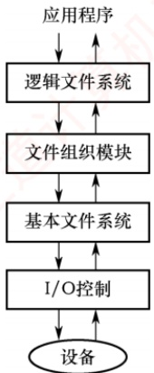

包含设备驱动程序和中断处理程序，负责在内存与磁盘之间传输数据。设备驱动程序将高层命令转换为底层硬件可识别的特定指令，由硬件控制器执行，实现I/O设备与系统的交互，并向I/O控制器指明对设备的具体位置执行何种操作

**(2)基本文件系统**

负责向设备驱动程序发送通用命令，以读取或写入磁盘的物理块；每个物理块由唯一的磁盘地址标识。该层还管理内存缓冲区，缓存文件系统元数据、目录项及数据块；在执行磁盘传输前，需要分配并维护合适的缓冲区—有效的缓冲区管理对系统性能至关重要。

**（3）文件组织模块**

负责建立文件逻辑块与物理块之间的映射关系，将逻辑块地址转换为物理块地址。文件的逻辑块按顺序编号（从0到N），通常与物理块布局不一致，因此需通过地址转换机制进行定位。该模块还包含空闲空间管理器，用于跟踪未分配的磁盘块，并按需分配给文件使用。

**(4）逻辑文件系统**

负责管理文件系统的元数据（描述文件系统结构的信息，如文件名、目录项、权限和时间戳等），不含实际数据内容。它维护目录结构，并根据给定文件名，向文件组织模块提供所需的元数据；同时通过文件控制块记录各文件的属性与状态，并负责实现文件保护机制。

### 4.1.3 文件的逻辑结构

文件的逻辑结构是指从用户视角所看到的文件组织形式；而文件的物理结构（也称存储结构）则是指文件在外存上的实际存储方式，对用户透明。逻辑结构与底层存储介质无关，其核心在于描述文件内部数据在逻辑上是如何组织的。

根据逻辑结构的不同，文件可分为两大类:无结构文件和有结构文件。

#### 1．无结构文件

无结构文件是最简单的组织形式，由连续的字符流构成，因此也称流式文件，其长度以字节为单位。对这类文件的访问通过读/写指针来定位下一个要操作的字节。系统中大量的源程序、可执行文件和库函数均采用这种形式。由于缺乏显式的记录边界，若需检索特定内容，只能进行顺序查找，效率较低，因而不适用于需要频繁随机访问或按记录检索的应用场景。

#### 2．有结构文件

有结构文件由一个或多个记录组成，故也称记录式文件。每条记录由若干数据项组成，其数量和长度可能固定，也可能可变。根据记录长度是否一致，有结构文件进一步分为两类。

1）定长记录。所有记录的长度相同，且各数据项在记录中的位置固定。系统可通过偏移量直接定位任意记录，从而支持高效的随机访问。

2）变长记录。各记录的长度不一，或因所含数据项数量不同，或因某些数据项长度可变。由于无法直接计算记录位置，检索时通常只能顺序查找，速度较慢。

有结构文件按记录的组织形式可分为顺序文件、索引文件、索引顺序文件。

**（1）顺序文件**

顺序文件中的记录按线性顺序依次排列，可采用定长或变长记录。根据记录是否按键字排序，可分为两种结构:①串结构，记录按存入时间先后排列，不按键字排序。检索时必须从头开始顺序扫描，效率较低。②顺序结构，所有记录按键字有序排列。对于定长且按键字有序的顺序文件，可通过偏移量直接定位记录，并支持折半查找等高效算法，检索效率高。

正因记录连续存储、访问局部性强，顺序文件在批量处理场景下表现最优当需要连续读取或写入大量记录时，其I/O效率在所有逻辑文件类型中最高。此外，对于顺序存储设备（如磁带），顺序文件是唯一能够有效工作的组织形式。然而，在频繁进行单条记录的查找、修改、插入或删除操作时，由于缺乏直接定位能力且需移动大量数据，顺序文件的性能明显不足。

**(2) 索引文件**

对于定长记录的顺序文件，可直接通过公式计算第i条记录的物理地址: $A_{i}   =   i L$ (L 为记录长度）。对于变长记录的顺序文件，由于各记录长度不一，无法直接定位目标记录，必须从头开始依次读取前i-1条记录，累加其长度以确定第i条记录的起始位置，即

$$
\mathcal {A}_{_{i}} = \sum_{i = 0}^{i - 1} L_{_{i}} + 1
$$

该过程需顺序扫描，效率较低。为提高检索效率，可建立一张索引表，为每个记录设置一个索引项，包含指向该记录的指针及其长度，并按关键字排序。由于索引表由定长记录构成，支持高效的随机访问。如图4.2所示，系统可通过索引表直接定位任意记录，从而将对变长记录顺序文件的顺序查找，转变为对定长索引文件的随机查找，显著提升检索速度。

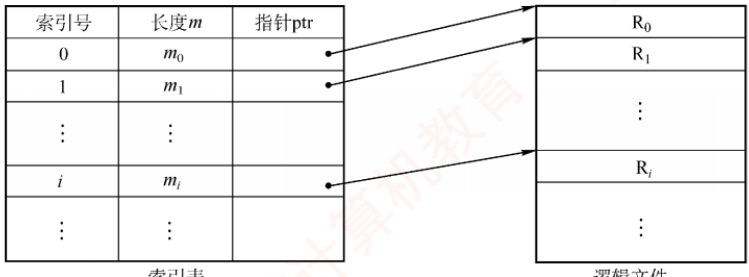

图4.2 索引文件示意图

索引文件需额外维护一张索引表，且每个记录对应一个索引项，因此增加了存储开销。

**(3）索引顺序文件**

索引顺序文件是顺序文件与索引文件的结合。其最简单的形式采用一级索引:先将变长记录的顺序文件划分为若干组，再为每组的首条记录建立一个索引项，包含该记录的关键字及其指针，所有索引项共同构成一张按关键字有序排列的索引表。

图4.3所示为索引顺序文件示意图。主文件包含姓名（作为关键字）及其他数据项，记录按姓名首字母分组——组内可无序，但组间必须按键字有序。每组首条记录的姓名及其逻辑地址被存入索引表，该表按姓名递增排序。检索时，首先在索引表中定位目标记录所属的组，继而在该组内进行顺序查找，从而快速找到目标记录。

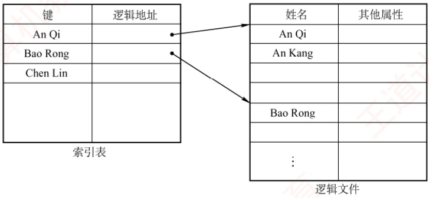

图4.3 索引顺序文件示意图

对于含N条记录的普通顺序文件，平均需查找N/2次。而在索引顺序文件中，若将记录均分为m组，则每组约含s=N/m条记录。查找过程分为两步:①在索引表中顺序查找，平均需m/2次；②在对应组内顺序查找，平均需s/2次。因此，总平均查找次数为

$$
m/2+s/2=m/2+(N/m)/2
$$

当 $m   =   \sqrt {N}$ 时，该值最小，查找效率达到最优。

显然，索引顺序文件显著提升检索效率；当记录数量极大时，还可引入两级或多级索引，进一步降低查找开销——这正是分块查找（也称索引顺序查找）的基本思想。然而，索引文件与索引顺序文件在大幅提升查找速度的同时，也因维护索引表而带来额外存储开销。

**（4）直接文件（散列文件）**

在直接文件（也称散列文件）中，记录的物理地址由其关键字经散列函数计算直接确定。这种方式支持极快的随机存取，但不同关键字可能映射到同一地址，从而引发冲突。

熟悉数据结构的读者不难发现:有结构文件的各类逻辑组织方式（包括顺序、索引、索引顺序和散列），本质上都是围绕“如何高效查找数据”这一核心目标而设计的。

### 4.1.4 本节小结

本节开头提出的问题的参考答案如下。

**1）什么是文件？**

文件是操作系统中用于存储和组织数据的基本单位，是一组逻辑上相关的信息（如程序、文本、图像等）的有序集合，通常以一个名字标识，并保存在持久性存储设备（如硬盘）上。

**2）文件系统在操作系统中的地位如何？**

文件系统是操作系统的核心子系统之一，负责对存储设备上的文件和目录进行统一管理，提供创建、读取、写入、删除、组织及保护等基本操作。它向上为应用程序和用户提供简洁、一致的抽象接口，屏蔽底层存储细节；向下则与设备驱动协同，高效调度物理存储资源。作为连接用户逻辑视图与物理存储之间的关键桥梁，文件系统在操作系统中扮演着承上启下的核心角色。

## 4.2 目录与文件

在学习本节时，请读者思考以下问题:

1）目录管理的基本要求是什么？

2）在目录中查找某个文件可采用哪些方法？

3）单个文件的逻辑结构与物理结构之间是否存在制约关系？

本节从文件控制块与索引节点的原理出发，逐步深入目录结构设计，文件的物理分配方式、基本操作以及共享与保护机制。这部分知识点密集、逻辑环环相扣。需特别提醒:历年考试表明，多数读者对进程与内存管理掌握较好，但对文件及I/O管理往往基础薄弱，甚至在基本问题上失分，实属可惜。究其原因，仍是对概念的理解不够全面和透彻，望读者高度重视。

### 4.2.1 目录的基本概念

现代计算机系统需存储大量文件，必须通过文件目录对文件进行有效组织。文件目录是一种数据结构，用于记录每个文件的属性、存储位置等元数据，以便在检索时快速定位其在外存中的物理地址。目录管理需要满足以下要求:①实现按名存取，用户仅需提供文件名，系统即可自动定位该文件在外存中的位置；②提高检索速度，通过合理组织目录结构，加快查找过程，从而提升文件存取效率；③支持文件共享，在多用户系统中，允许多个用户共享同一文件；④允许文件重名，不同用户可对各自所属的文件使用相同名称，以契合其命名习惯。

### 4.2.2 文件控制块和索引节点

为便于文件管理，引入了文件控制块（FileControl Block，FCB）这一重要数据结构。

#### 1．文件控制块

考点追踪文件属性信息的存储位置（2009）

文件控制块（FCB）是用于存放控制文件所需各种信息的数据结构，以实现按名存取。每个文件对应一个FCB，所有FCB的集合构成文件目录（也称目录文件）。每当创建新文件，系统即为其建立一个FCB，用以记录其属性信息。图4.4展示了一个典型的FCB结构。

FCB主要包含以下几类信息:

●基本信息，如文件名、物理位置、逻辑结构、物理结构等。

| 文件名 |
| --- |
| 类型 |
| 文件权限（读，写） |
| 文件大小 |
| 文件数据块指针 |

图 4.4 一个典型的 FCB

● 存取控制信息，包括文件主、核准用户和一般用户的访问权限。

● 使用信息，如文件创建时间、最后修改时间等。

#### 2．索引节点

考点追踪目录项结构的相关分析与计算（2020、2022）

然而，当文件数量庞大时，传统FCB目录会占用大量磁盘空间。在查找过程中，系统需逐块读入目录项，并逐一比对文件名；而仅当匹配成功时才需要获取该文件的物理地址。这意味着，在检索阶段，除文件名外的其他描述信息并无必要调入内存。为此，UNIX等系统采用文件名与描述信息分离的设计策略:将文件的描述信息独立组织为索引节点（inode），简称i节点；而目录项则仅由文件名及其对应的索引节点号（或索引节点指针）构成，如图4.5所示。

| 文件名 | 索引节点编号 |
| --- | --- |
| 文件名1 |  |
| 文件名2 |  |
| … |  |
| … |  |

图 4.5 UNIX 的文件目录结构

**考点追踪索引节点与文件容量的关系（2018、2020）**

例如，假设一个FCB占64B，盘块大小为1KB，则每个盘块可容纳16个FCB（FCB必须连续存放）；若目录共含640个FCB，则平均需启动磁盘20次才能完成一次文件查找。而在UNIX系统中，每个目录项仅占16B（14B文件名+2B索引节点号），每块可容纳64个目录项，从而将平均磁盘启动次数降至原来的1/4，显著降低系统开销。

为兼顾持久存储与高效访问，文件系统将索引节点设计为两种形态:

**（1）磁盘索引节点**

存储于磁盘上，作为文件的“永久档案”，每个文件有唯一磁盘索引节点，主要包含:

● 文件主标识符，标识文件所属的用户或用户组。

● 文件类型，指明是普通文件、目录文件还是特殊文件。

● 文件存取权限，规定文件主、核准用户及一般用户的访问权限

· 文件物理地址，通过13个地址项以直接或间接方式记录数据所在盘块编号

● 文件长度，以字节为单位表示文件的实际大小。

● 文件链接计数，统计本文件系统中指向该文件的目录项（硬链接）数量。

● 文件存取时间，记录文件最近被访问、修改的时间，以及索引节点最近被修改的时间。

**(2)内存索引节点**

当文件被打开时，系统将对应的磁盘索引节点载入内存，并附加运行时状态信息，以支持高效的并发访问与快速操作。因此，在磁盘索引节点的基础上，额外新增了以下内容:

● 索引节点号，用于在内存中唯一标识该节点。

● 状态，指示i节点是否被上锁或已修改，便于缓存一致性管理。

● 访问计数，进程每访问一次，计数加1；访问结束减1，用于判断节点是否可释放。

● 逻辑设备号，标识文件所属文件系统的逻辑设备号，在多文件系统环境中尤为关键。

● 链接指针，分别指向空闲链表与散列队列，便于内核高效调度和回收。

### 4.2.3 目录结构

#### *1．单级目录结构

整个文件系统仅维护一张全局目录表，每个文件对应一个目录项，如图4.6所示。

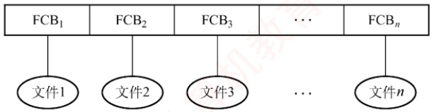

图4.6 单级目录结构

创建新文件时，系统首先遍历整张目录表，确保无同名文件存在；确认无冲突后，方可新增一个FCB，并填入该文件的属性信息。访问文件时，系统根据文件名查找对应的FCB，经合法性检查后执行相应操作。删除文件时，则先定位其FCB，回收其所占存储空间，再清除该FCB。

尽管单级目录结构实现了按名存取，但其存在查找效率低、不允许文件重名、难以支持文件共享等缺点，且完全无法满足多用户环境的需求，因此仅适用于早期单用户的简单文件系统。

#### *2．两级目录结构

为克服单级目录存在的缺陷，系统可采用两级方案，将文件目录划分为主文件目录（Master File Directory，MFD）和用户文件目录（User File Directory，UFD），如图 4.7所示。

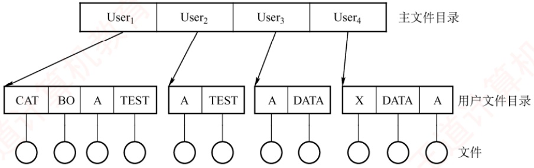

图 4.7 两级目录结构

MFD中的每个目录项记录一个用户名及其对应的 UFD存储位置；每个UFD则包含该用户所有文件的FCB。当用户访问其文件时，系统仅需在其专属UFD中进行查找。这一机制不仅有效解决了不同用户间文件重名的问题，还通过隔离用户命名空间增强了安全性。

两级目录结构提升了检索效率，并支持基于目录的访问控制。然而，由于每个用户仅拥有一个扁平的UFD，无法对文件进行分类管理，因此在组织复杂文件集合时显得灵活性不足。

#### 3．树形目录结构

考点追踪设置当前工作目录的作用（2010）

将两级目录结构加以推广，便形成了树形目录结构，如图4.8所示。

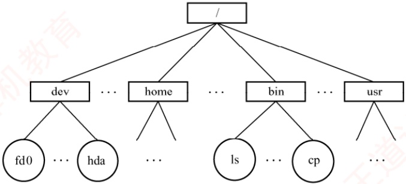

图4.8 树形目录结构

树形目录结构显著提升了目录检索效率与文件系统的整体性能。在该结构中，用户通过文件路径名来标识文件。路径名是一个字符串，由从根目录出发到目标文件路径上所有目录名和文件名，用分隔符“/”连接而成。若路径从根目录开始，则称为绝对路径；系统中每个文件都具有唯一的绝对路径。例如，在Linux系统中，“/dev/hda”就是一个典型的绝对路径。然而，当目录层次较深时，每次从根目录逐级查找会耗费大量时间。为此，系统为每个进程设置一个当前目录（也称工作目录），进程对文件的访问通常以当前目录为基准。此时，用户可使用相对路径进行定位:它由从当前目录出发至目标文件路径上的目录名与文件名，用“/”连接构成。例如，若当前目录为“/bin”，则“./ls”即为相对路径，其中符号“.”表示当前工作目录。

通常，每个用户都拥有专属的“当前目录”，登录后系统自动将其切换至该默认目录。操作系统提供专门的系统调用，允许用户随时更改当前目录。例如，Linux系统的/etc/passwd文件记录了各用户登录时的默认当前目录，而cd命令通过调用该接口动态更新当前目录。

树形目录结构支持灵活的文件分类，层次清晰，便于管理与保护。不同性质或归属的文件可分布于目录树的不同分支或子树中，并能针对各节点设置独立的存取权限，实现精细化控制。然而，该结构也存在局限:查找一个文件需按路径名逐级访问中间目录节点，导致磁盘I/O次数增加，可能影响查询速度。尽管如此，凭借其良好的组织性、扩展性以及对多用户环境的支持，目前绝大多数现代操作系统（如UNIX、Linux和Windows）都采用了树形目录结构。

#### *4．无环图目录结构

树形目录结构便于实现文件分类，但难以支持文件共享。为此，在其基础上引入指向同一节点的有向边，使整个目录结构演变为一个有向无环图，如图4.9所示。该结构允许目录共享子目录或文件，同一个文件或子目录可出现在两个或多个目录中，从而实现跨目录的共享。

然而，共享也带来了删除操作的复杂性:当某用户请求删除一个共享节点时，若系统直接将其物理删除，其他共享用户后续访问将因节点缺失而失败。为此，系统为每个共享节点维护一个共享计数器—新增共享链时计数器加1，收到删除请求时减1。仅当计数器归零，才真正删除该节点，否则仅断开请求用户的共享链，保留节点供他人

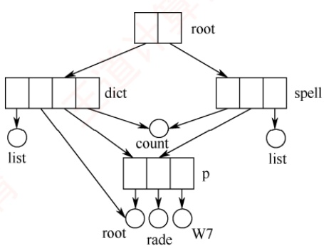

图4.9 无环图目录结构

继续使用。无环图目录结构虽有效支持灵活的文件共享，但也因此增加了管理开销，需额外维护引用计数等共享状态。

### 4.2.4 目录的操作

在理解文件系统的设计需求之前，需要先明确目录层面所支持的基本操作。这些操作构成了用户与文件系统交互的核心接口，也为后续把握文件系统的整体架构奠定基础。

● 搜索。访问文件时，需要在相应目录中查找对应的目录项。为提升效率，系统通常支持从根目录或当前工作目录出发，并允许使用精确匹配或部分文件名进行检索。

● 创建文件。系统首先检查当前目录中是否存在同名文件；仅当确认无重名后，才新增目录项，并初始化其属性（如文件类型、权限和时间戳等）。

● 删除文件。系统移除该文件在所属目录中的目录项，并回收其所占用的数据块及元数据。

创建目录。在树形目录结构中，用户可创建子目录（用户文件目录，UFD），用于组织个人文件与嵌套子目录，实现灵活的层次化管理。

● 删除目录。若目录为空（不含任何文件或子目录），则可直接删除；若非空，则通常采用两种策略:①要求用户先手动清空目录内容（对子目录需要递归删除），待其成为空目录后再删除；②允许直接删除非空目录，系统自动递归删除其中所有文件与子目录。

● 移动目录。将指定的文件或子目录从原父目录迁移到新的父目录下。移动完成后，原有目录项被转移，文件的完整路径名随之自动更新，而文件内容保持不变。

● 显示目录。列出指定目录的内容，包括所有文件与子目录的名称，通常还显示文件大小、最后修改时间等基本属性；当文件属性发生变化时，其目录项也会同步更新。

● 改变目录。用户可通过此操作切换当前工作目录，可指定绝对路径或相对路径；若未显式指定目标目录，系统通常默认返回用户的主目录，从而简化后续路径输入。

### *4.2.5 目录实现

访问文件时，操作系统根据路径名定位相应的目录项，而目录项中包含用于查找文件磁盘块所需的关键信息。目录实现的核心目标是高效支持查找操作，因此主要有两种基本方法:

#### 1．线性列表

最简单的目录实现方式是采用由文件名及其数据块指针组成的线性列表。创建新文件时，需要先遍历目录以确保无同名文件，然后新增目录项；删除文件时，则根据文件名查找并释放其占用的空间。为重用被删除的目录项，常见策略包括:标记为未使用、加入空闲链表，或将末尾项移至空位并缩短目录长度。若以链表组织目录项，还可进一步降低删除操作的时间开销。

线性列表的优点是实现简单，但缺点是查找效率低目录规模越大，扫描开销越高。

#### 2．哈希表

另一种方法是采用哈希表:系统根据文件名计算其哈希值，并以此索引到哈希表中的某个元素，该元素通常存放一个指向实际目录项的指针。哈希表的优势在于查找、插入和删除操作均具有很高的性能，但需要妥善处理哈希冲突，即不同文件名映射到同一表元素的情况。

由于目录查询依赖磁盘I/O，频繁访问会带来较大开销。为此，系统通常将当前活跃的目录缓存到内存中。后续访问可直接在内存进行，从而大幅减少磁盘操作，提升系统响应速度。

### 4.2.6 文件的物理结构

前文指出，文件本质上是一种抽象数据类型，其研究涵盖逻辑结构、物理结构及相关操作。文件的物理结构关注的是文件数据如何在磁盘上分布与组织。这一问题可从两个互补的视角加以理解:①文件分配方式，解决如何为文件分配已使用的磁盘块，属于对非空闲块的管理；②文件存储空间管理，解决如何跟踪和分配空闲磁盘块，属于对空闲块的管理（见4.3节）。

**考点追踪不同物理结构的特点和比较（2009、2011、2013、2020）**

文件分配方式直接决定文件的物理结构，常用策略有三种:连续分配、链接分配和索引分配。需要特别注意将其与文件的逻辑结构区分开来。可类比数据结构中“线性表”（逻辑结构）与“顺序表/链表”（物理实现）的关系:逻辑结构描述“是什么”，物理结构则说明“如何存”。

此外，如同内存被划分为固定大小的页，磁盘也被划分为若干磁盘块，其大小通常与内存页面一致。所有磁盘I/O操作均以块为单位，在内存与磁盘之间进行数据交换。

#### 1．连续分配

**考点追踪连续分配的应用和分析（2011、2012、2014）**

连续分配方法要求每个文件在磁盘上占有一组连续的块（见图4.10）。由于磁盘地址本身具有线性顺序，这种布局使得进程访问文件时所需的寻道次数和寻道时间最小。

采用连续分配时，逻辑文件中的记录依次存放在相邻的物理块中。文件的目录项需要记录该文件起始块的块号及其所占用的总块数。若文件长度为n块，且从块b开始存放，则该文件占据的块为 $b,b+1,b+2,\cdots,b+n-1$ ；要访问第i块，可直接计算并访问块b+i-1。

连续分配的优点:①支持顺序访问和直接访问。②顺序访问高效且速度快，因为文件所占的块通常位于一条或少数几条相邻磁道上，磁头移动距离最小。缺点:①必须为文件分配连续的存储空间，与内存连续分配类似，易产生大量外部碎片。②需要预先知道文件长度，难以支持文件的动态增长——若强行扩展，可能覆盖物理上相邻的其他文件。③为维持文件的逻辑顺序，在删除或插入记录时，往往需要对后续记录进行物理移动，开销较大。

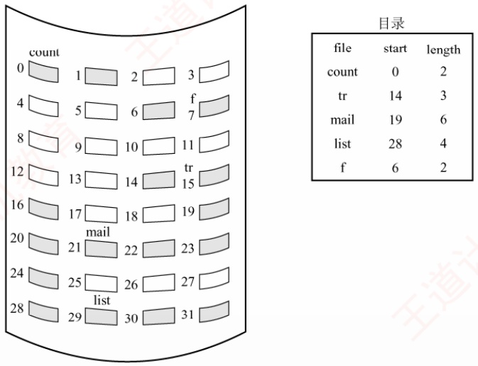

图 4.10 连续分配

#### 2．链接分配

链接分配是一种采用离散方式分配磁盘块的策略。其主要优点包括:①消除了外部碎片，显著提高磁盘空间的利用率。②支持动态分配盘块，无须事先预知文件大小。③文件的插入删除和修改操作十分便捷。根据指针存储方式的不同，链接分配可分为隐式链接和显式链接。

**（1）隐式链接**

**考点追踪链接分配的应用和分析（2014）**

隐式链接方式如图4.11所示。目录项中包含指向文件第一块和最后一块的指针（盘块号）。每个文件对应一个由磁盘块构成的链表，这些块可分散存储于磁盘的任意位置。除最后一块外，每个盘块均存有指向下一个盘块的指针，这些指针对用户完全透明。

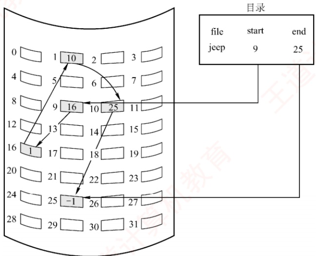

图4.11 隐式链接方式

隐式链接的缺点:①仅支持顺序访问，若要访问文件的第i块，必须从首块开始，依次跟随指针遍历至第i块，随机访问效率极低。②可靠性较差，一旦链中任一指针损坏，整个链将断开，导致后续数据无法访问。③每个盘块需要存储指向下一块的指针，占用一定的存储空间。

**考点追踪文件空间分配与簇的关系（2017、2018）**

为缓解上述问题，可引入簇（cluster）的概念:将若干连续的盘块组合成一个簇（基本分配单位），文件的分配与链接均以簇为单位进行。如此，指针数量大幅减少，不仅降低存储开销，也显著缩短链式查找时间，从而提升整体I/O性能。但这一优化的代价是可能产生内部碎片当文件大小不是簇大小的整数倍时，最后一个簇的剩余空间无法被其他文件利用。

**(2)显式链接**

显式链接将用于链接文件各物理块的指针集中存放在内存中的一张全局表中，该表在整个文件系统中仅设一张，称为文件分配表（FileAllocation Table，FAT）。FAT的每个表项对应一个磁盘块，并存放指向下一个盘块的指针。因此，文件目录项只需记录该文件的起始块号，后续所有块号均可通过依次查询FAT获得。例如，某磁盘共有100个盘块，其中存放了两个文件:文件“aaa”占用三个块，链接顺序为2→8→5；文件“bbb”占用两个块，链接顺序为7→1。其余盘块均为空闲块。该磁盘的文件分配表（FAT）如图4.12所示。

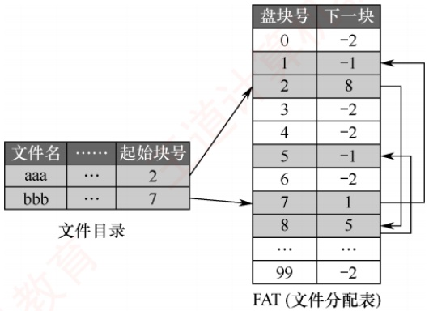

图4.12 磁盘的文件分配表

**考点追踪FAT表的作用（2019、2025）**

不难看出，FAT的表项与所有磁盘块一一对应。通常，可用特殊值-1标记文件的最后一块，用-2表示该盘块空闲（也可指定为-3、-4等）。因此，FAT不仅记录了文件的链式结构，还标识了空闲盘块，系统可直接利用FAT管理磁盘的空闲空间。当某进程请求分配一个磁盘块时，系统只需在FAT中查找值为-2的表项，并将对应的磁盘块分配给该进程即可。

显式链接的优点:①支持顺序访问，也支持直接访问，要访问第i块，无须依次遍历前i-1块；②FAT在系统启动时即被载入内存，后续检索操作均在内存中完成，不仅显著提升查找速度，也大幅减少磁盘I/O次数。缺点:FAT需要常驻内存，磁盘容量越大，内存开销越显著。

#### 3．索引分配

**（1）单级索引分配方式**

**考点追踪索引分配的应用和分析（2012）**

事实上，在打开某个文件时，只需将该文件所占用的盘块编号调入内存即可，无须加载整个FAT。为此，可将每个文件的所有盘块号集中存放于一处；当访问该文件时，只需将其对应的盘块号集合一次性载入内存，这正是索引分配的思想。具体而言，系统为每个文件分配一个专用的索引块（或称索引表），并将分配给该文件的所有盘块号记录其中，如图4.13所示。

例如，若盘块大小为4KB，每个盘块号占4B，则一个索引块可容纳 $4\mathrm{KB}/4\mathrm{B}=1024$ 个盘块号。采用单级索引时，可支持的最大文件为 $1024 \times 4 \mathrm{KB} = 4 \mathrm{MB}$ 0

索引分配的优点:①支持高效的直接访问，要访问文件的第i块，只需读取索引块中第i项，即可直接获得对应的盘块号；②不会产生外部碎片，因为文件的盘块可离散分配。缺点:引入了额外的存储开销，每个文件必须配备一个索引块。当文件较小时，如仅占用几个盘块，仍需要为其分配一个完整的索引块，导致索引块的利用率极低；当文件较大时，若所需盘块号超出单个索引块容量，虽可借助链式指针将多个索引块链接起来，但这种方法效率低下。

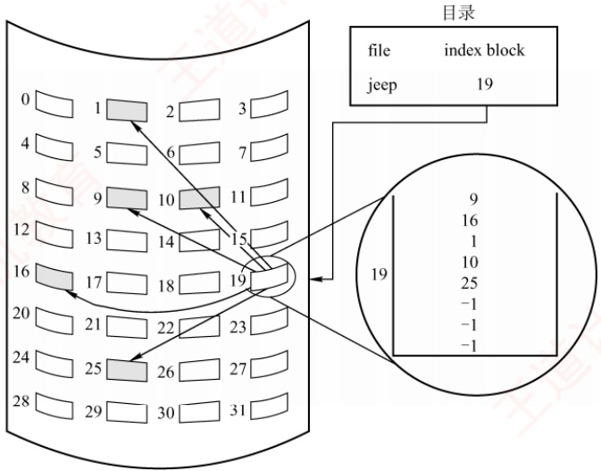

图 4.13 索引分配

**(2)多级索引分配方式**

显然，当文件过大而索引块较多时，可为这些索引块再建立一级索引，称为主索引。主索引表中依次存放各二级索引块的盘块号，从而形成二级索引分配方式。其设计思想与内存管理中的多级页表高度相似（见图4.14）。访问数据时，系统首先通过主索引定位对应的二级索引块，再通过该二级索引块找到目标数据块。若文件非常大，还可进一步扩展为三级、四级的索引分配结构。

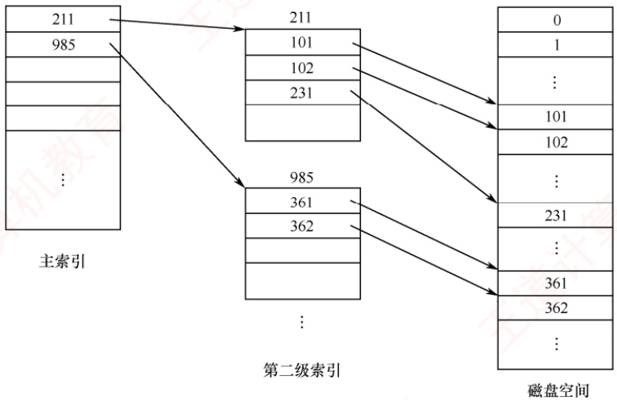

图4.14 二级索引分配

例如，假设盘块大小为4KB，每个盘块号占4B，则一个索引块可容纳1024个盘块号。采用两级索引时，可支持的最大文件为 $1024 \times 1024 \times 4 \mathrm{KB} = 4 \mathrm{GB}$

多级索引的优点:显著提升大型文件的可扩展性与查找效率。缺点:当访问一个盘块时，所需的磁盘I/O次数随索引级数增加而增多。若文件系统仅采用多级索引作为组织方式，则即使对于大量小文件，访问单个盘块仍需要多次磁盘I/O，导致整体I/O性能难以达到理想水平。

**（3）混合索引分配方式**

**考点追踪混合索引分配的原理（2013）**

为兼顾小、中、大乃至特大型文件的访问效率，需要根据文件大小动态选用最合适的分配策略，在空间开销与访问性能之间取得最佳平衡，因此通常采用混合索引分配方式。对于小文件，为提升大量小文件的访问速度，可将其全部盘块地址直接存放在inode（或FCB）中，系统直接从中获取所有盘块地址，无须额外读取索引结构，即直接寻址。对于中型文件，采用单级索引分配，inode中存放一个索引块的地址，系统需要先读取该索引块，再从中获取文件的盘块地址，即一次间址。对于大型或特大型文件，则分别采用两级和三级索引分配。UNIX系统正是采用这种混合策略。在其索引节点中，共设有13个地址项，即i.addr(0)～i.addr(12)，如图4.15所示。

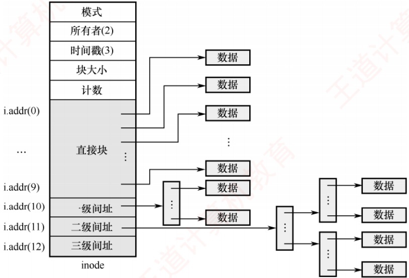

图 4.15 UNIX 系统的 inode 结构示意图

**考点追踪混合索引分配的相关计算（2010、2015、2018、2022）**

1）直接地址。为了提升对小文件的检索速度，索引节点中设置了10个直接地址项，记为$\mathrm{i.addr}(0) \sim \mathrm{i.addr}(9)$ ，每个项直接存放一个文件数据块的盘块号。假设每个盘块大小为4KB，当文件不大于40KB时，则可直接从索引节点中读取该文件的全部盘块号。

2）一次间接地址。对于中、大型文件，仅靠直接地址显然无法满足需求。为此，索引节点中的地址项i.addr(10)被设计为一次间接地址，用于实现一级索引分配。一次间接地址指向一个专门的一次间址块（索引块），其中存放的是文件数据块的盘块号。一个索引块可容纳1024个盘块号，通过一次间接地址最多可寻址 $1  K  \times 4  K   B  = 4  MB$ 的数据。因此，同时使用直接地址和一次间址时，最大可表示的文件长度为 $4MB + 40KB$

**考点追踪多级索引块的访问效率分析（2018、2022）**

3）多次间接地址。当文件长度超过4MB+40KB时，还需要利用地址项i.addr(11)作为二次间接地址，以实现两级索引分配。二次间接地址指向文件的主索引块，该主索引块中的每一项又指向一个一次间址块，而每个一次间址块再指向1024个数据块。通过二次间接地址最多可寻址 $1 \mathrm{K} \times 1 \mathrm{K} \times 4 \mathrm{KB} = 4 \mathrm{GB}$ 的数据。因此，同时使用直接地址、一次间址和二次间址时，最大可表示的文件长度为 $4\mathrm{GB}+4\mathrm{MB}+40\mathrm{KB}$ 。同理，同时采用直接地址、一次间址、二次间址和三次间址时，最大可表示的文件长度为 $4\mathrm{TB}+4\mathrm{GB}+4\mathrm{MB}+40\mathrm{KB}$ 0

### 4.2.7 文件的操作

文件是一种抽象数据类型。为了正确定义文件，需要明确可对其执行的操作。操作系统提供一系列的系统调用来实现对文件的创建、删除、读/写、打开和关闭等操作。

#### 1．文件的基本操作

最基本的文件操作包括创建文件、删除文件、读文件和写文件等。

**（1）创建文件**

**考点追踪文件创建的过程（2025）**

创建文件涉及元数据分配、存储空间预留与目录注册等多个步骤，具体过程如下:①合法性与权限校验，检查文件名是否合法、是否与同目录下已有的文件重名，并验证用户对目标目录是否具有写权限。若任一条件不满足，则创建立即终止。②分配索引节点，从空闲inode（或FCB)池中分配一个空闲项，初始化其元数据，包括文件类型、初始大小、访问权限、时间戳以及物理块指针等，并标记为已占用。③分配磁盘块，根据文件预估大小，从空闲磁盘块管理结构中分配相应数量的物理块，并将块地址记录在inode中。④在目录中新建目录项，格式为<文件名，索引节点号>，使文件可被检索。⑤更新文件系统元数据，包括空闲inode表、空闲磁盘块结构、目录大小以及修改时间等。⑥打开并返回文件描述符（可选），若创建后立即打开（见下节），则系统将在进程的打开文件表中创建表项，分配文件描述符，并初始化读/写指针。

**（2）删除文件**

**考点追踪文件删除的过程（2013、2021）**

删除文件的步骤包括撤销目录可见性、回收元数据、释放存储空间等，具体过程如下:①路径解析与定位，按路径名逐级查找目录，定位目标文件的目录项，获取其inode（或FCB），并验证用户对文件所在目录的写权限。②检查使用状态与硬链接计数，若文件正被打开，则部分系统将延迟物理删除，待所有引用关闭后再回收资源；若硬链接计数（见4.2.8节）大于1，则仅删除当前目录项并将计数减1，不回收inode与磁盘块；仅当计数为1时，才执行完整的删除流程。③移除目录中的目录项，使文件在用户视角下“消失”，完成逻辑删除。④释放索引节点，当链接计数降至0时，将inode标记为空闲，并归还至空闲管理结构，其元数据彻底失效。⑤释放磁盘块，根据inode中的块指针，将所有数据块和索引块归还至空闲磁盘块管理结构。⑥释放内存临时资源（可选），包括对应的缓冲区、打开文件表项及内核文件对象等。⑦更新文件系统元数据，同步更新目录大小、空闲inode表及空闲块结构，确保一致性。

**（3）读文件**

读文件时，首先根据文件名在目录中查找对应目录项，获取文件的索引节点号，进而定位其在外存中的数据块。随后，依据当前读指针的位置，从指定块中读取数据，并更新读指针。

**(4）写文件**

写文件时，系统同样先通过文件名查找目录项，获取索引节点号以定位外存数据块。然后，根据当前写指针的位置，将数据写入相应块，并更新写指针。若写入超出当前分配空间，系统将动态分配新磁盘块并更新inode（或FCB）中的块指针。

#### 2．文件的打开与关闭

当用户对一个文件执行多次读/写操作时，若每次均需要从检索目录开始，将带来显著的性能开销。为避免重复查找，大多数操作系统规定:用户首次访问某文件时，必须先通过系统调用open将其打开。系统维护一个称为打开文件表的数据结构，用于记录当前活跃文件的信息。所谓“打开”，是指系统根据文件路径定位到其目录项后，将关键信息载入内存，在打开文件表中创建一个表目，并将该表目的索引号（文件描述符）返回给用户。此后，用户再次操作该文件时，只需提供文件描述符，系统即可直接从内存获取所需信息，显著降低目录检索开销。

为提升效率与管理灵活性，现代操作系统采用两级打开文件表结构:

● 系统打开文件表:全局共享，存储与进程无关的文件属性，如磁盘位置、文件大小、访问时间等；每项都包含一个打开计数器（OpenCount），记录有多少进程打开了该文件。

● 进程打开文件表:每个进程独有，记录进程私有的访问状态，如当前读/写指针、访问权限及文件打开模式。该表中的每一项均指向系统打开文件表的对应项，实现资源共享与独立控制的统一。图4.16展示了内存中文件的系统结构。

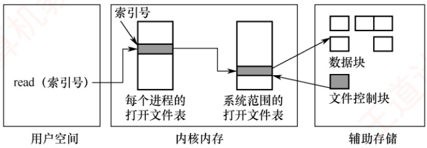

图4.16 内存中文件的系统结构

当一个进程成功打开文件时，系统首先确保其在系统打开文件表中存在对应项（若不存在，则创建），随后在该进程的打开文件表中新增一项，指向该系统表项。此后，其他进程若打开同一文件，仅需要在其各自的进程表中添加新项并指向同一系统表项，无须重复加载文件元数据，既保证了各进程访问上下文的隔离，又实现了底层资源的高效共享。

**考点追踪文件打开的过程与分析（2014、2017、2020）**

综上，文件打开的完整过程如下:系统首先根据用户提供的文件路径逐级遍历目录，将所需的目录文件从磁盘加载至内存，定位目标文件的目录项；随后从中提取其索引节点编号，并以此为关键字在系统打开文件表中查找对应项。若未找到，则从磁盘读取该索引节点至内核缓冲区，在系统表中创建新项，并将打开计数初始化为1；若已存在，则仅将该项的打开计数加1。接着，在发起请求的进程所属的进程打开文件表中分配一个新表项，用于记录其指向系统表项的索引；最终，将该表项的索引号作为文件描述符返回给用户进程，供后续读/写等操作使用。

**考点追踪文件关闭的过程（2023）**

当文件不再使用时，用户调用close关闭它。系统随即从该进程的打开文件表中删除对应项，并将系统打开文件表中相应项的打开计数器减1。一旦计数器减至0，表明该文件已无任何进程引用，系统便可安全地删除其在系统表中的项，并释放所占用的相关资源。

**考点追踪文件名和文件描述符的应用场景（2012、2017、2024）**

文件名并非打开文件表的组成部分。因为一旦系统通过文件名完成对磁盘上FCB的定位，后续操作便不再需要该文件名。用于访问打开文件表的索引号，也称文件描述符（Linux）或文件句柄（Windows）。因此，只要文件处于打开状态，所有文件操作均通过该索引号完成。

**注意**

一旦成功执行open()系统调用，后续所有文件操作[包括read()、write()、lseek()、close()等]均不再使用文件名，而是通过文件描述符进行，这一机制是文件管理的核心考点。

每个被打开的文件在系统中均关联以下关键信息:

● 文件指针。系统为每个进程维护一个独立的当前读/写位置指针。由于该指针对不同进程而言是私有的，必须与磁盘上的共享文件属性分离，保存在进程的打开文件表中。

● 文件打开计数。记录当前打开该文件的进程数量。因多个进程可能同时访问同一文件，系统只有在最后一个进程调用close()后，才会真正释放其在系统打开文件表中的项。

● 文件磁盘位置。大多数文件操作涉及对磁盘数据的修改。为避免每次操作都重新解析路径并读取元数据，系统将文件在磁盘上的位置信息缓存在内存中，供快速访问。

● 访问权限。每个进程在打开文件时需要指定访问模式（如只读、读/写、追加、创建等）。该权限信息保存在进程的打开文件表中，操作系统据此判断是否允许后续的I/O请求。

### 4.2.8 文件共享

文件共享允许多个用户访问同一文件，系统中仅需保留一个物理副本。若缺乏共享机制，则每个需要该文件的用户都必须持有独立副本，不仅浪费存储空间，还易导致数据不一致。

前文介绍的无环图目录结构可用于实现文件共享。建立链接时，需要将被共享文件的盘块号复制到相应目录项中。然而，若某用户向文件追加数据并分配新盘块，这些新增盘块仅出现在其操作所对应的目录中，对其他用户不可见，因此无法实现真正的共享。

#### 1．基于索引节点的共享方式（硬链接）

**考点追踪硬链接的原理与相关分析（2009、2017）**

硬链接是一种基于索引节点的共享机制。在此方式下，文件的物理地址和属性信息不再存放于目录项中，而是集中存储在索引节点内；目录项仅包含文件名及指向该索引节点的指针。

如图4.17所示，用户A和B的目录中均设有指向同一共享文件索引节点的指针。该索引节点包含一个链接计数count，也称引用计数，用于记录当前指向它的目录项数量。例如，当count=2时，表示有两个用户目录项链接到此文件，即两个用户共享该文件。

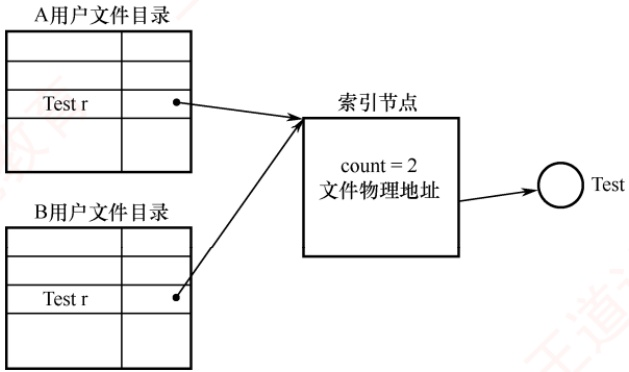

图4.17 基于索引节点的共享方式

当用户A创建新文件时，成为该文件的拥有者，系统为其创建索引节点，并将count置为1。当用户B需要共享此文件时，系统在B的目录中新增一个目录项，并设置指向该索引节点的指针，此时count增至2，但拥有者仍为A。若A不再需要该文件，能否直接删除？答案是否定的。因为删除操作若同时移除索引节点，将导致用户B的指针悬空；而B可能正在对该文件执行写操作，此时操作将中断失败。因此，A不能直接删除文件，而应仅删除自己的目录项，并将索引节点的coun减1。只要count>0，文件及其索引节点仍被保留，B可继续使用。只有当count=0时，系统才真正释放该文件及其索引节点。图4.18展示了不同用户对同一文件的链接情况。

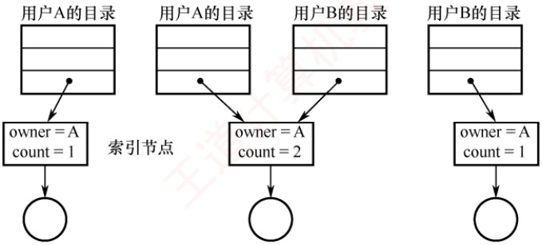

图4.18 文件共享中的链接计数

#### 2．利用符号链实现文件共享（软链接）

考点追踪软链接的原理与相关分析（2009、2021）

为使用户B能共享用户A的文件F，系统可创建一个LINK类型的新文件L，并将其写入用户B的目录中，从而建立B的目录与文件F之间的链接。文件L仅包含被链接文件F的路径名，如图4.19所示。这种链接方式称为符号链接，也称软链接，其功能类似于Windows系统中的快捷方式。当用户B访问文件L时，操作系统识别出其为LINK类型，便根据其中记录的路径名逐级查找，定位到目标文件F，并对其执行读/写操作，从而实现对文件F的共享。

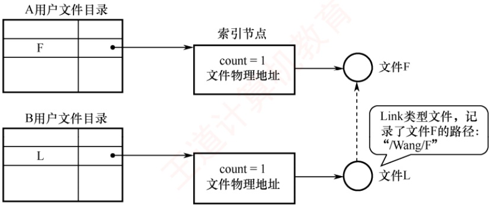

图4.19 利用符号链的共享方式

在基于符号链的共享机制中，只有文件拥有者持有指向其索引节点的指针。其他共享用户仅保存该文件的路径名，而不具备直接指向索引节点的指针。因此，即使拥有者删除了共享文件F，也不会导致其他用户的指针悬空。当其他用户尝试通过符号链访问已被删除的共享文件时，系统将返回访问失败，此时可安全地删除该符号链接，而不会引发任何问题。

在符号链的共享方式中，用户每次访问共享文件时，系统需要根据路径名逐级遍历目录结构，直至定位到目标文件的索引节点。这一过程可能涉及多次磁盘读取，从而增加访问开销。同时，符号链接本身也是一个独立文件，其索引节点同样占用一定的磁盘空间。

利用符号链实现网络文件共享时，只需记录文件所在机器的网络地址及文件路径名。

可以这样说:文件共享，“软硬”兼施。硬链接是多个目录项指向同一个索引节点，只要至少有一个指针存在，该索引节点就不会被删除；软链接是将到达共享文件的路径保存下来，访问时依据路径进行查找。可见，硬链接的查找速度通常优于软链接，因其直接通过指针访问。

### 4.2.9 文件保护

为防止文件共享导致文件被意外破坏或被未授权用户篡改，文件系统必须对用户访问文件的行为实施控制，即明确哪些用户可对文件执行读/写、执行等操作。为此，需要建立有效的文件保护机制。常见的实现方式包括口令保护、加密保护和访问控制:其中，口令与加密主要用于防止他人非法获取或窃取文件内容，而访问控制则用于精细管理用户对文件的具体访问权限。

#### 1．访问类型

文件保护通常通过限制用户可执行的访问类型来实现。主要的受控操作包括:

● 读。从文件中读取数据。

● 写。向文件中写入或修改数据。

● 执行。将文件加载到内存并运行。

● 添加。在文件末尾追加新数据，而不覆盖原有内容。

● 删除。移除文件并释放其所占用的存储空间。

● 列表清单。列出目录中文件的名称及其属性。

此外，系统还可对重命名、复制、编辑等高层操作进行控制。然而，这些功能通常由应用程序通过调用系统调用来实现，而真正的保护机制仅在底层提供。例如，复制文件本质上是通过一系列“读”操作完成的；因此，用户只要拥有读权限，便隐含具备了复制和打印的能力。

#### 2．访问控制

实现访问控制最常用的方法是基于用户身份进行权限管理。其中，最普遍的机制是为每个文件和目录附加一个访问控制列表（Access-Control List，ACL），明确指定各用户名及其被允许的访问类型。该方法的优点在于支持灵活而复杂的访问策略，但缺点是列表长度不可预知，可能带来复杂的空间管理开销。为此，现代系统常采用精简的访问控制列表加以缓解。

**考点追踪文件访问控制表的结构（2017）**

精简ACL通常将用户划分为三类:拥有者、组和其他。

1）拥有者。创建文件的用户。

2）组。一组需要共享该文件且具有相似访问需求的用户。

3）其他。系统中除拥有者和同组用户外的所有用户。

表4.1是一个精简ACL的实例。每种访问类型用一个二进制位表示，因此仅需一个3×4位的矩阵，即可完整描述三类用户的访问权限。创建文件时，系统将文件拥有者的用户名及其所属组名记录在该文件的FCB中。当用户访问文件时，系统按优先级顺序匹配其身份:若为拥有者，则授予拥有者权限；若与拥有者同属一组，则授予组权限；否则，仅授予其他用户的权限。

表4.1 一个精简的访问控制列表

<table><tr><td rowspan=2>用户类型</td><td colspan=4>访问类型</td></tr><tr><td>读取</td><td>写入</td><td>删除</td><td>执行</td></tr><tr><td>拥有者</td><td>1</td><td>1</td><td>1</td><td>1</td></tr><tr><td>组</td><td>1</td><td>0</td><td>0</td><td>0</td></tr><tr><td>其他</td><td>0</td><td>0</td><td>0</td><td>0</td></tr></table>

除ACL外，口令和密码也是常见的辅助性访问控制手段。

口令指用户在创建文件时设定一个口令，系统将其存入FCB，并告知授权共享的其他用户，访问时需要提供正确口令。该方法时空开销小，但因口令通常以明文或弱保护形式存储于系统内部，安全性较低。密码指用户对文件内容进行加密，访问时需要使用密钥解密。此方法保密性强，且不额外占用元数据空间，但加解密过程会引入一定的计算开销。

口令与加密主要用于防止文件被非法获取或窃取，并不区分具体的访问操作类型（如读/写、执行等）。因此，它们无法替代基于权限的访问控制机制，而应视为补充手段。

对于多级目录结构而言，保护需求不仅限于单个文件，还需要涵盖子目录及其全部内容。由于目录操作与文件操作存在较大差异，系统还必须提供专门的目录保护机制。

### 4.2.10 本节小结

本节开头提出的问题的参考答案如下。

1）目录管理的基本要求是什么？

①实现“按名存取”，这是目录管理最基本的功能。②提高目录检索速度，从而加快文件的存取效率。③为支持安全共享，目录需要提供访问控制信息，以管理不同用户对文件的使用权限。④支持重名，允许不同用户为各自的文件使用相同的名称。

2）在目录中查找某个文件可采用哪些方法？

可采用线性列表法或哈希表法。线性列表法将文件名组织成一个线性表，查找时依次与各表项比较；若文件名有序，则可采用折半查找。但插入新文件需要维护有序性，带来额外开销。哈希表法通过哈希函数将文件名映射为指向目录项的指针，查找迅速，但需要妥善处理哈希冲突。

3）单个文件的逻辑结构与物理结构之间是否存在制约关系？

文件的逻辑结构是用户可见的组织形式，即从用户视角所见的文件全貌；而物理结构则是文件在存储器上的实际存放方式，与存取方法及存储介质特性密切相关。二者虽无直接制约关系，但若物理结构选择不当，则难以体现逻辑结构的特点。例如，一个逻辑上为顺序结构的文件，若采用隐式链接的物理结构，即使理论上能快速定位某条记录，实际仍需在磁盘上逐块查找。

学到这里，读者应能体会到:现代操作系统的设计思想中，处处可见面向对象程序设计的影子。本章所学的“文件”，实质上是一种抽象数据类型，即一种数据结构。若读者在此之前已学完数据结构，则面对新数据结构时，自然会关注其逻辑结构、物理结构及所支持的操作。

## 4.3 文件系统

在学习本节时，请读者思考以下问题:

1）什么是文件系统？

2）文件系统要完成哪些功能？

本节除“外存空闲空间管理”外，其余内容均为2022年统考大纲新增考点。这些内容较为抽象，属于“看不见、摸不着”的底层原理，在常见的国内《操作系统》教材中鲜有涉及。若读者感到理解困难，建议结合王道最新课程进行学习，以更好地掌握这些抽象机制。

### 4.3.1 文件系统布局

#### 1．文件系统在磁盘中的结构

文件系统存放在磁盘上。磁盘通常被划分为一个或多个分区，每个分区中有一个独立的文件系统。文件系统一般包含以下关键信息:引导操作系统的机制、磁盘总块数、空闲块的数量与位置、目录结构，以及所有具体文件的数据。图4.20展示了一种可能的文件系统布局。

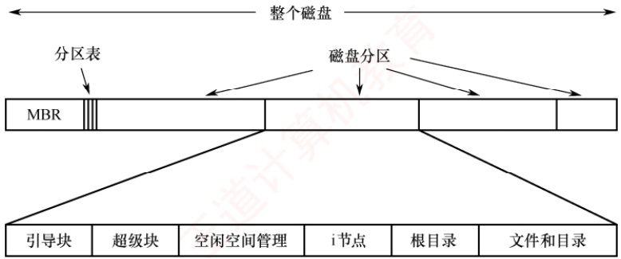

图 4.20 一个可能的文件系统布局

其主要组成部分简述如下:

1）主引导记录（Master Boot Record，MBR），位于磁盘的0号扇区，负责引导计算机。MBR后紧随一个分区表，用于记录各分区的起始与结束地址，并标记其中一个为活动分区。系统加电后，BIOS 将MBR读入内存并执行；MBR首先识别活动分区，随后读取该分区的第一个扇区，即引导块。

2）引导块（bootblock），MBR将控制权移交至引导块中的程序，由其负责加载并启动该分区中的操作系统。注意，每个分区均以引导块开头，即使当前未安装可启动的操作系统，也保留此区域，以便未来部署系统。在Windows中，该区域称为分区引导扇区。除引导块外，磁盘分区的后续布局因文件系统类型而异。UNIX/Linux系统中的文件系统通常还包含以下组件（见图4.20）:

3）超级块（superblock），存储文件系统的所有关键信息。当系统启动或首次挂载该文件系统时，超级块会被读入内存。超级块中的典型内容包括:分区的总块数、块大小、空闲块数量及其指针、空闲i节点（inode）数量及指针等。

4）空闲块信息，记录未分配的磁盘块，通常以位示图或空闲链表实现。紧随其后的是一组i节点，每个文件对应一个i节点，其中完整描述了文件的各种属性。之后是根目录，作为整个目录树的起点。磁盘的其余空间则用于存放所有其他文件和目录的实际数据。

#### 2．文件系统在内存中的结构

为高效管理文件系统并提升性能，系统在内存中维护一组数据结构。这些信息在文件系统挂载时加载，在运行期间动态更新，并在卸载时释放。典型的内存结构包括:

1）内存中的挂载表（mount table），记录每个已挂载文件系统分区的有关信息，如设备标识、挂载点、文件系统类型及挂载选项等。

2）内存中的目录项的缓存，缓存最近访问过的目录内容，以减少对磁盘的重复读取，加快路径解析速度。

3）系统级的打开文件表，为每个当前打开的文件维护一个FCB的副本，包含文件状态、访问权限、读/写指针、打开计数等全局信息。

4）进程级的打开文件表，每个进程拥有独立的打开文件表，包含该进程所使用的文件描述符及指向系统级打开文件表中对应表项的指针，从而实现进程与全局资源的关联。

### 4.3.2 文件存储空间管理

如4.2.6节所述，文件的物理结构包含两个方面:文件的分配方式与文件存储空间管理。后者专门负责记录磁盘中的哪些块是空闲的，并提供对这些块进行分配与回收的机制。由于系统以固定大小的物理块为单位进行数据交换，存储空间管理的核心任务是高效组织和管理空闲块。为此，系统需要维护描述空闲块状态的数据结构，而这正是本节要介绍的几种管理方法所要解决的问题。

**考点追踪 磁盘空闲块管理的方法及特点（2019、2024）**

#### 1．空闲表法

空闲表法属于连续分配方式，其思想源于内存的动态分区分配:为每个文件分配一块物理上连续的磁盘区域。系统为外存中的所有空闲区维护一张空闲表，每个空闲区对应一个表项，包含序号、起始盘块号和空闲盘块数等信息，并按起始盘块号递增顺序排列，如表4.2所示。

表 4.2 空闲盘块表

| 序 号 | 第一个空闲盘块号 | 空闲盘块数 |
| --- | --- | --- |
| 1 | 2 | 4 |
| 2 | 9 | 3 |
| 3 | 15 | 5 |
| 4 |  | 一 |

盘块的分配:

空闲盘区的分配策略与内存动态分区分配一致，通常采用首次适应(FirstFit)、最佳适应(Best Fit）等算法。当系统为新创建的文件分配空间时，会顺序扫描空闲表，查找第一个大小满足需求的空闲区；一旦找到，便将其分配给用户，并立即更新空闲表。

盘块的回收:

回收用户释放的空间时，也借鉴内存回收机制:需要判断回收区是否与空闲表中相邻的前区或后区在物理上连续。若相邻，则将它们合并为一个更大的空闲区，以减少碎片。

空闲表法的优点:具有较高的分配效率，能够显著降低磁盘I/O次数。尤其对于小型文件（如占用1～5个盘块），连续分配不仅实现简单，还能充分发挥磁盘顺序读/写的性能优势。

#### 2．空闲链表法

空闲链表法将所有空闲盘区组织成一条链表，根据链表节点的不同，可分为以下两类:

**（1）空闲盘块链**

空闲盘块链以单个盘块为单位，将所有空闲盘块链接成一条链，每个盘块包含一个指向下一个空闲盘块的指针。分配时:从链首依次摘下所需数量的盘块分配给用户。回收时:将释放的盘块逐个插入链尾。

空闲盘块链的优点:单个盘块的分配与回收操作极为简单。缺点:为一个文件分配多个盘块需要多次访问链表，效率较低；且由于管理粒度细，空闲盘块链通常较长，管理开销大。

**(2) 空闲盘区链**

空闲盘区链以空闲盘区（一组连续的盘块）为单位构建链表。每个盘区包含两项信息:本盘区的盘块数和指向下一个空闲盘区的指针。分配时:采用与内存动态分区分配类似的策略（如首次适应算法），查找满足需求的空闲盘区进行分配。回收时:需要判断回收区是否与链表中相邻的空闲盘区在物理上连续，若相邻则合并，从而有效减少外部碎片。

空闲盘区链的优缺点与空闲盘块链恰好相反，优点:分配与回收的效率较高，且空闲盘区链的长度较短。缺点:分配与回收的过程较为复杂，需要处理盘区的分割与合并操作。

#### 3．位示图法

考点追踪 位示图的应用及相关计算（2010、2014、2015、2023）

位示图法利用二进制的一位来表示磁盘中一个盘块的使用状态:磁盘上的每个盘块均对应位示图中的一个比特位。当该位为“0”时，表示对应盘块空闲；为“1”时，表示已被分配。因此，一个由m×n位组成的位示图，恰好可描述m×n个盘块的使用情况，如图4.21所示

盘块的分配:

1）顺序扫描位示图，查找一个（或一组）值为“0”的位。

2）将找到的一个（或一组）比特位转换为对应的盘块号。假设该位位于位示图中的第i行、第j列（行、列编号从1开始），每行包含n位，则对应盘块号b按下式计算:

$$
b = n(i - 1) + j
$$

3）修改位示图，置 $\operatorname* {map} [ i , j ] = 1$ C

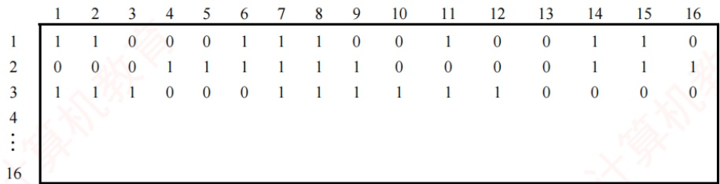

图 4.21 位示图法示意图

盘块的回收:

1）将回收盘块的盘块号b转换为位示图中的行号和列号。计算公式为

$$
i = (b - 1) \mathrm{DIV} n + 1
$$

$$
j = (b - 1) \mathrm{MOD} n + 1
$$

2）修改位示图，置 $\mathrm {map} [ i , j ] = 0$

**注意**

本书中位示图的行和列均从1开始编号。若题目指定从0开始，则上述公式需要相应调整。

位示图法的优点:查找高效，能快速在位示图中找到一个或一组相邻的空闲盘块，便于实现连续分配；位示图结构紧凑，占用内存空间极小，可常驻内存，避免频繁访问磁盘。缺点:位示图大小会随着磁盘容量的增加而增大，因此更适用于小型或中等规模的系统。

#### 4．成组链接法

空闲表法和空闲链表法均不适用于大型文件系统，因其管理结构随磁盘容量增大而过度膨胀。为此，UNIX系统采用成组链接法，它融合了二者的思想，有效控制了管理结构的规模。

成组链接法的思想:将所有空闲盘块划分为若于组（例如每组100个盘块）。除最后一组外，每组的第一个盘块用作索引块，用于记录下一组中所有空闲盘块的块号及其数量；这些索引块依次链接，形成一条链。文件系统挂载时，第一组的空闲盘块信息（包括块号列表和数量）被预先加载到内存的一个专用栈结构，称为空闲盘块号栈。例如，若系统空闲区为第201～7999号盘块，则分组如下:第一组为201～300号…次末组为7801～7900号，最末组为7901～7999号（共99个盘块）。最末组的块号由前一组的最后一个盘块（7900号）记录，而该盘块中存放的第一个盘块号为“0”，用作整条空闲链的结束标志，如图4.22所示。

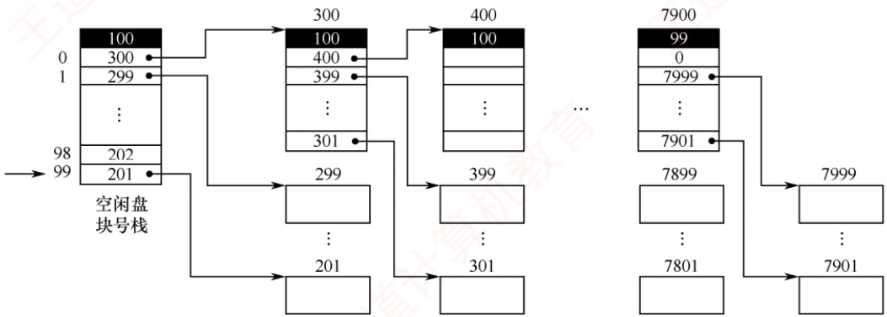

图4.22 成组链接法示意图

简而言之，成组链接法通过“分组+索引+链接”的设计，既避免了长链表的遍历开销，又无须维护完整的空闲表，从而在可扩展性与性能之间取得了良好平衡。

盘块的分配:

从空闲盘块号栈顶取出一个盘块号并分配给用户，栈指针相应上移，栈中空闲盘块数减1。若此时栈指针到达栈底（表示当前组已分配完毕），则需要读取该栈底盘块号所对应的物理盘块内容一其中保存的是下一组的空闲盘块号列表。此时，先将该内容整体读入栈以更新空闲盘块号栈，再将原栈底所指的盘块（其索引作用已完成）分配出去。

例如，在图4.22中，系统先依次分配201～299号盘块；当需要分配300号盘块时，首先将其内容（下一组的块号列表）读入空闲盘块号栈，随后将300号盘块本身分配给用户。

盘块的回收:

系统将释放的盘块号压入空闲盘块号栈顶部，栈指针相应下移，栈中空闲盘块数加1。若此时栈已满（如达到100项），则需要将当前栈中的全部盘块号写入该新回收的盘块，使其成为新的索引块；随后，将该盘块号设为新的栈底，并将栈中空闲盘块数重置为1。

描述空闲空间的数据结构（如空闲盘块号栈）以及文件系统的关键信息，通常存储在磁盘的固定位置。在UNIX系统中，这一区域称为超级块。文件系统挂载时会将其读入内存，并在运行过程中持续维护内存副本与磁盘副本的一致性，从而确保空闲空间管理的正确性与可靠性。

### 4.3.3 虚拟文件系统

**考点追踪虚拟文件系统的原理与特点（2025）**

现代操作系统通常需要支持多种文件系统，如ext4、NTFS、FAT等。这些文件系统在磁盘组织方式、元数据格式和操作方法上各不相同。若应用程序为每种文件系统分别编写代码，则不仅开发困难，系统的可维护性也会显著降低。为此，操作系统引入了虚拟文件系统（VFS），它位于用户程序与具体文件系统之间，向上提供统一的文件操作接口，如图4.23所示。有了VFS，用户程序就无须关心底层使用的是哪种文件系统。无论文件存储在何种设备上、采用何种格式，程序只需调用标准系统调用[如 open()、write()等]即可完成操作。VFS 则负责将这些通用请求转发给相应的文件系统进行处理，进而让用户无须察觉底层文件系统的差异。

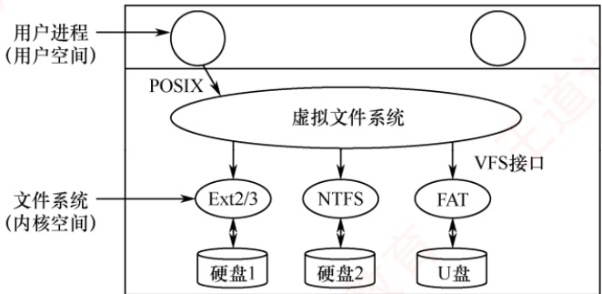

图4.23 虚拟文件系统的示意图

VFS采用面向对象的设计思想，抽象出一个通用的文件系统模型，并将其中的公共特性封装为四种对象。每个对象都包含数据成员和一组操作函数指针，这些函数由具体的文件系统提供。只要新的文件系统实现了VFS定义的接口，就能被系统识别、挂载并使用。这四种对象如下。

**（1）超级块对象**

超级块对象表示一个已挂载的文件系统。它对应磁盘上的超级块，记录该文件系统的全局信息，如块大小、总块数、空闲块数量以及文件系统类型等。当文件系统挂载时，VFS将其超级块读入内存，创建对应的超级块对象，并设置好相关的操作函数，如分配inode、同步元数据等。

**(2) V 节点对象**

V节点（vnode）对象是VFS中最重要的抽象对象，用于在内存中表示一个具体的文件或目录。每个vnode对象关联底层某个具体文件系统的索引节点（如 ext4的 inode），本质上是对各类文件系统元数据的统一封装:向上为系统调用提供统一的文件属性（如权限、大小、时间戳等），向下通过指针指向该文件系统私有的元数据结构。vnode对象仅在文件首次被访问时动态创建于内存，引用计数归零后自动释放；其内部包含一组标准操作函数指针（如read、write等），VFS通过这些指针将上层请求分发至相应文件系统的具体实现，以屏蔽不同文件系统的差异。

**注意**

V 节点并不等同于磁盘上的 inode。V节点是 VFS 为统一管理各类文件而创建的内存对象，它与 inode通过指针关联，协同完成文件操作:V节点提供统一接口，inode提供实际存储信息。

**(3)目录项对象**

目录项对象表示路径中的一个组成部分，如“/home/user/file”中的“user”。目录项对象并不直接对应磁盘上的某个固定结构，而是VFS在解析路径时动态生成的内存缓存；每个目录项保存文件名、指向父目录项和子目录项的指针，以及指向对应V节点的指针；多个目录项组合形成逻辑上的目录树；VFS通过缓存常用目录项，有效加快后续路径查找的速度。

**(4)文件对象**

文件对象表示一个进程所打开的文件，可理解为“文件在进程中的运行实例”，正如进程是程序的运行实例。当进程调用 open()时，内核为其创建一个文件对象；当调用 close()且引用计数归零时，该对象被销毁。文件对象保存当前读/写位置（文件指针）、访问模式（读/写或追加）和引用计数等信息，并包含指向对应V节点和目录项的指针；它提供的 read、write、seek等操作接口最终由V节点转发至底层文件系统执行。

下面以 write()为例说明 VFS 的工作过程:当进程调用 write(fd, buf, n)时，内核首先进入 VFS 层，执行 sys\_write()函数；随后根据文件描述符fd定位到对应的文件对象，并通过该对象获取其关联的 V节点；接着，VFS利用V节点中预置的写操作函数指针，调用目标文件系统的具体写方法；该文件系统将数据写入缓冲区，最终通过设备驱动完成磁盘写入。write()系统调用操作示意图如图4.24所示。

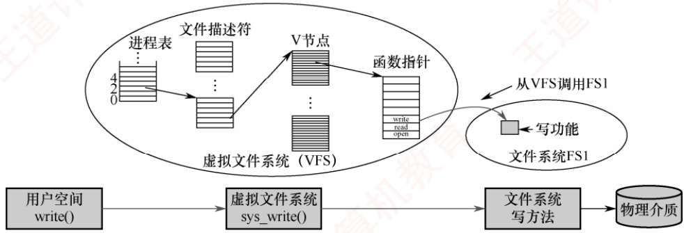

图4.24 write()系统调用操作示意图

总结:对用户程序而言，所有文件操作均通过VFS提供的统一接口完成，无须关心底层使用的是ext4、NTFS 还是其他文件系统。VFS借助前述四类对象，屏蔽不同文件系统的实现细节，使其在系统中呈现出一致的行为。需要强调的是，VFS本身并不是一种真正的文件系统—它仅存在于内存之中，不占用磁盘空间，随系统启动而建立，随系统关闭而释放。

### 4.3.4 文件系统挂载

如同文件在使用之前必须先打开一样，文件系统在被进程访问前也必须先安装，也称挂载（Mounting）。将某个设备上的文件系统挂载到目录树中的一个目录后，即可通过该目录访问该设备上的文件。此处的设备是指逻辑上的设备，如同一磁盘的不同分区可视为多个独立设备。

Windows系统采用驱动器号（如C:、D:）标识分区（也称卷），每个分区拥有独立的目录树结构，并关联一个已挂载的文件系统。文件路径通常表示为drive-letter:\path\to\file。访问时，操作系统根据驱动器号定位对应的文件系统，再在其目录结构中查找目标文件。较新版本的Windows也支持将文件系统挂载到目录树下的任意目录（称为装入点），其行为与UNIX类似。系统启动时，Windows会自动探测所有存储设备，并挂载其所识别的文件系统

UNIX系统则以单一的根文件系统为基础，该文件系统在系统启动时由内核直接挂载，通常包含内核映像等关键文件。除根文件系统外，所有其他文件系统都必须挂载到根文件系统中的某个目录下才能被访问。这些文件系统可在系统初始化阶段自动挂载，也可由用户手动挂载。用于挂载的目录称为挂载点（mountpoint）。需要注意的是:同一个设备可以被挂载到多个不同的挂载点；但同一挂载点在同一时刻只能挂载一个设备。

例如，将位于磁盘/dev/fd0上的 ext2 文件系统，通过 mount 命令挂载到目录/flp:

$$
{\tt mount - text 2 / dev / f d 0 / flp}
$$

若需要卸载该文件系统，则使用 umount命令。

贯穿本章有两条主线:其一，引入一种新的抽象数据类型一文件，从逻辑结构（如流式、记录式）和物理结构（如连续、链接、索引）两个维度展开；其二，阐述操作系统如何管理文件包括多文件的组织方式（目录结构）、用户请求的处理机制（如系统调用、VFS分发）以及底层存储的调度策略（磁盘管理）。仅了解宏观框架是远远不够的，其目的正是为了更好地掌握微观细节；读者应通过反复做题与思考，不断深化对知识点的理解与运用。

### 4.3.5 本节小结

本节开头提出的问题的参考答案如下。

**1）什么是文件系统？**

操作系统中负责管理和存储文件信息的软件机构称为文件管理系统，简称文件系统。文件系统由三部分组成:与文件管理相关的软件、被管理的文件，以及实现文件管理所需要的数据结构。

**2）文件系统要完成哪些功能？**

对用户而言，文件系统最主要的功能是支持对文件的基本操作，使用户能够按名存取和查找文件，将其组织为合适的逻辑结构，并提供基本的文件共享与保护机制。对操作系统而言，文件系统还需要管理与磁盘之间的信息交换，完成文件逻辑结构到物理结构的映射，合理组织文件在磁盘上的存放，并采用高效的文件布局策略与磁盘调度方法，以提升系统整体性能。

## 4.4 本章疑难点

### 1．文件的物理分配方式的比较

文件的三种物理分配方式的比较如表4.3所示。

表4.3 文件三种分配方式的比较

|  | 访问第n条记录 | 优 点 | 缺 点 |
| --- | --- | --- | --- |
| 连续分配 | 需要访问磁盘1次 | 顺序存取时速度快，文件定长时可根据文件起始地址及记录长度进行随机访问 | 文件存储要求连续的存储空间，会产生碎片，不利于文件的动态扩充 |
| 链接分配 | 需要访问磁盘n次 | 可解决外存的碎片问题，提高外存空间的利用率，动态增长较方便 | 只能按照文件的指针链顺序访问，查找效率低，指针信息存放消耗外存空间 |
| 索引分配 | m级需要访问磁盘$m + 1$次 | 可以随机访问，文件易于增删 | 索引表增加存储空间的开销，索引表的查找策略对文件系统效率影响较大 |

### 2．文件打开的过程描述

①检索目录，要求打开的文件应该是已经创建的文件，它应登记在文件目录中，否则会出错。在检索到指定文件后，就将其磁盘 inode复制到活动 inode表中。

②将参数mode所给出的打开方式与活动inode中在创建文件时所记录的文件访问权限相比较，若合法，则此次打开操作成功。

③当打开合法时，为文件分配用户打开文件表表项和系统打开文件表表项，并为后者设置初值，通过指针建立表项与活动inode之间的联系，再将文件描述符fd返回给调用者。
