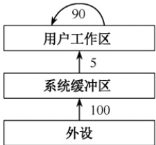
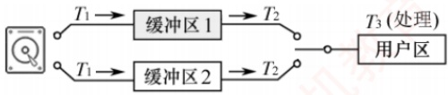
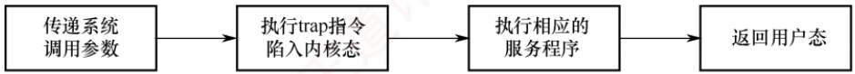
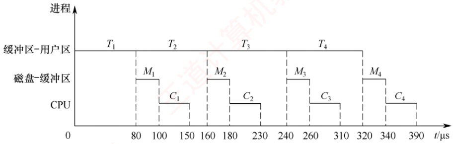
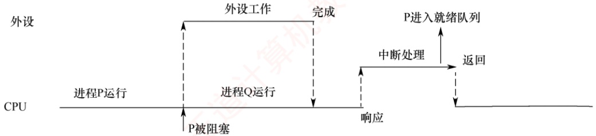
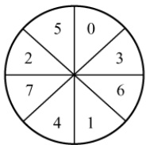
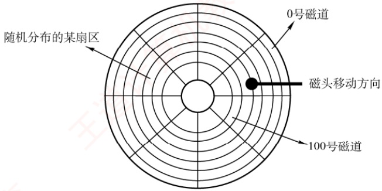
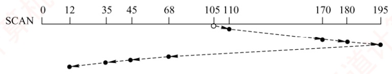
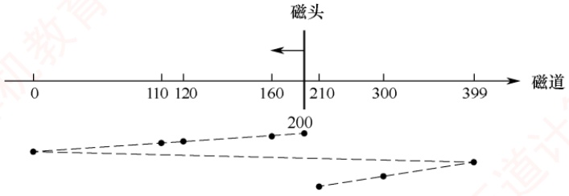
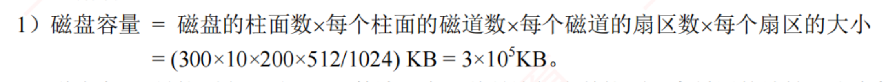

# 第5章 输入/输出管理 · 习题与解析

> 由《第5章 输入/输出管理》正文摘出；区块标题保留了原书的小节编号。

### 5.1.6 本节习题精选

#### 一、单项选择题

01. 下列关于设备属性的叙述中，正确的是（）。
A. 字符设备的基本特征是可寻址到字节，即能指定读/写操作的字节地址
B. 共享设备必须是可寻址的和可随机访问的设备
C. 共享设备是指同一时刻内允许多个进程同时访问的设备
D. 在分配共享设备和独占设备时都可能引起进程死锁

02. 下列关于虚拟设备的含义的描述中，正确的是（）。A. 允许用户使用比系统中具有的物理设备更多的设备

B. 允许用户以标准化方式来使用物理设备
C. 把一个物理设备变换成多个对应的逻辑设备
D. 允许用户程序不必全部装入主存便可使用系统中的设备

03. 磁盘设备的I/O控制主要采取（）方式。
A. 位
B. 字节
C. 帧
D. DMA

04. 为了便于上层软件的编制，设备控制器通常需要提供（）。
A. 控制寄存器、状态寄存器和控制命令
B. I/O地址寄存器、工作方式状态寄存器和控制命令
C. 中断寄存器、控制寄存器和控制命令
D. 控制寄存器、编程空间和控制逻辑寄存器

05. 在设备控制器中用于实现设备控制功能的是（）。
A. CPU
B. 设备控制器与处理器的接口
C. I/O 逻辑
D. 设备控制器与设备的接口

06. DMA方式是在（）之间建立一条直接数据通路。
A. I/O 设备和主存
B. 两个 I/O 设备
C. I/O 设备和 CPU
D. CPU 和主存

07.在操作系统中，（）指的是一种硬件机制。
A. 通道技术
B. 缓冲池
C. SPOOLing 技术
D. 内存覆盖技术

08. 若I/O设备与存储设备进行数据交换不经过 CPU来完成，则这种数据交换方式是（）。
A. 程序查询
B. 中断方式
C. DMA 方式
D. 直接存取方式

09. 下列关于DMA方式的描述中，正确的是（）。
A. DMA是一个专门负责输入/输出的处理机
B. 数据传输过程由DMA控制器负责，CPU只在预处理和后处理阶段进行干预
C. CPU通过程序的方式给出 DMA 可以解释的程序
D. DMA 不需要 CPU 指出所取数据的地址与长度

10. 计算机系统中，不属于 DMA 控制器的是（)。
A. 命令/状态寄存器
B. 内存地址寄存器
C. 数据寄存器 XTIS
D. 堆栈指针寄存器

11. DMA传输前需要进行预处理，传输后需要进行后处理，则下列说法中正确的是（）。
A. 预处理程序运行在用户态，后处理程序运行在内核态
B. 负责预处理和后处理程序的进程都是请求I/O的进程 算机
C. 预处理阶段不需要CPU参与，后处理阶段需要CPU参与
D. 预处理阶段请求I/O的进程处于运行态，后处理阶段处于阻塞态

12.在下列问题中，（）不是设备分配中应考虑的问题。
A. 及时性
B. 设备的固有属性
C. 设备独立性
D. 安全性

13. 将系统中的每台设备按某种原则统一进行编号，这些编号作为区分硬件和识别设备的代号，该编号称为设备的（）。
A. 绝对号
B. 相对号
C. 类型号
D. 符号

14. 关于通道、设备控制器和设备之间的关系，以下叙述中正确的是（）。
A. 设备控制器和通道可以分别控制设备
B. 对于同一组输入/输出命令，设备控制器、通道和设备可以并行工作
C. 通道控制设备控制器、设备控制器控制设备工作
D. 以上答案都不对

15. 一个计算机系统配置了2台相同类型的绘图机和3台相同类型的打印机，为了正确驱动这些设备，系统应该提供（）个设备驱动程序。
A. 5
B. 3
C. 2
D. 1

16. 将系统调用参数翻译成设备操作命令的工作由（）完成。
A. 用户层I/O 王道
B. 设备无关的操作系统软件
C. 中断处理
D. 设备驱动程序

17. 向设备寄存器的写命令是在I/O软件的（）中完成的。
A. 用户层软件
B. 设备独立性软件
C. 设备驱动程序
D. 中断处理程序

18.一个典型的文本打印页面有50行，每行80个字符，假定一台标准的打印机每分钟能打印6页，向打印机的输出寄存器中写一个字符的时间很短，可忽略不计。若每打印一个字符都需要花费 $50 \mu \mathrm {s}$ 的中断处理时间（包括所有服务），则使用中断驱动I/O方式运行这台打印机，中断的系统开销占CPU的百分比为（）。
A. 2%
B. 5%
C. 20%
D. 50%

19. 在接收和处理一个输入设备的中断的过程中，一定不由硬件来完成的工作是（）。
A. 判断产生中断的类型
B. CPU模式由用户态切换到内核态
C. 主机获取设备输入
D. 保存用户程序的断点

20. 下列几种I/O方式中，会导致用户进程进入阻塞态的是（）。I. 程序直接控制 II. 中断方式 III. DMA 方式
A. ⅡI
B. I、ⅢII
C. II、III
D. I、II、ⅢII

21. 当一个进程请求I/O操作时，该进程将被挂起，直到I/O设备完成I/O操作后，设备控制器便向CPU发送一个中断请求，CPU响应后便转向中断处理程序，下列关于中断处理程序的说法中，错误的是（）。
A. 中断处理程序将设备控制器中的数据传送到内存的缓冲区（读入），或将要输出的数据传送到设备控制器（输出）。
B. 对于不同的设备，有不同的中断处理程序
C. 中断处理结束后，需要恢复CPU现场，此时一定会返回到被中断的进程
D. I/O操作完成后，驱动程序必须检查本次I/O操作中是否发生了错误

22. 在I/O系统与高层之间的接口中，根据设备类型的不同，又进一步分为若干类接口，若某设备的数据传输速率较高，且可寻址，则比较适合采用（）。
A. 块设备接口
B. 网络设备接口
C. 字符设备接口
D. 流设备接口

23.【2010统考真题】本地用户通过键盘登录系统时，首先获得键盘输入信息的程序是（）。
A. 命令解释程序
B. 中断处理程序
C. 系统调用服务程序
D. 用户登录程序

24.【2011统考真题】用户程序发出磁盘I/O请求后，系统的正确处理流程是（）。
A. 用户程序→系统调用处理程序→中断处理程序→设备驱动程序
B. 用户程序→系统调用处理程序→设备驱动程序→中断处理程序
C. 用户程序→设备驱动程序→系统调用处理程序→中断处理程序
D. 用户程序→设备驱动程序→中断处理程序→系统调用处理程序

25.【2012统考真题】操作系统的I/0子系统通常由4个层次组成，每层明确定义了与邻近层次的接口，其合理的层次组织排列顺序是（）。
A. 用户级I/O软件、设备无关软件、设备驱动程序、中断处理程序
B. 用户级I/O软件、设备无关软件、中断处理程序、设备驱动程序
C. 用户级I/O软件、设备驱动程序、设备无关软件、中断处理程序
D. 用户级I/O软件、中断处理程序、设备无关软件、设备驱动程序

26.【2017统考真题】系统将数据从磁盘读到内存的过程包括以下操作:① DMA 控制器发出中断请求②初始化 DMA 控制器并启动磁盘③从磁盘传输一块数据到内存缓冲区④执行“DMA结束”中断服务程序正确的执行顺序是（）。
A. ③→①→②→④
B. 2 →4
C. ②→① ③→4
D. ①→② ④→③

#### 二、综合应用题

01. 在某计算机系统中，时钟中断处理程序每次执行时间为 2ms（包括进程切换开销），若时钟中断频率为60Hz，则CPU用于时钟中断处理的时间比率为多少？

02. 考虑56kb/s调制解调器的性能，驱动程序输出一个字符后就阻塞，当一个字符打印完毕后，产生一个中断通知阻塞的驱动程序，输出下一个字符，然后阻塞。若发消息、输出一个字符和阻塞的时间总和为0.1ms，则由于处理调制解调器而占用的CPU时间比率是多少？假设每个字符有一个开始位和一个结束位，共占10位。

### 5.1.7 答案与解析

#### 一、单项选择题

01. B

可寻址是块设备的基本特征，选项A错误。若共享设备不是可寻址的和可随机访问的，则不能保证数据的完整性和一致性，也不能提高设备的利用率，选项B正确。共享设备是指一段时间内允许多个进程同时访问的设备，选项C错误。分配共享设备是不会引起进程死锁的，选项D错误。

02. C

虚拟设备是指采用虚拟技术将一台独占设备转换为若干逻辑设备。引入虚拟设备是为了克服独占设备速度慢、利用率低的特点。这种设备并不是物理地变成共享设备，一般的独享设备也不能转换为共享设备，只是用户在使用它们时“感觉”是共享设备，是逻辑的概念。

03. D

DMA方式主要用于块设备，磁盘是典型的块设备。这道题也要求读者了解什么是I/O控制方式，选项A、B、C显然都不是I/O控制方式。

04. A

中断寄存器位于主机内；不存在I/O地址寄存器；编程空间一般是由体系结构和操作系统共同决定的。控制寄存器和状态寄存器分别用于接收上层发来的命令并存放设备状态信号，是设备控制器与上层的接口；至于控制命令，它虽然是由CPU发出的，用来控制设备控制器，但控制命令是由设备控制器提供的，每种设备控制器都对应一组相应的控制命令。

接口用来传输信号，I/O逻辑即设备控制器，用来实现对设备的控制。

06. A

DMA是一种不经过CPU而直接从主存存取数据的数据交换模式，它在I/O设备和主存之间建立了一条直接数据通路，如磁盘。当然，这条数据通路只是逻辑上的，实际并未直接建立一条

物理线路，而通常是通过总线进行的。

07. A

通道是一种特殊的处理器，所以属于硬件技术。SPOOLing、缓冲池、内存覆盖都是在内存的基础上通过软件实现的。

08. C

在DMA方式中，设备和内存之间可以成批地进行数据交换而不用 CPU干预，CPU 只参与预处理和结束过程。

09. B

DMA不是一个处理机，而是一个控制器，选项A错误。CPU无须给出DMA可以解释的程序，而是给DMA发出一条命令，同时设置DMA控制器中寄存器的值，来启动DMA，选项C错误。DMA需要CPU指出所取数据的地址与长度，这些参数存放在DMA控制器的寄存器中，选项D错误。

10. D

命令/状态寄存器控制 DMA的工作模式并给 CPU反映它当前的状态，地址寄存器存放DMA作业时的源地址和目标地址，数据寄存器存放需要DMA转移的数据，只有堆栈指针寄存器不需要在DMA控制器中存放。

11. D

在预处理之前，请求I/O的进程通过系统调用进入内核态，因此预处理程序和后处理程序都运行在内核态。负责预处理的进程是请求I/O的进程，负责后处理的进程是中断服务例程，中断服务例程不是一个单独的进程。在预处理阶段，CPU执行相应的设备驱动程序来设置相关的传输参数，需要CPU的参与。预处理由请求I/O的进程在内核态执行相关操作，之后阻塞其自身，直到系统调用返回，因此在后处理阶段请求I/O的进程仍处于阻塞态。

12. A

设备的固有属性决定了设备的使用方式；设备独立性可以提高设备分配的灵活性和设备的利用率；设备安全性可以保证分配设备时不会导致永久阻塞。设备分配时一般无须考虑及时性，及时性是一个与系统性能和用户需求相关的因素，设备分配时应该考虑的问题是如何在保证系统安全和正确运行的前提下，合理地分配和利用设备资源。

13. A

系统为每台设备确定一个编号以便区分和识别设备，这个确定的编号称为设备的绝对号。

14. C

三者的控制关系是层层递进的，选项C正确。对于同一组输入/输出命令，要么CPU向通道发出命令，要么CPU直接给设备控制器发出命令，不存在并行的可能，选项B错误。

15. C

因为绘图机和打印机属于两种不同类型的设备，系统只要按设备类型配置设备驱动程序即可，即每类设备只需一个设备驱动程序。

16. B

将系统调用参数翻译成设备操作命令的工作由设备无关的操作系统软件完成。设备无关的操作系统软件是I/O软件的一部分，它向上层提供系统调用的接口，根据设备类型选择调用相应的驱动程序。设备驱动程序负责执行操作系统发出的I/O命令，因设备的不同而不同。

17. C

设备驱动程序负责将上层软件发来的抽象I/O要求转换为具体要求，发送给设备控制器，控制设备工作。设备驱动程序需要向设备寄存器写入命令，以控制设备的工作状态和数据传输方式。

18. A

这台打印机每分钟打印50×80×6=24000个字符，即每秒打印400个字符。每个字符打印中断需要占用CPU时间50μs，所以每秒用于中断的系统开销为400×50μs=20ms。若使用中断驱动I/O，则CPU剩余的 980ms可用于其他处理，中断的开销占CPU的2%。因此，使用中断驱动I/O方式运行这台打印机是有意义的。

19. C

在中断I/O方式下，由中断服务程序来完成数据的输入和输出，C错误。在中断响应阶段由硬件完成CPU模式的转换，并保存用户程序的断点，中断源的识别可以采用硬件识别法。

20. C

在程序直接控制方式下，用户进程在I/O过程中不会被阻塞，驱动程序完成用户进程的I/O请求后才结束，CPU和I/O操作串行。在中断控制方式下，驱动程序启动第一次I/O操作后，将调出其他进程执行，而当前用户进程被阻塞，CPU和设备准备并行。在DMA方式下，驱动程序对DMA控制器初始化后，便发送“启动DMA”命令，在外设和主存之间传送数据，同时CPU执行调度程序，转向其他进程执行，当前用户进程被阻塞时，CPU和数据传送并行。

21. C

中断处理结束后，是否返回到被中断的进程，有两种情况:①采用的是屏蔽中断方式（单重中断），此时会返回被中断的进程。②采用的是中断嵌套方式（多重中断），若没有更高优先级的中断请求，则会返回被中断的进程；否则，系统将处理更高优先级的中断请求。

22. A

块设备是指数据的存取和传输都是以数据块为单位的设备，其特征是传输速率较高且可寻址，典型的块设备（如磁盘）通常采用DMA方式。字符设备（也称流设备）是指数据的存取和传输是以字符为单位的设备，如键盘、打印机等，字符设备的传输速率较低且不可寻址。

23. B

键盘是典型的通过中断I/O方式工作的外设，当用户输入信息时，计算机响应中断并通过中断处理程序获得输入信息。

24. B

输入/输出软件一般从上到下分为4个层次:用户层、与设备无关的软件层、设备驱动程序及中断处理程序。与设备无关的软件层也就是系统调用的处理程序。

当用户使用设备时，首先在用户程序中发起一次系统调用，操作系统的内核接到该调用请求后，请求调用处理程序进行处理，再转到相应的设备驱动程序，当设备准备好或者所需数据到达后，设备硬件发出中断，将数据按上述调用顺序逆向回传到用户程序中。

25. A

考查内容同上题。设备管理软件一般分为4个层次:用户层、与设备无关的系统调用处理层、设备驱动程序及中断处理程序。

26. B

DMA的传送过程分为预处理、数据传送和后处理三个阶段。在预处理阶段，由CPU初始化DMA控制器中的有关寄存器、设置传送方向、测试并启动设备等。在数据传送阶段，完全由DMA控制，DMA控制器接管系统总线。在后处理阶段，DMA控制器向CPU 发送中断请求，CPU执行中断服务程序做DMA结束处理。因此，正确的执行顺序是②③①④。

#### 二、综合应用题

01. 【解答】

时钟中断频率为60Hz，因此中断周期为1/60s，每个时钟周期中用于中断处理的时间为2ms，

因此比率为 0.002/(1/60) = 12%。

02. 【解答】

因为一个字符占10位，因此在56kb/s的速率下，每秒传送56000/10=5600个字符，即产生5600 次中断。每次中断需0.1ms，因此处理调制解调器占用的CPU时间共为5600×0.1ms=560ms，占 56%的 CPU 时间。

### 5.2.8 本节习题精选

#### 一、单项选择题

01. 设备的独立性是指（）。
A. 设备独立于计算机系统
B. 系统对设备的管理是独立的
C. 用户编程时使用的设备与实际使用的设备无关
D. 每台设备都有唯一的编号

02. 引入高速缓冲的主要目的是（）。
A. 提高 CPU 的利用率
B. 提高I/O设备的利用率
C. 改善 CPU 与 I/O 设备速度不匹配的问题
D. 节省内存

03. 为了使多个并发进程能有效地进行输入和输出，最好采用（）结构的缓冲技术。
A. 缓冲池
B. 循环缓冲
C. 单缓冲
D. 双缓冲

04. 缓冲技术中的缓冲池在（）中。

A. 主存
B. 外存
C. ROM
D. 寄存器

05. 支持双向传送的设备应使用（）。 算机
A. 单缓冲区
B. 双缓冲区
C. 多缓冲区
D. 缓冲池

06. 下列关于缓冲区的描述中，正确的是（）。
A. 缓冲区是一种专门的硬件缓冲器，不能用内存来实现
B. 缓冲区的作用是提高CPU和I/O设备之间的速度匹配
C. 缓冲区只能用于输入设备，不能用于输出设备
D. 缓冲区只能用于块设备，不能用于字符设备

07.使用单缓冲或双缓冲进行通信时，（）可以实现数据的双向并行传输。
A. 只有单缓冲
B. 只有双缓冲
C. 都
D. 都不

08.下列各种算法中，（）是设备分配常用的一种算法。
A. 首次适应
B. 时间片分配
C. 最佳适应
D. 先来先服务

09. 设从磁盘将一块数据传送到缓冲区所用的时间为 $80 \mu \mathrm {s}$ ，将缓冲区中的数据传送到用户区所用的时间为 $40 \mu \mathrm {s}$ ，CPU处理一个数据块所用的时间为 $30 \mu \mathrm {s}$ 。若有多块数据需要处理，并采用单缓冲区传送某磁盘数据，则处理一块数据所用的总时间为（）。
A. 120μs
B. 110μs
C. $150 \mu \mathrm {s}$
D. 70μs

10. 某操作系统采用双缓冲区传送磁盘上的数据。设从磁盘将数据传送到缓冲区所用的时间为 $T_{1}$ ，将缓冲区中的数据传送到用 $\dot{产}$ 区所用的时间为 $T_{2} , \mathrm {CPU}$ 处理一块数据所用的时间为 $T_{3} ,$ 假设一个磁盘块和一个缓冲区的大小相等，某系统在一段时间内连续处理一大批数据，则平均处理一个磁盘块数据的时间为（）。
A. $T_{1} + T_{2} + T_{3}$
B. $\max(T_{2},T_{3}) + T_{1}$
C. $\operatorname* {max} ( T_{1} , T_{3} ) + T_{2}$
D. $\max(T_{1},T_{2}+T_{3})$

11. 若I/O所花费的时间比 CPU 的处理时间短得多，则缓冲区（）。
A. 最有效
B. 几乎无效
C. 均衡
D. 以上答案都不对

12. 缓冲区管理者重要考虑的问题是（）。
A. 选择缓冲区的大小
B. 决定缓冲区的数量
C. 实现进程访问缓冲区的同步
D. 限制进程的数量

13. 考虑单用户计算机上的下列I/O操作，需要使用缓冲技术的是（）。I. 图形用户界面下使用鼠标 Ⅱ. 多任务操作系统下的磁盘驱动器（假设没有设备预分配） 十算机教Ⅲ. 包含用户文件的磁盘驱动器IV. 使用存储器映射I/O，直接和总线相连的图形卡 自
A. I、ⅢII
B. II、IV
C. II、III、IV
D. 全选

14. 以下（）不属于设备管理数据结构。
A. PCB
B. DCT
C. COCT
D. CHCT

15. 下列（）不是设备的分配方式。
A. 独享分配
B. 共享分配
C. 虚拟分配
D. 分区分配

16. 设备分配程序需要访问一系列的数据结构来给进程分配设备，这些数据结构有:设备控制表（DCT），控制器控制表（COCT），通道控制表（CHCT），系统设备表（SDT）。在设备分配的过程中，访问这些数据结构的正确顺序是（）。
A. SDT, DCT, COCT, CHCT
B. DCT, COCT, CHCT, SDT
C. SDT, COCT, CHCT, DCT 自
D. COCT, CHCT, SDT, DCT

17. 下面设备中属于共享设备的是（）。
A. 打印机
B. 磁带机
C. 磁盘
D. 磁带机和磁盘

18. 提高单机资源利用率的关键技术是（）。C. SPOLi 技术 道 B. 虚多道技序设计技术

19. 虚拟设备是靠（）技术来实现的。
A. 通道
B. 缓冲
C. SPOOLing
D. 控制器

20. SPOOLing技术的主要目的是（)。
A. 提高 CPU 和设备交换信息的速度
B. 提高独占设备的利用率
C. 减轻用户编程负担
D. 提供主、辅存接口

21. 在采用 SPOOLing技术的系统中，用户的打印结果首先被送到（）。
A. 磁盘固定区域
B. 内存固定区域
C. 终端
D. 打印机

22. 采用 SPOOLing技术的计算机系统，外围计算机需要（）。
A. 一台
B. 多台
C. 至少一台 首
D. 0台

23.SPOOLing系统由（）组成。
A. 预输入程序、井管理程序和缓输出程序
B. 预输入程序、井管理程序和井管理输出程序
C. 输入程序、井管理程序和输出程序
D. 预输入程序、井管理程序和输出程序

24. 在 SPOOLing系统中，用户进程实际分配到的是（）。
A. 用户所要求的外设
B. 外存区，即虚拟设备
C. 设备的一部分存储区
D. 设备的一部分空间

25.下面关于SPOOLing系统的说法中，正确的是（）。
A. 构成 SPOOLing系统的基本条件是有外围输入机与外围输出机
B. 构成 SPOOLing系统的基本条件仅是要有高速的大容量硬盘作为输入井和输出井
C. 当输入设备忙时，SPOOLing系统中的用户程序暂停执行，待I/O空闲时再被唤醒执行输出操作
D. SPOOLing系统中的用户程序可以随时将输出数据送到输出井中，待输出设备空闲时再由 SPOOLing系统完成数据的输出操作

26. 下面关于 SPOOLing的叙述中，不正确的是（）。
A. SPOOLing系统中不需要独占设备
B. SPOOLing系统加快了作业执行的速度
C. SPOOLing系统使独占设备变成共享设备
D. SPOOLing系统提高了独占设备的利用率

27.（）是操作系统中采用的以空间换取时间的技术。
A. SPOOLing技术
B. 虚拟存储技术
C. 覆盖与交换技术
D. 通道技术

28. 采用假脱机技术，将磁盘的一部分作为公共缓冲区以代替打印机，用户对打印机的操作实际上是对磁盘的存储操作，用以代替打印机的部分由（）完成。
A. 独占设备
B. 共享设备
C. 虚拟设备
D. 一般物理设备

29. 下面关于独占设备和共享设备的说法中，不正确的是（）。
A. 打印机、扫描仪等属于独占设备
B. 对独占设备往往采用静态分配方式
C. 共享设备是指一个作业尚未撤离，另一个作业即可使用，但每个时刻只有一个作业使用
D. 对共享设备往往采用静态分配方式 K

30.当用户要求使用打印机打印某文件时，用户的要求是由操作系统的（）实现的。
A. 文件系统
B. 设备管理程序
C. 文件系统和设备管理程序 自
D. 打印机启动程序和设备管理程序

31. 下列设备管理工作中，适合由设备独立性软件来完成的有（）。I. 向设备寄存器写命令 I. 检查用户是否有权使用设备II. 将二进制整数转换成 ASCII 码格式打印 IV. 缓冲区管理
A. I、ⅡI和III
B. II、III和Ⅳ
C. ⅡI和IV
D. I、III 和IV

32. 下列关于设备驱动程序的说法中，正确的是（）。I. 设备驱动程序负责处理与设备相关的中断处理过程 算机教Ⅱ. 驱动程序全部使用汇编语言编写，没有使用高级语言编写Ⅲ. 设备驱动程序负责处理磁盘调度IV. 设备驱动程序与设备密切相关，可以在任意操作系统运行
A. II、III、IV
B. I、III
C. III、IV
D. I、II、III

33.下列选项中，（）不属于设备驱动程序的功能。
A. 接收进程发来的I/O命令和参数，并检查其合法性
B. 查询 I/O 设备的状态
C. 发出I/O 命令，启动 I/O 设备
D. 对I/O设备传回的数据进行分析和缓冲

34. 对设备驱动程序的处理过程进行排序，正确的处理顺序是（）。①对服务请求进行校验 ②传送必要的参数 ③启动I/O设备④将抽象要求转化为具体要求 ⑤检查设备的状态
A. ①④⑤②③
B. ④①⑤②③
C. ①④②⑤③
D. ④①②⑤③

35. printf()是C 语言中进行格式化输出的库函数，该函数最终会转到内核态执行相应的系统调用服务例程，进程是通过执行（）从用户态进入内核态的。
A. 陷入指令
B. 关中断指令
C. 无条件跳转指令
D. 输出指令

36.【2009统考真题】单处理机系统中，可并行的是（）。I. 进程与进程 I. 处理机与设备 II. 处理机与通道 IV. 设备与设备
A. I、ⅡI、III
B. I、ⅡI、IV
C. I、III、IV
D. II、III、IV

37. 【2009统考真题】程序员利用系统调用打开I/O设备时，通常使用的设备标识是（）。
A. 逻辑设备名
B. 物理设备名
C. 主设备号
D. 从设备号

38.【2011统考真题】某文件占10个磁盘块，现要把该文件的磁盘块逐个读入主存缓冲区，并且送到用户区进行分析，假设一个缓冲区与一个磁盘块大小相同，把一个磁盘块读入缓冲区的时间为100μs，将缓冲区的数据传送到用户区的时间是50μs，CPU对一块数据进行分析的时间为50μs。在单缓冲区和双缓冲区结构下，读入并分析完该文件的时间分别是（）。
A. 1500μs, 1000μs
B. 1550μs, 1100μs
C. 1550μs, 1550μs
D. 2000μs, 2000μs

39.【2013统考真题】设系统缓冲区和用户工作区均采用单缓冲，从外设读入一块数据到系统缓冲区的时间为100，从系统缓冲区读入一块数据到用户工作区的时间为5，对用户工作区中的一块数据进行分析的时间为90（见右图）。进程从外设读入并分析2个数据块的最短时间是（）。

A. 200
B. 295
C. 300
D. 390

40. 【2013统考真题】用户程序发出磁盘I/O请求后，系统的处理流程是:用户程序→系统调用处理程序→设备驱动程序→中断处理程序。其中，计算数据所在磁盘的柱面号、磁头号、扇区号的程序是（）。
A. 用户程序 王道
B. 系统调用处理程序
C. 设备驱动程序
D. 中断处理程序

41.【2015统考真题】在系统内存中设置磁盘缓冲区的主要目的是（）。
A. 减少磁盘I/O 次数
B. 减少平均寻道时间
C. 提高磁盘数据可靠性
D. 实现设备无关性

42.【2016统考真题】下列关于SPOOLing技术的叙述中，错误的是（）。
A. 需要外存的支持
B. 需要多道程序设计技术的支持
C. 可以让多个作业共享一台独占式设备
D. 由用户作业控制设备与输入/输出井之间的数据传送

43.【2020统考真题】对于具备设备独立性的系统，下列叙述中，错误的是（）。
A. 可以使用文件名访问物理设备
B. 用户程序使用逻辑设备名访问物理设备
C. 需要建立逻辑设备与物理设备之间的映射关系
D. 更换物理设备后必须修改访问该设备的应用程序

44.【2022统考真题】下列关于驱动程序的叙述中，不正确的是（）。
A. 驱动程序与 I/O 控制方式无关
B. 初始化设备是由驱动程序控制完成的
C. 进程在执行驱动程序时可能进入阻塞态
D. 读/写设备的操作是由驱动程序控制完成的

45.【2023统考真题】下列因素中，设备分配需要考虑的是（）。I. 设备的类型 Ⅱ. 设备的访问权限Ⅲ. 设备的占用状态 IV. 逻辑设备与物理设备的映射关系
A. 仅I、ⅡI
B. 仅ⅡI、ⅢI
C. 仅ⅢI、IV
D. I、ⅡI、III、IV

46.【2024统考真题】当键盘中断服务例程执行结束时，所输入数据的存放位置是（）。
A. 用户缓冲区
B. CPU 中的通用寄存器
C. 内核缓冲区
D. 键盘控制器的数据寄存器

#### 二、综合应用题

01. 输入/输出软件一般分为4个层次:用户层、与设备无关的软件层、设备驱动程序和中断处理程序。请说明以下各工作是在哪一层完成的:1）为磁盘读操作计算磁道、扇区和磁头。2）向设备寄存器写命令。3）检查用户是否有权使用设备。 教育4）将二进制整数转换成ASCI码以便打印。

02. 在某系统中，若采用双缓冲区（每个缓冲区可存放一块数据），将一块数据从磁盘传送到缓冲区的时间为80μs，从缓冲区传送到用户的时间为20μs，CPU计算一块数据的时间为50μs。总共处理4个数据块，每个数据块的平均处理时间是多少？

03.【2023统考真题】进程P通过执行系统调用从键盘接收一个字符的输入，已知此过程中与进程P相关的操作包括:①将进程P插入就绪队列；②将进程P插入阻塞队列；③将字符从键盘控制器读入系统缓冲区；④启动键盘中断处理程序；⑤进程P从系统调用返回；⑥用户在键盘上输入字符。以上编号①\~⑥仅用于标记操作，与操作的先后顺序无关。请回答下列问题。

1）按照正确的操作顺序，操作①的前一个和后一个操作分别是上述操作中的哪一个？操作⑥的后一个操作是上述操作中的哪一个？

2）在上述哪个操作之后CPU一定从进程P切换到其他进程？在上述哪个操作之后CPU调度程序才能选中进程P执行？

3）完成上述哪个操作的代码属于键盘驱动程序？

4）键盘中断处理程序执行时，进程P处于什么状态？CPU是处于内核态还是处于用户态？

### 5.2.9 答案与解析

#### 一、单项选择题

01. C

设备的独立性主要是指用户使用设备的透明性，即使用户程序和实际使用的物理设备无关。

02. C

CPU与I/O设备执行速度通常是不对等的，前者快、后者慢，通过高速缓冲技术来改善两者不匹配的问题。

03. A

缓冲池是系统的共用资源，可供多个进程共享，并且既能用于输入又能用于输出。其一般包含三种类型的缓冲:①空闲缓冲区；②装满输入数据的缓冲区；③装满输出数据的缓冲区。为了管理上的方便，可将相同类型的缓冲区链成一个队列。选项B、C、D属专用缓冲。

04. A

输入井和输出井是在磁盘上开辟的存储空间，而输入/输出缓冲区是在内存中开辟的，因为CPU速度比I/O设备高很多，缓冲池通常在主存中建立。

05. B

支持双向发送和接收数据的设备（如网卡等）应使用双缓冲区，双缓冲区可以实现同一时刻的双向数据传输，提高设备的效率和利用率。单缓冲区只能实现单向数据传输。多缓冲区和缓冲池用于提高I/O性能的技术，但不是必需的，也不一定适合所有的双向设备。

06. B

缓冲区是一个存储区域，可由专门的硬件寄存器组成，也可利用内存来实现。缓冲区的作用是提高 CPU 和I/O设备之间的速度匹配，因为 CPU 的速度远高于 I/O 设备的速度，若没有缓冲区，则CPU就要等待I/O设备完成操作，造成资源浪费。缓冲区可用于输入设备和输出设备，如键盘、打印机等。缓冲区也可用于块设备和字符设备，如磁盘、串口等。

07. B

两个进程之间若只设置单缓冲区，则同一时刻只能实现单向传输，但可在一段时间内用于发送数据，另一段时间内用于接收数据。若设置双缓冲区，则可以实现双向同时的并行传输。

08. D

选项A和C都是动态分区分配的常用算法，选项B是进程调度的常用算法，设备分配的常用算法主要有先来先服务算法和最高优先级优先算法。

09. A

采用单缓冲区传送数据时，设备与处理机对缓冲区的操作是串行的，当进行第i次读磁盘数据送至缓冲区时，系统再同时读出用户区中第i-1次数据进行计算，此两项操作可以并行，并与数据从缓冲区传送到用户区的操作串行进行，所以系统处理一块数据所用的总时间为max(80μs, $30\mu s + 40\mu s = 120\mu s$ 0

10. D

计算处理一个磁盘块数据的平均时间，可以假定系统的初始状态:用户区为空，缓冲区1为满，缓冲区2为空，如右图所示。 $\textcircled{i}  0   \sim   T_{2}$ 时段，将缓冲区1中的数据送入用户区；② $T_{2} \sim T_{2} + T_{3}$ 时段， T1 缓冲区1 → T2 T3(处理)用户区处理用户区中的数据，③ $0 {\sim} T_{1}$ 时段，将数据从磁盘 a T1→ 缓冲区2 → T2送入缓冲区2，只有②和③都完成后，系统才重新回 一算机到初始状态，因此平均处理一个磁盘块数据的时间为 $\max(T_{1},T_{2}+T_{3})$ 0

11. B

缓冲区主要解决输入/输出速度比CPU处理的速度慢而造成数据积压的矛盾。所以当I/O花费的时间比CPU处理时间短很多时，缓冲区没有必要设置。

12. C

在缓冲机制中，无论是单缓冲、多缓冲还是缓冲池，因为缓冲区是一种临界资源，所以在使用缓冲区时都有一个申请和释放（互斥）的问题需要考虑。

13. D

在鼠标移动时，若有高优先级的操作产生，为了记录鼠标活动的情况，必须使用缓冲技术，说法Ⅰ正确。由于磁盘驱动器和目标或源I/O设备间的吞吐量不同，必须采用缓冲技术，说法Ⅱ正确。为了能使数据从用户作业空间传送到磁盘或从磁盘传送到用户作业空间，必须采用缓冲技术，说法Ⅲ正确。为了便于多幅图形的存取及提高性能，缓冲技术是可以采用的，特别是在显示当前一幅图形又要得到下一幅图形时，应采用双缓冲技术，说法IV正确。

14. A

DCT 是设备控制表；COCT 是控制器控制表；CHCT 是通道控制表；PCB 是进程控制块，不属于设备管理的数据结构。

15. D

设备的分配方式主要有独享分享、共享分配和虚拟分配，选项D是内存的分配方式。

16. A

在设备分配的过程中，访问数据结构的顺序通常是按设备管理的逻辑层次来安排的。设备分配过程通常从系统设备表（SDT）开始，然后依次获取设备控制表（DCT）、控制器控制表（COCT)和通道控制表（CHCT）中的信息，最终完成对设备的分配。

17. C

共享设备是指在一个时间间隔内可被多个进程同时访问的设备，只有磁盘满足。打印机在一个时间间隔内被多个进程访问时，打印出来的文档会乱；磁带机旋转到所需的读/写位置需要较长时间，若一个时间间隔内被多个进程访问，磁带机就只能一直旋转，没时间读/写。

18. D

在单机系统中，最关键的资源是处理器资源，最大化地提高处理器利用率，就是最大化地提高系统效率。多道程序设计技术是提高处理器利用率的关键技术，其他均为设备和内存的相关技术。

19. C

SPOOLing技术是操作系统中采用的一种将独占设备改造为共享设备的技术。通过这种技术处理后的设备通常称为虚拟设备。

20. B

SPOOLing技术将一台物理设备虚拟为多台逻辑设备，以减少设备的闲置时间，提高设备的并发度和吞吐量，因此 SPOOLing技术的主要目的是提高独占设备的利用率。

21. A

输入井和输出井是在磁盘上开辟的两大存储空间。输入井模拟脱机输入时的磁盘设备，用于暂存I/O设备输入的数据；输出井模拟脱机输出时的磁盘，用于暂存用户程序的输出数据。为了缓和CPU，打印结果首先送到位于磁盘固定区域的输出井。

22. D

SPOOLing技术需要使用磁盘空间（输入井和输出井）和内存空间（输入/输出缓冲区），不需要外围计算机的支持。

23. A

SPOOLing系统主要包含三部分，即输入井和输出井、输入缓冲区和输出缓冲区以及输入进程和输出进程。这三部分由预输入程序、井管理程序和缓输出程序管理，以保证系统正常运行。

24. B

通过 SPOOLing 技术可将一台物理 I/O 设备虚拟为I/O 设备，同样允许多个用户共享一台物理I/O 设备，所以 SPOOLing并不是将物理设备真的分配给用户进程。

25. D

构成SPOOLing系统的基本条件是不仅要有大容量、高速度的外存作为输入井和输出井，还要有 SPOOLing 软件，因此选项 A 错误、选项 B 不够全面，同时利用 SPOOLing 技术提高了系统和I/O设备的利用率，进程不必等待I/O操作的完成，因此选项C也不正确。

26. A

SPOOLing技术将独占设备虚拟成共享设备，因此必须先有独占设备才行。下面说明SPOOLing技术如何加快作业执行的速度，提高独占设备的利用率。进程不需要等待打印机空闲，只需将输出数据送到输出井，然后继续执行其他操作，这样就提高了进程的效率。打印机不需要空闲等待进程的输出，只需从输出井中读取数据进行打印，然后读取下一个数据，这样就提高了打印机的效率。输出进程可以根据输出并中的数据量和优先级来安排打印顺序，从而平衡各个进程的等待时间和响应时间，这样就提高了系统的性能。输出进程可以减少对打印机的切换次数，从而减少系统的开销，进而提高打印机的利用率。

27. A

SPOOLing技术需有高速大容量且可随机存取的外存支持，通过预输入和缓输出来减少CPU等待慢速设备的时间，将独享设备改造成共享设备。

28. C

利用假脱机技术可将独享设备改造为可供多个用户共享的虚拟设备，各作业在执行期间只使用虚拟设备。采用假脱机技术，将磁盘的一部分作为公共缓冲区以代替打印机，用户对打印机的操作实际上是对磁盘的存储操作，用以代替打印机的部分由虚拟设备完成。

29. D

独占设备采用静态分配方式，而共享设备采用动态分配方式。

30. C

当用户使用打印机打印某文件时，需要通过文件系统来访问磁盘上的数据，然后通过设备管

理程序来控制打印机的输出。打印机启动程序只能初始化打印机，不能直接访问磁盘上的数据。

31. C

设备寄存器写命令是由设备驱动程序完成的。检查用户是否有权使用设备属于设备保护，是由设备独立性软件完成的。将二进制整数转换成ASCⅡ码的格式打印是通过I/O库函数完成的，属于用户层软件。缓冲区管理属于输入/输出的共有操作，是由设备独立性软件完成的。缓冲区是内存中的区域，显然不是由设备驱动程序完成的。

32. B

不同厂家的设备通常提供不同的驱动程序，对应不同的中断处理，因此需要驱动程序来完成，说法Ⅰ正确。驱动程序仅有一部分需要用汇编语言编写，其余部分可用高级语言编写，说法Ⅱ错误。不同型号的磁盘的调度方式不一定相同，磁盘调度由磁盘驱动程序完成，说法Ⅲ正确。不同的操作系统有不同的驱动程序接口，因此驱动程序要根据操作系统的要求进行定制，说法IⅣ错误。

33. D

设备驱动程序的功能是管理I/O设备。数据的分析和缓冲是由进程或操作系统完成的。

34. B

用户层软件发出的命令是设备独立性软件提供的统一接口，需要由驱动程序将这些抽象要求转化为具体要求，才能被设备控制器识别，例如将抽象要求中的盘块号转化为磁盘的柱面号、盘面号和扇区号。然后，驱动程序会检查服务请求是不是该设备可以执行的，之后检查设备的状态，只有设备处于就绪状态时才能启动，最后传送此次I/O的参数并启动设备。

35. A

printf()是进行输出的函数，最终需要在内核态执行I/O指令来完成输出的功能。系统调用函数中包含一条陷入指令，也称trap指令，会让CPU陷入内核态执行相应的服务程序。

36. D

在单CPU系统中，同一时刻只能有一个进程占用CPU，因此进程之间不能并行执行。通道是独立于CPU、控制输入/输出的设备，两者可以并行。显然，处理器与设备是可以并行的。设备与设备也是可以并行的，比如显示屏与打印机是可以并行工作的。

37. A

用户程序对I/O设备的请求采用逻辑设备名，而程序实际执行时使用物理设备名，它们之间的转换是由设备无关软件层完成的。主设备和从设备是总线仲裁中的概念。

38. B

在单缓冲区中，当上一个磁盘块从缓冲区读入用户区完成时，下一磁盘块才能开始读入，也就是当最后一个磁盘块读入用户区完毕时所用的时间为 $150 \times 10 = 1500 \mu s$ ，加上处理最后一个磁盘块的时间 $50 \mu \mathrm {s}$ ，得 $1550 \mu \mathrm {s}$ 。双缓冲区中，不存在等待磁盘块从缓冲区读入用户区的问题，10个磁盘块可以连续从外存读入主存缓冲区，加上将最后一个磁盘块从缓冲区送到用户区的传输时间$50 \mu \mathrm {s}$ 及处理时间 $50 \mu \mathrm {s}$ ，也就是 $100 \times 10 + 50 + 50 = 1100 \mu s$

39. C

数据块1从外设到用户工作区的总时间为105，在这段时间中，数据块2未进行操作。在数据块1进行分析处理时，数据块2从外设到用户工作区的总时间为105，这段时间是并行的。再加上数据块2进行处理的时间90，总共是300。

40. C

计算柱面号、磁头号和扇区号的工作是由设备驱动程序完成的。题中的功能因设备硬件的不同而不同，因此应由厂家提供的设备驱动程序实现。

41. A

磁盘和内存的速度差异，决定了可以将内存经常访问的文件调入磁盘缓冲区，从高速缓存中复制的访问比磁盘I/O的机械操作要快很多。

42. D

SPOOLing利用专门的外围控制机，将低速I/O设备上的数据传送到高速磁盘上，或者相反。SPOOLing的意思是外部设备同时联机操作，也称假脱机输入/输出操作，是操作系统中采用的一项将独占设备改造成共享设备的技术。高速磁盘即外存，选项A正确。SPOOLing技术建立在多道程序设计技术的基础上，在一个时间段内，输入进程、输出进程是可以和运行的作业进程并发执行的，选项B正确。SPOOLing技术实现了将独占设备改造成共享设备的技术，选项C正确。设备与输入并/输出并之间数据的传送是由系统实现的，选项D错误。

43. D

设备可视为特殊文件，选项A正确。用户使用逻辑设备名来访问物理文件，有利于设备独立性，选项B正确。通过逻辑设备名访问物理设备时，需要建立逻辑设备和物理设备之间的映射关系，选项C正确。应用程序按逻辑设备名访问设备，再经驱动程序的处理来控制物理设备，若更换物理设备，则只需更换驱动程序，而无须修改应用程序，选项D错误。

44. A

厂家在设计一个设备时，通常会为该设备编写驱动程序，主机需要先安装驱动程序，才能使用设备。当一个设备被连接到主机时，驱动程序负责初始化设备(如将设备控制器中的寄存器初始化)，选项B正确。若采用程序直接控制方式，进程不会被阻塞，进程会处于等待状态；若采用中断控制方式，则驱动程序启动I/O操作后，将调出其他进程执行，而当前用户进程被阻塞；若采用DMA控制方式，则驱动程序对DMA控制器初始化后，便发送“启动DMA传送”命令，外设开始传送数据，同时CPU执行处理器调度程序，当前用户进程被阻塞，选项C正确。设备的读/写操作本质就是在设备控制器和主机之间传送数据，而只有厂家知道设备控制器的内部实现，因此也只有厂家提供的驱动程序能控制设备的读/写操作，选项D正确。厂家会根据设备特性，在驱动程序中实现一种合适的I/O控制方式，不同的I/O控制方式需要不同的驱动程序来实现数据的传输和控制，例如，中断驱动方式需要驱动程序能够响应中断信号，DMA方式需要驱动程序能够设置DMA控制器的寄存器，通道控制方式需要驱动程序能够执行通道指令等，选项A错误。

45. D

设备的类型决定了设备的固有属性，如独占性、共享性、可虚拟性等，不同类型的设备需要采用不同的分配方式，如独占分配、共享分配、虚拟分配等。设备的访问权限决定了哪些进程可以使用哪些设备，以保证系统的安全性和保密性，通常系统设备只能由系统进程或特权进程访问，用户设备只能由用户进程或授权进程访问。设备的占用状态决定了设备是否可以被分配给请求进程，以及如何处理等待进程，若设备空闲，则通常可以直接分配给请求进程；若设备忙，则需要将请求进程排入设备队列，并按照一定的算法进行调度。逻辑设备与物理设备的映射关系决定了如何通过逻辑地址访问物理地址，以提高系统的灵活性和可扩展性，通常系统会为每个物理设备分配一个逻辑名，并建立一个系统设备表来记录逻辑名与物理名之间的对应关系。

46. C

以C语言中 scanf()函数的执行过程为例，用户请求通过键盘输入数据，当程序执行到 scanf()

时，触发系统调用，CPU切换到内核态，执行系统调用服务例程，系统调用的内核程序进行一些初始化操作，启动外设，同时阻塞该用户进程，直到键盘输入数据，键盘中断服务例程（实际上是驱动程序）将数据从I/O接口（键盘控制器）中的数据寄存器取出并送至内核缓冲区，然后唤醒用户进程，用户进程被唤醒后进入就绪队列，等得到CPU运行后，再将内核缓冲区中的数据送至用户缓冲区，最后进行系统调用的返回。综上所述，键盘中断服务例程执行结束后，所输入数据的存放位置是内核缓冲区，当系统调用结束时，所输入数据才被送至用户缓冲区。

#### 二、综合应用题

01. 【解答】

分析:首先，我们来看这些功能是不是应该由操作系统来完成。操作系统是一个代码相对稳定的软件，它很少发生代码的变化。若1）由操作系统完成，则操作系统就必须记录逻辑块和磁盘细节的映射，操作系统的代码会急剧膨胀，而且对新型介质的支持也会引起代码的变动。若2）也由操作系统完成，则操作系统需要记录不同生产厂商的不同数据，而且后续新厂商和新产品也无法得到支持。

因为1）和2）都与具体的磁盘类型有关，因此为了能够让操作系统尽可能多地支持各种不同型号的设备，1）和2）应由厂商所编写的设备驱动程序完成。3）涉及安全与权限问题，应由与设备无关的操作系统完成。4)应由用户层来完成，因为只有用户知道将二进制整数转换为ASCⅡI码的格式（使用二进制还是十进制、有没有特别的分隔符等）。

02. 【解答】

4个数据块的处理过程如下图所示，总耗时 $390 \mu \mathrm {s}$ ，每块的平均处理时间为 $390\mu s /4 = 97.5\mu s$

从上图可以看出，处理n个数据块的总耗时为 $( 80 n + 20 + 50 ) \mu \mathrm {s} = ( 80 n + 70 ) \mu \mathrm {s}$ ，每个数据块的平均处理时间为 $( 80 n + 70 ) / n \mu \mathrm {s}$ ，当n较大时，平均时间近似为 $\operatorname* {max} ( C , T ) = 80 \mu \mathrm {s}$

03. 【解答】

1）正确的执行顺序为②⑥④③①⑤，因此操作①的前一个操作是③，后一个操作是⑤；操作⑥的后一个操作是④。下面以 scanf()函数的执行过程为例分析相关操作顺序。首先用户进程P 调用 I/O标准库的 scanf()函数，scanf()调用系统调用封装函数 read()，在这个函数中有一条陷阱指令，通过它陷入内核，内核调出 read()对应的 sys read()系统调用服务例程进行执行，进入内核后，在设备无关层进行若干调用，最终到设备驱动层进行处理，设备驱动程序对本次I/O进行初始化操作，然后执行操作系统的进程调度程序scheduler()，由调度程序schedulerO来阻塞用户进程P，并调度其他进程执行。此后，在用户输入字符之前，CPU运行其他进程，键盘等待用户输入数据，当用户在键盘上输入字符后，外设向CPU发出相应的中断请求，CPU响应中断后，启动键盘中断处理程序，该处理程序对I/O中断进行简单通用的处理后，唤醒具体的处理键盘输入的驱动程序，该驱动程序将字符从键盘控制器读入系统缓冲区，数据传输完成后，唤醒P并将其插入就绪队列，进行中断返回，进程P也从系统调用返回。相关过程如下图所示。

2）在操作②之后CPU一定从进程P切换到其他进程。在操作①之后CPU调度程序才能选中进程P执行。

3）设备驱动程序负责驱动I/O设备工作，I/O操作初始化，执行具体的I/O指令。将字符从键盘控制器读入系统缓冲区是和键盘直接相关的具体操作，完成操作③的代码属于键盘驱动程序。

4）键盘中断处理程序执行时，进程P还在阻塞队列，处于阻塞态。中断处理程序、设备驱动程序、设备独立性软件都属于内核I/O软件层，执行相关代码时，CPU处于内核态。

### 5.3.6 本节习题精选

#### 一、单项选择题

01. 文件系统和整个磁盘的关系是（）。
A. 没有磁盘就没有文件系统
B. 文件系统的组织信息放在磁盘上，这些信息和代码合在一起形成文件系统
C. 文件系统就是整个磁盘
D. 没有关系

02.磁盘是可共享设备，但在每个时刻（）作业启动它。
A. 可以由任意多个
B. 能限定多个
C. 至少能由一个
D. 至多能由一个

03. 既可以顺序读/写，又可以按任意次序读/写的存储器有（）。I. 光盘 II. 磁带 III.U盘 IV. 磁盘
A. II、III、IV
B. I、III、IV
C. III、IV
D. 仅IV

04. 磁盘调度的目的是缩短（）时间。
A. 寻道
B. 延迟
C. 传送
D. 启动

05.下列各种算法中，（）算法和其他算法存在根本的不同。
A. SCAN
B. FCFS
C. C-LOOK
D. CLOCK

06. 磁盘上的文件以（）为单位读/写。
A. 块
B. 记录
C. 柱面
D. 磁道

07. 在磁盘中读取数据的下列时间中，影响最大的是（）。
A. 处理时间
B. 延迟时间
C. 传送时间
D. 寻道时间

08. 硬盘的操作系统引导扇区产生在（）。
A. 对硬盘进行分区时
B. 对硬盘进行低级格式化时
C. 硬盘出厂时自带
D. 对硬盘进行高级格式化时

09. 在磁盘中，每个扇区的头部和尾部都包含一些磁盘控制器的使用信息，如扇区号等，这些磁盘控制器的使用信息是在（）阶段被创建的。
A. 低级格式化
B. 分区
C. 高级格式化
D. 系统引导

10.在下列有关旋转延迟的叙述中，不正确的是（）。
A. 旋转延迟的大小与磁盘调度算法无关
B. 旋转延迟的大小取决于磁盘空闲空间的分配程序
C. 旋转延迟的大小与文件的物理结构有关
D. 扇区数据的处理时间对旋转延迟的影响较大

11. 当设计针对传统机械式硬盘的磁盘调度算法时，主要考虑下列哪种因素对磁盘I/O的性能影响最为显著？（）。
A. 移动磁头的延迟 道计
B. 单个磁盘块的读/写时间
C. 磁盘平均旋转延迟
D. 磁盘最大旋转延迟

12. 下列算法中，用于磁盘调度的是（）。
A. 时间片轮转调度算法 C. 最短寻道时间优先算法 算
B. LRU 算法 D. 优先级高者优先算法

13. 以下算法中，（）可能出现“饥饿”现象。
A. 电梯调度
B. 最短寻道时间优先
C. 循环扫描算法
D. 先来先服务

14. 在以下算法中，（）可能随时改变磁头的运动方向。
A. 电梯调度
B. 先来先服务
C. 循环扫描算法
D. 以上答案都不对

15. 假设磁盘有256个柱面，4个磁头（盘面），每个磁道有8个扇区（编号均从0开始）。文件A在磁盘上连续存放。若文件A中的一个块存放在5号柱面、1号磁头下的7号扇区，则文件A的下一块应存放在（）。
A. 5号柱面、2号磁头下的7号扇区
B. 5号柱面、2号磁头下的0号扇区
C. 6号柱面、1号磁头下的7号扇区
D. 6号柱面、1号磁头下的0号扇区

16. 假设磁盘有100个柱面，每个柱面上有8个磁道，每个磁道有8个扇区。文件A含有6400个逻辑记录，逻辑记录大小与扇区大小一致，该文件以顺序结构的形式存放在磁盘上。文件的第0个逻辑记录存放在磁盘地址（0号柱面、0号盘面、0号扇区）中，则磁盘地址（78号柱面、6号盘面、6号扇区）中存放了该文件的第（）个逻辑记录。
A. 5045
B. 5046
C. 5047
D. 5048

17. 已知某磁盘的平均转速为r秒/转，平均寻道时间为T秒，每个磁道可以存储的字节数为N，现向该磁盘读/写b字节的数据，采用随机寻道的方法，每道的所有扇区组成一个簇，其平均访问时间是（）。
A. (r + T)b/N
B. b/NT
C. (b/N + T)r
D. bT/N + r

18. 设磁盘的转速为3000转/分，盘面划分为10个扇区，则读取一个扇区的时间为（）。
A. 20ms
B. 5ms
C. 2ms
D. 1ms

19. 一个磁盘的转速为7200转/分，每个磁道有160个扇区，每扇区有512B，那么理想情况下，其数据传输率为（）。
A. 7200×160KB/s
B. 7200KB/s
C. 9600KB/s
D. 19200KB/s

20. 设一个磁道访问请求序列为 55,58,39,18,90, 160,150,38,184，磁头的起始位置为 100若采用SSTF（最短寻道时间优先）算法，则磁头移动（）个磁道。
A. 55
B. 184
C. 200
D. 248

21.若当前磁头在67号磁道，依次有4个磁道号请求为35.77.55.121，则当采用（）调度算法时，下一次磁头才可能到达55号磁道。
A. 循环扫描（向大磁道号方向移动）
B. 最短寻道时间优先
C. 电梯调度（向小磁道号方向移动）
D. 先来先服务

22. 某磁盘有1000个磁道，编号从0到999，当前磁头正在734号磁道，且向磁道号增大的方向移动。磁道请求依次为 164,845,911,165,788,432, 396, 700,25，若分别用 SCAN 算法（非LOOK调度）和SSTF算法完成上述请求后，磁头移过的磁道数分别是（）。
A. 1865, 1543
B. 1688, 1738
C. 1239, 1131
D. 1239, 1738

23. 假定磁带的记录密度为400字符/英寸（1in=0.0254m），每条逻辑记录为80字符，块间隙（每条逻辑记录之间的间隙）为0.4英寸，现有3000个逻辑记录需要存储，存储这些记录需要长度为（）的磁带，磁带利用率是（）。
A. 1500 英寸，33.3%
B. 1500 英寸，43.5%
C. 1800 英寸，33.3%
D. 1800 英寸，43.5%

24.下列关于固态硬盘（SSD）的说法中，错误的是（）。
A. 基于闪存的存储技术
B. 随机读/写性能明显高于磁盘
C. 随机写比较慢
D. 不易磨损

25. 下列关于固态硬盘的说法中，正确的是（）。
A. 固态硬盘的写速度比较慢，性能甚至弱于常规硬盘
B. 相比常规硬盘，固态硬盘优势主要体现在连续存取的速度
C. 静态磨损均衡算法通常比动态磨损均衡算法的表现更优秀
D. 写入时，静态磨损均衡算法每次选择使用长期存放数据而很少擦写的存储块

26.下列关于固态硬盘的说法中，错误的是（）。
A. 常规硬盘需要采用磁盘调度算法，而固态硬盘不需要
B. 固态硬盘需要进行磨损均衡，而常规硬盘不需要
C. 反复写同一个块会减少固态硬盘的寿命
D. 磨损均衡机制的目的是加快固态硬盘读/写速度

27.【2009统考真题】假设磁头当前位于第105道，正在向磁道序号增加的方向移动。现有一个磁道访问请求序列为 35,45,12,68,110,180,170,195，采用 SCAN调度（电梯调度）算法得到的磁道访问序列是（）。
A. 110, 170, 180, 195, 68, 45, 35, 12
B. 110, 68, 45, 35, 12, 170, 180, 195
C. 110, 170, 180, 195, 12, 35, 45, 68
D. 12, 35, 45, 68, 110, 170, 180, 195

28. 【2012统考真题】下列选项中，不能改善磁盘设备I/O性能的是（）。
A. 重排 I/O 请求次序
B. 在一个磁盘上设置多个分区
C. 预读和滞后写
D. 优化文件物理块的分布

29. 【2015统考真题】某硬盘有200个磁道（最外侧磁道号为0），磁道访问请求序列为130 42,180,15,199，当前磁头位于第 58号磁道并从外侧向内侧移动。按照 SCAN调度方法处理完上述请求后，磁头移过的磁道数是（）。
A. 208
B. 287
C. 325
D. 382

30.【2017统考真题】下列选项中，磁盘逻辑格式化程序所做的工作是（）。I. 对磁盘进行分区Ⅱ. 建立文件系统的根目录 道计算机教I. 确定磁盘扇区校验码所占位数IV. 对保存空闲磁盘块信息的数据结构进行初始化
A. 仅Ⅱ
B. 仅Ⅱ、IV
C. 仅ⅢII、IV
D. 仅I、ⅡI、IV

31.【2018统考真题】下列优化方法中，可以提高文件访问速度的是（）。I. 提前读 I. 为文件分配连续的簇III. 延迟写 IV. 采用磁盘高速缓存
A. 仅I、Ⅱ
B. 仅Ⅱ、II
C. 仅I、III、IV
D. I、II、III、IV

32.【2018统考真题】系统总是访问磁盘的某个磁道而不响应对其他磁道的访问请求，这种现象称为磁头臂黏着。下列磁盘调度算法中，不会导致磁头臂黏着的是（）。
A. 先来先服务（FCFS）
B. 最短寻道时间优先（SSTF）
C. 扫描算法（SCAN）
D. 循环扫描算法（C-SCAN）

33.【2021统考真题】某系统中磁盘的磁道数为200（0\~199），磁头当前在184号磁道上。

用户进程提出的磁盘访问请求对应的磁道号依次为184,187,176,182,199。若采用最短寻道时间优先（SSTF）算法完成磁盘访问，则磁头移动的距离（磁道数）是（）。
A. 37
B. 38
C. 41
D. 42

34.【2024统考真题】某个磁盘的磁道数为400（磁道号为0\~399），采用循环扫描算法(C-SCAN)进行磁盘调度，完成对200号磁道的请求后，磁头向磁道号减小的方向移动。若还有7个磁盘请求，对应的磁道号分别为300,120,110,0,160,210,399，则完成上述磁盘访问请求后磁头移动的距离是（）。
A. 599
B. 619
C. 788
D. 799

35.【2025统考真题】在下列选项中，文件系统需要为温彻斯特硬盘和固态硬盘都提供的功能是（）。
A. 划分扇区
B. 确定盘块大小
C. 降低寻道时间
D. 实现均衡磨损

#### 二、综合应用题

01. 假定有一个磁盘组共有100个柱面，每个柱面有8个磁道，每个磁道划分成8个扇区。现有一个5000条逻辑记录的文件，逻辑记录的大小与扇区大小相等，该文件以顺序结构存放在磁盘组上，柱面、磁道、扇区均从0开始编址，逻辑记录的编号从0开始，文件信息从0柱面、0磁道、0扇区开始存放。试问，该文件编号为3468的逻辑记录应存放在哪个柱面的第几个磁道的第几个扇区上？

02. 假设磁盘的每个磁道分成9块，现在一个文件有A,B,…,I共9条记录，每条记录的大小与块的大小相等，设磁盘转速为27毫秒/转，每读出一块后需要2ms的处理时间。若忽略其他辅助时间，且一开始磁头在即将要读A记录的位置，试问:1）若将这些记录顺序存放在一个磁道上，则顺序读取该文件要多少时间？2）若要求顺序读取的时间最短，则应该如何安排文件的存放位置？

03. 在一个磁盘上，有1000个柱面，编号为0\~999，用下面的算法计算为满足磁盘队列中的所有请求，磁头臂必须移过的磁道的数目。假设最后服务的请求是在磁道345上，并且读/写头正在朝磁道0移动。在按FCFS顺序排列的队列中包含了如下磁道上的请求:123, 874, 692, 475, 105, 376. 1）FCFS; 2)SSTF; 3） SCAN; 4) LOOK; 5)C-SCAN;6) C-LOOK。

04. 某软盘有40个磁道，磁头从一个磁道移至相邻磁道需要6ms。文件在磁盘上非连续存放，逻辑上相邻数据块的平均距离为13磁道，每块的旋转延迟时间及传输时间分别为100ms和25ms，问读取一个100块的文件需要多少时间？若系统对磁盘进行了整理，让同一文件的磁盘块尽可能靠拢，从而使逻辑上相邻数据块的平均距离降为2磁道，这时读取一个100块的文件需要多少时间？

05. 有一个交叉存放信息的磁盘，信息在其上的存放方法如右图所示。每个磁道有8个扇区，每个扇区大小为512B，旋转速度为3000转/分，顺时针读扇区。假定磁头已在读取信息的磁道上，0扇区转到磁头下需要1/2转，且设备对应的控制器不能同时进行输入/输出，在数据从控制器传送至内存的这段时间内，从磁头下通过的扇区数为2，请回答:1）依次读取一个磁道上的所有扇区需要多少时间？

2）该磁盘的数据传输速率是多少？

06.【2010统考真题】如下图所示，假设计算机系统采用C-SCAN（循环扫描）磁盘调度策略，使用2KB的内存空间记录16384个磁盘块的空闲状态。

1）请说明在上述条件下如何进行磁盘块空闲状态的管理。

2）某单面磁盘的旋转速度为6000转/分，每个磁道有100个扇区，相邻磁道间的平均移动时间为1ms。若在某时刻，磁头位于100号磁道处，并沿着磁道号增大的方向移动（见上图），磁道号请求队列为50,90,30,120，对请求队列中的每个磁道需读取1个随机分布的扇区，则读完这4个扇区点共需要多少时间？要求给出计算过程。

3）若将磁盘替换为随机访问的Flash半导体存储器（如U盘、固态硬盘等），是否有比C-SCAN更高效的磁盘调度策略？若有，给出磁盘调度策略的名称并说明理由；若无，说明理由。

07.【2019统考真题】某计算机系统中的磁盘有300个柱面，每个柱面有10个磁道，每个磁道有200个扇区，扇区大小为512B。文件系统的每簇包含2个扇区。请回答下列问题:1）磁盘的容量是多少？

2）设磁头在85号柱面上，此时有4个磁盘访问请求，簇号分别为100260，60005，101660和110560。采用最短寻道时间优先SSTF算法，系统访问簇的先后次序是什么？

3）簇号100530在磁盘上的物理地址是什么？将簇号转换成磁盘物理地址的过程由I/0系统的什么程序完成？

08.【2021统考真题】某计算机用硬盘作为启动盘，硬盘的第一个扇区存放主引导记录，其中包含磁盘引导程序和分区表。磁盘引导程序用于选择引导哪个分区的操作系统，分区表记录硬盘上各分区的位置等描述信息。硬盘被划分成若干分区，每个分区的第一个扇区存放分区引导程序，用于引导该分区中的操作系统。系统采用多阶段引导方式，除了执行磁盘引导程序和分区引导程序，还需要执行ROM中的引导程序。回答下列问题:

1）系统启动过程中操作系统的初始化程序、分区引导程序、ROM中的引导程序、磁盘引导程序的执行顺序是什么？

2）将硬盘制作为启动盘时，需要完成操作系统的安装、磁盘的物理格式化、逻辑格式化、对磁盘进行分区，执行这4个操作的正确顺序是什么？

3）磁盘扇区的划分和文件系统根目录的建立分别是在第2）问的哪个操作中完成的？

### 5.3.7 答案与解析

#### 一、单项选择题

01. B

文件系统不一定依赖于磁盘，也可存在于其他存储介质上，如光盘、闪存、网络等。文件系统可以只占用磁盘的一部分空间，而不是整个磁盘；一个磁盘上可以有多个文件系统，也可以没有文件系统的空间。文件系统和磁盘之间的联系密切，文件系统需要用磁盘来存储数据，而磁盘需要用文件系统来组织数据。因此，选项B正确，选项A、C和D错误。

02. D

磁盘是可共享设备（分时共享），是指某段时间内可以有多个用户进行访问。但某一时刻只能有一个作业可以访问。

03. B

顺序访问按从前到后的顺序对数据进行读/写操作，如磁带。直接访问或随机访问，则可以按任意的次序对数据进行读/写操作，如光盘、磁盘、U盘等。

**04. A 04. A**

磁盘调度是对访问磁道次序的调度，若没有合适的磁盘调度，则寻道时间会大大增加。05. D SCAN、FCFS、C-LOOK算法都可以是磁盘调度算法，CLOCK算法是页面置换算法。06. A 文件以块为单位存放于磁盘中，文件的读/写也以块为单位。 算07. D

对磁盘读/写时间影响最大的是寻道时间，寻道过程为机械运动，时间较长，影响较大。08. D

操作系统的引导程序位于磁盘活动分区的引导扇区，因此必然产生在分区之后。分区是将磁盘分为由一个或多个柱面组成的分区（C盘、D盘等形式），每个分区的起始扇区和大小都记录在磁盘主引导记录的分区表中。而对于高级格式化（创建文件系统），操作系统将初始的文件系统数据结构存储到磁盘上，文件系统在磁盘上布局介绍详见第4章。

09. A

低级格式化是磁盘制造商在生产磁盘时进行的操作，它负责创建磁盘的物理结构，包括磁道、扇区的划分，并将一些控制信息（如扇区号、磁道号等）写入每个扇区的头部和尾部。这些信息在低级格式化阶段被写入磁盘，因此磁盘控制器能够理解如何访问各个扇区。

10. D

磁盘调度算法是为了减少寻道时间。扇区数据的处理时间主要影响传输时间。选项B、C均与旋转延迟有关，文件的物理结构与磁盘空间的分配方式相对应，包括连续分配、链接分配和索引分配。连续分配的磁盘中，文件的物理地址连续；而链接分配方式的磁盘中，文件的物理地址不连续，因此与旋转延迟都有关。

11. A

磁盘存取时间由寻道时间、旋转延迟时间、传输时间决定，寻道时间占的比例最大，磁盘的调度算法主要是优化寻道时间，而旋转延迟时间和传输时间难以从操作系统层面优化。

12. C选项A和D可是进程调度算法。选项B可是页面淘汰算法。只有选项C是磁盘调度算法。13. B

最短寻道时间优先算法中，当新的距离磁头比较近的磁盘访问请求不断被满足时，可能导致较远的磁盘访问请求被无限延迟，从而导致“饥饿”现象。

14. B

先来先服务算法根据磁盘请求的时间先后进行调度，因此可能随时改变磁头方向。而电梯调度、循环扫描算法均限制磁头的移动方向。

15. B

文件A采用连续存放方式，按照磁盘的地址结构（柱面号，磁头号，扇区号），文件A的下一块应存放在同一个柱面的同一个磁道的下一个扇区中，7号扇区已是本磁道的最后一个扇区，因此应存放在同一个柱面的下一个磁头的0号扇面，即5号柱面、2号磁头下的0号扇区。由此可见，文件A的数据是连续存储在磁盘的一组或相邻几组同心圆中的。

16. B

每个柱面上有8个磁道（表示有8个磁头），每个磁道有8个扇区，因此每个柱面有 $8   \times   8 = 64$个扇区。由题意可知，柱面号、盘面号、扇区号和逻辑记录编号都是从0开始的，因此78号柱面的6号磁道的6号扇区存放的是文件的第 $78 \times 64 + 6 \times 8 + 6 = 5046$ 个逻辑记录。

17. A

将每道的所有扇区组成一个簇，意味着可以将一个磁道的所有存储空间组织成一块数据组这样有利于提高存储速度。读/写磁盘时，磁头首先找到磁道，称为寻道，然后才可以将信息从磁道里读出或写入。读/写完一个磁道后，磁头会继续寻找下一个磁道，完成剩余的工作，所以在随机寻道的情况下，读/写一个磁道的时间要包括寻道时间和读/写磁道时间，即T+r秒。因为总的数据量是 b字节，它要占用的磁道数为b/N个，所以总平均读/写时间为(r + T)b/N秒。

18. C

访问每条磁道的时间为 $60/3000\mathrm{s}=0.02\mathrm{s}=20\mathrm{ms}$ ，即磁盘旋转一圈的时间为20ms，每个盘面10个扇区，因此读取一个扇区的时间为20ms/10=2ms。

19. C

磁盘的转速为7200转/分=120转/秒，转一圈经过160个扇区，每个扇区为512B，所以数据传输率 = 120×160×512/1024KB/s = 9600KB/s。

20. D

对于 SSTF算法，寻道序列应为100,90,58,55,39,38,18,150,160,184；移动磁道次数分别为10,32,3,16,1,20,132,10,24，所以磁头移动总次数为248。另外也可以画出草图来解答，从100寻道到18需要82次，然后加上从18到184需要的184-18=166次，共移动166+82=248次。

21. C

当磁头位于67号磁道时，各算法的下一访问目标如下:先来先服务算法按请求顺序处理，下一个是35号磁道；最短寻道时间优先算法选择距离最近的77号磁道；循环扫描算法若规定向大磁道号方向移动，则磁头继续向高编号端扫描，下一个是77号磁道；而电梯调度算法若当前向小磁道号方向移动，则在67号磁道之后依次服务55、35，因此下一次到达55号磁道，选项C正确。

22. C

采用 SCAN 算法时，依次访问的磁道是 788, 845,911,999,700,432,396,165, 164,25，磁头移动的距离是(999–734)+(999-25)=1239。采用 SSTF 算法时，依次访问的磁道是700,788,845, 911,432,396,165,164,25，磁头移动的距离是 $( 734 - 700 ) + ( 911 - 700 ) + ( 911 - 25 ) = 1131$ 0

23. C

一个逻辑记录所占的磁带长度为80/400=0.2英寸，因此存储3000条逻辑记录需要的磁带长度为 $(0.2 + 0.4) \times 3000 = 1800$ 英寸，利用率为 $0.2/(0.2+0.4)=33.3\%$ 0

24. D

固态硬盘基于闪存技术，没有机械部件，随机读/写不需要机械操作，因此速度明显高于磁盘，选项A和B正确。选项C已在考点讲解中解释过。SSD的缺点是容易磨损，选项D错误。

25. C

SSD基于闪存技术，无机械部件，随机读/写性能远优于机械硬盘；而机械硬盘因需寻道，在连续存取上相对占优，故选项A、B错误。动态磨损均衡仅在写入时选择擦写次数少的空块，而静态磨损均衡还会在空闲期间将长期未更新的“冷数据”迁移到高磨损块，使各存储块的擦写次数更均衡，从而延长SSD寿命，选项C正确。选项D错误地认为静态磨损均衡是在“写入时选择存放老数据的块”，实际上该机制是在后台空闲时主动迁移冷数据，而非发生在写入时刻。

26. D

磨损均衡机制的目的是延长固态硬盘的寿命，而不是加快固态硬盘读/写速度。

27. A

SCAN算法的原理类似于电梯。首先，当磁头从105道向序号增加的方向移动时，便会按照从小到大的顺序服务所有大于105的磁道号（110,170，180，195）；往回移动时又会按照从大到小的顺序进行服务（68,45,35,12），结果如下图所示。

28. B

对于选项A，重排I/O请求次序也就是进行I/O调度，使进程之间公平地共享磁盘访问，减少I/O完成所需要的平均等待时间。对于选项C，缓冲区结合预读和滞后写技术对于具有重复性及阵发性的I/O进程改善磁盘I/O性能很有帮助。对于选项D，优化文件物理块的分布可以减少寻道时间与延迟时间，从而提高磁盘性能。在一个磁盘上设置多个分区与改善设备I/O性能并无多大联系，相反还会带来处理的复杂性，降低利用率。

29. C

SCAN算法就是电梯调度算法。顾名思义，若开始时磁头向外移动，就一直要到最外侧，然后返回向内侧移动，就像电梯若往下，则一直要下到底层才会再上升一样。当前磁头位于58号并从外侧向内侧移动，先依次访问130、180和199，然后返回向外侧移动，依次访问42和15，因此磁头移过的磁道数是(199-58)+(199-15)=325。

30. B

新磁盘是空白盘，必须分成扇区以便磁盘控制器能进行读/写操作，这个过程称为低级格式化（或物理格式化）。低级格式化为每个扇区使用特别的数据结构，说法Ⅲ错误。为了使用磁盘存储文件，操作系统还需要将自己的数据结构记录在磁盘上。这分为两步。第一步是将磁盘分为由一个或多个柱面组成的分区，每个分区可以作为一个独立的磁盘，说法Ⅰ错误。在分区之后，第二步是逻辑格式化（创建文件系统）。在这一步，操作系统将初始的文件系统数据结构存储到磁盘上。这些数据结构包括空闲和已分配的空间及一个初始为空的目录，说法Ⅱ、IV正确。

31. D

说法Ⅱ和IV显然均能提高文件访问速度。对于说法I，提前读是指在读当前盘块时，将下一个盘块提前读入缓冲区，以便需要时直接从缓冲区中读取，提高了文件的访问速度。对于说法Ⅲ，延迟写是指先将数据写入缓冲区，并置上“延迟写”标志，以备不久之后访问，当缓冲区需要再次被分配出去时，才将缓冲区数据写入磁盘，减少了访问磁盘的次数，提高了文件的访问速度。

32. A

当系统中总是持续存在某个磁道的访问请求时，均持续满足最短寻道时间优先、扫描算法和循环扫描算法的访问条件，会一直服务该访问请求，尽管系统中还存在其他磁道的访问请求，但却得不到响应。而先来先服务按照请求次序进行调度，比较公平。

33. C

最短寻道时间优先算法总是选择调度与当前磁头所在磁道距离最近的磁道。可以得出访问序列184,182,187,176,199，从而求出移动距离之和是0+ 2+ 5 + 11 + 23 = 41。

34. C

采用C-SCAN算法进行磁盘调度，完成200号磁道的请求后，磁头向磁道号减小的方向移动，依次处理160,120,110,0号磁道的请求；然后，磁头向磁道号增大的方向快速移动至399号磁道，在快速移动的过程中不处理任何请求；完成399号磁道的请求后，依次处理300,210号磁道的请求所以磁头移动的总距离是 $(200 - 0) + (399 - 0) + (399 - 210) = 788.$ 。调度过程如下图所示。

35. B

无论是温彻斯特硬盘（机械磁盘）还是固态硬盘，文件系统均以固定大小的逻辑盘块为单位组织和管理存储空间，因此确定盘块大小是两者都必须提供的基础功能。相比之下，“划分扇区’是机械硬盘固件或硬件层面的操作，文件系统无须参与，固态硬盘无传统扇区结构；“降低寻道时间”仅针对存在磁头移动的机械硬盘，固态硬盘无机械部件，无寻道问题；“均衡磨损”则是固态硬盘为延长闪存寿命所特有的机制，机械硬盘无须考虑。

#### 二、综合应用题

01. 【解答】

该磁盘有8个盘面，一个柱面大小为8×8=64个扇区，即64条逻辑记录。所有磁头是固定在一起的，因此在存放数据时，先存满扇区，后存满磁道，再存满柱面。

编号为3468的逻辑记录对应的柱面号为 $3468 / 64 = 54$ ;对应的磁道号为(3468 MOD 64) DIV 8 = 1;对应的扇区号为(3468 MOD 64) MOD 8 = 4。

02. 【解答】

磁盘转速为27毫秒/转，每个磁道存放9条记录，因此读出1条记录的时间为27/9=3ms。

1）读出并处理记录A需要5ms，此时磁头已转到记录B的中间，因此为了读出记录B，必须再转接近一圈（从记录B的中间到记录B)。后续8条记录的读取及处理与此类似，但最后一条记录的读取与处理只需5ms。于是，处理9条记录的总时间为

$$
8 \times (27 + 3) + (3 + 2) = 245  ms
$$

【另解】注意，从开始读A到最后读完Ⅰ一共转了9圈，即处理完前8条记录+读第9条记录的时间一共是27×9=243ms，加上最后的 2ms处理时间，共243+2=245ms。

2）由于每读出一条记录后需要2ms的处理时间，当读出并处理记录A时，不妨设记录A放在第1个盘块中，读/写头已移到第2个盘块的中间，为了能顺序读到记录B，应将它放到第3个盘块中，即应将记录按下表顺序存放:

| 盘块 | 1 | 2 | 3 | 4 | 5 | 6 | 7 | 8 | 9 |
| --- | --- | --- | --- | --- | --- | --- | --- | --- | --- |
| 记录 | A | F | B | G | C | H | D | I | E |

这样，处理一条记录并将磁头移到下一条记录的时间是

$$
3 \left(  读出  \right) + 2 \left(  处理  \right) + 1 \left(  等待  \right) = 6 ms
$$

所以，处理9条记录的总时间为

$$
6 \times 8 + (3 + 2) = 53 \mathrm{ms}
$$

03. 【解答】

1）FCFS:移动磁道的顺序为345,123,874,692,475,105,376。磁头臂必须移过的磁道的数目为 $222+751+182+217+370+271=2013$

2）SSTF:移动磁道的顺序为345,376,475,692,874,123,105。磁头臂必须移过的磁道的数目为 $31+99+217+182+751+18=1298$

注意，磁头臂必须移过的磁道的数目之和的计算没有必要像上面一样对31,99,217，182，751，18求和，仔细的读者会发现:从345到874是一路递增的，接着从874到105是一路递减的。所以仅需计算(874-345)+(874-105)=1298。这种方法是不是要比上面得出6个数后再计算它们的和要快捷一些？若之前未注意到此法，相信聪明的读者会马上回顾刚做完的1），并会仔细观察以下几问的“规律”，进而总结出自己的思路。

3）SCAN:移动磁道的顺序为345,123,105,0,376,475,692,874。磁头臂必须移过的磁道的数目为 $222+18+105+376+99+217+182=1219$

4）L00K:移动磁道的顺序为345,123,105,376,475,692,874。磁头臂必须移过的磁道的数目为 $222+18+271+99+217+182=1009$

5）C-SCAN:移动磁道的顺序为345,123,105,0,999,874,692,475,376。磁头臂必须移过的磁道的数目为 $222+18+105+999+125+182+217+99=1967$

6）C-LOOK:移动磁道的顺序为345,123,105,874,692,475,376。磁头臂必须移过的磁道的数目为 $222+18+769+182+217+99=1507.$ 0

04. 【解答】

磁盘整理前，逻辑上相邻数据块的平均距离为13磁道，读一块数据需要的时间为

$$
13 \times 6 + 100 + 25 = 203  ms
$$

因此，读取一个100块的文件需要的时间为

$$
203 \times 100 = 20300  ms
$$

磁盘整理后，逻辑上相邻数据块的平均距离为2磁道，读一块数据需要的时间为

$$
2 \times 6 + 100 + 25 = 137  ms
$$

因此，读取一个100块的文件需要的时间为

$$
137 \times 100 = 13700  ms
$$

05. 【解答】

磁盘逆时针方向旋转按扇区来看即0,3,6,…这个顺序。每个号码连续的扇区正好相隔2个扇区，即数据从控制器传送到内存的时间，所以相当于磁头连续工作。

1）由题中条件可知，旋转速度为3000转/分=50转/秒，即20ms/转。

读一个扇区需要的时间为 $20/8 = 2.5  ms$

读一个扇区并将扇区数据送入内存需要的时间为2.5×3=7.5ms。

所以读出一个磁道上的所有扇区需要的时间为 $20/2+8\times7.5=70 ms =0.07 s$

2）每个磁道的数据量为 $8 \times 512 = 4 \mathrm{KB}$

所以数据传输速率为 $4\mathrm{KB}/0.07\mathrm{s}=4\times1024\mathrm{kB}/(1000\times0.07\mathrm{s})=58.5\mathrm{kB}/\mathrm{s}。$

06. 【解答】

1）用位图表示磁盘的空闲状态。每位表示一个磁盘块的空闲状态，共需16384/32=512个

字 $512 \times 4B = 2KB$ ，正好可放在系统提供的内存中。

2）采用C-SCAN算法，访问磁道的顺序和移动的磁道数如下表所示:

| 被访问的下一个磁道号 | 移动距离（磁道数） |
| --- | --- |
| 120 | 20 |
| 30 | 90 |
| 50 | 20 |
| 90 | 40 |

移动的磁道数为 $20+90+20+40=170$ ，因此总的移动磁道时间为170ms。

转速为6000转/分，因此平均旋转延迟为5ms，总的旋转延迟时间=20ms。

转速为6000转/分，因此读取一个磁道上的一个扇区的平均读取时间为0.1ms，扇区的平均读取时间为0.1ms，总的读取扇区的时间为0.4ms。

综上，读取上述磁道上所有扇区所花的总时间为190.4ms。

3）采用先来先服务（FCFS）调度策略更高效。因为Flash半导体存储器的物理结构不需要考虑寻道时间和旋转延迟，可直接按I/O请求的先后顺序服务。

07.【解答】

1）磁盘容量 = 磁盘的柱面数 × 每个柱面的磁道数 × 每个磁道的扇区数 × 每个扇区的大小 = (300×10×200×512/1024) KB = 3×10⁵ KB

> 说明：该公式在原 PDF 中为公式排版，MinerU 公式模型识别失败（输出重复乱码），flash 档亦回退为图片。上方文本由该区域原图二次 OCR 还原，并经算术校验（300×10×200×512/1024 = 300000 = 3×10⁵ KB）；同时保留原图以便核对。

2）磁头在85号柱面上，对SSTF算法而言，总是访问当前柱面距离最近的地址。注意每个簇包含2个扇区，通过计算得到，85号柱面对应的簇号为85000～85999。通过比较得出，系统最先访问离85000～85999最近的100260，随后访问离100260最近的101660，然后访问110560，最后访问60005。顺序为100260，101660，110560，60005。

3）第100530簇在磁盘上的物理地址由其所在的柱面号、磁头号、扇区号构成。柱面号 = 簇号/每个柱面的簇数」= 100530/(10×200/2)= 100。磁头号 = L(簇号%每个柱面的簇数)/每个磁道的簇数」= L530/(200/2)」= 5。扇区号 = 扇区地址%每个磁道的扇区数 = (530×2)%200 = 60。将簇号转换成磁盘物理地址的过程由磁盘驱动程序完成。

08.【解答】

1）执行顺序依次是ROM中的引导程序、磁盘引导程序、分区引导程序、操作系统的初始化程序。启动系统时，首先运行ROM中的引导代码（bootstrap）。为执行某个分区的操作系统的初始化程序，需要先执行磁盘引导程序以指示引导到哪个分区，然后执行该分区的引导程序，用于引导该分区的操作系统。

2）4个操作的执行顺序依次是磁盘的物理格式化、对磁盘进行分区、逻辑格式化、操作系统的安装。磁盘只有通过分区和逻辑格式化后才能安装系统和存储信息。物理格式化（也称低级格式化，通常出厂时就已完成）的作用是为每个磁道划分扇区，安排扇区在磁道中的排列顺序，并对已损坏的磁道和扇区做“坏”标记等。随后将磁盘的整体存储空间划分为相互独立的多个分区（如Windows中划分C盘、D盘等），这些分区可以用作多种用途，如安装不同的操作系统和应用程序、存储文件等。然后进行逻辑格式化（也称高级格式化），其作用是对扇区进行逻辑编号，建立逻辑盘的引导记录、文件分配表、文件目录表和数据区等。最后才是操作系统的安装。

3）由上述分析可知，磁盘扇区的划分是在磁盘的物理格式化操作中完成的，文件系统根目录的建立是在逻辑格式化操作中完成的。
