# 第5章 输入/输出管理

> 来源：27王道《操作系统》高清带书签.pdf（已清理水印、广告与 OCR 噪声）

## 【考纲内容】

（一）输入/输出（I/O）管理基础

### 5.1.1 I/O设备

设备:设备的基本概念，设备的分类，I/O接口

I/O控制方式:轮询方式，中断方式，DMA方式

I/O软件层次结构:中断处理程序，驱动程序，设备独立性软件，用户层I/O软件

输入/输出应用程序接口:字符设备接口，块设备接口，网络设备接口，阻塞/非阻塞I/O

（二）设备独立软件

缓冲区管理；设备分配与回收；假脱机技术（SPOOLing）；设备驱动程序接口

（三）外存管理

磁盘:磁盘结构，格式化，分区，磁盘调度算法

固态硬盘:读/写性能特效，磨损均衡

## 【复习提示】

本章内容较为分散，重点掌握I/O接口、I/O软件、I/O控制方式、缓冲区管理、SPOOLing技术，以及磁盘特性与调度算法。由于涉及较多硬件相关知识，建议结合《计算机组成原理》中的相关内容进行复习。本章在历年统考中所占分值较小，且命题通常较为直接:认真复习者一般能准确作答，而未接触相关内容者则难以凭直觉判断。考研成功的秘诀在于复习要“全面反复”且“多次”，偷工减料终将吃亏，希望读者重视本章内容。

## 5.1 I/O管理概述

在学习本节时，请读者思考:I/O管理需要完成哪些核心功能？

**5.1.1 I/0 设备**

I/O设备管理是操作系统中最复杂且多样化的部分，其核心是通过软硬件协作，屏蔽不同设备的物理差异，使应用程序能以统一方式使用各类设备。一个I/O设备通常由两部分组成:设备本身和设备控制器。设备本身是执行具体输入或输出操作的物理装置（如磁盘的盘片与磁头）；设备控制器则是连接到系统总线上的专用电路（如接口芯片），负责将操作系统发出的抽象命令（如“读取第x个扇区”）转换为设备可识别的电信号，并协调主机与设备间的数据传输。通过这种设计，操作系统无须了解各类设备的具体细节，即可统一管理它们。

#### 1．设备的分类

I/O设备是指能够向计算机输入数据或接收其输出数据的外部设备。I/O设备类型多样，可从

不同角度进行分类。

**（1）按信息交换单位分类**

1）块设备。以固定大小的数据块为单位进行信息交换，如磁盘等。其基本特征是传输速率较高、支持随机访问（可寻址），允许对任意数据块进行读/写操作。

2）字符设备。以字符（或字节）为单位进行信息交换，如交互式终端、打印机等。其基本特征是传输速率较低、不可寻址，通常采用中断方式实现异步通信。

**(2）按传输速率分类**

1）低速设备。传输速率仅为每秒几字节至数百字节，如键盘、鼠标等。

2）中速设备。传输速率为每秒数千字节至数十千字节，如激光打印机等。

3）高速设备。传输速率可达每秒数百千字节至数百兆字节（甚至更高），如磁盘等。

（3）按使用特性分类

1）人机交互设备。用于用户与计算机之间的信息交互，如键盘、显示器、打印机等。

2）存储设备。用于持久化存储数据，如磁盘、磁带、光盘等。

3）网络通信设备。用于计算机间通信，如网卡、调制解调器等。

**（4）按共享属性分类**

1）独占设备。任一时刻仅允许一个进程使用。一旦分配给某进程，即由该进程独占，直至使用完毕后释放。典型的独占设备多为低速设备，如打印机。

2）共享设备。允许多个进程在逻辑上并发访问。尽管物理访问仍需调度协调，系统可将其分配给多个进程分时交替使用。磁盘是典型的共享设备。

3）虚拟设备。通过SPOOLing技术，将独占设备改造为多个逻辑设备，使多个进程能并发使用。其实质是利用高速共享设备（如磁盘）作为缓冲区，实现独占设备的逻辑共享。

#### 2．I/O接口

I/O接口（也称设备控制器）是CPU与设备之间的“桥梁”，用于实现计算机与设备之间的数据交换。它接收CPU发出的命令，控制设备工作，使CPU得以从烦琐的设备控制事务中解脱出来。设备控制器主要由如下三部分组成，如图5.1所示。

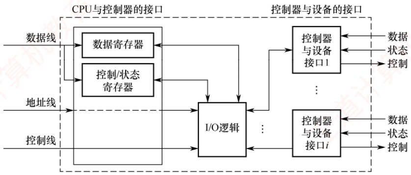

图 5.1 设备控制器的组成

1）设备控制器与CPU的接口。用于实现CPU与设备控制器之间的通信。该接口包括三类信号线:数据线、地址线和控制线。数据线用于传输读/写数据、控制和状态信息；地址线用于指定I/O接口中的寄存器编号；控制线用于传送读/写等控制信号。

2）设备控制器与设备的接口。一个设备控制器可连接一个或多个设备，因此内部包含一个或多个设备接口。每个接口均可传输数据、控制和状态三类信号。

3）I/O逻辑。用于实现对设备的控制。它通过控制线与CPU交互，对接收的I/O命令进行译码，并依据目标地址识别相应设备。CPU启动设备时，向控制器发送启动命令及目标地址，由I/O逻辑完成解析并控制指定的设备。

设备控制器的主要功能有:①接收并识别命令，例如磁盘控制器可响应CPU发出的读、写、寻道等命令；②完成数据交换，包括CPU与控制器之间以及控制器与设备之间的数据传输；③标识并报告设备状态，供CPU查询与处理；④地址识别；⑤数据缓冲；⑥差错控制。

以磁盘控制器为例:当它接收到一条读命令（如“读取第11408个扇区”）后，会自动将线性扇区号转换为对应的柱面号、盘面号和扇区号，并控制磁头定位、等待旋转延迟、读取数据，最终将数据可靠地传送到内存。操作系统只需发出命令，而无须关心底层硬件的具体实现细节。

#### 3．I/O接口的类型

从不同角度看，I/O接口可分为以下类型。

1）按数据传送方式（设备与接口一侧），可分为并行接口（一个字节或一个字的所有位同时传送）和串行接口（一位一位地有序传送），接口需完成相应的并/串或串/并格式转换。

2）按主机访问设备的控制方式，可分为程序查询接口、中断接口和DMA接口等。

3）按功能灵活性，可分为可编程接口（通过编程改变接口功能）和不可编程接口。

4）按设备类型的不同，可分为字符设备接口、块设备接口和网络设备接口。

#### 4．I/O端口

I/O端口是指设备控制器中可被CPU访问的寄存器，主要包括以下三类:

● 数据寄存器:缓存从设备送来的输入数据，或暂存CPU发出的输出数据。

● 状态寄存器:保存设备的状态或执行结果，供CPU读取。

● 控制寄存器:由CPU写入，用于启动操作或设置设备的工作模式。

为使CPU能够访问I/O端口，必须对各端口进行编址，每个端口对应一个唯一的端口地址。常见的编址方式主要有独立编址和统一编址两种，如图5.2所示。

**（1）独立编址（I/O映射方式）**

独立编址为I/O端口建立一个独立于主存的地址空间。I/O端口地址与内存地址在逻辑上完全分离，地址值可以相同，但由于属于不同地址空间，不会发生冲突。CPU通过专用的I/O指令（如x86 中的IN和OUT）访问I/O端口，指令中的地址字段指定端口号。

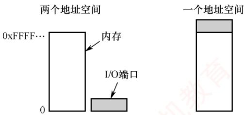

图 5.2 独立编址 I/O 和内存映射 I/O

优点:I/O端口数量远少于内存单元，所需地址线较少，译码电路简单，寻址速度快；使用专用I/O指令，使程序中的I/O操作清晰可辨，便于阅读与调试。

缺点:I/O指令功能有限，通常仅支持简单的数据传输，程序设计灵活性较差；CPU需同时提供存储器读/写和I/O读/写两组控制信号，增加了控制逻辑的复杂性。

**（2）统一编址（内存映射方式）**

统一编址将部分主存地址空间分配给I/O端口，使I/O端口与内存单元共享同一地址空间。通过地址范围即可区分访问目标（如高地址段映射到I/O设备），因此无须专用I/O指令，CPU使用普通的访存指令（如加载和存储指令）即可访问I/O端口。

优点:无须专用I/O指令，使得编程更加灵活；I/O端口可获得较大的编址空间；I/O访问的保护机制可由虚拟存储管理系统统一实现，无须额外硬件支持。

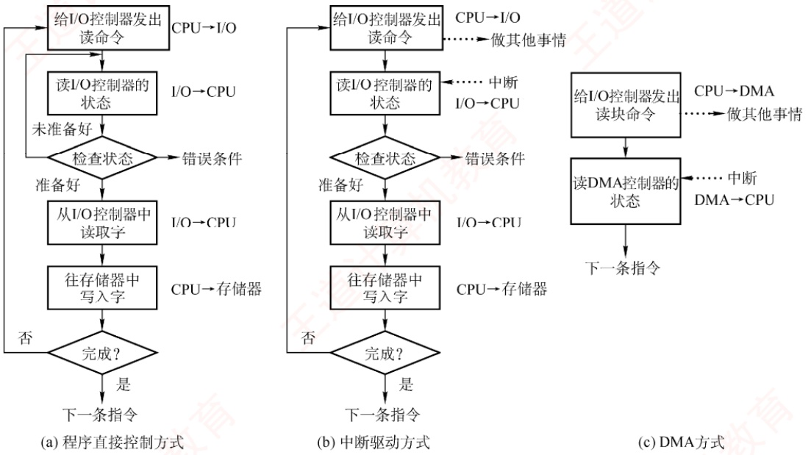

图 5.3 I/O 控制方式的操作流程

缺点:I/O端口占用主存地址空间，减少了系统可用内存容量；由于需根据完整地址判断是否为I/O区域，译码电路相对复杂，通常会降低译码速度。

### 5.1.2 I/O控制方式

I/O控制是指控制设备和主机之间的数据传送。在I/O控制方式的发展过程中，始终贯穿着这样一个宗旨:尽量减少 CPU 对I/O控制的干预，将 CPU 从繁杂的I/O控制事务中解脱出来，以便其能更多地去执行运算任务。I/O控制方式共有4种，下面分别加以介绍。

#### 1．程序直接控制方式

CPU对I/O设备的控制采取轮询的I/O方式，也称程序轮询方式。如图5.3(a)所示，CPU向设备控制器发出一条I/O指令，从I/O设备读取一个字（节），然后不断地循环测试设备状态（称为轮询），直到确定该字（节）已在设备控制器的数据寄存器中。于是CPU将数据寄存器中的数据取出，送入内存的指定单元，这样便完成了一个字（节）的I/O操作。

这种方式简单且易于实现，但缺点也很明显。CPU的绝大部分时间都处于等待I/O设备状态的循环测试中，CPU和I/O设备只能串行工作，由于CPU和I/O设备的速度差异很大，导致CPU的利用率相当低。而CPU之所以要不断地测试I/O设备的状态，就是因为在CPU中未采用中断机制，使I/O设备无法向CPU报告它已完成了一个字（节）的输入操作。

#### 2．中断驱动方式

中断驱动方式的思想是允许I/O设备主动打断CPU的运行并请求服务，从而“解放”CPU，使得CPU向设备控制器发出一条I/O指令后可以继续做其他有用的工作。如图5.3(b)所示，我们从设备控制器和CPU两个角度分别来看中断驱动方式的工作过程。

从设备控制器的角度来看:设备控制器从CPU接收一个读命令，然后从设备读数据。一旦数据读入设备控制器的数据寄存器，便通过控制线向CPU发出中断信号，表示数据已准备好，然后等待CPU请求该数据。设备控制器收到CPU发出的取数据请求后，将数据放到数据总线上传到CPU的寄存器中。至此，本次I/O操作完成，设备控制器又可开始下一次I/O操作。

> ①本节的内容在《计算机组成原理考研复习指导》一书的7.3节中描述得比较详细，建议读者结合复习。

**考点追踪中断处理程序执行时请求进程的状态（2017、2023）**

从CPU的角度来看:当前运行进程发出读命令，该进程将被阻塞，然后保存该进程的上下文，转去执行其他程序。在每个指令周期的末尾，CPU检查中断信号。当有来自设备控制器的中断时，CPU保存当前运行进程的上下文，转去执行中断处理程序以处理该中断请求。中断处理程序从设备控制器的数据寄存器中读取一个字节（或字），并将其写入内核的缓冲区。处理完成后，系统解除原I/O请求进程的阻塞状态，并恢复相应进程的上下文以继续执行。

相比于程序轮询I/O方式，在中断驱动I/O方式中，设备控制器通过中断主动向CPU报告I/O操作已完成，不再需要轮询，在设备准备数据期间，CPU和设备并行工作，CPU的利用率得到明显提升。但是，中断驱动方式仍有两个明显的问题:①设备与内存之间的数据交换都必须经过CPU中的寄存器；②CPU是以字（节）为单位进行干预的，若将这种方式用于块设备的I/O操作，则显然是极其低效的。因此，中断驱动I/O方式的速度仍然受限。

#### 3．DMA方式

DMA（直接存储器存取）方式的核心思想是在I/O设备与内存之间建立直接数据通路，彻底“解放”CPU。其特点如下:

1）基本传送单位是数据块，而不再是字（节）。

2）数据直接在设备与内存之间传输，而不再经过CPU。

3）仅在数据块传送开始和结束时需要CPU干预。

图 5.4 展示了 DMA 控制器的组成。

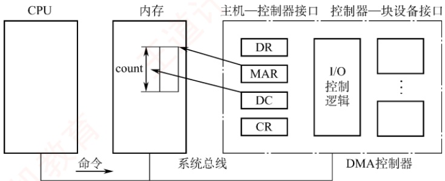

图 5.4 DMA 控制器的组成

为实现设备与内存之间直接交换成块的数据，DMA控制器需包含以下四类寄存器:

1）命令/状态寄存器（CR）。暂存CPU发来的I/O命令或设备状态。

2）内存地址寄存器（MAR）。存放数据在内存中的起始地址。输入时（设备→内存），表示数据要写入内存的目标地址；输出时（内存→设备），表示数据从内存读取的源地址。

3）数据寄存器（DR）。暂存单次传输的数据单元（如一个字）。

4）数据计数器（DC）。记录本次需传送的字（节）总数。

**考点追踪DMA方式的工作流程（2017）**

### 5.1.3 I/O软件层次结构

如图5.3(c)所示，DMA方式的工作过程如下:CPU收到设备的 DMA 请求后，向 DMA控制器发送启动命令，并设置MAR 和 DC的初值，随后启动 DMA 控制器。接着，CPU 将I/O控制权交予DMA控制器，转而执行其他任务。DMA控制器接管总线后，以突发方式将整块数据在设备与内存之间直接传输，无须CPU干预。传输结束后，DMA控制器向 CPU发送中断信号，通知操作完成。因此，CPU仅在数据传送的开始和结束阶段介入。

DMA方式的优点:数据以“块”为单位传输，相比中断方式，CPU干预频率进一步降低；数据也不再经过CPU寄存器，CPU与设备的并行程度进一步提升。

#### *4．通道控制方式

I/O通道是一种专用处理机，能够执行存放在主存中的通道程序（由一系列专用通道指令组成）。设置通道后，CPU仅需向通道发送一条I/O指令，指明目标设备及通道程序在内存中的起始地址。通道收到该指令后，便自主执行通道程序，完成全部I/O操作，并在结束后向CPU发出中断请求。由此，CPU、通道与I/O设备可高效并行工作，显著提升系统资源利用率。

通道与通用处理机的区别:通道的指令集专用于I/O控制，功能单一；它不具备独立的主存储器，其通道程序和数据均存放在主机内存中，且所有访存操作均受CPU控制。

通道与DMA方式的区别:DMA需由CPU预设数据块大小、内存始址等参数；而通道通过执行程序动态确定参数，能自主完成涉及多台设备、多个阶段的复杂I/O任务。此外，每个DMA控制器通常仅服务于一台设备，而一个通道可同时管理多台设备与内存之间的数据交换。

每种方式的优点都在于解决了前一种方式的主要缺点。总体而言，I/O控制方式的发展过程，就是要尽量减少 CPU 对I/O过程的干预，将 CPU 从繁杂的I/O控制事务中解脱出来。

下面通过一个形象的例子总结这几种I/O方式。想象一位客户要去裁缝店定制一批衣服的情形。采用程序直接控制方式时，裁缝没有客户的联系方式，客户只能每隔一段时间亲自去店里查看衣服是否做好，白白浪费大量时间。采用中断驱动方式时，裁缝有了客户的联系方式，每做完一件衣服就打电话通知客户来取，相比轮询方式，客户省去了反复跑腿的麻烦，但每件衣服都要跑一趟，依然效率不高。采用DMA方式时，客户花钱雇了一位秘书，并交代好:所有衣服先暂存在指定仓库，裁缝直接与秘书对接，由秘书负责取回衣服并入库，每处理完100件衣服，秘书才向客户汇报一次，从而大幅节省了客户的时间。采用通道方式时，客户交给秘书一份详细的办事清单（通道程序），秘书不仅能自主决定衣服存放的位置，还能根据清单灵活安排汇报时机。例如，是每完成100件还是10000件再通知客户，均由秘书自行判断。此外，一位DMA类秘书通常只能对接一位裁缝，而通道类秘书则可同时协调多位裁缝的工作。

**5.1.3 I/0 软件层次结构**

I/O软件涉及面很广，向下与硬件密切相关，向上又与虚拟存储器系统、文件系统及用户直接交互，各类I/O操作均需通过I/O软件实现。

**考点追踪I/O子系统各层次的功能及分析（2011、2012、2013）**

为使复杂的I/O软件具备清晰的结构、良好的可移植性和适应性，现代操作系统普遍采用层

次化的I/O软件设计。系统将设备管理模块划分为若于层次，每层利用其下层提供的服务，完成输入/输出功能中的特定子任务，并屏蔽其实现细节，向上层提供统一接口。只要层间接口保持不变，任一层的修改都不会影响其他层次，仅最低层涉及硬件的具体特性。一种较为合理的四层划分如图5.5所示。整个I/O软件可视为具有4个层次的系统结构，各层次及其功能如下:

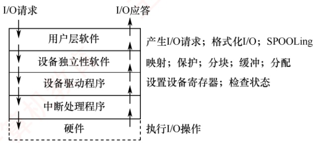

图 5.5 I/O 层次结构

#### 1．用户层软件

实现与用户的交互接口。用户可直接调用用户层提供的I/O库函数（如与I/O操作相关的标准库函数）对设备进行操作。通常，大部分I/O软件位于操作系统内核，但仍有一小部分驻留在用户层，例如与用户程序链接的库函数。用户层I/O软件必须通过系统调用获取操作系统服务。

#### 2．设备独立性软件

**考点追踪设备独立性所涵盖的内容（2020）**

设备独立性（也称设备无关性）是指应用程序在使用I/O设备时，无须依赖具体的物理设备。为实现这一特性，系统引入了逻辑设备与物理设备的概念:应用程序使用逻辑设备名请求某类设备；系统在运行时，必须将逻辑设备名映射为实际的物理设备名。

使用逻辑设备名的优势在于:①提高设备分配的灵活性；②易于实现I/O重定向，I/O重定向是指用于I/O操作的设备可以更换（重定向），而不必修改应用程序。

为实现设备独立性，需在设备驱动程序之上设置一层设备独立性软件。该层的主要功能包括以下两个方面:①执行所有设备的公共操作，包括设备的分配与回收、逻辑设备名到物理设备名的映射、设备保护（禁止用户直接访问硬件）、缓冲管理、差错控制，以及提供统一大小的逻辑块，以屏蔽不同设备在信息交换单位和传输速率上的差异；②向用户层（或文件系统）提供统一的接口。通过这一层抽象，无论底层设备类型如何，应用程序均可使用统一的系统调用（如read/write）进行访问，显著增强了系统的可移植性与可维护性。

#### 3．设备驱动程序

**考点追踪设备驱动程序的功能（2025）**

设备驱动程序与硬件直接相关，每类设备都需要配置一个专用的驱动程序。它作为I/O子系统与设备控制器之间的通信桥梁，向上层提供统一的操作接口，屏蔽不同设备控制器的差异。驱动程序的主要任务是:接收上层软件（如设备独立性层）发出的抽象I/O请求（例如 read或write命令），将其转换为设备控制器能够识别的具体指令，启动设备执行相应操作，并将设备控制器返回的状态信息或数据传递回上层。其工作流程通常包括如下操作。

1）将抽象请求转换为具体操作。上层请求通常是逻辑性的（如“读取逻辑块5”），而设备控制器只能处理物理操作。驱动程序根据设备特性，将逻辑地址转换为物理参数。例如，磁盘驱动程序会将逻辑扇区号转换为柱面号、盘面号和扇区号。

2）校验请求的合法性。驱动程序检查操作是否允许。例如，禁止从只写设备（如打印机）读取数据，或向以只读方式打开的设备写入。若请求非法，则向上层返回错误。

3）检查设备状态。在启动I/O前，驱动程序读取设备控制器的状态寄存器，确认设备是否就绪。例如，写操作要求设备处于“接收就绪”状态；否则，进程需要等待。

4）传递参数。设备就绪后，驱动程序向控制器的相应寄存器写入命令、数据缓冲区地址、传输长度等参数。对于磁盘等复杂设备，所需传递的参数更多。

5）启动设备并处理后续。参数设置完成后，驱动程序向命令寄存器发送启动信号，设备开始工作。在多道程序系统中，当前进程随即被阻塞，CPU转去执行其他就绪进程，实现与I/O设备的并行；设备完成操作并发出中断后，由中断处理程序将其唤醒。

此外，驱动程序还负责设备的初始化、状态维护、错误处理以及与中断处理的配合，通过封装底层硬件细节，使上层软件无须了解设备的具体实现，即可使用统一接口访问各类I/O设备。

#### 4．中断处理程序

当I/O操作完成时，设备控制器发出中断信号。CPU在执行完当前指令后响应中断，暂停当

前进程，转去执行相应的中断处理程序；处理完毕后，再恢复原进程执行。整个过程如下。

1）检测并响应中断。设备完成一个数据单位（如字符或数据块）传输后，其控制器发出中断请求。CPU在指令周期末检测到中断信号时，即暂停当前进程，准备转入中断处理。

2）保护被中断进程的CPU现场。硬件自动将程序计数器（PC）和程序状态字（PSW）压入中断栈；随后，操作系统软件将其他CPU寄存器内容也保存至该栈。

3）转入相应设备的中断处理程序。CPU识别中断源，并跳转至对应设备的中断处理程序。

4）处理中断。程序读取设备控制器的状态寄存器，判断操作是否正常完成:若成功，则将设备数据寄存器中的内容传送到内存缓冲区；若异常，则进行错误处理。

5）恢复现场并返回。中断处理完成后，系统从中断栈恢复所有寄存器内容，CPU从被中断指令的下一条继续执行原进程。

为确保上述流程可靠运行，操作系统还需对中断处理程序本身进行管理，主要包括三个环节。

1）注册中断。驱动程序初始化时，需要向内核注册中断号及其处理函数入口地址，以建立硬件中断信号与服务代码之间的映射，确保中断发生时内核能准确调用相应处理例程。

2）处理中断。中断处理程序的典型流程:①确认中断是否由本设备产生；②清除控制器中的中断标志，防止重复触发；③执行必要的硬件操作，如读/写数据。由于运行在中断上下文中，处理程序必须快速、非阻塞，不得调用可能引起进程睡眠或调度的函数。

3）注销中断。当驱动程序被卸载或设备停用时，需要注销其中断处理程序以释放资源。若该中断请求线为独占，则注销后内核立即禁用该线；若该中断请求线为共享，则仅移除本设备的处理例程，该中断线需要等到所有关联设备均注销后，才会被最终禁用。

#### 5．I/O操作举例

**考点追踪键盘I/O过程的分析（2010、2024）**

类似于文件系统的层次结构，/O子系统的层次结构也是需要掌握的重要内容，但不应死记硬背。为帮助读者理解，下面通过用户发起的一次write请求来说明各层的功能:①当用户要向某设备写入数据时，通过操作系统提供的write命令接口发起请求，该请求首先进入用户层软件。②操作系统向上层提供的是统一的通用接口，即大多数设备都支持的标准命令，用户发出的write请求首先由设备独立性层解析，然后传递给下一层。③ 不同类型设备对write命令的处理方式不同（如磁盘与打印机的行为差异显著），因此需由设备驱动层将通用的write命令转换为设备特定的指令。④驱动程序将指令发送给设备控制器，启动实际的写操作；操作完成后，控制器向CPU发出中断信号，由中断处理程序响应。⑤中断处理程序确认写操作完成，清除中断标志，唤醒等待该操作的进程，并将结果逐层返回至用户程序，完成整个写操作。

上面从理论上说明了I/O请求在各层次间的传递过程。下面结合Linux系统中一次 write系统调用的实际执行流程（见图5.6），具体分析各层如何协作以及CPU状态如何切换。

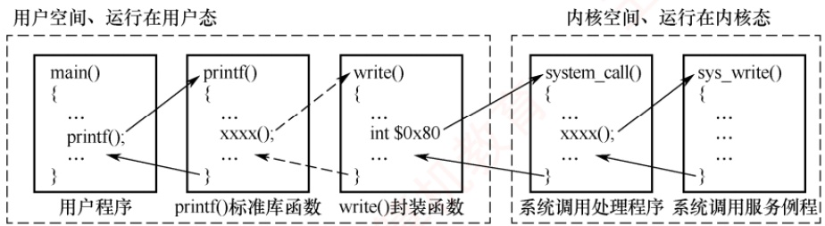

图 5.6 Linux 系统中 write 调用的执行流程

该流程始于用户空间对库函数的调用。用户程序调用printf()后，经标准库内部封装，最终触发write()系统调用的封装函数。该函数生成的机器指令序列中包含一条陷阱指令（如IA-32架构下的int\$0x80）。在执行该指令之前，若干传送指令会将系统调用号及I/O参数（如文件描述符、缓冲区地址、字节数）写入指定寄存器（如eax）。CPU执行陷阱指令后，产生一个受控的软中断，硬件自动完成从用户态到内核态的模式切换，并将控制权移交给操作系统内核。

进入内核态后，CPU跳转至系统调用的统一入口程序system\_call()。该程序根据寄存器 eax中的系统调用号，通过跳转表将请求分派给对应的系统调用服务例程 sys\_write()。sys\_write()首先执行与设备无关的公共操作，如参数合法性检查、内核缓冲区分配与管理等。随后，它根据参数（如文件描述符）定位目标设备，并调用对应的设备驱动程序。

设备驱动程序作为直接与设备控制器交互的模块，负责将抽象的I/O请求转换为设备可识别的具体命令。它初始化I/O接口、设置传输参数，并启动设备进行数据传输。随后，通常将当前进程置为阻塞态，并主动调用调度程序让出CPU，以便其他就绪进程运行。

传输完成后，设备控制器向CPU发出中断请求。CPU响应中断，暂停当前执行流，转入预设的中断服务程序。该程序读取设备状态，确认写操作是否成功，清除中断标志，并唤醒等待I/O的进程。中断处理完毕后，内核沿调用栈逐级返回。最终，在 system\_call()末尾通过执行 iret 等特权指令，CPU切换回用户态，并在用户空间中陷阱指令的下一条指令处恢复执行。

一次完整的I/O请求依次穿越了用户层软件、系统调用接口、设备独立性软件、设备驱动程序和中断处理程序，其中，陷阱指令是从用户态进入内核态的唯一合法入口，中断是设备通知操作完成、触发进程状态转换的核心机制。二者共同实现了用户态与内核态之间的安全切换。

### 5.1.4 应用程序I/O接口

应用程序I/O接口是操作系统为统一管理各类I/O设备而设计的一套软件架构与编程规范，其主要目的有二:一是让应用程序（如执行文件打开操作）无须关心底层硬件的具体实现细节；二是使新设备能够以模块化的方式方便地加入系统，而无须改动内核代码。

#### 1．I/O接口的分类

操作系统将物理设备抽象为三种通用类型:字符设备、块设备和网络设备，并为每类设备提供标准的接口。设备间的具体差异由相应的驱动程序封装。下面分别介绍这三类设备接口。

**（1）字符设备接口**

字符设备是指数据的存取和传输以字符为单位的设备，如键盘、打印机等。其基本特征是传输速率较低、不可寻址，输入/输出通常采用中断驱动方式。

get和put操作:由于字符设备不可寻址，只能顺序存取，系统通常为其设置一个字符缓冲区。用户程序通过get操作从缓冲区读取字符，通过put操作向缓冲区写入字符。

in-control指令:字符设备种类繁多，差异较大，因此接口还提供一种通用的in-control指令，（该指令包含多个参数），用于指定与具体设备相关的特定功能。

大部分字符设备属于独占设备，因此接口还需提供打开和关闭操作，以实现互斥共享。

**（2）块设备接口**

块设备是指数据的存取和传输以数据块为单位的设备，典型的块设备是磁盘。其基本特征是传输速率较高、可寻址。磁盘的I/O常采用DMA方式。

块设备接口将上层发来的抽象命令（如打开、读、写和关闭等）映射为设备能识别的具体操作。为简化上层访问，该接口隐藏了磁盘的物理二维结构（块地址用磁道号和扇区号表示），将所有扇区从0到n-1依次编号，从而将二维结构变为线性地址空间。

块设备接口的常用命令有 read()、write()和 seek()，其中 seek()命令用来指定下一个传输块。

这三个命令描述了块设备的基本行为，使得应用程序不必关注这些设备的低层差别。

**(3) 网络设备接口**

现代操作系统均提供网络通信的功能，为此需配备相应的网络软件和网络通信接口，使计算机能够与网络上的其他计算机通信或访问互联网。多数操作系统采用套接字（Socket）接口作为网络I/O的标准。应用程序通过套接字系统调用创建本地套接字，并将其连接到远程应用程序的套接字，从而建立通信通道，实现数据的发送与接收。

#### 2．阻塞I/O和非阻塞I/O

操作系统的I/O接口还支持两种执行模式:阻塞与非阻塞。

阻塞I/O是多数操作系统默认采用的模式，原因是其编程模型简单、逻辑直观。当进程发起I/O请求时，若所请求的数据尚未就绪，则该进程立即被阻塞，并移入相应的等待队列；此后，进程无法执行任何其他任务，只能等待底层设备完成实际的数据传输。I/O操作完成后，内核将该进程移回就绪队列。当其再次获得CPU时，系统调用返回操作结果，进程继续后续处理。例如你去咖啡店点单后，由于无法预知咖啡何时做好，只能原地等待，其间无法做其他事情。

优点:实现简单，适用于顺序处理或低并发场景。

缺点:I/O等待期间进程完全阻塞，CPU资源闲置，系统整体利用率较低。

非阻塞I/O是指当进程发起I/O请求时，内核不会阻塞该进程，而使系统调用立即返回。若数据尚未就绪，则调用将返回一个表示“暂无数据”的错误状态（如返回-1）；进程可据此继续执行其他任务，并在时机适当时重试该操作。当某次重试时数据已就绪时，内核便将数据从内核缓冲区复制到用户空间，并返回实际成功传输的字节数。例如，吸取上次的教训，你在咖啡店点单后去逛商场，每隔一段时间回来询问“好了吗？”，其间可自由安排其他活动。

优点:进程在I/O等待期间不被阻塞，可执行其他任务，适合高并发或高响应性应用。

缺点:采用轮询方式频繁检查I/O状态，浪费CPU资源。

### 5.1.5 本节小结

本节开头提出的问题的参考答案如下。

I/O管理需要完成哪些核心功能？

I/O管理需要完成以下4部分内容:

1）状态监控。实时掌握外部设备的工作状态（如忙、就绪、故障等）。

2）数据传输。协调并完成主机与设备之间的数据交换。

3）设备分配。在多用户或多进程环境下，负责设备的分配、共享与回收。

4）设备控制。通过设备驱动程序启动I/O操作，并处理设备返回的完成信号或故障中断。

## 5.2 设备独立性软件

在学习本节时，请读者思考以下问题:

1）当处理机和外部设备的速度差距较大时，有什么办法可以解决这个问题？

2）什么是设备的独立性？引入设备的独立性有什么好处？

### 5.2.1 设备独立性软件

设备独立性软件（也称与设备无关的软件）位于设备驱动程序之上，是内核I/O子系统的最高层。该层与设备驱动程序之间的界限并非固定，常因操作系统设计或设备类型而异。例如，某些通常由设备独立性软件实现的功能，有时会被下放至驱动程序中。这种设计差异源于对系统性能、代码复用性及驱动程序效率等多方面因素的综合权衡。总体而言，其核心职责是实现各类设备的公共操作，为上层提供统一、抽象的I/O接口。具体包括以下五项公共功能。

1）提供统一的驱动程序接口。为便于驱动开发与系统扩展，所有设备驱动程序应遵循一致的接口规范。设备独立性软件负责将抽象设备名映射到具体的物理设备，并定位相应驱动程序的入口，同时确保I/O操作通过内核受控路径执行，保障系统安全。

2）缓冲管理。系统普遍采用缓冲机制以缓解CPU与外设之间的速度差异，提高CPU利用率。缓冲形式包括单缓冲、双缓冲、环形缓冲和缓冲池等，可根据应用场景灵活选用。

3）差错控制。I/O设备因含机械与电气部件，故障率较高，产生的错误可分为两类:暂时性错误（如网络丢包），通常通过重试纠正，仅当连续失败后才视为持久性错误。此类错误主要由驱动程序处理，设备无关层仅介入驱动程序无法解决的情形。持久性错误（如磁盘划痕），操作系统可将其记录至坏块表，后续I/O自动绕过，避免更换整盘。

4）独占设备的分配与回收。对打印机等独占设备，系统需要统一分配以避免竞争。进程请求设备时，若设备空闲，则立即分配；否则，被阻塞并加入等待队列。设备释放时，若队列非空，则唤醒队首进程；否则，置设备状态为“空闲”，完成回收。

5）提供统一的逻辑数据块。不同设备的数据交换单位各异:字符设备以字节为单位，块设备以固定大小的数据块为单位，并且块长可能不一。设备独立性软件通过抽象层屏蔽这些差异，向上层提供大小统一的逻辑数据块，使上层无须感知底层设备特性。

### 5.2.2 高速缓存与缓冲区

#### 1．磁盘高速缓存（Disk Cache）

**考点追踪 设置磁盘缓冲区的目的（2015）**

操作系统采用磁盘高速缓存技术以提高磁盘I/O性能，访问高速缓存中的数据比直接读/写磁盘更高效。磁盘高速缓存不同于通常意义下的位于CPU与主存之间的硬件高速缓存，而是指利用内存中的存储空间暂存从磁盘读取的盘块数据。这些数据在逻辑上是磁盘内容的副本，物理上则驻留在内存中。磁盘高速缓存在内存中有两种组织形式:一种是在内存中开辟固定大小的专用缓存区；另一种是将系统空闲内存作为动态缓冲池，供请求分页系统和磁盘I/O子系统共享使用。

#### 2．缓冲区（Buffer）

在设备管理子系统中，引入缓冲区的主要目的如下:

1）缓和CPU与I/O设备间速度不匹配的矛盾。

2）减少对CPU的中断频率，放宽对中断响应时间的限制。

3）解决基本数据单元大小（数据粒度）不匹配的问题。

4）提高CPU与I/O设备之间的并行性。

缓冲区的实现方法包括:

1）采用硬件缓冲器，但由于成本较高，除一些关键部位外一般不采用。

2）利用内存作为缓冲区，本节要介绍的正是由内存组成的缓冲区

根据系统设置的缓冲区数量，缓冲技术可分为以下几种:

**（1）单缓冲**

当用户进程发出I/O请求时，操作系统在内存中为其分配一个缓冲区，其大小通常为一个数据块。如图5.7所示，在块设备输入过程中，假设设备将一块数据送入缓冲区的时间为T，操作系统将缓冲区数据传送到用户工作区的时间为M，CPU处理该块数据的时间为C。对于块设备，必须等整块数据装入缓冲区后，才能将其传送到工作区。

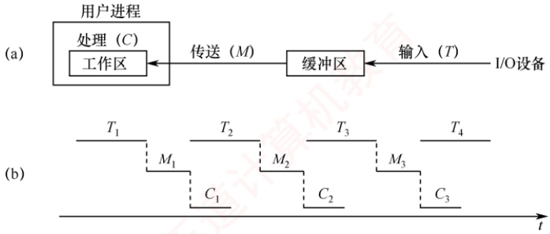

图 5.7 单缓冲工作示意图

**考点追踪单缓冲的工作时间的理解与计算（2011、2013）**

在单缓冲中，设备向缓冲区写入数据的时间T可与CPU处理前一块数据的时间C并行。

当T>C时，设备向缓冲区填充数据的速度慢于CPU处理数据的速度。此时，CPU在完成当前数据块的处理后，必须等待设备将下一块数据完整写入缓冲区；只有缓冲区装满后，操作系统才能将该数据块从缓冲区传送到用户工作区。处理每块数据所需的时间为T+M。

当T<C时，设备填充缓冲区的速度快于CPU的处理速度。此时，缓冲区一旦装满，设备便无法继续写入新数据，必须等待CPU完成对当前工作区数据的处理；此后，操作系统才能将缓冲区中的数据移至工作区，从而释放缓冲区空间。处理每块数据所需的时间为C+M。

**综上，单缓冲处理每块数据所需的时间为Max(T, C)+ M。**

由于单缓冲区是共享资源，设备与CPU对其访问必须互斥。若CPU尚未取走缓冲区中的数据，即使设备已准备好新数据，也无法写入缓冲区，此时设备需等待CPU释放缓冲区。

**(2) 双缓冲**

为了加快输入/输出速度，提高设备利用率，引入了双缓冲机制（也称缓冲对换）。如图5.8所示，当设备输入数据时，先将数据送入缓冲区1；装满后，转向缓冲区2写入。此时，操作系统可从已满的缓冲区1中取出数据送入用户工作区，并由CPU进行处理。当缓冲区1的数据处理完后，若缓冲区2已装满，则操作系统切换到从缓冲区2中取数据送入用户工作区，而设备又可以开始向缓冲区1写入新数据。可见，双缓冲显著提高了设备与CPU的并行程度。

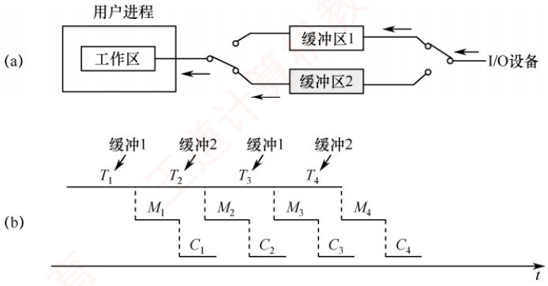

图 5.8 双缓冲工作示意图

**考点追踪双缓冲的工作时间的理解与计算（2011）**

仍假设设备输入数据到缓冲区、数据传送到工作区和处理的时间分别为T、M和C。在双缓冲中，设备向一个缓冲区写入数据的时间T可与操作系统传送及处理的时间C+M并行。

当T>C+M时，设备输入所需时间大于数据传送与处理的总时间。此时，设备可连续工作。假设在某一时刻，缓冲区1为空，缓冲区2已满:操作系统开始将缓冲区2的数据传送到工作区（耗时M），CPU随即处理该数据（耗时C），同时设备向缓冲区1写入新数据。由于 $T \geq C + M ,$ 当缓冲区2的数据处理完毕时，缓冲区1尚未装满，系统必须等待其装满后，才能将下一块数据从缓冲区1传送到工作区。处理每块数据所需的时间为 $T_{\circ}$

当T<C+M时，设备输入较快，CPU无须等待设备。类似地，当缓冲区1为空、缓冲区2已满时:操作系统传送并处理缓冲区2的数据（共耗时C+M），同时设备向缓冲区1写入数据。由于 $T \leq C + M$ ，缓冲区1很快装满，但系统仍需等待缓冲区2的数据完全处理完毕，才能切换至缓冲区1并传送其内容。处理每块数据所需的时间为C+M

**综上，双缓冲处理每块数据的时间为$\operatorname {Max} ( T , C + M )$ 0**

在双机通信场景中，若要实现全双工通信（双方同时收发数据），每台机器需分别设置发送缓冲区和接收缓冲区。如图5.9(b)所示，A机的发送缓冲区对应B机的接收缓冲区，反之亦然。若仅在每台机器中配置单一缓冲区[见图5.9(a)]，则无法同时进行发送与接收操作。

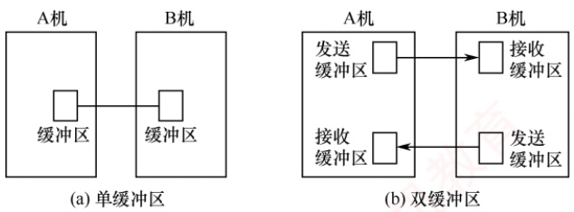

图5.9 双机通信时缓冲区的设置

**（3）循环缓冲**

在双缓冲机制中，当输入与输出速度基本匹配时，能够取得较好的效果；但若两者速率相差较大，则双缓冲难以充分发挥作用。为此，可引入多缓冲机制，并将多个缓冲区组织成循环缓冲区的形式，如图5.10所示(灰色表示已装满数据的缓冲区，白色表示空缓冲区)。

循环缓冲由若干个大小相等的缓冲区构成，每个缓冲区包含一个链接指针，指向下一个缓冲区；最后一个缓冲区的指针则指向第一个缓冲区，从而形成一个循环队列结构。

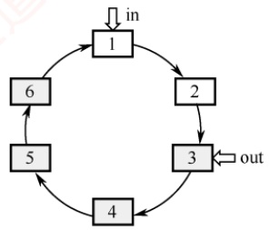

图5.10 循环缓冲工作示意图

系统需维护两个指针:in和 out。其中，in指向下一个待写入的空缓冲区，out指向下一个待读取的满缓冲区。输入进程和计算进程在运行过程中分别推进in和out指针，沿链接方向循环移动。采用循环缓冲技术，可以实现输入进程与计算进程的并行执行。由于两者的处理速度可能不一致，在运行过程中可能出现以下两种同步情形。

1）in追赶上out（称为系统受计算限制）。表明输入进程的写入速度快于计算进程的处理速度，导致所有缓冲区均被填满，无空缓冲区可供继续写入。此时，输入进程必须阻塞，直至计算进程从某个缓冲区中取走数据，释放出一个空缓冲区，并唤醒输入进程。

2）out追赶上in（称为系统受I/O限制）。表明计算进程的处理速度快于输入进程的供给速度，导致所有缓冲区均为空，无数据可供继续处理。此时，计算进程必须阻塞，直至输入进程向某个缓冲区写入数据，使其变为满缓冲区，并唤醒计算进程。

**（4）缓冲池**

相比于单个缓冲区（仅是一块内存区域)，缓冲池是一种包含管理数据结构和操作函数的软件机制，用于统一管理多个缓冲区，并支持多进程共享使用。

缓冲池由系统统一管理的供多个进程共享的一组缓冲区构成。根据使用状态，这些缓冲区被组织为以下队列:①空缓冲队列，由空缓冲区链接而成；②输入队列，由装满输入数据的缓冲区链接而成；③输出队列，由装满输出数据的缓冲区链接而成。

在操作过程中，缓冲区可动态扮演以下四种角色（见图5.11）:①收容输入缓冲区(hin)，用于暂存输入数据；②提取输入缓冲区（sin），用于读取输入数据；③收容输出缓冲区（hout），用于暂存输出数据；④提取输出缓冲区（sout），用于读取输出数据。

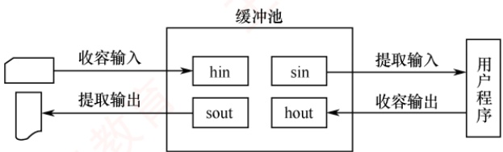

图 5.11 缓冲池的 4 种工作方式

缓冲池中的缓冲区按以下4种方式工作。

1）收容输入。输入进程需要输入数据时，从空缓冲队列队首摘取一个空缓冲区，作为收容输入缓冲区，将输入数据写入其中，装满后将其挂到输入队列队尾。

2）提取输入。计算进程需要输入数据时，从输入队列队首摘取一个缓冲区，作为提取输入缓冲区，从中读取数据，读取完毕后将其挂到空缓冲队列队尾。

3）收容输出。计算进程需要输出数据时，从空缓冲队列队首摘取一个空缓冲区，作为收容输出缓冲区，将输出数据写入其中，装满后将其挂到输出队列队尾。

4）提取输出。输出进程需要输出数据时，从输出队列队首摘取一个缓冲区，作为提取输出缓冲区，从中读取数据，读取完毕后将其挂到空缓冲队列队尾。

对于循环缓冲和缓冲池，本节仅介绍其工作机制，不涉及时间性能的定量分析。而对于单缓冲和双缓冲，只要依据前述模型进行分析，即可求解任意场景下处理每块数据所需的时间。

#### 3．高速缓存与缓冲区的对比

在I/O系统中，高速缓存（Cache）是一种利用高速存储介质保存慢速设备数据副本的机制，其访问速度远高于直接访问慢速设备。高速缓存与缓冲区的对比如表5.1所示。

表5.1 高速缓存和缓冲区的对比

<table><tr><td colspan="2"></td><td>高速缓存</td><td>缓冲区</td></tr><tr><td colspan="2">相同点</td><td colspan="2">均位于高速设备和低速设备之间，用于缓解二者之间的速度差异</td></tr><tr><td rowspan="2">区别</td><td>存放数据</td><td>已存在于慢速设备上的数据副本:缓存中的数据可长期驻留，直至被替换</td><td>存放正在传输过程中的数据；这些数据源自发送方（高速或低速设备），传输完成后通常立即释放</td></tr><tr><td>目的</td><td>提高重复访问的效率:若所需数据已存在于缓存中，则可避免访问低速设备</td><td>提高数据传输的效率与并行性:通过暂存数据，协调速度差异、降低中断频率、匹配数据粒度等</td></tr></table>

### 5.2.3 设备分配与回收

#### 1．设备分配概述

设备分配是指根据用户的I/O请求分配所需设备的过程。分配的总体原则是:在充分发挥设备使用效率（使设备尽可能忙碌）的同时，避免因分配策略不当引发进程死锁。

#### 2．设备分配的数据结构

在系统中，可能存在多个通道，一个通道可连接多个控制器，每个控制器又可连接多个物理设备。设备分配的数据结构要能体现出这种从属关系，各数据结构的介绍如下。

1）设备控制表（DCT）:系统为每个物理设备配置一张DCT，用于记录该设备的各项属性，如图5.12所示。DCT中的主要字段包括:

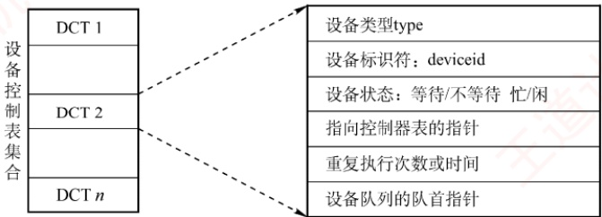

图 5.12 DCT

设备类型:表示设备类型，如打印机、扫描仪、键盘等。

设备标识符:即物理设备名，该标识符在系统内是唯一的。

设备状态:表示当前设备的状态（忙/闲）。

指向控制器表的指针:每个设备由一个控制器控制，该指针指向对应的控制器表。

重复执行次数或时间:系统指定I/O操作的可重试次数，超过此值则判定为I/O失败。

设备队列的队首指针:指向因请求该设备而阻塞的进程队列（由PCB构成）的队首。

**注意**

当某进程释放设备且无其他进程等待时，系统会将DCT中的设备状态置为空闲，完成设备回收。

2）控制器控制表（COCT）:每个设备控制器对应一张COCT，用于记录控制器的状态及所辖设备信息，如图5.13(a)所示。通过COCT中的“与控制器连接的通道表指针”，可以找到相应通道的信息。操作系统根据COCT对控制器进行操作和管理。

3）通道控制表（CHCT）:每个通道对应一张CHCT，用于管理该通道及其下属控制器，如图5.13(b)所示。通过CHCT中的“与通道连接的控制器表首址”，可以找到该通道管理的所有控制器的信息。操作系统根据CHCT对通道进行操作和管理。

4）系统设备表（SDT）:整个系统只维护一张SDT，作为所有物理设备的全局索引，如图5.13(c)所示。每个表目对应一个设备，通常包含设备类型、标识符等信息。

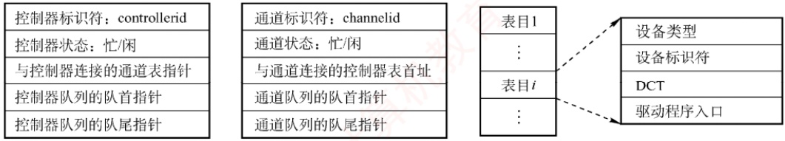

(a)控制器控制表COCT

(b) 通道控制表CHCT

(c)系统设备表SDT

图 5.13 COCT、CHCT 和 SDT

在多道程序系统中，由于进程数通常多于设备数，必须采用合理的分配策略。主要考虑的因素包括:设备的固有属性、分配算法、分配的安全性以及设备的独立性。

#### 3．设备分配时应考虑的因素

**考点追踪设备分配需要考虑的因素（2023）**

**（1）设备的固有属性**

设备的固有属性可分为三类，需采用不同的分配策略。

1）独占设备:分配给某进程后，便由其独占使用，直至进程主动释放或终止。

2）共享设备:可同时供多个进程使用，需通过调度机制协调访问顺序（如磁盘）。

3）虚拟设备:通过对独占设备进行虚拟化（如SPOOLing技术），使其在逻辑上表现为可共享设备，允许多个进程并发地提交I/O请求。

**（2）设备分配算法**

常用的设备分配算法主要有两种。

1）FCFS算法。按进程请求设备的先后顺序，排成一个等待队列，优先分配给队首进程。

2）最高优先级优先算法。高优先级进程排在队列前方，优先级相同时按FCFS原则排队。

**（3）设备分配中的安全性**

指在分配过程中应避免死锁的发生，主要通过以下两种方式实现。

1）安全分配方式。每当进程发出I/O请求后，便立即进入阻塞态，直至I/O操作完成才被唤醒。在此期间，进程不再请求任何其他资源，从而有效避免死锁。其优点是安全性高，缺点是CPU与I/O设备串行工作，系统效率较低。

2）不安全分配方式。进程在发出I/O请求后仍继续运行，需要时可发出第二个、第三个I/O请求等。仅当所请求的设备已被其他进程占用时，才进入阻塞态。其优点是单个进程可同时使用多个设备，使进程推进迅速；缺点是可能因循环等待而造成死锁。

#### 4．设备分配的步骤

下面以独占设备为例，介绍设备分配的过程

1）分配设备。首先根据I/O请求中的物理设备名，查找SDT，从中找出该设备的DCT，再根据DCT中的设备状态字段判断其状态。若忙，则将进程PCB挂入设备等待队列；若空闲，则将设备分配给该进程。

2）分配控制器。设备分配后，根据DCT找到对应的COCT，查询控制器的状态。若忙，则将进程PCB挂入控制器等待队列；若空闲，则将控制器分配给该进程。

3）分配通道。控制器分配后，根据COCT找到对应的CHCT，查询通道的状态。若忙，则将进程PCB挂入通道等待队列；若空闲，则将通道分配给该进程。只有当设备、控制器和通道均成功分配后，此次设备分配才算完成，随后可启动设备进行数据传送。

上述过程基于物理设备名发出I/O请求。若指定设备已被其他进程占用，则分配失败，说明该方案缺乏设备独立性。为实现设备独立性，进程应使用逻辑设备名。此时，系统从SDT中依次查找该类设备的DCT:若某设备空闲，则进行后续分配；仅当所有同类设备都忙时，才将进程挂入该类设备的公共等待队列。只要存在一个可用设备，系统便会继续进行后续分配流程。

#### 5．逻辑设备名到物理设备名的映射

**考点追踪逻辑设备名和物理设备名的使用（2009）**

为实现设备独立性，进程应使用逻辑设备名请求某类设备。由于系统只能识别物理设备名，需在系统中配置一张逻辑设备表（Logical Unit Table，LUT），用于建立逻辑设备名到物理设备名的映射。LUT的每个表项包含三项内容:逻辑设备名、物理设备名和驱动程序入口地址。当进程使用某个逻辑设备名请求设备时，系统为其分配一台空闲的物理设备，并在LUT中建立相应表目。此后，该进程的所有I/O请求均通过该表项找到对应的物理设备及其驱动程序。

系统中可采用两种方式设置逻辑设备表。

1）整个系统仅设置一张LUT。如图5.14(a)所示。所有进程的设备分配情况都记录在同一张LUT中，这就要求所有用户不能使用相同的逻辑设备名，适用于单用户系统。

2）为每个用户设置一张LUT。如图5.14(b)所示。系统仍维护全局的系统设备表（SDT）。不同用户可以使用相同的逻辑设备名，互不干扰，适用于多用户系统。

| 逻辑设备名 | 物理设备名 | 驱动程序入口地址 |
| --- | --- | --- |
| /dev/printer | 3 | 2014 |
| /dev/tty | 5 | 2046 |
|  | …… | … |

(a)整个系统的LUT

| 逻辑设备名 | 系统设备指针 |
| --- | --- |
| /dev/printer | 3 |
| /dev/tty | 5 |
| …… |  |

(b)每个用户设置一张LUT

图5.14 逻辑设备表（LUT）

### 5.2.4 SPOOLing技术（假脱机技术）

为缓和CPU的高速性与I/O设备低速性之间的矛盾，操作系统引入了SPOOLing，即假脱机技术。其思想源于早期的脱机I/O方式:依赖专用外围控制机，在主机不参与的情况下完成I/O操作。输入时，外围机将低速输入设备（如纸带机）上的数据预先读入高速磁盘；输出时，CPU先将结果高速写入磁盘，再由外围机将数据送至低速输出设备（如打印机）。由于整个I/O过程脱离主机控制，因此称为脱机。随着多道程序设计技术的发展，操作系统不再需要物理外围机，而通过专门的输入进程与输出进程，在主机直接控制下模拟外围机的功能:输入进程负责将低速输入设备的数据提前读入磁盘上的输入井；输出进程则将用户作业的输出结果暂存于磁盘的输出井，再逐步送往实际输出设备。由此，I/O操作 井，再逐步送往实际输出设备。由此，I/O操作

与CPU计算得以并行执行。

这种以磁盘为缓冲、用软件模拟脱机I/O的机制，正是SPOOLing技术的本质。“脱机”承袭自早期脱机I/O的思想，“假”则体现在以多道程序和磁盘空间替代外围机，进而将一台物理独占设备虚拟为多台逻辑设备，实现设备共享。SPOOLing系统的组成如图5.15 所示。

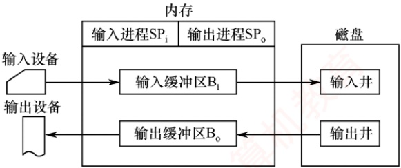

图 5.15 SPOOLing 系统的组成

**考点追踪SPOOLing技术的特点（2016）**

**（1）输入井和输出井**

在磁盘上开辟的两个专用存储区域。输入井模拟脱机输入的磁盘，用于暂存输入设备的数据。输出并模拟脱机输出的磁盘，用于暂存用户程序的输出数据。每个进程的输入（或输出）数据以文件形式保存（称为并文件），所有文件按顺序链接成输入队列或输出队列。

**(2）输入缓冲区和输出缓冲区**

在内存中开辟的两个缓冲区。输入缓冲区暂存由输入设备送来的数据，随后传送到输入井。输出缓冲区暂存从输出井读出的数据，随后传送到输出设备。

**（3）输入进程和输出进程**

输入进程模拟脱机输入的外围控制机，负责将输入设备的数据经输入缓冲区传送到输入井。

当CPU需要输入数据时，直接从输入井读取。输出进程模拟脱机输出的外围控制机，负责将用户程序的输出数据写入输出井，并在输出设备空闲时，经输出缓冲区将数据传送到输出设备。

**（4）井管理程序**

控制作业与磁盘井之间的信息交换。

打印机是典型的独占设备。通过SPOOLing技术，可将其改造为可供多个用户共享的虚拟设备。当多个用户进程发出打印请求时，SPOOLing系统接受其请求，但并不真正立即将物理打印机分配给它们，而是由输出进程为每个进程完成以下两项操作。

1）在磁盘输出井中为其分配一个空闲盘块，并将待打印数据写入其中。

2）申请一张用户请求打印表，记录用户的打印要求，并将该表挂到假脱机打印队列上。

完成上述操作后，用户进程即认为打印任务已完成，可继续执行后续代码。实际上，真实打印尚未开始，但该过程对用户完全透明。真正的打印由后台的假脱机打印进程负责。当打印机空闲时，该进程检查假脱机打印队列:若队列非空，则取出队首的请求表，根据其中信息将对应的输出数据从输出井读入内存缓冲区，再送至物理打印机进行输出。一个任务完成后，继续处理下一个:若队列为空，则该进程进入等待状态，直至有新的打印请求将其唤醒。由于用户进程仅需将数据写入磁盘即可返回，而物理打印由后台进程按队列顺序依次执行，多个用户便可并发提交打印请求。系统为每个请求在输出井中分配独立的存储区域，使各进程均以为自己独占了一台打印机。由此，一台物理打印机被虚拟为多台逻辑设备，实现了高效且透明的共享。

SPOOLing系统的特点:①提高了I/O速度，将对低速I/O设备的操作转化为对磁盘输出井中数据的存取，如同脱机输入/输出一样，有效缓和了CPU与低速I/O设备之间速度不匹配的矛盾；②将独占设备改造为共享设备，在假脱机打印机系统中，实际上并未将物理设备分配给任何进程；③实现了虚拟设备功能，每个进程都认为自己独占了一台设备。

SPOOLing技术是一种以空间换时间的技术。它通过开辟磁盘空间作为输入井和输出井，牺牲了存储空间，但显著节省了时间。磁盘是一种高速设备，其与内存交换数据的速度远高于打印机等低速设备。若无SPOOLing技术，CPU向打印机输出数据时，必须等待缓慢的打印操作完成，才能继续后续工作，造成CPU时间的浪费。而在 SPOOLing技术下，CPU可将待打印数据快速写入磁盘输出井(该过程由输出进程控制)，随即继续执行其他任务。若打印机正被占用，SPOOLing系统会将该打印请求挂到等待队列上，待打印机空闲时再按序输出。由于向磁盘写入数据的速度远快于直接驱动打印机，整体I/O效率得以提升，CPU与I/O设备实现了并行工作。

### 5.2.5 设备驱动程序接口

设备驱动程序是I/O系统上层与设备控制器之间的通信桥梁。其主要任务是接收上层软件发来的抽象I/O请求（如read/write），将这些请求转换为设备可识别的具体命令，并发送给设备控制器以启动设备执行相应操作；同时，也将设备控制器返回的状态和中断信息反馈给上层。

**考点追踪设备驱动程序的功能（2013、2019、2023）**

为实现上述通信功能，设备驱动程序应具备以下功能:①接收上层软件传递的命令和参数，并将抽象的I/O请求转换为与具体设备相关的操作指令。例如，将逻辑盘块号转换为磁盘的盘面号、磁道号和扇区号；②检查用户I/O请求的合法性，查询设备当前状态，传递必要参数，并设置其工作方式；③发出I/O命令:若设备空闲，则立即启动设备执行操作；若设备正忙，则将请求进程的PCB挂到该设备的等待队列上以待调度；④及时响应设备控制器发出的中断请求，并根据中断类型调用相应的中断处理程序进行处理。

考点追踪设备驱动程序的特点（2022）

相比于普通应用程序和系统程序，设备驱动程序具有以下特点:①它在抽象I/O请求与具体设备操作之间实现双向转换，并将设备状态及操作完成情况及时反馈给请求进程；②其实现与设备所采用的I/O控制方式(如中断驱动方式、DMA方式)紧密相关；③由于直接操作硬件，不同类型的设备必须配备相应的专用驱动程序；④部分底层驱动功能可能由设备固件或系统ROM提供；⑤驱动程序应设计为可重入的，以支持多个进程对同一设备的并发调用。

为使各类设备驱动程序具有统一的接口，操作系统要求:①所有驱动程序与内核之间遵循相同或相近的接口规范，便于新增和维护；②通过设备管理模块将逻辑设备名映射为物理设备名，并定位到对应的驱动程序入口；③对设备访问实施权限控制，防止未授权用户非法使用设备。

### 5.2.6 I/O操作举例

由于统考对I/O的考查日益深入，本节以C语言中的库函数 scanf()为例，从执行“scanf("%c",&d)’开始，到键盘输入的字符最终存入变量d，介绍I/O操作的具体执行过程。

在讨论之前，先补充两个概念:内核缓冲区（位于内核空间）和与之对应的用户缓冲区（位于用户空间）。这两个地址空间相互隔离:内核空间存放操作系统代码和数据，供所有进程共享；而用户程序运行在用户空间。由于系统调用在内核态执行，因此必须先将I/O设备的数据复制到内核缓冲区，在系统调用返回前，再将数据从内核缓冲区复制到用户缓冲区。

当程序调用“scanf("%c",&d)”时，试图通过键盘输入为变量d赋值。scanf()会关联一个由C标准库在用户空间管理的缓冲区buf。scanf()函数的执行分为两个阶段。

第一阶段的工作是在C标准库中完成的:

1）检查与scanf()函数关联的用户缓冲区buf。若其中已有数据，则直接读取；若缓冲区为空，则触发系统调用read，从内核缓冲区中读取数据。

2）执行read系统调用。在执行trap指令前，需要传入三个参数:

●fd:文件描述符，标识输入设备（此处为标准输入）。

●buf:用户空间的缓冲区，用于接收从内核复制的数据。

● count: 期望读取的最大字节数。

第二阶段的工作是系统调用，在内核中完成。read系统调用通过一段包含陷阱指令的代码，使CPU从用户态陷入内核态，执行相应的系统调用服务例程。系统调用的大致过程如图5.16所示。

图 5.16 系统调用的大致过程

进入内核态后，系统调用服务例程访问内核缓冲区，并转至真正执行I/O操作的设备驱动层。在中断驱动方式下，系统调用服务例程的执行过程大致如下。

1）设置相应的I/O参数后，发起I/O的进程P进入阻塞态，CPU调度其他进程运行。

2）用户通过键盘输入字符，该字符被送入键盘I/O接口的数据端口。

3）键盘I/O接口向CPU发出中断请求。

4）CPU响应中断，执行键盘中断处理程序，读取字符并将其从I/O端口送入内核缓冲区。

5）进程P被唤醒，并加入就绪队列，等待调度。

6）进程P再次获得CPU后，系统调用服务例程将字符从内核缓冲区复制到用户缓冲区。

7）进程P从系统调用返回，随后scanf()对缓冲区中的字符进行解析，最终将其存入变量d。

整个I/O操作的工作流程如图5.17所示。

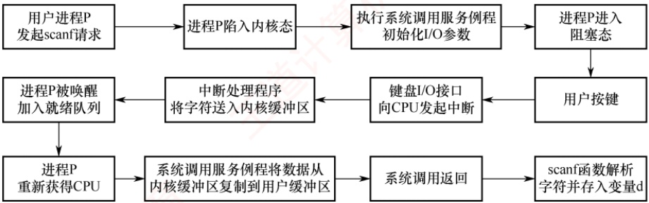

图 5.17 整个I/O操作的工作流程

值得注意的是，在此过程中，用户输入的字符首先从键盘I/O接口的数据端口送入内核缓冲区，再从内核缓冲区送入用户缓冲区。前者由设备驱动程序完成（因其需直接操作I/O端口），后者由设备无关的I/O软件层完成（因其不依赖具体硬件）。数据的流向如图5.18所示。

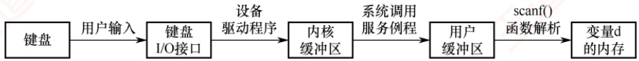

图 5.18 数据的流向

### 5.2.7 本节小结

本节开头提出的问题的参考答案如下。

1）当处理机和外部设备的速度差距较大时，有什么办法可以解决问题？

可采用缓冲技术来缓解CPU与外设速度上的矛盾，即在主存中设立一片缓冲区，外设与CPU的输入/输出都经过该缓冲区，从而减少相互等待，提高系统效率。

2）什么是设备的独立性？引入设备的独立性有什么好处？

设备独立性是指应用程序使用逻辑设备名进行I/O操作，而无须指定具体的物理设备。操作系统在运行时将逻辑设备名动态映射到实际可用的物理设备。引入设备独立性的主要优点包括:①简化编程，屏蔽底层硬件细节；②提高程序可移植性，使同一程序能在不同硬件配置的系统上运行；③支持I/O重定向与设备动态绑定，提升系统灵活性和资源利用率。

## 5.3 磁盘和固态硬盘

在学习本节时，请读者思考以下问题:

1）磁盘一次读/写操作包含哪几部分时间？其中哪部分最长？

2）存储文件时，若一个磁道容纳不下，剩余数据应存放在同一盘面的不同磁道，还是同一柱面的不同盘面？

本节主要介绍磁盘管理的方式。学习时应重点掌握:计算一次磁盘操作的时间，以及对给定的磁道访问序列，按特定调度算法求出磁头移动的总磁道数和平均寻道长度。

### 5.3.1 磁盘

**考点追踪磁盘容量的计算（2019）**

磁盘（Disk）是由表面涂有磁性物质的盘片构成的存储设备，它通过磁头（一个导体线圈）读/写数据。在读/写操作期间，盘片高速旋转，磁头沿盘片径向移动以定位目标位置。如图5.19所示，盘面上的数据存储在一组同心圆中，称为磁道。每个磁道宽度与磁头相当，一个盘面包含上千个磁道。磁道又划分为数百个扇区，每个扇区具有固定大小（如1KB），是磁盘寻址的最小物理单位。相邻磁道及扇区间留有间隙，以避免读/写于扰。传统设计中，每个磁道扇区数相同，由于外道周长更大，其线性存储密度低于内道，磁盘的存储能力受限于最内道的最大存储密度。

**注意**

为提高磁盘存储容量并充分利用外层磁道的存储能力，现代磁盘采用区域记录（ZBR）技术:将盘面划分为若干环带，同一环带内的所有磁道具有相同的扇区数，外层环带的磁道扇区数多于内层环带。

考点追踪将簇号转化为磁盘物理地址的过程（2019）

磁盘安装在磁盘驱动器中，后者由磁头臂、驱动盘片旋转的转轴及数据输入/输出电路组成。

> ①本节内容与《计算机组成原理考研复习指导》一书中的3.4节联系密切，建议结合复习。

如图5.20所示，多个盘片垂直堆叠形成盘组，每个盘面对应一个磁头，所有磁头安装在同一磁头臂上，同步径向移动。所有盘片上半径相同的磁道构成一个柱面。磁盘地址用“柱面号·盘面号·扇区号”表示，总存储容量由柱面数、盘面数和每磁道扇区数共同决定。

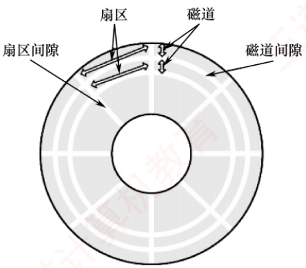

图 5.19 磁盘盘片

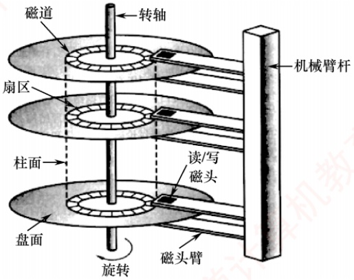

图 5.20 磁盘的结构

读/写磁盘数据块的过程如下:①根据柱面号移动磁头臂，使磁头定位到目标柱面；②激活对应盘面的磁头；③等待目标扇区随盘片旋转至磁头下方，完成读/写操作。

磁盘可按结构分为不同类型:固定头磁盘为每个磁道配备一个磁头，磁头位置固定；活动头磁盘的磁头可沿径向移动，通过磁头臂定位到目标磁道；固定盘磁盘的盘片永久密封在驱动器内，不可拆卸；而可换盘磁盘则允许盘片拆卸和更换。最早的磁盘由IBM公司于1973年推出，称为温彻斯特磁盘（温盘），其采用活动磁头与固定盘片结构，是现代机械硬盘的雏形。

在操作系统中，每类资源的管理都涉及相应的调度算法。用户访问文件时，操作系统需完成权限检查、逻辑地址到物理地址的转换等步骤，最终将请求转化为对磁盘的读/写操作。当多个I/O请求同时到达时，系统需决定服务顺序，这正是磁盘调度算法所要解决的核心问题。

### 5.3.2 磁盘的管理

#### 1．磁盘初始化

**考点追踪 物理格式化的内容（2017、2021）**

一个新的磁盘只是一个涂有磁性材料的空白盘。在磁盘能够存储数据之前，必须将其划分为扇区，以便磁盘控制器进行读/写操作，这一过程称为低级格式化（也称物理格式化）。每个扇区通常由头部、数据区域和尾部组成。头部和尾部包含了一些磁盘控制器的使用信息，其中利用磁道号、磁头号和扇区号来标志一个扇区，利用CRC字段对扇区进行校验。

大多数磁盘在出厂时作为制造过程的一部分已完成低级格式化，这使制造商能够测试磁盘，并建立逻辑块地址到物理扇区的初始映射。对于许多磁盘，控制器在低级格式化时还可指定扇区中数据区域的大小，通常为256字节、512字节或4KB等。

#### 2．分区

**考点追踪逻辑格式化的内容（2017、2021）**

在使用磁盘存储文件之前，还需完成两个步骤。第一步是分区，将磁盘划分为若干逻辑区域（如常见的C盘、D盘），每个分区的起始位置和大小记录在主引导记录（MBR）的分区表中。第二步是对分区进行逻辑格式化（也称高级格式化），即在分区上建立文件系统，包括初始化根目录、创建用于管理空闲与已分配空间的数据结构，并将初始目录置为空。

由于扇区单位过小，为提高I/O效率，操作系统将多个连续扇区组合成一簇（在文件系统中也称块)。为简化管理，通常将一簇分配给单个文件，因此文件占用空间为簇的整数倍；即使文件大小小于一簇（甚至为0字节），仍需占用一整簇空间。

#### 3．引导块

计算机启动时需要运行一个初始化程序（称为自举程序），用于初始化CPU、寄存器、设备控制器和内存等，随后加载并启动操作系统。为此，自举程序需定位磁盘上的操作系统内核，将其载入内存，并跳转至其入口地址，从而开始操作系统的执行。

自举程序通常存放于ROM中。为避免因修改自举代码而需更换ROM硬件的问题，一般仅在ROM中保留一个小型自举装入程序，而将功能完整的引导程序存放在磁盘的引导块中。该引导块位于磁盘的固定位置。含有引导块的磁盘称为启动磁盘或系统磁盘。

ROM中的代码指示磁盘控制器将引导块读入内存并执行，后者可从指定位置加载操作系统内核并启动之。下面以 Windows为例说明引导过程:Windows允许将磁盘划分为多个分区，其中活动分区（引导分区）包含操作系统核心文件。系统将初始引导代码存储在磁盘第0号扇区，称为主引导记录（MBR）。启动时，ROM中的代码首先读取MBR；除引导代码外，MBR还包含分区表和一个标志位，用于指明应从哪个分区引导，如图5.21所示。随后，系统读取该分区的首扇区（称为引导扇区），继续完成后续引导步骤，包括加载系统服务与驱动程序。

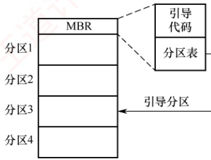

图 5.21 Windows 磁盘的引导

#### 4．坏块

磁盘因含有机械部件且容错能力较弱，容易出现一个或多个扇区损坏，部分坏块甚至在出厂时就已存在。根据磁盘类型和控制器能力，坏块的处理方式有所不同。

对于简单磁盘，如采用IDE控制器的磁盘，坏块通常由操作系统在逻辑格式化时检测。例如MS-DOS的Format命令会识别坏扇区，并在FAT表中标记为不可用，从而避免程序使用。

对于现代的复杂磁盘，控制器内部维护一份坏块列表。该列表在出厂低级格式化时初始化，并在使用过程中动态更新。低级格式化会预留部分备用扇区，这些扇区对操作系统透明。当发现坏块时，控制器自动将其映射到备用扇区，实现逻辑替换，此机制称为扇区备用。

坏块处理的核心思想是:通过软件标记或硬件重映射，确保系统不会使用坏块。

### 5.3.3 磁盘调度算法

#### 1．磁盘的存取时间

一次磁盘读/写操作的时间由寻道时间、旋转延迟时间和数据传输时间三部分组成。

1）寻道时间 $T_{\mathrm {s}} ,$ 活动头磁盘在读/写数据前，磁头移动到目标磁道所需的时间。该时间包括磁头臂的启动时间s和跨越n条磁道的移动时间，即

$$
T_{s} = mn + s
$$

式中，m为跨越每条磁道所需的时间，约为0.2ms；磁头臂的启动时间约为2ms。

2）旋转延迟时间 $T_{\mathrm {r}}$ 。目标扇区旋转至磁头下方所需的平均等待时间（因位置随机，平均为半圈旋转时间）。设磁盘转速为r，则

$$
T_{\mathrm {r}}   {=}   1 / ( 2 r )
$$

典型的磁盘转速为5400转/分，相当于旋转一圈需11.1ms，对应 $T_{\mathrm {r}} \approx 5 . 56 \mathrm {m s}$

3）数据传输时间 $T_{\mathrm {t}^{\circ}}$ 读取或写入 $b$ 字节数据所需的时间。若每条磁道存储N字节，则

$$
T_{\mathrm{t}} = b / (rN)
$$

式中，r为磁盘每秒转数。总平均存取时间 $T_{\mathrm {a}}$ 可表示为

$$
T_{a}=T_{s}+1/(2r)+b/(rN)
$$

在磁盘存取时间中，寻道时间占主导地位，且直接受磁盘调度算法影响；而旋转延迟时间和数据传输时间均与磁盘转速成反比，因此转速是磁盘性能的一个非常重要的硬件参数，难以从操作系统层面进行优化。因此，磁盘调度的主要目标是减少磁盘的平均寻道时间。

#### 2．磁盘调度算法

目前常用的磁盘调度算法有以下几种。

考点追踪各种磁盘调度算法的比较（2010、2018）

（1）先来先服务（First Come First Served，FCFS）算法

FCFS算法按进程请求访问磁盘的先后顺序进行调度，是最简单的调度算法（见图5.22）。优点是公平性好。当请求较少且访问的扇区在物理位置上较为聚集时，性能尚可；但当大量进程竞争磁盘时，磁头频繁长距离移动，导致效率低下。因此，实际系统通常采用更高效的调度算法。

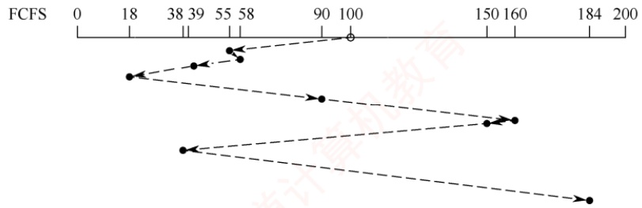

图 5.22 FCFS 算法

例如，假设磁盘请求队列为55,58,39,18,90,160,150,38,184，磁头初始位于磁道100。采用FCFS算法时，磁头的移动过程如图5.22所示。总移动距离为 $1 ( 45 + 3 + 19 + 21 + 72 + 70 + 10 +$ $112 + 146 = 498$ 个磁道，平均寻道长度 $498 / 9 = 55 . 3$

（2）最短寻道时间优先（Shortest Seek Time First, SSTF）算法

考点追踪SSTF算法的应用（2019、2021）

SSTF算法每次选择距离当前磁头位置最近的请求进行调度，以使单次寻道时间最短。尽管该策略不能保证平均寻道时间最小，但通常能提供优于FCFS算法的性能。该算法可能引发“饥饿”现象，如图5.23所示，若磁头位于18号磁道，且附近持续出现新请求，则磁头将长期在18号磁道附近来回移动，导致较远磁道（如184号）长时间得不到服务。

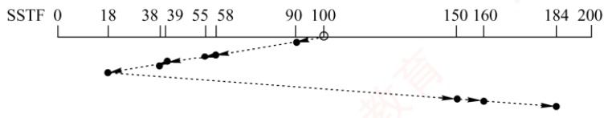

图 5.23 SSTF 算法

例如，设磁盘请求队列为55,58,39,18,90,160,150,38,184，磁头初始位于磁道100。采用SSTF算法时，磁头的移动过程如图5.23所示。总移动距离为 $10 + 32 + 3 + 16 + 1 + 20 + 132 + 10 +$ 24=248个磁道，平均寻道长度 $248/9 = 27.5$

**（3）扫描（SCAN）算法**

SSTF算法因磁头在局部区域来回移动而引发饥饿。为避免该问题，SCAN算法规定:磁头仅在到达最外侧磁道后才转向内侧移动，到达最内侧磁道后才转向外侧移动。它在SSTF的基础上引入了磁头移动方向的约束，如图5.24所示。其行为类似于电梯运行，故也称电梯调度算法。但SCAN算法对最近扫描过的区域不公平，因此在访问局部性方面不如FCFS算法和SSTF算法。

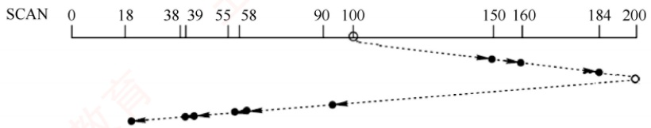

图 5.24 SCAN 算法

考点追踪SCAN算法的应用（2009、2010、2015）

例如，设磁盘请求队列为55,58,39,18,90,160,150,38,184，磁头初始位于磁道100。采用SCAN算法时，还需知道磁头移动方向。若磁头沿磁道号增大的方向移动，则访问顺序为100,150 160,184,200,90,58,55,39,38,18,磁头的移动过程如图5.24所示。总移动距离为(50+10+24+16 $110+32+3+16+1+20=282$ 个磁道，平均寻道长度 = 282/9= 31.33。

（4）循环扫描（Circular SCAN，C-SCAN）算法

考点追踪C-SCAN算法的应用（2024）

C-SCAN算法在SCAN算法的基础上规定:磁头仅沿单一方向移动并提供服务，返回时快速移至起始端且不处理任何请求。由于SCAN算法倾向于优先服务靠近最内侧或最外侧磁道的请求，导致中间区域的响应延迟较大。C-SCAN算法通过将回扫过程转化为非服务性的快速跳转，并以循环方式均匀地处理所有请求，从而有效缓解了这种不公平性，如图5.25所示。

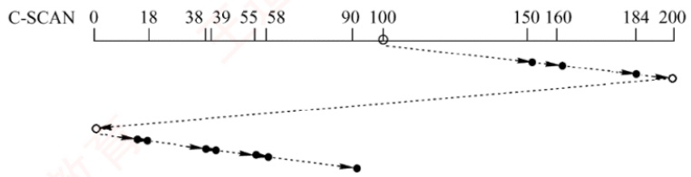

图 5.25 C-SCAN 算法

例如，假设磁盘请求队列为55,58,39,18,90,160,150,38,184，磁头初始位于磁道100。采用C-SCAN算法时，若磁头沿磁道号增大的方向移动，则访问顺序为100,150,160,184,200,0,18,38, 39,55,58,90，磁头的移动过程如图5.25所示。总移动距离为50+10+24+16+200+18+20+1+ 16+3+32=390个磁道，平均寻道长度 $= 390 / 9 = 43 . 33$

采用SCAN算法和C-SCAN算法时，磁头总是严格地从磁盘一端移动到另一端。实际上，可进一步改进:磁头只需移动到当前方向上最远的请求位置即可返回，无须抵达物理端点。这种改进后的 SCAN 算法和 C-SCAN算法分别称为LOOK 调度(见图 5.26)和 C-LOOK 调度(见图 5.27)，因其在朝某一方向移动前会“查看”（1ook）该方向是否存在待处理请求。

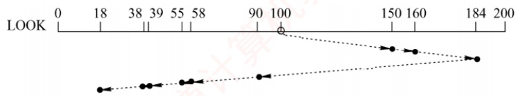

图 5.26 LOOK 调度

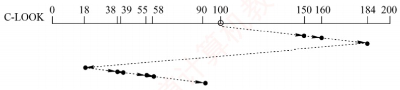

图 5.27 C-LOOK 调度

若无特别说明，实际系统中所称的 SCAN算法和C-SCAN算法通常指LOOK调度和C-LOOK调度。

以上四种磁盘调度算法的优缺点如表5.2所示。

表5.2 四种磁盘调度算法的优缺点

| 算 法 | 优 点 | 缺 点 |
| --- | --- | --- |
| FCFS 算法 | 公平、简单 | 平均寻道距离大，仅适用于磁盘I/O较少的场合 |
| SSTF 算法 | 性能优于“先来先服务” | 不能保证平均寻道时间最短，可能出现“饥饿”现象 |
| SCAN算法 | 寻道性能较好，可避免“饥饿”现象 | 对远离磁头当前位置一端的请求响应较慢 |
| C-SCAN 算法 | 消除了对两端磁道请求的不公平性 |  |

**(5) NStepSCAN 算法和 FSCAN 算法**

SSTF算法、SCAN算法和C-SCAN算法在特定情况下可能出现磁臂黏着现象:当一个或多个进程频繁发出对某个磁道的I/O请求时，磁头会长期滞留于该区域，导致其他进程难以获得服务。

为了缓解这一问题，NStepSCAN算法将磁盘请求队列划分为若干长度为N的子队列。调度器按FCFS原则依次处理各子队列，而在处理每个子队列内部时，则采用SCAN算法进行扫描。在处理某个子队列的过程中，若有新请求到达，则系统将其放入尚未处理的其他子队列中，不插入当前正在服务的子队列。这一机制有效避免了磁头因局部热点请求而长期滞留的现象，进而避免了磁臂黏着。算法性能随N值变化:当N值较大时，NStepSCAN算法的行为趋近于 SCAN算法；当N=1时，每个子队列仅含一个请求，算法退化为FCFS算法。

FSCAN 算法是NStepSCAN算法的简化形式，其做法是将请求队列固定划分为两个子队列:①当前服务队列，包含调度开始时已存在的所有请求，按SCAN算法处理；②新请求队列，在当前扫描过程中新到达的请求全部暂存于此，推迟至下一轮扫描时处理。通过“冻结当前、延后新请求”的策略，FSCAN算法不仅保留了SCAN算法的特性，还避免了磁臂黏着，且实现简单、开销低。

#### 3．减少延迟时间的方法

除减少寻道时间外，减少旋转延迟时间也是提高磁盘I/O效率的重要途径。

磁盘是连续旋转设备。当磁头读取一个扇区后，系统需要一定时间处理数据，才能开始读取下一个扇区。若逻辑上相邻的块在物理上也相邻，则在处理当前扇区的过程中，下一个目标扇区可能已随盘面旋转而掠过磁头；待处理完成时，该扇区已不可访问，只能等待近一整圈才能再次到达，从而造成显著延迟。为此，可对单个盘面的扇区采用交替编号假设盘面有8个扇区，见图5.28(b)]，使逻辑相邻的块在物理布局上保持

(a)连续编号

(b)交替编号

图5.28 盘面扇区的交替编号

适当间隔，确保在处理完一个扇区后，下一个目标扇区能及时旋转至磁头下方，从而有效减少因错过扇区而导致的长延迟。

此外，由于磁盘的所有盘面同步旋转，同一柱面内的块通常按盘面顺序连续存放，即依次为:

盘面0扇区0、盘面0扇区1……盘面0扇区7、盘面1扇区0……盘面1扇区7、盘面2扇区0……。若要读取不同盘面上的连续块，例如在读完盘面0扇区7后，系统仍需一段处理时间；而在此期间，盘面持续旋转，导致下一个目标块（如盘面1扇区0）可能已在磁头经过时被错过，无法立即读取，只能等待其下一次旋转至磁头下方。为此，可对不同盘面实施错位命名假设有2个盘面，且已采用交替编号，见图5.29(b)」，使得在处理完盘面0扇区7后，盘面1扇区0恰好或即将到达磁头位置，从而在首次经过时即可读取，显著减少旋转延迟。

0号盘面

(a)普通命名

1号盘面

0号盘面

(b)错位命名

1号盘面

图 5.29 磁盘盘面的错位命名

在磁盘的存取时间中，寻道时间和旋转延迟时间属于“找”的时间，这类开销可通过合理的调度算法或布局优化来降低，而传输时间主要由磁盘本身的特性决定，难以通过软件手段减少。

#### 4．提高磁盘I/O速度的方法

文件的访问速度是衡量文件系统性能最重要的因素，可从以下三个方面来优化:①改进文件的目录结构和检索目录的方法，以减少对目录的查找时间；②选取好的文件存储结构，以提高对文件的访问速度；③提高磁盘I/O速度，以实现文件数据在磁盘与内存之间的快速传送。其中，①和②已在第4章中介绍，这里主要介绍如何提高磁盘I/O的速度。

考点追踪改善磁盘I/O性能的方法（2012、2018）

1）采用磁盘高速缓存。5.2.2节介绍了磁盘高速缓存的概念。

2）调整磁盘请求顺序。即上文介绍的各种磁盘调度算法。

3）提前读。在读取当前磁盘块的同时，将逻辑上紧随其后的下一个（或多个）磁盘块一并预读到内存缓冲区，以应对后续可能的连续访问。

4）延迟写。当修改一个缓冲区中的数据时，并不立即写回磁盘，而仅设置延迟写标志；当该缓冲区被替换时，才真正将数据写入磁盘，从而合并多次写操作，减少I/O次数。

5）优化物理块的分布。除上文介绍的扇区编号优化外，对于采用链接或索引方式组织的文件，应尽量将其所属的块安排在同一磁道或相邻磁道上，以减少寻道时间。此外，将若干连续扇区组成簇，以簇为单位对文件进行分配，也能有效降低磁头的平均移动距离。

6）虚拟盘。指用内存空间仿真磁盘，也称RAM盘。由于内存访问速度远高于磁盘，因此常用于存放临时文件或对I/O延迟敏感的数据。虚拟盘与磁盘高速缓存的区别:虚拟盘的内容完全由用户程序控制，而磁盘高速缓存的内容则由操作系统透明管理。

7）采用磁盘阵列RAID。某些RAID级别可支持交叉存取，能大幅提高磁盘I/O速度。

### 5.3.4 固态硬盘

#### 1．固态硬盘的特性

**考点追踪机械磁盘与固态硬盘的对比（2025）**

固态硬盘（SSD）是一种基于闪存技术的存储设备。其存储介质与U盘类似，但容量更大、存取性能更优。一个SSD由一个或多个闪存芯片以及闪存翻译层组成，如图5.30所示。其中，闪存芯片替代了传统磁盘中的机械驱动器；而闪存翻译层负责将CPU发出的逻辑块读/写请求转换为对底层物理闪存的读/写控制信号，因此，闪存翻译层相当于代替了磁盘控制器的角色。

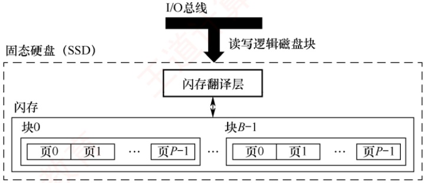

图5.30 固态硬盘（SSD）

一个闪存芯片由B块组成，每块包含P页。通常，页的大小为512B～4KB，每块包含32～ 128页，块的大小为16KB～512KB。读/写操作以页为单位进行；擦除操作以块为单位进行，只有在整块被擦除后，才能向其中的页写入新数据。一旦某块被擦除，其所有页均可重新写入一次。每个块的擦写次数有限，经过若干次重复写入后，该块会因磨损而失效。

随机写入速度较慢，主要有两个原因:①擦除操作耗时较长，通常比页访问慢一个数量级。②若需修改一个已包含有效数据的页 $P_{i} ,$ 必须先将该块中所有有效页复制到一个新的（已擦除的）块中，再执行对 $P_{i}$ 的写入。

相比传统机械磁盘，SSD具有显著优势:由半导体器件构成，无机械运动部件，因此随机访问延迟极低，且无噪声、无振动、功耗更低、抗震性强、安全性更高。

#### 2．磨损均衡（Wear Leveling）

SSD的主要缺点在于闪存的擦写寿命有限，通常仅为几百至几千次。若直接用普通闪存构建SSD而不加管理，则实际的寿命表现可能令人失望一一因为读/写操作往往会集中在少数物理块上，导致这些区域迅速磨损。一旦这部分闪存损坏，整块SSD即告失效。这种磨损不均衡的情况，可能导致一块256GB的SSD，仅因几兆字节的闪存损坏而报废。

为解决这一问题，SSD引入了磨损均衡技术，主要分为两类:

1）动态磨损均衡。在写入数据时，优先选择擦写次数较少的空闲块，避免反复写入同一区域，从而将写入负载分散到更多物理块上。

2）静态磨损均衡。这是一种更高级的策略。即使没有新数据写入，控制器也会定期扫描并自动进行数据迁移，将高磨损块中的有效数据迁移到低磨损块中。使高磨损块转为以读为主，低磨损块承担更多写入任务，进一步均衡整体寿命。

得益于磨损均衡算法，SSD的实际使用寿命显著提升。例如，一块256GB的 SSD，若其闪存的擦写寿命为500次，则理论总写入量可达125TB。即使每天持续写入10GB数据，也需要三十多年才会达到寿命极限。而日常使用中，普通用户的日均写入量通常远低于此值。

### 5.3.5 本节小结

本节开头提出的问题的参考答案如下。

1）磁盘一次读/写操作包含哪几部分时间？其中哪部分最长？

磁盘读/写操作的时间由三部分组成:寻道时间、旋转延迟和传输时间。寻道时间是将磁头臂移动到指定磁道所需的时间；旋转延迟是等待目标扇区旋转至磁头下方所需的时间；传输时间是实际读出或写入数据所经历的时间。由于磁头臂的机械运动较慢，寻道时间通常最长。

2）存储文件时，若一个磁道容纳不下，剩余数据应存放在同一盘面的不同磁道，还是同一柱面的不同盘面？

由于寻道时间对磁盘访问性能影响最大，应优先将剩余数据存放在同一柱面的不同盘面上。同一柱面的各磁道半径相同，切换盘面仅需选择对应磁头，无须移动磁头臂，故无寻道开销；而若存放在同一盘面的不同磁道，则须移动磁头臂，产生显著寻道延迟，降低访问效率。

## 5.4 本章疑难点

### 1．如何改进设备分配策略，以提高其灵活性和成功率？

可从以下两个方面对基本的设备分配程序加以改进:

1）增强设备无关性。进程使用逻辑设备名发起I/O请求。系统首先从系统设备表（SDT）中查找该类设备的第一个设备控制表（DCT）；若该设备正忙，则继续查找下一个DCT；仅当所有同类设备均处于忙碌状态时，才将进程挂起，并将其加入该类设备的等待队列；只要存在一个可用设备，系统便进入后续的安全性检查与分配流程。

2）支持多通路I/O结构。为避免I/O瓶颈，现代系统常采用多通路设计。在此结构下，控制器与通道的分配也需逐级尝试:若设备所连接的第一个控制器（或该控制器所连接的第一个通道）正忙，则尝试下一个；仅当所有相关控制器（或通道）均不可用时，分配才宣告失败，进程被挂入相应等待队列；只要有一个可用，即可完成分配。

在具有通道的系统中，设备分配需要依次访问 SDT→DCT→COCT→CHCT。成功分配一个设备须同时满足:设备可用；控制器可用；通道可用。因此，常称“设备分配，要过三关”。

### 2．用户缓冲区与内核缓冲区的定义及作用分别是什么？

用户缓冲区是指用户进程在读取文件时，通常会预先申请一块内存区域（如一个数组），称为缓冲区（Buffer），用于暂存从文件中读取的数据。每次调用read系统调用时，操作系统会将读取的数据填充到该缓冲区中，随后应用程序便可直接从中获取数据。当其中的数据被处理完毕后，再发起下一次read系统调用以重新填充缓冲区。可见，用户缓冲区的主要作用是减少系统调用的次数，进而降低因频繁在用户态与内核态之间切换所带来的开销。

内核缓冲区则是操作系统在内核空间中维护的缓冲区。当用户进程请求读取磁盘数据时，系统并不会直接访问磁盘，而是先检查内核缓冲区中是否已缓存所需数据:若存在，则将数据从内核缓冲区复制到用户缓冲区；若不存在，内核会发起磁盘I/O请求，并将当前进程挂起，转而调度其他进程执行。磁盘数据被读入内核缓冲区后，系统再将数据复制到用户缓冲区，并唤醒该进程。对于写操作，用户进程提交的数据通常不会立即写入磁盘，而是先写入内核缓冲区；当缓冲区中的数据积累到一定量，或满足特定刷新条件时，内核才会将数据批量写入磁盘。可见，内核缓冲区的核心目的是提升磁盘I/O的整体效率，尤其对写操作具有突出的优化效果
