# 第2章 线性表

> 来源：27王道《数据结构》高清带书签.pdf（已清理水印、广告与 OCR 噪声）

**【考纲内容】**
（一）线性表的基本概念
（二）线性表的实现
顺序存储；链式存储

**（三）线性表的应用**

【知识框架】

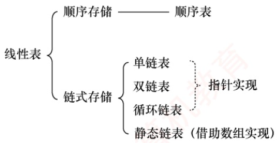

**【复习提示】**

线性表是算法题命题的重点。应牢固掌握其在两种存储结构（顺序存储与链式存储）下的各种基本操作，并在平时的学习中注重动手能力的培养。另需提醒的是，算法最重要的是思想！考场时间紧迫，在试卷上并不要求代码具备实际可执行性，应着重清晰地表达出算法的核心思想与关键步骤，而不必过于拘泥于语法、边界等细节。此外，即使采用暴力法，通常也能获得大部分分数，因此在时间紧张时建议直接采用。注意，算法题只能使用C/C++语言实现。

## 2.1 线性表的定义和基本操作

### 2.1.1 线性表的定义

线性表是由n（n≥0）个相同数据类型的元素组成的有限序列。其中n为表长；当n=0时，线性表为空表。若用L表示一个线性表，则其一般形式为

$$
L = ( a_{1} , a_{2} , \cdots , a_{i} , a_{i + 1} , \cdots , a_{n} )
$$

式中， $a_{1}$ 是唯一的“第一个”数据元素，也称表头元素； $a_{n}$ 是唯一的“最后一个”数据元素，也称表尾元素。除第一个元素外，每个元素有且仅有一个直接前驱；除最后一个元素外，每个元素有且仅有一个直接后继（“直接前驱”与“前驱”、“直接后继”与“后继”通常被视为同义词）。以上即为线性表的逻辑特性，这种一对一的线性逻辑关系正是线性表名称的由来。

由此，可总结出线性表的特点如下:

● 表中元素的个数有限。

● 表中元素具有逻辑上的顺序性，即存在明确的先后次序。

表中元素均为数据元素，每个元素在线性表中被视为一个不可分割的单位

表中元素的数据类型都相同，这意味着每个元素占有相同大小的存储空间。

● 表中元素具有抽象性，即仅讨论元素之间的逻辑关系，而不考虑其究竟表示什么内容。

**注意**

线性表是一种逻辑结构，表示元素之间一对一的相邻关系。顺序表和链表是两种存储结构，二者属于不同层面的概念，因此不要将其混淆。

### 2.1.2 线性表的基本操作

一个数据结构的基本操作是指其最核心、最基本的操作集合，其他较复杂的功能通常可通过调用这些基本操作来实现。线性表的主要操作如下。

● InitList(&L):初始化表。构造一个空的线性表。

● Length(L):求表长。返回线性表的长度，即其中数据元素的个数。

● LocateElem(L，e):按值查找操作。在表L中查找值为e的元素，并返回其位置。

GetElem(L,i):按位查找操作。获取表L中第i个位置的元素值。

● ListInsert(&L,i,e):插入操作。在表L的第i 个位置插入指定元素e。

● ListDelete(&L,i,&e):删除操作。删除表L中第i 个位置的元素，并用e返回被删元素的值。

● PrintList(L):输出操作。按前后顺序输出线性表L的所有元素值。

● Empty(L):判空操作。若L为空表，则返回 true，否则返回 false。

● DestroyList(&L):销毁操作。销毁线性表，并释放其占用的内存空间。

**注意**

①基本操作的具体实现取决于所用的存储结构，存储结构不同，算法的实现方式也不同。②符号&表示C++语言中的引用调用；在C语言中，可通过指针实现相同效果。

## 2.2 线性表的顺序表示

### 2.2.1 顺序表的定义

考点追踪（算法题）顺序表的应用（2010、2011、2018、2020、2025）

线性表的顺序存储也称顺序表。它是用一组地址连续的存储单元依次存储线性表中的数据元素，使得逻辑上相邻的元素在物理位置上也相邻。第1个元素存储在顺序表的起始位置，第i个元素的存储位置之后紧接着存放的是第i+1个元素，称i为元素 $a_{i}$ 在顺序表中的位序。因此，顺序表的特点是:表中元素的逻辑顺序与其物理存储顺序完全一致。

设顺序表L的起始存储地址为LOC(A)，每个数据元素占用的存储空间大小为 sizeof(E1 emType)，则顺序表的存储结构如图2.1所示。

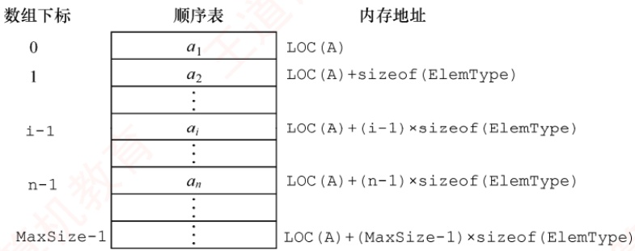

图 2.1 线性表的顺序存储结构

由于任意数据元素的存储地址与顺序表起始地址之间的偏移量与其位序呈线性关系，因此可在0(1)时间内直接访问表中任意位置的元素，这种特性使得线性表的顺序存储结构属于随机存取。在高级程序设计语言中，通常使用数组来实现顺序表。

```txt
注意
线性表中元素的位序从1开始，而数组中元素的下标从0开始，注意二者之间的转换。
```

```txt
假定线性表的元素类型为ElemType，则静态分配的顺序表存储结构描述为
#define MaxSize 50 //定义线性表的最大长度
typedef struct{
ElemType data[MaxSize]; //顺序表的元素
```

```javascript
int length;
}SqList;
```

```txt
//顺序表的当前长度
//顺序表的类型定义
```

一维数组既可以静态分配，也可以动态分配。静态分配时，数组的大小和存储空间在编译时已经固定，一旦空间占满，再插入新元素将导致溢出，进而可能引发程序异常。

动态分配时，存储数组的空间是在程序执行过程中通过动态存储分配语句申请的。当空间占满时，可以另行开辟一块更大的存储空间，将原表中的所有元素复制到新空间中，从而实现存储容量的扩充，而无须在初始化时为线性表一次性划分全部可能用到的空间。

动态分配的顺序表存储结构描述为

```c
#define InitSize 100
typedef struct{
ElemType *data;
int MaxSize,length;
}SeqList;
```

```txt
//表长度的初始定义
//指示动态分配数组的指针
//数组的最大容量和当前个数
//动态分配数组顺序表的类型定义
```

```javascript
L.data=(ElemType*)malloc(sizeof(ElemType)*InitSize);
C++的初始动态分配语句为
L.data=new ElemType[InitSize];
```

**注意**

动态分配并不是链式存储，它同样属于顺序存储结构。其物理结构没有变化，依然支持随机存取，只是存储空间的大小可以在运行时动态调整。

顺序表的主要优点:①可进行随机访问，即通过首地址和元素序号可在O(1)时间内找到指定的元素；②存储密度高，每个结点仅存储数据元素，无额外指针开销。顺序表的缺点也很明显:①插入和删除操作效率较低，需要移动大量元素；②要求分配连续的存储空间，不够灵活。

### 2.2.2 顺序表上基本操作的实现

**考点追踪顺序表上操作的时间复杂度分析（2023）**

本节仅讨论顺序表的初始化、插入、删除和按值查找，其他基本操作的实现都较为简单。

**注意**

在各种操作的实现中（包括严蔚敏老师的教材），通常可以忽略边界条件判断、变量定义、内存分配失败等实现细节，即不要求代码具有实际可执行性，而应重点体现算法的核心思想与逻辑步骤

#### 1．顺序表的初始化

静态分配和动态分配的顺序表在初始化时有所不同。静态分配:在声明顺序表时，数组空间已由编译器分配，因此初始化只需将当前长度置为0。

```txt
//SqList L; //声明一个顺序表
void InitList(SqList &L) {
L.length=0; //顺序表初始长度为0
```

动态分配:需在运行时为顺序表分配初始大小的数组空间，并设置长度和容量。

```txt
void InitList(SeqList &L){
L.data=(ElemType *)malloc(InitSize*sizeof(ElemType))；/分配存储空间
```

```javascript
L.length=0;
L.MaxSize=InitSize;
```

其中，MaxSize表示当前分配的存储空间上限。当插入元素导致空间不足时，需要扩容。

#### 2．插入操作

在顺序表L的第i（1≤i≤L.length+1）个位置插入新元素e。若i超出合法范围，或存储空间已满，则插入失败，返回false；否则，将第i个元素及其后的所有元素依次后移一位，腾出一个空位置插入e，表长加1，返回true。

```javascript
bool ListInsert(SqList &L,int i,ElemType e){
if(i<1|li>L.length+1) //判断i的范围是否有效
return false;
if(L.length>=MaxSize) //当前存储空间已满
return false;
for(int j=L.length;j>=i;j--) //将第i 个元素及之后的元素后移
L.data[j]=L.data[j-1];
L.data[i-1]=e; //在位置i插入e（注意下标转换）
L.length++; //表长加1
return true;
```

**注意**

区分位序（从1开始）与数组下标（从0开始）。为什么判断插入位置时使用1ength+1，而移动元素的for循环中使用length？因为合法插入位置包括第n+1位，但移动元素时最多从第n位开始后移。

最好情况:在表尾插入 $(i = n + 1)$ ，无须移动元素，时间复杂度为O(1)。

最坏情况:在表头插入（i =1），需移动全部n个元素，时间复杂度为O(n)。

平均情况:设在第i个位置插入的概率为 $p_{i} = 1 / ( n + 1 )$ ，则平均移动次数为

$$
\sum_{i = 1}^{n + 1}p_{i}(n - i + 1) = \sum_{i = 1}^{n + 1}\frac{1}{n + 1}(n - i + 1) = \frac{1}{n + 1}\sum_{i = 1}^{n + 1}(n - i + 1) = \frac{1}{n + 1}\frac{n(n + 1)}{2} = \frac{n}{2}
$$

因此，插入操作的平均时间复杂度为O(n)。

#### 3．删除操作

删除顺序表L中第i（1≤i≤L.1ength）个位置的元素，并通过引用参数e返回其值。若i非法，返回false；否则，保存被删元素，将其后所有元素前移一位，表长减1，返回true。

```javascript
bool ListDelete(SqList &L,int i,ElemType &e){
if(i<1|li>L.length) //判断i的范围是否有效
首 return false;
e=L.data[i-1]; //将被删除的元素赋给
for(int j=i;j<L.length;j++) //将第i 个位置后的元素前移
L.data[j-1]=L.data[j];
L.length--; //表长减1
return true;
```

最好情况:删除表尾元素（i=n），无须移动元素，时间复杂度为O(1)。

最坏情况:删除表头元素（i=1），需移动其余n−1个元素，时间复杂度为O(n)。

平均情况:设删除第i个元素的概率为 $p_{i}=1/n$ ，则平均移动次数为

$$
\sum_{i = 1}^{n}p_{i}(n - i) = \sum_{i = 1}^{n}\frac{1}{n}(n - i) = \frac{1}{n}\sum_{i = 1}^{n}(n - i) = \frac{1}{n}\frac{n(n - 1)}{2} = \frac{n - 1}{2}
$$

因此，删除操作的平均时间复杂度为 $O ( n )$

可见，顺序表的插入和删除操作的时间开销主要耗费在移动元素上，而移动元素的个数取决于操作位置。图2.2显示了顺序表插入和删除操作前、后的状态，以及数据元素在存储空间中的位置和表长变化。图2.2(a)将第4～7个元素从后往前依次后移一位，为新元素腾出位置。图2.2(b)将第5～7个元素从前往后依次前移一位，填补删除后的空缺。

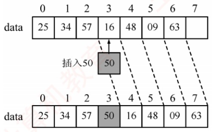

(a) 插入新元素示例

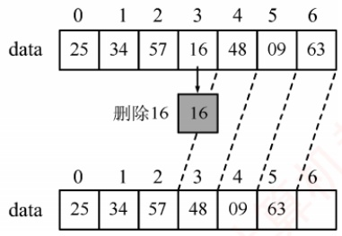

(b) 删除表中元素示例

图2.2 顺序表的插入和删除

#### 4．按值查找（顺序查找）

在顺序表L中查找第一个值等于e的元素，返回其位序；若未找到，则返回0。

```txt
int LocateElem(SqList L,ElemType e){ int i; 育
for(i=0;i<L.length;i++)
if(L.data[i]==e)
return i+1; //下标为 i 的元素值等于 e，返回其位序 i+1
return 0; //查找失败
```

最好情况:目标元素在表头（i=1），比较1次，时间复杂度为O(1)。

最坏情况:目标元素在表尾或不存在，需要比较n次，时间复杂度为O(n)。

平均情况:设目标元素在第i位的概率为 $p_{i}   = 1 / n$ ，则平均比较次数为

$$
\sum_{i = 1}^{n}p_{i} \cdot i = \sum_{i = 1}^{n}\frac{1}{n} \cdot i = \frac{1}{n}\frac{n(n + 1)}{2} = \frac{n + 1}{2}
$$

因此，按值查找的平均时间复杂度为 $O ( n )$

顺序表的按序号查找非常简单，直接通过数组下标访问即可，时间复杂度为O(1)。

## 2.3 线性表的链式表示

顺序表支持随机存取任意元素，但插入和删除操作需要移动大量元素，效率较低。相比之下，链式存储的线性表不要求地址连续的存储单元，即逻辑上相邻的元素在物理位置上是可以不相邻的；它通过指针建立元素之间的逻辑关系，因此插入或删除操作无须移动元素，而只需修改相关指针，效率较高。然而，这样做的代价是失去了顺序表的随机存取能力，只能从头开始顺序访问。

### 2.3.1 单链表的定义

考点追踪单链表的应用（2009、2012、2013、2015、2016、2019）

线性表的链式存储也称单链表。它通过一组任意的存储单元（不要求地址连续）来存储线性表中的数据元素。为了建立数据元素之间的线性关系，每个链表结点除了存放元素自身的信息外，还需额外设置一个指向其后继结点的指针。单链表的结点结构如图2.3所示，其中data为数据域，用于存放数据元素；next为指针域，用于存放其后继结点的地址。

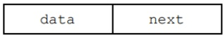

图2.3 单链表的结点结构

单链表结点类型的定义如下

```c
typedef struct LNode{ //定义单链表结点类型
ElemType data; //数据域
struct LNode *next; //指针域
}LNode, *LinkList;
```

单链表避免了顺序表对连续内存空间的依赖，但每个结点需要额外存储一个指针，带来了一定的存储开销。同时，由于其元素离散地分布在内存中，单链表是一种非随机存取的存储结构，即无法直接定位到表中的某个特定结点，查找时要从表头开始依次遍历。

通常使用头指针L（或head等）来标识一个单链表，该指针指向链表的起始位置。当头指针为NULL时，表示链表为空。此外，为了简化操作，在单链表的第一个数据结点之前常附加一个特殊的结点，称为头结点。头结点的数据域一般不存放有效数据（但可用于记录表长等信息）。在带头结点的单链表中，头指针工指向头结点，而头结点的next指向第一个数据结点，如图2.4(a)所示。在不带头结点的单链表中，头指针L直接指向第一个数据结点，如图2.4(b)所示。无论哪种形式，表尾结点的指针域为NULL（图中用“^”表示）。

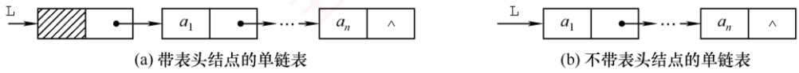

图2.4 带头结点和不带头结点的单链表

头指针与头结点的关系:头指针始终指向链表的第一个结点（无论带不带头结点），而头结点仅存在于带头结点的链表中，它是链表的第一个结点，其数据域通常不存储实际数据。

引入头结点后，可带来以下两个主要优点:

①操作统一性:第一个数据结点的位置存储在头结点的指针域中，因此在链表首部进行插入、删除等操作时，与其他位置的操作逻辑一致，无须特殊处理。

②空表与非空表处理统一:无论链表是否为空，头指针始终是一个非空指针（指向头结点），而空表仅表现为头结点的next为NULL，从而避免了对空表的单独判断。

### 2.3.2 单链表上基本操作的实现

带头结点单链表在操作实现上更为简便。如无特殊说明，本节算法均默认链表带头结点。

#### 1．单链表的初始化

带头结点与不带头结点的单链表在初始化时有所不同。带头结点的单链表初始化时，需创建一个头结点，并令头指针L指向该头结点，其next指针初始化为NULL。

```c
L=(LNode*)malloc(sizeof(LNode));//创建头结点①
L->next=NULL; //头结点之后暂无数据结点
return true; K
```

不带头结点的单链表初始化时，只需将头指针L初始化为NULL。

```txt
bool InitList(LinkList &L){
L=NULL;
return true;
```

**注意**

设p为指向链表结点的结构体指针，则\*p表示该结点本身。可通过p->data 或(\*p).data 访问其数据域，二者完全等价。成员运算符（.）左侧应为结构体变量，指向运算符（->）左侧应为结构体指针。例如，p->next->data等价于(\*(\*p).next).data，表示当前结点后继结点的数据。

#### 2．求表长操作

求表长是指统计单链表中数据结点的个数（不包括头结点）。从第一个数据结点开始依次遍历，为此需要设置一个计数变量，每访问一个结点，其值加1，直到遇到NULL。

```txt
int Length(LinkList L){
int len=0;
LNode *p=L;
while(p->next!=NULL) {
p=p->next;
len++;
1
return len;
}
```

求表长操作的时间复杂度为O(n)。

另外，需要注意的是，由于表长不包含头结点，带头结点与不带头结点的实现细节略有不同。

#### 3．按序号查找结点

从单链表的第一个数据结点开始，沿next指针逐个查找，返回第i个结点的指针；若i超出表长，则返回NULL。

```txt
LNode *GetElem(LinkList L,int i) {
LNode *p=L; //指针 p指向当前扫描结点
int j=0; //j 记录当前位序，头结点为第0个结点
while(p!=NULL&&j<i) { //循环找到第i 个结点
p=p->next;
j++;
return p; //返回第i 个结点的指针或 NULL
```

按序号查找操作的时间复杂度为O(n)。

#### 4．按值查找表结点

从单链表的第一个数据结点开始，依次比较各结点的数据域，若等于给定值e，则返回该结点指针；否则返回NULL。

```txt
LNode *LocateElem(LinkList L,ElemType e) {
LNode *p=L->next;
while(p!=NULL&&p->data!=e)∥/从第一个结点开始查找数据域为e 的结点
```

> ① 执行 s=(LNode\*)malloc(sizeof(LNode))的作用是由系统生成一个LNode 型结点，并将该结点的起始位置赋给指针变量s。

```txt
p=p->next;
return p;
1
```

```txt
//找到后返回该结点指针，否则返回NULL
```

按值查找操作的时间复杂度为 O(n)。

#### 5．插入结点操作

考点追踪单链表插入操作的过程（2016、2024）

将值为e的新结点插入到第i个位置（成为新的第i个数据结点）。先检查i的合法性，然后找到第i-1个结点（前驱），再在其后插入新结点。假设找到的第i-1个结点为\*p，然后令新结点\*s的next指向\*p的后继，再令\*p的next指向\*s，如图2.5所示。

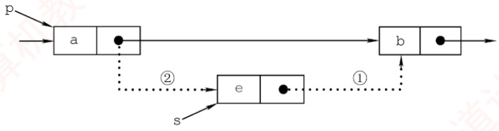

图 2.5 单链表的插入操作

```c
bool ListInsert(LinkList &L,int i,ElemType e){
LNode *p=L; //p 指向当前扫描结点
int j=0; //j 记录当前位序，头结点为第0个结点
while(p!=NULL&&j<i-1) { //循环找到第 i-1 个结点
p=p->next;
j++;
if(p==NULL) //i 值不合法
return false;
LNode *s=(LNode*)malloc(sizeof(LNode));
s->data=e;
s->next=p->next; //图 2.5 中操作步骤①
p->next=s; //图 2.5 中操作步骤②
return true;
```

步骤①和②的顺序不可颠倒。若先执行p->next=s，则原后继地址丢失，导致s->next= p->next实际变为s->next=s，形成自环。该操作的时间复杂度为O(n)，主要开销在于查找前驱结点。若已知某结点指针，则在其后插入新结点的时间复杂度为O(1)。注意，当插入位置i=1时，不带头结点的单链表需要更新头指针L指向新首结点，而带头结点的则无须特殊处理。

扩展:对某个结点进行前插操作。

前插操作是指在某结点前插入一个新结点，与后插操作相反。任何前插操作均可转化为后插操作:只需从头结点开始顺序查找其前驱，时间复杂度为O(n)。若对给定结点进行前插，则还可采用另一种技巧（适用于数据可复制的情况）:将新结点\*s插入目标结点\*p之后，再交换\*p与\*s的数据域。这种技巧逻辑上等效于前插，且时间复杂度为O(1)。主要代码片段如下:

```txt
s->next=p->next; //修改指针域，不能颠倒
p->next=s;
temp=p->data; //交换数据域部分
p->data=s->data;
s->data=temp;
```

#### 6．删除结点操作

删除单链表的第i个数据结点。先检查i的合法性，然后找到第i-1个结点（前驱），再删除其后继结点，并释放内存。假设找到的第i-1个结点为\*p，其后继为被删结点 $^{\star} \mathrm {q}$ ，先将 $^{\star} \mathrm {p}$ 的next 指向 $^{\star} \mathrm {{q}}$ 的后继结点，然后释放\*q的存储空间，如图2.6所示。

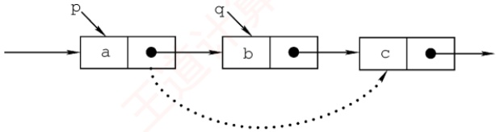

图2.6 单链表结点的删除

```c
bool List Delete(LinkList &L,int i,flemTve 前扫 到的结点
int j=0; //记录当前结点的位序，头结点是第0 个结点
while(p->next!=NULL&&j<i-1) {//循环找到第i-1 个结点
p=p->next; 算机
j++;
首 if(p->next==NULL|lj>i-1) //i 值不合法 道
return false;
LNode *q=p->next; ∥/令 g 指向被删除结点
e=q->data; //用 e 返回元素的值
p->next=q->next; //将*q 结点从链中“断开”
free(q) ; //释放结点的存储空间①
return true;
```

类似于插入操作，该操作的主要耗时也在查找操作上，时间复杂度为 $O ( n )$

当链表不带头结点时，需判断被删结点是否为首结点，若是，则要做特殊处理，将头指针L指向新的首结点。当链表带头结点时，删除首结点和删除其他结点的操作是相同的。

扩展:删除给定结点 $^{\star} \mathrm {p}$

常规方法需要从头遍历找到 $^{\star} \mathrm {p}$ 的前驱，时间复杂度为O(n)。若允许修改结点内容，则可采用一种O(1)的技巧:将 $^\star \mathrm {p}$ 的后继结点的数据复制到\*p中，然后删除其后继结点。该方法的局限性在于不能用于删除尾结点（因其无后继）。主要代码片段如下:

```txt
LNode *q=p->next; //令 g 指向*p 的后继结点
p->data=p->next->data; //用后继结点的数据域覆盖
p->next=q->next; //将*g 结点从链中“断开”
free(q) ; //释放后继结点的存储空间
```

#### 7．采用头插法建立单链表

该方法从一个空表开始，生成新结点\*s，并将读取的数据存入其数据域。然后，令s->next指向头结点当前 next 所指的结点，再将头结点的 next 指向\*s，如图 2.7所示。重复此过程，新结点始终成为第一个数据结点，最终链表中的元素顺序与输入顺序相反。

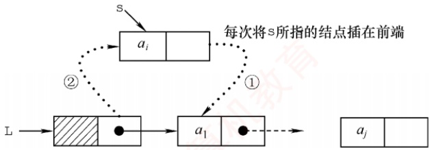

图2.7 采用头插法建立单链表

> ①执行free(q)的作用是由系统回收一个LNode型结点，回收后的空间可供再次生成结点时用。

```c
LinkList List HeadInsert(LinkList &L){ //逆向建立单链表
LNode *s; int x; //设元素类型为整型

L=(LNode*)malloc(sizeof(LNode)); //创建头结点
L->next=NULL; //初始为空链表
scanf("%d",&x) ; //输入结点的值
while(x!=9999) { 首 //输入9999 表示结束
s=(LNode*)malloc(sizeof(LNode));//创建新结点
s->data=x;
s->next=L->next;
L->next=s; //将新结点插入表中，Ⅰ为头指针
scanf ("%d",&x);
return L ;
```

每插入一个结点的时间复杂度为O(1)，总时间复杂度为O(n)。

**思考**

若单链表不带头结点，则上述代码中哪些地方需要修改？

#### 8．采用尾插法建立单链表

若希望输入顺序与链表中的元素顺序一致，则可采用尾插法。该方法将新结点插入当前链表的表尾。为此，需要维护一个尾指针r，并且始终指向当前的尾结点；插入时，令r->next指向新结点\*s，再将r更新为s，使其继续指向新的尾结点，如图2.8所示。

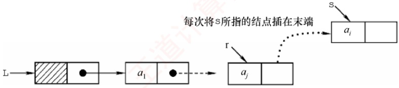

图2.8 采用尾插法建立单链表

```c
LinkList List TailInsert(LinkList &L){ //正向建立单链表
int x; //设元素类型为整型
L=(LNode*)malloc(sizeof(LNode)); //创建头结点
LNode *s,*r=L; //r为表尾指针
scanf("%d",&x); //输入结点的值
while(x!=9999) { //输入9999表示结束
s=(LNode *)malloc(sizeof(LNode));
s->data=x; 自
r->next=s;
r=s; //r 指向新的表尾结点
scanf ("%d",&x) ;
1
r->next=NULL; //尾结点指针置空
return L;
```

因为附设了一个尾指针，故无须遍历查找尾部，总时间复杂度仍为O(n)。

> ①主要修改之处:因为在头部插入新结点，每次插入新结点后，都需要将它的地址赋值给头指针L。

**注意**

单链表是链式存储结构的基础，建议读者熟练掌握其基本操作。在设计算法时，可先通过画图理清指针变化逻辑，再编写代码，有助于避免常见错误（如指针丢失、内存泄漏等）。

### 2.3.3 双链表

单链表的每个结点仅包含一个指向其后继的指针，故只能从前往后依次遍历。若需访问某结点的前驱（插入或删除操作时），则要从头开始遍历，时间复杂度为O(n)。为了克服这一局限，引入了双链表，双链表中的每个结点包含两个指针prior和next，分别指向直接前驱和直接后继，如图2.9所示。其中，头结点的prior为NULL，尾结点的next也为NULL。

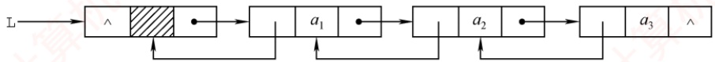

图2.9 双链表示意图

双链表结点类型的定义如下:

```c
typedef struct DNode{ //定义双链表结点类型
ElemType data; //数据域
struct DNode *prior,*next; //前驱和后继指针
}DNode, *DLinklist;
```

双链表的按值查找操作和按位查找操作与单链表的相同，通常也需要从头结点开始顺序查找。由于增加了指向前驱的指针，双链表在插入操作和删除操作中要同时维护前驱与后继两个方向的链接，因此其实现方式与单链表的有较大差异。关键在于:修改指针时不能造成断链。得益于对前驱结点的直接访问，在已知目标结点的前提下，双链表的插入和删除操作的时间复杂度可降至0(1)。

#### 1．双链表的插入操作

考点追踪双链表中插入操作的实现（2023）

在双链表的结点\*p之后插入新结点\*s，其指针变化过程如图2.10所示。代码片段如下:

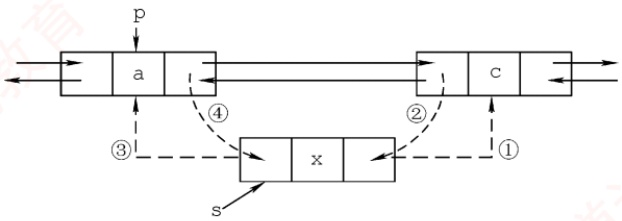

图2.10 双链表插入结点过程

```txt
① s->next=p->next; //将结点*s 插入到结点*p 之后
② p->next->prior=s;
③ s->prior=p;
④ p->next=s;
```

上述语句的执行顺序并不是任意的:步骤①必须在步骤④之前，否则p->next被覆盖后，无法访问原后继结点，导致指针丢失，插入失败。其余步骤可在保证逻辑正确的前提下适当调整（例如③可在①前执行）。若问题改成要求在结点\*p之前插入结点\*s，则要如何处理？请读者自行推导操作步骤。

#### 2．双链表的删除操作

考点追踪双链表中删除操作的实现（2016）

删除双链表中结点 $^{\star} \mathrm {p}$ 的后继结点 ${}^{\star} \mathbb {Q}   ;$ ，其指针的变化过程如图2.11所示。

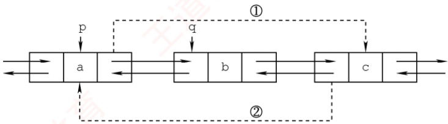

图2.11 双链表删除结点过程

$$
\begin{aligned} &\mathtt{p}->\mathtt{next}=\mathtt{q}->\mathtt{next} ; \\&\mathtt{q}->\mathtt{next}->\mathtt{pr} \downarrow \circ \mathtt{r}=\mathtt{p} ; \\&\mathtt{f} \mathtt{r} \mathtt{ee} (\mathtt{q}) ;\\ \end{aligned}
$$

若问题改成要求删除结点 $^{\star} \mathrm {{q}}$ 的前驱结点 $^{\star} \mathrm {p}$ ，请读者尝试写出对应的操作步骤。

建立双链表时，同样可以采用类似单链表的头插法或尾插法，但要注意:每次插入新结点时，要同时正确设置 next 和 $\mathtt {prior}$ 两个指针，以维持双向链接的完整性。

### 2.3.4 循环链表

#### 1．循环单链表

循环单链表与普通单链表的主要区别在于:表中最后一个结点的next域不再为NULL，而是指向头结点，从而使整个链表形成一个环。这种结构使得从任意一个结点出发均可遍历整个循环单链表，而不仅限于从表头开始，如图2.12所示。

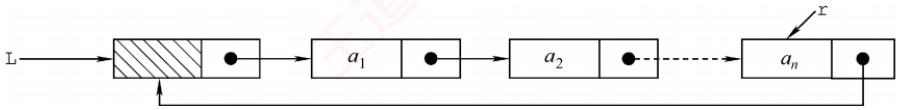

图2.12 循环单链表

尾结点 $^{\star} \mathbb {T}$ 的 next 指向头结点，因此链表中不存在next为NULL的结点。判空条件不再是检查头指针L是否为空，而是检查头结点的next是否指向自身 $( \mathtt {L} - > \mathtt {next} = = \mathtt {L} )$

**考点追踪循环单链表中删除首元素的操作（2021）**

循环单链表的插入和删除操作与普通单链表基本相同，但有一个关键差异:在表尾进行操作时，需要特别处理以维持链表的循环特性。然而，正是因为循环单链表是一个环，在任何位置上的插入和删除操作都是等价的，因此无须判断是否到达表尾。

为了提高效率，循环单链表有时不设头指针，而仅设置尾指针r。此时，在表头或表尾插入元素的时间复杂度均为O(1)。若使用头指针，则表尾插入需要遍历整个链表，时间复杂度为O(n)。例如，在表尾插入新结点 $^{\star} \mathrm {S}$ 时，需要执行以下步骤:令 $\mathrm{s}->\mathrm{n}\mathrm{e}\times \mathrm{t}=\mathrm{r}->\mathrm{n}\mathrm{e}\times \mathrm{t}$ (使新结点的后继指向头结点，以维持环状结构）；将 $\mathtt {r} \mathtt {-} \mathtt {>} \mathtt {n} \mathtt {e} \mathtt {x} \mathtt {t}$ 指向新结点 $\left[^{\star} \mathrm {S} \right]$ ；更新r为新结点 $^{\star} \mathrm {S}$

#### 2．循环双链表

基于循环单链表的概念，不难推导出循环双链表。不同之处在于:循环双链表中的每个结点不仅包含指向下一个结点的 ${\tt next}$ 域，还包含指向前一个结点的 $\mathtt {[ prior}$ 域。特别地，头结点的 $\mathtt {| prior}$需要指向表尾结点，从而形成一个完整的环形结构，如图2.13所示。

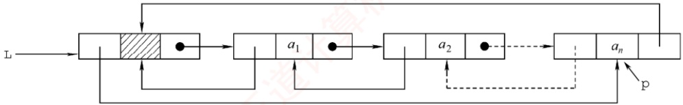

图 2.13 循环双链表

设尾结点为 $^{\star} \mathrm {p}$ ，则p->next 应指向头结点 L；同时，L->prior 应指向 $^{\star} \mathrm {p}$ 。当循环双链表为空时，其头结点L的prior 和 next都指向自身（L->prior== L且 $\mathtt {L} \mathtt {-} \mathtt {>} \mathtt {nex} \mathtt {\textell} \mathtt {=} \mathtt {=} \mathtt {L} \mathtt {)}$

### 2.3.5 静态链表

静态链表是用数组来模拟线性表的链式存储结构。每个结点都包含两个域:data域和next域。与动态链表不同的是，这里的指针实际上是结点在数组中的相对地址（数组下标），也称游标。类似于顺序表，静态链表也需要预先分配一块连续的内存空间。

静态链表和单链表的对应关系如图2.14所示。

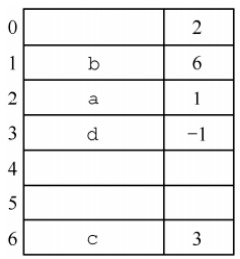

(a)静态链表示例

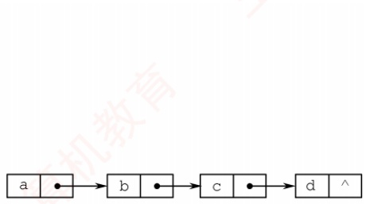

(b)静态链表对应的单链表

图2.14 静态链表和单链表的对应关系

静态链表的结构类型定义如下:

```txt
#define MaxSize 50 //静态链表的最大长度
typedef struct{ //静态链表的结构类型定义
ElemType data; //存储数据元素
int next; //下一个元素的数组下标
} SLinkList[MaxSize];
```

静态链表以next==-1作为其结束标志。静态链表的插入、删除操作与动态链表类似，只需修改指针（数组下标），而无须移动元素。尽管静态链表在灵活性上不及动态链表，但在一些不支持指针的编程语言（如Basic）中，它提供了一种巧妙的设计方案。

### 2.3.6 顺序表和链表的比较

#### 1．存取（读/写）方式

顺序表支持随机存取，可通过下标直接访问任意位置元素，时间复杂度为O(1)，同时也支持顺序存取。链表仅支持顺序存取，必须从头结点开始逐个遍历。例如，访问第i个元素时，顺序表只需一次操作；而链表需要遍历i个结点，平均时间复杂度为 $O ( n )$

#### 2．逻辑结构与物理结构

顺序存储中，逻辑上相邻的元素在物理内存中也连续存放，其邻接关系由地址自然体现；链式存储中，逻辑相邻的元素在物理上未必相邻，其逻辑关系通过指针显式维护。

#### 3．查找、插入和删除操作

对于按值查找，若表无序，则两者的时间复杂度均为O(n)；若表有序，则顺序表可以采用折半查找，时间复杂度为O(log2n)。对于按序号查找，顺序表的时间复杂度为O(1)，链表则为O(n)。对于插入/删除操作，顺序表平均需移动约一半的元素，开销较大；链表只需修改指针，无须移动元素，但前提是已知操作位置（否则仍需O(n)的时间定位）。

#### 4．空间分配

顺序表在静态分配下需预先设定容量:过大造成内存浪费，过小则易在插入时溢出。动态分配虽支持运行时扩容，但需要申请新的连续内存块并复制全部原有数据，不仅耗时，还可能因系统缺乏足够连续空闲空间而失败。相比之下，链表采用动态结点分配，按需扩展，灵活性高，但每个结点需额外存储指针域，导致存储密度小于1，空间利用率较低。

在实际应用中，该如何选择合适的存储结构呢？

#### 1．基于存储的考虑

当线性表的长度或规模难以预估时，顺序表因需预先分配固定容量而不适用；而链表无须预设容量，可按需动态扩展，但每个结点需额外存储指针，带来一定的空间开销。

#### 2．基于运算的考虑

若应用中频繁进行按序号访问（随机访问），顺序表具有O(1)的优势，明显更高效；而对于以插入和删除为主的操作，链表在定位目标位置后仅需调整指针，开销较小。尽管定位过程本身仍需O(n)时间，但在增删密集的场景下，链表的整体性能通常更优。

#### 3．基于环境的考虑

顺序表基于数组实现，几乎所有高级语言都支持，实现简单；链表则依赖指针操作，在部分环境中实现较为复杂。因此，开发语言和运行环境也是重要的考量因素。

综上所述，两种结构各有优劣。对于规模稳定、以随机访问为主的场景，宜采用顺序存储；而动态性强、频繁进行插入和删除操作的场景，则更适合链式存储。

**注意**

只有熟练掌握线性表的顺序存储和链式存储，才能深刻理解它们的优缺点。

## 归纳总结

本章是算法设计题的重点考查内容。线性表相关的算法题通常代码量较小，却蕴含一定的设计技巧，非常适合用于笔试考查。此类题目常采用“三段式”结构命题。

在给出题目背景和具体要求的前提下:

①给出算法的基本设计思想。

②采用C或C++语言描述算法，关键之处给出注释。

③分析所设计算法的时间复杂度和空间复杂度。

算法具体的设计思路灵活多变，难以一概而论。因此读者务必勤加练习，反复研读本章的典型例题，尝试用多种方法求解，并对比其时间与空间效率，从而逐步掌握各类题型的分析视角与最优解法。为此，编者整理了几种常用的算法设计技巧，供参考:针对链表，常用方法包括头插法、尾插法、逆置法、归并法、双指针法等，需根据具体问题灵活运用；针对顺序表，因其支持随机访问，常结合经典排序与查找策略进行设计，如归并排序、二分查找等。

**注意**

在算法设计题中，若能正确定义数据结构并清晰阐述算法思想，通常可获得至少一半的分数；若能进一步用规范代码实现，则得分更有保障；逻辑较复杂的部分可直接用文字说明，确保思路完整。

## 思维拓展

一个长度为 n的整型数组 A[1...n]，给定整数 x，设计一个时间复杂度不超过 O(nlog2n)的算法，查找出这个数组中所有两两之和等于x的整数对（每个元素只输出一次）。

提示:本题若想到排序，则问题便迎刃而解。先用一种时间复杂度为O(nlog2n)的排序算法将A[1...n]从小到大排序，然后分别从数组的小端(i=1)和大端(j=n)开始查找:若 $\mathbb {A} \left[ \downarrow \right] + \mathbb {A} \left[ \downarrow \right] < \mathbb {X}$ i++；若A[i]+A[j]>x，j--；否则输出A[i]、A[j]，然后i++，j--；直到i>=j时停止。

请读者思考本题是否有其他求解算法。
