# 第3章 栈、队列和数组

> 来源：27王道《数据结构》高清带书签.pdf（已清理水印、广告与 OCR 噪声）

**【考纲内容】**

（一）栈和队列的基本概念

（二）栈和队列的顺序存储结构

（三）栈和队列的链式存储结构

（四）多维数组的存储

（五）特殊矩阵的压缩存储

（六）栈、队列和数组的应用


**【知识框架】**

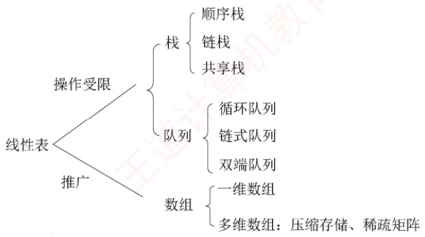

**【复习提示】**

本章通常以选择题形式考查，题目难度不大，但命题方式较为灵活。其中，栈（如入栈/出栈过程、出栈序列的合法性）和队列的操作及其特征是考查重点。由于二者都是线性表的典型应用与推广，也常出现在算法设计题中。此外，栈和队列的顺序存储与链式存储及其特点、双端队列的特性、栈和队列的常见应用，以及数组与特殊矩阵的压缩存储，均为必须掌握的内容。

## 3.1 栈

### 3.1.1 栈的基本概念

#### 1．栈的定义

考点追踪栈的特点（2017）

栈（Stack）是仅允许在一端进行插入和删除操作的线性表。作为一种特殊的线性表，栈的插入（入栈）和删除（出栈）操作被限制在表的一端进行，如图3.1所示。

栈顶（Top）:允许进行插入和删除操作的一端。

栈底（Bottom）:固定不变、不允许进行插入和删除操作的另一端。空栈:不含任何元素的栈。

$$
基高面螺师  \triangleright  出入枝序列的分析  (2010 、 2011 、 2013 、 2018 、 2020 、 2022)
$$

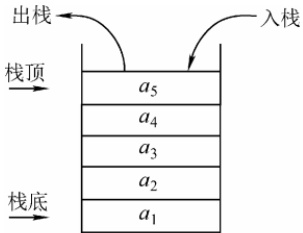

假设某栈 $S = ( a_{1} , a_{2} , a_{3} , a_{4} , a_{5} )$ ，如图3.1所示，其中 $a_{1}$ 为栈底元素，$a_{5}$ 为栈顶元素。栈的入栈和出栈操作只能在栈顶进行。若元素按顺序$a_{1} , a_{2} , a_{3} , a_{4} , a_{5}$ 入栈，则出栈顺序为 $a_{5} , a_{4} , a_{3} , a_{2} , a_{1} ,$ ，由此可见，栈的操作特性可概括为后进先出（Last In First Out，LIFO）。

图 3.1 栈的示意图

**注意**

每接触一种新的数据结构，都应从其逻辑结构、存储结构和基本运算三方面进行系统理解。

#### 2．栈的基本操作

不同教材对基本操作的命名略有差异，但含义基本一致，本文采用严蔚敏教材的命名规范。

● InitStack(&S):初始化一个空栈S。

• StackEmpty(S):判断栈是否为空。若栈 s 为空，返回 true；否则返回 false。

● Push(&S，x):入栈操作；若栈未满，则×成为新的栈顶元素。

● Pop(&S，&x):出栈操作；若栈非空，则弹出栈顶元素，并通过×返回该值。

● GetTop(S，&x):读取栈顶元素但不出栈；若栈非空，则通过 x返回栈顶元素。

● DestroyStack(&S):销毁栈s，并释放其所占用的存储空间（&表示引用调用）。

在解答算法题时，若题目未作特殊限制，可直接使用上述基本操作函数。

```txt
考点追踪Catalan数的应用（2015）
```

栈的数学性质:当n个不同元素按固定次序入栈时，可能的出栈序列总数为 $\scriptstyle {\frac {1} {n + 1}} C_{2 n}^{n}$ 。该数列称为卡特兰（Catalan）数，可通过数学归纳法证明，有兴趣的读者可参考组合数学教材。

### 3.1.2 栈的顺序存储结构

与线性表类似，栈也有两种基本的存储方式:顺序存储和链式存储。

#### 1．顺序栈的实现

采用顺序存储的栈称为顺序栈，它利用一组地址连续的存储单元存放从栈底到栈顶的数据元素，并附设一个整型指针（top）指示当前栈顶元素的位置。

顺序栈的类型可定义如下

```c
#define MaxSize 50 //定义栈中元素的最大个数
typedef struct{
Elemtype data[MaxSize]; //存放栈中元素
int top; //栈顶指针
}SqStack;
```

栈顶指针:s.top，初始时设为 s.top=-1；栈顶元素:s.data[s.top]。

入栈操作:当栈未满时，先将栈顶指针加1，再将元素存入栈顶。

出栈操作:当栈非空时，先取出栈顶元素，再将栈顶指针减1。

栈空条件:S.top==-1；栈满条件: $\mathrm{S}.\mathrm{top}=\mathrm{MaxS}\downarrow\mathrm{z}\mathrm{e}-1$ ；栈长:S.top+1。

另一种常见的方式是:栈顶指针初始化为s.top=0；入栈时先将元素存入栈顶，再将栈顶指针加 1；出栈时先将栈顶指针减 1，再取出栈顶元素；栈空条件为 s.top==0；栈满条件为

```txt

S.top==MaxSize。
```

顺序栈的入栈操作受数组上界约束。若对栈的最大使用空间估计不足，则可能发生栈上溢，此时，应向用户报告错误信息，以便及时处理，避免程序异常。

**注意**

栈和队列的判空、判满条件，会因实际给出的条件不同而变化，下面的代码实现是在栈顶指针初始化为-1的条件下的相应方法，而其他情况则需具体问题具体分析。

#### 2．顺序栈的基本操作

考点追踪出/入栈操作的模拟（2009）

栈操作的示意图如图3.2所示，图3.2(a)为空栈，图3.2(c)为A、B、C、D、E依次入栈后的状态，图3.2(d)为在图3.2(c)基础上E、D、C相继出栈后的结果，此时栈中剩余2个元素。尽管C、D、E可能仍保留在原存储单元中，但top指针已指向新的栈顶，因此它们已不属于当前栈的内容。读者应结合该图理解栈顶指针的作用:它标识了栈中有效元素的边界。

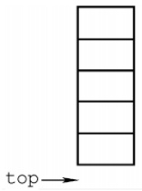

(a) 空栈

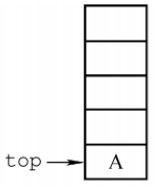

(b)1 个元素

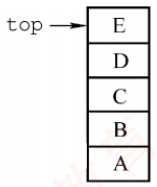

(c) 5 个元素

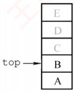

(d) 2 个元素

图3.2 栈顶指针和栈中元素之间的关系

以下是顺序栈常用基本操作的实现（基于top=-1初始化）。

**（1）初始化**

```txt
void InitStack(SqStack &S) {
S.top=-1; //初始化栈顶指针
```

**(2) 判栈空**

```txt
bool StackEmpty(SqStack S) {
if(S.top==-1) //栈空
return true;
else //不空
Kreturn false;
```

**（3)入栈**

```javascript
bool Push(SqStack &S,ElemType x){
if(S.top==MaxSize-1) //栈满，报错
return false;
S.data[++S.top]=x; //指针先加1，再入栈
return true;
```

**(4)出栈 出栈**

```javascript
bool Pop(SqStack &S,ElemType &x){
if(S.top==-1) //栈空，报错
return false;
x=S.data[S.top--]; //先出栈，指针再减1
return true;
首
```

**（5)读栈顶元素**

```javascript
bool GetTop(SqStack S,ElemType &x) {
if(S.top==-1) //栈空，报错
return false;
x=S.data[s.top]; //x记录栈顶元素
return true; 道
```

该操作不改变栈的状态，栈顶元素依然保留在栈中。

**注意**

此处，top指向栈顶元素本身。因此入栈为s.data[++S.top]=x，出栈为x=S.data[S.top--]。若top初始化为0（指向栈顶元素的下一个位置），则入栈变为S.data[S.top++]=x，出栈变为x=S.data[--S.top]，相应的判空、判满条件也随之改变。请读者仔细体会差异，做题时务必根据题目设定灵活应对。

#### 3．共享栈

利用栈底位置相对固定的特性，可让两个顺序栈共享同一段一维数组空间，将两个栈的栈底分别置于数组两端，栈顶向中间延伸，如图3.3所示。

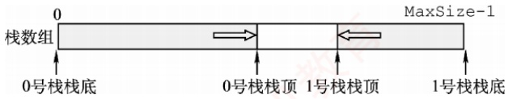

图3.3 两个顺序栈共享存储空间

0号栈栈顶指针为top0，1号栈栈顶指针为top1，均指向各自的栈顶元素；初始时top0=-1（0号栈空），top1=MaxSize（1号栈空）；栈满条件为top1-top0==1（两栈顶相邻）。当0号栈入栈时，top0先加1，再赋值；当1号栈入栈时，top1先减1，再赋值；出栈操作的顺序相反。

共享栈能更高效地利用存储空间，两个栈的空间可动态调节，仅当整个数组被占满时，才发生栈溢出。其存取数据的时间复杂度均为O(1)，对存取效率无影响。

### 3.1.3 栈的链式存储结构

采用链式存储的栈称为链栈。其优点是便于动态分配存储空间，不存在栈满溢出的问题，且在多栈共存的场景下能更灵活地利用内存。通常使用单链表实现链栈，并且规定所有操作均在链表的表头进行。此处约定链栈不带头结点，栈顶指针Lhead直接指向栈顶元素，如图3.4所示。

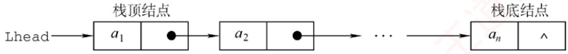

图 3.4 栈的链式存储

链栈的类型可定义为

```txt
typedef struct LinkNode{
ElemType data; //数据域
struct LinkNode *next; //指针域
}LiStack; //链栈类型定义
```

由于采用链式存储，结点的插入与删除操作非常高效。链栈的操作与单链表类似，入栈和出栈均在表头进行。注意，对于带头结点的链栈，其初始化、判空及操作细节会有所不同；而本节所述实现基于无头结点的设计，读者应根据实际需求灵活调整实现方式。

## 3.2 队列

### 3.2.1 队列的基本概念

#### 1．队列的定义

队列（Queue）简称队，也是一种操作受限的线性表，仅允许在表的一端进行插入，而在另一端进行删除。向队列中插入元素称为入队（或进队），删除元素称为出队（或离队）。这一

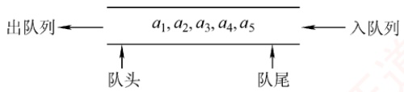

图 3.5 队列示意图

规则符合日常排队“先到先服务”的原则，因此队列的操作特性为先进先出（First In First Out，FIFO），如图3.5所示。

队头（Front）:允许删除的一端，也称队首。

队尾（Rear）:允许插入的一端。

空队列:不含任何元素的队列。

#### 2．队列常见的基本操作

InitQueue(&Q):初始化队列，构造一个空队列Q。

QueueEmpty(Q):判队列空；若队列Q 为空，返回 true，否则返回 false。

EnQueue(&Q,x):入队操作；若队列Q未满，将×加入队尾。

DeQueue(&Q，&x):出队操作；若队列Q非空，删除队首元素，并通过×返回其值。

GetHead(Q，&x):读队首元素但不出队；若队列Q非空，将队首元素赋值给x。

需要注意的是，栈和队列均为操作受限的线性表，因此并非所有线性表的操作都适用于它们。例如，不允许直接访问或修改栈或队列中间的元素，这是由其逻辑特性所决定的。

### 3.2.2 队列的顺序存储结构

#### 1．队列的顺序存储

队列的顺序实现是指分配一块连续的存储单元存放队列元素，并附设两个指针:队首指针front指向队首元素，队尾指针rear指向队尾元素的下一个位置。不同教材对front和rear指针含义的约定可能不同（例如，rear可能指向队尾元素或其下一位置），这会导致入队和出队操作的具体实现不同。本节后附有相关习题，建议读者结合练习深入理解。

```c

#define MaxSize 50 //定义队列中元素的最大个数
typedef struct{
ElemType data[MaxSize]; //用数组存放队列元素
int front,rear; //队首指针和队尾指针
} SqQueue; 首
```

队列的顺序存储类型可定义为

初始状态:Q. $\mathtt {front} = \mathtt {Q} \: . \: \mathtt {rear} = 0$ o

入队操作:当队列未满时，先将元素存入队尾，再将队尾指针加1。

出队操作:当队列非空时，先取出队首元素，再将队首指针加1。

如图3.6(a)所示，初始时空队列满足Q.front==Q.rear==0，该条件可作为判空依据。

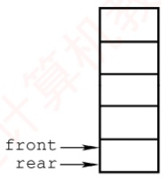

(a) 空队

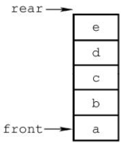

(b)5个元素入队

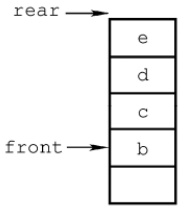

(c) 出队 1 次

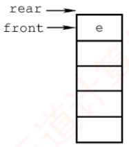

(d) 出队 3 次

图 3.6 队列的操作

然而，能否以 $\mathtt {Q \_r ear} {=} \mathtt {MaxSize}$ 作为队满条件呢？显然不能。如图3.6(d)所示，队列中仅剩一个元素，但rear已达MaxSize，若此时继续入队，则会出现“上溢”。但这种溢出并非真正溢出，实际上数组中仍有空闲单元，因此称此现象为假溢出。

#### 2．循环队列

为了解决顺序队列的假溢出问题，引入循环队列:将顺序存储空间在逻辑上组织为环状结构。当指针到达数组末尾时，自动回到起始位置，这可通过取模运算（%）实现。

考点追踪特定条件下循环队列队头/队尾指针的初值（2011）

初始状态:Q.front=Q.rear=0。

队首指针进1:Q.front=(Q.front+1)%MaxSize。

队尾指针进1:Q.rear=(Q.rear+1)%MaxSize。

队列长度:(Q.rear+MaxSize-Q.front)%MaxSize。

出入队操作:指针均按顺时针方向移动（见图3.7）。

考点追踪循环队列判空/满的条件（2014）

那么，循环队列判空和判满的条件是什么呢？队空条件显然为Q.front==Q.rear。但当入队速度远快于出队时，rear会追上front，此时同样满足 $\mathrm{Q.~f.~cont}==\mathrm{Q.~rear}$ ，却表示队满。因此，仅凭 $\mathtt {front} {=} \mathtt {rear}$ 无法区分队空与队满。循环队列出入队的示意图如图3.7所示。

为解决这一问题，常用以下三种方法:

1）牺牲一个存储单元:入队时少用一个存储单元，这是一种较为普遍的做法，约定以“队尾指针的下一位置为队首”作为队满标志，如图3.7(d2)所示。

队满条件: $( \mathtt {Q} \mathtt {. rear} \mathtt {+ 1} ) \mathtt {\S {MaxSize}} {= =} \mathtt {Q} \mathtt {. frorit} \mathtt {.}$

队空条件:Q.front==Q.rear。

队列中元素个数: $( \mathtt {Q} \mathtt {. rear} \mathtt {- Q} \mathtt {. front} \mathtt {+ MaxSize} ) \mathtt {\SMaxSize} \mathtt {\circ}$

2）增设size成员:记录当前元素个数。若入队成功，则 $\scriptstyle \mathbf {S}   {\dot {\perp}}   z   \in + +$ ，若出队成功，则 $\mathrm {size - -}$队空条件: $\mathtt {Q} . \mathtt {Size} {=} \mathtt {=} 0$ 0

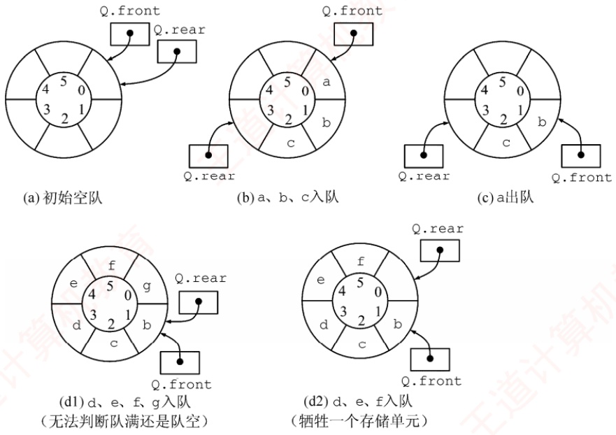

图3.7 循环队列出入队的示意图

队满条件: $\mathtt {Q . Size} = = \mathtt {MaxSize} \mathtt {\cdot}$

两种情形均有 $\mathtt {Q . front} {=} {=} \mathtt {Q . rear}$ ，由 $\mathrm {size}$ 区分队空与队满。

**3）增设tag标志位:**

出队后置 $\tan g = 0$ ，若此时 $\mathbb {Q} . \mathtt {front} = = \mathbb {Q} . \mathtt {rear}$ ，则为队空。TUIN入队后置tag=1，若此时 $\mathtt {Q . front} = = \mathtt {Q . rear}$ ，则为队满。

#### 3．循环队列的操作（基于牺牲一个单元法）

```javascript
（1）初始化
void InitQueue(SqQueue &Q) {
Q.rear=Q.front=0;
```

//初始化队首、队尾指针

(2)判队空

```txt
bool QueueEmpty(SqQueue Q) {
if(Q.rear==Q.front)
return true;
else
return false;
```

```txt
bool EnQueue(SqQueue &Q,ElemType x) {
if((Q.rear+1)%MaxSize==Q.front)
return false;
Q.data[Q.rear]=x;
Q.rear=(Q.rear+1) %MaxSize;
return true;
```

//队满则报错//队尾指针加 1 取模

```txt
bool DeQueue(SqQueue &Q,ElemType &x) {
if(Q.rear==Q.front)
return false;
x=Q.data[Q.front];
```

//队空则报错

```txt

Q.front=(Q.front+1) %MaxSize;

return true;
```

### 3.2.3 队列的链式存储结构

#### 1．队列的链式存储

考点追踪链式队列的应用场景（2019）

队列的链式表示称为链式队列，本质上是一个同时带有队首指针和队尾指针的单链表，如图3.8所示。队首指针指向队头结点，队尾指针指向队尾结点，即单链表的最后一个结点。

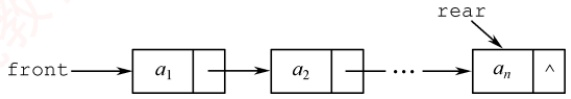

图3.8 不带队头结点的链式队列

链式队列的类型可定义为

```c
typedef struct LinkNode{ //链式队列结点
ElemType data;
struct LinkNode *next;
}LinkNode;
typedef struct{ //链式队列
LinkNode *front,*rear; //队列的队头和队尾指针
}LinkQueue;
```

当不带头结点时，若Q.front==NULL且Q.rear==NULL，则链式队列为空队列。

考点追踪链式队列判空的条件（2019）

入队操作:创建一个新结点，将其插入链表尾部，并令Q.rear指向该结点；若原队列为空，则同时令Q.front 也指向该结点。

出队操作:先判断队列是否为空；若非空，则取出队首元素，删除对应结点，并令Q.front指向下一个结点；若被删结点是最后一个元素，则将Q.front和Q.rear均置为NULL。

不难发现，不带头结点的链式队列在边界处理上较为烦琐。因此，通常将链式队列设计为带头结点的单链表，从而使插入与删除操作逻辑统一，如图3.9所示。

链式队列特别适用于元素数量频繁变化的场景，且不存在队满或溢出问题。此外，若程序中需使用多个队列（如同多个栈的情形），优先选用链式队列可避免存储分配不合理或溢出等问题。

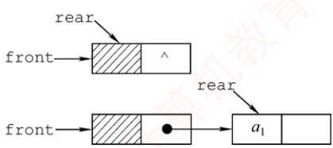

图3.9 带队头结点的链式队列

#### 2．链式队列的基本操作

考点追踪链式队列出队/入队操作的基本过程（2019）

（1）初始化

```javascript
void InitQueue(LinkQueue &Q){ //初始化带头结点的链式队列
Q.front=Q.rear=(LinkNode*)malloc(sizeof(LinkNode));//建立头结点
Q.front->next=NULL; //初始为空
```

(2) 判队空

```txt
bool QueueEmpty(LinkQueue Q) {
```

```c
if(Q.front==Q.rear) //判空条件
return true;
else 算
return false;
(3)入队
void EnQueue(LinkQueue &Q,ElemType x) {
LinkNode *s=(LinkNode *)malloc(sizeof(LinkNode));//创建新结点
s->data=x;
s->next=NULL;
Q.rear->next=s; //插入链尾
Q.rear=s; //修改尾指针 教育
(4）出队
bool DeQueue(LinkQueue &Q,ElemType &x) {
if(Q.front==Q.rear)
return false; //空队
LinkNode *p=Q.front->next; 道
x=p->data;
Q.front->next=p->next;
if(Q.rear==p)
Q.rear=Q.front; //若原队列中只有一个结点，删除后变空
free(p) ;
return true;
```

### 3.2.4 双端队列

双端队列是一种允许在两端进行插入和删除操作的线性表，如图3.10所示。双端队列两端的地位是平等的，为便于理解，可将左端视为前端，右端视为后端。

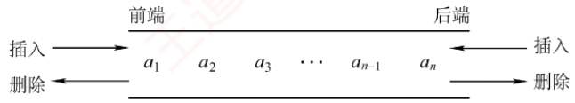

图 3.10 双端队列

在双端队列入队时:前端插入的元素排列在队列中后端插入的元素之前；后端插入的元素排列在队列中前端插入的元素之后。在双端队列出队时:无论是从前端还是后端出队，先出的元素总是排列在后出的元素之前。思考:如何由入队序列 a, b, c, d 得到出队序列 d, c, a, b?

**考点追踪双端队列出入队操作的分析（2010、2021）**

输出受限的双端队列:允许在一端进行插入和删除，但在另一端仅允许插入的双端队列称为输出受限的双端队列，如图3.11所示。

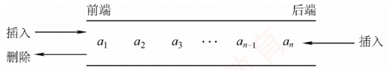

图 3.11 输出受限的双端队列

输入受限的双端队列:允许在一端进行插入和删除，但在另一端仅允许删除的双端队列称为输入受限的双端队列，如图3.12所示。若限定双端队列从某个端点插入的元素只能从该端点删除，则该双端队列就蜕变为两个栈底相邻接的栈。

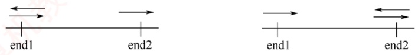

1,4, 2, 3 2, 4, 1, 3 3,4, 1, 2 3, 1, 4,2 3, 1, 2, 4

4,3, 1,2 4, 1, 3, 2 4, 2, 3, 1 4, 2, 1, 3 4, 1, 2, 3

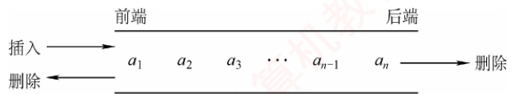

图3.12 输入受限的双端队列

例 设有一个双端队列，输入序列为1,2,3,4，试分别求出以下条件的输出序列。

（1）能由输入受限的双端队列得到，但不能由输出受限的双端队列得到的输出序列。

(2）能由输出受限的双端队列得到，但不能由输入受限的双端队列得到的输出序列。

（3）既不能由输入受限的双端队列得到，又不能由输出受限的双端队列得到的输出序列。

解:先看输入受限的双端队列，见图 3.13。假设 end1 端输入 1,2,3,4，则 end2 端的输出相当于普通队列的输出，即 1,2,3,4；而 end1 端的输出相当于栈的输出，n = 4 时仅通过 end1端有14 种输出序列（由 Catalan 公式得出），仅通过 end1 端不能得到的输出序列有4! – 14 = 10种:

通过 end1和 end2端混合输出，可以输出这10种中的8种，参见下表。其中， $S_{\mathrm {L}} , X_{\mathrm {L}}$ 分别代表 end1 端的入队和出队， $X_{\mathrm {R}}$ 代表 end2 端的出队。

| 输出序列 | 入队出队顺序 | 输出序列 | 入队出队顺序 |
| --- | --- | --- | --- |
| 1,4,2,3 | SLXRSLSLSLXLXRXR | 3,1,2,4 | SLSLSLXLSLXRXRXR |
| 2,4,1,3 | SLSLXLSLSLXLXRXR | 4, 1,2,3 | SLSLSLSLXLXRXRXR |
| 3,4,1,2 | SLSLSLXLSLXLXRXR | 4, 1, 3,2 | SLSLSLSLXLXRXLXR |
| 3,1,4,2 | SLSLSLXLXRSLXLXR | 4,3,1,2 | SLSLSLSLXLXLXRXR |

剩下的两种是不能通过输入受限的双端队列输出的，即4,2,3,1和4,2,1,3。

再看输出受限的双端队列，见图3.14。假设 end1和 end2端都能输入，仅end2端可以输出。若都从end2端输入，则就是一个栈。当输入序列为1,2,3,4时，输出序列有14种。对于其余10种不能得到的输出序列，通过交替从end1和end2端输入，还可以输出其中8种。设 $S_{\mathrm {L}}$ 代表 end1端的输入， $S_{\mathrm {R}}  、  X_{\mathrm {R}}$ 分别代表end2端的输入和输出，则可能的输出序列见下表。

图3.13 例题中输入受限的双端队列 图 3.14 例题中输出受限的双端队列

| 输出序列 | 入队出队顺序 | 输出序列 | 入队出队顺序 |
| --- | --- | --- | --- |
| 1,4,2,3 | $S_{\mathrm {L}} X_{\mathrm {R}} S_{\mathrm {L}} S_{\mathrm {L}} S_{\mathrm {R}} X_{\mathrm {R}} X_{\mathrm {R}} X_{\mathrm {R}}$ | 3,1,2,4 | $S_{\mathrm {L}} S_{\mathrm {L}} S_{\mathrm {R}} X_{\mathrm {R}} X_{\mathrm {R}} S_{\mathrm {L}} X_{\mathrm {R}} X_{\mathrm {R}}$ |
| 2,4,1,3 | SLSRXRSLSRXRXRXR | 4,1,2,3 | SLSLSLSRXRXRXRXR |
| 3,4,1,2 | $S_{\mathrm {L}} S_{\mathrm {L}} S_{\mathrm {R}} X_{\mathrm {R}} S_{\mathrm {R}} X_{\mathrm {R}} X_{\mathrm {R}} X_{\mathrm {R}}$ | 4,2, 1,3 | $S_{\mathrm {L}} S_{\mathrm {R}} S_{\mathrm {L}} S_{\mathrm {R}} X_{\mathrm {R}} X_{\mathrm {R}} X_{\mathrm {R}} X_{\mathrm {R}}$ |
| 3,1,4,2 | $S_{\mathrm {L}} S_{\mathrm {L}} S_{\mathrm {R}} X_{\mathrm {R}} X_{\mathrm {R}} S_{\mathrm {R}} X_{\mathrm {R}} X_{\mathrm {R}}$ | 4,3,1,2 | $S_{\mathrm {L}} S_{\mathrm {L}} S_{\mathrm {R}} S_{\mathrm {R}} X_{\mathrm {R}} X_{\mathrm {R}} X_{\mathrm {R}} X_{\mathrm {R}}$ |

通过输出受限的双端队列不能得到的两种输出序列是4,1,3,2和4,2,3,1。

综上所述:

1）能由输入受限的双端队列得到，但不能由输出受限的双端队列得到的是4,1,3,2。

2）能由输出受限的双端队列得到，但不能由输入受限的双端队列得到的是4,2,1,3。

3）既不能由输入受限的双端队列得到，又不能由输出受限的双端队列得到的是4,2,3,1。

**提示**

实际双端队列的考题不会如此复杂，通常只需判断序列是否满足题设条件，代入验证即可。

## 3.3 栈和队列的应用

要熟练掌握栈和队列，必须深入理解其典型应用场景，把握其中的规律，做到举一反三。接下来将简要介绍栈和队列的一些常见应用。

### 3.3.1 栈在括号匹配中的应用

假设表达式中允许包含两种括号:圆括号（）和方括号[]，其嵌套顺序任意。例如，（[]（））或[（[][]）]均为合法格式，而[（]）、（[（））或（(）]均为非法格式。

考虑如下括号序列:

$$
{\begin{array} {rlrlrlrlrlrlrlrlrlrlrlrlrlrlrlrlrlrlsig} & {{}} & {(} & {{}} & {[} & {{}} & {]} & {{}} & {[} & {{}} & {]} & {{}} & {[} & {{}} & {]} & {{}} & {} & {{}} & {)} & {{}} & {} & {{}} & {} & {{}} & {} & {{}} & {} & {{}} & {} & {{}} & {} & {{}} & {} & {{}} & {} & {{}} & {} & {{}} & {} & {{}} & {} & {{}} & {} & {{}} & {} & {{}} & {} & {{}} & {} & {{}} & {} & {{}} & {{}} & {} & {{}} & {{}} & {} & {{}} & {{}} & {} & {{}} & {{}} & {{}} & {{}} & {{}} & {{}} & {{}} & {{}} & {{}} & {{}} & {{}} & {{}} & {{}} & {{}} & {{}} & {{}} & {{}} & {{}} & {{}} & {{}} & {{}} & {{}} & {{}} & {{}} & {{}} & {{}} & {{}} & {{}} & {{}} & {{} & {} & {{}} & {{}} & {{}} & {{}} & {{}} & {{}} & {} & {{}} & {{}} & {{}} & {{} & {} & {{}} & {{}} & {} & {{}} & {{}} & {{}} & & {{}} & {{}} & {{} & {} & {{}} & {} & {{}} & {} & {{}} & {} & {{} & {} & {} & {{}} & {} & {{}} & & {{}} & {{} & {} & {} & {{}} & {} & {} & {} & {{}} & & {{}} & {} & {{} & {} & {} & {} & {} & {} & {} & {{} & {} & {} & {} & {} & {} & {} & {} & {{} & {} & {} & {} & {} & {} & {} & {} & {} & {} & {{} & {} & {} & {} & {} & {} & {} & & {{}} & & {{} & {} & {} & {} & {} & & {{}} & & {{} & {} & {} & {} & {} & & {{}  \end{array}
$$

分析过程如下:

1）读入第1个括号“”后，系统期待与之匹配的“]”（第8个）出现。

2）读入第2个括号“（”后，第1个括号“”的期待暂时搁置，转而优先期待与“（”匹配的“)”（第7个）出现。

3）读入第3个括号“”，当前最急迫的期待变为与之匹配的“]”（第4个）。该期待满足后，先前被搁置的第2个括号“(”的匹配任务重新成为当前最急迫事项。

4）以此类推，可见整个处理过程完全符合后进先出的栈行为。

算法思想如下:

1）初始化一个空栈，顺序扫描输入的括号序列。

2）若遇到左括号，将其压入栈中，表示新增一个待匹配的期待，且其优先级最高。

3）若遇到右括号，则检查栈是否为空:若栈非空且栈顶左括号与当前右括号匹配，则弹出栈顶，完成一次匹配；否则，括号序列非法，算法终止。

4）扫描结束后，若栈为空，则括号序列合法；否则，存在未匹配的左括号，序列非法。

### 3.3.2 栈在表达式求值中的应用

表达式求值是程序设计语言编译中的一个基本问题，也是栈应用的典型范例。

#### 1．算术表达式

中缀表达式（如3+4）是人们常用的算术表达式，其运算符位于两个操作数之间。与前缀表达式（如+34）或后缀表达式（如34+）相比，中缀表达式虽然符合人类阅读习惯，但不便于计算机直接求值，因此许多编程语言在内部仍需要将其转换为后缀或前缀形式进行求值。

与前缀或后缀表达式不同，中缀表达式必须依赖括号来明确运算次序。而后缀表达式的运算符置于操作数之后，其结构已隐含了运算顺序，因此无须括号，仅由操作数和运算符构成。

**考点追踪表达式树的定义（2025）**

中缀表达式 $\mathrm{A}+\mathrm{B}^{\star}(\mathrm{C}-\mathrm{D})-\mathrm{E} / \mathrm{F}$ 对应的后缀表达式为 $\mathrm{ABCD}-\mathrm{^{米}}+\mathrm{EF}/-$ ，与该表达式对应的表达式树(见图3.15）的后序遍历序列一致，体现了后缀表达式与树结构的内在联系。

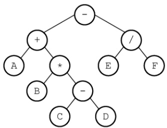

图 3.15 A+B\*(C-D)-E/F 对应的表达式树

#### 2．中缀表达式转后缀表达式

考点追踪中缀表达式转后缀表达式的方法（2024）

下面先介绍一种手算转换方法。

1）按运算优先级对整个表达式逐层加括号。

2）将每个运算符移到其所在括号的右括号之后，形成“左操作数右操作数运算符”的结构。

3）删除所有括号，即得后缀表达式。

以 $\mathrm{A}+\mathrm{B} \times(\mathrm{C}-\mathrm{D})-\mathrm{E} / \mathrm{F}$ 为例（下标表示运算顺序）:

1）加括号: $\left( \left( \mathbb{A} +_{\textcircled{3}} \left( \mathbb{B} +_{\textcircled{2}} \left( \mathbb{C} -_{\textcircled{1}} \mathbb{D} \right) \right) \right) -_{\textcircled{5}} \left( \mathbb{E} /_{\textcircled{4}} \mathbb{F} \right) \right)$

2）运算符后移: $( ( \mathbb{A} ( \mathbb{B} ( \mathbb{CD} ) -_{\textcircled{1}} ) \star_{\textcircled{2}} ) +_{\textcircled{3}} ( \mathbb{EF} ) /_{\textcircled{4}} ) -_{\textcircled{5} \circ}$

3）去括号后得到后缀表达式: $\mathrm{ABCD}-\mathrm{\textcircled{1}}^{\star}\mathrm{\textcircled{2}}+\mathrm{\textcircled{3} EF}/\mathrm{\textcircled{4} \textcircled{5} \circ}$

在计算机中，该转换过程需借助一个运算符栈，用于暂存尚未确定输出时机的运算符。从左至右依次扫描中缀表达式的每一项，具体规则如下:

1）遇到操作数:直接加入后缀表达式。

2）遇到界限符:若为“(”，直接入栈；若为“)”，不入栈，且不断弹出栈顶运算符并加入后缀表达式，直到遇到“(”，将其弹出并丢弃。

3）遇到运算符:①若其优先级高于栈顶运算符，或栈顶为“（”，则直接入栈；②若其优先级低于或等于栈顶运算符，则依次弹出栈中运算符并加入后缀表达式，直到栈空，或栈顶为“（”，或遇到优先级更低的运算符为止，再将当前运算符入栈。按上述方法扫描完所有字符后，将栈中剩余运算符依次弹出并加入后缀表达式。例如，中缀表达式 $\mathrm{A}+\mathrm{B}^{\star}(\mathrm{C}-\mathrm{D})-\mathrm{E} / \mathrm{F}$ 转后缀表达式的过程如表3.1所示。

表3.1 中缀表达式 A+B\*(C-D)-E/F转后缀表达式的过程

| 步 | 待处理序列 | 栈内 | 后缀表达式 | 扫描项 | 说明 |
| --- | --- | --- | --- | --- | --- |
| 1 | A+B*(C-D)-E/F |  |  | A | A加入后缀表达式 |
| 2 | +B*(C-D)-E/F |  | A | + | +入栈 |
| 3 | B*(C-D)-E/F | + | A | B | B加入后缀表达式 |
| 4 | *(C-D)-E/F | + | AB | * | *优先级高于栈顶，*入栈 |
| 5 | (C-D)-E/F | +* | AB | C | (直接入栈 |
| 6 | C-D)-E/F | +*( | AB | C | C加入后缀表达式 |
| 7 | -D)-E/F | +*( | ABC |  | 栈顶为(，-直接入栈 |
| 8 | D)-E/F | +*(- | ABC | D | D加入后缀表达式 |
| 9 | )-E/F | +*(- | ABCD | 一 | 遇到)，弹出-，删除( |
| 10 | -E/F | +* | ABCD- |  | -优先级低于栈顶，依次弹出*、+，-入栈 |
| 11 | E/F |  | ABCD-*+ | E | E加入后缀表达式 |
| 12 | /F | - | ABCD-*+E |  | /优先级高于栈顶，/入栈 |
| 13 | F | -1 | ABCD-*+E | F | F加入后缀表达式 |
| 14 |  | -1 | ABCD-*+EF |  | 扫描结束，弹出剩余运算符 |
| 15 |  |  | ABCD-*+EF/- |  | 结束 |

考点追踪栈的深度分析（2009、2012、2025）

所谓栈的深度，是指栈中元素最大个数。通常题目会给出入栈和出栈序列，要求计算栈所需的最大容量（最大深度）。有时该信息以中缀与后缀表达式的形式间接提供。掌握栈“后进先出”的特性，并通过手工模拟转换或求值过程，是解决此类问题的有效方法。

> ①中缀转前缀的方法类似，但统考真题仅考查过中缀转后缀，故本节仅介绍中缀转后缀的方法。

#### 3．后缀表达式求值

**考点追踪用栈实现表达式求值的分析（2018）**

后缀表达式的求值过程:从左至右依次扫描表达式，若当前项为操作数，则将其压入栈中；若为操作符&lt;op&gt;，则从栈中弹出两个操作数，先弹出的是右操作数Y，后弹出的是左操作数x，执行运算x&lt;op&gt;Y，并将结果压回栈中。所有项处理完毕后，栈顶元素即为最终计算结果。

例如，后缀表达式ABCD-\*+EF/-的求值过程共需12步，如表3.2所示。

表3.2 后缀表达式ABCD-\*+EF/-的求值过程

| 步 | 扫描项 | 项类型 | 动 作 | 栈中内容 |
| --- | --- | --- | --- | --- |
| 1 |  |  | 置空栈 | 空 |
| 2 | A | 操作数 | 入栈 XN | A |
| 3 | B | 操作数 | 入栈 | A B |
| 4 | C | 操作数 | 入栈 | A B C |
| 5 | D | 操作数 | 入栈 | A B C D |
| 6 | 一 | 操作符 | $\mathbb {D}_{\mathfrak {N}}$C出栈，计算C-D，结果R1入栈 | A B R1 |
| 7 | * | 操作符 | $\mathbb {R}_{1} ,$B出栈，计算$\mathbb {B} \times \mathbb {R}_{1} ,$结果R2入栈 | A$\mathrm {R}_{2}$ |
| 8 | + | 操作符 | $\mathbb {R}_{2} \textrm {v}$A 出栈，计算$\mathbb {A} + \mathbb {R}_{2} ,$结果 入栈$\mathrm {R}_{3}$ | $\mathrm {R}_{3}$ |
| 9 | E | 操作数 | 入栈 | R3 E |
| 10 | E | 操作数 | 入栈K | $\mathrm {R}_{3}$E F |
| 11 |  | 操作符 | F、E出栈，计算E/F，结果入栈$\mathbb {R}_{4}$ | R3 R4 |
| 12 | 一 | 操作符 | $\mathbb {R}_{4} ,$$\mathrm {R}_{3}$出栈，计算$\scriptstyle \mathbb {R}_{3} - \mathbb {R}_{4} ,$结果 入栈$\mathrm {R}_{5}$ | $\mathrm {R}_{5}$ |

### 3.3.3 栈在递归中的应用

递归是一种重要的程序设计方法。简单来说，若一个函数、过程或数据结构在其定义中直接或间接地引用了自身，则称其为递归定义，简称递归。递归通过将原问题逐层分解为规模更小但结构相同的子问题来求解。借助递归策略，仅需少量代码即可简洁地表达解题过程中反复出现的相同计算模式，显著减少程序代码量。然而，在一般情况下，递归的执行效率并不高。

以斐波那契数列为例，其数学定义为

$$
F(n)=\left\{\begin{aligned}&F(n-1)+F(n-2), \quad n>1, \\&1, \quad n=1, \\&0, \quad n=0.\end{aligned}\right.
$$

这是递归的典型范例，其程序实现如下:

```txt
int F(int n){ //斐波那契数列的实现
if(n==0)
return 0; //边界条件
else if(n==1)
return 1; //边界条件
else
return //递归表达式
```

必须注意，递归定义不能是循环或无终止的，必须满足以下两个条件:

● 递归体（递归表达式）:描述问题如何分解为更小规模的同类子问题。

● 边界条件（递归出口）:确保递归在有限步内终止。

递归的精髓在于能否将原问题转化为属性相同但规模更小的问题。

考点追踪栈在函数调用中的作用和工作原理（2015、2017）

在递归调用过程中，系统为每一层调用的返回地址、局部变量及形参等信息分配存储空间，这些信息被保存在递归工作栈中。因此，递归深度过大时容易导致栈溢出。此外，递归效率低下的主要原因是存在大量重复计算。以n=5为例，其递归调用过程如图3.16所示。

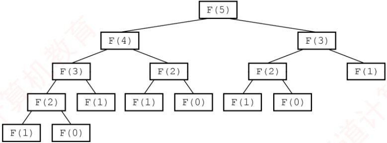

图 3.16 F(5)的递归执行过程

显然，在该过程中，F(3)被计算2次，F(2)被计算3次。F(1)被调用5次，F(0)被调用3次。由此可见，递归虽然代码简洁、易于理解，但存在明显的性能缺陷。在第5章讨论树的遍历时，采用递归可使代码极为简洁，但初学者往往难以清晰理解其执行过程。若希望深入理解递归的底层实现机制，可参考《编译原理》教材中关于运行时栈与活动记录的相关内容。

任何递归算法均可转换为非递归算法，通常需借助显式栈来模拟递归调用过程。

### 3.3.4 队列在层次遍历中的应用

在信息处理中，有一类典型问题需要逐层或逐行处理。解决这类问题的常用策略是:在处理当前层的同时，将下一层的元素按序加入待处理队列。队列正适用于此类场景，因其先进先出的特性，能够自然地保存后续待处理元素的顺序。以二叉树的层次遍历为例（见图3.17），可清晰体现队列的应用价值。表3.3展示了该遍历过程的具体执行步骤。

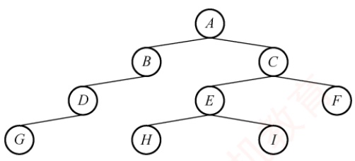

图 3.17 二叉树

表3.3 层次遍历二叉树的过程

| 序号 | 说明 | 队内 | 队外 |
| --- | --- | --- | --- |
| 1 | A入 | A |  |
| 2 | A出，BC入 | BC | A |
| 3 | B出，D入 | CD | AB |
| 4 | C出，EF入 | DEF | ABC |
| 5 | D出，G入 | EFG | ABCD |
| 6 | E出，HI入 | FGHI | ABCDE |
| 7 | F出 | GHI | ABCDEF |
| 8 | GHI 出 |  | ABCDEFGHI |

该过程可简要描述如下:

①将根结点入队。

②若队列为空（表示所有结点均已处理），则遍历结束；否则执行③。

③取出队首结点并访问；若其存在左孩子，则将左孩子入队；若其存在右孩子，则将右孩子入队；返回②继续执行。

### 3.3.5 队列在计算机系统中的应用

队列在计算机系统中的应用非常广泛，以下从两个主要方面进行阐述:第一个方面是解决主机与外部设备之间速度不匹配的问题，第二个方面是解决由多用户引起的资源竞争问题。

考点追踪缓冲区的逻辑结构（2009）

以主机和打印机之间的速度不匹配为例。主机输出数据的速度远快于打印机处理数据的速度。若直接将数据发送给打印机，会导致数据丢失或打印错误。为此，通常设置一个打印数据缓冲区来缓解这一问题。具体实现如下:主机将待打印的数据依次写入缓冲区，当缓冲区满时，主机暂停输出并转向其他任务:打印机则从缓冲区中按先进先出原则逐个取出数据进行打印:打印完成后，打印机向主机发出请求，主机再次向缓冲区写入新的打印数据。这种方法不仅保证了数据的正确性，还提高了主机的整体效率。因此，打印数据缓冲区实际上就是一个队列。

考点追踪多队列出队/入队操作的应用（2016）

在多用户环境下，CPU资源的竞争是一个典型场景。在一个多终端系统中，用户通过各自的终端向操作系统提出对CPU的请求。为公平分配CPU时间，操作系统通常按照请求的时间顺序，将这些请求排成一个队列。具体步骤如下:每次将CPU分配给队首用户的程序运行；当该程序运行结束或用完规定的时间片后，操作系统使其出队；然后将CPU分配给新的队首用户。这种方式既保证了请求的公平处理，又提升了CPU利用率。此外，在某些复杂系统中，可能还会引入多队列机制，以便根据不同的优先级或调度策略动态调整资源分配。

## 3.4 数组和特殊矩阵

矩阵在图形学、工程计算等领域占有重要地位。在数据结构中，关注的重点并非矩阵本身的数学性质及其运算，而是如何以最小的内存空间高效存储矩阵，并支持对元素的便捷访问。

### 3.4.1 数组的定义

数组是由n（n≥1）个相同类型的数据元素组成的有限序列。每个元素称为数组元素，其在线性序列中的位置由下标标识，下标的取值范围称为维界。

数组与线性表的关系:数组是线性表的推广。一维数组可视为一个线性表；二维数组可视为其元素为定长一维数组的线性表；更高维数组以此类推。数组一旦定义，其维数与维界即固定不变。因此，除初始化和销毁外，数组仅支持存取元素和修改元素两种基本操作。

### 3.4.2 数组的存储结构

大多数编程语言提供数组类型，逻辑上的数组通常映射为内存中一段连续的存储空间。以一维数组 $\mathrm {A} [ 0 . . .   n   -   1 ]$ 为例，设每个元素占L个存储单元，则元素A[i]的地址为

$$
\mathrm{LOC}(a_{i}) = \mathrm{LOC}(a_{0}) + iL \quad (0 \leqslant i \leqslant n)
$$

考点追踪二维数组按行优先存储的下标对应关系（2021）

多维数组在内存中需按某种顺序展开为一维。常见方式有按行优先和按列优先。按行优先:先行后列，先存储行号较小的元素；同一行内，先存储列号较小的元素。设二维数组行下标与列下标范围分别为 $[0,h_1]  与  [0,h_2]$ ，则元素A[i][i]的地址为

$$
\mathrm{LOC}(a_{i,j}) = \mathrm{LOC}(a_{0,0}) + [i(h_2 + 1) + j]L
$$

例如，数组 $\mathbf {A}_{[ 2 ] [ 3 ]}$ 按行优先存储的形式如图3.18所示。

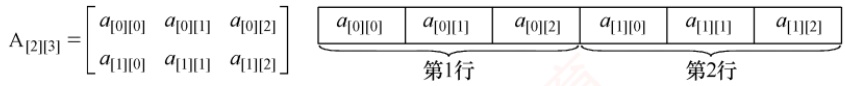

图3.18 二维数组按行优先顺序存放

按列优先:先列后行，先存储列号较小的元素；同一列内，先存储行号较小的元素。其对应的地址公式为

$$
\mathrm{LOC}(a_{i,j}) = \mathrm{LOC}(a_{0,0}) + [j(h_1 + 1) + i]L
$$

例如，数组 $\mathbf {A}_{[ 2 ] [ 3 ]}$ 按列优先存储的形式如图3.19所示。

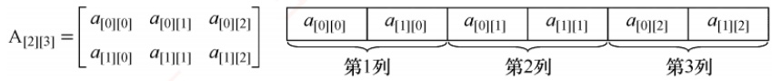

图3.19 二维数组按列优先顺序存放

### 3.4.3 特殊矩阵的压缩存储

压缩存储:为多个值相同的元素只分配一个存储空间，对零元素不分配存储空间。

特殊矩阵:指具有大量相同元素或零元素，且这些元素分布具有规律性的矩阵。常见的特殊矩阵有对称矩阵、上（下）三角矩阵、对角矩阵等。

特殊矩阵的压缩存储方法:通过分析矩阵中相同元素的分布规律，仅存储一份实际数据，其余的可通过下标映射访问，从而将原本冗余的数据压缩到一个共享的空间中，显著节省内存。

#### 1．对称矩阵

考点追踪 对称矩阵压缩存储的下标对应关系（2018、2020）

若 n阶矩阵A 中任意元素 $a_{i , j}$ 均满足 $a_{ij}=a_{ji} (1 \leqslant i,j \leqslant n)$ ，则称其为对称矩阵。其元素可分为三部分:上三角区、主对角线和下三角区，如图3.20所示。

由于上三角区与下三角区完全对称，若仍用二维数组存储，将近一半空间被浪费。为此可将n阶对称矩阵A压缩存储于一维数组 $\mathrm{B}[n(n + 1)/2]$ 中，通常仅存放下三角部分（含主对角线）。

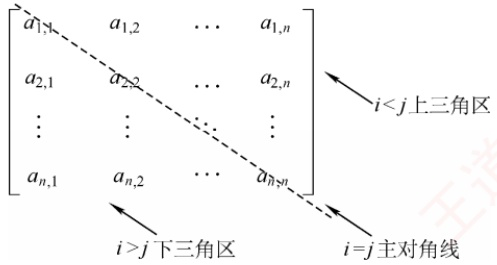

图 3.20 n阶矩阵的划分

对于元素 $a_{i j} \left( i \geqslant j \right)$ ，其在数组B中的位置由其前方的元素个数决定

第1行:1个元素 $( a_{\mathrm {1 , 1}} )$第2行:2个元素 $( a_{2 , 1} , a_{2 , 2} )$ …

第i-1行:i-1个元素 $(a_{i - 1,1}, a_{i - 1,2}, \cdots, a_{i - 1,i - 1})$第i行:j-1个元素 $( a_{i , 1} , a_{i , 2} , \cdots , a_{i , j - 1} )$

因此，元素 $a_{i , j}$ 在数组B中的下标

$k = 1 + 2 + \cdots + (i - 1) + j - 1 = i(i - 1) / 2 + j - 1$ （数组下标从0开始）。元素下标之间的对应关系如下:

$$
k = \left\{\begin{aligned} \frac{i(i - 1)}{2} + j - 1, & \quad i \geq j  (下三角区和主对角线元素) \\ \frac{j(j - 1)}{2} + i - 1, & \quad i < j  (上三角区元素 a_{i,j} = a_{j,i}) \end{aligned} \right.
$$

若数组下标从1开始，则可采用类似的推导方法，请读者自行思考。

**注意**

二维数组 A[n][n]与 A[0...n - 1][0...n - 1]写法等价，表示下标从0开始。若写作A[1...n][1...n]，则表示下标从1开始。矩阵元素通常记为 $a_{i , j} ,$ 其行号i和列号j通常从1开始。

#### 2．三角矩阵

在下三角矩阵见图3.22(a)]中，上三角区的所有元素均为同一常量。其存储思想与对称矩阵的类似，但是需要额外存储该常量一次。因此，可以将n阶下三角矩阵A压缩存储在$\mathrm{B}[n(n + 1)/2 +$ 1]中。 道

对于元素 $a_{i,j} (i \geqslant j)$ ，其在数组B中的下标为

$$
k = \left\{\begin{aligned} &\frac{i(i - 1)}{2} + j - 1, & \quad i \geq j & ( 下三角区和主对角线元素 ) \\ &\frac{n(n + 1)}{2}, & \quad i < j & ( 上三角区元素 ) \end{aligned} \right.
$$

下三角矩阵的压缩存储形式如图3.21所示。

| 0 | 1 | 2 | 3 | 4 | 5 | … |  |  | … |  | n(n+1)/2 |
| --- | --- | --- | --- | --- | --- | --- | --- | --- | --- | --- | --- |
| a1,1 | a2,1 | a2,2 | a3,1 | a3,2 | a3,3 | … | an,1 | an,2 | … | an,n | C |
| 第1行 | 第2行 |  |  | 第3行 |  |  |  |  | 第n行 |  | 常数项 |

图3.21下三角矩阵的压缩存储

考点追踪上三角矩阵采用行优先存储的应用（2011）

在上三角矩阵[见图3.22(b)]中，下三角区所有元素均为同一常量。只需存储主对角线、上三角区上元素及该常量一次，同样将其压缩存储在 $\mathrm{B}[n(n + 1)/2 + 1]$ 中。

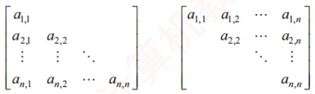

(a) 下三角矩阵

(b) 上三角矩阵

图 3.22 三角矩阵

对于元素 $a_{ij} (i \leqslant j)$ ，其在数组B中前方的元素个数为

第1行:n个元素

第2行:n-1个元素

第i−1行:n−i +2个元素

第i行:j-i个元素

故元素 $a_{i j}$ 在数组B中的下标 $k = n + (n - 1) + \cdots + (n - i + 2) + (j - i + 1) - 1 = (i - 1)(2n - i + 2)/2 +$ (j−i)。元素下标之间的对应关系如下:

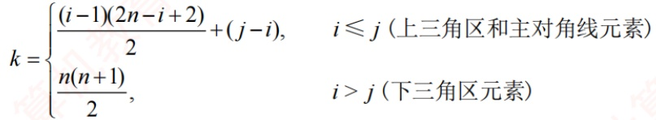

上三角矩阵的压缩存储形式如图3.23所示。

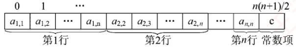

图3.23 上三角矩阵的压缩存储

以上推导均假设数组下标从0开始。若下标指定从1开始，则要相应地调整映射关系。

#### 3．三对角矩阵

若 n阶矩阵A 中的任意元素 $a_{i j}$ ，当 $\lvert i   -   j \rvert \geq 1$ 时均有 $a_{ij} = 0 \quad (1 \leqslant i, j \leqslant n)$ ，则称为三对角矩阵，如图3.24所示。非零元素仅集中在以主对角线为中心的3条对角线的区域。

$$
\begin{bmatrix} a_{1,1} & a_{1,2} & & & \\ a_{2,1} & a_{2,2} & a_{2,3} & & 0 \\ & a_{3,2} & a_{3,3} & a_{3,4} & \\ & & \ddots & \ddots & \ddots \\ & 0 & & a_{n-1,n-2} & a_{n-1,n-1} & a_{n-1,n} \\ & & & & a_{n,n-1} & a_{n,n} \end{bmatrix}
$$

图3.24 三对角矩阵A

可将三对角上的元素按行优先顺序存入一维数组B，且 $a_{1 , 1}$ 存于B[0]，如图3.25所示。

| $a_{1 , 1}$ | $a_{1 , 2}$ | $a_{2 , 1}$ | $a_{2 , 2}$ | $a_{2 , 3}$ |  | $a_{n - 1 , n}$ | $a_{n , n - 1}$ | $a_{n , n}$ |
| --- | --- | --- | --- | --- | --- | --- | --- | --- |

图3.25 三对角矩阵的压缩存储

**考点追踪三对角矩阵压缩存储的下标对应关系（2016）**

三对角上的元素 $a_{ij} (1 \leqslant i, j \leqslant n, |i - j| \leqslant 1)$ 在一维数组B中的下标 $k = 2 i + j - 3$

反之，已知元素存于B[中时， $i = \left\lfloor (k + 1)/3 \right\rfloor + 1, j = k - 2i + 3$ 例如，当k=0时， $i = \lfloor (0 + 1)/3 + 1 \rfloor = 1$ $j = 0 - 2 \times 1 + 3 = 1$ ，存放的是 $a_{1 , 1} ;$ 当k =2时， $i = \left\lfloor (2 + 1)/3 + 1 \right\rfloor = 2, j = 2 - 2 \times 2 + 3 = 1$ ，存放的是 $a_{2 , 1} ;$ 当k=4时， $i = \left\lfloor (4 + 1)/3 + 1 \right\rfloor = 2, \quad j = 4 - 2 \times 2 + 3 = 3$ ，存放的是 $\boldsymbol {a}_{2 , 3}$

### 3.4.4 稀疏矩阵

若矩阵中非零元素的个数t相对于总元素个数s来说非常少，即 $t \ll s ,$ ，则称该矩阵为稀疏矩

阵。例如，一个100×100的矩阵中只有不到100个非零元素。

**考点追踪存储稀疏矩阵需要保存的信息（2023）**

为避免空间浪费，稀疏矩阵通常仅存储非零元素。然而，由于非零元素的分布通常是无规律的，仅存储其值是不够的，还需记录它们所在的行和列。为此，将每个非零元素及其对应的行列位置组合成一个三元组（行标i，列标 j，值 $\overline {{a_{i , j}}} )$ ，如图3.26所示。这些三元组可以按某种顺序排列成线性表进行存储。稀疏矩阵压缩存储后便失去了随机存取特性。

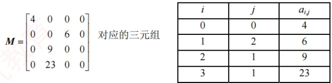

图3.26 稀疏矩阵及其对应的三元组

**考点追踪稀疏矩阵压缩存储的方式（2017）**

稀疏矩阵的三元组表可通过多种方式存储，常见的有:数组存储将所有三元组按某种顺序存储在一维数组中，这种方式简单直接，但插入和删除操作的效率较低；十字链表存储（见6.2节）通过链表的方式组织三元组，适用于频繁插入和删除操作的场景。无论采用哪种方式，都需要额外保存稀疏矩阵的行数、列数和非零元素的个数，以便支持后续的各种操作。

## 归纳总结

本章所介绍的几种数据结构是线性表的应用与推广，考试中主要以选择题形式考查，但栈和队列仍可能出现在算法设计题中。不少读者看到教材中列出大量操作函数时容易产生畏难情绪:如果考试中出现了栈或队列相关的算法大题，是否需要完整写出每个操作函数?

其实，在算法设计题中，栈和队列通常作为辅助工具用于解决其他问题，无须严格按照模块化方式分函数实现。我们完全可以将其声明和核心操作写得简洁明了。以顺序栈为例:

（1）声明并初始化栈:

Elemtype stack[maxSize]； int top=-1；//两句代码用来声明和初始化

（2）入栈操作:

（3）出栈操作:

x=stack[top--]; //单目运算符在变量之前表示“先运算后使用”，之后则相反

对于链式栈，同样只需定义一个结构体，然后根据需要从常规操作中摘取关键语句，直接嵌入到自己的解题代码中即可，无须完整实现所有接口。此外，在考研真题中，链式栈出现的概率远低于顺序栈，因此大家应有所侧重，多训练与顺序栈相关的题目。

## 思维拓展

设计一个栈，使它可以在O(1)的时间复杂度内实现 Push、Pop和min操作。所谓min操作，是指得到栈中最小的元素。

**提示**

使用双栈，两个栈是同步关系。主栈是普通栈，用来实现栈的基本操作Push和Pop；辅助栈用来记录同步的最小值 min，例如元素x 入栈，则辅助栈 stack min[top++]=(x<min)?x:min;即在每次Push 中，都将当前最小元素放到 stack min 的栈顶。在主栈中 Pop 最小元素y时，stack min 栈中相同位置的最小元素 y 也会随着 top--而出栈。因此 stack min 的栈顶元素必然是y之前入栈的最小元素。本题是典型的以空间换时间的算法。

购买王道书，就上

王道官方考研书店


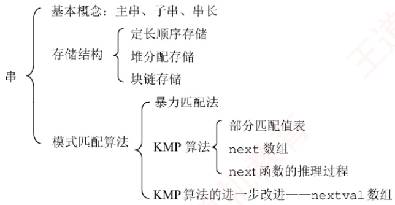

【复习提示】
