# 第5章 树与二叉树 · 习题与解析

> 由《第5章 树与二叉树》正文摘出；区块标题保留了原书的小节编号。

### 5.1.4 本节试题精选

#### 一、单项选择题

01. 树最适合用来表示（）的数据。
A. 有序
B. 无序
C. 任意元素之间具有多种联系
D. 元素之间具有分支层次关系

02. 一棵有n个结点的树的所有结点的度数之和为（）。
A. n−1
B. n
C. n + 1
D. 2n

03. 树的路径长度是从树根到每个结点的路径长度的（）。
A. 总和
B. 最小值
C. 最大值
D. 平均值

04. 对于一棵具有n个结点、度为4的树来说，（）。
A. 树的高度至多是n-3
B. 树的高度至多是n-4
C. 第 i 层上至多有 4(i−1)个结点
D. 至少在某一层上正好有4个结点
A. 至少有 h + 3 个结点 王
B. 至多有 4h-1 个结点
C. 至多有 4h 个结点
D. 至少有 h + 4个结点

06. 假定一棵度为3的树中，结点数为50，则其最小高度为（）。
A. 3 C. 5 教育 D. 6
B. 4

07. 设有一棵度为3的树，其中度为3的结点数 $n_{3} = ~ 2$ ，度为2的结点数 $n_{2}=1$ 叶结点数$n_{\mathrm {0}}   =   6$ ，则该树的结点总数为（）。
A. 12
B. 9 道计算
C. 10
D. ≥9 的任意整数

08. 设一棵 m 叉树中有 $N_{1}$ 个度数为1的结点， $N_{2}$ 个度数为 2 的结点 ${\cdots \cdots} N_{m}$ 个度数为 m 的结点，则该树中共有（）个叶结点。
A. $\sum_{i = 1}^{m} ( i - 1 ) N_{i}$
B. $\sum_{i = 1}^{m} N_{i}$
C. $\sum_{i = 2}^{m} (i - 1)N_{i}$
D. $\sum_{i = 2}^{m} ( i   -   1 ) N_{_i} + 1$

09.【2010统考真题】在一棵度为4的树T中，若有20个度为4的结点，10个度为3的结点1个度为2的结点，10个度为1的结点，则树T的叶结点数是（）。
A. 41
B. 82
C. 113
D. 122

10.【2016统考真题】若森林F有15条边、25个结点，则F包含树的个数是（）。
A. 8
B. 9
C. 10
D. 11

#### 二、综合应用题

01. 含有n个结点的三叉树的最小高度是多少？

02. 已知一棵度为4的树中，度为0,1,2,3的结点数分别为14,4,3,2，求该树的结点总数 n和度为4的结点数，并给出推导过程。

03. 已知一棵度为 m的树中，有 $n_{1}$ 个度为1的结点，有 $n_{2}$ 个度为 2 的结点……有 $n_{m}$ 个度为m的结点，问该树有多少个叶结点？

### 5.1.5 答案与解析

#### 一、单项选择题

01. D

树是一种分层结构，它特别适合组织那些具有分支层次关系的数据。

02. A

除根结点外，其他每个结点都是某个结点的孩子，因此树中所有结点的度数加1等于结点数，即所有结点的度数之和等于总结点数减1。这是一个重要的结论，做题时经常用到。

03. A

树的路径长度是指树根到每个结点的路径长的总和，根到每个结点的路径长度的最大值应是树的高度减1。注意与哈夫曼树的带权路径长度相区别。

04. A

要使得具有n个结点、度为4的树的高度最大，就要使得每层的结点数尽可能少，类似右图所示的树，除最后一层外，每层的结点数是1，最终该树的高度为n-3。树的度为4只能说明存在某结点正好（也最多）有4个孩子结点，选项D错误。

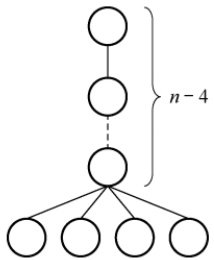

05. A

要使得度为4、高度为h的树的总结点数最少，需要满足以下两个条件: XIT

①至少有一个结点有4个分支。

②每层的结点数尽可能少。

情况类似右图所示的树，结点数为 $h + 3$

要使得度为4、高度为h的树的总结点数最多，应使每个非叶结点的度均为4，即满树，总结点数最多为 $1 + 4 + 4^{2} + \cdots + 4^{h - 1}$

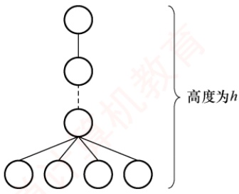

对于上面的两题，应画出草图来求解，就能一目了然。

06. C

要求满足条件的树，那么该树是一棵完全三叉树。在度为3的完全三叉树中，第1层有1个结点，第2层有 $3^{1} = 3$ 个结点，第3层有 $3^{2} = 9$ 个结点，第4层有 $3^{3}   =   27$ 个结点，因此结点数之和为 $1 + 3 + 9 + 27 = 40$ ，第5层的结点数 $50 - 40 = 10$ 个，因此最小高度为5。

07. D

总结点数 $n = n_{0} + n_{1} + n_{2} + n_{3} = 6 + n_{1} + 1 + 2 = n_{1} + 9$ ，总度数= $\cdot n   -   1   =$ $n_{1}+2n_{2}+3n_{3}=n_{1}+2+6=n_{1}+8$ ，根据题目条件无法得出n的具体值，只能证明n是一个大于或等于9的任意整数。画出满足题目条件的树，可以是右图所示的一棵树，该树中无法确定n的具体数量。08. D 08 D

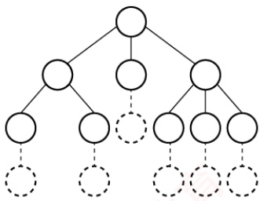

设叶结点数为 $N_{0}$ ，总结点数为N，则 $N = N_{1} + 2N_{2} + 3N_{3} + \cdots +$ $m N_{m} + 1$ ，又因为 $N = N_{0} + N_{1} + N_{2} + N_{3} + \cdots + N_{m}$ 所以 $N_{0}=N_{2}+2N_{3}+\cdots+$ M $(m - 1)N_{m} + 1 = \sum_{i = 2}^{m}(i - 1)N_{i} + 1$ 0

09. B

设树中度为 i（i = 0, 1, 2, 3, 4）的结点数分别为 ni，树中结点总数为 n，则 n = 分支数 + 1，而分支数又等于树中各结点的度之和，即 $n = 1 + n_{1} + 2n_{2} + 3n_{3} + 4n_{4} = n_{0} + n_{1} + n_{2} + n_{3} + n_{4}$ 。依题意， $n_{1} + 2n_{2} + 3n_{3} + 4n_{4} = 10 + 2 + 30 + 80 = 122, \quad n_{1} + n_{2} + n_{3} + n_{4} = 10 + 1 + 10 + 20 = 41$ ，可得出$n_{0}   = 82$ ，即树T的叶结点的个数是82。

10. C

解法1:树有一个重要性质，即在n个结点的树中有n-1条边，“那么对于每棵树，其结点数比边数多1”。本题森林中的结点数比边数多 $10 \left( 25 - 15 = 10 \right)$ ，显然共有10棵树。

解法2:仔细分析后发现此题也是考查图的性质:生成树和生成森林。对于图的生成树有一个重要的性质，即图中顶点数若为n，则其生成树含有n-1条边。对比解法1中树的性质，不难发现两种解法都用到了性质“树中结点数比边数多1”，后面的分析如解法1。

#### 二、综合应用题

01.【解答】

要求含有n个结点的三叉树的最小高度，那么满足条件的一定是一棵完全三叉树，设含有n个结点的完全三叉树的高度为h，第h层至少有1个结点，至多有 $3^{h - 1}$ 个结点。则有

$$
1 + 3^{1} + 3^{2} + \cdots + 3^{n - 2} < n \leqslant 1 + 3^{1} + 3^{2} + \cdots + 3^{n - 2} + 3^{n - 1}
$$

即 $( 3^{h - 1} - 1 ) / 2 < n \leq ( 3^{h} - 1 ) / 2$ ，得 $3^{h - 1} < 2n + 1 \leq 3^h$ ， 即 $h < \log_{3}(2n + 1) + 1, \quad h \geqslant \log_{3}(2n + 1).$

因为h只能为正整数， $h = \lceil \log_3 (2n + 1) \rceil$ ，所这种三叉树的最小高度是 $\left[ \log_{3}(2n + 1) \right]$

02. 【解答】

设树中度为 $i \left( i = 0,1,2,3,4 \right)$ 的结点数为，则结点总数 $n_{i} ,$ $n = n_{0} + n_{1} + n_{2} + n_{3} + n_{4}$ ，即 $n = 23 + n_{4},$根据“树中所有结点的度数加1等于结点数”的结论，有 $n = 0 + n_{1} + 2 n_{2} + 3 n_{3} + 4 n_{4} + 1$ ，即有 $n =$ $17 \pm 4 n_{4}$ 0 KNKI

综合两式得 $n_{4}=2,\ n=25$ 。所以该树的结点总数为25，度为4的结点数为2。

03. 【解答】

树中的结点数等于所有结点的度数加1，因此有 $n = \sum_{i = 0}^{m}in_{i} + 1 = n_{1} + 2n_{2} + 3n_{3} + \cdots + mn_{m} + 1$

又有 $n = n_{0} + n_{1} + n_{2} + \cdots + n_{m}$ ，所以

$$
n_{0}=\left(n_{1}+2 n_{2}+3 n_{3}+\cdots+m n_{m}+1\right)-\left(n_{1}+n_{2}+\cdots+n_{m}\right) \\ =n_{2}+2 n_{3}+\cdots+(m-1) n_{m}+1=1+\sum_{i=2}^{m}(i-1) n_{i}
$$

**注意**

综合以上几题，常用于求解树结点与度之间关系的有:

①总结点数 $n_{0}+n_{1}+n_{2}+\cdots+n_{m}$

②总分支数 $\begin{aligned}= \ln_{1} + 2n_{2} + \cdots + mn_{m}\end{aligned}$ (度为m的结点引出m条分支）。

③总结点数= 总分支数 +1。

这类题目常在选择题中出现，读者对以上关系应当熟练掌握并灵活应用。

### 5.2.3 本节试题精选

#### 一、单项选择题

01.下列关于二叉树的说法中，正确的是（）。
A. 度为2 的有序树就是二叉树
B. 含有n个结点的二叉树的高度为 $\lfloor \log_{2} n \rfloor + 1$
C. 在完全二叉树中，若一个结点没有左孩子，则它必是叶结点
D. 含有 n 个结点的完全二叉树的高度为[1og2n

02.“二叉树为空”意味着二叉树（）。
A. 根结点没有子树
B. 不存在
C. 没有结点
D. 由一些没有赋值的空结点构成

03.下列关于完全二叉树的说法中，正确的是（）。
A. 在完全二叉树中，叶结点的双亲的左兄弟（若存在）一定不是叶结点
B. 任何一棵二叉树中，叶结点数为度为2的结点数减1，即 $n_{0}   =   n_{2}   -   1$
C. 完全二叉树不适合顺序存储结构，只有满二叉树适合顺序存储结构
D. 结点按完全二叉树层序编号的二叉树中，第i个结点的左孩子的编号为2

04. 具有10个叶结点的二叉树中有（）个度为2的结点。
A. 8
B. 9
C. 10
D. 11

05. 设高度为h的二叉树上只有度为0和度为2的结点，则此类二叉树中所包含的结点数至少为（）。
A. h
B. 2h-1
C. 2h+ 1
D. h + 1

06. 具有n个结点且高度为 n的二叉树的数目为（）。
A. log₂n
B. $n / 2$
C. n
D. $2^{n - 1}$

07. 假设一棵二叉树的结点数为50，则它的最小高度是（）。
A. 4
B. 5
C. 6
D. 7

08. 设二叉树有 2n 个结点，且 $m \leq n .$ ，则不可能存在（）的结点。
A. n 个度为 0
B. 2m 个度为 0
C. 2m 个度为 1
D. 2m 个度为 2

09. 一个具有1025 个结点的二叉树的高h为（）。
A. 11
B. 10
C. 11\~1025
D. 10\~1024

10. 设二叉树只有度为0和2的结点，其结点数为15，则该二叉树的最大深度为（）。
A. 4
B. 5
C. 8
D. 9

11. 高度为h的完全二叉树最少有（）个结点。
A. $2^{h}$
B. $2^{h} + 1$
C. $2^{h - 1}$ 育
D. $2^{h}   -   1$

12. 已知一棵完全二叉树的第6层（设根为第1层）有8个叶结点，则完全二叉树的结点数最少是（）。
A. 39
B. 52
C. 111
D. 119

13. 若一棵深度为6的完全二叉树的第6层有3个叶结点，则该二叉树共有（）个叶结点。
A. 17
B. 18首
C. 19
D. 20

14. 一棵完全二叉树上有1001个结点，其中叶结点的个数是（）。
A. 250
B. 500
C. 254
D. 501

15. 若一棵二叉树有126个结点，在第7层（根结点在第1层）至多有（）个结点。
A. 32
B. 64
C. 63
D. 不存在第7层

16.一棵有124个叶结点的完全二叉树，最多有（）个结点。
A. 247
B. 248
C. 249
D. 250

17. 某完全二叉树T中，结点数最大的层有8个结点，则T中至多有（）个结点。
A. 8
B. 15
C. 23
D. 31

18.一棵有n个结点的二叉树采用二叉链存储结点，其中空指针数为（）。
A. n
B. n + 1
C. n−1
D. 2n

19. 设有n（n≥1）个结点的二叉树采用三叉链表表示，其中每个结点包含三个指针，分别指向其左孩子、右孩子及双亲（若不存在，则置为空），则下列说法中正确的是（）。I. 树中空指针的数量为 n + 2 I. 所有度为 2 的结点均被三个指针指向Ⅲ. 每个叶结点均被一个指针所指向
A. I
B. I、ⅡI
C. I、ⅢII
D. II、III

20. 在一棵完全二叉树中，其根的序号为1，（）可判定序号为p和q的两个结点是否在同一层。
A. $\lfloor \log_{2} p \rfloor = \lfloor \log_{2} q \rfloor$
B. $\log_{2}p = \log_{2}q$
C. $\lfloor \log_{2} p \rfloor + 1 = \lfloor \log_{2} q \rfloor$
D. $\lfloor \log_{2} p \rfloor = \lfloor \log_{2} q \rfloor + 1$

21. 在一个用数组表示的完全二叉树中，根结点的下标为1，那么下标为17和19的结点的最近公共祖先的下标是（）。
A. 1
B. 2
C. 4
D. 8

22. 假定一棵三叉树的结点数为50，则它的最小高度为（）。
A. 3
B. 4
C. 5
D. 6

23. 具有n个结点的三叉树用三叉链表表示，则树中空指针域的个数为（）。
A. 3n + 1
B. $2 n + 1$
C. 3n − 1
D. 3n

24. 对于一棵满二叉树，共有n个结点和m个叶结点，高度为h，则（）。
A. $n = h + m$
B. $n + m = 2h$
C. $m = h - 1$
D. $n   =   2^{h}   -   1$

25. 【2009统考真题】已知一棵完全二叉树的第6层（设根为第1层）有8个叶结点，则该完全二叉树的结点数最多是（）。
A. 39
B. 52
C. 111
D. 119

26.【2011统考真题】若一棵完全二叉树有768个结点，则该二叉树中叶结点的个数是（）。Y
A. 257
B. 258
C. 384
D. 385

27.【2018统考真题】设一棵非空完全二叉树T的所有叶结点均位于同一层，且每个非叶结点都有2 个子结点。若 T有k个叶结点，则 T的结点总数是（）。
A. 2k−1
B. 2k
C. $k^{2}$ TD
D. $2^{k}   -   1$

28.【2020统考真题】对于任意一棵高度为5且有10个结点的二叉树，若采用顺序存储结构保存，每个结点占1个存储单元（仅存放结点的数据信息），则存放该二叉树需要的存储单元数量至少是（）。
A. 31
B. 16
C. 15
D. 10

29. 【2022统考真题】若三叉树T中有244个结点（叶结点的高度为1），则T的高度至少是（）。

A. 8
B. 7
C. 61XT
D. 5

30.【2025统考真题】若二叉树的结点值均为正整数，采用顺序存储方式保存在数组R中，用-1表示结点不存在，则下列数组中，不能表示一棵二叉树的是（）。
A. $\mathrm{R}[] = \{20, 15, 40, -1, -1, 35 \}$
B. $\mathrm{R}[]=\{15,40,10,18,35,-1,-1\}$首
C. $\mathrm{R}[] = \{15, 40, 10, -1, -1, -1, 12\}$
D. $\mathrm{R}[] = \{17,20,35,-1,18,45,-1,-1,19,27\}$

#### 二、综合应用题

01. 在一棵完全二叉树中，含有 $n_{0}$ 个叶结点，当度为1的结点数为1时，该树的高度是多少？当度为1的结点数为0时，该树的高度是多少？

02. 一棵有n个结点的满二叉树有多少个分支结点和多少个叶结点？该满二叉树的高度是多少？

03. 已知完全二叉树的第9层有240个结点，则整个完全二叉树有多少个结点？有多少个叶结点？

04. 一棵高度为h的满m叉树有如下性质:根结点所在层次为第1层，第 h层上的结点都是叶结点，其余各层上每个结点都有m棵非空子树，若按层次自顶向下，同一层自左向右，顺序从1开始对全部结点进行编号，试问:

1）各层的结点数是多少？

2）编号为i的结点的双亲结点（若存在）的编号是多少？

3）编号为i的结点的第k个孩子结点（若存在）的编号是多少？

4）编号为i的结点有右兄弟的条件是什么？其右兄弟结点的编号是多少？

05. 已知一棵二叉树按顺序存储结构进行存储，设计一个算法，求编号分别为i和j的两个结点的最近的公共祖先结点的值。

06.【2016统考真题】若一棵非空 $k ( k \geqslant 2 )$ 叉树T中的每个非叶结点都有k个孩子，则称T为正则k叉树。请回答下列问题并给出推导过程。

1）若T有m个非叶结点，则 T中的叶结点有多少个？

2)若 T的高度为 h(单结点的树 $h   = 1 \; )$ ，则T的结点数最多为多少个？最少为多少个？

### 5.2.4 答案与解析

#### 一、单项选择题

01. C

在二叉树中，若某个结点只有一个孩子，则这个孩子的左右次序是确定的；而在度为2的有序树中，若某个结点只有一个孩子，则这个孩子就无须区分其左右次序，选项A错误。选项B仅当是完全二叉树时才有意义，对于任意一棵二叉树，高度可能为 $\left\lfloor \log_{2} n \right\rfloor + 1 \sim n .$ 。在完全二叉树中，若有度为1的结点，则只可能有一个，且该结点只有左孩子而无右孩子，选项C正确。完全二叉树的高度为 $\left\lceil \log_{2} ( n + 1 ) \right\rceil$ 或 $\left\lfloor \log_{2} n \right\rfloor + 1$ ，也可通过举例n=4来排除，选项D错误。

02. C

“二叉树为空”意味着二叉树中没有结点，但并不意味着二叉树不存在。注意，线性表可以是空表，树可以是空树，但图不能是空图（图中不能没有结点）。

03. A

在完全二叉树中，叶结点的双亲的左兄弟的孩子一定在其前面（且一定存在），所以双亲的左兄弟（若存在）一定不是叶结点，选项A正确。 $n_{0}$ 应等于 $n_{2} + 1$ ，选项B错误。完全二叉树和满二叉树均可以采用顺序存储结构，选项C错误。第i个结点的左孩子不一定存在，选项D错误。

选项B的这种通用公式适用于所有二叉树，我们应能立即联想到采用特殊值代入法验证，如画一个只含3个结点的满二叉树的草图来验证是否满足条件。

04. B

由二叉树的性质 $n_{0}   =   n_{2} + 1$ ，得 $n_{2}=n_{0}-1=10-1=9$ a

【另解】画出草图，如下图所示。首先画出10个叶结点，然后每2个结点向上合并，构造一个新的度为2的分支结点，直到构成如下图所示的二叉树，其中度为2的分支结点数为9。

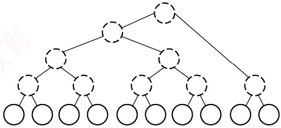

05. B

结点最少的情况如下图所示。除根结点层只有1个结点外，其他h-1层均有两个结点，结点总数 $2(h - 1) + 1 = 2h - 1$ 0

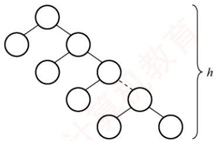

06. D

除根结点外，在其余n-1个结点中，每个结点要么是其父结点的左孩子，要么是其父结点的右孩子，每个结点都有两种可能，n-1个结点共有 $2^{n - 1}$ 种不同的组合形态。

07. C

要求满足条件的树，分析可知当这50个结点构成一棵完全二叉树时高度最小， $h = \left\lfloor \log_{2} n \right\rfloor + 1 =$ $\left \lfloor \log_{2}50 \right \rfloor + 1 = 6$ 粉

【另解】第1层最多有1个结点，第2层最多有 $2^{1}$ 个结点，第3层最多有 $2^{2}$ 个结点，第4层最多有 $2^{3}$ 个结点，以此类推，可以得到h最少为6。

08. C

由二叉树的性质1可知 $n_{0}   =   n_{2}   +   1$ ，结点总数 $2n = n_{0} + n_{1} + n_{2} = n_{1} + 2n_{2} + 1$ ，则 $n_{1}=2(n-n_{2})-1$所以 $n_{1}$ 为奇数，说明该二叉树中不可能有2m个度为1的结点。

09. C

当二叉树为单支树时具有最大高度，即每层上只有一个结点，最大高度为1025。而当树为完全二叉树时，其高度最小，最小高度为 $\left\lfloor \log_{2} n \right\rfloor + 1 = 11$

10. C

建议画图，第一层有1个结点，其余h-1层各有2个结点，总结点数 $1+2(h-1)=15,\ h=8$

11. C

高度为h的完全二叉树中，第1层～第h-1层构成一个高度为h-1的满二叉树，结点数为$2^{h - 1} - 1$ 。第h层至少有一个结点，所以最少的结点数 $( 2^{h - 1} - 1 ) + 1 = 2^{h - 1}$ 0

12. A

第6层有叶结点说明完全二叉树的高度可能为6或7，显然树高为6时结点最少。若第6层上有8个叶结点，则前5层为满二叉树，所以完全二叉树的结点数最少为 $2^{5}-1+8=39$

13. A

深度为6的完全二叉树，第5层共有 $2^{4} = 16$ 个结点。第6层最左边有3个叶结点，其对应的双亲结点为第5层最左边的两个结点，所以第5层剩余的结点均为叶结点，共有 $16   -   2   =   14$ 个，加上第6层的3个叶结点，共有17个叶结点。

14. D

由完全二叉树的性质，最后一个分支结点的序号为 $\left \lfloor 1001/2 \right \rfloor = 500$ ，所以叶结点数为 501。【另解】 $n = n_{0} + n_{1} + n_{2} = n_{0} + n_{1} + (n_{0} - 1) = 2n_{0} + n_{1} - 1$ ，因为 $n   =   1001$ ，而在完全二叉树中，$n_{1}$ 只能取0或1。当 $n_{1} = 1$ 时， $n_{0}$ 为小数，不符合题意。所以 $n_{1} = 0$ ，于是有 $n_{0} = 501$

15. C

要使二叉树第7层的结点数最多，只考虑树高为7层的情况，7层满二叉树有127个结点，126仅比127少1个结点，只能少在第7层，所以第7层最多有 $2^{6} - 1 = 63$ 个结点。

16. B

在非空的二叉树当中，由度为0和2的结点数的关系 $n_{0}   =   n_{2} + 1$ 可知 $n_{2} = 123$ ；总结点数 $n =$ $n_{0}+n_{1}+n_{2}=247+n_{1}$ ，其最大值为 $248 \: \left( n_{1} \right.$ 的取值为1或0，当 $n_{1} = 1$ 时结点最多）。注意，由完全二叉树总结点数的奇偶性可以确定 $n_{1}$ 的值，但不能根据 $n_{0}$ 来确定 $n_{1}$ 的值。

【另解】 $124 \leq 2^{7} = 128$ ，所以第8层没满，前7层为完全二叉树，由此可推算第8层可能有120个叶结点，第7层的最右4个为叶结点，考虑最多的情况，这4个叶结点中的最左边可以有1个左孩子（不改变叶结点数），因此结点总数 $2^{7}-1+120+1=248$ 0

17. C

在完全二叉树中，第4层刚好最多有8个结点（前4层对应高度为4的满二叉树），若第5层也有8个结点，则对应于结点数最多的情况，此时树高为5，总结点数为 $15 + 8 = 23$ 0

18. B

非空指针数=总分支数=n-1，空指针数=2×结点总数-非空指针数 $2n - (n - 1) = n + 1$

【另解】在树中，1个指针对应1个分支，n个结点的树共有n-1个分支，即n-1个非空指针，每个结点都有2个指针域，所以空指针数 $2n - (n - 1) = n + 1$ 0

19. A

二叉链表表示的二叉树中空指针的数量为n+1，三叉链表表示的二叉树多了一个根结点指向双亲的空指针，所以树中空指针的数量为n+2，说法Ⅰ正确。若根结点的度为2，则只有左右两个孩子指向它，说法Ⅱ错误。若整棵树只有一个根结点，则没有指针指向它，说法Ⅲ错误。

20. A

由完全二叉树的性质，编号为 $i (i \geqslant 1)$ 的结点所在的层次为 $\log_{2}i + 1$ ，若两个结点位于同一层，则一定有 $\lfloor \log_{2} p \rfloor + 1 = \lfloor \log_{2} q \rfloor + 1$ ，因此有 $\lfloor \log_{2} p \rfloor = \lfloor \log_{2} q \rfloor$ 成立。

21. C

当根结点下标为1时，下标为i的结点的父结点下标为 $. i / 2 .$ ，那么下标为17的祖先的下标有8,4,2,1，下标为19的祖先的下标有9,4,2,1，因此两者最近的公共祖先的下标是4。

22. C

分析可知，满足条件的三叉树可以是完全三叉树，这棵树的第 $i ( i \geqslant 1 )$ 层最多有 $3^{i - 1}$ 个结点。设高度为h，则 $3^{0}+3^{1}+\cdots+3^{h-1}=(3^{h}-1)/2$ 是结点数的上限，问题是求解 $50 \leqslant ( 3^{h} - 1 ) / 2$ 的最小h值，即 $h \geqslant \log_{3}101$ ，有 $h = \left\lceil \log_{3}101 \right\rceil = 5$

23. B

三叉树采用三叉链表表示，每个结点均有3个指针域指向3个孩子，共有3n个指针域，但n个结点构成的一棵树中只需要n-1个指针（对于n-1条边），因此空指针域有2n+1个。

24. D

对于高度为h的满二叉树，结点总数 $n = 2^{0} + 2^{1} + \cdots + 2^{h - 1} = 2^{h} - 1$ ，叶结点数 $m   =   2^{h - 1}$

25. C

第6层有叶结点，完全二叉树的高度可能为6或7，显然树高为7时结点最多。完全二叉树与满二叉树相比，只是在最下一层的右边缺少部分叶结点，而最后一层之上是个满二叉树，且只有最后两层上有叶结点。若第6层上有8个叶结点，则前6层为满二叉树，而第7层缺失 $8 \times 2 = 16$个叶结点，所以完全二叉树的结点数最多为 $2^{7}-1-16=111$

26. C

最后一个分支结点的编号为 $\left \lfloor 768/2 \right \rfloor = 384$ ，所以叶结点的个数为 $768-384=384$

【另解】 $n = n_{0} + n_{1} + n_{2} = n_{0} + n_{1} + (n_{0} - 1) = 2n_{0} + n_{1} - 1$ ，其中 $n = 768$ 而在完全二叉树中，$n_{1}$ 只能取0或1，当 $n_{1}   =   0$ 时， $n_{0}$ 为小数，不符合题意。因此 $n_{1} = 1$ ，所以 $n_{0} = 384$

27. A

非叶结点的度均为2，且所有叶结点都位于同一层的完全二叉树就是满二叉树。对于一棵高度为h的满二叉树（空树 $h   =   0 )$ ，其最后一层全部是叶结点，数目为 $2^{h - 1}$ ；总结点数为 $2^{h} {-} 1$ 。因此当 $2^{h - 1} = k$ 时，可以得到 $2^{h} - 1 = 2 k - 1$

28. A

二叉树采用顺序存储时，用数组下标来表示结点之间的父子关系。对于一棵高度为5的二叉树，为了满足任意性，其1～5层的所有结点都要被存储起来，即考虑为一棵高度为5的满二叉树，共需要存储单元的数量为 $1+2+4+8+16=31$

29. C

高度一定的三叉树中结点数最多的情况是满三叉树。高度为5的满三叉树的结点数 $= 3^{0} + 3^{1} +$ $3^{2}+3^{3}+3^{4}=121$ ，高度为6的满三叉树的结点数 $3^{0}+3^{1}+3^{2}+3^{3}+3^{4}+3^{5}=364$ 。三叉树T的结点数为244， $121 < 244 < 364$ ，因此T的高度至少为6。

30. D

在二叉树的顺序存储结构中，结点按完全二叉树的层次顺序存放:根在下标0，对于任意非根结点R[i]，其父结点为 $\mathrm {R} [ ( i - 1 ) / 2 ]$ 。若某结点为空，则其所有后代位置必须也为空，否则将出现“空

所有非-1的元素，其从根到该结点的祖先路径上均不含-1，符合顺序存储规则。在选项D中， $\mathrm {R} [ 8 ]   =   19$ 是一个有效结点，其父结点应为 $\mathrm{R}[(8 - 1)/2] =$ R[3]，但 $\operatorname {R} [ 3 ]   =   - 1$ ，表示该结点不存在，因此无法构成合法的二叉树。

#### 二、综合应用题

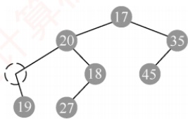

01. 【解答】

在非空的二叉树中，由度为0和度为2的结点之间的关系 $n_{0}   =   n_{2}   +   1$ ，可知 $n_{2}   =   n_{0}   - 1$ 。因此总结点数 $n = n_{0} + n_{1} + n_{2} = 2n_{0} + n_{1} - 1$ X

①当 $n_{1} = 1$ 时， $n = 2 n_{0} , \quad h = \lceil \log_{2} ( n + 1 ) \rceil = \lceil \log_{2} ( 2 n_{0} + 1 ) \rceil .$

②当 $n_{1} = 0$ 时， $n = 2n_{0} - 1, \quad h = \lceil \log_{2}(n + 1) \rceil = \lceil \log_{2}(2n_{0}) \rceil = \lceil \log_{2}(n_{0}) \rceil + 1 。$

02. 【解答】

满二叉树中 $n_{1} = 0$ ，由二叉树的性质1可知 $n_{0}   =   n_{2} + 1$ ，即 $n_{2}=n_{0}-1,n=n_{0}+n_{1}+n_{2}=2n_{0}-1$则 $n_{0}   =   ( n + 1 ) / 2$ 。分支结点数 $n_{2}=n-(n+1)/2=(n-1)/2$ 高度为h的满二叉树的结点数 $n = 1 + 2^{1} +$ $2^{2} + \cdots + 2^{h - 1} = 2^{h} - 1$ ，即高度 $h = \log_{2}(n + 1)$ 公村

03.【解答】

在完全二叉树中，若第9层是满的，则结点数 $2^{9 - 1} = 256$ ，而现在第9层只有240个结点，说明第9层未满，是最后一层。1～8层是满的，所以总结点数 $2^{8}-1+240=495$ o

因为第9层是最后一层，所以第9层的结点都是叶结点。且第9层的240个结点的双亲在第8层中，其双亲个数为120，即第8层有120个分支结点，其余为叶结点，所以第8层的叶结点数为 $2^{8 - 1} - 120 = 8$ 。因此，总的叶结点数 $8+240=248$

【另解】总结点数 $n = n_{0} + n_{1} + n_{2}, \quad n_{2} = n_{0} - 1, \quad n = n_{0} + n_{1} + n_{2} = 2n_{0} + n_{1} - 1$ 。若 $n_{1} = 1$ ，则$2n_{0}+n_{1}-1=2n_{0}=495$ ，不符合；若 $n_{1} = 0$ ，则 $2n_{0}+n_{1}-1=2n_{0}-1=495$ ，则 $n_{0} = 248$

**注意**

对于本题，应理解完全二叉树中只有最底层的结点是不满的，其他各层的结点都是满的。

04.【解答】

1）第1层有 $m^{0}   = 1$ 个结点，第2层有 $m^{1}$ 个结点，第3层有 $m^{2}$ 个结点……一般地，第i层有$m^{i - 1}$ 个结点 $( 1 \leqslant i \leqslant h )$

2）在m叉树的情形下，结点i的第1个孩子编号为 $j = (i - 1)m + 2$ ，反过来，结点i的双亲的编号是L $(i - 2)/m \downarrow + 1$ ，根结点没有双亲，所以要求i>1。

3）因为结点i的第1个孩子编号为 $l ( i - 1 ) m + 2$ ，若设该结点孩子的序号为 $k   =   1 , 2 , \cdots , m$ ，则第k个孩子结点的编号为 $(i - 1)m + k + 1 \quad (1 \leq k \leq m)$

4）结点i不是其双亲的第m个孩子时才有右兄弟。设其双亲编号为j，可得 $j = \left\lfloor (i + m - 2)/m \right\rfloor$结点j的第m个孩子的编号为 $\exists (j-1)m+m+1=jm+1=\left\lfloor (i+m-2)/m \right\rfloor m+1$ ，所以当结点的编号 $i \leqslant \left\lfloor (i + m - 2)/m \right\rfloor m$ 时才有右兄弟，右兄弟的编号为 $i + 1   \mathrm {{_{c}}}$ 。或者，对于任意一个双亲结点j，其第m个孩子结点的编号是 $j m + 1$ ，故若不为第m个孩子结点，则 $(i - 1)^{n} \% m ! = 0$

05.【解答】

首先，必须明确二叉树中任意两个结点必然存在最近的公共祖先结点，最坏的情况下是根结点（两个结点分别在根结点的左右分支中），而且从最近的公共祖先结点到根结点的全部祖先结点都是公共的。由二叉树顺序存储的性质可知，任意一个结点i的双亲结点的编号为 $i / 2$ 。求解 i和j最近公共祖先结点的算法步骤如下（设从数组下标1开始存储）:

1）若 $i \geq j ,$ 则结点i所在层次大于或等于结点j所在层次。结点i的双亲结点为结点 $i / 2$若 $i / 2 = j,$ 则结点 i/2 是原结点i和结点j的最近公共祖先结点，若 $i / 2   \neq   j$ ，则令 $i = i / 2$即以该结点i的双亲结点为起点，采用递归的方法继续查找。

2）若 $j \geq i ,$ 则结点j所在层次大于或等于结点i所在层次。结点j的双亲结点为结点 $j / 2$若 $j / 2 = i$ ，则结点 $j / 2$ 是原结点i和结点j的最近公共祖先结点，若 $j / 2   \neq   i$ ，则令 $j   =   j / 2$重复上述过程，直到找到它们最近的公共祖先结点为止。

本题代码如下:

<div class="docvortex-algorithm" style="white-space: pre-wrap; font-family:monospace;">
ElemType Comm Ancestor(SqTree T,int i,int j){
//本算法在二叉树中查找结点i 和结点 j 的最近公共祖先结点
$\begin{aligned}\texttt{i f (T [i] !=}&amp; \# \texttt{' sgT [j] !=} \# \texttt{' ) \{}} \\\texttt{wh ile (i !=j) \{}} \\\texttt{i f (i&gt;j)} \\\texttt{i=i/2 ;}\end{aligned}$ //结点存在
//两个编号不同时循环
//向上找i 的祖先
</div>

```txt
else

j=j/2; //向上找 j 的祖先
return T[i];
1
```

由解题中算法的步骤描述可知，本题也很容易地联想到采用递归的方法求解。

06. 【解答】

1）正则k叉树中仅含有两类结点；叶结点（个数记为 $n_{0} )$ 和度为k的分支结点（个数记为 $n_{k} )$ 。树 T 中的结点总数 $n = n_{0} + n_{k} = n_{0} + m.$ 。树中所含的边数 $e = n - 1$ ，这些边均是从m个度为k的结点发出的，即 $e   =   m k .$ 。整理得 $n_{0}+m=mk+1$ ，所以 $n_{0} = (k - 1)m + 1$

2）高度为h的正则k叉树T中，含最多结点的树形为:除第h层外，第1到第h-1层的结点都是度为k的分支结点；而第h层均为叶结点，即树是“满”树。此时第 $j (1 \leqslant j \leqslant h)$层的结点数为 $k^{j - 1}$ ，结点总数 $M_{1}$ 为

$$
M_{1}=\sum_{j = 1}^{h}k^{j - 1}=\frac{k^{h}-1}{k - 1}
$$

含最少结点的正则k叉树的树形为:第1层只有根结点，第2到第h-1层仅含1个分支结点和k-1个叶结点，第h层有k个叶结点。也就是说，除根外，第2到第h层中每层的结点数均为k，所以T中所含结点总数 $M_{2}$ 为

$$
M_{2}=1+(h-1)k
$$

### 5.3.3 本节试题精选

#### 一、单项选择题

01. 在下列关于二叉树遍历的说法中，正确的是（）。

> ①将函数1中的1tag和1child替换为rtag和rchild，并向右下方查找，即为求中序序列的最后一个结点。将函数2中的rtag和rchild替换为1tag和1child，调用函数替换为求左子树的中序序列的最后一个结点，即为求中序序列中结点p的前驱。

A. 若有一个结点是二叉树中某个子树的中序遍历结果序列的最后一个结点，则它一定是该子树的先序遍历结果序列的最后一个结点
B. 若有一个结点是二叉树中某个子树的先序遍历结果序列的最后一个结点，则它一定是该子树的中序遍历结果序列的最后一个结点
C. 若有一个叶结点是二叉树中某个子树的中序遍历结果序列的最后一个结点，则它一定是该子树的先序遍历结果序列的最后一个结点
D. 若有一个叶结点是二叉树中某个子树的先序遍历结果序列的最后一个结点，则它一定是该子树的中序遍历结果序列的最后一个结点

02. 在任何一棵二叉树中，若结点a有左孩子b、右孩子c，则在结点的先序序列、中序序列、后序序列中，（）。
A. 结点 b一定在结点a的前面
B. 结点a一定在结点c的前面
C. 结点 b一定在结点c的前面
D. 结点a一定在结点 b 的前面

03. 设n,m为一棵二叉树上的两个结点，在中序遍历时，n在m前的条件是（）。
A. n 在 m 右方
B. n 是 m 祖先
C. n 在 m 左方
D. n 是 m子孙

04.设n,m为一棵二叉树上的两个结点，在后序遍历时，n在m前的充分条件是（）。
A. n 在 m 右方
B. n 是 m 祖先
C. n 在 m 左方
D. n 是 m 子孙

05. 某非空二叉树采用顺序存储结构，树中的结点信息按完全二叉树的层次序列依次存放在如下所示的一维数组中，则该二叉树的后序遍历序列为（）。

| 0 | 1 | 2 | 3 | 4 | 5 | 6 | 7 | 8 | 9 | 10 | 11 | 12 |
| --- | --- | --- | --- | --- | --- | --- | --- | --- | --- | --- | --- | --- |
| a | b | c |  | d | e | J |  |  | g |  |  | h |

A. ghbefhca
B. gbdehcfa -
C. gdbhefca
D. bgdehcfa

06. 在二叉树的先序序列、中序序列和后序序列中，所有叶结点的先后顺序（）。
A. 都不相同
B. 完全相同
C. 先序和中序相同，而与后序不同
D. 中序和后序相同，而与先序不同

07. 对二叉树的结点从1开始进行连续编号，要求每个结点的编号大于其左右孩子的编号，同一结点的左右孩子中，其左孩子的编号小于其右孩子的编号，可采用（）次序的遍历实现编号。
A. 先序遍历
B. 中序遍历
C. 后序遍历
D. 层次遍历

08. 按某种顺序对二叉树的结点进行编号，编号为1,2,…,n，规定:树中任一结点ν，其编号等于ν的左子树上的最小编号减1，而ν的右子树中的最小编号等于ν的左子树上的最大编号加1，则说明该二叉树是按（）次序编号的。
A. 中序遍历
B. 先序遍历
C. 后序遍历
D. 层次遍历

09. 先序序列为 A, B, C，后序序列为 C, B, A 的二叉树共有（）。
A. 1 棵
B. 2 棵
C. 3 棵
D. 4 棵

10. 一棵完全二叉树的后序遍历序列为CDBFGEA，则其先序遍历序列是（）。
A. CBDAFEG
B. ABECDFG
C. ABCDEFG
D. 无法确定

11. 设结点X和Y是二叉树中任意的两个结点。在该二叉树的先序遍历序列中X在Y之前而在其后序遍历序列中X在Y之后，则X和Y的关系是（）。
A. X是Y的左兄弟
B. X是Y的右兄弟
C. X是Y的祖先
D. X是Y的后裔

12. 若二叉树中结点的先序序列是…a…b…，中序序列是…b…a…，则（）
A. 结点a和结点b分别在某结点的左子树和右子树中
B. 结点 b 在结点 a 的右子树中
C. 结点 b 在结点 a的左子树中
D. 结点 a和结点b分别在某结点的两棵非空子树中

13. 一棵二叉树的先序遍历序列为1234567，它的中序遍历序列可能是（）。
A. 3124567
B. 1234567
C. 4135627
D. 1463572

14. 下列序列中，不能唯一地确定一棵二叉树的是（）。
A. 层次序列和中序序列
B. 先序序列和中序序列
C. 后序序列和中序序列
D. 先序序列和后序序列

15. 若一棵二叉树的中序序列和后序序列相同，则（）。
A. 二叉树为空树或二叉树任一结点没有左子树
B. 二叉树为空树或二叉树任一结点没有右子树
C. 二叉树为空树或二叉树中每个结点的度为1
D. 二叉树为空树或二叉树为满二叉树

16. 已知一棵二叉树的后序序列为DABEC，中序序列为 DEBAC，则先序序列为（）。
A. ACBED
B. DECAB
C. DEABC
D. CEDBA

17. 已知一棵二叉树的先序遍历结果为ABCDEF，中序遍历结果为 CBAEDF，则后序遍历的结果为（）。
A. CBEFDA
B. FEDCBA
C. CBEDFA
D. 不确定

18. 已知一棵二叉树的层次序列为ABCDEF，中序序列为 BADCFE，则先序序列为（）。
A. ACBEDF
B. ABCDEF
C. BDFECA
D. FCEDBA

19. 某二叉树中结点 x在先序、中序、后序遍历序列中的编号分别为 pre(x)、in(x)、post(x) (假设都从1开始依次顺序编号)，a和 b是该二叉树中的两个结点，其中a是b的祖先，则下列选项中不可能出现的是（）。
A. pre(a) < pre(b)
B. post(a) < post(b)
C. in(a) < in(b)
D. in(a) > in(b)

20. 某二叉树采用二叉链表存储结构，若要删除该二叉链表中的所有结点，并释放它们占用的存储空间，则采用（）遍历方法最合适。
A. 中序
B. 层次
C. 后序
D. 先序

21. 某二叉树T采用二叉链表存储结构，T的中序遍历序列为一个升序序列，要求采用某种方法对T进行某种操作之后得到一棵新的二叉树T'，要求T'的中序遍历序列为一个降序序列，则下列关于该算法的叙述中，正确的是（）。
A. 采用中序遍历的方法最合适
B. 采用后序遍历的方法最合适
C. T'中的根结点一定不是原T中的根结点
D. T'中的叶结点不一定是原 T中的叶结点

22. 引入线索二叉树的目的是（）。
A. 加快查找结点的前驱或后继的速度
B. 为了能在二叉树中方便插入和删除
C. 为了能方便找到双亲
D. 使二叉树的遍历结果唯一

23. n个结点的线索二叉树上含有的线索数为（）。
A. 2n
B. n-1
C. n + 1l
D. n

24. 判断线索二叉树中\*p结点有右孩子结点的条件是（）。
A. p!=NULL
B. p->rchild!=NULL
C. p->rtag==0
D. p->rtag==1

25.一棵左子树为空的二叉树在先序线索化后，其中空的链域的个数是（）。
A. 不确定
B. 0个
C. 1个
D. 2 个

26.在线索二叉树中，下列说法不正确的是（）。
A. 在中序线索树中，若某结点有右孩子，则其后继结点是它的右子树的最左下结点
B. 在中序线索树中，若某结点有左孩子，则其前驱结点是它的左子树的最右下结点
C. 线索二叉树是利用二叉树的n+1个空指针来存放结点的前驱和后继信息的
D. 每个结点通过线索都可以直接找到它的前驱和后继

27.二叉树在线索化后，仍不能有效求解的问题是（）。
A. 先序线索二叉树中求先序后继
B. 中序线索二叉树中求中序后继
C. 中序线索二叉树中求中序前驱
D. 后序线索二叉树中求后序后继

28. 若X是二叉中序线索树中一个有左孩子的结点，且X不为根，则X的前驱为（）。
A. X的双亲
B. X的右子树中最左的结点
C. X的左子树中最右的结点
D. X的左子树中最右的叶结点

29.若X是后序线索二叉树中的叶结点，且X存在左兄弟Y，则X的右线索指向的是（）。
A. X的双亲
B. 以Y为根的子树的最左下结点
C. X的左兄弟 Y
D. 以Y为根的子树的最右下结点

30. 某二叉树的先序序列和后序序列正好相反，则该二叉树一定是（）。
A. 空或只有一个结点
B. 高度等于其结点数
C. 任意一个结点无左孩子
D. 任意一个结点无右孩子

31. 某非空二叉树的先序序列和中序序列正好相反，则下列叙述中正确的是（）。
A. 该二叉树一定只有一个结点
B. 只有一个叶结点的二叉树一定满足条件
C. 任意一个结点无左孩子的二叉树一定满足条件
D. 任意一个结点无右孩子的二叉树一定满足条件

32.【2009统考真题】给定二叉树如右图所示。设N代表二叉树的根，L代表根结点的左子树，R代表根结点的右子树。若遍历后的结点序列是3175624，则其遍历方式是（）。
A. LRN
B. NRL
C. RLN
D. RNL

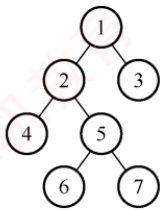

33.【2010统考真题】下列线索二叉树中（用虚线表示线索），符合后序线索树定义的是（）。

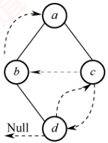

A.

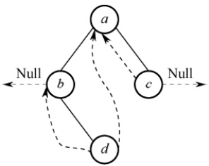

B.

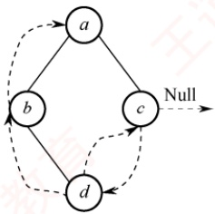

C.

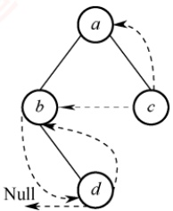

D.

34. 【2011统考真题】一棵二叉树的先序遍历序列和后序遍历序列分别为1,2,3,4和4,3,2,1，该二叉树的中序遍历序列不会是（）。
A. 1, 2, 3, 4
B. 2, 3, 4,1
C. 3, 2, 4, 1
D. 4, 3, 2, 1

35. 【2012统考真题】若一棵二叉树的先序遍历序列为 $a , e , b , d , c ,$ 后序遍历序列为 $b , c , d , e ,$ a，则根结点的孩子结点（）。
A. 只有 e
B. 有e、b
C. 有e、c
D. 无法确定

36. 【2013统考真题】若X是后序线索二叉树中的叶结点，且X存在左兄弟结点Y，则X的右线索指向的是（）
A. X的父结点 王
B. 以Y为根的子树的最左下结点
C. X的左兄弟结点Y
D. 以 Y为根的子树的最右下结点

37.【2014统考真题】若对右图所示的二叉树进行中序线索化，则结点X的左右线索指向的结点分别是（）。
A. $e ,   c$
B. $e , a$
C. $d , c$
D. $b , a$

38. 【2015统考真题】先序序列为 $a , b , c , d$ 的不同二叉树的个数是（）
A. 13
B. 14
C. 15
D. 16

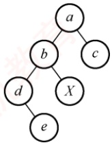

39.【2017统考真题】某二叉树的树形如右图所示，其后序序列为 $e,a,c,b,d,$ $g , f ,$ 树中与结点a同层的结点是（）。 道
A. c
B. d
C. f
D. g

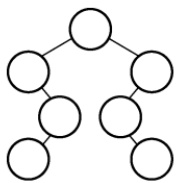

40.【2017统考真题】要使一棵非空二叉树的先序序列与中序序列相同，其所有非叶结点须满足的条件是（）
A. 只有左子树
B. 只有右子树
C. 结点的度均为1
D. 结点的度均为2

41. 【2022统考真题】若结点p与 q在二叉树T的中序遍历序列中相邻，且p在q之前，则下列p与q的关系中，不可能的是（）I. q 是p的双亲 II. q 是p的右孩子ⅢII. q 是p的右兄弟 道 IV. q 是p的双亲的双亲
A. 仅I
B. 仅Ⅲ
C. 仅Ⅱ、ⅢI
D. 仅ⅡI、IV

42.【2023统考真题】已知一棵二叉树的树形如右图所示，若其后序遍历序列为 $fdbeca$ ，则其先（前）序遍历序列是（）。
A. $aedfbc$
B. acebdf
C. $cabefd$ 教育
D. dfebac

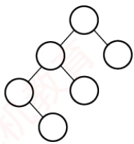

43.【2024统考真题】若p、q和ν均为二叉树T中的结点，ν有两个孩子结点，T的中序遍历序列形如 $``  \cdots ,p,v,q,\cdots  ''$ ，则在下列叙述中，正确的是（）。
A. p没有右孩子，q没有左孩子
B. p没有右孩子，q有左孩子
C. p有右孩子，q没有左孩子
D. p有右孩子，q有左孩子

#### 二、综合应用题

01. 若某非空二叉树的先序序列和后序序列正好相反，则该二叉树的形态是什么？

02. 若某非空二叉树的先序序列和后序序列正好相同，则该二叉树的形态是什么？

03. 假设二叉树采用二叉链表存储结构，设计一个非递归算法求二叉树的高度

04. 二叉树按二叉链表形式存储，试编写一个判别给定二叉树是否是完全二叉树的算法

05. 假设二叉树采用二叉链表存储结构存储，试设计一个算法，计算一棵给定二叉树的所有双分支结点数。

06. 设树B是一棵采用链式结构存储的二叉树，编写一个把树B中所有结点的左右子树进行交换的函数。

07. 假设二叉树采用二叉链存储结构存储，设计一个算法，求先序遍历序列中第k（1≤k≤二叉树中结点数）个结点的值。

08. 已知二叉树以二叉链表存储，编写算法完成:对于树中每个元素值为x的结点，删除以它为根的子树，并释放相应的空间。

09. 在二叉树中查找值为x的结点，试编写算法（用C语言）打印值为x的结点的所有祖先，假设值为x的结点不多于一个。

10. 设一棵二叉树的结点结构为(LLINK，INFO，RLINK)，ROOT为指向该二叉树根结点的指针，p和q分别为指向该二叉树中任意两个结点的指针，试编写算法ANCESTOR (ROOT,p,q,r)，找到p和q的最近公共祖先结点r。

11. 假设二叉树采用二叉链表存储结构，设计一个算法，求非空二叉树b的宽度（具有结点数最多的那一层的结点数）。

12. 设有一棵满二叉树（所有结点值均不同），已知其先序序列为pre，设计一个算法求其后序序列 post。

13. 设计一个算法将二叉树的叶结点按从左到右的顺序连成一个单链表，表头指针为head。二叉树按二叉链表方式存储，链接时用叶结点的右指针域来存放单链表指针。

14. 试设计判断两棵二叉树是否相似的算法。所谓二叉树 $T_{1}$ 和 $T_{2}$ 相似，指的是 $T_{1}$ 和 $T_{2}$ 都是空的二叉树或都只有一个根结点；或者 $T_{1}$ 的左子树和 $T_{2}$ 的左子树是相似的，且 $T_{1}$ 的右子树和 $T_{2}$ 的右子树是相似的。

15.【2014统考真题】二叉树的带权路径长度（WPL）是二叉树中所有叶结点的带权路径长度之和。给定一棵二叉树T，采用二叉链表存储，结点结构为

| left | weight | right |
| --- | --- | --- |
|  |  |  |

其中叶结点的 weight 域保存该结点的非负权值。设 root 为指向 T的根结点的指针，请设计求 T的 WPL 的算法，要求:

1）给出算法的基本设计思想。

2）使用C或C++语言，给出二叉树结点的数据类型定义

3）根据设计思想，采用C或C++语言描述算法，关键之处给出注释。

16.【2017统考真题】请设计一个算法，将给定的表达式树（二叉树）转换为等价的中缀表达式（通过括号反映操作符的计算次序）并输出。例如，当下列两棵表达式树作为算法的输入时:

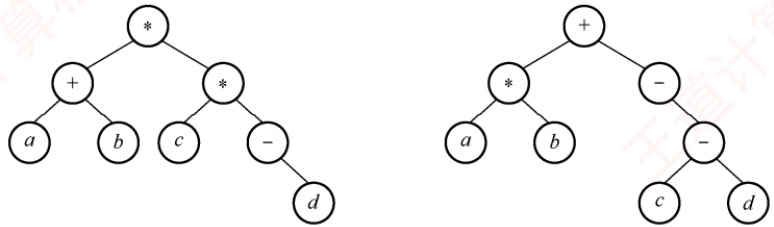

输出的等价中缀表达式分别为 $(a+b) \star (c \star (-d))$ 和(a\*b)+(−(c-d))。

二叉树结点定义如下:

```c
typedef struct node{
char data[10]; //存储操作数或操作符
struct node *left, *right;
}BTree;
```

要求:

1）给出算法的基本设计思想。

2）根据设计思想，采用C或C++语言描述算法，关键之处给出注释。

17. 【2022统考真题】已知非空二叉树T的结点值均为正整数，采用顺序存储方式保存，数据结构定义如下:

```txt
typedef struct { //MAX SIZE为已定义常量
int SqBiTNode[MAX SIZE]; //保存二叉树结点值的数组
int ElemNum; //实际占用的数组元素个数
} SqBiTree;
```

T中不存在的结点在数组 SqBiTNode中用-1表示。例如，对于下图所示的两棵非空二叉树 $T_{1}$ 和 $T_{2}$

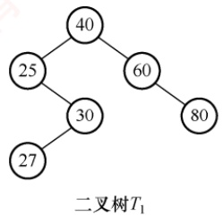

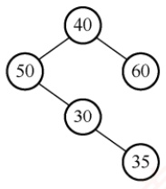

$T_{1}$ 的存储结果如下:

| 40 |  | 60 |  | 30 |  | 80 |  |  | 27 |  |  |
| --- | --- | --- | --- | --- | --- | --- | --- | --- | --- | --- | --- |

T1.ElemNum=10

$T_{2}$ 的存储结果如下:

| e |  | 50 | 60 |  | 30 |  |  | -1 |  |  | 35 |  |
| --- | --- | --- | --- | --- | --- | --- | --- | --- | --- | --- | --- | --- |

T2.ElemNum=11

请设计一个尽可能高效的算法，判定一棵采用这种方式存储的二叉树是否为二叉搜索树，若是，则返回true，否则，返回false。要求:

1）给出算法的基本设计思想。

2）根据设计思想，采用C或C++语言描述算法，关键之处给出注释。

### 5.3.4 答案与解析

#### 一、单项选择题

01. C

二叉树中序遍历的最后一个结点一定是从根开始沿右孩子指针链走到底的结点，设用p指示。若结点p不是叶结点（其左子树非空），则先序遍历的最后一个结点在它的左子树中，选项A、B错误；若结点p是叶结点，则先序与中序遍历的最后一个结点就是它，选项C正确。若中序遍历的最后一个结点p不是叶结点，它还有一个左孩子q，结点q是叶结点，那么结点q是先序遍历的最后一个结点，但不是中序遍历的最后一个结点，选项D错误。

02. C

三种遍历方式中，都先遍历左子树，再遍历右子树，因此b一定在c的前面访问。

03. C

中序遍历时，先访问左子树，再访问根结点，后访问右子树。n在m前的3种可能性如右图所示，从中看出n 总是在 m 的左方。

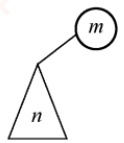

【另解】设n和m的最近公共祖先p，则有以下可能:

(a)

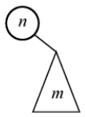

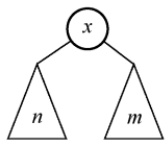

(b)

(c)

情形1，m和 n分别在p的左右（右左）分支上；情形2，m或n为p结点，另一结点在 $p$的分支上。只有n和 m分别处于p的左右分支上，m为祖先结点且 n位于 m的左分支，n为祖先结点且m位于n的右分支，符合题意。

04. D

后序遍历的顺序是LRN，若n在N的左子树上，m在N的右子树上，则在后序遍历的过程中 n在m之前访问；若n是 m的子孙，设 m在N的位置，则n无论是在m的左子树还是在右子树，在后序遍历的过程中n都在m之前访问。其他都不可以。选项C要成立，就需加上两个结点位于同一层这个条件。

05. C

在二叉树的数组存储结构中，下标为i的结点的左右孩子的下标分别为2i+1和2i+2（若存在），画出二叉树的形态如下右图所示，则后序遍历序列为 gdbhefca。

06. B

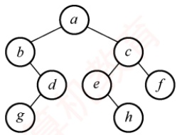

三种遍历方式中，访问左右子树的先后顺序是不变的，只是访问根结点的顺序不同，因此叶结点的先后顺序完全相同。此外，读者可以采用特殊值法，画一个结点数为3的满二叉树，采用三种遍历方式来验证答案的正确性。

07. C

对每个顶点从1开始按序编号，要求结点编号大于其左右孩子编号，并且左孩子编号小于右孩子编号。编号越大说明遍历顺序越靠后，因此，三者遍历顺序为先左子树、再右子树、后根结点。4个选项中仅后序遍历满足要求。

08. B

结点ν的编号比其左子树上的最小编号还小，而ν的右子树中的最小编号大于ν的左子树中的最大编号，因此ν的编号比其左右子树上的所有编号都小，显然是按先序遍历次序。

09. D

先序为A、B、C的不同二叉树共有5种，其中后序为C、B、A的有4种（前4种），都是单支树，如下图所示。

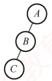

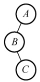

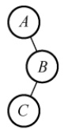

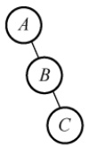

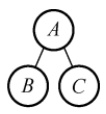

10. C

7个结点的完全二叉树是一棵3层的满二叉树，画出相应二叉树的树形，根据后序遍历序列填入相应的结点，得到相应的完全二叉树，求得其先序遍历序列为ABCDEFG。

11. C

二叉树的先序遍历为NLR，后序遍历为LRN。根据题意，在先序序列中X在Y之前，在后序序列中X在Y之后，若设X在根的位置，Y在其左子树或右子树中，即满足要求。

12. C

先序序列是…a… b…，因此a和b结点的3种情况如下图(a)～(c)所示。中序序列是… b…a…，因此 a和 b结点的3种情况如下图(d)～(f)所示，相同部分是b在 a的左子树中。

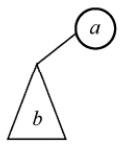

(a)

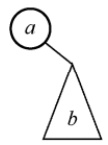

(b)

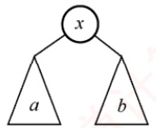

(c)

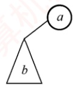

(d)

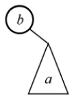

(e)

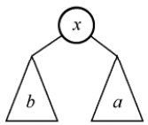

(f)

13. B

解法1:由题可知，1为根结点，2为1的孩子。对于选项A，3应为1的左孩子，先序序列应为13…，不符题意。类似地，选项C也是错误的。对于选项B，2为1的右孩子，3为2的右孩子………满足题意。对于选项D，463572应为1的右子树，2为1的右孩子，46357为2的左子树，3为2的左孩子，46为3的左子树，57为3的右子树，先序序列4、6应相连，5、7应相连，不符题意。

解法2:先序遍历时需要借助栈。二叉树的先序序列和中序序列的关系相当于以先序序列作为入栈次序，以中序序列作为出栈次序。题中以1234567入栈；对于选项A，第一个出栈的是3，所以1不可能在2之前出栈，错误。对于选项C，1不可能在3之前出栈，错误。对于选项D，6第三个出栈，此时栈顶元素是5，不是3，错误。选项B正确。

解法3:因先序序列和中序序列可以确定一棵二叉树，所以可试着用题目中的序列构造出相应的二叉树，即可得知，只有选项B的序列可以构造出二叉树。

14. D

先序序列为NLR，后序序列为LRN，虽然可以唯一确定树的根结点，但无法划分左右子树。例如，先序序列为AB，后序序列为BA，则其对应的二叉树如右图所示。

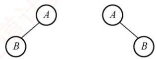

15. B

中序遍历是“左根右”，后序遍历是“左右根”，当任一结点没有右子树时，两种遍历都是“左根”。显然，当二叉树为空树或只有根结点时，其中序序列和后序序列也相同。

16. D

根据后序序列与中序序列可构造出二叉树，如下图所示。由图可知先序序列为CEDBA。

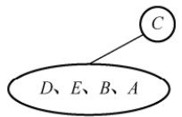

(a) 确定根结点

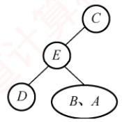

(b)确定左子树根结点

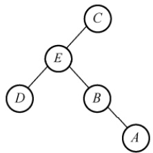

(c)确定剩下的子树

17. A

对于这种遍历序列问题，先根据遍历的性质排除若干项，若还无法确定答案，则再根据遍历结果得到二叉树，找到对应遍历序列。例如，在本题中，已知先序和中序遍历结果，可知本树的根结点为A，左子树有C和B，其余为右子树，则后序遍历结果中，A一定在最后，并且C和B一定在前面，排除选项B和D。又因先序中有DEF，中序中有EDF，则D为这个子树的根，所以D在后序中排在EF之后。

根据二叉树的递归定义，要确定二叉树，就要分别找到根结点和左右子树。因此，根据遍历结果，必定要确定根结点位置和如何划分左右子树，才可以确定最终的二叉树。因此，仅有先序和后序遍历不能唯一确定一棵二叉树，而二者之一加上中序遍历都可以唯一确定一棵二叉树。如在本题中，根据先序和中序遍历的结果确定二叉树的过程如下图所示。

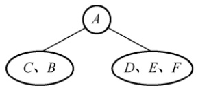

(a) 确定根结点

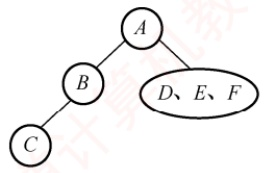

(b) 确定左子树

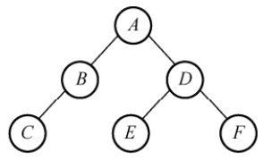

(c) 确定右子树

18. B

可构造出二叉树如下图所示。因此，先序序列为ABCDEF。

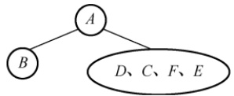

(a) 确定根结点

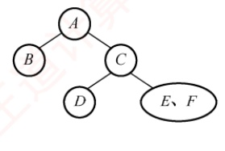

(b)确定右子树的根结点

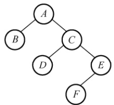

(c) 确定剩下的子树

19. B

先序遍历是根左右，祖先a先于子孙b访问，即 $\mathrm{pre}(a) < \mathrm{pre}(b)$ ，因此选项A一定成立。后序遍历是左右根，子孙b先于祖先a访问，即 $\mathrm {post} ( b ) < \mathrm {post} ( a )$ ，因此选项B一定不成立。中序遍历是左根右，左子树中的子孙先于祖先访问，右子树中的子孙后于祖先访问，因此子孙的编号可能小于祖先的编号，也可能大于祖先的编号，选项C和D都有可能。

20. C

删除一个结点时，需要先递归地删除它的左右孩子，并释放它们所占的存储空间，然后删除该结点，并删除它所占的存储空间，这正好和后序遍历的访问顺序相吻合。

21. B

只要交换T中所有分支结点的左右子树，就能得到一棵中序遍历序列为降序序列的树，而这并不会改变根结点，叶结点也仅仅交换位置，仍是原T中的叶结点，选项C、D错误。交换T中所有分支结点的左右子树，要么先处理根结点，然后递归地处理左右子树，即先序遍历；要么先处理左右子树，然后处理根结点，即后序遍历；中序遍历是不适合的。选项A错误，选项B正确。

22. A

线索是前驱结点和后继结点的指针，引入线索的目的是加快对二叉树的遍历。

23. C

n个结点共有链域指针2n个，其中，除根结点外，每个结点都被一个指针指向。剩余的链域建立线索，共2n−(n−1)=n+1个线索。

24. C

线索二叉树中用1tag/rtag标识结点的左/右指针域是否为线索，其值为1时，对应指针域为线索，其值为0时，对应指针域为左/右孩子。

25. D

对左子树为空的二叉树进行先序线索化，根结点的左子树为空并且也没有前驱结点（先遍历根结点），先序遍历的最后一个元素为叶结点，左右子树均为空且有前驱无后继结点，所以线索化后，树中空链域有2个。

26. D

不是每个结点通过线索都可以直接找到它的前驱和后继。在先序线索二叉树中查找一个结点的先序后继很简单.而杏找先序前驱必须知道该结占的双亲结占。同样. 的先序后继很简单，而查找先序前驱必须知道该结点的双亲结点。同样，

在后序线索二叉树中查找一个结点的后序前驱也很简单，而查找后序后继也必须知道该结点的双亲结点，二叉链表中没有存放双亲的指针。

27. D

后序线索二叉树不能有效解决求后序后继的问题。如右图所示，结点E的右指针指向右孩子，而在后序序列中E的后继结点为B，在查找

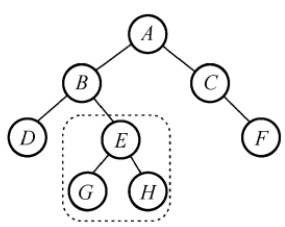

E的后继时仍然只能按常规方法来查找。

28. C

在二叉中序线索树中，某结点若有左孩子，则按照中序“左根右”的顺序，该结点的前驱结点为左子树中最右的一个结点（注意，并不一定是最右叶结点）。

29. A

在二叉树的后序遍历中，叶结点X的后继是其双亲，因此X的右线索应指向该结点。

30. B

非空二叉树的先序序列和后序序列相反，即“根左右”与“左右根”顺序相反，因此树只有根结点，或根结点只有左子树或右子树，其子树也有同样的性质，任意结点只有一个孩子，才能满足先序序列和后序序列正好相反。此时树形应为一个长链，树中仅有一个叶结点。

31. D

非空二叉树的先序序列和中序序列相反，即“根左右”与“左根右”顺序相反，因此树只有根结点，或任意一个结点只有左孩子，此时树形应该是一棵向左倾斜的单支树，这棵单支树只有一个叶结点。但是，只有一个叶结点的二叉树不能保证任意一个结点无右孩子。

32. D

分析遍历后的结点序列，可以看出根结点是在中间被访问的，而且右子树结点在左子树之前，则遍历的方法是RNL。本题考查的遍历方法并不是二叉树遍历的3种基本遍历方法，对于考生而言，重要的是掌握遍历的思想。

33. D

题中所给二叉树的后序序列为dbca。结点d无前驱和左子树，左链域空，无右子树，右链域指向其后继结点 $b ;$ 结点b无左子树，左链域指向其前驱结点 $d ;$ 结点c无左子树，左链域指向其前驱结点b，无右子树，右链域指向其后继结点 a。

34. C

先序序列为NLR，后序序列为LRN，因为先序序列和后序序列刚好相反，所以不可能存在一个结点同时有左右孩子，即二叉树的高度为4。1为根结点，根结点只能有左孩子（或右孩子），因此在中序序列中，1或在序列首或在序列尾，选项A、B、C、D皆满足要求。仅考虑以1的孩子结点2为根结点的子树，它也只能有左孩子（或右孩子），因此在中序序列中，2或在序列首或在序列尾，选项A、B、D皆满足要求。

【另解】画出各选项与题干信息所对应的二叉树如下，所以选项A、B、D均满足。

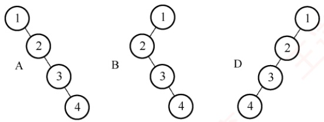

35. A

先序序列和后序序列不能唯一确定一棵二叉树，但可以确定二叉树中结点的祖先关系:当两个结点的先序序列为XY与后序序列为YX时，则X为Y的祖先。考虑先序序列 $a , e , b , d , c_{\mathrm {{}^{\prime}}}$ 后序序列 $b , c , d , e , a$ ，可知a为根结点，e为a的孩子结点；此外，由a的孩子结点的先序序列 $e , b , d ,$ c、后序序列 $b , c , d , e$ ，可知e是 bcd的祖先，所以根结点的孩子结点只有e。

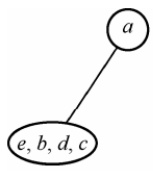

(a)

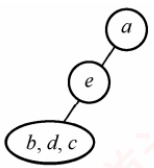

(b)

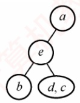

(c)

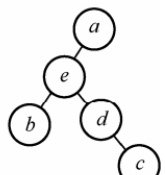

(d)

排除法:显然a为根结点，且确定e为a的孩子结点，排除选项D。各种遍历算法中左右子树的遍历次序是固定的，若b也为a的孩子结点，则在先序序列和后序序列中e、b的相对次序应是不变的，所以排除选项B，同理排除选项C。

特殊法:先序序列和后序序列对应多棵不同的二叉树树形，我们只需画出满足该条件的任意一棵二叉树即可，任意一棵二叉树必定满足正确选项的要求。

显然选择选项A，最终得到的二叉树满足题设中先序序列和后序序列的要求。

**36. A。**

根据后序线索二叉树的定义，X结点为叶结点且有左兄弟，因此这个结点为右孩子结点，利用后序遍历的方式可知X结点的后序后继是其父结点，即其右线索指向的是父结点。为了更加形象，在解题的过程中可以画出如右所示的草图。

37. D

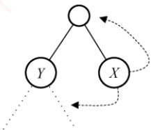

线索二叉树的线索实际上指向的是相应遍历序列特定结点的前驱结点和后继结点，所以先写出二叉树的中序遍历序列debxac，中序遍历中在x左边和右边的字符，就是它在中序线索化的左右线索，即 b, a。

38. B

根据二叉树先序遍历和中序遍历的递归算法中递归工作栈的状态变化得出:先序序列和中序序列的关系相当于以先序序列为入栈次序，以中序序列为出栈次序。因为先序序列和中序序列可以唯一地确定一棵二叉树，所以题意相当于“以序列 $a , \; b , \; c , \; d$ 为入栈次序，则出栈序列的个数为？”，对于n个不同元素入栈，出栈序列的个数为 $\begin{array} {r} {\frac {1} {n + 1} C_{2 n}^{n} = 14 .} \end{array}$

39. B

后序序列先访问左子树，接着访问右子树，最后访问父结点，递归进行。根结点左子树的叶结点首先被访问，它是e。接下来是它的父结点a，然后是a的父结点 $c_{\circ}$ 接着访问根结点的右子树。它的叶结点b首先被访问，然后是b的父结点 $d ,$ 再后是 $d$ 的父结点 $g ,$ 最后是根结点 $f ,$ 如右图所示。因此 $d$ 与a同层，选项B正确。

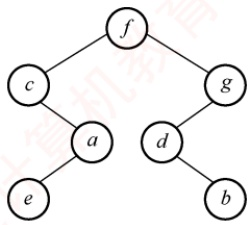

40. B

先序序列先访问父结点，接着访问左子树，然后访问右子树。中序序列先访问左子树，接着访问父结点，然后访问右子树，递归进行。若所有非叶结点只有右子树，则先序序列和中序序列都先访问父结点，后访问右子树，递归进行。

41. B

对于此类题，每种情况只需举出一个反例即可。如图1所示，q是p的双亲，中序遍历序列为 $\{p ,   q \}$ ，说法Ⅰ可能。如图2所示，q是p的右孩子，中序遍历序列为 $\{p ,   q \}$ ，说法Ⅱ可能。如图4所示， $q$ 是 $p$ 的双亲的双亲，中序遍历序列为 $\{x ,   p ,   q \}$ ，说法IV可能。如图3所示， $q$ 是 $p$的右兄弟，F是q和p的父结点，中序遍历要求先遍历左子树，再访问根结点，最后遍历右子树，因此一定先访问p，再访问F，最后访问q，p和q不可能相邻出现，说法Ⅲ不可能。


图1


图2


图3


图4

42. A

根据二叉树的树形和后序遍历序列，可以轻松地将各字母填入结点中，如右图所示。

然后对该二叉树进行先序遍历，得到序列 aedfbc。

43. A


根据中序遍历的特点，ν有左右子树，以ν为根的子树的中序序列为:ν的左子树的中序序列,v,ν的右子树的中序序列。又因为T的中序序列为“…, p, v, ${\bf \Phi} q , \cdots {\bf \Phi}^{\prime \prime}$ 可知p属于ν的左子树，q属于ν的右子树。在ν的左子树的中序序列

中:假设p有右孩子，则p的右孩子在中序序列中应在p之后，与p是最后一个遍历结点矛盾，因此p不存在右孩子。在ν的右子树的中序序列中:假设q存在左孩子，则q的左孩子在中序序列中应在q之前，与q是第一个遍历结点矛盾，因此q不存在左孩子。

#### 二、综合应用题

01.【解答】

二叉树的先序序列是NLR，后序序列是LRN。要使NLR=NRL（后序序列反序）成立，L或R应为空，这样的二叉树每层只有一个结点，即二叉树的形态是其高度等于结点数。以3个结点a, b, c为例，其形态如下图所示。


02. 【解答】

二叉树的先序序列是NLR，后序序列是LRN。要使NLR=LRN成立，L和R均应为空，所以满足条件的二叉树只有一个根结点。

03.【解答】

采用层次遍历的算法，设置变量1evel 记录当前结点所在的层数，设置变量1ast 指向当前层的最右结点，每次层次遍历出队时与1ast指针比较，若两者相等，则层数加1，并让1ast指向下一层的最右结点，直到遍历完成。1eve1的值即二叉树的高度。

算法实现如下:

int Btdepth(BiTree T){//采用层次遍历的非递归方法求解二叉树的高度if(!T) return 0; //树空，高度为0 int front=-1,rear=-1; int last=0,level=0; //1ast 指向当前层的最右结点

```javascript
BiTree Q[MaxSize]; //设置队列Q，元素是二叉树结点指针且容量足够
Q[++rear]=T; //将根结点入队
BiTree p;
while(front<rear) { //队不空，则循环
p=Q[++front]; //队列元素出队，即正在访问的结点
if(p->lchild)
Q[++rear]=p->1child;//左孩子入队
if(p->rchild)
Q[++rear]=p->rchild;//右孩子入队
if(front==last) { //处理该层的最右结点
level++; //层数增1
last=rear; //1ast 指向下层
算机教育
return level;
```

求某层的结点数、每层的结点数、树的最大宽度等，都可采用与此题类似的思想。当然，此题可编写为递归算法，其实现如下:

```c
int Btdepth2(BiTree T){
if(T==NULL)
return 0; //空树，高度为0
1dep=Btdepth2(T->1child); //左子树高度
rdep=Btdepth2(T->rchild); //右子树高度
if (1dep>rdep)
return ldep+1; //树的高度为子树最大高度加根结点
else
return rdep+1;
```

04. 【解答】

根据完全二叉树的定义，具有n个结点的完全二叉树与满二叉树中编号从1\~n的结点一对应。算法思想:采用层次遍历算法，将所有结点加入队列（包括空结点）。遇到空结点时，查看其后是否有非空结点。若有，则二叉树不是完全二叉树。

算法实现如下:

```c
bool IsComplete(BiTree T){
//本算法判断给定二叉树是否为完全二叉树
InitQueue(Q);
if(!T)
return true; //空树为满二叉树 算
EnQueue (Q, T) ;
while(e(ty(){
if (p) { //结点非空，将其左右子树入队列
EnQueue (Q,p->lchild) ;
EnQueue(Q,p->rchild) ;
else //结点为空，检查其后是否有非空结点
while(!IsEmpty(Q)){
DeQueue (Q, p) ;
if (p) //结点非空，则二叉树为非完全二叉树
return false
return true; 道
```

```c

void swap(BiTree b) {
//本算法递归地交换二叉树的左右子树
if(b) {
swap(b->lchild) ; //递归地交换左子树
swap(b->rchild) ; //递归地交换右子树
temp=b->lchild; //交换左右孩子结点
b->lchild=b->rchild;
b->rchild=temp;
```

05.【解答】

计算一棵二叉树b中所有双分支结点数的递归模型f(b)如下:

```txt
f (b) =0 若b=NULL
f (b) =f (b->1child) +f (b->rchild)+1 若*b为双分支结点
f (b) =f (b->1child)+f (b->rchild) 其他情况（*b为单分支结点或叶结点）
```

具体算法实现如下:

```c
int DsonNodes(BiTree b){
if(b==NULL)
return 0;
else if(b->lchild!=NULL&&b->rchild!=NULL) //双分支结点
return DSonNodes (b->lchild) +DsonNodes (b->rchild) +1;
else
return DSonNodes (b->lchild) +DsonNodes (b->rchild) ;
```

当然，本题也可以设置一个全局变量Num，每遍历到一个结点时，判断每个结点是否为分支结点（左右结点都不为空，注意是双分支），若是，则Num++。

06.【解答】

采用递归算法实现交换二叉树的左右子树，首先交换b结点的左孩子的左右子树，然后交换b结点的右孩子的左右子树，最后交换b结点的左右孩子，当结点为空时递归结束（后序遍历的思想）。算法实现如下:

07.【解答】

设置一个全局变量i（初值为1）来表示进行先序遍历时，当前访问的是第几个结点。然后可以借用先序遍历的代码模型，先序遍历二叉树。当二叉树b为空时，返回特殊字符'#'；当k==i时，该结点即要找的结点，返回b->data；当k≠i时，递归地在左子树中查找，若找到则返回该值，否则继续递归地在右子树中查找，并返回其结果。对应的递归模型如下:

```txt
f (b, k) ='#' 当 b=NULL 时
f (b,k) =b->data 当i=k时
f (b,k) =((ch=f(b->lchild,k))=='#'?f (b->rchild,k):ch) 其他情况
管法的应现加下
```

算法的实现如下:

```c
int i=1; //遍历序号的全局变量
ElemType PreNode(BiTree b,int k) {
//本算法查找二叉树先序遍历序列中第k个结点的值
if(b==NULL) //空结点，则返回特殊字符
return '#';
if(i==k) 算 //相等，则当前结点即第k个结点
return b->data;
i++; //下一个结点
ch=PreNode(b->lchild,k) ; //左子树中递归寻找
```

```txt
if(ch!='#')

return ch;
ch=PreNode(b->rchild,k);
return ch;
```

本题实质上就是一个遍历算法的实现，只不过用一个全局变量来记录访问的序号，求其他遍历序列的第k个结点也采用相似的方法。二叉树的遍历算法可以引申出大量的算法题，因此考生务必要熟练掌握二叉树的遍历算法。

08.【解答】

删除以元素值×为根的子树，只要能删除其左右子树，就可以释放值为×的根结点，因此宜采用后序遍历。算法思想:删除值为×的结点，意味着应将其父结点的左（右）孩子指针置空，用层次遍历易于找到某结点的父结点。本题要求删除树中每个元素值为×的结点的子树，因此要遍历完整棵二叉树。算法实现如下:

```c
void DeleteXTree(BiTree &bt) { //删除以 bt 为根的子树
if (bt) {
DeleteXTree(bt->lchild);
DeleteXTree(bt->rchild); //删除bt 的左子树、右子树
free(bt); //释放被删结点所占的存储空间
1
//在二叉树上查找所有以×为元素值的结点，并删除以其为根的子树
void Search(BiTree bt,ElemType x) {
BiTree Q[]; //Q是存放二叉树结点指针的队列，容量足够大
if (bt) {
if (bt->data==x) { //若根结点值为x，则删除整棵树
DeleteXTree(bt);
exit(0);
InitQueue(Q) ;
EnQueue (Q,bt);
while(!IsEmpty(Q)){
DeQueue (Q, p) ;
if(p->lchild) //若左孩子非空
if(p->lchild->data==x) { //左子树符合则删除左子树
DeleteXTree(p->lchild) ;
p->lchild=NULL;
//父结点的左孩子置空
王道计算机教 else
EnQueue(Q,p->lchild) ; //左子树入队列
if(p->rchild) //若右孩子非空
if(p->rchild->data==x) { //右孩子符合则删除右子树
DeleteXTree(p->rchild) ;
p->rchild=NULL;
1 //父结点的右孩子置空
else
EnQueue (Q,p->rchild) ; //右孩子入队列
```

09.【解答】

算法思想:采用非递归后序遍历，最后访问根结点，访问到值为×的结点时，栈中所有元素均为该结点的祖先，依次出栈打印即可。算法实现如下:

```c

typedef struct{
BiTree t;
int tag;
}stack； //tag=0 表示左孩子被访问，tag=1表示右孩子被访问
void Search(BiTree bt,ElemType x) {
//在二叉树bt中，查找值为×的结点，并打印其所有祖先
stack s[]; //栈容量足够大
top=0;
while(bt!=NULL|ltop>0) {
while(bt!=NULL&&bt->data!=x) { //结点入栈
s[++top].t=bt;
s[top].tag=0;
bt=bt->lchild; //沿左分支向下
if(bt!=NULL&&bt->data==x) {
printf("所查结点的所有祖先结点的值为：\n")； ∥/找到x
for(i=1;i<=top;i++)
printf("%d",s[i].t->data); //输出祖先值后结束
王道 exit(1);
while(top!=0&&s[top].tag==1)
top--; //退栈（空遍历）
if(top!=0){
s[top].tag=1;
bt=s[top].t->rchild; 机教育 //沿右分支向下遍历
}/while(bt!=NULLlltop>0)
```

因为查找的过程就是后序遍历的过程，所以使用的栈的深度不超过树的深度。

10. 【解答】

后序遍历最后访问根结点，即在递归算法中，根是压在栈底的。本题要找p和σ的最近公共祖先结点r，不失一般性，设p在g的左边。算法思想:采用后序非递归算法，栈中存放二叉树结点的指针，当访问到某结点时，栈中所有元素均为该结点的祖先。后序遍历必然先遍历到结点p，栈中元素均为p的祖先。先将栈复制到另一辅助栈中。继续遍历到结点g时，将栈中元素从栈顶开始逐个到辅助栈中去匹配，第一个匹配（相等）的元素就是结点p和g的最近公共祖先。算法实现如下:

```c
typedef struct{
BiTree t;
int tag；//tag=0 表示左孩子已被访问，tag=1 表示右孩子已被访问
}stack;
stack s[],s1[]; //栈，容量足够大
BiTree Ancestor(BiTree ROOT,BiTNode *p,BiTNode *q){
//本算法求二叉树中 p 和 q指向结点的最近公共结点
top=0;bt=ROOT;
while(bt!=NULL||top>0) {
while(bt!=NULL) { s[++top].t=bt; 育
s[top].tag=0;
bt=bt->lchild;
1 //沿左分支向下
while(top!=0&&s[top].tag==1) {
//假定p在q的左侧，遇到p时，栈中元素均为p的祖先
if(s[top].t==p) {
for(i=1;i<=top;i++)
```

```c
s1[i]=s[i];

top1=top; 算机教
1 //将栈 s 的元素转入辅助栈 s1 保存
if(s[top].t==q) //找到 q 结点
for(i=top;i>0;i--) {//将栈中元素的树结点到 s1 中去匹配
for(j=top1;j>0;j--)
if(s1[j].t==s[i].t)
return s[il.t；//p 和g 的最近公共祖先已找到
1
top--; //退栈
} ∥while
if(top!=0) {
s[top].tag=1;
bt=s[top].t->rchild; 算机教
//沿右分支向下遍历
} ∥while
return NULL; //p 和 q 无公共祖先
```

11.【解答】

采用层次遍历的方法求出所有结点的层次，并将所有结点和对应的层次放在一个队列中。然后通过扫描队列求出各层的结点总数，最大的层结点总数即二叉树的宽度。算法实现如下:

```javascript
typedef struct{
BiTree data[MaxSize]; //保存队列中的结点指针
int level[MaxSize]; //保存 data 中相同下标结点的层次
int front,rear;
int BTWidth(BiTree b) { }Qu; 算机
BiTree p;
int k,max,i,n;
Qu.front=Qu.rear=-1; 首 //队列为空
Qu.rear++;
Qu.data[Qu.rear]=b; //根结点指针入队
Qu.level[Qu.rear]=1; //根结点层次为1
while(Qu.front<Qu.rear) {
Qu.front++; //出队
p=Qu.data[Qu.front]; //出队结点
k=Qu.level[Qu.front]; //出队结点的层次
if(p->lchild!=NULL) { //左孩子入队
算 Qu.rear++; Qu.data[Qu.rear]=p->lchild;
Qu.level[Qu.rear]=k+1;
1 首
if(p->rchild!=NULL) { //右孩子入队
Qu.rear++;
Qu.data[Qu.rear]=p->rchild;
Qu.level[Qu.rear]=k+1;
}//while
max=0;i=0; //max保存同一层最多的结点数
k=1; //k 表示从第一层开始查找
while(i<=Qu.rear) { //i 扫描队中所有元素
n=0; //n 统计第k层的结点数
while(i<=Qu.rear&&Qu.level[i]==k){
n++;
i++;
```

```javascript
k=Qu.level[i];
if(n>max) max=n; //保存最大的 n
return max;
```

**注意**

本题队列中的结点，在出队后仍需要保留在队列中，以便求二叉树的宽度，所以设置的队列采用非环形队列，否则在出队后可能被其他结点覆盖，无法再求二叉树的宽度。

12. 【解答】

对一般二叉树，仅根据先序或后序序列，不能确定另一个遍历序列。但对满二叉树，任意一个结点的左右子树均含有相等的结点数，同时，先序序列的第一个结点作为后序序列的最后一个结点，由此得到将先序序列pre[11..h1]转换为后序序列post[12..h2]的递归模型如下:

```txt
f(pre,11,h1,post,12,h2)=不做任何事情 h1<11时
f(pre,11,h1,post,12, h2)=post[h2]=pre[11] 其他情况
取中间位置 half=(h1-11)/2;
将pre[11+1,11+half]左子树转换为post[12,12+half-1]，
即f(pre,11+1,11+half,post,12,12+half-1);
将pre[11+half+1,h1]右子树转换为post[12+half,h2-1]，
即f(pre,11+half+1,h1,post,12+half,h2-1)。
```

其中，post[h2]=pre[11]表示后序序列的最后一个结点（根结点）等于先序序列的第一个结点（根结点）。相应的算法实现如下:

```txt
void PreToPost (ElemType pre[],int 11,int h1,ElemType post[],int 12,int h2) {
int half;
if(h1>=11) {
post[h2]=pre[11];
half=(h1-11)/2;
PreToPost(pre,11+1,11+half,post,12,12+half-1); //转换左子树
PreToPost(pre,11+half+1,h1,post,12+half,h2-1); //转换右子树
```

例如，有以下代码:

```txt
ElemType *pre="ABCDEFG";
ElemType post[MaxSize];
PreToPost(pre,0,6,post,0,6) ;
printf("后序序列：")；
for(int i=0;i<=6;i++)
printf("%c",post[i]);
printf("\n");
```

执行结果如下:

```txt
后序序列：C D B F G E A
```

13. 【解答】

通常使用的先序、中序和后序遍历对于叶结点的访问顺序都是从左到右，这里选择中序递归遍历。算法思想:设置前驱结点指针pre，初始为空。第一个叶结点由指针head指向，遍历到叶结点时，就将它前驱的rchild指针指向它，最后一个叶结点的rchild为空。算法实现如下:

```txt
LinkedList head, pre=NULL;
```

//全局变量

```c

LinkedList InOrder(BiTree bt) {
if (bt) {
InOrder(bt->lchild); //中序遍历左子树
if(bt->lchild==NULL&&bt->rchild==NULL) //叶结点
if(pre==NULL){
head=bt;
pre=bt;
//处理第一个叶结点
else {
pre->rchild=bt;
pre=bt;
//将叶结点链入链表
InOrder(bt->rchild); //中序遍历右子树
pre->rchild=NULL; //设置链表尾
return head;
```

上述算法的时间复杂度为 O(n)，辅助变量使用 head 和pre，栈空间复杂度为O(n)。

14.【解答】

本题采用递归的思想求解，若 $T_{1}$ 和 $T_{2}$ 都是空树，则相似；若有一个为空另一个不空，则必然不相似；否则递归地比较它们的左右子树是否相似。递归函数的定义如下:

1）f(T1,T2)=1；若T1==T2==NULL。

2）f(T1，T2)=0；若T1和T2之一为NULL，另一个不为NULL。

```txt
3)f(T1,T2)=f(T1->lchild,T2->lchild)&&f(T1->rchild,T2->rchild);若T1
和 T2 均不为 NULL。
```

因此，算法实现如下:

```c
int similar(BiTree T1,BiTree T2){
//采用递归的算法判断两棵二叉树是否相似
int leftS,rightS;
if(T1==NULL&&T2==NULL) //两棵树皆空
return 1;
else if(T1==NULL|IT2==NULL) //只有一棵树为空
return 0;
else{ //递归判断
leftS=similar(T1->lchild,T2->lchild);
rightS=similar(T1->rchild,T2->rchild);
return leftS&&rightS;
```

15.【解答】

二叉树的带权路径长度有两种常见的计算方法:①根据二叉树的带权路径长度的定义，二叉树的 WPL值 = 树中全部叶结点的带权路径长度之和。②根据带权二叉树的性质，二叉树的WPL值=树中所有非叶结点的权值之和（记住该结论即可，不要求证明）。根据两种常见的计算方法，本题不难写出下列两种解法。

**1）算法的基本设计思想。**

①本问题可采用递归算法实现。根据定义:

```txt
二叉树的 WPL值=树中全部叶结点的带权路径长度之和
= 根结点左子树中全部叶结点的带权路径长度之和+
根结点右子树中全部叶结点的带权路径长度之和
```

叶结点的带权路径长度 = 该结点的 weight 域的值×该结点的深度

设根结点的深度为0，若某结点的深度为d时，则其孩子结点的深度为d+1。

在递归遍历二叉树结点的过程中，若遍历到叶结点，则返回该结点的带权路径长度，否则返回其左右子树的带权路径长度之和。

② 若借用非叶结点的 weight 域保存其孩子结点中 weight 域值的和，则树的 WPL 等于树中所有非叶结点 weight 域值之和。

采用后序遍历策略，在遍历二叉树 T时递归计算每个非叶结点的 weight 域的值，则树 T的 WPL 等于根结点左子树的 WPL加上右子树的 WPL，再加上根结点中 weight 域的值。在递归遍历二叉树结点的过程中，若遍历到叶结点，则return0并且退出递归，否则递归计算其左右子树的WPL和自身结点的权值。

2）二叉树结点的数据类型定义如下。

```txt
typedef struct node{
int weight;
struct node *left,*right;
}BTree;
```

3）算法的代码如下。

①基于方法1的算法实现:

```c
int WPL(BTree *root) //根据WPL的定义采用递归算法实现
return WPL1(root,0);
1
int WPL1(BTree *root,int d) //d 为结点深度
if(root->left==NULL&&root->right==NULL)
return(root->weight*d);
else
return (WPL1(root->left,d+1)+WPL1(root->right,d+1));
```

②基于方法2的算法实现:

```c
int WPL(BTree *root) //基于递归的后序遍历算法实现
int w l,w r;
if(root->left==NULL&&root->right==NULL)
return 0;
else
w l=WPL(root->left); //计算左子树的 WPL
w r=WPL(root->right); //计算右子树的 WPL
root->weight=root->left->weight+root->right->weight;
//填写非叶结点的 weight 域
return (w l+w r+root->weight); //返回 WPL值
```

**注意**

上述两种算法为官方标准答案，当遍历到度为1的结点时，会传入空指针，导致空指针异常。但是，作为408考试的算法题，不要求考虑特殊的边界条件，只要算法思想正确，代码逻辑正确，即可得满分。因此，在复习过程中，无须花过多的时间抠代码的各种边界条件。

16. 【解答】

1）算法的基本设计思想。

表达式树的中序序列加上必要的括号即等价的中缀表达式。可以基于二叉树的中序遍历策略

得到所需的表达式。

表达式树中分支结点所对应的子表达式的计算次序，由该分支结点所处的位置决定。为得到正确的中缀表达式，需要在生成遍历序列的同时，在适当位置增加必要的括号。显然，表达式的最外层（对应根结点）和操作数（对应叶结点）不需要添加括号。

**2）算法实现。**

将二叉树的中序遍历递归算法稍加改造即可得本题的答案。除根结点和叶结点外，遍历到其他结点时在遍历其左子树之前加上左括号，遍历完右子树后加上右括号。

```c
void BtreeToE(BTree *root) {
BtreeToExp(root,1); //根的高度为 1
void BtreeToExp( BTree *root,int deep){
if(root==NULL) return; //空结点返回
else if(root->left==NULL&&root->right==NULL) //若为叶结点
printf("%s", root->data); //输出操作数，不加括号
else {
if(deep>1) printf("("); //若有子表达式则加一层括号
BtreeToExp(root->left, deep+1);
printf("%s", root->data); //输出操作符
BtreeToExp(root->right, deep+1);
if(deep>1) printf(")"); //若有子表达式则加一层括号
1
```

**17. 【解答1】**

**1）算法的基本设计思想。**

对于采用顺序存储方式保存的二叉树，根结点保存在 SqBiTNode[0]中；当某结点保存在SqBiTNode[i]中时，若有左孩子，则其值保存在 SqBiTNode[2i+1]中；若有右孩子，则其值保存在 SqBiTNode[2i+2]中；若有双亲结点，则其值保存在 SqBiTNode[(i-1)/2]中。

二叉搜索树需要满足的条件是:任意一个结点值大于其左子树中的全部结点值，小于其右子树中的全部结点值。中序遍历二叉搜索树得到一个升序序列。

使用整型变量va1记录中序遍历过程中已遍历结点的最大值，初值为一个负整数。若当前遍历的结点值小于或等于val，则算法返回 false，否则，将val的值更新为当前结点的值。

**2）算法实现。**

```c
#define false 0 K
#define true 1
typedef int bool;
bool judgeInOrderBST(SqBiTree bt,int k,int *val) {//初始调用时 k 的值是0
if(k<bt.ElemNum&&bt.SqBiTNode[k]!=-1){
if(!judgeInOrderBST(bt,2*k+1,val)) return false;
if(bt.SqBiTNode[k]<=*val) return false;
*val=bt.SqBiTNode[k];
if(!judgeInOrderBST(bt,2*k+2,val)) return false;
1
return true; 育
```

**【解答2】**

**1）算法的基本设计思想。**

对于采用顺序存储方式保存的二叉树，根结点保存在 SqBiTNode[0]中；当某结点保存在SqBiTNode[i]中时，若有左孩子，则其值保存在SqBiTNode[2i+1]中；若有右孩子，则其值保存在 SqBiTNode[2i+2]中；若有双亲结点，则其值保存在 SqBiTNode[(i-1)/2]中。

二叉搜索树需要满足的条件是:任意一个结点值大于其左子树中的全部结点值，小于其右子树中的全部结点值。设置两个数组 pmax和pmin。根据二叉搜索树的定义，SqBiTNode[i]中的值应该大于以 SqBiTNode[2i+1]为根的子树中的最大值（保存在 pmax[2i+1]中），小于以SqBiTNode[2i+2]为根的子树中的最小值（保存在 pmin[2i+1]中）。初始时，用数组SqBiTNode 中前 ElemNum 个元素的值对数组 pmax 和 pmin 初始化。

在数组 SqBiTNode中从后向前扫描，扫描过程中逐一验证结点与子树之间是否满足上述的大小关系。

**2）算法实现。**

```c
#define false 0
#define true 1
typedef int bool; 算机教育
bool judgeBST(SqBiTree bt) {
int k,m,*pmin,*pmax;
pmin=(int *)malloc(sizeof(int)*(bt.ElemNum));
pmax=(int *)malloc(sizeof(int)*(bt.ElemNum));
for(k=0;k<bt.ElemNum;k++) //辅助数组初始化 自
pmin[k]=pmax[k]=bt.SqBiTNode[k];
for(k=bt.ElemNum-1;k>0;k--) { //从最后一个叶结点向根遍历
if (bt.SqBiTNode[k]!=-1) {
m=(k-1)/2; /双亲
if(k%2==1&&bt.SqBiTNode[m]>pmax[k]) //其为左孩子
pmin[m]=pmin[k];
else if(k%2==0&&bt.SqBiTNode[m]<pmin[k]) //其为右孩子
pmax[m]=pmax[k];
else return false;
return true;
```

### 5.4.4 本节试题精选

#### 一、单项选择题

01.下列关于树的说法中，正确的是（）。I. 对于有n个结点的二叉树，其高度为 $\log_{2}   n$ Ⅱ. 完全二叉树中，若一个结点没有左孩子，则它必是叶结点Ⅲ. 高度为h（h>0）的完全二叉树对应的森林所含的树的个数一定是h IV. 一棵树中的叶子数一定等于与其对应的二叉树的叶子数
A. I和III
B. IV
C. I和ⅡI
D. ⅡI

02.利用二叉链表存储森林时，根结点的右指针是（）。 道
A. 指向最左兄弟
B. 指向最右兄弟
C. 一定为空
D. 不一定为空

03. 设森林F中有3棵树，第1、2、3棵树的结点数分别为 $M_{1},M_{2}$ 和 $M_{3} ,$ ，与森林F对应的二叉树根结点的右子树上的结点数是（）。
A. $M_{1}$
B. $M_{1} + M_{2}$
C. $M_{3}$
D. $M_{2} + M_{3}$

04. 设森林 F中有4 棵树，第1、2、3、4 棵树的结点数分别为 a、b、c和 $d ,$ 与森林F对应的二叉树的根结点的左子树上的结点数是（）。
A. a
B. $b + c + d$
C. a − 1
D. $a + b + c$

05. 设森林 F对应的二叉树为 B，它有 m 个结点，B 的根为 p，p 的右子树结点数为 n，森林F中第一棵树的结点数是（）。

A. m−n
B. m−n−1
C. n + 1
D. 条件不足，无法确定

06. 设森林F对应的二叉树是一棵具有16个结点的完全二叉树，则森林F中树的数目和结点最多的树的结点数分别是（）。
A. 2 和8
B. 2和9
C. 4和8
D. 4和9

07. 森林 $T = (T_1, T_2, \cdots, T_m)$ 转化为二叉树BT的过程为:若m=0，则BT为空，若 $m \neq 0$则（）。
A. 将中间子树 $T_{mid} ( mid  = (1 + m)/2)$ 的根作为BT的根；将 $(T_1, T_2, \cdots, T_{\mathrm{mid}-1})$ 转换为 BT的左子树；将 $(T_{\mathrm{mid}+1}, \cdots, T_m)$ 转换为BT的右子树
B. 将子树 $T_{1}$ 的根作为 BT 的根；将 $T_{1}$ 的子树森林转换成BT的左子树；将 $(T_{2}, T_{3}, \cdots, T_{m})$转换成BT的右子树
C. 将子树 $T_{1}$ 的根作为 BT的根；将 $T_{1}$ 的左子树森林转换成BT的左子树；将 $T_{1}$ 的右子树森林转换为BT的右子树；其他以此类推
D. 将森林 T的根作为 BT 的根；将 $( T_{1} , \; T_{2} , \cdots , \; T_{m} )$ 转化为该根下的结点，得到一棵树，然后将这棵树再转化为二叉树BT

08. 设F是一个森林，B 是由F变换来的二叉树。若F中有n个非终端结点，则B 中右指针域为空的结点有（）个。
A. n-1
B. n
C. n+1
D. n + 2

09. 设某树的孩子兄弟链表示中共有6个空的左指针域、7个空的右指针域，包括5个结点的左右指针域都为空，则该树中叶结点的个数是（）。
A. 7
B. 6
C. 5
D. 不能确定

10. 若 $T_{1}$ 是由有序树T转换而来的二叉树，则T中结点的后根序列就是 $T_{1}$ 中结点的（）序列。
A. 先序
B. 中序
C. 后序
D. 层序

11. 某二叉树结点的中序序列为 BDAECF，后序序列为 DBEFCA，则该二叉树对应的森林包括（）棵树。
A. 1
B. 2
C. 3
D. 4

12. 设X是树T中的一个非根结点，B 是T所对应的二叉树。在 B 中，X是其双亲结点的右孩子，下列结论中正确的是（）。
A. 在树T中，X是其双亲结点的第一个孩子
B. 在树T中，X一定无右边兄弟 计算机教
C. 在树 T中，X一定是叶结点
D. 在树T中，X一定有左边兄弟

13. 右图是一棵逻辑上的树T，则在关于该树的存储结构的叙述中，错误的是（）。
A. 若T采用双亲表示法，则有9个指向双亲的指针
B. 若T采用孩子表示法，则在T中查找某个结点的孩子比双亲表示法更方便
C. 若T采用孩子兄弟表示法，则在T中查找某个结点的双亲的时间复杂度为O(1)
D. 双亲表示法是顺序存储结构，孩子表示法和孩子兄弟表示


14. 在森林的二叉树表示中，结点M和结点N是同一父结点的左孩子和右孩子，则在该森林中（）。

A. M和N有同一双亲
B. M和N可能无公共祖先
C. M是N的孩子
D. M是N的左兄弟

15.【2009统考真题】将森林转换为对应的二叉树，若在二叉树中，结点u是结点ν的父结点的父结点，则在原来的森林中，u和ν可能具有的关系是（）。I. 父子关系 Ⅱ. 兄弟关系 . u的父结点与ν的父结点是兄弟关系
A. 只有Ⅱ
B. Ⅰ和Ⅱ
C. I和III
D. I、ⅡI和III

16. 【2011 统考真题】已知一棵有2011个结点的树，其叶结点数为116，该树对应的二叉树中无右孩子的结点数是（）。
A. 115
B. 116
C. 1895
D. 1896

17.【2014统考真题】将森林F转换为对应的二叉树T，F中叶结点的个数等于（）。
A. T中叶结点的个数
B. T 中度为 1 的结点数
C. T中左孩子指针为空的结点数
D. T中右孩子指针为空的结点数

18.【2019统考真题】若将一棵树T转化为对应的二叉树BT，则下列对BT的遍历中，其遍历序列与T的后根遍历序列相同的是（）。
A. 先序遍历
B. 中序遍历
C. 后序遍历
D. 按层遍历

19. 【2020 统考真题】已知森林F 及与之对应的二叉树 T，若 F的先根遍历序列是 a, b, c, d, $e , f ,$ 后根遍历序列是 $b , a , d , f , e , c ,$ 则 T的后序遍历序列是（）。
A. $b , a , d , f , e , c$
B. $b , d , f , e , c , a$
C. $b , f , e , d , c , a$
D. $[ f , e , d , c , b , a$

20. 【2021统考真题】某森林F对应的二叉树为T，若T的先序遍历序列是 $a , b , d , c , e , g , f ,$中序遍历序列是 $b , d , a , e , g , c , f ,$ 则F中树的棵数是（）。
A. 1
B. 2
C. 3
D. 4

21.【2025统考真题】下列关于二叉树及森林的叙述中，正确的是（）。
A. 完全二叉树中不存在度为1的结点
B. 任意一个森林都可以转换为一棵二叉树
C. 二叉树的分支结点数比叶结点数少
D. 表达式树的根中保存的是最先计算的运算符

#### 二、综合应用题

01. 给定一棵树的先根遍历序列和后根遍历序列，能否唯一确定一棵树？若能，请举例说明；若不能，请给出反例。

02.将下面一个由3棵树组成的森林转换为二叉树。


03. 已知某二叉树的先序序列和中序序列分别为ABDEHCFIMGJKL 和 DBHEAIMFCGKLJ，请画出这棵二叉树，并画出二叉树对应的森林。

04. 编程求以孩子兄弟表示法存储的森林的叶结点数。

05. 以孩子兄弟链表为存储结构，请设计递归算法求树的深度。

### 5.4.5 答案与解析

#### 一、单项选择题

01. D

若n个结点的二叉树是一棵单支树，则其高度为n。完全二叉树中最多存在一个度为1的结点且只有左孩子，若不存在左孩子，则一定也不存在右孩子，因此必是叶结点，说法Ⅱ正确。只有满二叉树才具有性质Ⅲ，如下图所示。


(a) 满二叉树转化为对应的森林


(b) 非满二叉树转化为对应的森林

在树转换为二叉树时，若有几个叶结点具有共同的双亲，则转换成二叉树后只有一个叶结点（最右边的叶结点），如下图所示，说法IV错误。注意，若树中的任意两个叶结点都不存在相同的双亲，则树中的叶子数才有可能与其对应的二叉树中的叶子数相等。


02. D

森林与二叉树具有对应关系，因此，我们存储森林时应先将森林转换成二叉树，转换的方法就是“左孩子右兄弟”，与树不同的是，若存在第二棵树，则二叉链表的根结点的右指针指向的是森林中的第二棵树的根结点。若此森林只有一棵树，则根结点的右指针为空。因此，右指针可能为空也可能不为空。

03. D

与树转换为二叉树不同，森林中的每棵树是独立的，因此先要将每棵树的根结点全部视为兄弟结点的关系。森林转换为二叉树后，树2作为树1的根结点的右子树，树3作为树2的根结点的右子树，因此森林F对应的二叉树根结点的右子树上的结点数是 $M_{2} + M_{3}$

04. C

森林转换为二叉树后，二叉树的根结点为第1棵树的根结点，二叉树的根结点的左子树包含第1棵树的所有孩子，因此森林F对应的二叉树的根结点的左子树上的结点数是a−1。

05. A

森林转换成二叉树时采用孩子兄弟表示法，根结点及其左子树为森林中的第一棵树。右子树为其他剩余的树。所以，第一棵树的结点数为m-n。

06. D

森林转换为二叉树后，二叉树的根结点及其左子树由第1棵树转换得到，二叉树的根结点的右子树由剩余的森林转换得到，以此类推，可以划分出第2,3,…棵树的结点。具有16个结点的完全二叉树的形态如右图所示，沿二叉树的根结点往右下遍历，共有4个结点，可知森林中有4棵树，其中第1棵树的结点数最多，


有9个。

07. B

将森林中每棵树的根结点视为兄弟结点的关系，再按照“左孩子右兄弟”的规则来进行转化。

08. C

根据森林与二叉树转换规则“左孩子右兄弟”。二叉树B中右指针域为空代表该结点没有兄弟结点。森林中每棵树的根结点从第二个开始依次连接到前一棵树的根的右孩子，因此最后一棵树的根结点的右指针为空。另外，每个非终端结点，其所有孩子结点在转换之后，最后一个孩子的右指针也为空，所以树B中右指针域为空的结点有n+1个。

09. B

在树的孩子兄弟表示法中，若一个结点没有孩子（叶结点），则表现为该结点的左指针域为空，因此本题答案为“6”。至于“5个结点的左右指针域都为空”，表示树中有5个结点既没有孩子又没有右兄弟，约束条件比题中的“求叶结点的个数”要求更严格。

10. B

有序树T转换成二叉树 $T_{1}$ 时，T的后根序列是对应 $T_{1}$ 的中序序列还是后序序列呢（显然树的后根序列不可能对应二叉树的先序序列和层序序列）？看右图所示的例子，在树T中，叶结点

B应最先访问，在 $T_{1}$ 中，B的右兄弟C转换为它的右孩子，若对应 $T_{1}$ 的后序序列，则C应在B的前面访问，所以T的后根序列不可能对应 $T_{1}$ 的后序序列。


11. C

根据二叉树的先序序列和中序序列可以确定一棵二叉树。根据后序序列，A是二叉树的根结点。根据中序序列，二叉树的形态如下图(a)所示。对于A的左子树，根据后序序列，B比D后被访问，因此B必为D的父结点，又根据中序序列，D是B的右孩子。对于A的右子树，同理可确定结点E、C、F的关系。此二叉树的形态如下图(b)所示。


(a)


(b)

再根据二叉树与森林的对应关系，森林中树的棵数即其对应二叉树（向右上旋转 $45^{\circ}$ 后）的根结点A及其右兄弟数，或解释为:对应二叉树从根结点A开始不断往右孩子访问，所访问到的结点数。可知此森林中有3棵树，根结点分别为A、C和F。

12. D

在二叉树B中，X是其双亲的右孩子，因此在树T中，X必是其双亲结点的右兄弟，换句话说，X在树中必有左兄弟。

13. C

若T采用双亲表示法存储，则除根结点外，其余每个结点都有指向其双亲的指针，T共有10个结点，于是有9个指向双亲的指针，选项A正确。若T采用孩子表示法存储，则每个结点的孩子被视为一个线性表，且以单链表作为存储结构，只要遍历该单链表，就能找到某个结点的所有孩子，而双亲表示法要寻找某个结点的孩子，就必须遍历整棵树，选项B正确。若T采用孩子兄弟表示法，则在T中查找某个结点的双亲也必须遍历整棵树，时间复杂度为O(n)，选项C错误。选项D显然正确。

14. B

在森林的二叉树表示中，当M和N的父结点是二叉树根结点时，M和N在不同的树上。因此M和N可能无公共祖先。

15. B

森林与二叉树的转换规则为“左孩子右兄弟”。在最后生成的二叉树中，父子关系在对应森林关系中可能是兄弟关系或者原本就是父子关系。

说法I:若结点ν是结点u的第二个孩子结点，转换时，结点ν就变成结点μ第一个孩子的右孩子，符合要求。说法Ⅱ:结点u和ν是兄弟结点的关系，但二者之中还有一个兄弟结点k，则转换后结点ν就变为结点k的右孩子，而结点k则是结点u的右孩子，符合要求。


图I


图Ⅱ

说法Ⅲ:若结点u的父结点与ν的父结点是兄弟关系，则转换后，结点μ和ν分别在两者最左父结点的两棵子树中，不可能出现在同一条路径中。


图Ⅲ


【另解】由题意可知μ是ν的父结点的父结点，如下图所示，有四种情况:


(1)


(2)


(3)


(4)

根据树与二叉树的转换规则，将这四种情况转换成树中结点的关系。（1）在原来的树中μ是ν的父结点的父结点；（2）在树中u是ν的父结点；（3）在树中u是ν的父结点的兄弟；（4）在树中u与ν是兄弟关系。由此可知说法Ⅰ和Ⅱ正确。

16. D

树转换为二叉树时，树的每个分支结点的所有子结点中的最右子结点无右孩子，根结点转换后也没有右孩子，因此，对应二叉树中无右孩子的结点数=分支结点数 $+ 1 = 2011 - 116 + 1 = 1896$

通常本题应采用特殊法求解，设题意中的树是如右图所示的结构，则对应的二叉树中仅有前115个叶结点有右孩子，所以无右孩子的结点数 $2011 - 115 = 1896$


17. C

将森林转化为二叉树相当于用孩子兄弟表示法来表示森林。在变化过程中，原森林某结点的第一个孩子结点作为它的左子树，它的兄弟作为它的右子树。森林中的叶结点没有孩子结点，转化为二叉树时，该结点就没有左结点，因此F中叶结点的个数等于T中左孩子指针为空的结点数。此题还可通过一些特例来排除选项A、B和D。

18. B

后根遍历树可分为两步:①从左到右访问双亲结点的每个孩子（转化为二叉树后，先访问根结点，再访问右子树）；②访问完所有孩子后，再访问它们的双亲结点（转化为二叉树后，先访问左子树，再访问根结点），因此树的后根遍历序列与其相应二叉树的中序遍历序列相同。对于此类题，采用特殊值法求解通常会更便捷，左下图树T转换为二叉树BT的过程如下图所示，树的后序遍历序列显然和其相应二叉树的中序遍历序列相同，均为5,6,7,2,3,4,1.


19. C

森林F的先根遍历序列对应于其二叉树T的先序遍历序列，森林F的后根遍历序列对应于其二叉树T的中序遍历序列。即T的先序遍历序列为 $a , b , c , d , e , f ,$ 中序遍历序列为 $b , a , d , f , e , c \circ$根据二叉树T的先序序列和中序序列可以唯一确定它的结构，构造过程如下:


可以得到二叉树T的后序序列为 $b , f , e , d , c , a \circ$

20. C

由二叉树T的先序序列和中序序列可以构造出T，如右图所示。由森林转化成二叉树的规则可知，森林中每棵树的根结点以右子树的方式相连，所以T中的结点a、c、f为F中树的根结点，森林F中有3棵树。

21. B

完全二叉树中至多存在一个度为1的结点（最后一个非叶结点仅当总结点数为偶数时出现），选项A错误。根据“左孩子右兄弟”表示法，


任意森林均可唯一地转换为一棵二叉树，即将每棵树的根视为兄弟，各树内部按左孩子、右兄弟关系重构，选项B正确。在任意非空二叉树中，叶结点数 $n_{0}$ 等于度为2的结点数 $n_{2}$ 加1。但分支结点包括度为1和度为2的结点，其总数不一定少于叶结点数。例如，一条单支二叉树中，叶结点仅1个，而分支结点有n-1个，远多于叶结点。选项C错误。表达式树的结构体现运算优先级，根结点对应最后执行的运算符，而非最先计算的。最先计算的操作位于最深层的子树中，选项D错误。

#### 二、综合应用题

01. 【解答】

一棵树的先根遍历结果与其对应二叉树的先序遍历结果相同，树的后根遍历结果与其对应二叉

树表示的中序遍历结果相同。二叉树的先序序列和中序序列能够唯一地确定这棵二叉树，因此，根据题目给出的条件，利用树的先根遍历序列和后根遍历序列能够唯一地确定这棵树。例如，对于右图所示的树，对应二叉树的先序序列为1,2,3,4,5,6,8,7，中序序列为3,4,8,6,7,5,2,1。原树的先根遍历序列为1,2,3. 4,5,6,8,7，后根遍历序列为3,4,8,6,7,5,2,1。


注意

树的先根遍历、后根遍历与对应二叉树的先序遍历、中序遍历对应。

02.【解答】

根据树与二叉树“左孩子右兄弟”的转换规则，将森林转换为二叉树的过程如下:①将每棵树的根结点也视为兄弟关系，在兄弟结点之间加一连线。②对每个结点，只保留它与第一个子结点的连线，与其他子结点的连线全部抹掉。③以树根为轴心，顺时针旋转45°。结果如下图所示。


03. 【解答】

知道二叉树的先序和中序遍历后，可以唯一确定这棵树的结构。然后把二叉树转换到树和森林的方式是，若结点x是双亲y的左孩子，则把x的右孩子、右孩子的右孩子………都与y用连线连起来，最后去掉所有双亲到右孩子的连线。

得到的二叉树及对应的森林如下图所示。


04.【解答】

当森林（树）以孩子兄弟表示法存储时，若结点没有孩子（fch=NULL），则它必是叶子，总的叶结点数是孩子子树（fch）上的叶子数和兄弟子树（nsib）上的叶结点数之和。

算法代码如下:

```c
typedef struct node
1
ElemType data; //数据域
struct node *fch,*nsib; //孩子与兄弟域
}*Tree;
int Leaves(Tree t) { //计算以孩子兄弟表示法存储的森林的叶子数
if(t==NULL)
return 0; //树空返回0
if(t->fch==NULL) ∥若结点无孩子，则该结点必是叶子
return 1+Leaves(t->nsib); //返回叶结点和其兄弟子树中的叶结点数
else /孩子子树和兄弟子树中叶子数之和
return Leaves (t->fch) +Leaves(t->nsib);
```

05.【解答】

由孩子兄弟链表表示的树，求高度的算法思想:采用递归算法，若树为空，高度为零；否则，高度为第一个孩子树高度加1和兄弟子树高度的大者。其非递归算法使用队列，逐层遍历树，取得树的高度。算法代码如下: XTOT

```c
int Height(CSTree bt){
//递归求以孩子兄弟链表表示的树的深度
int hc,hs;
if(bt==NULL)
return 0;
else{//否则，高度取孩子高度+1 和兄弟子树高度的大者
hc=Height(bt->firstchild); //第一个孩子树高
hs=Height(bt->nextsibling); //兄弟树高
if(hc+1>hs)
return hc+1;
else
return hs ;
```

### 5.5.3 本节试题精选

#### 一、单项选择题

01. 在有n个叶结点的哈夫曼树中，非叶结点的总数是（）。X
A. n-1
B. n
C. 2n-1
D. 2n

02. 给定整数集合{3,5,6,9,12}，与之对应的哈夫曼树是（）。


A.


B.


C.


D.

03.下列编码中，（）不是前缀码。
A. {00, 01, 10, 11} 道
B. {0, 1, 00, 11}
C. {0, 10, 110, 111}
D. {10, 110, 1110, 1111}

04. 设哈夫曼编码的长度不超过4，若已对两个字符编码为1和01，则还最多可对（）个字符编码。
A. 2
B. 3
C. 4
D. 5

05.一棵哈夫曼树共有215个结点，对其进行哈夫曼编码，共能得到（）个不同的码字。
A. 107
B. 108
C. 214
D. 215 X

06. 设某哈夫曼树有5个叶结点，则该哈夫曼树的高度最高可以是（）。
A. 3
B. 4
C. 5
D. 6

07.以下对于哈夫曼树的说法中，错误的是（）
A. 用一组权值构造出的哈夫曼树可能不唯一，但带权路径长度唯一
B. 哈夫曼树具有最小的带权路径长度
C. 哈夫曼树中没有度为1的结点
D. 哈夫曼树中除了度为1的结点，还有度为2的结点和叶结点

08.下列关于哈夫曼树的说法中，错误的是（）。I. 哈夫曼树的总结点数不能是偶数I. 哈夫曼树中度为1的结点数等于度为2和0的结点数之差Ⅲ. 哈夫曼树的带权路径长度等于其所有分支结点的权值之和
A. 仅Ⅲ
B. I和Ⅱ
C. 仅Ⅱ
D. I、ⅡI和III

09. 若度为m的哈夫曼树中，叶结点数为n，则非叶结点的个数为（）。
A. n−1
B. Ln/m−1
C. [(n−1)/(m−1)]
D. [n/(m−1)]−1

10. 并查集的结构是一种（）。
A. 二叉链表存储的二叉树 直
B. 双亲表示法存储的树
C. 顺序存储的二叉树
D. 孩子表示法存储的树

11. 并查集中最核心的两个操作是:①查找，查找两个元素是否属于同一个集合；②合并，若两个元素不属于同一个集合，且所在的两个集合互不相交，则合并这两个集合。假设初始长度为10（0\~9）的并查集，按1-2、3-4、5-6、7-8、8-9、1-8、0-5、1-9的顺序进行查找和合并操作，最终并查集共有（）个集合。
A. 1
B. 2
C. 3
D. 4机

12.下列关于并查集的说法中，正确的是（）（注，本题涉及图的考点）
A. 并查集不能检测图中是否存在环路的问题I
B. 通过路径优化后的并查集在最坏情况下的高度仍是O(n)
C. Find操作返回集合中元素个数的相反数，它用来作为某个集合的标志
D. Union操作时可根据当前集合的规模，将小集合合并到大集合中

13.下列关于并查集的叙述中，（）是错误的（注意，本题涉及图的考点）
A. 并查集是用双亲表示法存储的树
B. 并查集可用于实现克鲁斯卡尔算法
C. 并查集可用于判断无向图的连通性
D. 在长度为 n的并查集中进行查找操作的时间复杂度为 O(log2n

14. 【2010统考真题】n（n≥2）个权值均不相同的字符构成哈夫曼树，关于该树的叙述中，错误的是（）。
A. 该树一定是一棵完全二叉树
B. 树中一定没有度为1的结点
C. 树中两个权值最小的结点一定是兄弟结点
D. 树中任意一个非叶结点的权值一定不小于下一层任意一个结点的权值 育

15.【2014统考真题】5个字符有如下4种编码方案，不是前缀编码的是（）
A. 01,0000,0001,001,1
B. 011,000,001,010,1
C. 000,001,010,011,100
D. 0,100,110,1110,1100

16.【2015统考真题】下列选项给出的是从根分别到达两个叶结点路径上的权值序列，能属于同一棵哈夫曼树的是（）。
A. 24, 10, 5 和 24, 10, 7
B. 24,10, 5 和 24, 12, 7
C. 24, 10, 10 和 24, 14, 11
D. 24, 10, 5 和 24, 14, 6

17. 【2017 统考真题】已知字符集{a, b, c, d, e,f g, h}，各字符的哈夫曼编码依次是 0100, 10, 0000,0101,001,011,11,0001，编码序列0100011001001011110101的译码结果是（）。
A. acgabfh
B. adbagbb
C. afbeagd
D. afeefgd

18. 【2018 统考真题】已知字符集{a, b, c, d, e, f}，若各字符出现的次数分别为 6,3,8,2, 10, 4，则对应字符集中各字符的哈夫曼编码可能是（）。
A. 00, 1011, 01, 1010, 11, 100
B. 00, 100, 110, 000, 0010, 01
C. 10, 1011, 11, 0011, 00, 010
D. 0011, 10, 11, 0010, 01, 000

19. 【2019统考真题】对n个互不相同的符号进行哈夫曼编码。若生成的哈夫曼树共有115个结点，则n的值是（）。
A. 56
B. 57
C. 58
D. 60

20. 【2021统考真题】若某二叉树有5个叶结点，其权值分别为10，12,16,21,30，则其最小的带权路径长度（WPL）是（）
A. 89
B. 200
C. 208
D. 289

21. 【2022统考真题】对任意给定的含 $n ( n > 2 )$ 个字符的有限集S，用二叉树表示S的哈夫曼编码集和定长编码集，分别得到二叉树 $T_{1}$ 和 $T_{2}$ 。下列叙述中，正确的是（）
A. $T_{1}$ 与 $T_{2}$ 的结点数相同
B. $T_{1}$ 的高度大于 $T_{2}$ 的高度 0
C. 出现频次不同的字符在 $T_{1}$ 中处于不同的层 机教
D. 出现频次不同的字符在 $T_{2}$ 中处于相同的层

22. 【2023统考真题】在由6个字符组成的字符集S中，各字符出现的频次分别为3,4,5，6,8,10，为S构造的哈夫曼编码的加权平均长度为（）。
A. 2.4
B. 2.5
C. 2.67
D. 2.75

23.【2025统考真题】设字符集S中包含7个字符，各字符出现的频次分别为2,3,4,6,8,10, 11。现为S中的各字符构造哈夫曼编码，编码长度不小于3的字符数是（）。
A. 2
B. 3
C. 4
D. 5

#### 二、综合应用题

01. 设给定权集 w = {5, 7,2, 3,6,8,9}，试构造关于 w 的一棵哈夫曼树，并求其加权路径长度WPL。

02. 【2012 统考真题】设有 6 个有序表 A, B, C, D, E, F，分别含有 10, 35, 40, 50, 60 和 200个数据元素，各表中的元素按升序排列。要求通过5次两两合并，将6个表最终合并为1个升序表，并使最坏情况下比较的总次数达到最小。请回答下列问题:1）给出完整的合并过程，并求出最坏情况下比较的总次数。2）根据你的合并过程，描述 $n (n \geqslant 2)$ 个不等长升序表的合并策略，并说明理由。

03.【2020统考真题】若任意一个字符的编码都不是其他字符编码的前缀，则称这种编码具有前缀特性。现有某字符集（字符个数≥2）的不等长编码，每个字符的编码均为二进制的0、1序列，最长为L位，且具有前缀特性。请回答下列问题:1）哪种数据结构适宜保存上述具有前缀特性的不等长编码？ 算机2）基于你所设计的数据结构，简述从0/1串到字符串的译码过程。3）简述判定某字符集的不等长编码是否具有前缀特性的过程。

### 5.5.4 答案与解析

#### 一、单项选择题

01. A

由哈夫曼树的构造过程可知，哈夫曼树中只有度为0和2的结点。在非空二叉树中，有 $n_{0} =$ $n_{2} + 1$ ，所以 $n_{2}   =   n   -   1$ 0

【另解】n个结点构造哈夫曼树需要n-1次合并过程，每次合并新建一个分支结点，所以选择选项A。

02. C

首先，3和5构造为一棵子树，其根权值为8，然后该子树与6构造为一棵新子树，根权值

为14，再后9与12构造为一棵子树，最后两棵子树共同构造为一棵哈夫曼树。

03. B

若没有一个编码是另一个编码的前缀，则称这样的编码为前缀编码。在选项B中，0是00的前缀，1是11的前缀。

04. C

在哈夫曼编码中，一个编码不能是任何其他编码的前缀。3位编码可能是001，对应的4位

编码只能是0000和0001。3位编码也可能是000，对应的4位编码只能是0010和0011。若全采用4位编码，则可以为0000,0001,0010和0011。题中问的是最多，所以选择选项C。

【另解】若哈夫曼编码的长度只允许小于或等于4，则哈夫曼树的高度最高是5，已知一个字符编码为1，另一个字符编码为01，这说明第二层和第三层各有一个叶结点，为使得该树从第3层起能够对尽可能多的字符编码，余下的二叉树应该是满二叉树，如右图所示，底层可以有4个叶结点，最多可以再对4个字符编码


05. B

根据上题的结论，叶结点数为 $( 215 + 1 ) / 2 = 108$ ，所以共有108个不同的码字。

【另解】在哈夫曼树中只有度为0和2的结点，结点总数 $n = n_{0} + n_{2}$ ，且 $n_{0} = n_{2} + 1$ ，由题知$n = 215, \quad n_0 = 108$ 0

06. C

在哈夫曼树的构造中，每个初始结点最终都成为叶结点，5个初始结点构造的哈夫曼树共新建4个双分支结点，4个双分支结点所构成的高度最高的哈夫曼树如右图所示，其高度为5。

07. D


在哈夫曼树的构造过程中，每次选根的权值最小的两棵树，一棵作为左子树，一棵作为右子树，生成新的二叉树，新的二叉树根的权值应为其左右两棵子

树根结点权值的和。至于谁做左子树，谁做右子树，没有限制，所以构造的哈夫曼树是不唯一的，但其带权路径长度是最小的和唯一的。哈夫曼树只有度为0和2的结点，度为0的结点是外结点，带有权值，没有度为1的结点。

08. C

由n个初始结点构造的哈夫曼树，会新建n -1个双分支结点，因此总结点数为 $2 n   -   1$ ，必为奇数，说法Ⅰ正确。哈夫曼树中没有度为1的结点，说法Ⅱ错误。哈夫曼的带权路径长度有两种计算方法:①所有叶结点的带权路径长度之和；②所有分支结点的权值之和，说法Ⅲ正确。

09. C

一棵度为m的哈夫曼树应只有度为0和 m的结点，设度为m的结点有 $n_{m}$ 个，度为0的结点有$n_{0}$ 个，又设结点总数为N， $N = n_{0} + n_{m}$ ，因N个结点的哈夫曼树有N-1条分支，则 $m n_{m} = N - 1 = n_{m} +$ $n_{\mathrm {0}}   -   1$ ，整理得 $(m - 1)n_{m} = n_{0} - 1,\ n_{m} = (n_{0} - 1)/(m - 1)$ 。

10. B

并查集的存储结构是用双亲表示法存储的树，主要是为了方便两个重要的操作。

11. C

初始时，0～9各自成一个集合。查找1-2时，合并{1}和{2}；查找3-4时，合并{3}和{4}；

查找5-6时，合并{5}和{6}；查找7-8时，合并{7}和{8}；查找8-9时，合并{7，8}和{9}；查找1-8时，合并{1,2}和{7,8,9}；查找0-5时，合并{0}和{5,6}；查找1-9时，它们属于同一个集合。最终的集合为{0,5,6}、{1,2,7,8,9}和{3,4}，因此答案选择选项C。

12. D

依次探测图的各条边，用并查集检查该边依附的两个顶点是否已属于同一集合（两个顶点的根结点是否相同）。若是，则说明图中存在环路，选项A错误。经过路径优化后，并查集在最坏情况下的高度远小于O(n)，选项B错误。Finα操作总返回当前根结点作为集合的标志，选项C错误。

13. D

在用并查集实现Kruskal算法求图的最小生成树时:判断是否加入一条边之前，先查找这条边关联的两个顶点是否属于同一个集合（判断加入这条边之后是否形成回路），若形成回路，则继续判断下一条边；若不形成回路，则将该边和边对应的顶点加入最小生成树T，并继续判断下条边，直到所有顶点都已加入最小生成树T。选项B正确。用并查集判断无向图连通性的方法:遍历无向图的边，每遍历到一条边，就把这条边连接的两个顶点合并到同一个集合中，处理完所有边后，只要是相互连通的顶点都会被合并到同一个子集合中，相互不连通的顶点一定在不同的子集合中。选项C正确。未做路径优化的并查集在最坏情况下的高度为n，此时查找操作的时间复杂度为O(n)，时间复杂度通常指最坏情况下的时间复杂度。选项D错误。

14. A

哈夫曼树为带权路径长度最小的二叉树，不一定是完全二叉树。哈夫曼树中没有度为1的结点，选项B正确。构造哈夫曼树时，最先选取两个权值最小的结点作为左右子树构造一棵新的二叉树，选项C正确。哈夫曼树中任意一个非叶结点的权值为其左右子树根结点的权值之和，可知，哈夫曼树中任意一个非叶结点的权值一定不小于下一层任意一个结点的权值。

15. D

前缀编码的定义是在一个字符集中，任何一个字符的编码都不是另一个字符编码的前缀。选项D中的编码110是编码1100的前缀，违反了前缀编码的规则，所以选项D不是前缀编码。

16. D

在哈夫曼树中，左右孩子权值之和为父结点权值。仅以分析选项A为例:若两个10分别属于两棵不同的子树，则根的权值不等于其孩子的权值和，不符；若两个10属同棵子树，则其权值不等于其两个孩子（叶结点）的权值和，不符。选项B、C选项的排除方法相同。

17. D

哈夫曼编码是前缀编码，各个编码的前缀不同，因此直接拿编码序列与哈夫曼编码一一比对即可。序列可分割为0100011001001011110101，译码结果是afeefgd。选项D正确。

18. A

根据各字符出现的次数构造的哈夫曼树如右图所示。由图可知，a、c和e的编码长度应该相同；a和c的第1个编码应该相同，且与e的第1个编码不同；b和d的前3个编码应该相同。

19. C

n个符号构造成哈夫曼树的过程中，共新建了n-1个结点（双分支结点），因此哈夫曼树的结点总数为2n-1=115，n的值为 58。


20. B

对于带权值的结点，构造出哈夫曼树的带权路径长度（WPL）最小，哈夫曼树的构造过程如下图所示。求得其 $\mathrm{WPL}=(10+12)\times3+(30+16+21)\times2=200$ 0


21. D

第二步


可以画一个简单的特例来证明。图1是满足条件的二叉树 $T_{1}$ ，图2是满足条件的二叉树 $T_{2}$结点中有值表示这个结点是编码字符。 $T_{1}$ 和 $T_{2}$ 的结点数不同，选项A错误。 $T_{1}$ 的高度等于 $T_{2}$ 的高度，选项B错误。出现频次不同的字符在 $T_{1}$ 中也可能处于相同的层，选项C错误。对于定长编码集，所有字符一定都在 $T_{2}$ 中处于相同的层，而且都是叶结点。


图1


图2

22. B

构建哈夫曼树的过程如下图所示。


对叶结点的哈夫曼编码，共有4个长度为3的叶结点、2个长度为2的叶结点，编码的加权平均长度为 $\left[ (3+4+5+6) \times 3+(8+10) \times 2 \right] / (3+4+5+6+8+10) = 2.5$ 0

23. D

哈夫曼编码的编码长度等于该字符在哈夫曼树中的路径深度（从根到该叶结点的边数）。一个字符所在子树参与后续合并的轮数越多，其深度越大。合并过程如下:①合并2和3→新结点 $5 ;$ ②合并4和5→新结点$9 ; \textcircled{3}$ 合并6和8→新结点14；④合并9和10→新结点19；⑤合并11和14→新结点25；⑥合并19和25→根结点44。最终构建的哈夫曼树如右图所示。因此，编码长度不小于3的字符为4、2、3、6、8，共5个。


#### 二、综合应用题

01.【解答】

根据哈夫曼树的构造方法，每次从森林中选取两个根结点值最小的树合并成一棵树，将原先的两棵树作为左右子树，且新根结点的值为左右孩子关键字之和。构造过程如下图所示。


由构造出的哈夫曼树可得 $\mathrm{WPL}=(2+3)\times4+(5+6+7)\times3+(8+9)\times2=108$

**注意**

哈夫曼树并不唯一，但带权路径长度一定是相同的。

02. 【解答】

1）最先合并的表中的元素在后续的每次合并中都会再次参与比较因此求最小合并次数类似于求最小带权路径长度，此时可立即想到哈夫曼树。根据哈夫曼树的构造过程，每次选择表集合中长度最小的两个表进行合并。6个表的合并顺序如右图所示。根据图中的哈夫曼树，6个序列的合并过程如下:

①在表集合{10,35,40,50,60,200}中，选择表A与表B合并，生成含45个元素的表AB。


②在表集合{40,45,50,60,200}中，将表 AB 与表C 合并，生成含85 个元素的表ABC。

③在表集合{50,60,85,200}中，表D与表E合并，生成含110个元素的表DE。

④在表集合{85,110,200}中，表 ABC与表DE合并，生成含195个元素的表 ABCDE。

⑤当前表集合为{195,200}，表ABCDE与表F合并，生成含395 个元素的表ABCDEF。因为合并两个长度分别为m和n的有序表，最坏情况下需要比较 $m + n - 1$ 次，所以最坏情况下比较的总次数计算如下:

第1次合并:最多比较次数=10+35-1=44。

第2次合并:最多比较次数=40+45-1=84。

第3次合并:最多比较次数=50+60-1=109。

第4次合并:最多比较次数=85+110-1=194。

第5次合并:最多比较次数=195+200-1=394。

比较的总次数最多为 44+84 +109+194+394= 825。

2）各表的合并策略是:对多个有序表进行两两合并时，若表长不同，则最坏情况下总的比较次数依赖于表的合并次序。可以借助哈夫曼树的构造思想，依次选择最短的两个表进行合并，此时可以获得最坏情况下的最佳合并效率。

03. 【解答】

1）使用一棵二叉树保存字符集中各字符的编码，每个编码对应于从根开始到达某叶结点的一条路径，路径长度等于编码位数，路径到达的叶结点中保存该编码对应的字符。

2）从左至右依次扫描0/1串中的各位。从根开始，根据串中当前位沿当前结点的左子指针或右子指针下移，直到移动到叶结点时为止。输出叶结点中保存的字符。然后从根开始重复这个过程，直到扫描到0/1串结束，译码完成。

3）二叉树既可用于保存各字符的编码，又可用于检测编码是否具有前缀特性。判定编码是否具有前缀特性的过程，也是构建二叉树的过程。初始时，二叉树中仅含有根结点，其左子指针和右子指针均为空。

依次读入每个编码C，建立/寻找从根开始对应于该编码的一条路径，过程如下:

对每个编码，从左至右扫描C的各位，根据C的当前位（0或1）沿结点的指针（左子指针或右子指针）向下移动。当遇到空指针时，创建新结点，让空指针指向该新结点并继续移动。沿指针移动的过程中，可能遇到三种情况:

①若遇到了叶结点（非根），则表明不具有前缀特性，返回。

②若在处理C的所有位的过程中，均没有创建新结点，则表明不具有前缀特性，返回。

③若在处理C的最后一个编码位时创建了新结点，则继续验证下一个编码。

若所有编码均通过验证，则编码具有前缀特性。
