# 第5章 树与二叉树

> 来源：27王道《数据结构》高清带书签.pdf（已清理水印、广告与 OCR 噪声）

**【考纲内容】**

（一）树的基本概念

（二）二叉树

二叉树的定义及其主要特征；二叉树的顺序存储结构和链式存储结构；

二叉树的遍历；线索二叉树的基本概念和构造


**（三）树、森林**

树的存储结构；森林与二叉树的转换；树和森林的遍历

（四）树与二叉树的应用

哈夫曼（Huffman）树和哈夫曼编码；并查集及其应用；堆及其应用

**【知识框架】**

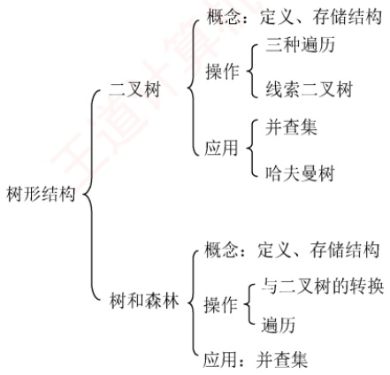

**【复习提示】**

本章内容主要以选择题和综合题形式考查，统考中也可能出现与树遍历相关的算法题。树与二叉树的基本性质、遍历操作、相互转换、存储结构及操作特性，以及满二叉树、完全二叉树、线索二叉树和哈夫曼树的定义与性质，均为选择题的高频考点。

## 5.1 树的基本概念

### 5.1.1 树的定义

树是 $n (n \geqslant 0)$ 个结点的有限集。当n=0时，称为空树。在任意一棵非空树中必须满足:

1）有且仅有一个特定的结点称为根结点。

2）当n>1时，其余结点可分为 $m (m > 0)$ 个互不相交的有限集 $T_{1} ,   T_{2} , \cdots ,   T_{m}$ ，其中每个集合本身又是一棵树，称为根的子树。

显然，树的定义是递归的一—在定义中引用了自身，因此树是一种典型的递归数据结构。作为一种逻辑结构，树同时也是一种分层结构，具有以下两个特征:

1）根结点没有前驱，除根结点外的每个结点有且仅有一个前驱。

2）所有结点均可拥有零个或多个后继。

树适用于表示具有层次结构的数据。除根结点外，树中任一结点最多只与上一层的一个结点（其父结点）存在直接关联；根结点则无上层结点。因此，在包含n个结点的树中，恰好存在n-1条边。同时，每个结点可与其下一层的零个或多个结点（其孩子结点）建立直接联系。

### 5.1.2 基本术语

下面结合图5.1中的树来说明一些基本术语和概念。

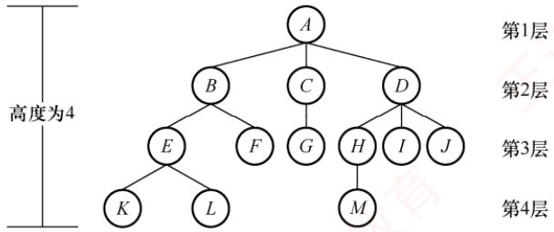

图 5.1 树的树形表示

1）祖先、子孙、双亲、孩子、兄弟和堂兄弟。

考虑结点K，从根A到结点K的唯一路径上所经过的所有其他结点，称为K的祖先。例如，结点B是K的祖先，而K是B的子孙；B的子孙包括E,F,K,L。该路径上最接近K的结点E称为K的双亲，K则是E的孩子。根结点A是树中唯一没有双亲的结点。具有相同双亲的结点互为兄弟，如K与L的双亲均为E，故K与L为兄弟。若两个结点的双亲位于同一层，则它们互为堂兄弟，如G与E,F,H,I,J互为堂兄弟。

2）结点的层次、深度和高度。

结点的层次从根开始定义:根为第1层，其孩子为第2层，以此类推。结点的深度即为其所在的层次。树的高度（或深度）是树中结点的最大层数。而结点的高度是指以其为根的子树的高度。图5.1中树的高度为4。

3）结点的度和树的度。

树中一个结点的孩子个数称为该结点的度；树中所有结点的度的最大值称为树的度。例如，结点B的度为2，结点D的度为3，因此该树的度为3。

4）分支结点和叶结点。

度大于0的结点称为分支结点（也称非终端结点）；度为0（无孩子）的结点称为叶结点（也称终端结点）。在分支结点中，每个结点的分支数即为其度。

5）有序树和无序树。

若树中各结点的子树从左到右具有固定次序、不可互换，则称为有序树；否则称为无序树。假设图5.1为有序树，若交换某结点的子结点位置，则得到一棵不同的树。

6）路径和路径长度。

树中两个结点之间的路径是由从一个结点到另一个结点所经过的结点序列构成的，路径长度则是该路径上边的数目。

7）森林。

**考点追踪森林中树的数量、边数和结点数的关系（2016）**

森林是 $m (m \geqslant 0)$ 棵互不相交的树的集合。森林与树的概念密切相关:将树的根结点移除后，其各子树构成一个森林；反之，若为m棵独立的树添加一个新结点，并将其作为这m棵树的共同根，则森林便转化为一棵树。

**注意**

上述概念无须死记硬背，结合实例理解即可。考研通常不会直接考查定义，而是融入具体题目中综合考查。做题时若遇到不熟悉的概念，可随时查阅；随着练习增多，自然能够熟练掌握。

### 5.1.3 树的性质

树具有如下基本性质:

考点追踪树中结点数和度数的关系分析（2010、2016）

1）树的结点数n等于所有结点的度数之和加1。

结点与其每个孩子都有唯一的边相连，因此树中所有结点的度数之和等于边数；又因除根结点外每个结点均有唯一双亲，故结点数n等于边数加1，即所有结点的度数之和加1。

2）度为m的树中，第i层上至多有 $m^{i - 1}$ 个结点（i≥1）。第1层至多有1个结点（根结点）；第2层至多有m个结点；第3层至多有 $m^{2}$ 个结点，以此类推。通过数学归纳法可以证明，第i层至多有 $m^{i - 1}$ 个结点。

3）高度为h的 m叉树至多有 $(m^h - 1)/(m - 1)$ 个结点。当各层结点数达到最大时，树中至多有 $1+m+m^{2}+\cdots+m^{h-1}=(m^{h}-1)/(m-1)$ 个结点。

**考点追踪指定结点数的三叉树的最小高度分析（2022）**

4）度为m、具有n个结点的树的最小高度h为 $\log_{m} ( n ( m - 1 ) + 1 ) ] .$

要使高度最小，树应尽可能饱满，即前h-1层每层的结点数均达到最大值。前h-1层最多有 $( m^{h - 1} - 1 ) / ( m - 1 )$ 个结点，前h层最多有 $( m^{h} - 1 ) / ( m - 1 )$ 个结点。因此， $( m^{h - I} - 1 ) / ( m - 1 ) < n$ $\leqslant \left( m^{h} - 1 \right) / (m - 1)$ 即 $h - 1 < \log_{m}(n(m - 1) + 1) \leq h$ ，解得 $h_{\min} = \left\lceil \log_{m}(n(m - 1) + 1) \right\rceil$

5）度为m、具有n个结点的树的最大高度h为 $n   -   m   +   1$

树的度为m，因此至少有一个结点有m个孩子，它们处于同一层。为使树的高度最大，其他层可仅有一个结点，因此最大高度（层数）为 $n   -   m   +   1$ 。由此，也可逆推出高度为h、度为 m的树至少包含 $h + m - 1$ 个结点。

## 5.2 二叉树的概念

### 5.2.1 二叉树的定义及其主要特性

#### 1．二叉树的定义

二叉树是一种特殊的树形结构，其核心特征在于:每个结点至多拥有两棵子树（不存在度大于2的结点），且这两棵子树具有明确的左右之分，其次序是固定的，不可交换。

与树类似，二叉树也以递归的方式定义。二叉树是包含 $n (n \geqslant 0)$ 个结点的有限集合:

①或者为空二叉树，即 $n   =   0$

②或者由一个根结点以及两棵互不相交的被称为根的左子树和右子树构成，且左右子树本身也均为二叉树。

二叉树属于有序树。即使某个结点仅有一棵子树，也要区分它是左子树还是右子树；若交换某结点的左右子树，则会得到另一棵不同的二叉树。二叉树的5种基本形态如图5.2所示。

(a) 空二叉树

(b) 只有根结点

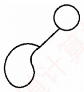

(c) 只有左子树

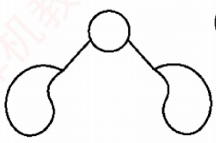

(d) 左右子树都有

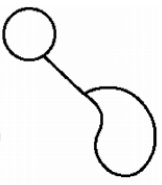

(e) 只有右子树

图 5.2 二叉树的 5 种基本形态

注意，二叉树与度为2的有序树有本质区别

①度为2的树至少包含3个结点，而二叉树可以为空。

②在度为2的有序树中，若某结点只有一个孩子，则无须区分左右次序（因为左右关系是相对于另一个孩子而言的）；而在二叉树中，无论结点是否拥有两个孩子，其子树的左右位置都是确定且不可省略的，这种次序并非相对概念，而是结构本身的固有属性。

#### 2．几种特殊的二叉树

1）满二叉树。一棵高度为h且包含2-1个结点的二叉树称为满二叉树，即每一层都含有该层所能容纳的最大结点数，如图5.3(a)所示。满二叉树的所有叶结点均位于最下一层，且除叶结点外，其余每个结点的度均为2。

可对满二叉树按层序进行编号:约定根结点编号为1，自上而下，自左向右依次编号。在此编号规则下，对于编号为i的结点，若其存在双亲，则双亲编号为i/2]；若存在左孩子，则左孩子编号为2i；若存在右孩子，则右孩子编号为2i+1。

**考点追踪完全二叉树的特性（2009、2011、2018、2025）**

2）完全二叉树。高度为h且包含n个结点的二叉树，当且仅当其每个结点与高度为h的满二叉树中编号为1～n的结点一一对应时，称为完全二叉树，如图5.3(b)所示。

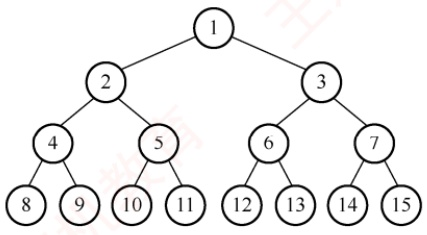

(a) 满二叉树

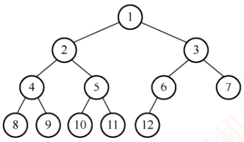

(b) 完全二叉树

图5.3 两种特殊形态的二叉树

3）二叉排序树。其左子树上所有结点的关键字均小于根结点的关键字；右子树上所有结点的关键字均大于根结点的关键字，且左子树和右子树本身也各是一棵二叉排序树。

4）平衡二叉树。树中任意一个结点的左子树和右子树的高度之差的绝对值不超过1。关于二叉排序树和平衡二叉树的详细介绍，见本书第7.3节。

考点追踪正则k叉树树高和结点数的关系的应用（2016）

5）正则二叉树。树中每个分支结点均有2个孩子，即树中仅有度为0或2的结点。

#### 3．二叉树的性质

考点追踪二叉树中结点数的关系（2025）

1）非空二叉树的叶结点数等于度为2的结点数加1，即 $n_{0}   =   n_{2} + 1$

设度为0,1和2的结点数分别为 $n_{\mathrm {0}} , n_{\mathrm {1}}$ 和 $n_{2} ,$ 结点总数 $n = n_{0} + n_{1} + n_{2}$ 0

再考虑二叉树中的分支数，除根结点外，其余结点都有一个分支进入，设B为分支总数，则 $n   =   B   +   1$ 。这些分支是由度为1或2的结点射出的，因此有 $B = n_{1} + 2n_{2}$

由此得出 $n_{0}+n_{1}+n_{2}=n_{1}+2n_{2}+1$ ，从而得出 $n_{0} = n_{2} + 1$ 0

**注意**

该性质在选择题中经常出现，希望读者牢记并灵活应用。

2）非空二叉树的第k层最多有 $2^{k - 1}$ 个结点 $(k \geq 1)$

例如，第1层最多有 $2^{1 - 1}   =   1$ 个结点（根），第2层最多有 $2^{2 - 1} = 2$ 个结点，以此类推，这构成一个首项为1、公比为2的等比数列，通项为 $2^{k - 1}$

3）高度为h的二叉树至多有 $2^{h}   -   1$ 个结点 $(h \geqslant 1)$

该性质可通过性质2求前h项的和得到，即等比数列求和的结果。

**注意**

性质 2 和 3 可拓展到 m叉树的情况，即 m叉树的第 k 层最多有 $m^{k - 1}$ 个结点，高度为 h的 m叉树至多有 $( m^{h}   -   1 ) / ( m   -   1 )$ 个结点。

4）对完全二叉树按从上到下、从左到右的顺序依次编号 $1,2,\cdots,n,$ 则有以下关系:

① 最后一个分支结点的编号为 $\lfloor n / 2 \rfloor$ ，若 $i \leq \lfloor n / 2 \rfloor$ ，则结点i为分支结点，否则为叶结点。

②叶结点只可能出现在最后两层上（相当于在相同高度的满二叉树的最底层、最右侧减少一些连续叶结点；当减少两个及以上叶结点时，次底层将出现叶结点）。

③若存在度为1的结点，则最多只可能有一个，且该结点只有左孩子而无右孩子（度为1的分支结点只可能是最后一个分支结点，其结点编号为 $\lfloor n / 2 \rfloor )$ )。

④按层序编号后，一旦某个结点i为叶结点或仅有左孩子，则所有编号大于i的结点均为叶结点（与上述结论①和结论③一致）。

⑤若n为奇数，则每个分支结点都有左右孩子；若n为偶数，则编号最大的分支结点（编号为n/2）只有左孩子，没有右孩子，其余分支结点都有左右孩子。

⑥当i> 1时，结点i的双亲结点的编号为 $[ i / 2 ]$

⑦若结点i有左右孩子，则左孩子编号为2i，右孩子编号为 $2 i + 1$

⑧结点i所在层次（深度）为 $\lfloor \log_{2} i \rfloor + 1$

5）具有n个 $( n > 0 )$ 结点的完全二叉树的高度为 $\left\lceil \log_{2} ( n + 1 ) \right\rceil$ 或 $\left\lfloor \log_{2}n \right\rfloor + 1$

设高度为h，根据性质3和完全二叉树的定义有

$$
2^{h - 1} - 1 < n \leq 2^h - 1 \quad  或者  \quad 2^{h - 1} \leq n \leq 2^h
$$

得出 $2^{h - 1} < n + 1 \leq 2^h$ ，即 $h - 1 < \log_{2}(n + 1) \leq h$ ，因为h为正整数，所以 $h = \left\lceil \log_{2}(n + 1) \right\rceil$或者得出 $h - 1 \leq \log_{2}n < h$ ，所以 $h = \left\lfloor \log_{2} n \right\rfloor + 1$

### 5.2.2 二叉树的存储结构

#### 1．顺序存储结构

二叉树的顺序存储是指使用一组连续的存储单元，按照自上而下、自左至右的层序，依次存储完全二叉树中的结点元素。即将编号为i的结点存储在一维数组下标为i-1的位置中。

依据二叉树的性质，完全二叉树和满二叉树特别适合采用顺序存储，其结点编号能够唯一反映结点之间的逻辑关系，既能最大限度地节省存储空间，又可直接通过数组下标快速确定结点在二叉树中的位置及其父子、兄弟关系。

**考点追踪二叉树的顺序存储结构相关应用（2020、2025）**

然而，对于一般的二叉树，若仍想通过数组下标反映逻辑结构，则需插入若于“空结点”，使其结构与同高度的完全二叉树一致，再将所有结点（包括空结点）按层序存入数组，这种做法在最坏情况下效率极低。例如，一个高度为h且仅有h个结点的单支树，却需要占用近 $2^{h}   -   1$ 个存储单元。图5.4展示了二叉树的顺序存储结构，其中用0表示空结点。

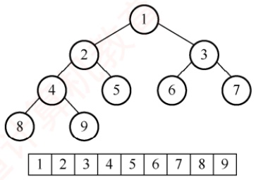

(a)完全二叉树的顺序存储结构

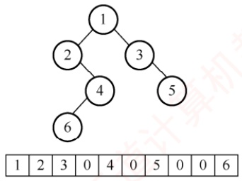

(b)一般二叉树的顺序存储结构

图 5.4 二叉树的顺序存储结构

**注意**

建议从数组下标1开始存储树中结点，保证数组下标与结点编号一致。

#### 2．链式存储结构

由于顺序存储的空间利用率较低，二叉树通常采用链式存储结构，即使用链表结点来存储二叉树中的每个结点。在二叉树的链式存储中，每个结点通常包括若干数据域和指针域。二叉链表至少包含3个域:左指针域1child、数据域data 和右指针域rchild，如图5.5所示。

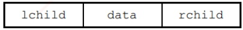

图 5.5 二叉树链式存储的结点结构

图5.6展示了一棵二叉树及其对应的二叉链表。在实际应用中，还可根据需要扩展结点结构，例如增加指向父结点的指针域，从而形成三叉链表的存储结构。

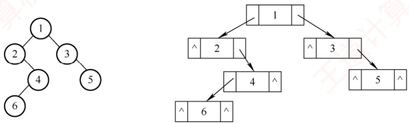

图 5.6 二叉链表的存储结构

二叉树的链式存储结构可定义如下:

```txt
typedef struct BiTNode{
ElemType data; //数据域
struct BiTNode *lchild,*rchild; //分别指向左右孩子的指针
}BiTNode,*BiTree;
```

不同的存储结构会导致二叉树操作算法的实现不同，因此应根据实际应用场景（如二叉树的

形态特征及所需执行的运算类型）选择合适的存储方式。

容易验证，在含有n个结点的二叉链表中，共有n+1个空链域（重要结论），常出现在选择题中。下一节将利用这些空链域构造一种新的链表结构——线索链表。

## 5.3 二叉树的遍历和线索二叉树

### 5.3.1 二叉树的遍历

二叉树的遍历是指按照某种搜索路径访问树中的每个结点，使得每个结点均被访问一次且仅被访问一次。由于二叉树是一种非线性结构，每个结点最多有两棵子树，因此需要确定一种系统性的访问顺序，将树中结点排列成一个线性序列，以便于后续处理。 0

考点追踪二叉树遍历的相关分析（2009、2011、2012）

考点追踪（算法题）二叉树遍历的应用（2014、2017、2022）

根据二叉树的递归定义，遍历一棵二叉树的关键在于确定对根结点（N）、左子树（L）和右子树（R）的访问顺序。在遵循“先左后右”的原则下，常见的遍历方式有三种:先序遍历（NLR）、中序遍历（LNR）和后序遍历（LRN），其中“序”指的是根结点在遍历序列中的位置。

#### 1．先序遍历（PreOrder）

若二叉树为空，则不执行任何操作；否则，

1）访问根结点；

2）先序遍历左子树；

3）先序遍历右子树。

图 5.7 中的虚线表示对该二叉树进行先序遍历的访问路径，所得先序遍历序列为124635。

对应的递归算法如下:

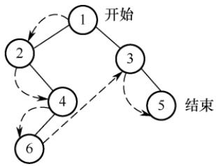

图 5.7 二叉树的先序遍历

```txt

void PreOrder(BiTree T){
if(T!=NULL) {
visit(T); //访问根结点
PreOrder(T->lchild) ; //递归遍历左子树
PreOrder(T->rchild) ; //递归遍历右子树
道
```

#### 2．中序遍历（InOrder）

若二叉树为空，则不执行任何操作；否则，

1）中序遍历左子树；

2）访问根结点；

3）中序遍历右子树。

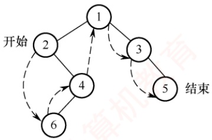

**考点追踪中序序列中结点关系的分析（2017、2024）**

图5.8中的虚线表示对该二叉树进行中序遍历的访问路径，所得中序遍历序列为264135。

图 5.8 二叉树的中序遍历

对应的递归算法如下:

```txt
void InOrder(BiTree T){
if(T!=NULL) {
InOrder(T->lchild); //递归遍历左子树
visit(T); //访问根结点
InOrder(T->rchild); //递归遍历右子树
```

#### 3．后序遍历（PostOrder）

若二叉树为空，则不执行任何操作；否则，

1）后序遍历左子树；

2）后序遍历右子树；

3）访问根结点。

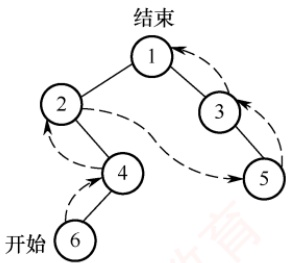

图5.9中的虚线表示对该二叉树进行后序遍历的访问路径，所得后序遍历序列为642531。

对应的递归算法如下:

图 5.9 二叉树的后序遍历

```c
void PostOrder(BiTree T) {
if(T!=NULL) {
PostOrder(T->lchild); //递归遍历左子树
道 PostOrder(T->rchild); //递归遍历右子树
visit(T); //访问根结点
2
```

上述三种遍历算法中，递归遍历左右子树的顺序都是固定的，区别仅在于访问根结点的时机

不同。不论采用哪种遍历方法，每个结点都被访问一次且仅一次，时间复杂度均为O(n)。在递归实现中，系统工作栈的深度等于树的高度，在最坏情况下（如单支树），空间复杂度为O(n)。

#### 4．层次遍历

图5.10展示了二叉树的层次遍历过程，即按照1,2,3,4的层次顺序，以及箭头所指方向，从上到下、从左到右逐层访问二叉树中的各结点。

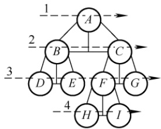

图 5.10 二叉树的层次遍历

层次遍历需要借助一个队列，其基本思想如下:首先将根结点入队，随后不断出队并访问队头结点，同时将其存在的左右孩子依次加入队尾，直至队列为空。

**二叉树的层次遍历算法如下:**

```c
void LevelOrder(BiTree T) {
InitQueue(Q) ; 道 //初始化辅助队列
BiTree p;
EnQueue (Q,T) ; //将根结点入队
while(!IsEmpty(Q)){ //队列不空则循环
DeQueue(Q, p); //队头结点出队
visit(p); //访问出队结点
if(p->lchild!=NULL)
EnQueue(Q,p->lchild); //若左孩子不空，则左孩子入队
if(p->rchild!=NULL)
算 EnQueue(Q,p->rchild) ; //若右孩子不空，则右孩子入队
```

读者可将上述层次遍历算法作为一个模板，熟练掌握其执行过程，并达到熟练手写的程度。

**注意**

遍历是二叉树各类操作的基础。例如，对于一棵给定二叉树，求结点的双亲、查找孩子结点、计算树的深度、统计叶结点数、判断两棵二叉树是否相同等操作，本质上都是在某种遍历过程中完成的。因此，必须深入理解并灵活运用各种遍历方法，以解决实际问题。

#### 5．由遍历序列构造二叉树

考点追踪先序序列对应的不同二叉树的分析（2015）

对于一棵给定的二叉树，其先序序列、中序序列、后序序列和层序序列都是唯一确定的。然而，仅凭这四种遍历序列中的任意一种，却无法唯一确定这棵二叉树。但若已知中序序列，并辅以其他三种遍历序列中的任意一种，则可以唯一地重构出该二叉树。

**（1）由先序序列和中序序列构造二叉树**

考点追踪先序序列和中序序列相同时确定的二叉树（2017）

**考点追踪由先序序列和中序序列构造一棵二叉树（2020、2021）**

在先序序列中，第一个结点必定是整棵二叉树的根结点；而在中序遍历中，根结点将中序序列划分为两个子序列:左侧子序列为左子树的中序序列，右侧子序列为右子树的中序序列。由于左右子树的结点数在先序和中序序列中一致，因此可据此从先序序列中分离出左右子树各自的先序子序列，如图5.11所示。通过递归地对左右子树重复上述过程，即可唯一地确定整棵二叉树。

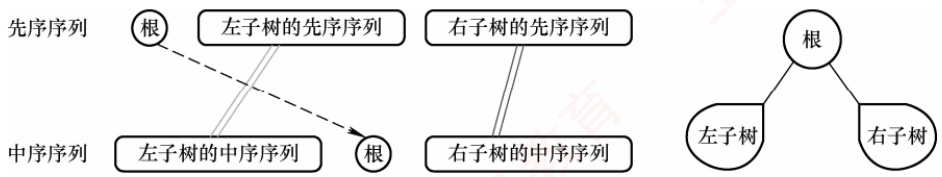

图5.11 由先序序列和中序序列构造二叉树

例如，求先序序列（ABCDEFGHI）和中序序列（BCAEDGHFI）所确定的二叉树。首先，由先序序列可知A为根结点。在中序序列中，A左侧的BC构成左子树的中序序列，右侧的EDGHFI构成右子树的中序序列。然后，由先序序列可知B是左子树的根结点，D是右子树的根结点。以此类推，将剩余结点递归分解，最终构造出的二叉树如图5.12(c)所示。

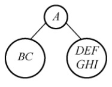

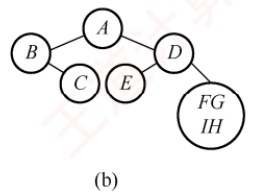

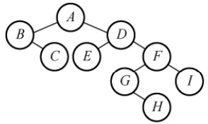

图 5.12 一棵二叉树的构造过程

**（2）由后序序列和中序序列构造二叉树**

**考点追踪由后序序列和树形构造一棵二叉树（2017、2023）**

同理，后序序列与中序序列也可唯一确定一棵二叉树。后序序列的最后一个结点即为整棵树的根结点，它同样能将中序序列划分为左右子树的中序序列。随后，根据左右子树的结点数，可从后序序列中分离出对应的左右子树的后序序列，并递归构造，如图5.13所示。

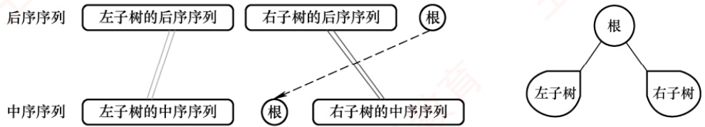

图5.13 由后序序列和中序序列构造二叉树

请读者分析后序序列（CBEHGIFDA）和中序序列（BCAEDGHFI）所确定的二叉树。

**（3）由层序序列和中序序列构造二叉树**

在层序序列中，第一个结点必为二叉树的根结点，由此可在中序序列中划分出左右子树的中序序列。若存在左子树，则层序序列的第二个结点一定是左子树的根，可以进一步划分左子树；若存在右子树，则层序序列中紧接着的下一个结点一定是右子树的根，可以进一步划分右子树，如图5.14所示。通过逐层确定各子树的根结点并递归划分，即可唯一确定这棵二叉树。

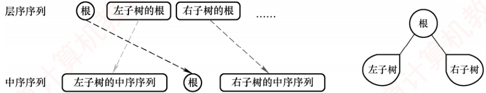

图5.14 由层序序列和中序序列构造二叉树

请读者分析层序序列（ABDCEFGIH）和中序序列（BCAEDGHFI）所确定的二叉树。

注意，仅凭先序、后序和层序序列中的任意两种组合，通常无法唯一确定一棵二叉树。例如，图5.15所示的两棵二叉树的先序序列均为AB，后序序列均为BA，层序序列均为AB。

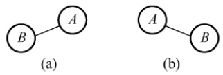

图 5.15 两棵不同的二叉树

### 5.3.2 线索二叉树

#### 1．线索二叉树的基本概念

遍历二叉树是按照特定规则将树中所有结点排列成一个线性序列，从而得到相应的遍历序

列。在该序列中，除首尾结点外，每个结点都有唯一的直接前驱和直接后继。

```txt
考点追踪线索二叉树的定义（2010）
```

传统的二叉链表结构仅能反映父子关系，无法直接获取结点在某种遍历序列中的前驱或后继。前面提到，在含有n个结点的二叉树中，共有n+1个空指针域:每个叶结点贡献2个空指针，每个度为1的结点贡献1个空指针，因此空指针总数为 $2n_{0}+n_{1}, 又 n_{0}=n_{2}+1$ ，可得空指针总数 $n_{0}+n_{1}+n_{2}+1=n+1$ 9由此，自然想到:可否利用这些空指针，直接指向结点在遍历序列中的前驱或后继？若能实现，便可像遍历链表一样高效地遍历二叉树，线索二叉树正是基于这一思想设计的。

具体规定如下:

● 若某结点无左子树，则将1chilα指向其在指定遍历序列中的前驱结点。

● 若某结点无右子树，则将rchild指向其在指定遍历序列中的后继结点。

为区分指针域指向的是孩子还是线索，需在结点结构中增设两个标志域，如图5.16所示。

| 1child | 1tag | data | rtag | rchild |
| --- | --- | --- | --- | --- |
|  |  |  |  |  |

图5.16 线索二叉树的结点结构

标志域1tag 和rtag 的含义如下:

● 1tag=0 表示 lchild 指向左孩子，1tag=1 表示 lchild 指向前驱。

● rtag=0 表示 rchild 指向右孩子，rtag=1 表示 rchild 指向后继。

线索二叉树的存储结构可定义为:

```txt
typedef struct ThreadNode{
ElemType data; //数据元素
struct ThreadNode *lchild,*rchild; //左右孩子指针
int ltag,rtag; //左右线索标志
}ThreadNode,*ThreadTree;
```

采用上述结构的二叉链表称为线索链表，其中指向前驱或后继的指针称为线索。这种带有线索的二叉树称为线索二叉树。

#### 2．中序线索二叉树的构造

二叉树的线索化是指将二叉链表中的空指针域替换为指向前驱或后继的线索。由于结点的前驱和后继关系只能在遍历过程中确定，因此线索化本质上就是对二叉树进行一次遍历。

```txt
考点追踪中序线索二叉树中线索的指向（2014）
```

以中序线索二叉树的构造为例:设指针pre指向刚刚访问过的结点，指针p指向当前正在访问的结点，pre即为p的中序前驱。在中序遍历过程中:检查p的左指针是否为空，若为空则令其指向 pre；检查pre的右指针是否为空，若为空则令其指向p，如图5.17所示。

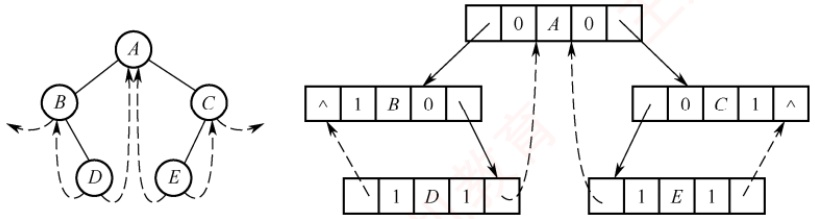

图5.17 中序线索二叉树及其二叉链表示

通过中序遍历对二叉树线索化的递归算法如下:

```txt
void InThread(ThreadTree &p,ThreadTree &pre) {
if(p!=NULL) {
```

```c

InThread(p->lchild,pre); //递归，线索化左子树
if(p->lchild==NULL) { //当前结点的左子树为空
p->lthild;pre; //建立当前结点的前驱线索
1
if(pre!=NULL&&pre->rchild==NULL){//前驱结点非空且其右子树为空
pre->rchild=p; //建立前驱结点的后继线索
pre->rtag=1;
1
pre=p; //标记当前结点成为刚刚访问过的结点
InThread(p->rchild,pre); //递归，线索化右子树
```

建立中序线索二叉树的主过程如下:

```c
void CreateInThread(ThreadTree T) {
ThreadTree pre=NULL;
if(T!=NULL) { //非空二叉树，线索化
InThread(T,pre); //线索化二叉树
首 pre->rchild=NULL; //处理遍历的最后一个结点
pre->rtag=1;
1
```

为方便遍历，可在线索链表上增设一个头结点:其1child指向根结点；rchild指向中序序列的最后一个结点；中序序列的第一个结点的1child和最后一个结点的rchild均指向头结点。如此，便形成一个双向循环线索链表，从而支持正向与反向的高效遍历，如图5.18所示。

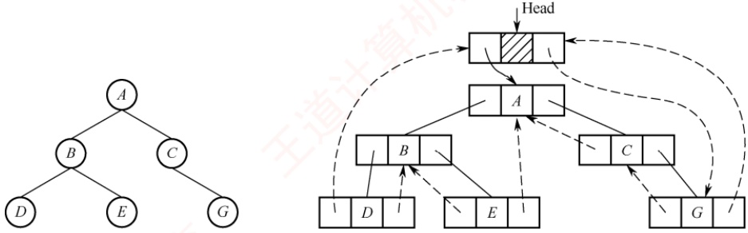

图5.18 带头结点的中序线索二叉树

#### 3．中序线索二叉树的遍历

中序线索二叉树的结点中已隐含前驱和后继信息，因此遍历时无须借助栈或递归。只需先找到中序序列的第一个结点，然后依次查找每个结点的后继，直至后继为空（或回到头结点）。在中序线索二叉树中，查找结点后继的规则如下:若结点的rtag为1，则rchild直接指向其后继；若rtag为0，则其后继为右子树中最左下结点（右子树的中序第一个结点）。

不含头结点的中序线索二叉树遍历相关算法如下。

1）求中序序列中的第一个结点:

```txt
ThreadNode *Firstnode(ThreadNode *p) {
while(p->ltag==0) p=p->lchild； //沿左孩子链走到最左下结点
return p;
```

2）求结点p在中序序列中的后继:

```txt
ThreadNode *Nextnode(ThreadNode *p) {
if(p->rtag==0) return Firstnode(p->rchild)； //右子树中最左下结点
else return p->rchild; //若rtag==1 则直接返回后继线索
```

请读者自行完成求中序序列中的最后一个结点和结点p的中序前驱的运算①。

3）利用上面两个算法，可实现非递归的中序遍历:

```txt
void Inorder (ThreadNode *T) {
for(ThreadNode *p=Firstnode(T);p!=NULL; p=Nextnode(p))
visit(p); 道
```

#### 4．先序线索二叉树和后序线索二叉树

建立先序或后序线索二叉树的方法与中序类似，只需调整递归调用顺序及线索建立的位置。以图5.19(a)的二叉树为例，手工构造先序线索二叉树的过程如下（先序序列为ABCDF，依次处理每个结点，若其左或右指针为空，则将其替换为对应前驱或后继的线索）:

结点A、B均有左右孩子，无须修改指针；结点C无左孩子，将其1chi1d指向前驱B，无右孩子，将其rchilα指向后继D；结点D无左孩子，将其1child指向前驱C，无右孩子，将其rchild指向后继F；结点F无左孩子，将其1chilα指向前驱D，无右孩子且无后继，将其rchild置为空，最终得到的先序线索二叉树如图5.19(b)所示。

构造后序线索二叉树的过程类似（后序序列为CDBFA）:

结点C无左孩子且无前驱，将1child置空，无右孩子，将rchild指向后继 $D;$ 结点D无左孩子，将1child指向前驱C,无右孩子，将rchild指向后继 $B ;$ 结点F无左孩子，将1child指向前驱B，无右孩子，将rchi1d指向后继A，得到的后序线索二叉树如图5.19(c)所示。

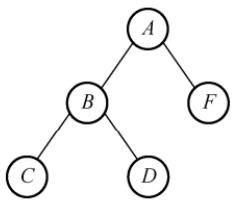

(a) 一颗二叉树

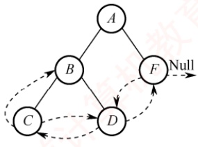

(b) 先序线索二叉树

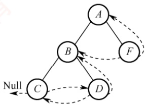

(c) 后序线索二叉树

图5.19 先序线索二叉树和后序线索二叉树

在先序线索二叉树中查找某结点的后继较为直接:若该结点有左孩子，则左孩子为其后继；若无左孩子但有右孩子，则右孩子为其后继；若为叶结点，则其rchild直接指向后继。

**考点追踪后序线索二叉树的特点（2013）**

而在后序线索二叉树中查找后继则较为复杂，需要分以下三种情况:①若结点x是整棵二叉树的根，则其后继为空；②若结点x是其双亲的右孩子，或是其双亲的左孩子且该双亲无右子树，则x的后继即为其双亲；③若结点x是其双亲的左孩子，且该双亲存在右子树，则x的后继为该右子树中按后序遍历访问的第一个结点（右子树中最左下结点）。

值得注意的是，图5.19(c)中，结点B的后继是A，但无法直接通过线索找到后继，需要回溯到其双亲。因此，在后序线索二叉树中高效查找后继通常需要知道结点的父结点信息。为此，通常采用带父指针的三叉链表作为存储结构，而非标准的二叉线索链表。

## 5.4 树、森林

### 5.4.1 树的存储结构

树的存储方式有多种，既可采用顺序存储结构，也可采用链式存储结构。无论采用何种方式，都必须能够唯一地反映树中各结点之间的逻辑关系。下面介绍三种常用的存储结构。

#### 1．双亲表示法

双亲表示法使用一组连续的存储空间（如数组）来存放树中的所有结点。每个结点除包含数据域外，还增设一个“伪指针”域，用于指示其双亲结点在数组中的下标。如图5.20所示，根结点位于下标0处，其双亲域设为-1，表示无双亲。

双亲表示法的存储结构定义如下:

```c
#define MAX TREE SIZE 100 //树中最多结点数
typedef struct{ //树的结点定义
ElemType data; //数据元素
int parent; 算 //双亲位置域
} PTNode;
typedef struct{ //树的类型定义
PTNode nodes [MAX_TREE SIZE]; //双亲表示
```

//结点数

int n;}PTree;

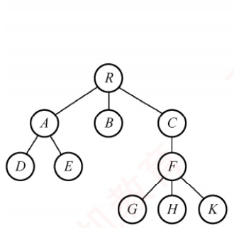

(a)一棵树

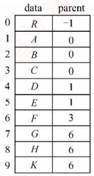

(b) 双亲表示

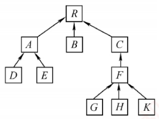

(c) 双亲指针图示

图5.20 树的双亲表示法

双亲表示法利用了每个结点（除根结点外）有且仅有一个双亲的性质。因此，查找任意结点的双亲非常高效；然而，查找某结点的孩子则需遍历整个数组，效率较低。

**注意**

区分树与二叉树的顺序存储结构。在树的双亲表示法中，数组下标用于标识结点，结点间的父子关系通过parent域显式记录。而在二叉树的顺序存储结构中（如完全二叉树的数组表示），下标隐含了父子关系（例如，结点i的左孩子为2i +1，右孩子为2i +2）。二叉树是树的特例，因此可以使用树的存储结构表示。但是，一般的树不能直接使用二叉树的顺序存储方式。

#### 2．孩子表示法

孩子表示法将每个结点的所有孩子视为一个线性表，并用单链表存储。整棵树则由n个这样的孩子链表组成（叶结点对应空链表）。为便于访问，所有孩子链表的头指针被集中存放在一个顺序表（如数组）中，每个位置对应一个结点。图5.21(a)展示了图5.20(a)中树的孩子表示法。

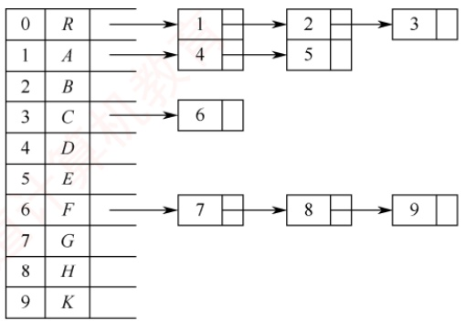

(a) 孩子表示法

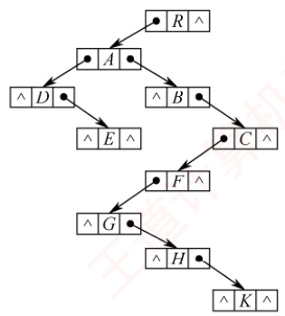

(b)孩子兄弟表示法

图5.21 树的孩子表示法和孩子兄弟表示法

与双亲表示法相反，孩子表示法便于查找结点的孩子，但若要查找某结点的双亲，则需遍历所有孩子链表，检查是否包含该结点，效率较低。

#### 3．孩子兄弟表示法

孩子兄弟表示法也称二叉树表示法，采用二叉链表作为树的存储结构。每个结点包含三部分:

数据域、指向第一个孩子的指针、指向下一个兄弟的指针（沿此指针可依次访问该结点的所有右侧兄弟），如图5.21(b)所示。这种结构以“左孩子-右兄弟”的方式，将树映射为二叉树形式。

孩子兄弟表示法的存储结构描述如下:

```c
typedef struct CSNode{
ElemType data; //数据域
struct CSNode *firstchild,*nextsibling; //第一个孩子和右兄弟指针
}CSNode,*CSTree;
```

孩子兄弟表示法具有良好的灵活性，其最大优点是能自然地将树转换为二叉树，从而复用二叉树的算法。查找孩子非常高效。然而，从当前结点高效回溯到其双亲较为困难。若在结点中增设一个parent指针域，则可高效查询双亲，形成一种三叉链表的存储结构。

### 5.4.2 树、森林与二叉树的转换

二叉树和树均可用二叉链表作为存储结构。从物理结构上看，树的孩子兄弟表示法与二叉树的二叉链表表示法完全相同，因此可以用同一存储结构的不同解释将一棵树转换为二叉树。

#### 1．树转换为二叉树

考点追踪树和二叉树的转换及相关性质的推理（2009、2011）

树转换为二叉树的规则:每个结点的左指针指向其第一个孩子；右指针指向其在原树中的下一个右兄弟，这个规则也被称为“左孩子-右兄弟”原则。由于根结点没有兄弟，因此由树转换而来的二叉树的根结点必无右子树，如图5.22所示。

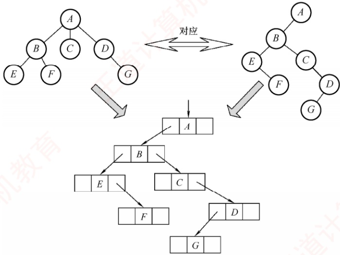

图5.22 树与二叉树的对应关系

树转换为二叉树的手工画法:

1）在所有兄弟结点之间添加连线；

2）对每个结点，仅保留其与第一个孩子的连线，删除与其他孩子的连线；

3）以树根为轴心，顺时针旋转45°，使其呈现二叉树形态。

#### 2．森林转换为二叉树

**考点追踪森林和二叉树的转换及相关性质的推理（2014）**

森林是若干棵树的集合，其转换基于单棵树的转换方法。首先将森林中的每棵树分别转换为对应的二叉树；由于每棵转换后的二叉树根结点均无右子树，可将这些根结点视为兄弟；将第二棵二叉树作为第一棵二叉树根的右子树………以此类推，最终形成一棵完整的二叉树。

森林转换为二叉树的手工画法:

1）将森林中的每棵树转换为相应的二叉树；

2）每棵树的根也可视为兄弟关系，在各树的根之间依次添加连线:

3）以第一棵树的根为轴心，顺时针旋转45°。

等效做法是:先在各树的根之间添加连线，然后整体应用树转二叉树的方法处理。

#### 3．二叉树转换为森林

考点追踪由遍历序列构造一棵二叉树并转换为对应的森林（2020、2021）

若给定的二叉树非空，则其转换为森林的规则:二叉树的根及其左子树对应第一棵树的二叉树表示；将根的右指针断开，其右子树即代表剩余森林转换后的二叉树；对右子树递归应用相同规则，不断分离出下一棵树，直至右子树为空；最后将每棵分离出的二叉树还原为普通树，即可得到原始森林。此过程如图5.23所示。二叉树转换为树或森林的结果是唯一的。

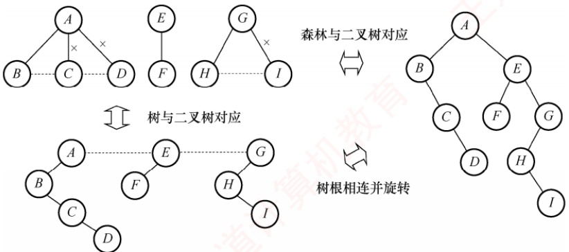

图5.23 森林与二叉树的对应关系

### 5.4.3 树和森林的遍历

#### 1．树的遍历

**考点追踪树与二叉树遍历方法的对应关系（2019）**

树的遍历是指以某种方式访问树中的每个结点，且仅访问一次。主要有两种方式:

1）先根遍历。若树非空，则按如下规则遍历:

● 先访问根结点。

● 再依次遍历根结点的每棵子树，遍历子树时仍遵循先根后子树的规则。

其遍历序列与这棵树相应二叉树的先序序列相同

2）后根遍历。若树非空，则按如下规则遍历:

● 先依次遍历根结点的每棵子树，遍历子树时仍遵循先子树后根的规则。

● 再访问根结点。

其遍历序列与这棵树相应二叉树的中序序列相同。

图5.22的树的先根遍历序列为ABEFCDG，后根遍历序列为EFBCGDA。

此外，树也支持层次遍历，与二叉树的层次遍历原理相似，即按层序依次访问各个结点。

#### 2．森林的遍历

基于森林和树相互递归的定义，可得出森林的两种遍历方法。

1）先序遍历森林。若森林为非空，则按如下规则遍历:

● 访问森林中第一棵树的根结点。

● 先序遍历第一棵树中根结点的子树森林。

● 先序遍历除去第一棵树后的剩余森林。

2）中序遍历森林。若森林为非空，则按如下规则遍历:

● 中序遍历第一棵树中根结点的子树森林。

● 访问森林中第一棵树的根结点。

● 中序遍历除去第一棵树后的剩余森林。

图 5.23 的森林的先序遍历序列为 ABCDEFGHI，中序遍历序列为 BCDAFEHIG。

**考点追踪森林与二叉树遍历方法的对应关系（2020）**

当森林转换成二叉树时，第一棵树的子树森林会转换为左子树，剩余森林则转换为右子树。因此，森林的先序、中序遍历与其对应二叉树的先序、中序遍历相同。

树和森林的遍历与二叉树的遍历关系见表5.1。

表5.1 树和森林的遍历与二叉树遍历的对应关系

| 树 | 森林 | 二叉树 |
| --- | --- | --- |
| 先根遍历 | 先序遍历 | 先序遍历 |
| 后根遍历 | 中序遍历 | 中序遍历 |

**注意**

森林遍历方法的命名按照严蔚敏老师的教材。有些教材也将森林的中序遍历称为后序遍历，称中序遍历是相对其二叉树而言的，称后序遍历是因为根确实是在最后才被访问的。

## 5.5 树与二叉树的应用

### 5.5.1 哈夫曼树和哈夫曼编码

#### 1．哈夫曼树的定义

在介绍哈夫曼树之前，先明确几个相关概念:

在许多实际应用中，树中的结点常被赋予一个具有特定意义的数值，称为该结点的权。从树的根结点到某一结点的路径长度与该结点权值的乘积，称为该结点的带权路径长度。树中所有叶结点的带权路径长度之和称为该树的带权路径长度（WPL），记为

$$
\mathrm{WPL} = \sum_{i = 1}^{n} w_{i} l_{i}
$$

式中， $w_{i}$ 为第i个叶结点的权值， $l_{i}$ 为该叶结点到根结点的路径长度。

若将各叶结点的权值视为其出现的频度或概率，则每个叶结点的路径长度以其权值为权重所计算出的加权平均值称为加权平均长度，记为 KK

$$
加权平均长度  =  WPL  /  各叶结点的权值之和
$$

在含有n个带权叶结点的二叉树中，WPL最小的二叉树称为哈夫曼树，也称最优二叉树。图 5.24 中的 3 棵二叉树均包含4 个叶结点 $a,b,c,d,$ 权值分别为7,5,2,4，对应的WPL分别为

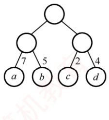

(a)

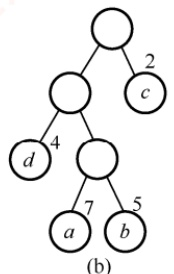

(b)

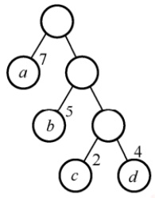

(c)

图5.24 具有不同带权路径长度的二叉树

(a) $\mathrm{WPL}=7 \times 2+5 \times 2+2 \times 2+4 \times 2=36$

(b) $\mathrm{WPL}=4 \times 2+7 \times 3+5 \times 3+2 \times 1=46$

(c) $\mathrm{WPL}=7 \times 1+5 \times 2+2 \times 3+4 \times 3=35$

其中，图5.24(c)树的WPL最小，可验证其恰好为对应权值集合的哈夫曼树。

#### 2．哈夫曼树的构造

给定n个权值分别为 $w_{1},w_{2},\cdots,w_{n}$ 的结点，构造哈夫曼树的步骤如下:

1）将这n个结点分别视为n棵仅含一个结点的二叉树，构成森林 $F_{\circ}$

考点追踪分析哈夫曼树的路径上权值序列的合法性（2010）

2）构造一个新结点，从F中选取两棵根结点权值最小的树作为其左右子树，并将新结点的权值设为左右子树根结点的权值之和。

3）从F中删除所选的两棵树，并将新生成的树加入F。

4）重复步骤2）和3），直至F中仅剩一棵树为止，最终得到的树即为哈夫曼树。

**考点追踪哈夫曼树的性质（2010、2019）**

由上述构造过程可归纳出哈夫曼树的以下性质:

1）每个初始结点最终都成为叶结点，且权值越小的结点，其到根的路径长度越大。

2）构造过程中共新建了n-1个结点（双分支结点），因此哈夫曼树的结点总数为2n-1。

3）每次合并均选取两棵树，故哈夫曼树中不存在度为1的结点（为严格二叉树）。

例如，权值集合{7,5,2,4}的哈夫曼树构造过程如图5.25所示。

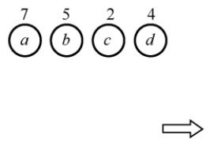

(a)

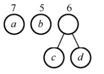

(b)

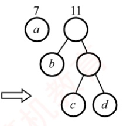

(c)

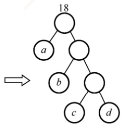

(d)

图 5.25 哈夫曼树的构造过程

#### 3．哈夫曼编码

在数据通信中，若对每个字符使用相同长度的二进制位表示，称这种编码方式为固定长度编码；若允许不同字符使用不同长度的二进制位表示，则称为可变长度编码。合理的可变长度编码（如哈夫曼编码）比固定长度编码要好得多，其特点是对出现频率高的字符赋予较短编码，而对频率低的字符赋予较长编码，从而降低字符的平均编码长度，起到压缩数据的效果。

**考点追踪根据哈夫曼编码对编码序列进行译码（2017）**

若一个编码集合中，没有任何一个编码是另一个编码的前缀，则称该编码为前缀编码。例如，为字符A,B和C分配编码0,10和110，这是一个前缀编码。由于编码互不为前缀，解码过程简单且无歧义:从左到右扫描码串，一旦识别出一个有效编码，即可立即译出对应字符。例如，码串0010110可唯一译为AABC。反之，若再为字符D分配编码11，则11是110的前缀，导致上述码串的后3位无法确定是DA，还是直接表示C，从而破坏唯一可译性。

**考点追踪哈夫曼树的构造及相关的分析（2012、2018、2021、2023）**

**考点追踪前缀编码的分析及应用（2014、2020）**

可利用二叉树设计二进制前缀编码。例如，为字符A,B,C. D设计前缀编码，可用图5.26所示的二叉树表示:四个叶结点分别对应这四个字符，并约定左分支标记为0，右分支标记为1。将根到各叶结点路径上的分支标记（0/1）拼接成的字符串，作为对应字符的编码，字符A, B,C,D的编码分别为 0,10,110 111。可以证明，如此生成的编码必为前缀编码。

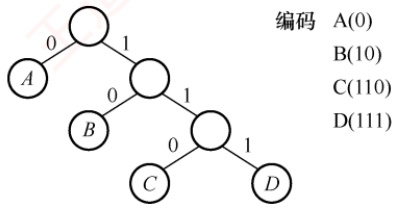

图 5.26 前缀编码示例

**考点追踪哈夫曼编码和定长编码的差异（2022）**

哈夫曼编码是一种非常高效的数据压缩编码方法。由哈夫曼树生成哈夫曼编码的过程十分自然。首先，将每个字符视为一个独立的叶结点，其权值为其出现的频度（或次数）；构造对应的哈夫曼树；然后，将从根到各叶结点路径上分支标记的字符串，作为该字符的编码。图5.27展示了一个由哈夫曼树构造哈夫曼编码的示例，图中矩形结点标注了字符及其出现频次。

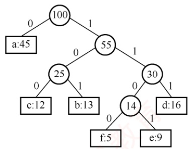

图5.27 由哈夫曼树构造哈夫曼编码

该哈夫曼树的 WPL 为

$$
\mathrm{WPL}=1 \times 45+3 \times(13+12+16)+4 \times(5+9)=224
$$

此处的WPL表示对100个字符编码后的二进制总长度，共224位。若采用3位固定长度编码（共6个不同字符，需至少3位），则总长度为 $3 \times 100 = 300$ 位。因此，哈夫曼编码实现了约25%的数据压缩率。由此可见，利用哈夫曼树可以设计出总长度最短的二进制前缀编码。

**注意**

左分支和右分支分别表示0还是1并无强制规定，因此构造出的哈夫曼树在形态上可能不唯一。此外，当存在多个权值相同的结点时，合并顺序的不同也可能导致结构不同的哈夫曼树。但无论具体形态如何，其带权路径长度WPL始终相同且达到最小值，即最优性不受影响。

### 5.5.2 并查集

#### 1．并查集的概念

并查集是一种处理不相交集合的合并与查询问题的树状数据结构，它支持三种基本操作:

1）Initial(S):将集合s中的每个元素都初始化为一个独立的单元素子集合。

2) Union(S,Root1,Root2):将集合s 中的子集合 Root2 并入子集合 Root1。要求 Root1和Root2属于不同的子集合，否则不执行合并操作。

3）Find(S,x):在集合s中查找单元素×所属的子集合，并返回该子集合的根结点。

#### 2．并查集的存储结构

并查集通常采用树的双亲表示法作为其存储结构:每个子集合用一棵树来表示，所有子集合对应的树共同构成一个森林，并统一存储在一个数组中。在该数组中，数组下标代表集合中的元素编号，而每个元素所存的值为其双亲结点的下标；对于根结点，其双亲域设为负数一一通常取该子集合元素数量的相反数，既标识其为根，又记录了集合的规模。

例如，设有一个全集合为S= {0,1,2,3,4,5,6,7,8,9}，初始化时每个元素自成一个单元素子集合，对应数组中每个位置的值均为-1，如图5.28所示。

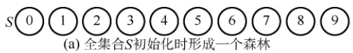

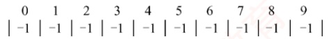

(b)初始化时形成的(森林)双亲表示

图 5.28 并查集的初始化

经过若干合并操作后，这些子集合可能被合并为三个更大的子集合: $S_{1} = \{0 , 6 , 7 , 8 \}$ $S_{2} = \{1 , 4 , 9 \}$ $S_{3}   =   \{2 , 3 , 5 \}$ ，此时并查集的树形及其对应的数组存储形式如图5.29所示。

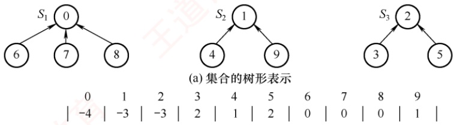

(b)集合S1、S2和S3的(森林)双亲表示

图 5.29 用树表示并查集

要实现两个子集合的并操作 $( S_{1} \cup S_{2} )$ ，只需将其中一个子集合根结点在数组中的值设为另一个子集合的根结点下标。例如，将 $S_{2}$ 的根指向 $S_{1}$ 的根后，所得结构如图5.30所示。

<table><tr><td colspan=10></td></tr><tr><td></td><td></td><td></td><td></td><td></td></tr></table>

图 5.30 $S_{1} \cup S_{2}$ 的表示方法

在该存储方案中，集合元素的编号从0到SIZE-1，其中SIZE表示集合中元素的最大数量。

#### 3．并查集的基本实现

并查集的结构定义如下:

```txt

int Find(int S[],int x){
while(S[x]>=0) //循环寻找×的根
x=S[x];
return x; //根的 S []小于0
KN
```

下面是并查集主要运算的实现。

（1）并查集的初始化操作

```txt
void Initial(int S[]){
for(int i=0;i<SIZE;i++)
S[i]=-1;
```

将每个元素对应的数组值设为-1，表示这些元素各自为根。

**(2) 并查集的 Find 操作**

在并查集中查找并返回包含元素×的树的根。

判断两个元素是否属于同一集合，只需分别找到它们的根，再比较根是否相同即可。

**（3）并查集的 Union 操作**

合并两个不相交子集合的操作。当要合并两个元素所在的集合时，需要先找到这两个元素的根，然后让一棵子集树的根指向另一棵子集树的根。

```javascript
void Union(int S[],int Root1,int Root2) {
if(Root1==Root2) return; //要求 Root1 与 Root2 是不同的集合
S[Root2]=Root1; //将根 Root2 连接到另一根 Root1 下面
```

Find 和 Union 操作的时间复杂度分别为 O(d)和 O(1)，其中 d为树的深度。

#### 4．并查集实现的优化

在极端情况下，由n个元素构成的集合树可能退化为一条链，深度达到n，此时Find操作的最坏时间复杂度为O(n)。改进的办法是:在执行Union操作前先比较两个子集合的规模，将规模较小的树作为子树挂到规模较大的树的根下，即“小树并入大树”。为此，可利用根结点的绝对值（其绝对值即为集合大小）来记录该集合中包含的元素个数。

（1）改进的 Union 操作

```txt
void Union(int S[l,int Root1,int Root2) {
if(Root1==Root2) return;
if (S[Root2]>S[Root1]) { //Root2 结点数更少
S[Root1]+=S[Root2]; //累加集合中的元素总数
S[Root2]=Root1; //小树合并到大树
else { //Root1 结点数更少
S[Root2]+=S[Root1]; //累加结点总数
S[Root1]=Root2; //小树合并到大树
```

采用这种按集合大小合并的策略后，所构造的集合树深度不超过Llog2n+1。

然而，随着子集不断合并，集合树的深度仍可能逐渐增大。为进一步缩短查找时间，还可对上述Find操作进一步优化:引入路径压缩机制——在找到根结点后，将从×到根路径上的所有中间结点直接挂接到根结点下，从而“压平”整条路径。

**(2) 改进的 Find 操作**

```txt
int Find(int S[],int x)
int root=x;
```

```javascript
while(S[root]>=0)
root=S[root];
while(x!=root) {
int t=S[x];
S[x]=root;
x=t;
return root;
```

采用按大小合并与路径压缩两种优化后，并查集的操作效率得到极大提升，使得集合树的深度不超过 O(α(n))，其中 α(n)是一个增长极其缓慢的函数，对于常见的正整数n，通常α(n)≤4。

关于并查集的实际应用示例，请参见本书配套视频。

## 归纳总结

本章内容较为丰富，其中二叉树是极其重要的考查重点。在历年统考真题中，已多次出现基于二叉树的算法设计题，考生需特别关注。 道

遍历是二叉树各类操作的基础，统考常结合遍历过程考查对结点的各种附加操作。建议读者重点掌握各种遍历方法的代码实现，并在此基础上灵活完成相关操作。其中，递归算法结构简洁、逻辑清晰，在考试中出现的概率较高，切勿掉以轻心。应熟练掌握先序、中序、后序遍历的程序模板，并通过足量习题训练，方能在考试中快速写出规范、高效的代码。

二叉树遍历的通用递归框架如下

```c
void Track(BiTree *p){
if(p!=NULL) {
∥(1)
Track(p->lchild)
∥(2)
Track(p->rchild);
```

∥(3)

将访问操作visit()放在位置(1)、(2)或(3)，分别对应先序遍历、中序遍历和后序遍历。但在具体题目中，需根据问题要求灵活调整和扩展该模板。

例如，设二叉树采用二叉链表存储结构，请编写有关二叉树的递归算法。

1）统计二叉树中度为1的结点数。

2）统计二叉树中度为2的结点数。

3）统计二叉树中度为0的结点（叶结点）个数。

4）求二叉树的高度。

5）求二叉树的宽度（各层中结点数的最大值）。

6）删除二叉树中的所有叶结点。

7）计算指定结点\*p所在的层次。

8）求二叉树中所有结点数据值的最大值。

9）交换二叉树中每个结点的左右孩子。

10）以先序次序输出二叉树中每个结点的数据值及其所在层次。

## 思维拓展

输入一个整数data和一棵二元树。从树的根结点开始往下访问一直到叶结点，所经过的所有结点形成一条路径。打印出路径及与data相等的所有路径。例如，输入整数22和右图所示的二元树，则打印出两条路径10,12和10,5,7。

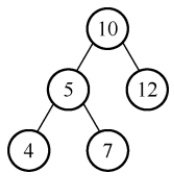

注意

使用数组或栈保存访问的路径，并记录当前路径上所有元素的和sum。若当前结点为叶结点，且当前结点值与sum的和等于data，则满足条件，打印当前路径。然后递归返回到父结点，注意在递归返回之前要先减去当前结点元素的值。使用先序遍历操作的递归算法模板可以简化程序。

购买王道书，就上

王道官方考研书店


邻接矩阵；邻接表；邻接多重表；十字链表

**（三）图的遍历**

深度优先搜索；广度优先搜索

（四）图的基本应用

最小（代价）生成树；最短路径；拓扑排序；关键路径

【知识框架】

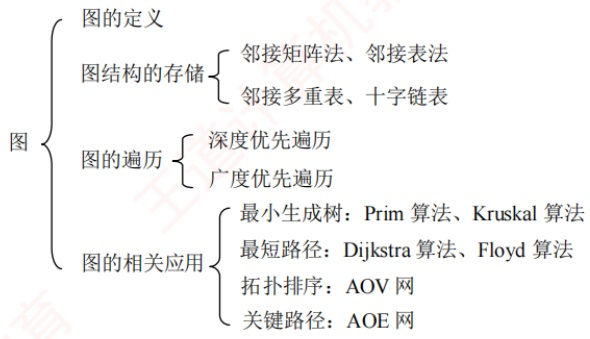

【复习提示】

图算法整体难度较大，应重点掌握深度优先搜索与广度优先搜索。理解图的基本概念与性质，掌握邻接矩阵、邻接表、邻接多重表和十字链表等存储结构及其特点，并能进行结构间的转换。掌握基于这些结构的遍历操作及典型应用，如拓扑排序、最小生成树、最短路径和关键路径等。图算法较多，通常只需掌握其核心思想与实现步骤，代码实现并非重点。

## 6.1 图的基本概念

### 6.1.1 图的定义

图G由顶点集V和边集E组成，记为 $G = (V,   E)$ 。其中，V(G)表示图G中顶点的有限非空集；E(G)表示图G中顶点之间的关系（边）集合。若 $V = \{v_{1}, v_{2}, \cdots, v_{n} \}$ ，则用|表示图G中顶点的数量， $E = \{( u , v )   |   u {\in} V , v {\in} V \}$ ，用E表示图G中边的数量。

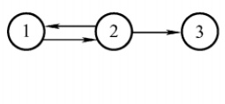

**注意**
