# 第6章 图 · 习题与解析

> 由《第6章 图》正文摘出；区块标题保留了原书的小节编号。

### 6.1.2 本节试题精选

#### 一、单项选择题

01.一个有n个顶点和n条边的无向图一定是（）。
A. 连通的
B. 不连通的
C. 无环的
D. 有环的

> ①有向图强连通情况下边最少的情况:至少需要n条边，构成一个环路。

02. 若从无向图的任意顶点出发进行一次深度优先搜索即可访问所有顶点，则该图一定是（）。
A. 强连通图
B. 连通图
C. 有回路
D. 一棵树

03. 以下关于图的叙述中，正确的是（）。
A. 图与树的区别在于图的边数大于或等于顶点数
B. 假设有图 $G   =   \{V ,   \{E \} \}$ ，顶点集 $V^{\prime}   \subseteq   V , \quad E^{\prime}   \subseteq   E$ ，则V'和{E′}构成G的子图
C. 无向图的连通分量是指无向图中的极大连通子图
D. 图的遍历就是从图中某一顶点出发访遍图中其余顶点

04.以下关于图的叙述中，正确的是（）。
A. 强连通有向图的任何顶点到其他所有顶点都有弧
B. 图的任意顶点的入度等于出度
C. 有向完全图一定是强连通有向图
D. 有向图的边集的子集和顶点集的子集都构成原有向图的子图

05.一个有28条边的非连通无向图至少有（）个顶点。
A. 7
B. 8
C. 9
D. 10

06. 对于一个有n个顶点的图:若是连通无向图，其边的个数至少为（）；若是强连通有向图，则其边的个数至少为（）。
A. n−1, n
B. n−1, n(n−1)
C. n, n
D. n, n(n − 1)

07. 无向图G有23条边，度为4的顶点有5个，度为3的顶点有4个，其余都是度为2的顶点，则图G有（）个顶点。
A. 11
B. 12 X
C. 15
D. 16

08. 在有n个顶点的有向图中，顶点的度最大可达（）。
A. n
B. n-1
C. 2n
D. $2 n   -   2$

09. 具有6个顶点的无向图，当有（）条边时能确保是一个连通图。
A. 8 X
B. 9
C. 10
D. 11

10. 设有无向图 G =(V, E)和 $G^{\prime}   =   ( V^{\prime} , E^{\prime} )$ ，若G'是G的生成树，则下列不正确的是（）。I. G'为 G的连通分量I. G'为 G的无环子图 算机. G'为 G的极小连通子图且 V = V
A. I、ⅡI
B. 只有Ⅲ
C. II、ⅢII
D. 只有I

11. 具有 51 个顶点和 21 条边的无向图的连通分量最多为（）
A. 33
B. 34
C. 45
D. 32

12. 在右图所示的有向图中，共有（）个强连通分量。
A. 1
B. 2 0
C. 3
D. 4

13. 若具有n个顶点的图是一个环，则它有（）棵生成树。
A. $n^{2}$
B. n
C. n−1
D. 1

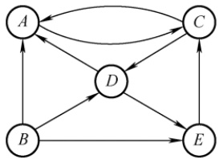

14. 若一个具有n个顶点、e条边的无向图是一个森林，则该森林中必有（）棵树。

A. n
B. e
C. n-e
D. 1

15.【2009统考真题】下列关于无向连通图特性的叙述中，正确的是（）。I. 所有顶点的度之和为偶数I. 边数大于顶点个数减1 I. 至少有一个顶点的度为1
A. 只有I
B. 只有Ⅱ
C. I和ⅡI
D. I和III

16. 【2010统考真题】若无向图 $G   =   ( V ,   E )$ 中含有7个顶点，要保证图G在任何情况下都是连通的，则需要的边数最少是（）。
A. 6
B. 15
C. 16
D. 21

17.【2017统考真题】已知无向图G含有16条边，其中度为4的顶点个数为3，度为3的顶点个数为4，其他顶点的度均小于3。图G所含的顶点个数至少是（）。
A. 10
B. 11
C. 13
D. 15

18. 【2022统考真题】对于无向图 $G   =   ( V , E )$ ，下列选项中，正确的是（）。
A. 当 $| V | > | E |$ 时，G一定是连通的
B. 当 $| V | < | E |$ 时，G一定是连通的
C. 当 $| V |   =   | E |   - 1$ 时，G一定是不连通的
D. 当 $| V |   >   | E |   +   1$ 时，G一定是不连通的

#### 二、综合应用题

01. 图G是一个非连通无向图，共有28条边，该图至少有多少个顶点？

### 6.1.3 答案与解析

#### 一、单项选择题

01. D

若一个无向图有n个顶点和n-1条边，可以使它连通但没有环（生成树），但若再加一条边，在不考虑重边的情形下，则必然会构成环。

02. B

强连通图是有向图，与题意矛盾，选项A错误；对无向连通图做一次深度优先搜索，可以访问到该连通图的所有顶点，选项B正确；有回路的无向图不一定是连通图，因为回路不一定包含图的所有顶点，选项C错误；连通图可能是树，也可能存在环，选项D错误。

03. C

图与树的区别是逻辑上的区别，而不是边数的区别，图的边数也可能小于树的边数，选项A错误；若 E'中的边对应的顶点不是V的元素，则V和{E}无法构成图，选项B 错误；无向图的极大连通子图称为连通分量，选项C正确；图的遍历要求每个顶点只能被访问一次，且若图非连通，则从某一顶点出发无法访问到其他全部顶点，选项D的说法不准确。

04. C

强连通有向图的任何顶点到其他所有顶点都有路径，但未必有弧；无向图任意顶点的入度等于出度，但有向图未必满足；若边集中的某条边对应的某个顶点不在对应的顶点集中，则有向图的边集的子集和顶点集的子集无法构成子图。

05. C

考查至少有多少个顶点的情形，我们考虑该非连通图最极端的情况，即它由一个完全图加一个独立的顶点构成，此时若再加一条边，则必然使图变成连通图。在 $28 = n(n - 1)/2 = 8 \times 7/2$条边的完全无向图中，总共有8个顶点，再加上1个不连通的顶点，共9个顶点

06. A

对于连通无向图，边最少即构成一棵树的情形；对于强连通有向图，边最少即构成一个有向环的情形。

07. D

因为在具有n个顶点、e条边的无向图中，有 $\sum_{i = 1}^{n} \mathrm{TD}(v_{i}) = 2e$ ，所以求得度为2的顶点数为7，从而共有16个顶点。

08. D

在有向图中，顶点的度等于入度与出度之和。n个顶点的有向图中，任意一个顶点最多还可以与其他n-1个顶点有一对指向相反的边相连。注意，数据结构中仅讨论简单图。

09. D

5个顶点构成一个完全无向图，需要 $n(n - 1)/2 = 10$ 条边；再加上1条边后，能保证第6个顶点必然与此完全无向图构成一个连通图，所以共需11条边。

10. D

一个连通图的生成树是一个极小连通子图，显然它是无环的，因此说法Ⅱ、Ⅲ正确。极大连通子图称为连通分量，G'连通但非连通分量。这里再补充一下“极大连通子图”:若图本来就是连通的，且每个子部分包含其本身的所有顶点和边，则它就是极大连通子图。

11. C

初始考虑只有51个顶点的无向图G，此时G中每个顶点都是连通分量，问题转化为向G中添加21条边，如何添加这 21 条边使得连通分量数目最多。若向两个不同的连通分量之间添加边，则连通分量数目会减1，所以应尽可能地将这21条边加入同一个连通分量且让其接近完全图，含有7个顶点的完全图有21条边，所以用7个顶点构成一个含有21条边的连通分量，剩下51-7=44个顶点对应44个连通分量，共有45个连通分量。

12. B

强连通分量是极大强连通子图，任意两个顶点之间有方向相反的两条路径。由定义不难得出，若一个顶点只有出边或入边，则该顶点必定单独构成一个连通分量。图中，顶点B只有出边，其他所有顶点都不可能有到顶点B的路径，所以顶点B单独构成一个强连通分量。在顶点A、C、D、E中，任意两个顶点之间都有方向相反的两条路径，所以可构成一个强连通分量。

13. B

n 个顶点的生成树是具有 n-1 条边的极小连通子图，因为 n 个顶点构成的环共有 n 条边，去掉任意一条边就是一棵生成树，所以共有n种情况，所以可以有n棵不同的生成树。

14. C

n个顶点的树有n-1条边，假设森林中有x棵树，将每棵树的根连到一个添加的顶点，则成为一棵树，顶点数是n+1，边数是e + x，从而可知 $x   =   n   -   e$ 0

【另解】设森林中有x棵树，则再用x-1条边就可将所有的树连接成一棵树，此时边数+1=顶点数，即 $e+(x-1)+1=n$ ，所以 $x = n - e$ 0 ZTA

15. A

每条边都连接了两个顶点，在计算顶点的度之和时每条边都被计算了两次，所以所有顶点的度之和偶数。无向连通图对应的生成树也是无向连通图，但此时边数等于顶点数减1，说法Ⅱ错误。考虑2个或以上的顶点恰好构成一个环的情况，此时每个顶点的度都为2，说法Ⅲ错误。

16. C

题干要求无论如何分配边，都能使7个顶点连通，这不同于只要6条边两两相连就能构成一个连通图的情形。考虑最极端的情形，即图G的某6个顶点构成一个完全无向图，此时若再添加一条边，则都将连通第7个顶点，使该图变成一个连通图。所以最少边数 $6 \times 5 / 2 + 1 = 16$ 。若边数n小于或等于15，可以使这n条边仅连接图G中的某6个顶点，从而导致第7个顶点无法与这6个顶点构成连通图（不满足“在任何情况下”）。

为简单起见，以5个顶点为例，左边4个顶点和 $4 {\times} 3 / 2 = 6$ 条边构成一个完全图，此时若再添加一条边（可以是虚线中的任意一条），则能保证这5个顶点在任何情况下都是连通的，如右图所示。若边数小于7，则不能保证5个顶点在任何情况下都是连通的。

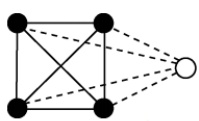

17. B

无向图边数的2倍等于各顶点度数的总和。要求至少的顶点数，应使每个顶点的度取最大，而其他顶点的度均小于3，因此可设它们的度都为2，并设它们的数量为x，列出方程 $4 \times 3 + 3 \times 4 +$ $2x = 16 \times 2$ ，解得 $x = 4$ 。因此至少包含 $4 + 4 + 3 = 11$ 个顶点。

18. D

对于此类分析图的边数、顶点数与连通性问题，思路是寻找临界情况，在临界情况下任意增加或减少一条边，都会改变图的连通性。第一种临界情况如图1所示，此时若减少任意一条边，图就由连通变为不连通，即无向图连通的最小边数是-1，因此，当 $| E | < | V |   -   1$ 时，图一定不连通，选项C错误，选项D正确。第二种临界情况如图2所示，此时若增加任意一条边，则图就由不连通变为连通，即无向图不连通的最大边数是 $( | V | - 1 ) ( | V | - 2 ) / 2$ (此时|-1个顶点构成一个完全图），因此，仅当 $| E | \geqslant ( | V | - 1 ) ( | V | - 2 ) / 2 + 1$ 时才能保证无向图一定连通，选项A、B错误。

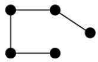

图1

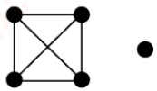

图2

#### 二、综合应用题

01. 【解答】

图G是一个非连通无向图，当边数固定时，顶点数最少的情况是该图由两个连通子图构成，且其中之一只含一个顶点，另一个为完全图。其中只含一个顶点的子图没有边，另一个完全图的边数为 $n(n - 1)/2 = 28$ ，得 $n = 8$ 。所以该图至少有 $1 + 8 = 9$ 个顶点。

### 6.2.6 本节试题精选

#### 一、单项选择题

01. 下列关于图的存储结构的说法中，错误的是（）。

A. 使用邻接矩阵存储一个图时，在不考虑压缩存储的情况下，所占用的存储空间大小只与图中的顶点数有关，与边数无关
B. 邻接表只用于有向图的存储，邻接矩阵适用于有向图和无向图
C. 若一个有向图的邻接矩阵的对角线以下的元素为0，则该图的拓扑序列必定存在
D. 存储无向图的邻接矩阵是对称的，所以只需存储邻接矩阵的下（或上）三角部分

02. 若图的邻接矩阵中主对角线上的元素皆为0，其余元素全为1，则该图一定（）。
A. 是无向图
B. 是有向图
C. 是完全图
D. 不是带权图

03. 在含有n个顶点和e条边的无向图的邻接矩阵中，零元素的个数为（）。
A. e
B. $2 e$
C. $n^{2}   -   e$
D. $n^{2}   -   2 e$

04. 带权有向图G用邻接矩阵存储，则 $v_{i}$ 的入度等于邻接矩阵中（）。
A. 第i行非∞的元素个数
B. 第i列非∞的元素个数m
C. 第i行非∞且非0的元素个数
D. 第i列非∞且非0的元素个数

05. 一个有n个顶点的图用邻接矩阵A 表示，若图为有向图，顶点 $v_{i}$ 的入度是（）；若图为无向图，顶点 $v_{i}$ 的度是（）。
A. $\sum_{i = 1}^{n} A [ i ] [ j ]$
B. $\sum_{j = 1}^{n}$ A[j][i]教育算机教育
C. $\sum_{i = 1}^{n} A[j][i]$
D. $\sum_{j = 1}^{n}$ A[j][i]或 $\sum_{j = 1}^{n}$ A[i][j]

06. 从邻接矩阵 $\boldsymbol{A} = \begin{bmatrix} 0 & 1 & 0 \\ 1 & 0 & 1 \\ 0 & 1 & 0 \end{bmatrix}$ 可以看出，该图共有（①）个顶点；若是有向图，则该图共有（②）条弧；若是无向图，则共有（③）条边。①
A. 9
B. 3
C. 6
D. 1 E. 以上答案均不正确② A. 5 B. 4 C. 3 D. 2 E. 以上答案均不正确③ A. 5 B. 4 C. 3 D. 2 E. 以上答案均不正确

07. 以下关于图的存储结构的叙述中，正确的是（）。
A. 一个图的邻接矩阵表示唯一，邻接表表示唯一
B. 一个图的邻接矩阵表示唯一，邻接表表示不唯一
C. 一个图的邻接矩阵表示不唯一，邻接表表示唯一
D. 一个图的邻接矩阵表示不唯一，邻接表表示不唯一

08. 矩阵A是有向图G的邻接矩阵，若矩阵 $A^{2}$ 的某元素 $a_{i , j}^{2} = 3$ ，则说明（）。
A. 从顶点i到j存在 3条长度为 2的路径
B. 从顶点i到i存在3条长度不超过2的路径
C. 从顶点i到j存在2条长度为3的路径
D. 从顶点i到j存在2条长度不超过3的路径

09.用邻接表法存储图所用的空间大小（）。
A. 与图的顶点数和边数有关
B. 只与图的边数有关
C. 只与图的顶点数有关
D. 与边数的平方有关

10. 若邻接表中有奇数个边表结点，则（）。
A. 图中有奇数个顶点
B. 图中有偶数个顶点
C. 图为无向图
D. 图为有向图

11.在有向图的邻接表存储结构中，顶点ν在边表中出现的次数是（）。
A. 顶点ν的度
B. 顶点ν的出度
C. 顶点ν的入度
D. 依附于顶点ν的边数

12. n个顶点的无向图的邻接表最多有（）个边表结点。
A. $n^{2}$
B. $n ( n   -   1 )$
C. $n ( n + 1 )$
D. $n ( n   -   1 ) / 2$

13. 设某无向图中有n个顶点和e条边，则建立该图的邻接表的时间复杂度为（）。
A. $O ( n + e )$
B. $O ( n^{2} )$ 直
C. $O ( n e )$
D. $O ( n^{3} )$

14. 假设有n个顶点、e条边的有向图用邻接表表示，则删除与某个顶点ν相关的所有边的时间复杂度为（）。
A. O(n)
B. O(e)
C. O(n + e)
D. O(ne)

15. 设n个顶点、e条边的有向图用邻接表表示，则求某顶点ν的入度的时间复杂度为（）。
A. O(n)
B. O(e)
C. O(n + e)
D. O(ne)

16. 对邻接表的叙述中，（）是正确的。
A. 无向图的邻接表中，第i个顶点的度为第i个链表中结点数的两倍
B. 邻接表比邻接矩阵的操作更简便
C. 邻接矩阵比邻接表的操作更简便
D. 求有向图顶点的度，必须遍历整个邻接表

17. 邻接多重表是（）的存储结构。
A. 无向图
B. 有向图
C. 无向图和有向图
D. 都不是

18.十字链表是（）的存储结构。
A. 无向图
B. 有向图
C. 无向图和有向图
D. 都不是

19.【2013统考真题】设图的邻接矩阵A如下所示，各顶点的度依次是（）。

$$
\boldsymbol{A} = \begin{bmatrix} 0 & 1 & 0 & 1 \\ 0 & 0 & 1 & 1 \\ 0 & 1 & 0 & 0 \\ 1 & 0 & 0 & 0 \end{bmatrix}
$$

A. 1, 2, 1, 2
B. 2,2, 1,1
C. 3,4,2, 3
D. 4, 4, 2, 2

20. 【2024 统考真题】若无向图G = (V, E)的邻接多重表如下图所示，则 G 中顶点 b与 d的度分别是（）。

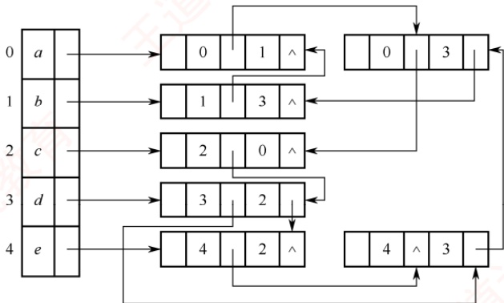

A. 0, 2
B. 2, 4
C. 2, 5
D. 3，4

#### 二、综合应用题

01. 已知带权有向图G的邻接矩阵如下图所示，请画出该带权有向图G。

| 0 | 15 | 2 | 12 | 8 | 8 | 8 |
| --- | --- | --- | --- | --- | --- | --- |
| 8 | 0 | 8 | 8 | 6 | 8 | 8 |
| 8 | ∞ | 0 | 8 | 8 | 4 | 8 |
| 8 | 8 | 8 | 0 | 8 | 8 | 3 |
| 8 | 8 | 8 | 8 | 0 | 8 | 9 |
| 8 | 8 | 8 | 5 | 8 | 0 | 10 |
| 4 8 |  | 8 | 8 | 8 | 8 | 0 |

02. 设图G=(V,E)以邻接表存储，如下图所示。画出其邻接矩阵存储及图G。

| 1 |  |  | 2 |  |  | 3 |  | 4 | ∧ |  |  |  |
| --- | --- | --- | --- | --- | --- | --- | --- | --- | --- | --- | --- | --- |
| 2 | a |  | 1 |  |  | 3 |  | 4 |  |  | 5 |  |
| 3 | • |  | 1 |  |  | 2 |  | 4 |  |  |  |  |
| 4 |  |  | 1 | • |  | 2 |  | 3 | ● |  | 5 |  |
| 5 |  |  | 2 |  |  | 4 |  |  |  |  |  |  |

03. 对n个顶点的无向图和有向图，分别采用邻接矩阵和邻接表表示时，试问:

1）如何判别图中有多少条边？

2）如何判别任意两个顶点i和j是否有边相连？

3）任意一个顶点的度是多少？

04. 如何对无环有向图中的顶点重新编号，使得该图的邻接矩阵中所有的1都集中到对角线以上？

05. 写出从图的邻接表表示转换成邻接矩阵表示的算法。

06.【2015统考真题】已知含有5个顶点的图G如右图所示。请回答下列问题:

1）写出图G的邻接矩阵A（行、列下标从0开始）。

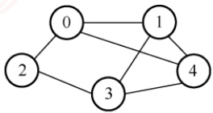

2）求A²，矩阵A²中位于0行3列元素值的含义是什么？

3）若已知具有n（n≥2）个顶点的图的邻接矩阵为B，则 $B^{m} (2 \leqslant m \leqslant n)$ 中非零元素的含义是什么？

07. 【2021统考真题】已知无向连通图G由顶点集V和边集E组成，|E>0，当G中度为奇数的顶点个数为不大于2的偶数时，G存在包含所有边且长度为|E|的路径（称为EL路径）。设图G采用邻接矩阵存储，类型定义如下:

```txt
typedef struct{ //图的定义
int numVertices,numEdges; //图中实际的顶点数和边数
char VerticesList[MAXV]; //顶点表。MAXV为已定义常量
int Edge[MAXV] [MAXV]; //邻接矩阵
```

```txt
}MGraph;
```

请设计算法 int IsExistEL (MGraph G)，判断 G 是否存在 EL 路径，若存在，则返回1，否则返回0。要求:

1）给出算法的基本设计思想。

2）根据设计思想，采用C或C++语言描述算法，关键之处给出注释。

3）说明你所设计算法的时间复杂度和空间复杂度。

08.【2023统考真题】已知有向图G采用邻接矩阵存储，类型定义如下:

```c
typedef struct{ //图的类型定义
int numVertices,numEdges; //图的顶点数和有向边数
char VerticesList[MAXV]; //顶点表，MAXV为已定义常量
int Edge[MAXV] [MAXV] ; //邻接矩阵
```

```txt
}MGraph;
```

将图中出度大于入度的顶点称为K顶点。例如，在右图中，顶点a和b为K顶点。

请设计算法 int printVertices(MGraph G)，对给定的任意非空有向图G，输出G中所有的K顶点，并返回K顶点的个数。要求:

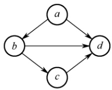

1）给出算法的基本设计思想。

2）根据设计思想，采用C或C++语言描述算法，关键之处给出注释。

### 6.2.7 答案与解析

#### 一、单项选择题

01. B

对于有n个顶点的图，若采用邻接矩阵表示，不考虑压缩存储，则存储空间大小为 $O ( n^{2} )$选项A正确。邻接表可用于存储无向图，只是把每条边都视为两条方向相反的有向边，因此需要存储两次，选项B 错误。因为邻接矩阵中对角线以下的元素全为0，所以若存在&lt;i,&gt;，则必有 i <j，由传递性可知图中路径的顶点编号是依次递增的，假设存在环 k→…→j→k，由题设可知k<j<k，矛盾，所以不存在环，拓扑序列必定存在，选项C正确。选项D显然正确。

**注意**

若邻接矩阵对角线以下（或以上）的元素全为0，则图中必然不存在环，即拓扑序列一定存在，但这并不能说明拓扑序列是唯一的。

02. C

除主对角线上的元素外，其余元素全为1，说明任意两个顶点之间都有边相连，因此该图一定是完全图。 xK

03. D

在无向图的邻接矩阵中，矩阵大小为 $n^{2}$ ，非零元素的个数为2e，所以零元素的个数为$n^{2}   -   2 e$ 。读者应掌握此题的变体，即当无向图变为有向图时，能够求出零的个数和非零的个数。

04. D

带权有向图的邻接矩阵中，0和∞表示的都不是有向边，而入度是由邻接矩阵的列中元素计算出来的；出度是由邻接矩阵的行中元素计算出来的。

**05. B、D**

有向图的入度是其第i列的非0元素之和，无向图的度是第i行或第i列的非0元素之和。

**06. B、B、D**

邻接矩阵的顶点数等于矩阵的行（列）数，有向图的边数等于矩阵中非零元素的个数，无向图的边数等于矩阵中非零元素个数的一半。

**注意**

本题中所给的矩阵为对称矩阵，若不是对称矩阵，则必然不可能是无向图。

07. B

邻接矩阵表示唯一是因为图中边的信息在矩阵中有确定的位置，邻接表不唯一是因为邻接表的建立取决于读入边的顺序和边表中的插入算法。

08. A

设图G的邻接矩阵为A，Aⁿ的元素 $a_{\phantom {n} i , \phantom {n} j}^{n}$ 等于从顶点 i 到 j 的长度为 n 的路径的数目，因此$a_{i , j}^{2} = 3$ 表示从顶点i到j存在3条长度为2的路径。该结论记住即可。

09. A

邻接表存储时，顶点数n决定了顶点表的大小，边数e决定了边表结点的个数，且无向图的

每条边存储两次，总存储空间为O(n+2e)。而邻接矩阵只与图的顶点数有关，为O(n²)。

10. D

无向图采用邻接表表示时，每条边存储两次，所以其边表结点的个数为偶数。题中边表结点为奇数个，所以必然是有向图，且有奇数条边。

11. C

题中的边表是不包括顶点表的。因为任何顶点u对应的边表中存放的都是以u为起点的边所对应的另一个顶点ν。从而ν在边表中出现的次数也就是它的入度。

12. B

最多有n(n-1)/2条边，每条边在邻接表中存储两次，因此边表结点最多为n(n-1)个。

13. A

建立图的邻接表需要遍历所有的顶点和边，每个顶点有一个顶点表结点，每条边需要创建一个边表结点并插入到相应的链表中。因此，共需n+2e次操作，时间复杂度为O(n+ e)。

14. C

与顶点ν相关的边包括出边和入边，对于出边，只需遍历ν的顶点表结点和其指向的边表；对于入边，则需遍历整个边表。先删除出边:删除ν的顶点表结点的单链表，出边数最多为n-1，时间复杂度为O(n)；再删除入边:扫描整个边表（扫描剩余全部顶点表结点及其指向的边表），删除所有的顶点ν的入边，时间复杂度为O(n+e)。因此总时间复杂度为O(n + e)。

15. C

为了求顶点ν的入度，只需要遍历邻接表中的所有边表，检查每条边是否指向顶点ν，这相当于遍历整个邻接表，因此算法的时间复杂度为O(n+e)。

16. D

无向图的邻接表中，第i个顶点的度为第i个链表中的结点数，所以选项A错。邻接表和邻接矩阵对于不同的操作各有优势，选项B和C都不准确。有向图顶点的度包括出度和入度，对于出度，需要遍历顶点表结点所对应的边表；对于入度，则需要遍历剩下的全部边表。

17. A

邻接多重表是无向图的存储结构。

18. B

十字链表是有向图的存储结构。

19. C

邻接矩阵A为非对称矩阵，说明图是有向图，度为入度与出度之和。各顶点的度是矩阵中此顶点对应的行（对应出度）和列（对应入度）的非零元素之和。

20. B

在邻接多重表中，统计一个顶点的入度、出度或度数（入度+出度）时，只需考虑所有的边结点。下图是邻接多重表的边结点的结构: XTI

| ivex | ilink | jvex | jlink | info |
| --- | --- | --- | --- | --- |
|  |  |  |  |  |

其中，ivex表示弧头的编号，ilink域指向下一个弧头相同的边结点，jvex表示弧尾的编号，jlink域指向下一个弧尾相同的边结点。根据定义可知:求x号顶点的入度时，只需统计jvex域等于x的边结点个数；求x号顶点的出度时，只需统计ivex域等于x的边结点个数；x号顶点的度数为入度和出度之和。顶点b的编号为1，统计可知:入度为1，出度为1，度数为2。顶点d的编号为3，统计可知:入度为1，出度为3，度数为4。 K 人 4)

#### 二、综合应用题

01. 【解答】

带权有向图G如右图所示。

02.【解答】

其邻接矩阵存储如下所示。

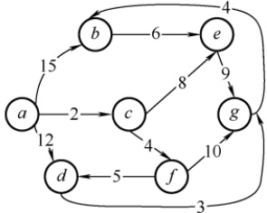

$$
\begin{bmatrix} 0 & 1 & 1 & 1 & 0 \\ 1 & 0 & 1 & 1 & 1 \\ 1 & 1 & 0 & 1 & 0 \\ 1 & 1 & 1 & 0 & 1 \\ 0 & 1 & 0 & 1 & 0 \end{bmatrix}
$$

在邻接表中，每条边存储了2次，在没有特殊说明时，通常默认其为无向图（当然，无向图也可视为具有对边的有向图）。该邻接表对应的图G如右图所示。

03.【解答】

1）对于邻接矩阵表示的无向图，边数等于矩阵中1的个数除以2；对于邻接表表示的无向图，边数等于边结点的个数除以2。

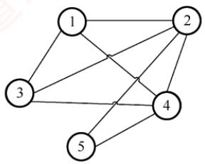

对于邻接矩阵表示的有向图，边数等于矩阵中1的个数；对于邻接表表示的有向图，边数等于边结点的个数。

2）在邻接矩阵表示的无向图或有向图中，对于任意两个顶点i和j，邻接矩阵中 arcs[i][j]或arcs[j][i]为1表示有边相连，否则表示无边相连。在邻接表表示的无向图或有向图中，对于任意两个顶点i和j，若从顶点表结点i出发找到编号为j的边表结点或从顶点表结点j出发找到编号为i的边表结点，表示有边相连；否则为无边相连。

3）对于邻接矩阵表示的无向图，顶点i的度等于第i行中1的个数；对于邻接矩阵表示的有向图，顶点i的出度等于第i行中1的个数；入度等于第i列中1的个数；度数等于它们的和。对于邻接表表示的无向图，顶点i的度等于顶点表结点i的单链表中边表结点的个数；对于邻接表表示的有向图，顶点i的出度等于顶点表结点i的单链表中边表结点的个数，顶点i的入度等于邻接表中所有编号为i的边表结点数；度数等于入度与出度之和。

04.【解答】

按各顶点的出度进行排序。n个顶点的有向图，其顶点的最大出度为 $n   -   1$ ，最小出度为0。这样排序后，出度最大的顶点编号为1，出度最小的顶点编号为n。之后，进行调整，即只要存在弧&lt;i,&gt;，就不管顶点j的出度是否大于顶点i的出度，都把i编号在顶点j的编号之前，因为只有 $i {\leqslant} j$ ，弧 $\textcircled{<} i , j \textgreater$ 对应的1才能出现在邻接矩阵的上三角。

通过后面小节的学习，会发现采用拓扑排序并依次编号是一种更为简便的方法。

05. 【解答】

算法思想:设图的顶点分别存储在数组 $\nabla \left[ \mathrm{n} \right]$ 中。首先初始化邻接矩阵。遍历邻接表，在依次遍历顶点v[i]的边链表时，修改邻接矩阵的第i行的元素值。若链表边结点的值为j，则置arcs[i][j]=1。遍历完邻接表时，整个转换过程结束。此算法对于无向图、有向图均适用。

算法的实现如下:

```javascript
void Convert(ALGraph &G,int arcs[M] [N]){
//此算法将邻接表方式表示的图G 转换为邻接矩阵arcs
for(i=0;i<n;i++) { //依次遍历各顶点表结点为头的边链表
p=(G->v[i]).firstarc; //取出顶点i的第一条出边
while(p!=NULL) { //遍历边链表
arcs[i][p->adjvex]=1;
p=p->nextarc; //取下一条出边
//while
//for
```

06. 【解答】

考查图的邻接矩阵的性质。

1）图G的邻接矩阵A如下:

$$
\boldsymbol{A} = \begin{bmatrix} 0 & 1 & 1 & 0 & 1 \\ 1 & 0 & 0 & 1 & 1 \\ 1 & 0 & 0 & 1 & 0 \\ 0 & 1 & 1 & 0 & 1 \\ 1 & 1 & 0 & 1 & 0 \end{bmatrix}
$$

2）A²如下:

```csv
12213
31031
0２２0２
13212
31031
```

0行3列的元素值3表示从顶点0到顶点3之间长度为2的路径共有3条。

3) $\boldsymbol{B}^{m} (2 \leqslant m \leqslant n)$ 中位于i行j列 $(0 \leqslant i, j \leqslant n-1)$ 的非零元素的含义是，图中从顶点i到顶点j的长度为m的路径条数。

07.【解答】

1）算法的基本设计思想:

本算法题属于送分题，题干已经告诉我们算法的思想。对于采用邻接矩阵存储的无向图，在邻接矩阵的每一行（列）中，非零元素的个数为本行（列）对应顶点的度。可以依次计算连通图G中各顶点的度，并记录度为奇数的顶点个数，若个数为0或2，则返回1，否则返回0。

2）算法实现

```javascript
int IsExistEL(MGraph G){
//采用邻接矩阵存储，判断图是否存在EL路径
int degree,i,j,count=0;
for(i=0;i<G.numVertices;i++) { 直
degree=0;
for(j=0;j<G.numVertices;j++)
degree+=G.Edge[i][j]; //依次计算各个顶点的度
if(degree%2!=0)
count++; //对度为奇数的顶点计数
1
if(count==0l|count==2)
return 1; //存在EL 路径，返回1
else
return 0; //不存在 EL 路径，返回 0
```

3）时间复杂度和空间复杂度

算法需要遍历整个邻接矩阵，所以时间复杂度为 $O ( n^{2} )$ ，空间复杂度为O(1)。

08.【解答】

**1）算法的基本设计思想:**

采用邻接矩阵表示有向图时，一行中1的个数为该行对应顶点的出度，一列中1的个数为该列对应顶点的入度。使用一个初值为零的计数器记录K顶点的个数。对图G的每个顶点，根据邻接矩阵计算其出度 outdegree 和入度 indegree。若 $\mathtt {outdegree {-} indegree {>} 0}$ ，则输出该顶点且计数器加1。最后返回计数器的值。

**2）用C语言描述的算法:**

```c
int printVertices (MGraph G) {
//采用邻接矩阵存储，输出K顶点，返回个数
int indegree,outdegree,k,m,count=0;
for(k=0;k<G.numVertices;k++) {
indegree=outdegree=0;
for(m=0;m<G.numVertices;m++) //计算顶点的出度
outdegree+=G.Edge[k] [m];
for(m=0;m<G.numVertices;m++) //计算顶点的入度
if(outdegreeindegeem][k];
printf("%c",G.VerticesList[k]);
count++;
1
return count; //返回K顶点的个数
```

### 6.3.4 本节试题精选

#### 一、单项选择题

01.下列关于广度优先算法的说法中，正确的是（）。

I. 当各边的权值相等时，广度优先算法可以解决单源最短路径问题I. 当各边的权值不等时，广度优先算法可用来解决单源最短路径问题Ⅲ.广度优先遍历算法类似于树中的后序遍历算法

IV. 实现图的广度优先算法时，使用的数据结构是队列
A. I、IV
B. II、III、IV
C. II、IV
D. I、III、IV

02.下列关于图的说法中，错误的是（）。I. 对一个无向图进行深度优先遍历时，得到的深度优先遍历序列是唯一的Ⅱ. 若有向图不存在回路，即使不用访问标志位，同一顶点也不会被访问两次Ⅲ. 采用深度优先遍历或拓扑排序算法可以判断一个有向图中是否有环（回路）IV. 对任何非强连通图必须2次或以上调用广度优先遍历算法才可访问所有的顶点
A. I、II、III
B. II、III
C. I、ⅡI
D. I、II、IV

03. 对于一个非连通无向图G，采用深度优先遍历访问所有顶点，在 DFSTraverse 函数（见考点讲 DFS部分）中用 DFS的次数正好分量数 D. 不确定

04. 对一个有 n 个顶点、e条边的图采用邻接表表示时，进行 DFS 遍历的时间复杂度为（），空间复杂度为（）；进行BFS遍历的时间复杂度为（），空间复杂度为（）。
A. O(n)
B. O(e)
C. $O ( n + e )$
D. O(1)

05. 图的广度优先遍历算法中使用队列作为其辅助数据结构，那么在算法执行过程中，每个顶点的入队次数最多为（）。
A. 1
B. 2
C. 3 7
D. 4

06. 对有n 个顶点、e条边的图采用邻接矩阵表示时，进行DFS 遍历的时间复杂度为（），进行BFS遍历的时间复杂度为（）
A. $O ( n^{2} )$
B. O(e)
C. $O ( n + e )$
D. $O ( e^{2} )$

07. 无向图 $G   =   ( V , E )$ ，其中 $V   = \{a , b , c , d , e , f \}$ $\it {E} = \{( a , b ) , ( a , e ) , ( a , c ) , ( b , e ) , ( c , f ) , ( f , d ) \}$ (e,d)}，对该图从a开始进行深度优先遍历，得到的顶点序列正确的是（）。
A. $a , b , e , c , d , f$
B. $a , c , f , e , b , d$
C. $a , e , b , c , f , d$
D. $a , e , d , f , c , b$

08. 如右图所示，在下面的5个序列中，符合深度优先遍历的序列个数是（）。1. $aeb f_{Ḋ} d c Ḍ$ 2. acfdeb 3. $aedfcb$ 4. $aefdbc$ 5. aecfdb
C. 3
D. 2

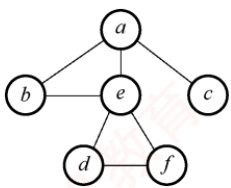

09. 用邻接表存储的图的深度优先遍历算法类似于树的（），而其广度优先遍历算法类似于树的（）。
A. 中序遍历
B. 先序遍历
C. 后序遍历
D. 按层次遍历

10.一个有向图G的邻接表存储如下图所示，从顶点1出发，对图G调用深度优先遍历所得顶点序列是（）；按广度优先遍历所得顶点序列是（）

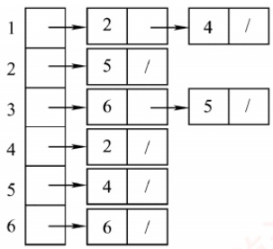

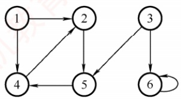

A. 125436
B. 124536 V
C. 124563
D. 362514

11. 无向图 $G   =   ( V , E )$ ，其中 $V = \{a , b , c , d , e , f \} , \quad E = \{( a , b ) , ( a , e ) , ( a , c ) , ( b , e ) , ( c , f ) , ( f , d ) \}$ $( e , d ) \}$ 。对该图进行深度优先遍历，不能得到的序列是（）。
A. $acfdeb$
B. $aebdfc$
C. $aed f_{} {c b}$
D. $abecdf$

12. 判断有向图中是否存在回路，除拓扑排序外，还可利用（）。（注:涉及下节内容）
A. 求关键路径的方法
B. 求最短路径的 Dijkstra 算法
C. 深度优先遍历算法
D. 广度优先遍历算法

13. 设无向图 $G   =   ( V , E )$ 和 $G^{\prime}   =   ( V^{\prime} , E^{\prime} )$ ，若G'是G的生成树，则下列说法错误的是（）。
A. G'为 G的子图
B. G'为 G 的连通分量
C. G'为 G的极小连通子图且 $V   = V^{\prime}$
D. G'是 G的一个无环子图 收育

14. 图的广度优先生成树的树高比深度优先生成树的树高（）。
A. 小或相等
B. 小
C. 大或相等
D. 大

15. 【2012统考真题】对有n个顶点、e条边且使用邻接表存储的有向图进行广度优先遍历，其算法的时间复杂度为（）。
A. O(n)
B. O(e)
C. $O ( n + e )$ $O ( n e )$

16.【2013统考真题】下列选项中，不是右图所示无向图的广度优先遍历序列的是（）。
A. $h , c , a , b , d , e , g , f$
B. $e , a , f , g , b , h , c , d$
C. $d , b , c , a , h , e , f , g$ 直机教育
D. $a , b , c , d , h , e , f , g$

$$
G = ( V , E )
$$

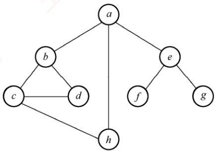

$$
V   =
$$

$$
\{V_{0} , V_{1} , V_{2} , V_{3} \}
$$

$$
E = \{< v_{0},v_{1} > , < v_{0},v_{2} > , < v_{0},v_{3} > ,
$$

$< \scriptstyle {\boldsymbol {v}}_{1} , \scriptstyle {\boldsymbol {v}}_{3} > \}$ 。若从顶点 $V_{0}$ 开始对图进行深度优先遍历，则可能得到的不同遍历序列个数是（）。
A. 2
B. 3
C. 4
D. 5

18.【2016统考真题】下列选项中，不是右图所示深度优先搜索序列的是（）。
A. $V_{1},V_{5},V_{4},V_{3},V_{2}$
B. $V_{1} , V_{3} , V_{2} , V_{5} , V_{4}$
C. $V_{1},V_{2},V_{5},V_{4},V_{3}$
D. $V_{1} , V_{2} , V_{3} , V_{4} , V_{5}$ V

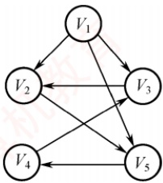

#### 二、综合应用题

01. 图 $G = ( V ,   E )$ 以邻接表存储，如下图所示，试画出图G的深度优先生成树和广度优先生成树（假设从顶点1开始遍历）。

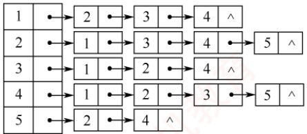

02. 给定一个连通无向图，采用邻接表存储，将图的所有顶点分别染成红色或蓝色，若存在一种染色方法使图中每条边的两个顶点的颜色都不相同，则称这个图能被二分。

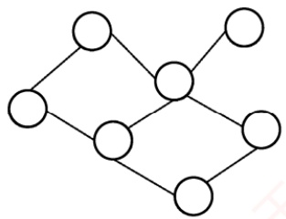

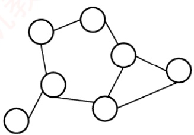

1）判断上面两个无向图是否能被二分，若能被二分，则请标出每个顶点的颜色。

2）请设计一种算法用来判断图是否能被二分，仅用语言描述算法的思想即可。

3）给出你设计的算法的时间复杂度和空间复杂度。

03. 试设计一个算法，判断一个无向图G是否为一棵树。若是一棵树，则算法返回true，否则返回false。

04. 分别采用基于深度优先遍历和广度优先遍历算法判别以邻接表方式存储的有向图中是否存在由顶点 $v_{i}$ 到顶点v的路径（i≠j）。注意，算法中涉及的图的基本操作必须在此存储结构上实现。

05. 假设图用邻接表表示，设计一个算法，输出从顶点 $V_{i}$ 到顶点 $V_{j}$ 的所有简单路径。

### 6.3.5 答案与解析

#### 一、单项选择题

01. A

广度优先搜索以起始顶点为中心，一层一层地向外层扩展遍历图的顶点，因此无法考虑到边权值，只适合求边权值相等的图的单源最短路径。广度优先搜索相当于树的层序遍历，说法Ⅲ错误。广度优先搜索需要用到队列，深度优先搜索需要用到栈，说法IV正确。

02. D

图的深度优先遍历序列通常是不唯一的，说法Ⅰ错误。图1是一个不存在回路的有向图，从顶点1开始执行广度优先遍历，若不设置访问标志位，则会重复访问顶点3，说法Ⅱ错误。深度优先遍历（见本节后面习题的解析）或拓扑排序算法可以判断有向图中是否有环，说法Ⅲ正确。图2是一个非强连通图，但从顶点1开始调用一次广度优先遍历算法就可访问所有顶点，说法IV错误。

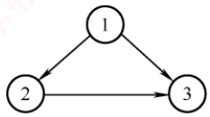

图1

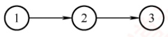

图2

03. C

DFS（或BFS）可用来计算无向图的连通分量数，因为一次遍历必然会将一个连通图中的所有顶点都访问到，所以计算图的连通分量数正好是DFSTraverse()中DFS被调用的次数。

**04.C、A、C、A**

深度优先遍历时，每个顶点表结点和每个边表结点均查找一次，每个顶点递归调用一次，需要借助一个递归工作栈；而广度优先遍历时，也是每个顶点表结点和每个边表结点均查找一次，需要借助一个辅助队列。因此，时间复杂度都为 $O ( n + e )$ ，空间复杂度都为O(n)。

05. A

在图的广度优先遍历算法中，每个顶点被访问后立即做访问标记并入队。若队列不空，则队首顶点出队，若该顶点的邻接顶点未被访问，则访问之，做访问标记并入队；若被访问过，则跳过，如此反复，直至队空。因此，在广度优先遍历过程中，每个顶点最多入队一次。

**06. A、A**

采用邻接矩阵表示时，查找一个顶点所有出边的时间复杂度为 O(n)，共有 n个顶点，所以时间复杂度均为 $O ( n^{2} )$ 0

07. D

画出草图后，此类题可以根据边的邻接关系快速排除错误选项。以选项A为例，在遍历到e之后，应该访问与e邻接但未被访问的顶点，(e,c)显然不在边集中。

08. D

仅1和4正确。以2为例，遍历到c之后，与c邻接且未被访问的顶点为空集，所以应为a的邻接点b或e入栈。以3为例，因为遍历要按栈退回，所以是先b后c，而不能先c后b。

**09. B、D**

图的深度优先搜索类似于树的先根遍历，即先访问顶点，再递归向外层顶点遍历，都采用回溯算法。图的广度优先搜索类似于树的层序遍历，即一层一层向外层扩展遍历，都需要采用队列来辅助算法的实现。

**10. A、B**

DFS 序列产生的路径为<1, 2>, <2, 5>, <5, 4>, <3, 6>； BFS 序列产生的路径为<1, 2>, <1, 4>, <2, $5>,<3,6>$ 0 X

11. D

画出V和E对应的图G，然后根据搜索算法求解。

**注意**

为什么本题序列是不唯一的，而上题序列却是唯一的呢？

因为上题给出了具体的存储结构，此时就必须按照算法的过程来执行，每个顶点的邻接点的顺序已固定，但本题中每个顶点的邻接点的顺序是非固定的。 北K

12. C

利用深度优先遍历可以判断图G中是否存在回路。

对于无向图来说，若深度优先遍历过程中遇到了回边，则必定存在环；对于有向图来说，这条回边可能是指向深度优先森林中另一棵生成树上的顶点的弧；但是，从有向图的某个顶点v出发进行深度优先遍历时，若在DFS(v)结束之前出现一条从顶点 u到顶点ν的回边，且 u在生成树上是ν的子孙，则有向图必定存在包含顶点ν和顶点u的环。

13. B

连通分量是无向图的极大连通子图，其中极大的含义是将依附于连通分量中顶点的所有边都加上，所以连通分量中可能存在回路，这样就不是生成树了。

**注意**

极大连通子图是无向图（不一定连通）的连通分量，极小连通子图是连通无向图的生成树。极小和极大是在满足连通的前提下，针对边的数目而言的。极大连通子图包含连通分量的全部边；极小连通子图（生成树）包含连通图的全部顶点，且使其连通的边数最少。

14. A

对于无向图的广度优先搜索生成树，起点到其他顶点的路径是图中对应的最短路径，即所有生成树中树高最小。此外，深度优先总是尽可能“深”地搜索图，因此其路径也尽可能长，所以深度优先生成树的树高总是大于或等于广度优先生成树的树高。

15. C

广度优先遍历需要借助队列实现。采用邻接表存储方式对图进行广度优先遍历时，每个顶点均需入队一次（顶点表遍历），所以时间复杂度为 $O ( n )$ ，在搜索所有顶点的邻接点的过程中，每条边至少访问一次（出边表遍历），所以时间复杂度为 $O ( e )$ ，算法总的时间复杂度为 $O ( n + e )$

16. D

只要掌握DFS和BFS的遍历过程，便能轻易解决。逐个代入，手工模拟，选项D是深度优先遍历，而不是广度优先遍历。

17. D

画出该有向图，如右图所示。采用图的深度优先遍历，共有5种可能: $< v_{0}, v_{1}, v_{3},$ $v_{2}>,<v_{0},v_{2},v_{3},v_{1}>,<v_{0},v_{2},v_{1},v_{3}>,<v_{0},v_{3},v_{2},v_{1}>,<v_{0},v_{3},v_{1},v_{2}>。$ 自

18. D

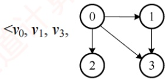

按深度优先遍历的策略进行遍历。对于选项A:先访问 $V_{1}$ ，然后访问与 $V_{1}$ 邻接且未被访问的任意一个顶点（满足的有 $V_{2} , ~ V_{3}$ 和 $V_{5} )$ ，此时访问 $V_{5}$ ，然后从 $V_{5}$ 出发，访问与 $V_{5}$ 邻接且未被访问的任意一个顶点（满足的只有 $V_{4} )$ ，然后从 $V_{4}$ 出发，访问与 $V_{4}$ 邻接且未被访问的任意一个顶点（满足的只有 $V_{3} )$ ，然后从 $V_{3}$ 出发，访问与 $V_{3}$ 邻接且未被访问的任意一个顶点（满足的只有 $V_{2} )$ ，结束遍历。选项B和C的分析方法与A相同。对于选项D，首先访问 $V_{1}$ ，然后从 $V_{1}$出发，访问与 $V_{1}$ 邻接且未被访问的任意一个顶点（满足的有 $V_{2} , ~ V_{3}$ 和 $V_{5} )$ ，然后从 $V_{2}$ 出发，访问与 $V_{2}$ 邻接且未被访问的任意一个顶点（满足的只有 $V_{5} )$ ，按规则本应该访问 $V_{5}$ ，但选项D却访问了 $V_{3}$ ，错误。

#### 二、综合应用题

01.【解答】

根据G的邻接表不难画出图(a)。

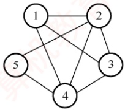

(a) 图G

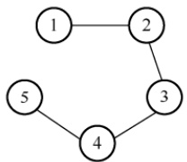

(b)深度优先生成树

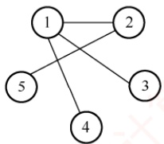

(c)广度优先生成树

1）采用深度优先遍历。深度优先搜索总是尽可能“深”地搜索图，根据存储结构可知，深度优先搜索的路径次序为(1,2),(2,3),(3,4),(4,5)，深度优先生成树如图(b)所示。需要注意的是，当存储结构固定时，生成树的树形也就固定了，因此不能先搜索(1,3)。

2）采用广度优先遍历。广度优先搜索总是尽可能“广”地搜索图，一层一层地向外扩展，根据存储结构可知广度优先搜索的路径次序为(1,2),

(1, 3),(1,4),(2,5)，广度优先生成树如图(c)所示。

02. 【解答】

1）右图不能被二分，左图能被二分，染色情况如右图所示。

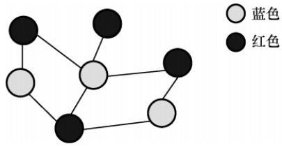

2）从任意一个顶点开始，将其染成红色，并从该顶点开始对整个图进行遍历，在遍历过程中，若当前遍历的顶点 a有一条边指向b，则可能出现三种情况:①b未被染色，将它染成与顶点a不同的颜色，并且继续遍历与 b相连的顶点；② a与b的颜色相同，说明该图不能被二分，直接返回；③a与b的颜色不同，跳过b点。

3）上述遍历无论是使用深度优先还是使用广度优先，时间复杂度都为O(n+ m)，其中的n和m分别是顶点数和边数。需要一个数组来存储各顶点的颜色及是否已访问，空间复杂度为 O(n)。

03.【解答】

一个无向图G是一棵树的条件是，G必须是无回路的连通图或有n-1条边的连通图。这里采用后者作为判断条件。对连通的判定，可以用能否一次遍历全部顶点来实现。可以采用深度优先搜索算法在遍历图的过程中统计可能访问到的顶点个数和边的条数，若一次遍历就能访问到n个顶点和n-1条边，则可断定此图是一棵树。算法实现如下:

```c
bool isTree(Graph& G) {
for(i=1;i<=G.vexnum;i++)
visited[i]=FALSE; //访问标记 visited[]初始化
int Vnum=0,Enum=0; //记录顶点数和边数
DFS(G,1,Vnum,Enum,visited);
if(Vnum==G.vexnum&&Enum==2*(G.vexnum-1))
return true; //符合树的条件
else
return false; //不符合树的条件
void DFS(Graph& G,int v,int& Vnum,int& Enum,int visited[])
//深度优先遍历图 G，统计访问过的顶点数和边数，通过 Vnum 和Enum 返回
visited[v]=TRUE;Vnum++; //作访问标记，顶点计数
int w=FirstNeighbor(G,v); //取v的第一个邻接顶点
while(w!=-1) { //当邻接顶点存在
Enum++; //边存在，边计数
if(!visited[w]) //当该邻接顶点未访问过
DFS (G,w,Vnum,Enum,visited);
w=NextNeighbor(G,v,w);
```

04. 【解答】

两个不同的遍历算法都采用从顶点v出发，依次遍历图中每个顶点，直到搜索到顶点v，若能够搜索到vyj，则说明存在由顶点v到顶点vj的路径。

深度优先遍历算法的实现如下:

```javascript
int visited[MAXSIZE]={0}; //访问标记数组
void DFS(ALGraph G,int i,int j,bool &can reach){
/深度优先判断有向图 G 中顶点 v到顶点 v是否有路径，用 can reach 来标识
if(i==j){
can reach=true;
return; //i就是j 育
visited[i]=1; //置访问标记
for(int p=FirstNeighbor(G,i);p>=0;p=NextNeighbor(G,i,p))
if(!visited[p]&&!can reach) //递归检测邻接点
DFS(G,p,j,can reach);
```

广度优先遍历算法的实现如下:

```javascript
int visited[MAXSIZE]={0}; //访问标记数组
int BFS(ALGraph G,int i,int j){
//广度优先判断有向图G 中顶点v到顶点v是否有路径，若是，则返回1，否则返回0
InitQueue(Q)； EnQueue(Q,i); //顶点i 入队
while(!QueueEmpty(Q)){ //非空循环
DeQueue (Q,i) ; 道 //队头顶点出队
visited[i]=1; //置访问标记
if(i==j) return 1;
for(int p=FirstNeighbor(G,i);p;p=NextNeighbor(G,i,p)){
//检查所有邻接点
if(p==j) //若p==j，则查找成功
return 1;
if(!visited[p]) { //否则，顶点p入队
visited(pl=); 算
return 0; 道
```

本题也可以这样解答:调用以 i 为参数的 DFS(G,i) 或 BFS(G, i)，执行结束后判断visited[j]是否为 TRUE，若是，则说明 vj已被遍历，图中必存在由 vi到v的路径。但此种解法每次都耗费最坏时间复杂度对应的时间，需要遍历与v连通的所有顶点。

05.【解答】

本题采用基于递归的深度优先遍历算法，从顶点u出发，递归深度优先遍历图中顶点，若访问到顶点v，则输出该搜索路径上的顶点。为此，设置一个path数组来存放路径上的顶点（初始为空），α表示路径长度（初始为-1）。查找从顶点u到v的简单路径过程说明如下（假设查找函数名为FindPath()）:

1) FindPath(G,u,v,path,d):d++;path[d]=u；若找到 u 的未访问过的相邻顶点u1，则继续下去，否则置visited[u]=0 并返回。

2) FindPath(G,u1,v,path,d):d++;path[d]=u1；若找到 u1 的未访问过的相邻顶点u2，则继续下去，否则置visited[u1]=0。

3）以此类推，继续上述递归过程，直到ui=v，输出path。

算法实现如下:

```c
void FindPath(AGraph *G,int u,int v,int path[],int d){
int w;
ArcNode *p;
d++; //路径长度增1
path[d]=u; //将当前顶点添加到路径中
visited[u]=1; //置已访问标记
if(u==v) //找到一条路径则输出
print(path[]); //输出路径上的顶点
p=G->adjlist[u]. firstarc; //p 指向 u 的第一个相邻点
while(p!=NULL) {
w=p->adjvex; //若顶点w未访问，递归访问它
if(visited[w]==0)
FindPath(G,w,v,path,d);
p=p->nextarc; //p 指向 u的下一个相邻点
visited[u]=0; //恢复环境，使该顶点可重新使用
```

### 6.4.6 本节试题精选

#### 一、单项选择题

01. 任何一个无向连通图的最小生成树（）。
A. 有一棵或多棵
B. 只有一棵
C. 一定有多棵
D. 可能不存在

02. 用 Prim算法和Kruskal算法构造图的最小生成树，所得到的最小生成树（）。
A. 相同
B. 不相同
C. 可能相同，可能不同
D. 无法比较

03.下列关于图的生成树和最小生成树的叙述中，正确的是（）。
A. 只要无向连通图中没有权值相同的边，则其最小生成树唯一
B. 只要无向图中有权值相同的边，则其最小生成树一定不唯一
C. 从n个顶点的连通图中选取n-1条权值最小的边，即可构成最小生成树
D. 设连通图G含有n个顶点，则含有n个顶点、n-1条边的子图一定是G的生成树

04. 设有n个顶点的无向连通图的最小生成树不唯一，则下列说法中正确的是（）
A. 图的边数一定大于n-1
B. 图的权值最小的边一定有多条
C. 图的最小生成树的代价不一定相等
D. 图的各条边的权值不相等

05. 用Prim算法求一个带权连通图的最小生成树，在算法执行的某个时刻，已选取的顶点集合 U= {1, 2, 3}，已选取的边集合 TE = {(1, 2),(2, 3)}，要选取下一条权值最小的边，应当从（）组中选取。
A. {(1, 4), (3, 4), (3, 5), (2, 5)}
B. {(3, 4), (3, 5), (4, 5), (1, 4)}
C. {(1, 2), (2, 3), (3, 5)}
D. {(4, 5), (1, 3), (3, 5)}

06. 用Kruskal算法求一个带权连通图的最小生成树，在算法执行的某个时刻，已选取的边集合TE= {(1,2),(2, 3),(3,5)}，要选取下一条权值最小的边，不可能选取的边是（）。
A. (3, 6)
B. (2, 4)
C. (1,3)
D. (1, 4)

07.下列关于图的最短路径的相关叙述中，正确的是（）。
A. 最短路径一定是简单路径
B. Dijkstra算法不适合求有回路的带权图的最短路径
C. Dijkstra算法不适合求任意两个顶点的最短路径
D. Dijkstra算法可以正确处理含有负权边的图

08.下列关于图的最短路径的相关叙述中，正确的是（）。I. Dijkstra 算法求单源最短路径不允许边的权为负II. Dijkstra算法求每对顶点间的最短路径的时间复杂度为 $O ( n^{2} )$ Ⅲ. Floyd算法求每对顶点间的最短路径允许边的权为负，但不允许含有负权的回路
A. I、Ⅱ和ⅢI
B. 仅Ⅰ
C. I和ⅢII
D. ⅡI和ⅢII

09. 已知带权连通无向图 $G   =   ( V , E )$ ，其中 $V = \{v_{1} , v_{2} , v_{3} , v_{4} , v_{5} , v_{6} , v_{7} \}$ $E = \{( v_{1} , v_{2} ) 10 , ( v_{1} , v_{3} ) 2 ,$ $(v_{3}, v_{4})2, (v_{3}, v_{6})11, (v_{2}, v_{5})1, (v_{4}, v_{5})4, (v_{4}, v_{6})6, (v_{5}, v_{7})7, (v_{6}, v_{7})3\}$ (注:顶点偶对括号外的数据表示边上的权值），从源点 $v_{1}$ 到顶点 $v_{7}$ 的最短路径上经过的顶点序列是（）
A. $v_{1},v_{2},v_{5},v_{7}$
B. $v_{1} , v_{3} , v_{4} , v_{6} , v_{7}$
C. $v_{1},v_{3},v_{4},v_{5},v_{7}$
D. $v_{1} , v_{2} , v_{5} , v_{4} , v_{6} , v_{7}$ 算机

10. 用 Dijkstra算法求一个带权有向图的从顶点0出发的最短路径，在算法执行的某个时刻，已求得的最短路径的顶点集合S={0,2,3,4}，下一个选取的目标顶点是顶点1，则可能修改的最短路径是（）。
A. 从顶点0到顶点3的最短路径
B. 从顶点0到顶点2的最短路径
C. 从顶点2到顶点4的最短路径
D. 从顶点0到顶点1的最短路径

11. 下面的（）方法可以判断出一个有向图是否有环（回路）。I. 深度优先遍历 Ⅱ. 拓扑排序 I. 求最短路径 IV. 广度优先遍历
A. I、II、IV
B. I、ⅢII、IV
C. I、ⅡI、III
D. 全部可以

12. 在有向图G的拓扑序列中，若顶点 $v_{i}$ 在顶点 $v_{j}$ 之前，则不可能出现的情形是（）。
A. G中有弧 $<_{v_{i} , \; v_{j} >}$
B. G中有一条从 $v_{i}$ 到 $v_{j}$ 的路径
C. G 中没有弧 $<_{V_{i} , V_{j} >}$ 道
D. G中有一条从 $v_{j}$ 到 $v_{i}$ 的路径

13.下列关于拓扑排序的说法中，错误的是（）。I. 若某有向图存在环路，则该有向图一定不存在拓扑排序Ⅱ. 在拓扑排序算法中为暂存入度为零的顶点，可以使用栈，也可以使用队列Ⅲ. 若有向图的拓扑有序序列唯一，则图中每个顶点的入度和出度最多为1 IV. 若有向图的拓扑有序序列唯一，则图中入度为0和出度为0的顶点都仅有1个
A. I、III、IV
B. III、IV
C. II、IV
D. III

14. 下列关于拓扑排序的说法中，正确的是（）。I. 顶点数大于1的强连通图不能进行拓扑排序Ⅱ. 在一个有向图的拓扑序列中，若顶点a在顶点b之前，则图中必有一条弧 ${\it {. 4 a}} ,$ b> Ⅲ. 若有向无环图的拓扑序列唯一，则可以唯一确定该图
A. I和ⅡI
B. I、ⅡI和ⅢII
C. 仅I
D. I和ⅢII

15. 若一个有向图的顶点不能排成一个拓扑序列，则判定该有向图（）。
A. 含有多个出度为0的顶点
B. 是个强连通图
C. 含有多个入度为0的顶点
D. 含有顶点数大于1的强连通分量

16. 右图所示有向图的所有拓扑序列共有（）个。
A. 4
B. 6
C. 5
D. 7

17. 已知有向图 G = (V, E)，其中 $V = \{v_{1}, v_{2}, v_{3}, v_{4}, v_{5}, v_{6},$ $| v_{7} \rangle$ $E = \{< \nu_{1} , \nu_{2} > , < \nu_{1} , \nu_{3} > , < \nu_{1} , \nu_{4} > , < \nu_{2} , \nu_{5} > , < \nu_{3} , \nu_{5} > , < \nu_{3} , \nu_{6} > , < \nu_{5} , \nu_{7} > , < \nu_{6} , \nu_{7} > , < \nu_{4} ,$ $\scriptstyle v_{6} > \scriptstyle {\big \}}$ ，G的拓扑序列是（）。
A. $\{v_{1} , v_{3} , v_{4} , v_{6} , v_{2} , v_{5} , v_{7} \}$
B. $\{v_{1} , v_{3} , v_{2} , v_{6} , v_{4} , v_{5} , v_{7} \}$
C. $\{v_{1} , v_{3} , v_{4} , v_{5} , v_{2} , v_{6} , v_{7} \}$
D. $\{v_{1} , v_{2} , v_{5} , v_{3} , v_{4} , v_{6} , v_{7} \}$

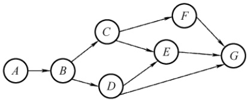

18. 下列哪种图的邻接矩阵是对称矩阵？（）
A. 有向网
B. 无向图
C. AOV 网
D. AOE 网

19. 若一个有向图具有有序的拓扑排序序列，则它的邻接矩阵必定为（）。
A. 对称
B. 稀疏
C. 三角
D. 一般

20. 用 DFS 算法遍历一个无环有向图，并在 DFS 算法退栈返回时输出相应的顶点，则输出的顶点序列是（）。
A. 逆拓扑有序
B. 拓扑有序
C. 无序的
D. 无法确定

21.下列关于图的说法中，正确的是（）。I. 有向图中顶点V的度等于其邻接矩阵中第V行中1的个数Ⅱ.无向图的邻接矩阵一定是对称矩阵，有向图的邻接矩阵一定是非对称矩阵I. 在带权图G的最小生成树 $G_{1}$ 中，某条边的权值可能会超过未选边的权值IV. 若有向无环图的拓扑序列唯一，则可以唯一确定该图
A. I、ⅡI和ⅢII
B. III和 IV
C. III
D. IV

22. 下图所示的 AOE网中，关键路径长度为（）。
A. 16
B. 17
C. 18
D. 19

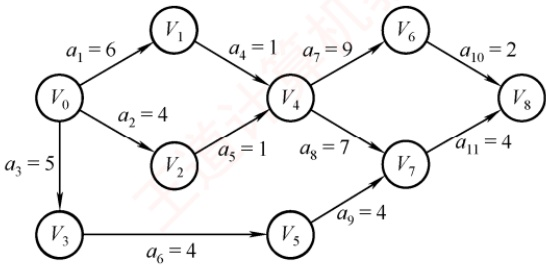

23. 若某带权图为 G = (V, E)，其中 $V = \{v_{1}, v_{2}, v_{3}, v_{4}, v_{5}, v_{6}, v_{7}, v_{8}, v_{9}, v_{10} \}, E = \{< v_{1}, v_{2} > 5, < v_{1},$ $\mathrm{v}_{3}>6,<\mathrm{v}_{2}, \mathrm{v}_{5}>3,<\mathrm{v}_{3}, \mathrm{v}_{5}>6,<\mathrm{v}_{3}, \mathrm{v}_{4}>3,<\mathrm{v}_{4}, \mathrm{v}_{5}>3,<\mathrm{v}_{4}, \mathrm{v}_{7}>1,<\mathrm{v}_{4}, \mathrm{v}_{5}>4,<\mathrm{v}_{5}, \mathrm{v}_{6}>4,<\mathrm{v}_{5}, \mathrm{v}_{7}>2,<\mathrm{v}_{6}$ $v_{10} > 4, < v_{7}, v_{9} > 5, < v_{8}, v_{9} > 2, < v_{9}, v_{10} > 2 \}$ （注:边括号外的数据表示边上的权值），则G的关键路径的长度为（）。
A. 19
B. 20
C. 21
D. 22

24.下面关于求关键路径的说法中，不正确的是（）。
A. 求关键路径是以拓扑排序为基础的 道
B. 一个事件的最早发生时间与以该事件为始的弧的活动的最早开始时间相同
C. 一个事件的最迟发生时间是以该事件为尾的弧的活动的最迟开始时间与该活动的持续时间的差
D. 任何一个活动的持续时间的改变可能会影响关键路径的改变

25.下列关于AOE网的关键路径的说法中，正确的是（）。I. 改变网上某一关键路径上的任意一个关键活动后，必将产生不同的关键路径Ⅱ. 关键路径上活动的时间延长多少，整个工期也就随之延长多少Ⅲ. 缩短关键路径上任意一个关键活动的持续时间可缩短关键路径长度IV. 缩短所有关键路径上共有的任意一个关键活动的持续时间可缩短关键路径长度

V. 缩短多条关键路径上共有的任意一个关键活动的持续时间可缩短关键路径长度
A. Ⅱ和 V
B. I、ⅡI和IV
C. ⅡI和IV
D. I和IV

26.在求AOE网的关键路径时，若该有向图用邻接矩阵表示且第i列值全为∞，则（）。
A. 若关键路径存在，第i个顶点一定是起点
B. 若关键路径存在，第i个顶点一定是终点
C. 关键路径不存在
D. 该有向图对应的无向图存在多个连通分量

27.【2010统考真题】对右图进行拓扑排序，可得不同拓扑序列的个数是（）。
A. 4
B. 3
C. 2
D. 1

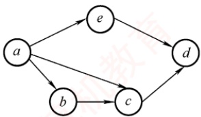

28.【2012统考真题】下列关于最小生成树的叙述中，正确的是（）。I. 最小生成树的代价唯一 道计Ⅱ. 所有权值最小的边一定会出现在所有的最小生成树中Ⅲ. 使用Prim算法从不同顶点开始得到的最小生成树一定相同IV. 使用 Prim 算法和 Kruskal 算法得到的最小生成树总不相同
A. 仅I
B. 仅Ⅱ
C. 仅I、Ⅲ
D. 仅ⅡI、IV

29.【2012统考真题】对右图所示的有向带权图，若采用Dijkstra 算法求从源点 a 到其他各顶点的最短路径，则得到的第一条最短路径的目标顶点是b，第二条最短路径的目标顶点是c，后续得到的其余各最短路径
A. 的目标顶点依次是（）。 $d , e , f$
B. $e , d , f$ 道
C. f, d, e

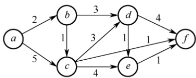

$$
f , e , d
$$

30.【2012统考真题】若用邻接矩阵存储有向图，矩阵中主对角线以下的元素均为零，则关于该图拓扑序列的结论是（）。
A. 存在，且唯一
B. 存在，且不唯一
C. 存在，可能不唯一
D. 无法确定是否存在 教育

31.【2013统考真题】下列AOE网表示一项包含8个活动的工程。通过同时加快若干活动的进度，可缩短整个工程的工期。在下列选项中，加快其进度就可缩短工程工期的是（）。

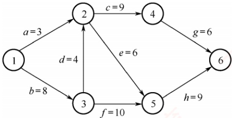

A. c和e
B. d和 c
C. f和 d
D. $f  和  h$

32. 【2014统考真题】对右图所示的有向图进行拓扑排序，得到的拓扑序列可能是（）。
C. 3,1,4,2,5,6 道
D. 3,1,4,2,6,5

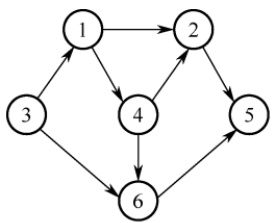

33.【2015统考真题】求右图所示带权图的最小（代价）生成树时，可能是 Kruskal 算法第 2 次选中但不是 Prim 算法（从 $V_{4}$ 开始）第2次选中的边是（）。AC $( V_{2} ,   V_{3} )$ $( V_{1} ,   V_{3} )$ 道 BD. $( V_{1} ,   V_{4} )$ $( V_{3} ,   V_{4} )$

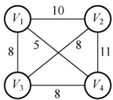

34.【2011统考真题】下列关于图的叙述中，正确的是（）。I. 回路是简单路径Ⅱ. 存储稀疏图，用邻接矩阵比邻接表更省空间Ⅲ. 若有向图中存在拓扑序列，则该图不存在回路
A. 仅Ⅱ
B. 仅I、Ⅱ
C. 仅Ⅲ
D. 仅I、Ⅲ

35. 【2016统考真题】使用Dijkstra算法求下图中从顶点1到其他各顶点的最短路径，依次得到的各最短路径的目标顶点是（）。

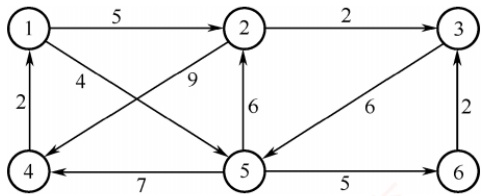

A. 5,2, 3, 4, 6
B. 5,2, 3, 6, 4
C. 5,2,4,3,6
D. 5, 2, 6, 3, 4

36.【2016统考真题】若对n个顶点、e条弧的有向图采用邻接表存储，则拓扑排序算法的时间复杂度为（）
A. O(n)
B. $O ( n + e )$
C. O(n²)
D. O(ne)

37.【2018统考真题】下列选项中，不是右侧有向图的拓扑序列的是（）。王道
A. 1, 5, 2, 3, 6, 4
B. 5, 1, 2, 6, 3, 4
C. 5, 1, 2, 3, 6, 4
D. 5, 2, 1, 6, 3, 4

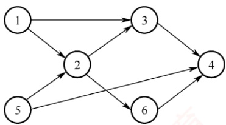

38. 【2019统考真题】下图所示的AOE网表示一项包含8个活动的工程。活动d的最早开始时间和最迟开始时间分别是（）。

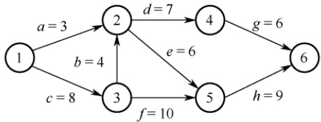

A. 3和7
B. 12和 12
C. 12和 14
D. 15和 15

39. 【2019统考真题】用有向无环图描述表达式(x+y)((x+y)/x)，需要的顶点个数至少是（）。
A. 5
B. 6
C. 8
D. 9

40. 【2020统考真题】已知无向图G如右所示，使用Kruskal 算法求图G的最小生成树，加

到最小生成树中的边依次是（）。
A. $( b , f ) , ( b , d ) , ( a , e ) , ( c , e ) , ( b , e )$
B. $( b , f ) , ( b , d ) , ( b , e ) , ( a , e ) , ( c , e )$
C. $( a , e ) , ( b , e ) , ( c , e ) , ( b , d ) , ( b , f )$

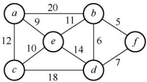

D. $( a , e ) , ( c , e ) , ( b , e ) , ( b , f ) , ( b , d )$

41.【2020统考真题】修改递归方式实现的图的深度优先搜索（DFS）算法，将输出（访问）顶点信息的语句移到退出递归前（执行输出语句后立刻退出递归）。采用修改后的算法遍历有向无环图G，若输出结果中包含G中的全部顶点，则输出的顶点序列是G的（）。王
A. 拓扑有序序列
B. 逆拓扑有序序列
C. 广度优先搜索序列
D. 深度优先搜索序列

42.【2020统考真题】若使用AOE网估算工程进度，则下列叙述中正确的是（）
A. 关键路径是从源点到汇点边数最多的一条路径
B. 关键路径是从源点到汇点路径长度最长的路径
C. 增加任意一个关键活动的时间不会延长工程的工期 算机教
D. 缩短任意一个关键活动的时间将会缩短工程的工期

43.【2021统考真题】给定右图所示有向图，该图的拓扑有序序列的个数是（）。
A. 1
B. 2
C. 3
D. 4

44. 【2021 统考真题】使用 Dijkstra 算法求下图中从顶点1 到其余各顶点的最短路径，将当前找到的从顶点1到顶点2,3,4,5的最短路

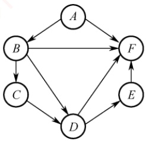

径长度保存在数组dist中，求出第二条最短路径后，dist中的内容更新为（）。

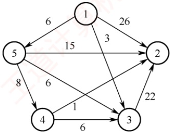

A. 26, 3, 14, 6
B. 25, 3, 14, 6
C. 21, 3, 14, 6
D. 15, 3, 14, 6

45.【2022统考真题】下图是一个有10个活动的AOE网，时间余量最大的活动是（）。

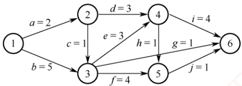

A. c
B. g
C. h
D. j

46. 【2023统考真题】已知无向连通图G中各边的权值均为1。在下列算法中，一定能够求出图G中从某顶点到其余各顶点最短路径的是（）。I. Prim 算法 II. Kruskal 算法 III. 图的广度优先搜索算法
A. 仅I
B. 仅ⅢII
C. 仅I、Ⅱ
D. I、ⅡI、ⅢII

47.【2025统考真题】下列关于图的叙述中，正确的是（）。
A. 有向图必存在入度为0的顶点
B. 有向无环图的拓扑有序序列存在且唯一
C. 各顶点的度均大于或等于2的无向图必有回路
D. 可用BFS算法求出带权图中每对顶点间的最短路径

#### 二、综合应用题

01.下面是一种称为“破圈法”的求解最小生成树的方法:所谓“破圈法”，是指“任取一圈，去掉圈上权最大的边”，反复执行这一步骤，直到没有圈为止。试判断这种方法是否正确。若正确，说明理由；若不正确，举出反例（注:圈就是回路）。

02. 已知有向图如右图所示。

1）写出该图的邻接矩阵表示并据此给出从顶点1出发的深度优先遍历序列。

2）求该有向图的强连通分量的数目。

3）给出该图的任意两个拓扑序列。

4）若将该图视为无向图，分别用 Prim 算法和 Kruskal算法求最小生成树。

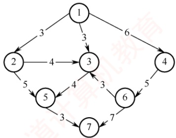

03.对右图所示的无向图，按照Dijkstra算法，写出从顶点1 到其他各个顶点的最短路径和最短路径长度（顺序不能颠倒）。

04. 下图所示为一个用AOE网表示的工程。

1）画出此图的邻接表表示。

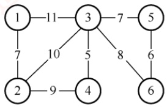

2）完成此工程至少需要多少时间？

3）指出关键路径。

4）哪些活动加速可以缩短完成工程所需的时间？

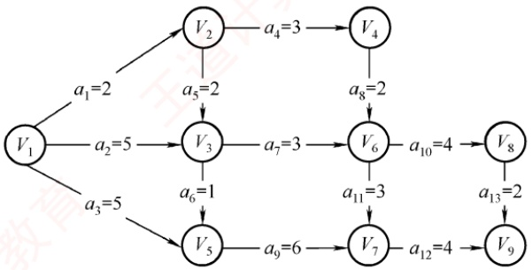

05. 下表给出了某工程各工序之间的优先关系和各工序所需的时间（其中“—”表示无先驱工序），请完成以下各题:

1）画出相应的AOE网。

2）列出各事件的最早发生时间和最迟发生时间。

3）求出关键路径并指明完成该工程所需的最短时间。

| 工序代号 | A | B | C | D | E | F | G | H |
| --- | --- | --- | --- | --- | --- | --- | --- | --- |
| 所需时间 | 3 | 2 | 2 | 3 | 4 | 3 | 2 | 1 |
| 先驱工序 | 一 |  | A | A | B | A | C、E | D |

06. 一连通无向图，边非负权值，问用Dijkstra最短路径算法能否给出一棵生成树，该树是否一定是最小生成树？说明理由。

07. 试编写利用 DFS 实现有向无环图拓扑排序的算法。

08.【2009统考真题】带权图（权值非负，表示边连接的两顶点间的距离）的最短路径问题是找出从初始顶点到目标顶点之间的一条最短路径。假设从初始顶点到目标顶点之间存在路径，现有一种解决该问题的方法:

①设最短路径初始时仅包含初始顶点，令当前顶点u为初始顶点。

②选择离u最近且尚未在最短路径中的一个顶点ν，加入最短路径，修改当前顶点u = v。

③重复步骤②，直到u是目标顶点时为止。

请问上述方法能否求得最短路径？若该方法可行，请证明；否则，请举例说明。

09.【2011统考真题】已知有6个顶点（顶点编号为0\~5）的有向带权图G，其邻接矩阵A为上三角矩阵，按行为主序（行优先）保存在如下的一维数组中。

| 4 | 6 | 8 | 8 | 8 | 5 | 8 | 8 | 8 | 4 | 3 | 8 | 8 | 3 | 3 |
| --- | --- | --- | --- | --- | --- | --- | --- | --- | --- | --- | --- | --- | --- | --- |

要求:

1）写出图G的邻接矩阵A。

2）画出有向带权图G。

3）求图G的关键路径，并计算该关键路径的长度。

10. 【2014统考真题】某网络中的路由器运行OSPF路由协议，下表是路由器R1维护的主要链路状态信息（LSI），R1构造的网络拓扑图（见下图）是根据题下表及R1的接口名构造出来的网络拓扑。

<table><tr><td colspan=2></td><td>R1的 LSI</td><td>R2的 LSI</td><td>R3 的 LSI</td><td>R4 的 LSI</td><td>备  注</td></tr><tr><td colspan=2>Router ID</td><td>10.1.1.1</td><td>10.1.1.2</td><td>10.1.1.5</td><td>10.1.1.6</td><td>标识路由器的IP地址</td></tr><tr><td rowspan=3>Link1</td><td>ID</td><td>10.1.1.2</td><td>10.1.1.1</td><td>10.1.1.6</td><td>10.1.1.5</td><td>所连路由器的 Router ID</td></tr><tr><td>IP</td><td>10.1.1.1</td><td>10.1.1.2</td><td>10.1.1.5</td><td>10.1.1.6</td><td>Link1 的本地 IP地址</td></tr><tr><td>Metric</td><td>3</td><td>3</td><td>6</td><td>6</td><td>Link1的费用</td></tr><tr><td rowspan=3>Link2</td><td>ID</td><td>10.1.1.5</td><td>10.1.1.6</td><td>10.1.1.1</td><td>10.1.1.2</td><td>所连路由器的 Router ID</td></tr><tr><td>IP</td><td>10.1.1.9</td><td>10.1.1.13</td><td>10.1.1.10</td><td>10.1.1.14</td><td>Link2 的本地 IP 地址</td></tr><tr><td>Metric</td><td>2</td><td>4</td><td>2</td><td>4</td><td>Link2的费用</td></tr><tr><td rowspan=2>Net1</td><td>Prefix</td><td>192.1.1.0/24</td><td>192.1.6.0/24</td><td>192.1.5.0/24</td><td>192.1.7.0/24</td><td>直连网络 Net1 的网络前缀</td></tr><tr><td>Metric</td><td>1</td><td>1</td><td>1</td><td>1</td><td>到达直连网络 Net1 的费用</td></tr></table>

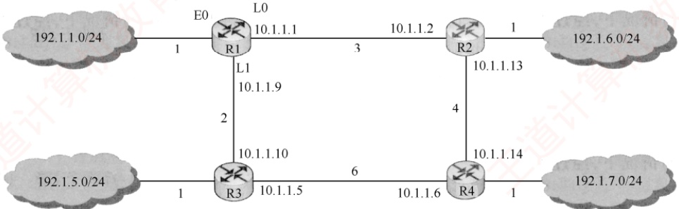

请回答下列问题。

1）本题中的网络可抽象为数据结构中的哪种逻辑结构？

2）针对表中的内容，设计合理的链式存储结构，以保存表中的链路状态信息(LSI）。要求给出链式存储结构的数据类型定义，并画出对应表的链式存储结构示意图（示意图中可仅以ID标识结点）。

3）按照 Dijkstra算法的策略，依次给出 R1到达子网192.1.x.x的最短路径及费用。

11.【2017统考真题】使用Prim算法求带权连通图的最小（代价）生成树（MST）。请回

答下列问题:

1）对右侧的图G，从顶点A开始求G的MST，依次给出按算法选出的边。

2）图 G 的 MST 是唯一的吗？

3）对任意的带权连通图，满足什么条件时，其MST是唯一的？

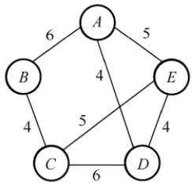

12.【2018统考真题】拟建设一个光通信骨干网络连通BJ、CS、

XA、QD、JN、NJ、TL和WH等8个城市，右图中无向边上的权值表示两个城市之间备选光缆的铺设费用。请回答下列问题:

1）仅从铺设费用角度出发，给出所有可能的最经济的光缆铺设方案（用带权图表示），并计算相应方案的总费用。

2）该图可采用图的哪种存储结构？给出求解问题1）所用的算法名称。

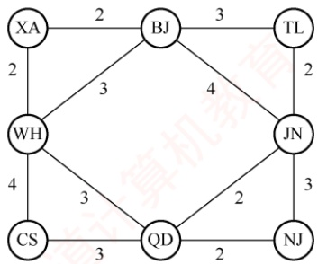

3）假设每个城市采用一个路由器按1）中得到的最经济方案组网，主机H1直接连接TL 的路由器，主机 H2 直接连接 BJ 的路由器。若 H1 向 H2 发送一个 TTL = 5 的 IP分组，则H2是否可以收到该IP分组？

13.【2024统考真题】2023年10月26日，神舟十七号载人飞船发射取得圆满成功，再次彰显了中国航天事业的辉煌成就。载人航天工程是包含众多子工程的复杂系统工程，为了保证工程的有序开展，需要明确各子工程的前导子工程，以协调各子工程的实施。该问题可以简化、抽象为有向图的拓扑序列问题。已知有向图G采用邻接矩阵存储，类型定义如下。

```txt
typedef struct 道
int numVertices, numEdges;
char VerticesList[MAXV];
int Edge[MAXV] [MAXV];
```

//图的顶点数和有向边数//顶点表，MAXV 为已定义常量//邻接矩阵

请设计算法:int uniquely(MGraqh G)，判定G 是否存在唯一的拓扑序列，若是，则返回1，否则返回0。要求如下。

1）给出算法的基本设计思想。

2）根据设计思想，采用C或C++语言描述算法，关键之处给出注释。

14.【2025统考真题】某工程包含12个活动，使用右图所示的AOE网描述，图中各边上标注了活动及其持续时间。

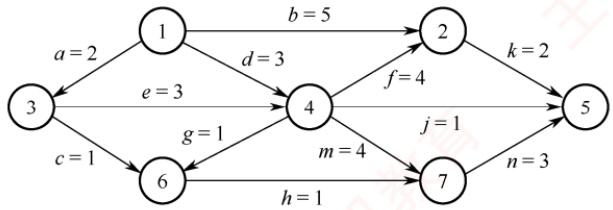

请回答下列问题（活动均用活动名表示）。

1）完成该工程的最短时间是多少？哪些活动是关键活动？

2）若以最短时间完成工程，则与活动e同时进行的活动可能有哪些？

3）时间余量最大的活动是哪个？其时间余量是多少？

4）假设工程从时刻0启动，因某种原因，活动b在时刻6开始。为了保证工程不延期，在其他活动持续时间均不变的情况下，b的持续时间最多是多少？若不改变b的持续时间，则压缩哪个活动的持续时间也能保证工程不延期?

### 6.4.7 答案与解析

#### 一、单项选择题

01. A

当无向连通图存在权值相同的多条边时，最小生成树可能是不唯一的；另外，这是一个无向连通图，因此最小生成树必定存在，从而选择选项A。

02. C

因为无向连通图的最小生成树不一定唯一，所以用不同算法生成的最小生成树可能不同，但当无向连通图的最小生成树唯一时，不同算法生成的最小生成树必定是相同的。

03. A

最小生成树算法是基于贪心策略的，每次总是选取权值最小且满足条件的边，若各边权值不同，则每次选择的新顶点也是唯一的，因此最小生成树唯一，选项A正确。对于选项B，若无向图本身就是一棵树，则最小生成树就是它本身，这时就是唯一的。对于选项C，选取的n-1条边可能构成回路。对于选项D，含有n个顶点、n-1条边的子图可能构成回路，也可能不连通。

04. A

若图的边数小于n-1，则图不存在最小生成树；若无向连通图的边数等于n-1，则最小生成树唯一，即图本身，所以图的边数一定大于n-1，选项A正确。若最小生成树不唯一，则一定存在权值相等的边，但未必是权值最小的边，如右图所示，

选项B错误。最小生成树可能不唯一，但代价一定相同，选项C错误。当图的各边的权值互不相等时，图的最小生成树是唯一的，选项D错误。

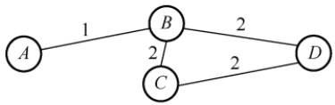

05. A

$U   = \{1 , 2 , 3 \}$ $V - U = \{4, 5, \cdots \}$ ，候选边只能是这两个顶点集之间的边，只有选项A符合题意。

06. C

若选取边(1,3)则会构成回路。

07. A

选项A正确，见严蔚敏老师的教材。Dijkstra算法适合求解有回路的带权图的最短路径，也可以求任意两个顶点的最短路径，不适合求带负权值的最短路径问题。

08. C

在负权图中，Dijkstra算法既不能保证每次选出的顶点都是真正的最近顶点，又不能保证已确定的最短路径不再被改变，因此Dijkstra算法不允许边的权为负，说法Ⅰ正确。求每对顶点间的最短路径需要调用 Dijkstra算法n次，时间复杂度为 $O ( n^{3} )$ ，说法Ⅱ错误。Floyd算法求每对顶点间的最短路径允许有负边的存在，但不允许包含总权值为负的回路，说法Ⅲ正确。

09. B

题目所描述的图 G 如下图所示。A, B, C,D 对应的路径长度分别为 18, 13, 15, 24。应用Dijkstra算法不难求出最短路径为 $v_{1} \rightarrow v_{3} \rightarrow v_{4} \rightarrow v_{6} \rightarrow v_{7}$ 0

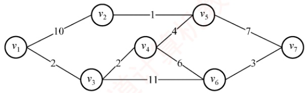

10. D

在Dijkstra算法的执行过程中，只可能修改从源点0到集合V-S中某个顶点的最短路径。

11. A

使用深度优先遍历，若从有向图上的某个顶点u出发，在DFS(u)结束之前出现一条从顶点到μ的边，ν在生成树上是u的子孙，图中必定存在包含μ和ν的环，因此深度优先遍历可以检测一个有向图是否有环。拓扑排序时，当某顶点不为任何边的头时才能加入序列，存在环时环中的顶点一直是某条边的头，不能加入拓扑序列。也就是说，还存在无法找到下一个可以加入拓扑序列的顶点，则说明此图存在回路。求最短路径是允许图有环的。广度优先遍历主要用于无权图求最短路径或层次遍历，不能直接用于判断有向图是否有环。

12. D

若图 $G$ 中存在一条从 $v_{j}$ 到 $v_{i}$ 的路径，说明 $V_{j}$ 是 $V_{i}$ 的前驱，则要把 $V_{j}$ 消去以后才能消去 $V_{i} ,$从而拓扑序列中必然先输出v，再输出 $\nu_{i} ,$ 这显然与题意矛盾。

13. D

对于说法I，若有向图中存在环，运行拓扑排序算法后，肯定会剩下有环的子图，在此环中无法再找到入度为0的顶点，拓扑排序也就无法再运行。对于说法Ⅱ，若两个顶点之间不存在祖先或子孙关系，则它们在拓扑序列中的前后关系是任意的，因此使用栈和队列都可以，因为入

栈或队列的都是入度为0的顶点。说法Ⅲ是难点，若拓扑序列唯一，则很自然联想到一个线性的有向图，右图的拓扑序列也唯一，但却不满足该条件。对于说法IV，若入度为0的顶点不唯一，则这些顶点均可作为拓扑序列的起点；若出度为0的顶点不唯一，则这些顶点均可作为拓扑序列的终点。

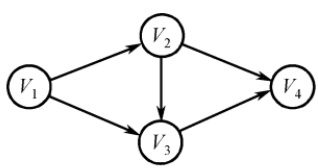

14. C

强连通图是指有向图中任意顶点对之间都存在两条相反的路径，这意味着强连通图中一定存在环，因此不能进行拓扑排序，说法Ⅰ正确。假设顶点a和b的入度均为0，且分别有两条孤从 a和 b 指向同一顶点 c，则产生的拓扑序列可以是 abc，但是此时并无一条弧 $\leq a,$ b>，说法Ⅱ错误。如图1和2所示的有向图对应的拓扑序列都是abcd，且都是唯一的，说法Ⅲ错误。

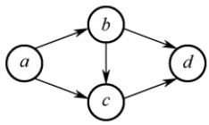

图1

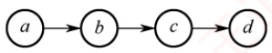

图2

15. D

一个有向图中的顶点不能排成一个拓扑序列，表明其中存在一个顶点数目大于1的回路（环），该回路构成一个强连通分量，从而答案选择选项D。

16. C

本图的拓扑排序序列有 ABCFDEG, ABCDFEG, ABCDEFG, ABDCFEG 和 ABDCEFG。读者应能把这一类经典习题的拓扑序列全部写出来。

17. A

拓扑序列的过程:找到入度为0的顶点，删除该顶点及其所有出边，并将顶点加入拓扑序列，重复直至所有顶点都加入拓扑序列。选择入度为0的顶点 $v_{1}$ ，删除与 $v_{1}$ 有关的边；此时顶点 $v_{3}$ 的入度为0，选择 $v_{3}$ ，删除与 $v_{3}$ 有关的边；以此类推，得出G的拓扑序列。

18. B

无向图的邻接矩阵存储中，每条边存储两次，且 $A [ i ] [ j ] = A [ j ] [ i ]$

19. C

此题一直以来争议较大，因为有些书中漏掉了“有序”二字。可以证明，对有向图中的顶点适当地编号，使其邻接矩阵为三角矩阵且主对角元素全为零的充分必要条件是，该有向图可以进行拓扑排序。若这个题目把“有序”二字去掉，显然应选择选项D。但此题题干中已经指出是“有序的拓扑序列”，因此应选选项C。需要注意的是，若一个有向图的邻接矩阵为三角矩阵（对角线以上或以下的元素为0），则图中必不存在环，因此其拓扑序列必然存在。

20. A

设图中有顶点 $\gamma_{i} ,$ 它有后继顶点，即存在边 $v_{j}$ ${\scriptstyle \cdot} {\scriptstyle \leq} \boldsymbol {v}_{i_{2}}$ $v_{j} \succ$ 。根据 DFS 的规则， $v_{i}$ 入栈后，必先遍历完其后继顶点后 $v_{i}$ 才会出栈，也就是说 $v_{i}$ 会在 $v_{j}$ 之后出栈，在如题所指的过程中， $v_{i}$ 在 $v_{j}$ 后打印。 $v_{i}$ 和 $v_{j}$ 具有任意性，因此由上面的规律看出，输出顶点的序列是逆拓扑有序序列。

对有向无环图利用深度优先搜索进行拓扑排序的例子如下:如右图所示，退出 DFS 栈的顺序为 efgdcahb，此图的一个拓扑序列为bhacdgfe。该方法的每一步均是先输出当前无后继的顶点，即对每个顶点v，先递归地求出ν的每个后继的拓扑序列。


21. C

有向图邻接矩阵的第V行中1的个数是顶点V的出度，而有向图中顶点的度为入度与出度之和，说法Ⅰ错。无向图的邻接矩阵一定是对称矩阵，但当有向图中任意两个顶点之间有边相连，且是两条方向相反的有向边时，有向图的邻接矩阵也是一个对称矩阵，说法Ⅱ错。最小生成树中的n-1条边不能保证是图中权值最小的n-1条边，因为权值最小的n-1条边并不一定能使图连通。在下图中，左图的最小生成树如下图所示，权值为3的边不在其最小生成树中。


有向无环图的拓扑序列唯一并不能唯一确定该图。在下图所示的两个有向无环图中，拓扑序列都为 $V_{1} , V_{2} , V_{3} , V_{4}$ ，IV错。注意，很多辅导书对该命题的判断是错误的。


22. C

观察题图，从 $V_{0}$ 到 $V_{8}$ 的最长路径为 $V_{0} \rightarrow V_{1} \rightarrow V_{4} \rightarrow V_{6} \rightarrow V_{8}$ ，长度为 $6+1+9+2=18$

23. C

题目描述的图如下，得到关键路径的长度为21，图中画出的两条路径都是关键路径。


24. C

一个事件的最迟发生时间=min{以该事件为尾的弧的活动的最迟开始时间}，或min{以该事件为尾的弧所指事件的最迟发生时间与该弧的活动的持续时间之差}。改变AQE网中任何一个活动的持续时间，需要重新计算关键活动，可能导致关键路径的改变。

25. C

若改变的是所有关键路径上的公共活动，则不一定会产生不同的关键路径（延长必然不会导致，只有缩短才有可能导致）。根据关键路径的定义，可知说法Ⅱ正确。关键路径是源点到终点的最长路径，只有所有关键路径的长度都缩短时，整个图的关键路径才能有效缩短，但也不能任意缩短，一旦缩短到一定程度，该关键活动就有可能变成非关键活动。

26. A

邻接矩阵第i列值全为∞，说明顶点i没有入边，为整个工程的开始，若关键路径存在，则该顶点一定是起点。不能确定关键路径是否存在，也不能确定其对应的无向图的连通分量个数。

27. B

拓扑排序的过程如下图所示。


可以得到 3 种不同的拓扑序列，即 abced, abecd 和 aebcd。

28. A

最小生成树的树形可能不唯一（因为可能存在权值相同的边），但代价一定是唯一的，说法I正确。若权值最小的边有多条并且构成环状，则总有权值最小的边将不出现在某棵最小生成树中，说法Ⅱ错误。设N个顶点构成环，N条边的权值相等，从不同的顶点开始执行Prim算法，只要选取任意不同的N-1条边，就能得到不同的最小生成树，说法Ⅲ错误。当最小生成树唯一时（各边的权值不同），Prim算法和Kruskal算法得到的最小生成树相同，说法IV错误。

29. C

从a到各顶点的最短路径的求解过程下:

| 顶点 | 第1轮 | 第2轮 | 第3轮 | 第4轮 | 第5轮 |
| --- | --- | --- | --- | --- | --- |
| b | $( a , b ) 2$ |  |  |  |  |
| $c$ | $( a , c ) 5$ | $( a , b , c ) 3$ |  |  |  |
| $d$ | $\infty$ | $( a , b , d ) 5$ | $( a , b , d ) 5$ | $( a , b , d ) 5$ |  |
| $e$ | 8 | $\infty$ | $( a , b , c , e ) 7$ | $( a , b , c , e ) 7$ | $( a , b , d , e ) 6$ |
| $f$ | $\infty$ | $\infty$ | $\left( a , b , c , f \right) 4$ |  |  |
| 集合S | $\{a , b \}$ | $\{a , b , c \}$ | $\{a , b , c , f \}$ | $\{a , b , c , f , d \}$ | $\{a , b , c , f , d , e \}$ |

后续目标顶点依次为f, d, e。

本题也可用排除法:对于选项A，若下一个顶点为d，路径 $a ,   b ,   d$ 的长度为5，而 $a, \; b, \; c,$ f的长度仅为4，显然错误。同理可排除选项B。将f加入集合S后，采用上述方法也可排除选项D。

30. C

对角线以下元素均为零，表明只有顶点i到 $j \; ( i < j )$ 可能有边，而顶点j到i一定没有边，即有向图是一个无环图，因此一定存在拓扑序列。对于拓扑序列是否唯一，试举一例:设有向图的邻接矩阵 $\begin{bmatrix} 0 & 1 & 1 \\ 0 & 0 & 0 \\ 0 & 0 & 0 \end{bmatrix}$ ，存在两个拓扑序列，因此该图存在可能不唯一的拓扑序列。

结论:对于任一有向图，若它的邻接矩阵中对角线以下（或以上）的元素均为零，则存在拓扑序列（可能不唯一）。反之，若图存在拓扑序列，却不一定能满足邻接矩阵中主对角线以下的元素均为零，但是可以通过适当地调整顶点编号，使其邻接矩阵满足前述性质。

31. C

找出 AOE网的全部关键路径为 bdcg、bdeh和 $bfh$ 。根据性质，只有当所有关键路径的活动时间同时减少时，才能缩短工期。即正确选项中的路径必须能涵盖所有的关键路径。选项A和B不能涵盖 bfh这条路径，选项 D不能涵盖 bdcg这条路径，只有选项C 能涵盖所有关键路径，因此只有加快f和d的进度才能缩短工期（建议在图中检验）。

32. D

按照拓扑排序的算法，每次都选择入度为0的顶点从图中删除，此图中一开始只有顶点3的入度为0；删除顶点3后，只有顶点1的入度为0；删除顶点1后，只有顶点4的入度为0;删除顶点4后，顶点2和顶点6的入度都为0，此时选择删除不同的顶点，会得出不同的拓扑序列，分别处理完毕后可知可能的拓扑序列为3,1,4,2,6,5和3,1,4,6,2,5。

33. C

从 $V_{4}$ 开始，Kruskal 算法选中的第一条边一定是权值最小的 $( V_{1} ,   V_{4} )$ ，B错误。 $V_{1}$ 和 $V_{4}$ 已经可达，因此含有 $V_{1}$ 和 $V_{4}$ 的权值为8的第二条边一定符合Prim算法，排除选项A和选项D。

34. C

第一个顶点和最后一个顶点相同的路径称为回路；序列中顶点不重复出现的路径称为简单路径:回路显然不是简单路径，说法Ⅰ错误。稀疏图是边比较少的情况，邻接矩阵存储的空间复杂度为 $O ( n^{2} )$ ，必将浪费大量的空间，而邻接表存储的空间复杂度为 $O ( n + e )$ ，所以应选用邻接表，说法Ⅱ错误。存在回路的有向图不存在拓扑序列，若拓扑排序输出结束后所余下的顶点都有前驱，则说明只得到了部分顶点的拓扑有序序列，图中存在回路，说法Ⅲ正确。

35. B

根据Dijkstra算法，从顶点1到其余各顶点的最短路径如下表所示。

| 顶点 | 第1轮 | 第2轮 | 第3轮 | 第4轮 | 第5轮 |
| --- | --- | --- | --- | --- | --- |
| 2 | 5$v_{1} \rightarrow v_{2}$ | 5$v_{1} \rightarrow v_{2}$ | KK |  |  |
| 3 | 8 | $\infty$ | 7$v_{1} \rightarrow v_{2} \rightarrow v_{3}$ |  |  |
| 4 | 8 | 11$v_{1} \rightarrow v_{5} \rightarrow v_{4}$ | 11$v_{1} \rightarrow v_{5} \rightarrow v_{4}$ | 11$v_{1} \rightarrow v_{5} \rightarrow v_{4}$ | 11v1→V5→V4 |
| 5 | 4$v_{1} \rightarrow v_{5}$ |  |  |  |  |
| 6 | 8 | 9$v_{1} \rightarrow v_{5} \rightarrow v_{6}$ | 9$v_{1} \rightarrow v_{5} \rightarrow v_{6}$ | 9$v_{1} \rightarrow v_{5} \rightarrow v_{6}$ |  |
| 集合S | {1, 5} | {1, 5, 2} | {1, 5, 2, 3} | {1, 5, 2, 3, 6} | {1, 5, 2, 3, 6, 4} |

快速解法。依次观察从顶点1到其他顶点的最短路径长度:顶点1到顶点2的最短路径长度为5；顶点1到顶点3的最短路径长度为 $5+2=7;$ 顶点1到顶点4的最短路径长度为11；顶点 1 到顶点 5 的最短路径长度为 4；顶点 1 到顶点 6 的最短路径长度为 $4   +   5   =   9$ ；最终$\mathrm{dist}[] = \{0, 5, 7, 11, 4, 9\}$ ，根据 dist数组值从小到大选择顶点顺序为1,5,2,3,6,4。

36. B

采用邻接表作为AOV网的存储结构进行拓扑排序，需要对n个顶点做入栈、出栈、输出各一次，当处理e条边时，需要检测这n个顶点的边链表结点，共需要的时间为 $O ( n + e )$ 。若采用邻接矩阵作为AOV网的存储结构进行拓扑排序，在处理e条边时需对每个顶点检测相应矩阵中的某一行，寻找与它相关联的边，以便对这些顶点的入度减1，需要的时间代价为 $O ( n^{2} )$

【补充】有两种常用的拓扑排序算法:基于BFS的算法和基于DFS的算法。本题未指明采用哪种算法，因此只需验证一种算法即可（说明两种算法在对应条件下的时间复杂度相同）。

基于BFS的算法的思想:首先找到所有入度为0的顶点，将它们加入一个队列，并将它们作为拓扑序列的起始部分；然后依次从队列中取出顶点，并删除它们与后继顶点的所有边。若某个后继顶点的入度变为0，则将它也加入队列，并将它加入拓扑序列，重复这个过程。

基于 DFS 的算法的思想:在 DFS 调用过程中设定一个时间标记，当 DFS 调用结束时，对各顶点计时，进而按结束时间从大到小排序，可以得到一个拓扑序列。

37. D

拓扑排序每次选取入度为 0的顶点输出，经观察不难发现拓扑序列前两位一定是1,5 或 5,1 (因为只有1和5的入度均为0，且其他顶点都不满足仅有1或仅有5作为前驱)

38. C

活动的最早开始时间等于该活动弧的起点所表示的事件的最早发生时间，活动d的最早开始时间等于事件2的最早发生时间 $\max\{a,b+c\}=\max\{3,12\}=12$ 。活动d的最迟开始时间等于该活动弧的终点所表示的事件的最迟发生时间与该活动所需时间之差，先算出图中关键路径长度为27（对于不复杂的选择题，找出所有路径计算长度），那么事件4的最迟发生时间为$\min\{27 - g\} = \min\{27 - 6\} = 21$ ，活动d的最迟开始时间为 $21 - d = 21 - 7 = 14$

常规方法:按照关键路径算法算得到下表。

|  | $v_{1}$ | $v_{2}$ | $v_{3}$ | $v_{4}$ | $v_{5}$ | $v_{6}$ |
| --- | --- | --- | --- | --- | --- | --- |
| $v_{e} ( i )$ | 0 | 12 | 8 | 19 | 18 | 27 |
| $v_{l} ( i )$ | 0 | 12 | 8 | 21 | 18 | 27 |

|  | a | $b$ | $c$ | $d$ | $e$ | $f$ | g | h |
| --- | --- | --- | --- | --- | --- | --- | --- | --- |
| e(i) | 0 | 8 | 0 | 12 | 12 | 8 | 19 | 18 |
| l(i) | 9 | 8 | 0 | 14 | 12 | 8 | 21 | 18 |
| l(i) − e(i) | 9 | 0 | 0 | 2 | 0 | 0 | 2 | 0 |

从表中可知，活动d的最早开始时间和最迟开始时间分别为12和14，所以选择选项 $\mathrm {C}_{\circ}$

39. A

先将该表达式转换成有向二叉树，该二叉树中有些顶点是重复的，为了节省存储空间，去除重复的顶点，将有向二叉树去重转换成有向无环图，如下图所示。


40. A

Kruskal算法:按权值递增顺序依次选取n-1条边，并保证这n-1条边不构成回路。初始构造一个仅含n个顶点的森林；第一步，选取权值最小的边(b,f)加入最小生成树；第二步，剩余边中权值最小的边为(b,d)，加入最小生成树，第二步操作后权值最小的边(d,f)不能选，因为会与之前已选取的边形成回路；接下来依次选取权值9、10、11对应的边加入最小生成树，此时6个顶点形成了一棵树，最小生成树构造完成。按照上述过程，加到最小生成树的边依次为(b,f)，(b, d), (a, e), (c, e), (b, e)。其生成过程如下所示。


41. B

根据题干所提供的信息可知:

①图G为有向无环图，因此一定存在拓扑序列和逆拓扑序列。

② DFS 的性质是顶点 $v_{i}$ 的所有后继顶点 $v_{j}$ 出栈后， $v_{i}$ 才会出栈。

③本题要求执行输出语句后立刻退出递归，即执行完输出语句后立即出栈，因此后入栈的顶点先输出，结合②不难得出只有输出顶点 $v_{i}$ 的所有后继顶点 $v_{j}$ 后， $v_{i}$ 才会输出。综合上述分析，输出的顶点序列是逆拓扑有序序列。

42. B

关键路径是指权值之和最大而非边数最多的路径，选项A错误。选项B是关键路径的概念。无论是存在一条还是存在多条关键路径，增加任意一个关键活动的时间都会延长工程的工期，因为关键路径始终是权值之和最大的那条路径，选项C错误。仅有一条关键路径时，减少关键活动的时间会缩短工程的工期；存在多条关键路径时，缩短一条关键活动的时间不一定会缩短工程的工期，缩短了路径长度的那条关键路径不一定还是关键路径，选项D错误。

43. A

求拓扑序列的过程:从图中选择无入边的顶点，输出该顶点并删除该顶点的所有出边，重复上述过程，直至全部顶点都已输出，这样求得的拓扑序列为ABCDEF。每次输出一个顶点并删除该顶点的所有出边后，都发现有且仅有一个顶点无入边，因此该拓扑序列唯一。

44. C

在执行Dijkstra算法时，首先初始化 dist[]，若顶点1到顶点 i（i = 2,3,4,5）有边，就初始化为边的权值；若无边，就初始化为∞；初始化顶点集S只含顶点1。Dijkstra算法每次选择一个到顶点1 距离最近的顶点 j加入顶点集 S，并判断由顶点1绕行顶点 j后到任意一个顶点 k是否距离更短，若距离更短 $\left( \mathrm{dist}[j] + \mathrm{arc}[j][k] < \mathrm{dist}[k] \right)$ ，则将 dist[x]更新为 $\mathrm {dist} [ j ] + \mathrm {arcs} [ j ] [ k ]$ ；重复该过程，直至所有顶点都加入顶点集S。数组dist的变化过程如下图所示，可知将第二个顶点5加入顶点集S后，数组 dist更新为 21, 3,14,6。

$$
dist \{26,3,\infty,6\} \xrightarrow{顶点 3 入 S} \{25,3,\infty,6\} \xrightarrow{顶点 5 入 S} \{21,3,14,6\}
$$

45. B

在 AOE网中，活动的时间余量=结束顶点的最迟开始时间-开始顶点的最早开始时间-该活动的持续时间。根据关键路径算法得到下表:

| 顶点编号 | 1 | 2 | 3 | 4 | 5 | 6 |
| --- | --- | --- | --- | --- | --- | --- |
| 最早开始时间$v_{e} ( i )$ | 0 | 2 | 5 | 8 | 9 | 12 |
| 最迟开始时间 v(i) | 0 | 4 | 5 | 8 | 11 | 12 |

c的时间余量 $v_{\mathrm{f}}(3)-v_{\mathrm{e}}(2)-1=5-2-1=2$ ，g的时间余量 $v_{\mathrm{f}}(6)-v_{\mathrm{e}}(3)-1=12-5-1=6$ , h的时间余量 $v_{1}(5)-v_{e}(4)-1=11-8-1=2,$ j的时间余量 $v_{1}(6)-v_{e}(5)-1=12-9-1=2$

46. B

Prim 算法和 Kruskal 算法用于求解最小生成树，最小生成树中某顶点到其余各顶点的路径不一定具有最短路径的性质。例如，在右图求得的最小生成树中，a到c的路径长度为2，但原图中a到c的最短路径长度为1。


图的广度优先搜索算法总按距离由近到远来遍历图中的每个顶点，因此可用来求解非带权图（或各边权值均相同）的单源最短路径问题。

47. C

若一个有向图构成环，则每个顶点的入度均不为0。有向无环图一定存在拓扑序列，但当存在多个入度为0的顶点时，其拓扑序列不唯一。在无向图中，若每个顶点的度都大于或等于2，说明从任意点出发，总能“一直走下去”（因为每到一个点，至少还有另一条边可走），由于顶点有限，走着走着必定会重复访问某个顶点，从而形成回路，选项C正确。BFS算法仅适用于求解无权图（或所有边权相等）的单源最短路径，不适用于带权图（边权不等）。

#### 二、综合应用题

01. 【解答】

这种方法是正确的。

经过“破圈法”之后，最终没有回路，因此一定可以构造出一棵生成树。下面证明这棵生成树是最小生成树。记“破圈法”生成的树为T，假设T不是最小生成树，则必然存在最小生成树 $T_{0} ,$ ，使得它与T的公共边尽可能多，则将 $T_{0}$ 与T取并集，得到一个图，此图中必然存在回路，“破圈法”的定义就是从回路中去除权最大的边，因此此时生成的T的权必然是最小的，这与原假设矛盾，从而T是最小生成树。下图说明了“破圈法”的过程:


02. 【解答】

1）该图的邻接矩阵为

$$
\boldsymbol{A} = \begin{aligned}1 & \quad 2 \quad 3 \quad 4 \quad 5 \quad 6 \quad 7 \\2 & \quad \left[ \begin{matrix}0 & 3 & 4 & \infty & \infty \\\infty & 0 & 4 & \infty & 5 & \infty \\\infty & \infty & 0 & \infty & 4 & \infty & \infty \\\end{matrix} \right] \\4 & \quad \left[ \begin{matrix}\infty & \infty & \infty & 0 & \infty & 5 & \infty \\\infty & \infty & \infty & \infty & 0 & \infty & 3 \\\end{matrix} \right] \\5 & \quad \infty & \quad \infty & \quad \infty & \quad 0 & \infty & \quad 3 \\6 & \quad \infty & \quad \infty & \quad 3 & \infty & \infty & \quad 0 & \quad 7 \\7 & \quad \infty & \quad \infty & \quad \infty & \quad \infty & \quad \infty & \quad 0 \\\end{aligned}
$$

得到的深度优先遍历序列为1,2,3,5,7,4,6。

2）解题思路:当某个顶点只有出弧而没有入弧时，其他顶点无法到达这个顶点，不可能与其他顶点和边构成强连通分量（这个单独的顶点构成一个强连通分量）。

①顶点1无入弧构成第一个强连通分量。删除顶点1及所有以之为尾的弧。

②顶点2无入弧构成一个强连通分量。删除顶点2及所有以之为尾的弧。

以此类推，最后得到每个顶点都是一个强连通分量，所以强连通分量数目为7。

3）该图的两个拓扑序列如下:

① 1, 2, 4, 6, 3, 5, 7

② 1, 4, 2, 6, 3, 5, 7

4）若视该图为无向图:

用Prim算法生成最小生成树的过程如下:

1-2，1-3，3-6，3-5，5-7，6-4（图略）。

用Kruskal算法生成最小生成树的过程如下图所示。


03.【解答】

根据Dijkstra算法，求从顶点1到其余各顶点的最短路径如下表所示。

<table><tr><td rowspan=2>顶点</td><td colspan=5>从顶点1 到各终点的 dist 值</td></tr><tr><td>第1轮</td><td>第2轮</td><td>第3轮</td><td>第4轮</td><td></td></tr><tr><td>2</td><td>7 $\mathbf {v_{1}} , \mathbf {v_{2}}$ </td><td></td><td></td><td></td><td></td></tr><tr><td>3</td><td>11 $v_{1} , v_{3}$ </td><td>■ $\mathbf {H}$  $v_{1} , v_{3}$ </td><td>算机</td><td></td><td></td></tr><tr><td>4</td><td> $\infty$ </td><td> $16$  $\nu_{1} , \nu_{2} , \nu_{4}$ </td><td> $\mathbf {16}$  $\nu_{1} , \nu_{2} , \nu_{4}$ </td><td></td><td></td></tr><tr><td>5</td><td> $\infty$ </td><td> $\infty$ 王</td><td> $18$  $\boldsymbol {\mathscr {v}}_{1} , \boldsymbol {\mathscr {v}}_{3} , \boldsymbol {\mathscr {v}}_{5}$ </td><td>18 $\nu_{1} , \nu_{3} , \nu_{5}$ </td><td></td></tr><tr><td>6</td><td> $\infty$ </td><td> $\infty$ </td><td> $19$  $\nu_{1} , \nu_{3} , \nu_{6}$ </td><td> $19$  $\nu_{1} , \nu_{3} , \nu_{6}$ </td><td>19 $\nu_{1} , \nu_{3} , \nu_{6}$ </td></tr><tr><td>集合S</td><td>{1, 2}</td><td>{1, 2,3}</td><td>{1, 2, 3, 4}</td><td>{1, 2, 3, 4, 5}</td><td>{1, 2, 3, 4, 5, 6}</td></tr></table>

04.【解答】

1）该图的邻接表表示如下图所示。

$$
\boxed{V_{1}} \boxed{} \boxed{} \boxed{2} \boxed{2} \boxed{} \boxed{3} \boxed{5} \boxed{} \boxed{5} \boxed{}
$$

$$
\boxed{V_{2}} \boxed{\quad} \boxed{3} \boxed{2} \boxed{\quad} \boxed{4} \boxed{3} \boxed{\quad}
$$

$$
\boxed{V_{3}} \boxed{\quad} \boxed{\quad} \boxed{\quad} \boxed{\quad} \boxed{\quad} \boxed{\quad} \boxed{\quad} \boxed{\quad} \boxed{\quad}
$$

$$
\boxed{V_{4}} \boxed{\quad} \boxed{\quad} \boxed{\quad} \boxed{6 \quad} \boxed{\quad 2 \quad} \wedge \quad \boxed{\quad}
$$

$$
\boxed{V_{5}} \boxed{\quad} \boxed{\quad} \boxed{7} \boxed{6} \boxed{\quad}
$$

$$
\begin{array}{l|l|l|l|}\hline V_{6} & \hline & \hline & \hline & \hline & \hline & \hline & \hline & \hline & \hline & \hline & \hline & \hline & \hline & \hline & \hline & \hline & \hline & \hline & \hline & \hline & \hline & \hline & \hline & \hline & \hline & \hline & \hline & \hline & \hline & \hline & \hline & \hline & \hline & \hline & \hline & \hline & \hline & \hline & \triangledown & \triangledown & \triangledown & \triangledown & \triangledown & \triangledown & \triangledown & \triangledown & \triangledown & \triangledown & \triangledown & \triangledown & \triangledown & \triangledown & \triangledown & \triangledown & \triangledown & \vartriangle & \vartriangle & \vartriangle & \vartriangle & \vartriangle & \vartriangle & \vartriangle & \vartriangle & \vartriangle & \vartriangle & \vartriangle & \vartriangle & \vartriangle & \vartriangle & \vartriangle & \vartriangle & \vartriangle & \vartriangle & \vartriangle & \vartriangle & \vartriangle & \vartriangle & \vartriangle & \vartriangle & \vartriangle & \vartriangle & \vartriangle & \vartriangle & \vartriangle & \vartriangle & \vartriangle & \vartriangle & \vartriangle & \vartriangle & \vartriangle & \vartriangle & \vartriangle & \vartriangle & \vartriangle & \vartriangle & \vartriangle & \vartriangle & \vartriangle & \vartriangle & \vartriangle & \vartriangle & \vartriangle & \vartriangle & \vartriangle & \vartriangle & \vartriangle & \vartriangle & \vartriangle & \vartriangle & \vartriangle & \vartriangle & \vartriangle & \vartriangle & \vartriangle & \vartriangle & \vartriangle & \vartriangle & \vartriangle & \vartriangle & \vartriangle & \vartriangle & \vartriangle & \vartriangle & \vartriangle & \square \square & \square \square & \square \square \square & \square \square \quad \square \square \quad \square \square \square \quad \square \square \square \quad \square \square \square \square \quad \square \square \square \square \quad \square \square \square \square \square \quad \square \square \square \square \square \square \quad \square \square \square \square \square \square \square \square \square \quad \square \square \square \square \square \square \square \square \square \square \square \square \square \square \square \square \square \square \square \square \square \square \square \square \square \square \square \square \square \square \square \square \square \square \square \square \square \square \square \square \square \square \square \square \square \square \square \square \square \square \square \square \square \square \square \square \square \square \square \square \square \square \square \square \square \square \square \square \square \square \square \square \square \square \square \square \square \square \square \square \square \square \square \square \square \square \square \square \square \square \square \square \square \square \square} \square \square \square \square \square \square \square \square \square \square \square \square \square \square \square \square 于 F 于 F \square 于 F \square \square 于 F 于 F 于 F 于 F  \square 于 F  \square 于 F  \square 于 F  \square 于 F  \square 于 F  \square 于 F  \square 于 F  \square 于 F  \square 于 F  \square 于 F  \square 于 F  \square 于 F  \square 于 F  \square 于 F  \square 于 F  \square � \end{array}
$$

$$
\boxed{V_{7}} \boxed{\quad} \boxed{\quad} \boxed{\quad} \boxed{\quad} \boxed{\quad} \boxed{\quad}
$$

$$
\boxed{V_{8}} \boxed{\quad} \boxed{\quad} \boxed{9} \boxed{2} \boxed{\quad}
$$

$$
\boxed{V_{9}} \land
$$

求关键路径的算法如下:

①输入e条弧 $\cdot \cdot j , k \cdot$ ，建立 AOE网的存储结构。

②从源点 $v_{1}$ 出发，令 $v_{e} ( 1 )   =   0$ ，求 $v_{e}(j), 2 \leqslant j \leqslant n.$

③从汇点 $v_{n}$ 出发，令 $v_{\mathrm {l}} ( n ) = v_{e} ( n )$ ，求 $v_{\mathrm{l}}(i), \ 1 \leqslant i \leqslant n-1$

④根据各顶点的 $v_{e}$ 和 $v_{1}$ 值，求每条弧s（活动）的最早开始时间e(s)和最晚开始时间l(s)，其中 $e ( s ) = l ( s )$ 为关键活动。

2）根据以上算法可以得到至少需要时间16。

3）关键路径为 $( V_{1} , V_{3} , V_{5} , V_{7} , V_{9} ) .$

4）活动 $a_{2} , a_{6} , a_{9} , a_{12}$ 加速，可以缩短工程所需的时间。

05.【解答】

1）根据题表可以画出AOE网如下图所示。


求解各事件和活动的最早发生时间与最迟发生时间公式分别如下:

① ve(源点 $v_{e}(k) = \mathrm{Max}\{v_{e}(j) + \mathrm{Weight}(v_{j}, v_{k})\}$ $\mathrm{Weight}(v_j, v_k)$ 表示从 $v_{j}$ 指向 $v_{k}$ 的弧的权值。

② vi(汇点) = ve(汇点), $v_{\mathrm{l}}(j) = \mathrm{Min}\{v_{\mathrm{l}}(k) - \mathrm{Weight}(v_{j}, v_{k})\}$ $\mathrm{weight}(v_{j}, v_{k})$ 表示从 $v_{j}$ 指向 $v_{k}$ 的弧的权值。

③若边 $< \scriptstyle {\mathcal {V}}_{k} , \; {\mathcal {V}}_{j} >$ 表示活动 $a_{i} ,$ ，则有 $e ( i ) = v_{e} ( k )$

④若边 $< \scriptstyle {v_{k} , \; v_{j} >}$ 表示活动 $a_{i} ,$ 则有 $l(i) = v_{\mathrm{l}}(j) - \mathrm{Weight}(v_{k}, v_{j})$

⑤ $d(i) = l(i) - e(i)$

关键路径即由 d(i) = 0的 i 构成。

2）根据上述公式，各事件的最早发生时间 $v_{e}$ 和最迟发生时间 $v_{l}$ 如下表所示。

|  | $v_{1}$ | $v_{2}$ | $v_{3}$ | $v_{4}$ | V5 | V6 |
| --- | --- | --- | --- | --- | --- | --- |
| ve(i) | 0 | 3 | 2 | 6 | 6 | 8 |
| vi(i) | 0 | 4 | 2 | 6 | 7 | 8 |

3）根据上述公式，各活动最早发生时间e、最迟发生时间l和时间余量 $d ( i ) = l ( i ) - e ( i )$ 如下表所示。

|  | A | B | C | D | E | F | G | H |
| --- | --- | --- | --- | --- | --- | --- | --- | --- |
| e(i) | 0 | 0 | 3 | 3 | 2 | 3 | 6 | 6 |
| l(i) | 1 | 0 | 4 | 4 | 2 | 5 | 6 | 7 |
| l(i)− e(i) | 1 | 0 | 1 | 1 | 0 | 2 | 0 | 1 |

所以关键路径为B、E、G，完成该工程最少需要8（单位依题意而定）。

06.【解答】

Dijkstra算法每一步都会贪婪地选择与源点 $v_{0}$ 最近的下一条边，直到 $v_{0}$ 连接到图中所有顶点。Prim算法（已知是最小生成树算法）与Dijkstra算法高度相似，但是在每个阶段，它贪婪地选择与该阶段已加入MST中任意一个顶点最近的下一条边。显然，Dijkstra算法可以产生一棵生成树，但该树不一定是最小生成树，只需举出一个反例即可，以下图G为例（将a作为源点）。

(a) 图 G


(b) 两种算法产生的生成树

Dijkstra 算法得到的路径集合为{(a, b), (a, c), (a, d)}，该生成树的总权值为 5 + 5 + 5 = 15。Prim算法得到的边集合为 $\{( a , d ) , ( b , d ) , ( c , d ) \}$ ，该最小生成树的总权值为5 +1 +1= 7。显然，Dijkstra算法得到的生成树不一定是最小生成树。

07.【解答】

本节前面给出了DFS 实现拓扑排序的思想，下面是利用 DFS 求各顶点结束时间的代码（在DFS的基础上加入了time变量）。将结束时间从大到小排序，即可得到拓扑序列。

```javascript
bool visited[MAX_VERTEX_NUM]; //访问标记数组
void DFSTraverse(Graph G) {
for(v=0;v<G.vexnum;++v)
visited[v]=FALSE; 首 //初始化访问标记数组
time=0;
for(v=0;v<G.vexnum;++v) //本代码从 v=0 开始遍历
if(!visited[v]) DFS(G,v);
void DFS(Graph G,int v){
visited[v]=TRUE;
visit(v);
for(w=FirstNeighbor(G,v);w>=0;w=NextNeighbor(G,v,w))
if(!visited[w]){ //w 为v的尚未访问的邻接点
DFS(G,W);
time=time+1;finishTime[v]=time;
```

08.【解答】

该方法不一定能（或不能）求得最短路径。

例如，对于右图所示的带权图，若按照题中的原则，从A到C的最短路径是A→B→C，事实上其最短路径是 $A \xrightarrow{} D \xrightarrow{} C$ ZTA


09.【解答】

1）在上三角矩阵 $\mathbb {A}   [   6   ]   [   6   ]$ 中，第1行至第5行主对角线上方的元素个数分别为5,4,3,2,1，由此可以画出压缩存储数组中的元素所属行的情况，如下图所示。


可以用“平移”的思想，将前5个、后4个、后3个、后2个、后1个元素，分别移动到矩阵对角线（“0”）右边的行上。图G的邻接矩阵A为

$$
\boldsymbol{A} = \begin{bmatrix} 0 & 4 & 6 & \infty & \infty & \infty \\ \infty & 0 & 5 & \infty & \infty & \infty \\ \infty & \infty & 0 & 4 & 3 & \infty \\ \infty & \infty & \infty & 0 & \infty & 3 \\ \infty & \infty & \infty & \infty & 0 & 3 \\ \infty & \infty & \infty & \infty & \infty & 0 \end{bmatrix}
$$

2）有向带权图G如下图所示。


3）先计算各个事件的最早发生时间，得到 $v_{e} ( )$ 和 $v ( )$ 数组如下表所示。

| i | 0 | 1 | 2 | 3 | 4 | 5 |
| --- | --- | --- | --- | --- | --- | --- |
| ve(i) | 0 | 4 | 9 | 13 | 12 | 16 |
| vi(i) | 0 | 4 | 9 | 13 | 13 | 16 |

接下来计算所有活动的最早和最迟发生时间 $e ( )$ 和l()，如下表所示。

|  | $a_{0^{-} 1}$ | $a_{0^{\rightarrow} 2}$ | $a_{1^{- 2}}$ | $a_{2^{-}3}$ | $a_{2^{- 4}}$ | $a_{3^{- 5}}$ | $a_{4^{\rightarrow} 5}$ |
| --- | --- | --- | --- | --- | --- | --- | --- |
| e() | 0 | 0 | 4 | 9 | 9 | 13 | 12 |
| 10 | 0 | 3 | 4 | 9 | 10 | 13 | 13 |
| l0-e() | 0 | 3 | 0 | 0 | 1 | 0 | 1 |

满足 $l ( ) - e ( ) = 0$ 的路径就是关键路径，所以关键路径为 $a_{0 \to 1}, \; a_{1 \to 2}, \; a_{2 \to 3}, \; a_{3 \to 5}$ ，如右图所示（双线箭头表示），长度为 $4+5+4+3=16$ 0


按求关键路径的公式计算较为复杂，建议考生面临此类题时直接穷举各条路径即可。

10. 【解答】

本题初看起来感觉难度较大，但仔细分析就可发现考查的其实是邻接表的数据结构。

1）图题中给出的是一个简单的网络拓扑图，可以抽象为无向图。

2）图的常用存储结构有邻接矩阵法和邻接表法，其中邻接表法属于链式存储结构，因此本题的基本思路就是写出邻接表的数据类型定义，并根据题意调整相应的边表结点和顶点表结点的成员变量。具体分析如下:邻接表由表头顶点和弧顶点组成。根据题目给出的图和表，可将顶点分为三类:路由器、网络和链路。路由器是连接网络和链路的载体，因此可将它作为表头顶点。网络和链路则是连接路由器的边，因此可将它们作为弧顶点。为了简化代码，可将网络和链路的结构合并为一个，用一个标志位来区分它们，这样就可用邻接表来实现图的存储。链式存储结构如下图所示。

弧结点的两种基本形态

<table><tr><td>Flag=1</td><td>Next</td><td colspan=2></td><td>Flag=2</td><td>Next</td><td rowspan=4>表头结点结构示意</td></tr><tr><td colspan=2>ID</td><td></td><td></td><td colspan=2>Prefix</td><td>RouterID</td></tr><tr><td colspan=2>IP</td><td></td><td></td><td colspan=2>Mask</td><td>LN_link</td></tr><tr><td colspan=2>Metric</td><td colspan=2></td><td colspan=2>Metric</td><td></td></tr></table>

其数据类型定义如下:

```c
typedef struct{
unsigned int ID, IP;
}LinkNode; //Link 的结构
typedef struct{
unsigned int Prefix, Mask;
}NetNode; //Net 的结构
typedef struct Node{
int Flag; //Flag=1 为Link;Flag=2 为Net
union{
LinkNode Lnode;
NetNode Nnode
}LinkORNet;
Unsigned int Metric;
struct Node *next;
}ArcNode; //弧结点
typedef struct hNode{
unsigned int RouterID;
ArcNode *LN link;
Struct hNode *next;
}HNODE; //表头结点
```

对应表的链式存储结构示意图如下所示。


3）计算结果如下表所示。

|  | 目的网络 | 路 径 | 代价（费用） |
| --- | --- | --- | --- |
| 步骤1 | 192.1.1.0/24 | 直接到达 | 1 |
| 步骤2 | 192.1.5.0/24 | R1→R3→192.1.5.0/24 | 3 |
| 步骤3 | 192.1.6.0/24 | R1→R2→192.1.6.0/24 | 4 |
| 步骤4 | 192.1.7.0/24 | R1→R2→R4→192.1.7.0/24 | 8 |

11.【解答】

1）Prim算法属于贪心策略。算法从一个任意的顶点开始，一直长大到覆盖图中的所有顶点为止。算法的每一步在连接树集合S的顶点和其他顶点的边中，选择一条使得树的总权重增加最小的边加入集合 $S_{\circ}$ 当算法终止时，S就是最小生成树。

① S 中顶点为 A，候选边为(A, D), (A, B), (A, E)，选择(A, D)加入 $S_{\circ}$

② S 中顶点为 A, D，候选边为(A, B), (A, E), (D, E), (C, D)，选择(D, E)，加入 S。

③ S 中顶点为 A, D, E，候选边为(A, B),(C, D), (C, E)，选择(C, E)加入 S。

④ S 中顶点为 A, D, E, C，候选边为(A, B), (B, C)，选择(B, C)加入 S。

⑤S就是最小生成树。

依次选出的边为

$$
( A , D ) , ( D , E ) , ( C , E ) , ( B , C )
$$

2）图G的 MST 是唯一的。第一小题的最小生成树包括了图中权值最小的4 条边，其他边除(A,E)外都比这4条边大，但若用(A,E)替换同权值的(C,E)，A,D,E三个顶点构成了回路，因此不能替换，所以此图的MST唯一。

3）当带权连通图的任意一个环中所包含的边的权值均不相同时，其MST是唯一的。此题不要求回答充分必要条件，所以回答一个限制边权值的充分条件即可。

12.【解答】

1）为了求解最经济的方案，可把问题抽象为求无向带权图的最小生成树。可以采用手动Prim算法或Kruskal算法作图。注意本题的最小生成树有两种构造，如下图所示。


方案1


方案2

方案的总费用为16。

2）存储题中的图可采用邻接矩阵（或邻接表）。构造最小生成树采用Prim算法（或Kruskal 算法）。

3）TTL=5，即IP分组的生存时间（最大传递距离）为5，方案1中TL和BJ的距离过远，TTL = 5 不足以让 IP 分组从 H1 传送到 H2，因此 H2不能收到 IP 分组。而方案2中 TL和BJ邻近，H2可以收到IP分组。

13. 【解答】

1）算法的基本设计思想:建立图G各顶点的入度表 degree[]。选择入度为0的顶点ν，将ν的所有邻接点的入度减1，重复执行这个过程。若每次选中的入度为0的顶点有且仅有一个，且共进行了G.numVertices次，则意味着存在唯一的拓扑序列，返回1，否则不存在拓扑序列，或者存在多个拓扑序列，返回0。

2）用C语言描述的算法如下:

```javascript
int uniquely(MGraph G) {//判定有向图是否存在唯一的拓扑序列
int *degree,i,j,count=0,in0=-l,prev in0;
degree=(int*)malloc(G.numVertices*sizeof(int));
for(j=0;j<G.numVertices;j++) {//计算各顶点的入度
degree[j]=0;
for(i=0;i<G.numVertices;i++)
degree[j]+=G.Edge[i][j];
if(degree[j]==0) {
```

```javascript
if(in0==_1) in0=j; //入度为0的顶点
else in0=-2; //有多个入度为0的顶点
1 算
while(in0>=0){
count++; 道
prev in0=in0;
in0=-1;
for(j=0;j<G.numVertices;j++)
if(G.Edge[prev in0][j]>0) {
if(--degree[j]==0){ //邻接点入度值减1
VO if(in0==-1) in0=j；//入度为0的顶点
else in0=-2; //有多个入度为0的顶点
free(degree);
if(count==G.numVertices) return 1;
else return 0; 道
```

14.【解答】

1）计算AOE网中各事件的最早发生时间 $v_{e}$ 和最晚发生时间 $\boldsymbol {v}_{l^{\bullet}}$ 以确定关键路径。

）求各事件的最早发生时间 $\nu_{e} ;$ 从源点（事件1）出发，按拓扑顺序递推。 $v_{e} ( 1 ) = 0 ;$ $v_{e}(3) = v_{e}(1) + a = 0 + 2 = 2; \quad v_{e}(6) = v_{e}(3) + c = 2 + 1 = 3; \quad v_{e}(4) = \max\{v_{e}(1) + d, v_{e}(3) +$ e, ve(6) + g} = max{0 + 3, 2 + 3, 3 + 1 } = 5; ve(2) = max{ve(1) + b, ve(4) + f} = max{0 + 5, 5 + 4} = 9; ve(7) = max{ve(6) + h, ve(4) + m} = max{5 + 4, 3 + 1} = 9; ve(5) = max{ve(2) + k, ve(4) + j, ve(7) + n} = max{9 + 2, 5 + 1, 9 + 3} = 12 .

汇点(5)的值就是完成工程的最短时间，即12。

②求各事件的最晚发生时间 $v_{l} ;$ 从汇点（事件5）开始，按逆拓扑顺序反向递推。 $v_{l} ( 5 ) =$ $v_{c}(5)=12;\quad v_{f}(2)=v_{f}(5)-k=12-2=10;\quad v_{f}(7)=v_{f}(5)-n=12-3=9;\quad v_{f}(6)=v_{f}(7)-h=$ 9 − 1 = 8; vi(4) = min{vi(2) −f, v(5) −j, vi(7) − m} = min{10 − 4, 12 − 1, 9 − 4} = 5; v(3) = min{vi(4) − e, vi(6)− c} = min{5 − 3, 8 − 1} = 2; v(1) = min{vi(3) − a, vi(2) − b, v(4)− d} = min{2−2, 10−5, 5−3} = 0。 xK

③关键活动是满足 $v_{e}(i)=v_{l}(i), \quad v_{e}(j)=v_{l}(j)$ 且 $v_{l} ( j ) - v_{e} ( i ) = \mathrm {duration} ( i , j )$ 的活动。满足条件的事件序列为1,3,4,7,5，对应的活动为 $a , e , m , n ,$ 它们构成了关键路径。

2）关键活动 $e(3 \rightarrow 4)$ 的最早开始时间 $v_{e} ( 3 ) = 2$ ，最早结束时间 $v_{e}(3) + 3 = 5$ ，执行时间窗口为[2,5]，因此与它同时进行的活动是其时间窗口与[2,5]有重叠的活动。活动b开始的时间窗口为[0,5]，有重叠；活动c开始的时间窗口为[2,3]，完全被包含；活动d开始的时间窗口为[0,3]，有重叠。因此，与活动e同时进行的活动可能有 $b , c , d \circ$

3）活动的时间余量 $d(i) = v_{i}(j) - v_{e}(i) - w(i,j) \quad d(j) = v_{i}(5) - v_{e}(4) - 1 = 6; \quad d(b) = v_{i}(2) - v_{e}(1) - 5 =$ $d(c) = v_{1}(6) - v_{e}(3) - 1 = 5; d(h) = v_{1}(7) - v_{e}(6) - 1 = 5$ 。其他非关键活动的时间余量更小。故时间余量最大的活动是j，其时间余量是6。

4）活动b的最晚开始时间为 $v_{l}(2)-\mathrm{duration}(b)=10-5=5$ 现于时刻6开始，已延迟1个单位时间，这将导致工程延期。为保证工程不延期，①调整b的持续时间:若b在时刻6开始，则事件2的最早发生时间变为 $6 + w(b)$ 。后续事件5的最早发生时间为 $6 + w(b) +$ $k = 6 + w(b) + 2$ 。要使工程不延期，需满足 $6+w(b)+2\le 12$ ，解得 $w(b) \leq 4$ 。因此 b的持续时间最多为4。②不调整b的持续时间:若b的持续时间仍为5，它在时刻6开始，

则事件2在时刻11发生，事件5在时刻11+ k发生。要使工程不延期，需要满足11+ w(k)≤12，解得w(k)≤1。因此，需压缩活动k的持续时间（从2压缩到1）。
