# 第6章 图

> 来源：27王道《数据结构》高清带书签.pdf（已清理水印、广告与 OCR 噪声）

**【考纲内容】**
（一）图的基本概念
（二）图的存储及基本操作

线性表可以是空表，树可以是空树，但图不可以是空图。也就是说，图中不能一个顶点也没有，图的顶点集V必须是非空的，但边集E可以为空，此时图中只有顶点而无边。

下面是图的一些基本概念及术语。

#### 1．有向图

若E是有向边（也称弧）的有限集合，则图G称为有向图。弧是顶点的有序对，记为&lt;v，w&gt;其中，v称为弧尾，w称为弧头，表示从v到w的有向边，也称v邻接到w。

图 6.1(a)所示的有向图 $G_{1}$ 可表示为

$$
\begin{array} {c} {{G_{1}   =   ( V_{1} , E_{1} )}} \\ {{V_{1}   =   \{1 , 2 , 3 \}}} \\ {{E_{1}   =   \{<   1 , 2   >   ,   <   2 , 1   > ,   <   2 , 3   >   \}}} \end{array}
$$

#### 2．无向图

若E是无向边（简称边）的有限集合，则图G称为无向图。边是顶点的无序对，记为(v,w)或(w, vν)。可以说w和ν互为邻接点，或称边(v, w)和 ν, w 相关联。

图 6.1(b)所示的无向图 $G_{2}$ 可表示为

$$
\begin{aligned}G_{2} &= (V_{2}, E_{2}) \\V_{2} &= \{1, 2, 3, 4\} \\E_{2} &= \{(1, 2), (1, 3), (1, 4), (2, 3), (2, 4), (3, 4)\}\end{aligned}
$$

(a) 有向图G1

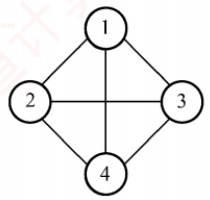

(b) 无向图G2

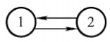

(c) 有向完全图G3

图 6.1 图的示例

#### 3．简单图、多重图

若图G满足条件:①不存在重复边；②不存在顶点到自身的边，则称图G为简单图。图6.1 中 $G_{1}$ 和 $G_{2}$ 均为简单图。若图G中某两个顶点之间的边数超过1条，并且允许顶点通过一条边与自身关联，则称图G为多重图。多重图和简单图的定义是相对的。本书仅讨论简单图。

#### 4．顶点的度、入度和出度

**考点追踪无向图中顶点和边的关系（2009、2017）**

在无向图中，顶点ν的度是指依附于顶点ν的边的数量，记为TD(v)。图6.1(b)中，每个顶点的度均为3。无向图的全部顶点的度之和等于边数的2倍，因为每条边与两个顶点相关联。

在有向图中，顶点ν的度分为入度和出度，入度是以顶点ν为终点的有向边的数量，记为ID(v)；而出度是以顶点ν为起点的有向边的数量，记为OD(v)。图6.1(a)中，顶点2的出度为2、入度为1。顶点ν的度等于其入度与出度之和，即 $\mathrm{TD}(v)=\mathrm{ID}(v)+\mathrm{OD}(v)$ 。有向图的全部顶点的入度之和与出度之和相等，并且等于边数，这是因为每条有向边都有一个起点和终点。

#### 5．路径、路径长度和回路

顶点 $v_{p}$ 到 $v_{q^{*}}$ 之间的一条路径是指顶点序列 $v_{p},v_{i_{1}},v_{i_{2}},\cdots,v_{i_{m}},v_{q}$ 。路径所含边的数量称为路径长度。第一个顶点和最后一个顶点相同的路径称为回路或环。若一个图有n个顶点，且有大于n-1条边，则此图一定有环。

#### 6．简单路径、简单回路

考点追踪路径、回路、简单路径、简单回路的定义（2011）

路径序列中顶点不重复出现的路径称为简单路径。除第一个顶点和最后一个顶点外，其余顶点不重复的回路称为简单回路。

#### 7．距离

从顶点u到ν的最短路径的长度称为从u到ν的距离。若不存在路径，则距离为无穷大。

#### 8．子图

设有两个图 $G = ( V ,   E )$ 和 $G^{\prime} = ( V^{\prime} ,   E^{\prime} )$ ，若V是V的子集，且E'是E的子集，则称G'是G的子图。若有满足 $V_{} ( G^{\prime} ) = V_{} ( G )$ 的子图G'，则称其为G的生成子图。图6.1中 $G_{3}$ 为 $G_{1}$ 的子图。

**注意**

并非V和E的任何子集都能构成G的子图，因为这样的子集可能不是图，即E的子集中的某些边关联的顶点可能不在这个V的子集中。

#### 9．连通、连通图和连通分量

考点追踪 图的连通性与边和顶点的关系（2010、2022）

在无向图中，若从顶点v到w存在路径，则称v和w是连通的。若图G中任意两个顶点都是连通的，则称图G为连通图；否则为非连通图。无向图中的极大连通子图称为连通分量，在图6.2(a)中，图 $G_{4}$ 的3个连通分量如图6.2(b)所示。假设一个图有n个顶点，若边数少于n-1，则此图必然是非连通的。思考:在一个非连通图中，最多可能有多少条边？①

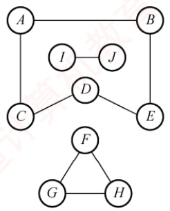

(a) 无向图G4

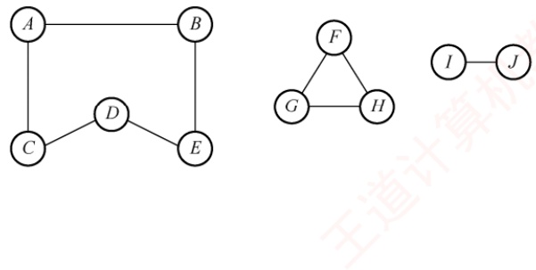

(b) G4的3个连通分量

图6.2 无向图及其连通分量

#### 10．强连通图、强连通分量

在有向图中，如果一对顶点ν和w，从ν到w和从w到ν之间都有路径，则称这两个顶点是强连通的。如果图中任意一对顶点都是强连通的，则称此图为强连通图。有向图中的极大强连通子图称为强连通分量，图 $G_{1}$ 的强连通分量如图6.3所示。思考，假设有向图拥有n个顶点，且该图是强连通的，则最少需要多少条边？①

> ①非连通情况下边最多的情况:由n-1个顶点构成一个完全图，此时再加入一个顶点则变成非连通图。

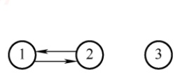

**注意**

在无向图中讨论连通性，在有向图中讨论强连通性。

#### 11．生成树、生成森林

连通图的生成树是一个包含所有顶点的极小连通子图。若图中有n个顶点，则其生成树恰好包含n-1条边。这样的子图仅通过最少数量的边保持连通。对生成树而言，若移除任意一条边，都会变成非连通图；添加任何一条边则会形成一个回路。在非连通图中，每个连通分量的生成树共同构成了该图的生成森林。图 $G_{2}$ 的一个生成树如图6.4所示。

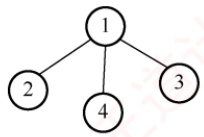

图 6.3 图 $G_{1}$ 的强连通分量

图 6.4 图 $G_{2}$ 的一个生成树

**注意**

区分极大连通子图和极小连通子图。极大连通子图要求子图必须连通，而且包含尽可能多的顶点和边；极小连通子图是既要保持子图连通又要使得边数最少的子图。

#### 12．边的权、网和带权路径长度

在一些图中，每条边可以被赋予一个代表某种意义的数值，称为该边的权值。这种边上带有权值的图称为带权图，也称网。路径上所有边的权值之和，称为该路径的带权路径长度。

#### 13．完全图（也称简单完全图）

对于无向图，边的数量|E范围是从0到 $n ( n   -   1 ) / 2$ 。当边数达到最大值 n(n-1)/2时，该无向图称为完全图，意味着任意两个顶点之间都有一条边相连。对于有向图，E的范围是从0到n(n-1)，有n(n-1)条弧的有向图称为有向完全图，即任意两个顶点之间都存在方向相反的两条弧。图6.1中 $G_{2}$ 为无向完全图，而 $G_{3}$ 为有向完全图。

#### 14．稠密图、稀疏图

边数相对较少的图称为稀疏图，反之称为稠密图。这两个概念本身较为模糊，稀疏和稠密常常是相对而言的。一般认为，当图G满足 $| E | < | V | \log_{2} | V$ 时，可视为稀疏图。

#### 15．有向树

一个顶点的入度为0、其余顶点的入度均为1的有向图，称为有向树。

## 6.2 图的存储及基本操作

图的存储必须要完整、准确地反映顶点集和边集的信息。针对不同的图结构和算法需求，选择合适的存储方式将显著影响程序的效率，因此所采用的存储结构应与待求解的问题相适应。

### 6.2.1 邻接矩阵法

邻接矩阵存储方法通过一个一维数组存储图中顶点的信息，并用一个二维数组存储边的信息（各顶点之间的邻接关系）。这个用于存储邻接关系的二维数组称为邻接矩阵。

顶点数为 n的图 $G   =   ( V , E )$ 的邻接矩阵A是n×n的，将图G的顶点编号为 $v_{1} , v_{2} , \cdots , v_{n}$ ，则

$$
\mathcal{A}[i][j] = \left\{\begin{aligned} 1, & \quad (v_i, v_j)  或  \langle v_i, v_j \rangle  是  E(G)  中的边  \\ 0, & \quad (v_i, v_j)  或  \langle v_i, v_j \rangle  不是  E(G)  中的边  \end{aligned} \right.
$$

**考点追踪图的邻接矩阵存储及相互转换（2011、2015、2018）**

对带权图而言，若顶点 $v_{i}$ 和v之间有边相连，则邻接矩阵中对应位置存放该边的权值；若顶点 $v_{i}$ 和 $v_{j}$ 不相连，则通常用0或 $\infty$ 表示这两个顶点之间不存在边:

$$
A[i][j] = \left\{\begin{aligned} & w_{ij}, \quad (v_i, v_j)  或  \langle v_i, v_j \rangle  是  E(G)  中的边  \\ & 0  或  \infty, \quad (v_i, v_j)  或  \langle v_i, v_j \rangle  不是  E(G)  中的边  \end{aligned} \right.
$$

图6.5展示了有向图、无向图及带权图（网）对应的邻接矩阵。

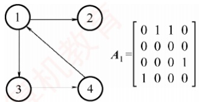

(a) 有向图 $G_{1}$ 及其邻接矩阵

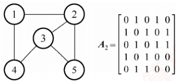

(b) 无向图 $G_{2}$ 及其邻接矩阵

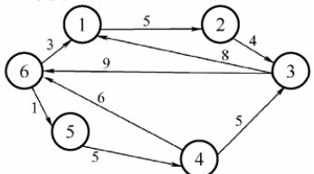

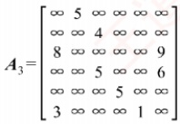

(c) 网及其邻接矩阵（对角线元素也经常用0表示）

图6.5 有向图、无向图及网的邻接矩阵

**考点追踪（算法题）邻接矩阵的遍历及顶点的度的计算（2021、2023）**

图的邻接矩阵存储结构定义如下:

```c
#define MaxVertexNum 100 //顶点数目的最大值
typedef char VertexType; 山 //顶点对应的数据类型
typedef int EdgeType; //边对应的数据类型
typedef struct{
VertexType vex[MaxVertexNum]; //顶点表
EdgeType edge [MaxVertexNum][MaxVertexNum];//邻接矩阵，边表
int vexnum,arcnum; //图的当前顶点数和边数
}MGraph;X
```

**注意**

①在简单应用中，可以直接使用二维数组作为图的邻接矩阵（顶点信息等均可省略）。

② 当邻接矩阵元素仅表示相应边是否存在时，EdgeType可用值为0和1的枚举类型

③邻接矩阵表示法的空间复杂度为 $O ( n^{2} )$ ，其中n为图的顶点数|]。

**考点追踪邻接矩阵的遍历的时间复杂度（2021）**

邻接矩阵表示法具有以下特点:

①无向图的邻接矩阵一定是对称矩阵，因此实际存储时只需保存上（或下）三角部分。在顶点编号固定的条件下，该邻接矩阵是唯一的。

考点追踪基于邻接矩阵的顶点的度的计算（2013、2021、2023）

②对于无向图，邻接矩阵第i行（或第i列）非零元素（或非 $\infty$ 元素）的数量正好是顶点i的度 $\mathrm {T D} ( v_{i} )$ 美

③对于有向图，邻接矩阵第i行非零元素（或非∞元素）的数量是顶点i的出度OD(vi)；第i列非零元素（或非∞元素）的数量则是顶点i的入度ID(vi)。

④使用邻接矩阵存储图时，很容易判断任意两个顶点之间是否有边相连，但要确定图中有多少条边，通常需要遍历整个矩阵，时间代价较大。

⑤稠密图（边数较多的图）更适合采用邻接矩阵存储。

考点追踪计算A2并说明An[i][]的含义（2015）

⑥ 设图 G 的邻接矩阵为 A， $A^{n}$ 的元素 A″[i][j]代表从顶点 i 到顶点 j 长度为 n的路径数量。这一结论了解即可，具体证明可参考离散数学教材。

### 6.2.2 邻接表法

当图为稀疏图时，使用邻接矩阵法显然会浪费大量存储空间。而邻接表法结合了顺序存储与链式存储的优点，能显著减少这种不必要的空间开销。

所谓邻接表，是指对图G中的每个顶点 $v_{i}$ 建立一个单链表。第i个单链表中的结点表示依附于顶点 $v_{i}$ 的边（对于有向图，这些边是以 $v_{i}$ 为尾的弧），该链表称为顶点 $v_{i}$ 的边表（有向图中也称出边表）。边表的头指针与顶点的数据信息采用顺序存储，称为顶点表。因此，邻接表中包含两类结点:顶点表结点和边表结点，如图6.6所示。

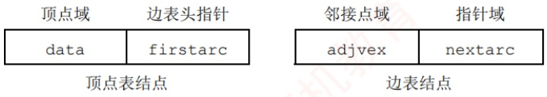

图6.6 顶点表和边表结点结构

顶点表结点由两个域组成:顶点域（data）存储顶点 $v_{i}$ 的相关信息，边表头指针域（firs tarc）指向其第一条邻接边的边表结点。边表结点至少包含两个域:邻接点域（adjvex）存储与该顶点邻接的另一顶点编号，指针域（nextarc）指向下一条边的边表结点。

考点追踪图的邻接表存储的应用（2014）

无向图和有向图的邻接表表示分别如图6.7和图6.8所示。

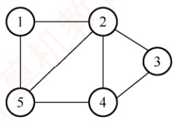

(a)无向图G

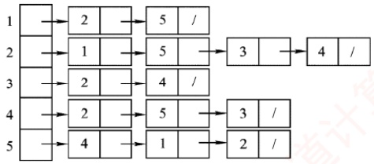

(b)无向图G的邻接表的表示

图6.7 无向图的邻接表表示

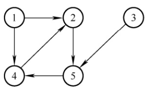

(a)有向图 G

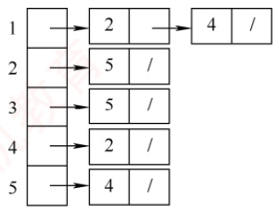

(b)有向图G的邻接表的表示

图6.8 有向图的邻接表表示

图的邻接表存储结构定义如下:

```c
#define MaxVertexNum 100 //图中顶点数目的最大值
typedef struct ArcNode{ //边表结点
int adjvex; //该弧所指向的顶点的位置
struct ArcNode *nextarc; //指向下一条弧的指针
∥InfoType info; //网的边权值
}ArcNode;
typedef struct VNode{ //顶点表结点
VertexType data; //顶点信息
ArcNode *firstarc; //指向第一条依附该顶点的弧的指针
}VNode,AdjList [MaxVertexNum];
typedef struct{
AdjList vertices; //邻接表
int vexnum,arcnum; //图的顶点数和弧数
}ALGraph; //ALGraph 是以邻接表存储的图类型
```

邻接表表示法具有以下特点:

①若G为无向图，所需存储空间为O(+ 2|E)；若为有向图，则为 O(I+ |E)。前者包含系数2，是因为无向图中每条边在邻接表中会出现两次。

**考点追踪邻接矩阵法和邻接表法的适用性分析（2011）**

②对于稀疏图（边数较少的图），采用邻接表表示能极大节省存储空间。

③在查找指定顶点的所有邻接点时，邻接表只需遍历对应的边表；而邻接矩阵则需扫描对应整行，效率较低。然而，若要判断两个顶点之间是否存在边，邻接矩阵支持O(1)的直接访问；而邻接表需要线性查找对应的边表，效率较低。

④在无向图的邻接表中，顶点的度等于其邻接表中边表结点的个数。对于有向图，顶点的出度等于其邻接表中边表结点的个数；而入度则需遍历所有顶点的边表，统计所有边表中（adjvex）域等于该顶点编号的结点总数。

⑤邻接表的表示不唯一，因为每个顶点对应的边表中，各边结点的链接顺序可以是任意的，它取决于建立邻接表的算法及输入边的次序。

### 6.2.3 十字链表

十字链表是有向图的一种链式存储结构。在十字链表中，每条弧用一个结点（称为弧结点）表示，每个顶点也用一个结点（称为顶点结点）表示。这两种结点的结构如下所示。

| tailvex | headvex | hlink | tlink | (info) |  | data | firstin | firstout |
| --- | --- | --- | --- | --- | --- | --- | --- | --- |

弧结点包含五个域:tailvex和headvex域分别存放弧尾顶点和弧头顶点的编号；头链域hlink指向弧头相同的下一条弧；尾链域tlink指向弧尾相同的下一条弧；info域存放该弧的相关信息。这样，弧头相同的弧在同一个链表上，弧尾相同的弧也在同一个链表上。

顶点结点包含三个域:data 域存放该顶点的数据信息，如顶点名称；firstin 域指向以该顶点为弧头的第一条弧；firstout域指向以该顶点为弧尾的第一条弧。

图6.9为有向图的十字链表表示法。

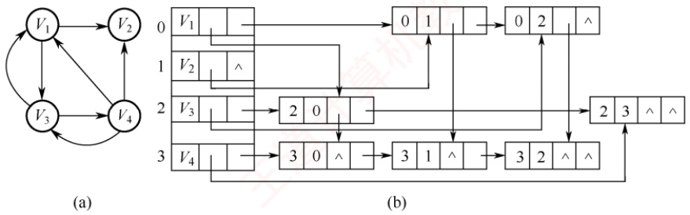

图6.9 有向图的十字链表表示（弧结点省略info域）

注意，顶点结点之间是顺序存储的，弧结点省略了info域。

在十字链表中，既容易找到以 $V_{i}$ 为尾的弧，也容易找到以 $V_{i}$ 为头的弧。因此，很容易求得顶点的出度和入度。图的十字链表的表示形式不唯一，取决于弧的输入顺序。

### 6.2.4 邻接多重表

邻接多重表是无向图的一种链式存储结构。虽然邻接表可以方便地获取顶点和边的信息，但在执行如判断两个顶点之间是否存在边等操作时，需分别遍历两个顶点的边表，效率较低。邻接多重表通过将每条边仅用一个结点表示，从而在判断边时只需遍历一次，提升了效率。

与十字链表类似，在邻接多重表中，每条边用一个结点表示，其结构如下。

| e |  |  |  | 1 |
| --- | --- | --- | --- | --- |
|  |  |  |  |  |

其中，ivex和jvex域存放该边依附的两个顶点的编号；ilink 域指向依附于顶点 ivex的下条边；jlink域指向依附于顶点jvex的下一条边，info域存放该边的相关信息。

每个顶点也用一个结点表示，包含如下所示的两个域。

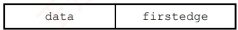

其中，data域存放该顶点的相关信息，firstedge域指向依附于该顶点的第一条边。

在邻接多重表中，所有依附于同一顶点的边串联在同一链表中。由于每条边依附于两个顶点，其对应的边结点同时链接在两个链表中。对无向图而言，其邻接多重表与邻接表的主要区别在于:邻接表用两个结点表示同一条无向边，而邻接多重表仅用一个。

考点追踪图的邻接多重表表示的分析（2024）

图6.10为无向图的邻接多重表表示。邻接多重表的基本操作与邻接表类似。

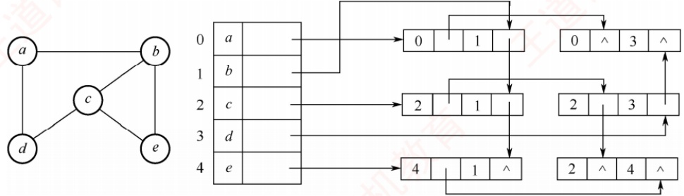

图6.10 无向图的邻接多重表表示（边结点省略info域）

图的四种存储方式的总结如表6.1所示。

表6.1 图的四种存储方式的总结

|  | 邻接矩阵 | 邻接表 | 十字链表 | 邻接多重表 |
| --- | --- | --- | --- | --- |
| 空间复杂度 | $O ( \| V \|^{2} )$ | 无向图:$O ( \| V \| + 2 \| E \| )$有向图:$O ( \| V \| + \| E \| )$ | $O ( \| V \| + \| E \| )$ | $O ( \| V \| + \| E \| )$ |
| 找相邻边 | 遍历对应行或列的时间复杂度为 O(\|I) | 找有向图的入度必须遍历整个邻接表 | 很方便 | 很方便 |
| 删除边或顶点 | 删除边很方便，删除顶点需要大量移动数据 | 无向图中删除边或顶点都不方便 | 很方便 | 很方便 |
| 适用于 | 稠密图 | 稀疏图和其他 | 只能存有向图 | 只能存无向图 |
| 表示方式 | 唯一 | 不唯一 | 不唯一 | 不唯一 |

### 6.2.5 图的基本操作

图的基本操作独立于其存储结构，但不同存储方式下的具体实现算法性能会有所不同。在设计具体算法时，应根据需求选择合适的存储方式以提高效率。

图的基本操作主要包括（仅抽象地考虑，所以忽略各变量的类型）:

${\tt Adjacent} \left( {\tt G} , {\tt x} , {\tt y} \right)$ :判断图G 中是否存在边 $<   \propto , \gamma   >$ 或 $( \mathbf {x} , \mathbf {y} )$

$\tt Neighbors ( G , x )$ :列出图G中与顶点×邻接的所有边。

● InsertVertex(G,x):在图G 中插入顶点 x。

$\mathtt {DeleteVertex} \left( \mathtt {G} , \mathtt {x} \right)$ :从图G中删除顶点×及其相关的所有边。

• AddEdge $( \mathtt {G} , \mathtt {x} , \mathtt {y} )$ :若无向边 $( \mathbf {x} , \mathbf {y} )$ 或有向边 $<   \scriptstyle \mathrm {x}   ,   \scriptstyle \mathrm {y}   >$ 不存在，则将其添加到图G中。

• RemoveEdge $( \mathtt {G} , \mathtt {x} , \mathtt {y} )$ :若无向边 $(x,y)$ 或有向边 $<   \scriptstyle \mathbb {X}   ,   \scriptstyle \mathbb {Y}   \geq$ 存在，则从图G中删除该边。

● $\mathtt {FirstNeighbor} \left( \mathtt {G} , \mathtt {x} \right)$ :查找图G中顶点×的第一个邻接点。若存在则返回顶点号；若x没有邻接点或图中不存在x，则返回-1。

$\mathtt {NextNeighbor} \; ( \mathtt {G} , \mathtt {x} , \mathtt {y} )$ :假设顶点y是顶点×的一个邻接点，返回除y外顶点×的下一个邻接点的顶点号。若y是×的最后一个邻接点，则返回-1。

$\mathtt {Get \_e dge \_v alue \left( G , x , y \right)}$ :获取图 G 中边 $( \mathbf {x} , \mathbf {y} )$ 或 $<   \mathrm {x}   ,   \mathrm {y}   >$ 对应的权值。

$\mathtt {Set \_e dge \_v alue ( G , x , y , v )}$ :设置图 G 中边 $( \mathbf {x} , \mathbf {y} )$ 或 $<   \scriptstyle \mathrm {x}   ,   \scriptstyle \mathrm {y}   >$ 对应的权值为v。

此外，还有图的遍历算法:按照某种顺序访问图中的每个顶点且仅访问一次。常见的图遍历算法包括深度优先遍历（DFS）和广度优先遍历（BFS），具体内容将在下一节详细讨论。

## 6.3 图的遍历

图的遍历是指从图中某一顶点出发，按照某种搜索策略，沿着图中的边访问所有顶点，且每个顶点仅被访问一次。注意到树是一种特殊的图，因此树的遍历可视为图遍历的一种特例。图的遍历算法是求解连通性问题、拓扑排序、关键路径等图算法的基础。

与树的遍历相比，图的遍历要复杂得多，因为图中任意一个顶点都可能与其余多个顶点相邻接。访问某个顶点后，沿着某条路径继续搜索时，可能再次回到该顶点。为避免重复访问，遍历过程中需记录已访问过的顶点，通常设置一个辅助数组 visited[]来标记各顶点是否已被访问。图的遍历主要有两种基本算法:广度优先搜索和深度优先搜索。

### 6.3.1 广度优先搜索

广度优先搜索（Breadth-First-Search,BFS）类似于树的层序遍历。其基本思想是:首先访问起始顶点ν，然后从ν出发，依次访问ν的所有未被访问过的邻接顶点 $w_{1}, w_{2}, \cdots, w_{i};$ 随后依次访问 $w_{1}, w_{2}, \cdots, w_{i}$ 的所有尚未访问过的邻接顶点；再从这些访问过的顶点出发，访问它们所有未被访问过的邻接顶点，直至图中所有可达顶点都被访问为止。若此时图中仍有未被访问的顶点，则另选一个未访问的顶点作为新的起始点，重复上述过程，直至图中所有顶点均被访问。Dijkstra单源最短路径算法和Prim最小生成树算法也应用了类似的思想。

换句话说，广度优先搜索以起始顶点ν为中心，按路径长度递增的顺序访问所有从ν可达的顶点，即先访问距离为1的顶点，再访问距离为2的顶点，以此类推。BFS是一种分层遍历过程:每完成一层的访问，便会处理下一层的所有顶点，而不会沿已访问路径回溯，因此通常以非递归方式实现。BFS算法必须借助一个辅助队列，用于暂存当前层顶点的下一层邻接顶点。

```javascript
bool visited[MAX VERTEX NUM]; //访问标记数组
void BFSTraverse(Graph G) { //对图 G 进行广度优先遍历
for(i=0;i<G.vexnum;++i)
visited[i]=FALSE; //访问标记数组初始化
自
InitQueue(Q) ; //初始化辅助队列Q
for(i=0;i<G.vexnum;++i) //从0号顶点开始遍历
if(!visited[i]) //对每个连通分量调用一次BFS()
BFS(G,i); //若ν未访问过，从ν开始调用 BFS()
```

广度优先搜索算法的实现如下:

基于邻接表的广度优先搜索实现如下:

```c
void BFS(ALGraph G,int i){
visit(i); visited[i]=TRUE; //对i 做已访问标记 //访问初始顶点i 算机教
EnQueue (Q,i); //顶点i入队
while(!QueueEmpty(Q)){
首 for(p=G.vertices[v].firstarc;p;p=p->nextarc){/检测v 的所有邻接点 DeQueue (Q, v) ; //队首顶点 v 出队
w=p->adjvex;
if(visited[w]==FALSE) {
visit(w); //w 为 ⅴ 的尚未访问的邻接点，访问 w
visited[w]=TRUE; //对 w 做已访问标记
EnQueue(Q,w); //顶点 w 入队
笔机教
```

基于邻接矩阵的广度优先搜索实现如下:

```javascript
void BFS(MGraph G,int i){
visit(i); //访问初始顶点 i
visited[i]=TRUE; //对i做已访问标记
EnQueue(Q,i); //顶点i入队
while(!QueueEmpty(Q)){
DeQueue(Q, v) ; //队首顶点 v 出队
for(w=0;w<G.vexnum;w++) //检测v的所有邻接点
if(visited[w]==FALSE&&G.edge[v][w]==1) {
visit(w); //w 为 ⅴ 的尚未访问的邻接点，访问w
算机 visited[w]=TRUE; //对 w 做已访问标记
EnQueue(Q,w); //顶点 w 入队
道
```

辅助数组 visited[]用于标记顶点是否已被访问，初始值均为 FALSE。在遍历过程中，一旦顶点vi被访问，立即置 $\mathtt {visited \left[ i \right] {=} TRUE}$ ，以防止重复访问。

考点追踪广度优先遍历的过程（2013）

给定图 G 如图 6.11 所示，假设从顶点 a开始遍历，BFS 的执行过程如下:a先入队；队列非空，取出a，发现其邻接点b和c均未访问，依次访问并入队；取出b，访问其未访问的邻接点d和e，并入队（a虽与b也邻接，但已访问，故跳过）；取出c，访问其未访问的邻接点f和g，并入队；取出d，其邻接点均已访问，无操作；取出e，访问其未访问邻接点 h，并入队；继续处理 f, g,h，均无新邻接点可访问；最终队列为空，遍历结束。遍历结果为 abcdefgh。

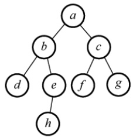

图 6.11 一个无向图 G

上述过程与二叉树的层序遍历完全一致，说明图的BFS是树层序遍历算法的自然推广。

#### 1．BFS算法的性能分析

无论采用邻接表还是邻接矩阵存储，BFS 算法都需要借助一个辅助队列 Q来实现逐层访问。每个顶点最多入队一次，在最坏的情况下，空间复杂度为O()。

**考点追踪基于邻接表存储的BFS的效率（2012）**

遍历图的过程实质上是对每个顶点查找其邻接点的过程，耗费的时间取决于所采用的存储结构。采用邻接表存储时:每个顶点均需搜索（或入队）一次，时间复杂度为O()；在搜索每个顶点的邻接点时，每条边均需访问一次，时间复杂度为O(E)；总的时间复杂度为 $O(|V| + |E|)$ 。采用邻接矩阵存储时:查找每个顶点的邻接点所需的时间为O(I)，总时间复杂度为O(²)

#### 2．BFS算法求解单源最短路径问题

若图 G = (V, E)为非带权图，定义从顶点 u到顶点ν的最短路径 d(u,v)为所有从 u到ν的路径中所含边数的最小值；若从u到ν不可达，则 $d ( u , v ) = \infty$

利用BFS可求解非带权图的单源最短路径问题，这是因为广度优先搜索总是按照距离由近到远的顺序遍历图中顶点，从而保证每个顶点首次被访问时，所经过的路径即为最短路径。

BFS求解单源最短路径的实现如下:

```txt
void BFS MIN Distance(Graph G,int u){
//α[i]表示从 u 到 i 的最短路径
for(i=0;i<G.vexnum;++i)
d[i]=∞; 三 //初始化路径长度
visited[u]=TRUE; d[u]=0;
EnQueue (Q, u) ;
while(!QueueEmpty(Q)){ //BFS 算法主过程
DeQueue (Q, u) ; //队头元素u 出队
for(w=FirstNeighbor(G,u);w>=0;w=NextNeighbor(G,u,w))
if(!visited[w]) { //w 为u的尚未访问的邻接顶点
visited[w]=TRUE; //设已访问标记
d[w]=d[u]+1; //路径长度加1
EnQueue(Q,w); //顶点 w 入队
```

#### 3．广度优先生成树

在广度优先遍历的过程中，所经过的边与访问的顶点共同构成一棵树，称为广度优先生成树，如图6.12所示。需要注意的是:若图采用邻接矩阵存储，由于其表示是唯一的，因此从同一源点出发得到的广度优先生成树也是唯一的。而若采用邻接表存储时，其表示不唯一，导致遍历时邻接点的访问顺序不确定，因此生成的广度优先生成树也可能不唯一。

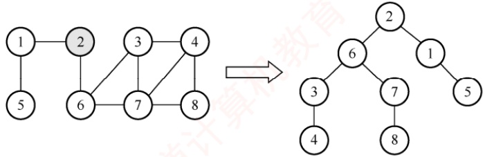

图 6.12 图的广度优先生成树

### 6.3.2 深度优先搜索

与广度优先搜索不同，深度优先搜索（Depth-First-Search，DFS）类似于树的先序遍历。正如其名称所暗示的那样，这种搜索算法遵循尽可能“深”地探索一个图的策略。

其基本思想是:首先访问图中的某一起始顶点ν，然后从ν出发，访问ν的一个未访问邻接顶点 $w_{1}$ ，再访问 $w_{1}$ 的一个未访问邻接顶点 $\mathcal {W}_{2} {}^{\cdot \cdot \cdot \cdot \cdot \cdot \cdot}$ 以此类推。当无法继续向下访问时，回退至上一顶点（递归返回），检查其是否还有未访问的邻接顶点。若有，则从该顶点开始继续上述搜索过程，直到图中所有顶点均被访问为止。

一般而言，其递归形式的算法非常简洁，具体过程如下:

```txt
bool visited[MAX VERTEX NUM]; //访问标记数组
void DFSTraverse(Graph G) { //对图 G 进行深度优先遍历
for(i=0;i<G.vexnum;i++)
visited[i]=FALSE; //初始化已访问标记数组
for(i=0;i<G.vexnum;i++) //本代码从v0开始遍历
道 if(!visited[i]) //对尚未访问的顶点调用 DFS()
DFS(G,i);
1
```

基于邻接表的深度优先搜索实现如下:

```txt
void DFS(ALGraph G,int i){
visit(i); //访问初始顶点i
visited[i]=TRUE; //对i做已访问标记
for(p=G.vertices[i].firstarc;p;p=p->nextarc) {//检测 i 的所有邻接点
j=p->adjvex;
if(visited[j]==FALSE)
DFS(G,j); ∥j 为 i的尚未访问的邻接点，递归访问 j
1
```

基于邻接矩阵的深度优先搜索实现如下:

```javascript
void DFS(MGraph G,int i) {
visit(i); //访问初始顶点i
visij=0;ij]=.vexnum;j++){ /对做已间有标记点 10
if(visited[j]==FALSE&&G.edge[i][j]==1)
DFS(G,j); ∥/j 为 i的尚未访问的邻接点，递归访问 j
```

考点追踪 深度优先遍历的过程（2015、2016）

以图6.11的图G为例，DFS的执行过程如下:首先访问顶点a，并置a访问标记。接着访问与 a邻接且未被访问的b，置b访问标记；随后访问与b邻接且未被访问的d，置d访问标记。此时，由于d没有更多未被访问的邻接顶点，因此返回上一个访问的b，继续访问其未被访问的邻接顶点e，置e访问标记，以此类推，直至图中所有顶点都被访问一次。遍历结果为abdehcfg。

**注意**

图的邻接矩阵表示是唯一的，这意味着基于邻接矩阵和同一源点出发遍历得到的DFS和BFS序列是唯一的。然而，对邻接表来说，若边的输入顺序不同，则生成的邻接表也会不同。因此，对同一个图，基于邻接表的遍历得到的DFS序列和BFS序列可能不是唯一的。

#### 1．DFS算法的性能分析

DFS算法通常以递归形式实现，其执行过程依赖系统提供的递归工作栈，在最坏情况下，递归深度可达|，因此空间复杂度为O()。

图的遍历本质上是通过边依次访问邻接点的过程。因此，无论是深度优先搜索还是广度优先搜索，其时间复杂度仅取决于图的存储结构，而与访问顺序无关。具体而言:采用邻接矩阵存储时，对每个顶点需扫描整行以查找邻接点，总时间复杂度为O(²)；采用邻接表存储时，每个顶点和每条边均被访问常数次，总时间复杂度为O(I+E)。

#### 2．深度优先的生成树和生成森林

与广度优先搜索类似，深度优先搜索在遍历过程中也会形成一棵深度优先生成树。其存在的前提是图必须是连通的。只有对连通图调用DFS时，才能得到一棵覆盖所有顶点的生成树；若图是非连通的，DFS将为每个连通分量分别生成一棵树，这些树共同构成深度优先生成森林，如图6.13所示。注意，不论是采用DFS还是采用BFS方法，基于邻接表得到的生成树是不唯一的，而基于邻接矩阵和同一源点所得到的生成树是唯一的。

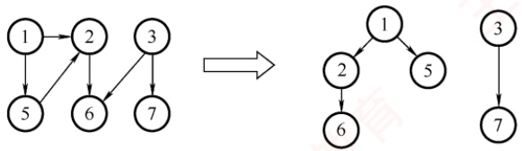

图6.13 图的深度优先生成森林

### 6.3.3 图的遍历与图的连通性

图的遍历算法可用于判断图的连通性。

为了确保遍历图中所有顶点（无论图是否连通），在BFSTraverse()和DFSTraverse（）中均添加了一个外层for循环:从每个尚未被访问的顶点出发，启动一次新的BFS或DFS。

对于无向图，若图是连通的，则只需一次遍历即可访问所有顶点；若图是非连通的，则一次遍历仅能覆盖其所在连通分量的所有顶点。因此，调用BFS(G,i)或 DFS(G,i) 的次数恰好等于该图的连通分量数，因为每次调用都会遍历一个连通分量中的所有顶点。

对于有向图，情况略有不同。仅当从初始顶点到达图中每个顶点都存在路径时，才能通过一次遍历访问到所有顶点；否则，将不能访问所有顶点。即使整个图是弱连通的，也可能包含强连通分量和非强连通分量。在非强连通分量中，单次调用 BFS(G,i)或 DFS(G,i) 不一定能访问到该子图的所有顶点。例如，某些顶点可能无法从初始顶点到达，尽C管它们之间可能存在路径。因此，对于有向图，同样需要外层循环以确保所有顶点被覆盖，如图6.14所示。 图6.14 有向图的非强连通分量

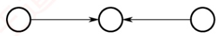

## 6.4 图的应用

本节是历年考查的重点，但直接考查算法设计题的概率偏小，更多是结合具体的图实例，考查算法的具体操作过程。读者必须掌握如何手工模拟各类图算法在给定图上的执行过程。此外，还需要具备将实际问题抽象为图模型，并据此构建合适的图结构以解决问题的能力。

### 6.4.1 最小生成树

一个连通图的生成树包含了图的所有顶点，并且仅包含尽可能少的边。对生成树来说，若移除一条边，则会使该生成树变成非连通图；若增加一条边，则会在图中形成一条回路。

对于带权连通无向图G而言，不同的生成树其总权重（树中所有边的权值之和）可能不同。具有最小总权重的生成树称为图G的最小生成树（Minimum-Spanning-Tree，MST）。

**考点追踪最小生成树的性质（2012、2017）**

不难看出，最小生成树具有以下特性:

1）若图G中含有权值相同的边，则最小生成树可能不唯一，即可能存在多个不同的最小生成树。当图G中所有边的权值互不相同时，最小生成树是唯一的。此外，若无向连通图G本身的边数等于顶点数减1（G本身就是一棵树），则其最小生成树就是它本身。

2）虽然最小生成树可能不唯一，但所有最小生成树的总权重都是相同的，且为最小值。

3）最小生成树的边数等于顶点数减1。

**考点追踪最小生成树中某顶点到其他顶点是否具有最短路径的分析（2023）**

**注意**

最小生成树中所有边的权值之和最小，但不能保证任意两个顶点之间的路径是最短路径。如下图所示，最小生成树中A到C的路径长度为5，但图中A到C的最短路径长度为4。

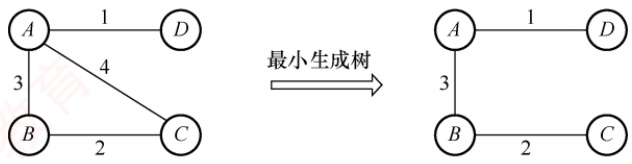

构造最小生成树的方法有多种，但大多数算法都基于这样一个核心性质:假设 $G = (V, E)$个带权连通无向图，U是顶点集V的一个非空子集。若(u,v)是一条权值最小的边，其中 $u   \in   U ,$ $v   \in   V   -   U ,$ 则图G中必存在一棵包含边(u,ν)的最小生成树。

基于此原理的主要算法包括 Prim 算法和 Kruskal 算法，二者均采用贪心策略。对这两种算法，应重点掌握其本质含义与基本思想，并能动手模拟其执行过程。

以下是通用的最小生成树算法框架:

while T 未形成一棵生成树；

do 找到一条最小代价边(u,v)并且加入π 后不会产生回路；

$$
\scriptstyle \mathbb {T} = \mathbb {T} \cup   ( \mathbb {u} ,   \mathbb {v} ) \; ;
$$

通过逐步添加边来逐渐构造一棵生成树，下面介绍实现上述框架的两种经典算法。

#### 1．Prim算法

Prim（普里姆）算法在执行过程上与求解单源最短路径的Dijkstra算法较为相似。

考点追踪Prim算法构造最小生成树的实例（2015、2017、2018）

初始时，从图中任取一个顶点加入树T，此时T仅包含该顶点。接着，选择一个与当前T中顶点集合距离最近的顶点，并将该顶点及其相连的最小权值边加入T。每执行一次此操作，T中的顶点数和边数各增加1。重复这一过程，直到图中所有顶点都被并入T为止。最终得到的T即为最小生成树，且其中必然含有n-1条边。图6.15展示了Prim算法构造最小生成树的过程。

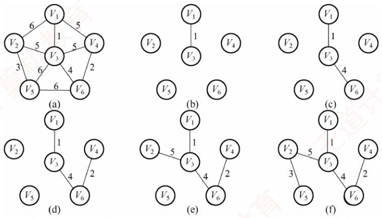

图 6.15 Prim算法构造最小生成树的过程

Prim算法步骤如下:

假设 $G = \{V , E \}$ 是连通图，其最小生成树 T=(U, Er)， $E_{T}$ 是 T中的边集合。

初始化:向空树 $T   =   ( U , E_{T} )$ 中添加图G的任意一个顶点u0，使得 $U = \{u_{0} \} , E_{T} = \emptyset$

循环（重复，直至 $U = V )$ :从图 G 中选择满足条件{(u, ν)|u∈U, ν∈V− U}且具有最小权值的边 $\mathbf {\nabla}_{\mathbf {\nabla}} ( u , v )$ ，将其加入树T，并更新 $U = U \cup \{v \} , \quad E_{T} = E_{T} \cup \{( u , v ) \}$

Prim算法的简单实现如下:

```txt
void Prim(G,T) {
T=∅; //初始化空树
U= {w} ; //添加任意一个顶点 w
while((V-U)!=∅){ //若树中不含全部顶点
设(u, v) 是使 u∈υ 与 v∈ (V-U)，且权值最小的边；
T=T∪{(u,v) }; //边归入树
U=U∪{v}; //顶点归入树
```

在Prim算法中，每步都从当前已构建的树向外扩展一条最短边，逐步生长出整棵最小生成树。该算法的时间复杂度为 $O ( | V |^{2} )$ ，与边数E无关，因此特别适用于求解边稠密图的最小生成树。虽然采用其他方法能改进Prim算法的时间复杂度，但会增加实现的复杂度。

#### 2．Kruskal算法

与Prim算法从一个顶点开始扩展最小生成树的方式不同，Kruskal（克鲁斯卡尔）算法采用按边的权值递增次序选择合适的边来构造最小生成树的方法。

**考点追踪Kruskal算法构造最小生成树的实例（2015、2018、2020）**

初始时，图 $T = \{V , \{\} \}$ 包含全部n个顶点，但不含任何边，每个顶点自成一个连通分量。然后按照边的权值从小到大的顺序，依次考察各条边:如果当前边连接的两个顶点属于T中不同的连通分量（可通过并查集判断），则将该边加入T；否则，舍弃此边，继续考察下一条权值最小的边。重复这一过程，直到所有顶点都属于同一个连通分量，此时得到的T即为最小生成树。图6.16展示了Kruskal算法构造最小生成树的过程。

Kruskal 算法步骤如下:

假设 $G   =   ( V , E )$ 是连通图，其最小生成树 $T = ( U , E_{T} ) , E_{T}$ 是T中的边集合。

初始化: $U = V , E_{T} = \varnothing$ 。即每个顶点构成一棵独立的树，T此时是一个仅含个顶点的森林。循环（重复，直至T成为一棵树）:按照边权值递增的顺序，从 $E   -   E_{T}$ 中选择一条边。若该边加入T后不构成回路，则将其加入 $E_{T} ;$ ；否则舍弃，直到 $E_{T}$ 包含n-1条边为止。

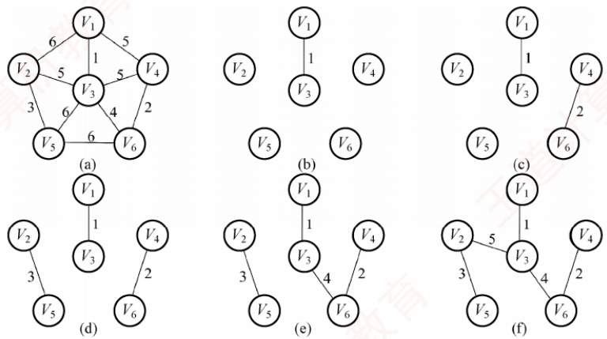

图 6.16 Kruskal算法构造最小生成树的过程

Kruskal 算法的简单实现如下:

```txt
void Kruskal(V,T) {
T=V; 道 //初始化树T，仅含顶点
numS=n; //连通分量数
while(numS>1) { //若连通分量数大于1
从Ε 中取出权值最小的边(v,u)；
if (v 和 u 属于 T 中不同的连通分量) {
T=T∪{(v,u)}; //将此边加入生成树中
numS //连通分量数减1
机教育
```

在Kruskal算法中，每当选择一条连接两棵不同树的边时，这两棵树将通过这条边合并为一棵更大的树，随着算法的进行，整个森林逐渐合并成一棵树。考虑到算法效率，在最坏情况下需要对所有的E条边各扫描一次。通常，边会存储在一个堆（见第7章）中，每次从中选出最小权值的边所需时间为 $O ( \log_{2} \lvert E \rvert )$ 。同时，使用并查集来快速确定两个顶点是否属于同一集合的时间复杂度为O(α())，这里 α()增长极其缓慢，可视为常数。因此，Kruskal算法的总时间复杂度为 $O ( | E | \log_{2} | E | )$ ，不依赖于，这使得它特别适合于处理边稀疏但顶点较多的图。

### 6.4.2 最短路径

**考点追踪最短路径的分析与举例以及相关的算法（2009、2023）**

在6.3节中讨论的广度优先搜索算法适用于求解无权图的最短路径。当图是带权图时，从一个顶点 $v_{0}$ 到图中任意另一个顶点 $v_{i}$ 的路径上所有边的权值之和，称为该路径的带权路径长度；其中，带权路径长度最小的路径（可能存在多条）称为最短路径。

求解最短路径问题的算法通常基于其最优子结构性质:两点间最短路径上的任意子路径，也是对应端点间的最短路径。图的最短路径问题一般可分为两类:一是单源最短路径一一求图中某个顶点到其余各顶点的最短路径，可使用经典的Dijkstra（迪杰斯特拉）算法求解；二是所有顶点对之间的最短路径，可使用Floyd（弗洛伊德）算法求解。

#### 1．Dijkstra算法求单源最短路径问题

Dijkstra算法使用一个集合S记录已确定最短路径的顶点。初始时，将源点（顶点0）放入S；每当将一个新顶点i加入S后，需更新源点到所有尚未确定最短路径的顶点（集合V-S中的顶点）的当前最短路径长度。算法执行过程中维护以下三个辅助数组:

● final:标记各顶点是否已找到最短路径（是否属于集合S）。

● dist[:记录从源点到各顶点的当前最短路径长度。初始化时，若存在从源点到顶点 i的直接边，则dist[i]为该边的权值，否则置为∞。

• path]:path[i]存储从源点到顶点 i的最短路径。算法结束后，可通过 path[]数组回溯，重构出完整的最短路径。

假设源点为顶点0，集合 S初始仅含顶点 0。图以邻接矩阵 arcs 表示，其中 arcs[i][]为有向边&lt;i,j&gt;的权值；若该边不存在，则 arcs[i][j]为∞。

Dijkstra算法的步骤如下（暂不考虑对path[]的操作）:

1）初始化:集合S= {0}，dist[]的初始值为 $\mathrm{dist}[i] = \mathrm{arc}[0][i], i = 1, 2, \cdots, n-1$

2）选择最短路径顶点:从不在S中的顶点集合（V-S）中选出顶点j，使得dist[j]最小，此时，顶点即为当前从源点出发的最短路径的终点，将其加入集合S。

3）松弛操作:对每个从顶点j出发的邻接顶点 $k \left( \arcsin[j][k] \neq \infty \right)$ ，若 $\mathrm {dist} [ j ]   +   \mathrm {arcs} [ j ] [ k ]   <$ dist[k]，则更新 $\operatorname {dist} [ k ] = \operatorname {dist} [ j ] + \operatorname {arcs} [ j ] [ k ]$

4）重复步骤2）～3）共n-1次，直至所有顶点都包含在集合S中。

每个新顶点加入集合S后，都可能发现到达其他尚未确定最短路径顶点的更短路径，从而需要更新相应的dist[]值。以右图为例，设源点为 $\nu_{0} ,$ 初始时 S = {vo}，dist[1] = 3, $\operatorname {dist} [ 2 ] = 7$将 $v_{1}$ 加入集合S后，发现路径 $v_{0} \rightarrow v_{1} \rightarrow v_{2}$ 的长度为4（dist[1]+

$$
\arcsin[1][2] = 3 + 1 = 4
$$

思考:Dijkstra算法与 Prim算法有何异同之处？①

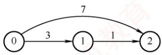

考点追踪Dijkstra算法求解最短路径的实例（2012、2014、2016、2021）

例如，对图6.17中的图应用Dijkstra算法求从顶点1出发到其余各顶点的最短路径的过程，如表6.2所示。算法执行过程的说明如下。

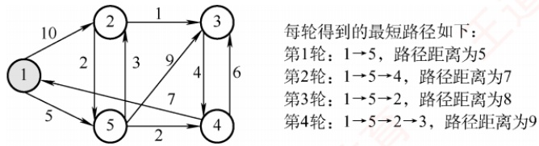

每轮得到的最短路径如下:

第2轮:1→5→4，路径距离为7

第3轮:1→5→2，路径距离为8

第4轮: $1 \rightarrow 5 \rightarrow 2 \rightarrow 3$ ，路径距离为9

图 6.17 应用 Dijkstra 算法的图

> ①Dijkstra算法的流程、操作与 Prim 算法的都很相似，都基于贪心策略。区别在于，i. 目的不同:Dijkstra 算法的目的是构建单源点的最短路径树；Prim算法的目的是构建最小生成树。ii.算法思路略有不同:Prim算法从一个点开始，每次选择权值最小的边，将其连接到已构建的生成树上，直至所有顶点都已加入；而Dijkstra算法每次找出到源点距离最近且未归入集合的点，并把它归入集合，同时以这个点为基础，更新从源点到其他所有顶点的距离。iii.适用的图不同:Prim算法只能用于带权无向图；Dijkstra算法可用于带权有向图或带权无向图。

表 6.2 从 $\mathbf {v_{1}}$ 到各终点的dist值和最短路径的求解过程

| 顶点 | 第1轮 | 第2轮 | 第3轮 | 第4轮 |
| --- | --- | --- | --- | --- |
| 2 | 10$v_{1} \rightarrow v_{2}$ | 8$v_{1} \rightarrow v_{5} \rightarrow v_{2}$ | 8$v_{1} \rightarrow v_{5} \rightarrow v_{2}$ |  |
| 3 | $\infty$ | 14$v_{1} \rightarrow v_{5} \rightarrow v_{3}$ | 13$v_{1} \rightarrow v_{5} \rightarrow v_{4} \rightarrow v_{3}$ | 9$v_{1} \rightarrow v_{5} \rightarrow v_{2} \rightarrow v_{3}$ |
| 4 | 8 | 7$v_{1} \rightarrow v_{5} \rightarrow v_{4}$ |  |  |
| 5 | 5$v_{1} \rightarrow v_{5}$ |  |  |  |
| 集合S | {1, 5} | {1, 5, 4} | {1, 5,4,2} | {1, 5, 4, 2, 3} |

初始化:集合S初始为 $\{v_{1} \}$ ，从 $v_{1}$ 可达 $v_{2}$ 和 $v_{5} ,$ 不可达 $v_{3}$ 和 $v_{4}$ ，因此 dist[数组的初始值为$\mathrm{dist}[2]=10,\ \mathrm{dist}[3]=\infty$ $\operatorname {dist} [ 4 ] = \infty$ $\mathrm {dist} [ 5 ] = 5$ X

第 1 轮:选出最小值 dist[5]，将 $v_{5}$ 加入集合S，此时已确定 $v_{1}$ 到 $v_{5}$ 的最短路径。检查从 $v_{5}$ 出发的邻接边: $v_{5}$ 可达 $v_{2}$ $v_{1} \rightarrow v_{5} \rightarrow v_{2}$ 的长度为8，小于当前 $\mathrm {dist} [ 2 ] = 10$ 更新 $\mathrm {dist} [ 2 ] = 8 ; \quad v_{5}$ 可达$v_{3}, v_{1} \rightarrow v_{5} \rightarrow v_{3}$ 的长度为14，更新 $\mathrm{dist}[3] = 14; \quad v_{5}$ 可达 $v_{4} , v_{1} \rightarrow v_{5} \rightarrow v_{4}$ 的长度为7，更新 $\mathrm {dist} [ 4 ] = 7 .$

第 2 轮:选出最小值 dist[4]，将 $v_{4}$ 加入集合S。检查从 $v_{4}$ 出发的邻接边: $v_{4}$ 不可达 $v_{2}$ ,dist[2]不变； $v_{4}$ 可达 $v_{3}$ $v_{1} \rightarrow v_{5} \rightarrow v_{4} \rightarrow v_{3}$ 的长度为13，小于当前 $\mathrm{dist}[3] = 14$ ，更新 $\mathrm {dist} [ 3 ] = 13$

第 3 轮:选出最小值 dist[2]，将 $v_{2}$ 加入集合S。检查从 $v_{2}$ 出发的邻接边: $v_{2}$ 可达 $v_{3}$ 2 $v_{1} \rightarrow v_{5} \rightarrow v_{2} \rightarrow v_{3}$ 的长度为9，小于当前 $\mathrm {dist} [ 3 ] = 13$ ，更新 $\operatorname {dist} [ 3 ] = 9 .$

第 4 轮:选出唯一最小值 dist[3]，将 $v_{3}$ 加入集合S，此时，所有顶点均已包含在集合S中。

使用邻接矩阵表示图，并采用线性扫描dist[]查找最小值时，Dijkstra算法的时间复杂度为$O ( | V |^{2} )$ 。若改用带权邻接表，虽然松弛操作的总代价可降至 $O ( | E | )$ ，但由于查找最小 dist[]值仍需O()时间，总时间复杂度仍为 $O ( | V |^{2} )$ 。即使只需求解从源点到某一个特定顶点的最短路径，在最坏情况下仍需处理所有顶点，因此时间复杂度不变，仍为 $O ( | V |^{2} )$ o

特别注意:Dijkstra算法不适用于存在负权边的图。该算法基于贪心策略，一旦顶点被加入集合S，便不再更新其最短路径。然而，若图中存在负权边，后续路径可能通过负权边“绕回”已确定的顶点，从而发现更短路径，而Dijkstra算法无法察觉这一变化，导致结果错误。例如，对于图6.18所示的带权有向图，Dijkstra算法可能无法得到正确的最短路径。

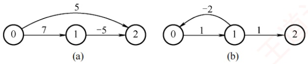

图6.18 边上带有负权值的有向带权图

#### 2．Floyd算法求各顶点之间最短路径问题

给定带权有向图，对任意两个不同顶点 $v_{i} \neq v_{j}$ ，求解从 $v_{i}$ 到 $v_{j}$ 的最短路径及其长度。

Floyd算法的基本思想:迭代生成一系列n阶方阵 $A^{(-1)}, A^{(0)}, \cdots, A^{(k)}, \cdots, A^{(n-1)}$ ，其中 $A^{( k )} [ i ] [ j ]$表示从顶点 $v_{i}$ 到 $v_{j} .$ 、仅允许使用编号不超过k的顶点作为中间顶点时的最短路径长度。初始时$( k = - 1 )$ ，若存在从 $v_{i}$ 到 $v_{j}$ 的直接边，则 $A^{(-1)}[i][j]$ 为该边的权值；否则设为 $\infty$ 。特别地，对所有i,令 $A^{( - 1 )} [ i ] [ i ] = 0$ 。随后，依次考虑顶点k $(k = 0, 1, \cdots, n-1)$ 作为中间顶点，若经由 $v_{k}$ 的路径比当前记录的路径更短，则更新对应的距离。算法的描述如下:

定义n阶方阵序列 $A^{(-1)}, A^{(0)}, \cdots, A^{(n-1)}$ ，其中，

$$
\begin{array} {c} {\mathcal {A}^{( - 1 )} [ i ] [ j ] = \operatorname {arcs} [ i ] [ j ]} \\ {\mathcal {A}^{( k )} [ i ] [ j ] = \operatorname {Min} \{\mathcal {A}^{( k - 1 )} [ i ] [ j ] , \quad \mathcal {A}^{( k - 1 )} [ i ] [ k ] + \mathcal {A}^{( k - 1 )} [ k ] [ j ] \} , \quad k = 0 , 1 , \cdots , n - 1} \end{array}
$$

式中， $\mathcal {A}^{( 0 )} [ i ] [ j ]$ 表示从 $v_{i}$ 到 $v_{j} \mathrm {_v}$ 仅允许使用 $v_{0}$ 作为中间顶点的最短路径长度；一般地， $\mathcal {A}^{( k )} [ i ] [ j ]$ 表示从 $v_{i}$ 到 $v_{j} .$ 、中间顶点编号不超过k的最短路径长度。Floyd算法是一个迭代过程，每完成一次迭代，便将下一个顶点纳入可选的中间顶点集合；经过n次迭代后， $A^{( n - 1 )} [ i ] [ j ]$ 即为 $v_{i}$ 到 $v_{j}$ 的最短路径长度。最终，矩阵 $A^{( n - 1 )}$ 中的每个元素即为对应顶点对的最短路径长度。

图 6.19 所示为一带权有向图 G 及其邻接矩阵。应用 Floyd 算法求解所有顶点对之间的最短路径长度的过程如表6.3所示。算法执行过程的说明如下。

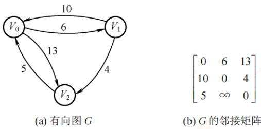

图6.19 带权有向图 G及其邻接矩阵

初始化:方阵 $A^{( - 1 )} [ i ] [ j ] = \operatorname {arcs} [ i ] [ j ]$

第1轮:以 $v_{0}$ 为中间顶点，检查全部顶点对 $\{i , j \}$ 。若 $\boldsymbol {\varLambda}^{( - 1 )} [ i ] [ j ] \geq \boldsymbol {\varLambda}^{( - 1 )} [ i ] [ 0 ] + \boldsymbol {\varLambda}^{( - 1 )} [ 0 ] [ j ]$ ，则将A(−1][i][]更新为 $A^{( - 1 )} [ i ] [ 0 ] + A^{( - 1 )} [ 0 ] [ j ] , \quad A^{( - 1 )} [ 2 ] [ 1 ] = \infty$ ，而 $\boldsymbol {\varLambda}^{( - 1 )} [ 2 ] [ 0 ] + \boldsymbol {\varLambda}^{( - 1 )} [ 0 ] [ 1 ] = 11$ ，因 $\infty > 11$故更新 $\boldsymbol {\mathcal {A}}^{( - 1 )} [ 2 ] [ 1 ]   =   11$ 。其余元素保持不变，得到方阵 $A^{( 0 )}$

第 2轮: $以  v_{1}$ 为中间顶点，检查全部顶点对 $\{i , j \}$ $\mathcal {A}^{( 0 )} [ 0 ] [ 2 ] = 13$ ，而 $A^{( 0 )} [ 0 ] [ 1 ] + A^{( 0 )} [ 1 ] [ 2 ] =$ 10，因 $13 \geq 10$ ，故更新 $A^{( 0 )} [ 0 ] [ 2 ]   =   10$ ，得到方阵 $A^{( 1 )}$

第 3轮:以 $v_{2}$ 为中间顶点，检查全部顶点对 $\{i , j \}$ $\mathcal {A}^{( 1 )} [ 1 ] [ 0 ] = 10$ ，而 $\mathcal {A}^{( 1 )} [ 1 ] [ 2 ] + \mathcal {A}^{( 1 )} [ 2 ] [ 0 ] =$ 9，更新 $A^{( 1 )} [ 1 ] [ 0 ] = 9$ ，最终得到方阵 $A^{( 2 )}$ ，其中每个元素 $A^{( 2 )} [ i ] [ j ]$ 即为 $v_{i}$ 到 $v_{j}$ 的最短路径长度。

表 6.3 Floyd 算法的执行过程

<table><tr><td>A</td><td colspan=3> $A^{( - 1 )}$ </td><td colspan=3> $A^{( 0 )}$ </td><td colspan=3> $A^{( 1 )}$ </td><td colspan=3> $A^{( 2 )}$ </td></tr><tr><td></td><td> $V_{0}$ </td><td> $V_{1}$ </td><td> $V_{2}$ </td><td> $V_{0}$ </td><td> $V_{1}$ </td><td> $V_{2}$ </td><td> $V_{0}$ </td><td> $V_{1}$ </td><td> $V_{2}$ </td><td> $V_{0}$ </td><td> $V_{1}$ </td><td> $V_{2}$ </td></tr><tr><td> $V_{0}$ </td><td>0</td><td>6</td><td>13</td><td>0</td><td>6</td><td>13</td><td>0</td><td>6</td><td>10</td><td>0</td><td>6</td><td>10</td></tr><tr><td> $V_{1}$ </td><td>10</td><td>0</td><td>4</td><td>10</td><td>0</td><td>4</td><td>10</td><td>0</td><td>4</td><td>2</td><td>0</td><td>4</td></tr><tr><td> $V_{2}$ </td><td> $5$ </td><td>8</td><td>0</td><td>5</td><td>11</td><td>0</td><td>5</td><td>11</td><td>0</td><td>5</td><td>11</td><td>0</td></tr></table>

Floyd 算法的时间复杂度为 $O ( | V |^{3} )$ 。其代码结构紧凑，仅需一个三重循环，无须复杂数据结构，且常数因子较小，因此在中等规模图上实际运行效率较高。

Floyd算法允许图中存在负权边，但不允许存在负权环。Floyd算法同样适用于带权无向图一一只需将每条无向边视为两条方向相反、权值相同的有向边。

此外，也可通过调用单源最短路径算法求解所有顶点对的最短路径:在边权非负的条件下，依次以每个顶点为源点运行Dijkstra算法。Dijkstra算法的时间复杂度为 $O ( | V |^{2} )$ ，因此共需执行|次，总时间复杂度为 $O ( | V |^{3} )$ ，与Floyd算法的相同。

BFS 算法、Dijkstra算法和 Floyd 算法求最短路径的总结如表 6.4所示。

表 6.4 BFS 算法、Dijkstra 算法和 Floyd 算法求最短路径的总结

|  | BFS 算法 | Dijkstra 算法 | Floyd 算法 |
| --- | --- | --- | --- |
| 用途 | 求单源最短路径 | 求单源最短路径 | 求各顶点之间的最短路径 |
| 无权图 | 适用 | 适用 | 适用 |
| 带权图 | 不适用 | 适用 | 适用 |
| 带负权值的图 | 不适用 | 不适用 | 适用 |
| 带负权回路的图 | 不适用 | 不适用 | 不适用 |
| 时间复杂度 | ()或(\|+\|) | () | () |

### 6.4.3 有向无环图描述表达式

有向无环图（简称DAG图）是指一个不含任何有向环路的有向图。

考点追踪构建表达式的有向无环图（2019）

有向无环图是表示含有公共子表达式的代数表达式的有效工具。例如，表达式

$$
( ( a + b )^{*} ( b^{*} ( c + d ) ) + ( c + d )^{*} e )^{*} ( ( c + d )^{*} e )
$$

可用上一章介绍的二叉树表示，如图6.20所示。观察该表达式，可发现存在公共子表达式，如 $\mathbb {I} ( c + d )$ ；该子表达式在多个位置被复用，如参与构成 $( c + d )^{*} e$ 等。这些重复出现的子结构会被分别存储，造成空间浪费。若采用有向无环图，公共子表达式只需存储一次，并通过多个父结点的入边共享，从而显著节省存储空间。图6.21展示了该表达式的有向无环图表示。

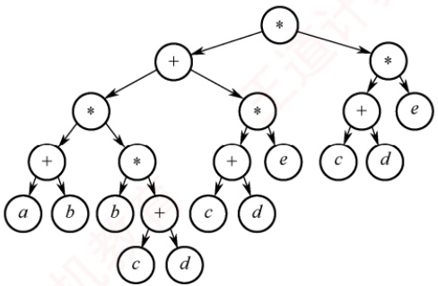

图 6.20 二叉树描述表达式

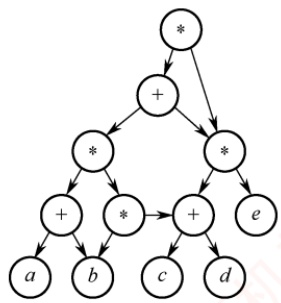

图6.21 有向无环图描述表达式

关于有向无环图描述表达式的具体示例，可参考本书配套视频中的相关讲解。

**注意**

在表达式的有向无环图表示中，不会出现重复的操作数顶点。

### 6.4.4 拓扑排序

AOV网:若用有向无环图表示一个工程，每个顶点代表一个活动，并用有向边 $i \textless V_{i} ,   V_{j} \textgreater$ 表示活动 $V_{i}$ 必须先于活动 $V_{j}$ 进行的关系，则称这种有向图为顶点表示活动的网络，简称 $\mathrm {AOV}$ 网。在此网络中，活动 $V_{i}$ 是活动 $V_{j}$ 的直接前驱，而 $V_{j}$ 则是 $V_{i}$ 的直接后继，这种关系具有传递性。此外，任何活动都不能成为自己的前驱或后继。

在图论中，拓扑排序指的是由有向无环图的顶点构成的一个线性序列，该序列满足条件:

1）每个顶点恰好出现一次。

2）若存在从顶点A到B的路径，则在排序后的序列中，B必须排在A之后。

每个AOV网都有一个或多个拓扑排序序列。

**考点追踪拓扑排序和回路的关系（2011）**

下面介绍一种常用的拓扑排序方法步骤:

①从AOV网中选择一个没有前驱（入度为0）的顶点并输出之。图中可能存在多个入度为0的顶点，随机选择一个输出，因此拓扑序列可能不唯一。

②从网中删除该顶点和所有以它为起点的有向边。

③重复步骤①和②，直到当前AOV网为空或无法找到新的入度为0的顶点为止。后一种情况表明有向图中必然存在环。 xK

考点追踪拓扑排序的实例（2010、2014、2018、2021）

图6.22展示了拓扑排序的过程示例，每轮选择一个入度为0的顶点输出，然后删除该顶点和所有以它为起点的有向边，最终得到拓扑排序结果{1,2,4,3,5}。

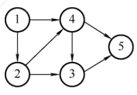

| 顶点号 | 1 | 2 | 3 | 4 | 5 |
| --- | --- | --- | --- | --- | --- |
| 初始入度 | 0 | 1 | 2 | 2 | 2 |
| 第1轮 |  | 0 | 2 | 1 | 2 |
| 第2轮 |  |  | 1 | 0 | 2 |
| 第3轮 |  |  | 0 |  | 1 |
| 第4轮 |  | N |  |  | 0 |
| 第5轮 |  |  |  |  |  |

(a)

图6.22 有向无环图的拓扑排序过程

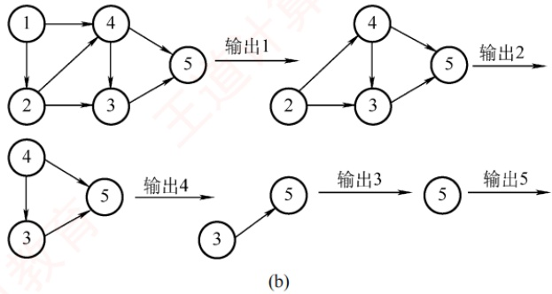

图6.22 有向无环图的拓扑排序过程（续）

**考点追踪（算法题）拓扑排序的实现（2024）**

基于邻接表存储结构的拓扑排序算法的实现如下:

```txt
bool TopologicalSort(Graph G) {
InitStack(S); //初始化栈，存储入度为0的顶点
int i;
for(i=0;i<G.vexnum;i++)
if(indegree[i]==0)
Push(S,i) ; //将所有入度为0的顶点入栈
int count=0; //计数，记录当前已经输出的顶点数
while(!StackEmpty(S)){ //栈不空，则存在入度为0的顶点
Pop (S,i) ; //栈顶元素出栈
print[count++]=i; //输出顶点 i
for(p=G.vertices[i].firstarc;p;p=p->nextarc) {
//将所有i指向的顶点的入度减1，并且将入度减为0的顶点压入栈S
```

```txt

v=p->adjvex;
if(!(--indegree[v]))
Push(S,v); ∥/入度为0，则入栈
1
if(count<G.vexnum)
return false; //排序失败，有向图中有回路
else
return true; //拓扑排序成功
```

考点追踪不同存储方式下的拓扑排序的效率（2016）

因为输出每个顶点的同时还要删除以它为起点的边，所以采用邻接表存储时，拓扑排序的时间复杂度为 O( +|E)；采用邻接矩阵存储时，时间复杂度为 O(²)。

**考点追踪DFS实现拓扑排序的思想（2020）**

通过深度优先搜索（DFS）也可以实现拓扑排序，其基本思路如下（具体实现见本节习题）。对于有向无环图G中的任意两个顶点u和ν，其关系必属于以下三种情形之一:

1）若u是ν的祖先（存在从u到ν的路径），则在DFS过程中会先访问u，再递归访问v；ν先完成回溯，因此ν的结束时间早于u，即u的结束时间大于ν的结束时间。

2）若u是ν的子孙，则ν是u的祖先，因此ν的结束时间大于u的结束时间。

3）若u和ν之间不存在任何方向的路径，则它们在拓扑序列中的相对顺序可以任意。

于是，将所有顶点按DFS结束时间降序排列，即可得到一个合法的拓扑排序序列

对一个AOV网，若采用以下步骤进行排序，则称为逆拓扑排序:

①从AOV网中选择一个没有后继（出度为0）的顶点并输出。

②从网中删除该顶点和所有以它为终点的有向边。

③重复步骤①和②，直到当前的AOV网变为空为止。

用拓扑排序算法处理AOV网时，应注意以下几点:

1）入度为零的顶点表示没有前驱活动，或其所有前驱活动均已执行完毕。工程可以从该顶点所代表的活动开始或继续推进。

**考点追踪拓扑排序序列的存在性和唯一性分析（2011、2024）**

2）拓扑排序的结果可能不唯一。拓扑序列唯一的充要条件是:AOV网中任意两个顶点之间都存在单向路径（任意两个活动都有明确的先后顺序）。实际判断方法是:每次输出顶点时，若当前入度为0的顶点都恰好只有一个，则最终拓扑序列唯一。

3）AOV网中各顶点地位平等，其编号是人为设定的。因此，可根据拓扑排序的结果对顶点重新编号，使得新邻接矩阵成为上三角矩阵。对于一般的有向图而言，若其邻接矩阵可通过顶点重排转换为上三角矩阵，则该图一定是有向无环图，因而存在拓扑序列。

### 6.4.5 关键路径

在带权有向图中，若以顶点表示事件，以有向边表示活动，并以边上的权值表示完成该活动所需的开销（如时间），则称这种图为用边表示活动的网络，简称AOE网。AOE网和AOV网同属有向无环图，但二者在定义上有本质区别:AOE网的边带有权值，代表活动及其持续时间，而顶点表示事件；AOV网的边无权值，仅用于表示顶点（活动）之间的前后关系。

AOE网具有以下两个基本性质:

①只有在某顶点所代表的事件发生后，从该顶点出发的各有向边所代表的活动才能开始;

②只有当进入某顶点的各有向边所代表的活动都已完成时，该顶点所代表的事件才能发生。

在AOE网中，通常仅有一个入度为0的顶点，称为开始顶点（源点），表示整个工程的起点；同时仅有一个出度为0的顶点，称为结束顶点（汇点），表示整个工程的终点。

考点追踪关键路径的性质与应用（2020、2025）

在AOE网中，有些活动可以并行进行。从源点到汇点可能存在多条有向路径，且这些路径的长度（路径上各边权值之和）可能不同。尽管不同路径上的活动所需时间各异，但只有在所有活动都完成后，整个工程才算结束。因此，在所有从源点到汇点的路径中，路径长度最大的那条路径被称为关键路径，而把关键路径上的活动称为关键活动。

完成整个工程所需的最短时间等于关键路径的长度，即该路径上所有活动持续时间之和。关键活动决定了工程的总工期，若任一关键活动延迟，整个工程的完成时间将随之推迟。因此，只要识别出关键活动，就能确定关键路径，并得出工程的最早完成时间。

下面给出在寻找关键活动时所用到的几个关键参量的定义。

**1.事件 $v_{k}$ 的最早发生时间 $v_{e} ( k )$**

指从源点 $v_{1}$ 到顶点 $v_{k}$ 的最长路径长度。该值决定了所有从 $v_{k}$ 开始的活动能够开工的最早时间。可用以下递推公式计算:

$$
v_{e}(源点) = 0
$$

$$
v_{e}(k) = \mathrm{Max}\{v_{e}(j) + \mathrm{Weight}(v_{j}, v_{k})\}
$$

其中， $v_{k}$ 是 $v_{j}$ 的任意后继，Weight $( v_{j} , v_{k} )$ 表示有向边 $< v_{j}, v_{k} >$ 上的权值。

**注意**

计算 $v_{e} ( )$ 时，可在拓扑排序过程中同步进行:

①初始时，令 $v_{e} [ 1 . . . n ] = 0 .$

②每当输出一个入度为0的顶点 $v_{j} ,$ 就计算其所有直接后继顶点 $v_{k}$ 的最早发生时间，若 $v_{e} [ j ] +$ $\mathrm{Weight}(v_j, v_k) > v_e[k]$ ，则更新 $v_{e} [ k ] = v_{e} [ j ] + \mathrm {Weight} ( v_{j} ,   v_{k} )$ 。重复此过程，直至输出全部顶点。

**2. 事件 $v_{k}$ 的最迟发生时间 $v_{l} ( k )$**

指在不推迟整个工程完成时间的前提下，事件 $v_{k}$ 必须发生的最晚时间，以保证其所有后继事件 $v_{j}$ 均不晚于各自的最迟发生时间 $v_{l} ( j )$ 发生。可用以下递推公式计算:

$$
v_{l}( 汇点 ) = v_{e}( 汇点 )
$$

$$
v_{l}(k) = \min \left\{v_{l}(j) - \mathrm{Weight}(v_{k}, v_{j}) \right\}
$$

其中， $v_{k}$ 是 $v_{j}$ 的任意前驱。

**注意**

计算 $v_{l} ( k )$ 时，需按逆拓扑顺序进行。可在拓扑排序时用栈记录顶点顺序，排序结束后从栈顶到栈底即为逆拓扑序列。

①初始时，令 $v_{l} [ 1 . . . n ] = v_{e} [ n ]$

②依次弹出栈顶顶点 $v_{j} ,$ 计算其所有直接前驱顶点 $v_{k}$ 的最迟发生时间，若 $v_{l} [ j ] - \mathrm {Weight} ( v_{k} , v_{j} ) < v_{l} [ k ]$则更新 $v_{l} [ k ] = v_{l} [ j ] - \mathrm {Weight} ( v_{k} , v_{j} )$ 。重复此过程，直至栈空。

**3. 活动 $\pmb {a}_{i}$ 的最早开始时间 $e ( i )$**

指该活动所对应弧的起点事件的最早发生时间。若边 $<   \scriptstyle {\mathcal {V}}_{k} ,   \scriptstyle {\mathcal {V}}_{j} >$ 表示活动 $a_{i} ,$ ，则有

$$
e ( i ) = v_{e} ( k ) ,
$$

#### 1．事件vk的最早发生时间ve(k)

#### 2．事件vk的最迟发生时间vl(k)

#### 3．活动ai的最早开始时间e(i)

**4. 活动 $\pmb {a}_{i}$ 的最迟开始时间l(i)**

指在不延误工程总工期的前提下，活动 $a_{i}$ 最迟必须开始的时间，等于其终点事件的最迟发生时间与该活动所需时间之差。若边 $< v_{k}, v_{j} >$ 表示活动 $a_{i} ,$ 则有

$$
l(i) = v_l(j) - \mathrm{Weight}(v_k, v_j)
$$

5. 一个活动 $\pmb {a}_{i}$ 的最迟开始时间l(i)与其最早开始时间 e(i)的差额:

$$
d ( i ) = l ( i ) - e ( i )
$$

或称活动 $a_{i}$ 的时间余量。该值表示在不延长整个工程总工期的前提下，活动 $a_{i}$ 可以拖延的时间。若一个活动的时间余量为零，则该活动必须如期完成，否则将导致整个工程延期。因此，满足 $l(i) - e(i) = 0$ 即 $l ( i ) = e ( i ) ]$ 的活动称为关键活动。

考点追踪求关键路径的实例（2019、2022、2025）

求关键路径的算法步骤如下:

①从源点出发，令 $v_{e}(源点) = 0$ ，按拓扑有序求其余顶点的最早发生时间 $v_{e} ( )$

②从汇点出发，令 $v_{l}( 汇点 ) = v_{e}( 汇点 )$ ，按逆拓扑有序求其余顶点的最迟发生时间 $v ( )$

③根据各顶点的 $v_{e} ( ) \nmid$ 值，求所有弧的最早开始时间 $e ( )$

④根据各顶点的νi()值，求所有弧的最迟开始时间1()。

⑤求 AOE网中所有活动的时间余量d()，找出所有 $d \mathrm {{( )}} = 0$ 的活动构成关键路径。

图6.23所示为求解关键路径的具体过程，简单说明如下:

①求 $v_{e} ( ) \cdot$ 初始时 $v_{e} ( 1 )   =   0$ 。在拓扑排序输出顶点的过程中，依次求得 $v_{e}(2)=3,\ v_{e}(3)=2$ $\nu_{d}(4)=\max\{\nu_{d}(2)+2,\nu_{d}(3)+4\}=\max\{5,6\}=6,\ \nu_{d}(5)=6,\ \nu_{d}(6)=\max\{\nu_{d}(5)+1,\nu_{d}(4)+2,$ $v_{e}(3)+3 \}=\max \{7, 8, 5\}=8$

若本题为选择题，仅凭上述 $v_{e} ( )$ 的计算过程，通常已可推断出关键路径。

②求 νi():初始时 $v ( 6 ) = 8 \circ$ 在逆拓扑排序（通过栈回溯）过程中，依次求得 $v_{1}(5)=7,\ v_{1}(4)=$ 6, $v_{1}(3)=\min\{v_{1}(4)-4,v_{1}(6)-3\}=\min\{2,5\}=2,\quad v_{1}(2)=\min\{v_{1}(5)-3,v_{1}(4)-2\}=\min\{4,4\}=$ 4, $v(1) 必$ 然为0，无须额外计算。

③弧的最早开始时间 $e ( )$ 等于该弧的起点顶点的 $v_{e} ( )$ 值，结果见下表。

④弧的最迟开始时间 $l ( i )$ 等于该弧的终点顶点的 $v ( )$ 值减去该弧的权值，结果见下表。

⑤由 $l(i) - e(i) = 0$ 可确定关键活动，最终得到的关键路径为 $l(v_{1},v_{3},v_{4},v_{6})$

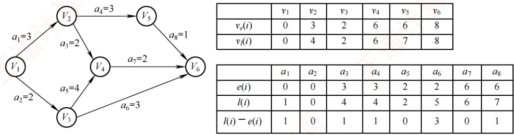

图6.23 求解关键路径的过程

考点追踪缩短工期的相关分析（2013、2025）

对于关键路径，需要注意以下几点:

#### 4．活动ai的最迟开始时间l(i)

#### 5．一个活动ai的最迟开始时间l(i)与其最早开始时间e(i)的差额：

1）关键路径上的所有活动均为关键活动，它们共同决定了整个工程的工期。因此，加快关键活动的执行速度有可能缩短总工期。但不能任意缩短关键活动的持续时间，一旦过度缩短，原关键路径的长度可能小于其他路径，从而引发关键路径的转移。此时，即使继续压缩该活动，工程总工期已由新的最长路径决定，不再受其影响。

2）网中的关键路径可能不止一条。当存在多条关键路径时，仅提高其中某一条路径上的关键活动速度，并不能缩短整个工程的工期。只有加快那些同时出现在所有关键路径上的关键活动（公共关键活动），才能达到缩短工期的目的。

各种图算法在采用邻接矩阵或邻接表存储时的时间复杂度如表6.5所示。

表6.5采用不同存储结构时各种图算法的时间复杂度

|  | Dijkstra | Floyd | Prim | Kruskal | DFS | BFS | 拓扑排序 | 关键路径 |
| --- | --- | --- | --- | --- | --- | --- | --- | --- |
| 邻接矩阵 | ${\cal O} ( n^{2} )$ | $O ( n^{3} )$ | $O ( n^{2} )$ | - | $\mathcal {O} ( n^{2} )$ | $O ( n^{2} )$ | ${\cal O} ( n^{2} )$ | $O ( n^{2} )$ |
| 邻接表 | FX | 一 | 一 | O(elog2e) | O(n + e) | O(n + e) | O(n + e) | $O ( n + e )$ |

## 归纳总结

**1. 关于图的基本操作**

本章中介绍的多数图算法均可适配邻接矩阵或邻接表存储结构，主要原因是在图的基本操作函数中保持了相同的参数和返回值，封装了内部实现细节。例如，函数NextNeighbor(G,x,y)用于返回顶点×在邻接顶点y之后的下一个邻接顶点。

**1）使用邻接矩阵作为存储结构**

```txt
int NextNeighbor(MGraph& G,int x,int y) {
if(x!=-1&&y!=-1){
for(int col=y+1;col<G.vexnum;col++)
m if(G.Edge[x][col]>0 && G.Edge[x][col]<maxWeight)
return col; //maxWeight 代表∞
1
return -1;
```

2）使用邻接表作为存储结构

```c
int NextNeighbor(ALGraph& G,int x,int y){
if(x!=-1) { //顶点×存在
ArcNode *p=G.vertices[x].first;/对应边链表第一个边结点
while(p!=NULL && p->data!=y) //寻找邻接顶点y
p=p->next;
if(p!=NULL && p->next!=NULL)
return p->next->data; //返回下一个邻接顶点
1
return -1;
}
```

2. 关于图的遍历、连通性、生成树、关键路径的几个要点

1）在执行图的遍历时，由于图中可能存在回路，且任意顶点都可能与其他顶点相连，访问完某个顶点后可能沿某些边回到已访问过的顶点。因此，需设置辅助数组visited[]标记顶点是否已被访问，以避免重复访问。

2）深度优先搜索（DFS）采用回溯策略遍历图，通常通过递归实现。在递归访问某一邻接顶点前，必须先判断该顶点是否已被访问。此外，所有递归算法均可借助栈转换为非递归形式，DFS也不例外，具体实现参见6.3.4节综合应用题03。

3）广度优先搜索（BFS）是一种分层遍历过程，每向前推进一层可能访问一批顶点，不存在回退操作，因此它不是递归过程。

4）一个给定图的邻接矩阵表示是唯一的；但邻接表表示则依赖于边的输入顺序，若输入次序不同，生成的邻接表也可能不同。

5）最小生成树针对带权连通无向图，是从图中选出n-1条边构成的连通无环子图，使得所有边的权值总和最小。

6）加速某一关键活动不一定能缩短整个工程的工期，因为AOE网中可能存在多条关键路径。只有那些出现在所有关键路径上的关键活动被加速时，才能有效缩短总工期。

## 思维拓展

【网易有道笔试题】求一个无向连通图的割点。割点的定义是，若除去此顶点和与其相关的边，无向图不再连通，描述算法。

**提示**

要判断一个点是否为割点，最简单直接的方法是，先把这个点和所有与它相关的边从图中去掉，再用深搜或广搜来判断剩下的图的连通性，这种方法适合判断给定顶点是否为割点；还有一种比较复杂的方法可以快速找出所有割点，有兴趣的读者可自行搜索相关资料。

购买王道书，就上

王道官方考研书店


