# 第7章 查找 · 习题与解析

> 由《第7章 查找》正文摘出；区块标题保留了原书的小节编号。

### 7.2.4 本节试题精选

#### 一、单项选择题

01. 顺序查找适合于存储结构为（）的线性表。
A. 顺序存储结构或链式存储结构
B. 散列存储结构
C. 索引存储结构
D. 压缩存储结构

02. 由n个数据元素组成的两个表:一个递增有序，一个无序。采用顺序查找算法，对有序表从头开始查找，发现当前元素已不小于待查元素时，停止查找，确定查找不成功，已知查找任意一个元素的概率是相同的，则在两种表中成功查找（）。
A. 平均时间后者小
B. 平均时间两者相同 -算机
C. 平均时间前者小
D. 无法确定

03. 对长度为n的有序单链表，若查找每个元素的概率相等，则顺序查找表中任意一个元素的查找成功的平均查找长度为（）。
A. $n / 2$
B. $( n + 1 ) / 2$
C. (n−1)/2
D. $n / 4$

04. 对长度为3 的顺序表进行查找，若查找第一个元素的概率为1/2，查找第二个元素的概率为1/3，查找第三个元素的概率为1/6，则查找任意一个元素的平均查找长度为（）。
A. 5/3
B. 2
C. 7/3
D. 4/3

05.下列关于二分查找的叙述中，正确的是（）。
A. 表必须有序，表可以顺序方式存储，也可以链表方式存储
B. 表必须有序且表中数据必须是整型、实型或字符型
C. 表必须有序，而且只能从小到大排列
D. 表必须有序，且表只能以顺序方式存储

06. 在一个顺序存储的有序线性表上查找一个数据时，既可以采用折半查找，也可以采用顺序查找，但前者比后者的查找速度（）
A. 必然快
B. 取决于表是递增还是递减
C. 在大部分情况下要快
D. 必然不快

07. 折半查找过程所对应的判定树是一棵（）。
A. 最小生成树
B. 平衡二叉树
C. 完全二叉树
D. 满二叉树

08. 折半查找和二叉排序树的时间性能（）。
A. 相同
B. 有时不相同
C. 完全不同
D. 无法比较

09. 在有11个元素的有序表 $\mathbb {A} [ 1   ,   2   ,   \cdots   ,   11 ]$ 中进行折半查找 $( \lfloor ( \mathtt {low} + \mathtt {high} ) / 2 \rfloor )$ 查找元素A[11]时，被比较的元素下标依次是（）。
A. 6, 8, 10, 11
B. 6, 9, 10, 11
C. 6,7,9, 11
D. 6, 8, 9, 11

10. 已知有序表(13,18,24,35,47,50,62,83,90,115,134)，当二分查找值为90的元素时，查找成功的元素比较次数为（）。
A. 1
B. 2
C. 4
D. 6

11. 若有序表的关键字序列为 {b, c, d, e, f, g, q, r, s, t}，则在二分查找关键字 b 的过程中，进行比较的关键字依次为（）。
A. $f , c , b$
B. $f , d , b$
C. $g , c , b$
D. $g , d , b$

12. 对表长为n的有序表进行折半查找，其判定树的高度为（）。
A. $\lceil \log_{2} ( n + 1 ) \rceil$
B. $\lfloor \log_{2} ( n + 1 ) \rfloor - 1$ $\lceil \log_{2} n \rceil$ D. $\lfloor \log_{2} n \rfloor - 1$

13. 已知一个长度为16 的顺序表，其元素按关键字有序排列，若采用折半查找算法查找一个不存在的元素，则比较的次数至少是（），至多是（）。
A. 4
B. 5
C. 6
D. 7

14. 具有12 个关键字的有序表中，对每个关键字的查找概率相同，折半查找算法查找成功的平均查找长度为（），折半查找查找失败的平均查找长度为（）。
A. 37/12
B. 35/12
C. 39/13
D. 49/13

15.下列关于查找的说法中，正确的是（）。（注，涉及下节内容）
A. 若数据元素保持有序，则查找时就可以采用折半查找法
B. 折半查找与二叉查找树的时间性能在最坏情况下是相同的
C. 折半查找法的平均查找长度一定小于顺序查找法
D. 折半查找法查找一个元素大约需要 $O ( \log_{2} n )$ 次关键字比较

16.采用分块查找时，数据的组织方式为（）。
A. 数据分成若干块，每块内数据有序
B. 数据分成若干块，每块内数据不必有序，但块间必须有序，每块内最大（或最小）的数据组成索引块
C. 数据分成若干块，每块内数据有序，每块内最大（或最小）的数据组成索引块
D. 数据分成若干块，每块（除最后一块外）中数据个数需相同

17. 对有2500个记录的索引顺序表（分块表）进行查找，最理想的块长为（）。
A. 50
B. 125
C. 500
D. $\left[ \log_{2}2500 \right]$

18. 设顺序存储的某线性表共有123个元素，按分块查找的要求等分为3块。若对索引表采用顺序查找法来确定子块，且在确定的子块中也采用顺序查找法，则在等概率情况下，分块查找成功的平均查找长度为（）

A. 21
B. 23
C. 41XT
D. 62

19. 为提高查找效率，对有65025个元素的有序顺序表建立索引顺序结构，在最好情况下查找到表中已有元素最多需要执行（）次关键字比较。
A. 10
B. 14
C. 16
D. 21

20.【2010统考真题】已知一个长度为16的顺序表L，其元素按关键字有序排列，若采用折半查找法查找一个L中不存在的元素，则关键字的比较次数最多是（）。
A. 4
B. 5
C. 6
D. 7

21.【2015统考真题】下列选项中，不能构成折半查找中关键字比较序列的是（）。
A. 500, 200, 450, 180
B. 500, 450, 200, 180
C. 180, 500, 200, 450
D. 180, 200, 500, 450

22.【2016统考真题】在有n（n>1000）个元素的升序数组A中查找关键字x。查找算法的伪代码如下所示。k=0; while(k<n 且 A[k]<x) k=k+3; if(k<n 且 A[k]==x) 查找成功； 王道else if(k-1<n 且 A[k-1]==x) 查找成功；else if(k-2<n 且 A[k-2]==x) 查找成功；else 查找失败；

本算法与折半查找算法相比，有可能具有更少比较次数的情形是（）。
A. 当× 不在数组中
B. 当×接近数组开头处
C. 当×接近数组结尾处
D. 当×位于数组中间位置

23.【2017统考真题】下列二叉树中，可能成为折半查找判定树（不含外部结点）的是（）。
A. Ω
B. Ω

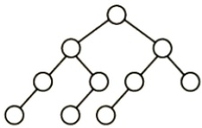

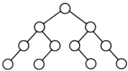

C.

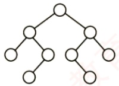

D.

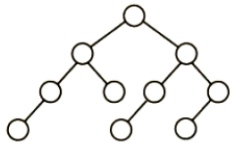

24. 【2023统考真题】对含600个元素的有序顺序表进行折半查找，关键字间的比较次数最多是（）
A. 9
B. 10
C. 30
D. 300

25.【2024统考真题】下列数据结构中，不适合直接使用折半查找的是（）。I. 有序链表 Ⅱ. 无序数组 I. 有序静态链表IV. 无序静态链表
A. 仅I、I
B. 仅ⅡI、IV
C. 仅ⅡI、III、IV
D. I、ⅡI、III、IV

26.【2025统考真题】已知查找表中有400个元素，查找每个元素的概率相同。采用分块查找法进行查找，且均匀分块。若采用顺序查找法确定元素所在的块，且块内也采用顺序查找法，为使查找效率最高，则每块包含的元素个数应为（）。
A. 8
B. 10
C. 20
D. 25

#### 二、综合应用题

01. 若对有n个元素的有序顺序表和无序顺序表进行顺序查找，试就下列三种情况分别讨论两者在相等查找概率时的平均查找长度是否相同。

1）查找失败。

2）查找成功，且表中只有一个关键字等于给定值k的元素。

3）查找成功，且表中有若干关键字等于给定值k的元素，要求一次查找能找出所有元素。02. 有序顺序表中的元素依次为 017,094,154,170,275,503,509,512,553,612,677,765,897,908。

1）试画出对其进行折半查找的判定树。

2）若查找275或684的元素，将依次与表中的哪些元素比较？

3）计算查找成功的平均查找长度和查找不成功的平均查找长度

03. 已知一个有序顺序表A[0...8n-1]的表长为 8n，并且表中没有关键字相同的数据元素。假设按下述方法查找一个关键字值等于给定值X的数据元素:首先在A[7],A[15],A[23]，…,A[8k-1]，…,A[8n-1]中进行顺序查找，若查找成功，则算法报告成功位置并返回；若不成功，则当 $\mathrm{A}\left[8\mathrm{k}-\mathrm{l}\right]<\mathrm{X}<\mathrm{A}\left[8\times(\mathrm{k}+\mathrm{l})-\mathrm{l}\right]$ 时，可确定一个缩小的查找范围 $\mathbb{A}[8\mathrm{k}]\sim\mathbb{A}[8\times(\mathrm{k}+1)-2]$ ，然后可在这个范围内执行折半查找。特殊情况:若X>A[8n-1]的关键字，则查找失败。

1）画出描述上述查找过程的判定树。

2）计算相等查找概率下查找成功的平均查找长度。

04. 写出折半查找的递归算法。初始调用时，low为1，high为 ST.length。

05. 线性表中各结点的检索概率不等时，可用如下策略提高顺序检索的效率:若找到指定的结点，则将该结点和其前驱结点（若存在）交换，使得经常被检索的结点尽量位于表的前端。试设计在顺序结构和链式结构的线性表上实现上述策略的顺序检索算法。

06. 已知一个n阶矩阵A和一个目标值k。该矩阵无重复元素，每行从左到右升序排列，每列从上到下升序排列。请设计一个在时间上尽可能高效的算法，判断矩阵中是否存在目标值k。例如，矩阵为 $\begin{bmatrix} 1 & 4 & 7 \\ 2 & 5 & 8 \\ 3 & 6 & 9 \end{bmatrix}$ ，目标值为8，判断存在。要求:

1）给出算法的基本设计思想。

2）根据设计思想，采用C或C++语言描述算法，关键之处给出注释。

3）说明你的算法的时间复杂度和空间复杂度

07.【2013统考真题】设包含4个数据元素的集合 $S = \{\mathrm {d o} , \mathrm {for} , \mathrm {repeat} , \mathrm {while} \}$ ，各元素的查找概率依次为 $p_{1}=0.35, p_{2}=0.15, p_{3}=0.15, p_{4}=0.35.$ 将S保存在一个长度为4的顺序表中，采用折半查找法，查找成功时的平均查找长度为2.2。

1）若采用顺序存储结构保存S，且要求平均查找长度更短，则元素应如何排列？应使用何种查找方法？查找成功时的平均查找长度是多少？

2）若采用链式存储结构保存S，且要求平均查找长度更短，则元素应如何排列？应使用何种查找方法？查找成功时的平均查找长度是多少？

### 7.2.5 答案与解析

#### 一、单项选择题

01. A

顺序查找是指从表的一端开始向另一端查找。它不要求查找表具有随机存取的特性，可以是顺序存储结构或链式存储结构。

02. B

对于顺序查找，不管线性表是有序的还是无序的，成功查找第一个元素的比较次数为1，成功查找第二个元素的比较次数为2，以此类推，即每个元素查找成功的比较次数只与其位置有关（与是否有序无关），因此查找成功的平均时间两者相同。

03. B

在有序单链表上做顺序查找，查找成功的平均查找长度与在无序顺序表或有序顺序表上做顺序查找的平均查找长度相同，都是(n+1)/2。

04. A

在长度为3的顺序表中，查找第一个元素的查找长度为1，查找第二个元素的查找长度为2，查找第三个元素的查找长度为3，所以有

$$
\mathrm{ASL}_{成功} = \frac{1}{2} \times 1 + \frac{1}{3} \times 2 + \frac{1}{6} \times 3 = \frac{5}{3}
$$

05. D

二分查找通过下标来定位中间位置元素，所以应采用顺序存储，且二分查找能够进行的前提是查找表是有序的，但具体是从大到小还是从小到大的顺序则不做要求。

06. C

折半查找的快体现在一般情况下，在大部分情况下要快，但是对于某些特殊情况，顺序查找可能会快于折半查找。例如，查找一个含1000个元素的有序表中的第一个元素时，顺序查找的比较次数为1次，而折半查找的比较次数却将近10次。

07. B

A显然排除。对于选项C，考点精析示例中的判定树就不是完全二叉树。由选项C也可排除选项D，且满二叉树对结点数有要求。只可能选择选项B。事实上，由折半查找的定义不难看出，每次把一个数组从中间结点分割时，总是把数组分为结点数相差最多不超过1的两个子数组，从而使得对应的判定树的两棵子树高度差的绝对值不超过1，所以应是平衡二叉树。

08. B

折半查找的性能分析可以用二叉判定树来衡量，平均查找长度和最大查找长度都是O(log2n);二叉排序树的查找性能与数据的输入顺序有关，最好情况下的平均查找长度与折半查找相同，但最坏情况即形成单支树时，其查找长度为O(n)。

09. B

依据折半查找算法的思想，第一次 $\mathrm{mid}=\left\lfloor\left(1+11\right)/2\right\rfloor=6$ ，第二次 $\mathrm{mid}=\left\lfloor\left[(6+1)+11\right]/2\right\rfloor=9$第三次 $\mathrm{m}\bot\mathrm{d}=\left\lfloor\left[\left(9+1\right)+11\right]/2\right\rfloor=10$ ，第四次mid=11。

10. B

开始时 1ow 指向 13，high 指向 134，mid 指向 50，比较第一次 90 >50，所以将1ow 指向62，high 指向134，mid指向90，第二次比较找到90。

11. A

在折半查找算法中，mid取值的方式是确定的，要么采用向上取整，要么采用向下取整，而不能出现两种情况。对于选项A，第1次比较的元素是 $f ,$ 为向下取整；第2次比较的元素是c，为向下取整；第3次比较的元素是b，为向下取整，查找成功，符合二分查找。对于选项B，第1次比较的元素是 $f ,$ 为向下取整；第2次比较的元素是 $d ,$ 为向上取整，两次mid取值的方式不同，不符合二分查找。对于选项C，第1次比较的元素是 $g ,$ ，为向上取整；第2次比较的元素是c，为向下取整，不符合二分查找。对于选项D，第1次比较的元素是 $g ,$ ，为向上取整；第2次比较的元素是 $d ,$ 为正中间元素；第3次比较的元素为b，为向下取整，不符合二分查找。

12. A

对n个结点的判定树，设结点总数 $n = 2^{h} - 1$ ，则 $\bar {h} = \lceil \log_{2} ( n + 1 ) \rceil$

【另解】特殊值代入法。直接将n=1和n=2的情况代入，仅有A满足要求。

**13. A、B**

对于此类题，有两种做法:一种方法是，画出查找过程中构成的判定树，让最小的分支高度对应于最少的比较次数，让最大的分支高度对应于最多的比较次数，出现类似于长度为15的顺序表时，判定树刚好是一棵满树，此时最多比较次数与最少比较次数相等；另一种方法是，直接用公式求出最小的分支高度和最大分支高度，从前面的讲解不难看出最大分支高度为 $H = \left\lceil \log_{2}(n + 1) \right\rceil = 5$ ，这对应的就是最多比较次数，然后因为判定树不是一棵满树，所以至少应该是4（由判定树的各分支高度最多相差1得出）。

注意，若求查找成功或查找失败的平均查找长度，则需要画出判定树来求解。此外，对长度为n的有序表，采用折半查找时，查找成功和查找失败的最多比较次数相同，均为 $\left[ \log_{2}(n + 1) \right]$ o

**14. A、D**

假设有序表中元素为A[0...11]，不难画出对它进行折半查找的判定树如下图所示，圆圈是查找成功结点，方形是虚构的查找失败结点。从而可以求出查找成功的 $\mathrm{ASL} = (1 + 2 \times 2 + 3 \times 4 + 4 \times 5)/12 =$ 37/12，查找失败的 $\mathrm{ASL} = (3 \times 3 + 4 \times 10)/13$ C

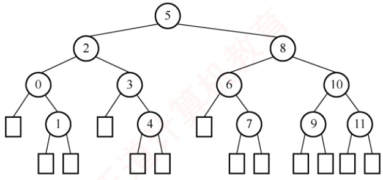

**注意**

对于本类题目，应先根据所给n的值，画出如上图所示的折半查找判定树。另外，查找失败结点的ASL不是到图中的方形结点，而是到方形结点上一层的圆形结点。

15. D

折半查找法不仅要求数据元素有序，而且要求必须为顺序存储，选项A错误。折半查找法在最坏情况下的时间性能为O(log2n)，二叉查找树在最坏情况下的时间性能为O(n)，选项B错误。在每个元素查找概率不同的情况下，折半查找法的平均查找长度可能大于顺序查找法，选项C错误。

16. B

通常情况下，在分块查找的结构中，不要求每个索引块中的元素个数都相等。

17. A

设块长为b，索引表包含n/b项，索引表的 $\mathrm{ASL} = (n/b + 1)/2$ ，块内的 $\mathrm {ASL} = ( b + 1 ) / 2$ ，总 $\mathrm {ASL}   =$索引表的 ASL + 块内的 $\mathrm{ASL} = (b + n/b + 2)/2$ ，其中对于 $b + n / b$ ，由均值不等式可知， $b = n / b$ 时有最小值，此时 $b   =   \sqrt {n}$ 。则最理想块长为 $\sqrt{2500} = 50$

18. B

根据公式 $\mathrm{ASL} = L_{1} + L_{\mathrm{S}} = \frac{b + 1}{2} + \frac{s + 1}{2} = \frac{s^{2} + 2s + n}{2s}$ ，其中 $b = n / s , s = 123 / 3 , n = 123$ ，代入不难得出ASL为23。所以选择选项B。另一方面，可根据穷举法来一步步模拟。对于A块中的元素，查找过程的第一步是先找到A块，由于是顺序查找，找到A块只需一步，然后在A块中顺序查找，因此A块内各元素查找长度分别为 $2,3,4,\cdots,42 。$ 对于B块，采用类似的方法，但查找到B块要比查找到A块多一步，因此B块内各元素查找长度为3,4,5,…,43。同理，C块中各个元素查找长度为4,5,6,…，44。所以平均查找长度为 $( 2 + 3 + 4 + \cdots + 42 + 3 + 4 + 5 + \cdots + 43 + 4 + 5 + 6 + \cdots + 44 ) / 123 = 23$

19. C

为使查找效率最高，每个索引块的大小应是 $\sqrt{65025} = 255$ ，为每个块建立索引，则索引表中索引项的个数为255。若对索引项和索引块内部都采用折半查找，则查找效率最高，为 $\left[ \log_{2}(255 + 1) \right] +$ $\left[ \log_{2}(255 + 1) \right] = 16$ 0 XT

20. B

折半查找法在查找不成功时和给定值进行关键字的比较次数最多为树的高度，即 $\log_{2}n + 1$或 $\left[ \log_{2} ( n + 1 ) \right]$ 。在本题中， $n   =   16$ ，所以比较次数最多为5。

**注意**

在折半查找判定树中的方形结点是虚构的，它不计入比较的次数。

21. A

画出查找路径图，因为折半查找判定树是一棵二叉排序树，看其是否满足二叉排序树的要求。

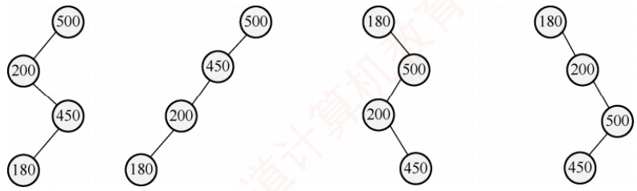

显然，选项A的查找路径不满足。

22. B

本题为送分题。

该程序采用跳跃式的顺序查找法查找升序数组中的x。显然，×越靠前，比较次数越少。

23. A

对于给定的一个有序查找表，其对应的折半查找判定树是确定且唯一的。在折半查找算法中， $\mathrm{mi}   \mathrm{d}= \left\lfloor (10w + \mathrm{h} \mathrm{i}  \mathrm{g} \mathrm{h}) / 2 \right\rfloor$ ，因此若表中初始有 $2 n + 1$ 个元素，则midα分割后，左右子树各有n个元素；若表中初始有2n个元素，则miα分割后，左子树有n−1个元素，右子树有n个元素。即左子树的元素个数或者与右子树的元素个数相等，或者比右子树少一个。若令mid= $\left[ \left( 10 w + high \right) / 2 \right]$ ，不难理解，左子树的元素个数或者与右子树的元素个数相等，或者比右子树多一个。对于选项A，树中每个左子树都与右子树的结点个数相等，或者多一个结点，符合向上取整的规则。对于选项B、C、D，存在有的左子树比右子树多一个结点，有的左子树比右子树少一个结点，不符合折半查找的规则。

24. B

用折半查找法查找给定值的比较次数最多不超过折半查找判定树的高度。折半查找判定树的树高 $h = \lceil \log_2 (n + 1) \rceil$ ，将 $n   =   600$ 代入，结果为10。

25. D

折半查找必须满足两个条件:①数组（或顺序表），折半查找的上一次查找和本次查找可能相隔很远的距离，如依次查找下标为 $n / 2 ,   n / 4 ,   n / 8 , \cdots$ 的元素，若采用链表（或静态链表），则会使得时间复杂度非常高。②有序，只有在有序的情况下才能根据上一次的比较情况舍弃一半的序列。

26. C

本题可直接套用书中的结论“每块记录数= $\sqrt {n}$ 时，平均查找长度最小”。解释如下:分块查找的平均查找长度（ASL）等于查找索引表的ASL与块内查找的ASL之和。设每块含s个元素，则块数为 $k   =   400 / s$ 。总 $\mathrm{ASL} = (k + 1)/2 + (s + 1)/2 = (k + s)/2 + 1$ 。要使ASL最小，需要最小化 $k   +   s   =$ $400 / s + s_{\perp}$ 。根据均值不等式，当 $400 / s   =   s$ 时取最小值，解得 $s   =   20$

#### 二、综合应用题

01. 【解答】

1）平均查找长度不同。因为有序顺序表查找到其关键字值比要查找值大的元素时就停止查找，并报告失败信息，不必查找到表尾；而无序顺序表必须查找到表尾才能确定查找失败。

2）平均查找长度相同。两者查找到表中元素的关键字值等于给定值时就停止查找

3）平均查找长度不同。有序顺序表中关键字相等的元素相继排列在一起，只要查找到第一个就可以连续查找到其他关键字相同的元素。而无序顺序表必须查找全部表中的元素才能找出相同关键字的元素，因此所需的时间不同。

02. 【解答】

1）判定树如下图所示。

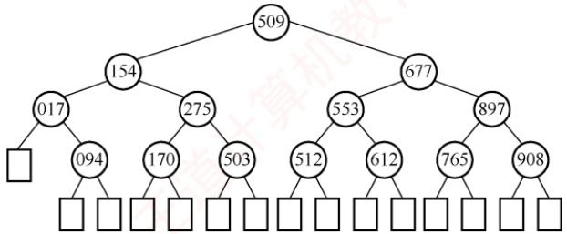

2）若查找275，依次与表中元素509,154,275进行比较，共比较3次。若查找684，依次与表中元素509,677,897,765进行比较，共比较4次。

3）在查找成功时，会找到图中的某个圆形结点，其平均查找长度为

$$
\overline{ASL}_{成功} = \frac{1}{14}\sum_{i = 1}^{14}C_{i} = \frac{1}{14}(1 + 2 \times 2 + 3 \times 4 + 4 \times 7) = \frac{45}{14}
$$

在查找失败时，会找到图中的某个方形结点，但这个结点是虚构的，最后一次的比较元素为其父结点（圆形结点），所以其平均查找长度为

$$
\mathrm{ASL}_{不成功} = \frac{1}{15} \sum_{i=0}^{14} C_{i}^{\prime} = \frac{1}{15} (3 \times 1 + 4 \times 14) = \frac{59}{15}
$$

03. 【解答】

1）先在 $\mathbb{A} \left[ 7 \right], \mathbb{A} \left[ 15 \right], \cdots, \mathbb{A} \left[ 8 \mathbb{n} - 1 \right]$ 内顺序查找，再在区间内折半查找。相应的判定树如下图所示。其中，每个关键字下的数字为其查找成功时的关键字比较次数。

2）等查找概率下，平均每个关键字查找成功的概率为1/8n；0～7之间的关键字，顺序比较1次后，进行折半查找，查找成功的平均查找长度为 $2+3\times2+4\times4; 8\sim15$ 之间的关键字，先顺序比较2次后，再进入折半查找；以此类推， $8(n - 1) \sim 8n - 1$ 之间的关键字，先顺序比较n次，再进入折半查找，如上图所示。因此，查找成功的平均查找长度为

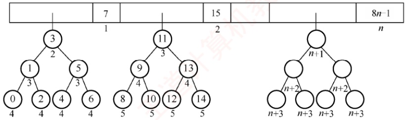

```txt

1 8n-1 1 n n+1 n+2 n+3
ASL成功 二 a Ci = i + 2 i+ 4 i
8ni=0 8n i=1 i=2 i=3 i=4
1 n
二 (i + (i + 1) + 2(i + 2) + 4(i + 3))
8n i=1
1 1 (8i + 17) = n i+17 1 n+1 17
8n=1 ni=1 8 2 8
```

04. 【解答】

算法的基本思想:根据查找的起始位置和终止位置，将查找序列一分为二，判断所查找的关键字在哪一部分，然后用新的序列的起始位置和终止位置递归求解。

算法代码如下:

```c
typedef struct{ //查找表的数据结构
ElemType *elem; //存储空间基址，建表时按实际长度分配，0号留空
int length; //表的长度
} SSTable;
int BinSearchRec(SSTable ST,ElemType key,int low,int high) {
if(low>high)
return 0;
mid=(low+high)/2; //取中间位置
if(key>ST.elem[mid]) //向后半部分查找
BinSearchRec(ST,key,mid+1,high);
else if(key<ST.elem[mid]) //向前半部分查找
BinSearchRec(ST,key,low,mid-1);
else //查找成功
return mid;
```

算法把规模为n的复杂问题经过多次递归调用转化为规模减半的子问题求解。时间复杂度为O(log2n)，算法中用到了一个递归工作栈，其规模与递归深度有关，也是O(log2n)。

05.【解答】

算法的基本思想:检索时可先从表头开始向后顺序扫描，若找到指定的结点，则将该结点和其前趋结点（若存在）交换。采用顺序表存储结构的算法实现如下:

```javascript
int SeqSrch(RcdType R[],ElemType k) {
//顺序查找线性表，找到后和其前面的元素交换
int i=0;
while((R[i].key!=k)&&(i<n))
i++; //从前向后顺序查找指定结点
if(i<n&&i>0) { //若找到，则交换
temp=R[i];R[i]=R[i-1];R[i-1]=temp;
return --i; //交换成功，返回交换后的位置
else return -1; //交换失败
```

链表的实现方式请读者自行思考。注意，链表方式实现的基本思想与上述思想相似，但要注

意用链表实现时，在交换两个结点之前需要保存指向前一结点的指针。

**06.【解析】**

1）算法的基本设计思想:

从矩阵A的右上角（最右列）开始比较，若当前元素小于目标值，则向下寻找下一个更大的元素；若当前元素大于目标值，则从右往左依次比较，若目标值存在，则只可能在该行中。

2）算法的实现:

```txt
bool findkey(int A[][],int n,int k){
int i=0,j=n-1;
while(i<n&&j>=0){ //离开边界时查找结束
if(A[i][j]==k) return true; //查找成功
else if(A[i][j]>k) j--; //向左移动，在该行内寻找目标值
else i++; //向下移动，查找下一个更大的元素
算
return false; //查找失败
```

3）比较次数不超过2n次，时间复杂度为O(n)；空间复杂度为 O(1)。

07.【解答】

1）折半查找要求元素有序顺序存储，字符串默认按字典序排序（字典序是一种比较两个字符串大小的方法，它按字母顺序从左到右逐个比较对应的字符，若某一位可以比较出大小，则不再继续比较后面的字符，如 abd < acd、abc < abcd 等），对本题来说 do < for < repeat <while。若各个元素的查找概率不同，折半查找的性能不一定优于顺序查找。采用顺序查找时，元素按其查找概率的降序排列时查找长度最小。采用顺序存储结构，数据元素按其查找概率降序排列。采用顺序查找方法。查找成功时的平均查找长度 $0.35 \times 1 + 0.35 \times 2 + 0.15 \times 3 + 0.15 \times 4 = 2.1$此时，显然查找长度比折半查找的更短。

2）答案1:采用链式存储结构时，只能采用顺序查找，其性能和顺序表一样，类似于上题。数据元素按其查找概率降序排列，构成单链表。采用顺序查找方法。

$$
0.35 \times 1 + 0.35 \times 2 + 0.15 \times 3 + 0.15 \times 4 = 2.1
$$

答案2:还可以构造成二叉排序树的形式。采用二叉链表的存储结构，构造二叉排序树，元素的存储方式见下图。采用二叉排序树的查找方法。

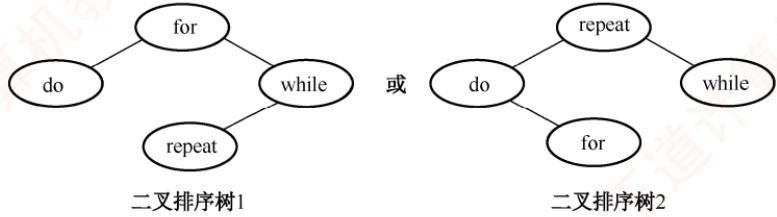

查找成功时的平均查找长度 $0.15 \times 1 + 0.35 \times 2 + 0.35 \times 2 + 0.15 \times 3 = 2.0$

### 7.3.4 本节试题精选

#### 一、单项选择题

01.对于二叉排序树，下面的说法中，（）是正确的。
A. 二叉排序树是动态树表，查找失败时插入新结点，会引起树的重新分裂和组合
B. 对二叉排序树进行层序遍历可得到有序序列
C. 用逐点插入法构造二叉排序树，若先后插入的关键字有序，二叉排序树的深度最大
D. 在二叉排序树中进行查找，关键字的比较次数不超过结点数的1/2

02. 按（）遍历二叉排序树得到的序列是一个有序序列。
A. 先序
B. 中序
C. 后序
D. 层次

03.在二叉排序树中进行查找的效率与（）有关。
A. 二叉排序树的深度
B. 二叉排序树的结点的个数
C. 被查找结点的度
D. 二叉排序树的存储结构

04. 在常用的描述二叉排序树的存储结构中，关键字值最大的结点（）。
A. 左指针一定为空
B. 右指针一定为空
C. 左右指针均为空
D. 左右指针均不为空

05. 设二叉排序树中关键字由1到1000的整数构成，现要查找关键字为 363的结点，下述关键字序列中，不可能是在二叉排序树上查找的序列是（）。
A. 2, 252, 401, 398, 330, 344, 397, 363
B. 924, 220, 911, 244, 898, 258, 362, 363
C. 925, 202, 911, 240, 912, 245, 363
D. 2, 399, 387, 219, 266, 382, 381, 278, 363

06. 分别以下列序列构造二叉排序树，与用其他3个序列所构造的结果不同的是（）。
A. (100, 80, 90, 60, 120, 110, 130)
B. (100, 120, 110, 130, 80, 60, 90)
C. (100, 60, 80, 90, 120, 110, 130)
D. (100, 80, 60, 90, 120, 130, 110)

07. 从空树开始，依次插入元素52,26,14,32,71,60,93,58,24和41后构成了一棵二叉排序树。在该树查找60，要进行比较的次数为（）。
A. 3
B. 4
C. 5
D. 6

08. 在含有n个结点的二叉排序树中查找某个关键字的结点时，最多进行（）次比较。

A. n/2
B. $\log_{2}   n$
C. log₂n + 1
D. n

09. 五个不同结点构造的二叉查找树的形态共有（）种。
A. 20
B. 30
C. 32
D. 42

10. 构造一棵具有n个结点的二叉排序树时，最理想情况下的深度为（）。
A. n/2
B. n
C. $\left\lfloor \log_{2} ( n + 1 ) \right\rfloor$
D. [log2(n + 1)]

11. 含有20个结点的平衡二叉树的最大深度为（）。
A. 4
B. 5
C. 6
D. 7

12. 具有5层结点的平衡二叉树至少有（）个结点。
A. 10
B. 12
C. 15
D. 17

13. 高度为3的平衡二叉排序树的形态共有（）种。
A. 13
B. 14
C. 16
D. 15

14. 在平衡二叉树的基本操作中，可能发生两次旋转的操作是（）。
A. 添加、删除结点
B. 仅删除结点
C. 仅添加结点
D. 都不会

15. 将关键字1,2,3,…，1024依次插入到初始为空的平衡二叉树中，假设只有一个根结点的二叉树的高度为0，则插入结束后的平衡二叉树的高度为（）。
A. 8
B. 9
C. 10
D. 11

16. 下列关于红黑树和AVL树的说法中，不正确的是（）。I. 一棵含有 n个结点的红黑树的高度至多为 $2\log_{2}(n + 1)$ Ⅱ. 若一个结点是红色的，则它的父结点和孩子结点都是黑色的Ⅲ. 红黑树的查询效率一般要优于含有相同结点数的AVL树IV. 若AVL树的某结点的左右孩子的平衡因子都是零，则该结点的平衡因子也是零
A. I、III
B. ⅢII
C. II、IV
D. III、IV

17.下列关于红黑树和AVL树的描述中，不正确的是（）
A. 两者都属于自平衡的二叉树
B. 两者查找、插入、删除的时间复杂度都相同
C. 红黑树插入和删除过程至多有2次旋转操作
D. 红黑树的任意一个结点的左右子树高度（含叶结点）之比不超过2

18.下列关于红黑树的说法中，正确的是（）
A. 红黑树的红结点的数目最多和黑结点的数目相同（不考虑虚构结点）
B. 若红黑树的所有结点都是黑色的，则它一定是一棵满二叉树
C. 红黑树的任何一个分支结点都有两个非空孩子结点首
D. 红黑树的子树也一定是红黑树

19. 下列四个选项中，满足红黑树定义的是（）。
A.
B.
C.

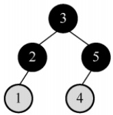

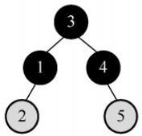

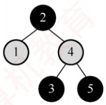

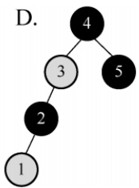

20. 将关键字1,2,3,4,5,6,7依次插入初始为空的红黑树 T，则 T 中红结点的个数是（）。
A. 1
B. 2
C. 3
D. 4

21. 将关键字 5,4,3,2,1 依次插入初始为空的红黑树 T，则 T的最终形态是（）。

A.

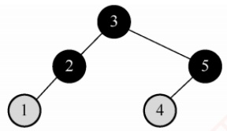

B.

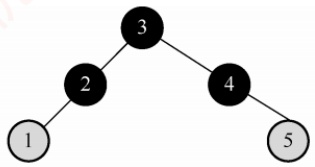

C.

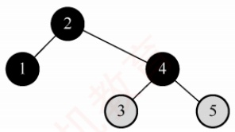

D.

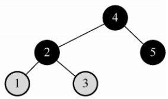

22. 在下图所示的红黑树中插入结点2且染成红色后，则下一步应进行的操作是（）。

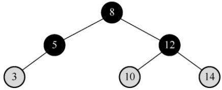

A. 左旋
B. 右旋
C. 变色
D. 无须调整

23.【2009统考真题】下列二叉排序树中，满足平衡二叉树定义的是（）。

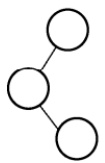

A.

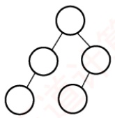

B.

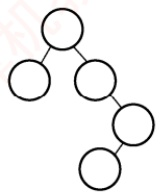

C.

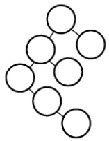

D.

24.【2010统考真题】在下图所示的平衡二叉树中插入关键字48后得到一棵新平衡二叉树，在新平衡二叉树中，关键字37所在结点的左右子结点中保存的关键字分别是（）。

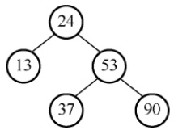

A. 13, 48
B. 24, 48
C. 24,53
D. 24, 90

25.【2011统考真题】对下列关键字序列，不可能构成某二叉排序树中一条查找路径的是（）。
A. 95, 22, 91, 24, 94, 71
B. 92, 20, 91, 34, 88, 35
C. 21, 89, 77, 29, 36, 38
D. 12, 25, 71, 68, 33, 34

26. 【2012统考真题】若平衡二叉树的高度为6，且所有非叶结点的平衡因子均为1，则该平衡二叉树的结点总数为（）。
A. 12
B. 20
C. 32
D. 33

27.【2013统考真题】在任意一棵非空二叉排序树 $T_{1}$ 中，删除某结点ν之后形成二叉排序树 $T_{2}$ ，再将ν插入 $T_{2}$ 形成二叉排序树 $T_{3}$ 。下列关于 $T_{1}$ 与 $T_{3}$ 的叙述中，正确的是（）。I. 若ν是 $T_{1}$ 的叶结点，则 $T_{1}$ 与 $T_{3}$ 不同

II. 若ν是 $T_{1}$ 的叶结点，则 $T_{1}$ 与 $T_{3}$ 相同ⅢII. 若ν不是 $T_{1}$ 的叶结点，则 $T_{1}$ 与 $T_{3}$ 不同IV. 若ν不是 $T_{1}$ 的叶结点，则 $T_{1}$ 与 $T_{3}$ 相同
A. 仅I、III
B. 仅I、IV
C. 仅Ⅱ、ⅢII
D. 仅ⅡI、IV

28. 【2013 统考真题】若将关键字1,2,3,4,5,6,7依次插入初始为空的平衡二叉树T，则T中平衡因子为0的分支结点的个数是（）。
A. 0
B. 1
C. 2
D. 3

29.【2015统考真题】现有一棵无重复关键字的平衡二叉树（AVL），对其进行中序遍历可得到一个降序序列。下列关于该平衡二叉树的叙述中，正确的是（）。
A. 根结点的度一定为 2
B. 树中最小元素一定是叶结点
C. 最后插入的元素一定是叶结点
D. 树中最大元素一定是无左子树

30.【2018统考真题】已知二叉排序树如右图所示，元素之间应满足的大小关系是（）。
A. $x_{1} < x_{2} < x_{5}$
B. $x_{1} < x_{4} < x_{5}$ 王道
C. $x_{3} < x_{5} < x_{4}$
D. $x_{4} < x_{3} < x_{5}$

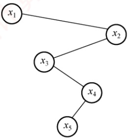

31.【2019统考真题】在任意一棵非空平衡二叉树（AVL树） $T_{1}$ 中，删除某结点ν之后形成平衡二叉树 $T_{21}$ ，再将ν插入 $T_{2}$ 形成平衡二叉树 $T_{3 \circ}$ 下列关于 $T_{1}$ 与 $T_{3}$ 的叙述中，正确的是（）。I. 若ν是 $T_{1}$ 的叶结点，则 $T_{1}$ 与 $T_{3}$ 可能不相同II. 若ν不是 $T_{1}$ 的叶结点，则 $T_{1}$ 与 $T_{3} -$ 定不相同IⅢII. 若ν不是 $T_{1}$ 的叶结点，则 $T_{1}$ 与 $T_{3}  一$ 定相同
A. 仅I
B. 仅Ⅱ
C. 仅I、ⅡI 道
D. 仅I、Ⅲ

32.【2020统考真题】下列给定的关键字输入序列中，不能生成右边二叉排序树的是（）。
A. 4, 5, 2, 1, 3
B. 4, 5, 1, 2, 3
C. 4,2,5,3,1
D. 4, 2, 1, 3, 5

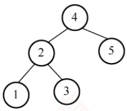

33.【2021统考真题】给定平衡二叉树如右图所示，插入关键字23后，根中的关键字是（）。
A. 16
B. 20
C. 23
D. 25

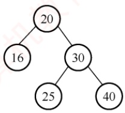

34.【2024统考真题】一棵二叉搜索树如右图所示， $k_{1} 、 k_{2} 、 k_{3}$ 分别是对应结点中保存的关键字。子树T的任一结点中保存的关键字x满足的是（）。
A. $x   \le   k_{1}$
B. $x \geq k_{2}$
C. $k_{1} < x < k_{3}$
D. $k_{3} < x < k_{2}$

#### 二、综合应用题

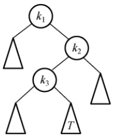

01. 一棵二叉排序树按先序遍历得到的序列为(50,38,30,45,40,48,70,60, 75,80)，试画出该二叉排序树，并求出等概率下查找成功和查找失败的平均查找长度。

02.按照序列(40,72,38,35,67,51,90,8,55,21)建立一棵二叉排序树，画出该树，并求出在等概率的情况下，查找成功的平均查找长度。

03. 依次把结点(34,23,15,98,115,28,107)插入初始状态为空的平衡二叉排序树，使得在每次插入后保持该树仍然是平衡二叉树。请依次画出每次插入后所形成的平衡二叉排序树。

04. 给定一个关键字集合{25,18,34,9,14,27,42,51,38}，假定查找各关键字的概率相同，请画出其最佳二叉排序树。

05. 试编写一个算法，判断给定的二叉树是否是二叉排序树。

06. 设计一个算法，求出指定结点在给定二叉排序树中的层次。

07. 利用二叉树遍历的思想编写一个判断二叉树是否是平衡二叉树的算法。

08. 设计一个算法，求出给定二叉排序树中最小和最大的关键字。

09. 设计一个算法，从大到小输出二叉排序树中所有值不小于k的关键字。

10. 编写一个递归算法，在一棵有n个结点的、随机建立的二叉排序树上查找第k（1≤k ≤n）小的元素，并返回指向该结点的指针。要求算法的平均时间复杂度为O(log2n)。二叉排序树的每个结点中除data、1child、rchild等数据成员外，增加一个count成员，保存以该结点为根的子树上的结点个数。

### 7.3.5 答案与解析

#### 一、单项选择题

01. C

二叉排序树插入新结点时不会引起树的分裂组合。对二叉排序树进行中序遍历可得到有序序列。当插入的关键字有序时，二叉排序树会形成一个长链，此时深度最大。在此种情况下进行查找，有可能需要比较每个结点的关键字，超过总结点数的1/2。

02. B

由二叉排序树的定义不难得出中序遍历二叉树得到的序列是一个有序序列。

03. A

二叉排序树的查找路径是自顶向下的，其平均查找长度主要取决于树的高度。

04. B

在二叉排序树的存储结构中，每个结点由三部分构成，其中左（或右）指针指向比该结点的关键字值小（或大）的结点。关键字值最大的结点位于二叉排序树的最右位置，因此它的右指针一定为空（有可能不是叶结点）。还可用反证法，若右指针不为空，则右指针上的关键字肯定比原关键字大，所以原关键字结点一定不是值最大的，与条件矛盾，所以右指针一定为空。

05. C

在二叉排序树上查找时，先与根结点值进行比较，若相同，则查找结束，否则根据比较结果，沿着左子树或右子树向下继续查找。根据二叉排序树的定义，有左子树结点值≤根结点值≤右子树结点值。C序列中，比较911关键字后，应转向其左子树比较240，左子树中不应出现比911更大的数值，但240竟有一个右孩子结点值为912，所以不可能是正确的序列。

06. C

按照二叉排序树的构造方法，不难得到A,B,D序列的构造结果相同。

07. A

以第一个元素为根结点，依次将元素插入树，生成的二叉排序树如右图所示。进行查找时，先与根结点比较，然后根据比较结果，继续在左子树或右子树上进行查找。比较的结点依次为52,71,60。

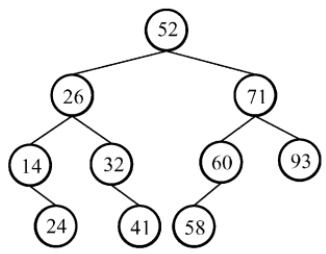

08. D

当输入序列是一个有序序列时，构造的二叉排序树是一个单支树，当查找一个不存在的关键字值或最后一个结点的关键字值时，需要n次比较。

09. D

五个不同结点构造的二叉查找树，中序序列是确定的。先序序列的个数为n=5的卡特兰数，加上中序序列和先序序列能唯一确定一棵二叉树，因此二叉排序树的形态共有Catalan(5)=42种。

10. D

当二叉排序树的叶结点全部都在相邻的两层内时，深度最小。理想情况是从第一层到倒数第二层为满二叉树。类比完全二叉树，可得深度为 $\left[ \log_{2} ( n + 1 ) \right]$ o 姚K

11. C

平衡二叉树结点数的递推公式为 $n_{0}   =   0$ $n_{1} = 1$ $n_{2} = 2$ $n_{h} = 1 + n_{h - 1} + n_{h - 2}$ (h为平衡二叉树高度， $n_{h}$ 为构造此高度的平衡二叉树所需的最少结点数）。通过递推公式可得，构造5层平衡二叉树至少需12个结点，构造6层至少需要20个结点。

12. B

设 $n_{h}$ 表示高度为h的平衡二叉树中含有的最少结点数，则有 $n_{1} = 1, n_{2} =$ $n_{h}=n_{h-1}+n_{h-2}+1$ ，由此求出 $n_{5}   =   12$ ，对应的AVL如右图所示。

13. D

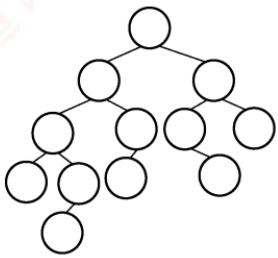

高度为3的平衡二叉树的左右子树的高度共有三种情况:①左右子树都是高度为2的平衡二叉树；②左子树是高度为1的平衡二叉树，右

子树是高度为2的平衡二叉树；③左子树是高度为2的平衡二叉树，右子树是高度为1的平衡二叉树。高度为1的平衡二叉树只有1种形态，即单个结点，如图1所示；高度为2的平衡二叉树有3种形态，如图2所示。


图1

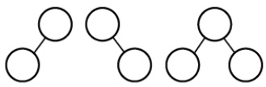

图2

因此，对于情况①，共有3×3= 9种树形态；对于情况②，共有1×3= 3种树形态；情况③和情况②类似，也有3种树形态，所以共有 $9 + 3 + 3 = 15$ 种树形态。

14. A

插入和删除结点都有可能引起LR平衡旋转或者RL平衡旋转，发生两次旋转操作。

15. C

当按关键字有序的顺序插入初始为空的平衡二叉树时，若关键字个数 $n   =   2^{k}   -   1$ 时，则该平衡二叉树一定是一棵满二叉树（可以用1～3、1～7手工验证）。当插入关键字1023时，平衡二叉树正好是一棵满二叉树，高度为9。因此，插入关键字1024后，平衡二叉树的高度为10。

16. D

说法Ⅰ和Ⅱ都是红黑树的性质。AVL是高度平衡的二叉查找树，红黑树是适度平衡的二叉查找树，从这一点也可以看出AVL的查询效率往往更优，说法Ⅲ错误。AVL的某结点的左右孩子的平衡因子都是零，并不能说明左右子树的高度相等，因此该结点的平衡因子不一定为零，说法IV错误。

17. C

自平衡的二叉排序树是指在插入和删除时能自动调整以保持其所定义的平衡性，两者都属于自平衡二叉树，选项A正确。两者的查找、插入、删除操作的时间复杂度都为O(log₂n)，选项B正确。在红黑树中删除结点时，情况1可能变为情况2、3或4，情况2会变为情况3，可能会出现旋转次数超过2次的情况，选项C错误。从任一结点到每个叶结点的所有路径都包含相同数目的黑结点，没有两个连续的红结点，且叶结点是黑色的，这意味着在任一结点到其左右子树中最远和最近的叶结点之间，红结点的数目小于或等于黑结点的数目，路径长度之比不超过2，选项D正确。

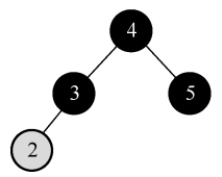

18. B

红黑树的红结点数目最大可以是黑结点数目的2倍（如一棵有3个结点的红黑树，第1层为黑色，第2层为红色），选项A错误。从根结点出发到所有叶结点的黑结点数是相同的，若所有结点都是黑色，则一定是满二叉树，选项B正确。考虑某个黑结点，它可以有一个空叶结点孩子和一个非空红结点孩子，选项C错误。红黑树中可能存在红结点，根结点为红色的子树不是红黑树，选项D错误。

19. A

红黑树是一种特殊的二叉排序树，选项B不满足二叉排序树的性质。选项C中，结点2的左右黑结点数不同。在选项D中，结点3的左右黑结点数不同。只有选项A满足红黑树的定义。

20. C

关键字1,2,3,4,5,6,7依次插入红黑树后的形态变化如下:

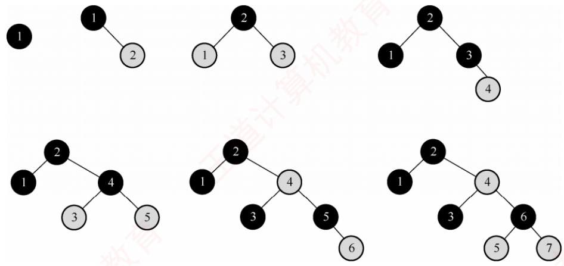

21. D

关键字5,4,3,2,1依次插入红黑树后的形态变化如下:

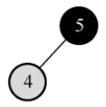

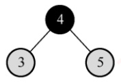

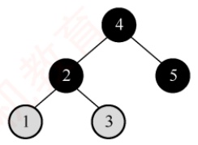

22. B

插入结点2且将其染成红色后违反不红红原则，并且叔结点是黑色，应进行LL旋转，将结点3右旋旋转到结点5的位置，结点2和结点5分别成为结点3的左右孩子，然后将结点3染成黑色，结点2和结点5染成红色。因此，下一步应进行右旋操作。

23. B

根据平衡二叉树的定义，任意结点的左右子树高度差的绝对值不超过1。而其余3个答案均可以找到不满足条件的结点。答题时可以把每个非叶结点的平衡因子都写出来。

24. C

插入48以后，该二叉树根结点的平衡因子由-1变为-2，在最小不平衡子树根结点的右子树（R）的左子树（L）中插入新结点引起的不平衡属于RL型平衡旋转（先右旋后左旋）。

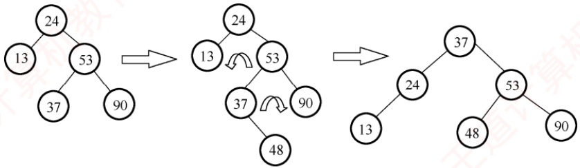

调整后，关键字37所在结点的左右子结点中保存的关键字分别是24、53。

25. A

在二叉排序树中，左子树结点值小于根结点，右子树结点值大于根结点。在选项A中，当查找到91后再向24查找，说明这一条路径（左子树）之后查找的数都要比91小，而后面却查找到了94（解题过程中，建议配合画图），因此错误。

画图法:各选项对应的查找过如下图所示。选项B、C、D对应的查找树都是二叉排序树，选项A对应的查找树不是二叉排序树，因为在91为根的左子树中出现了比91大点的结点94。

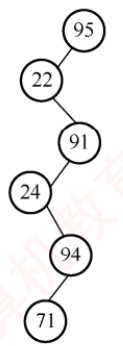

(a) 选项A的查找过程

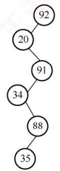

(b) 选项B的查找过程

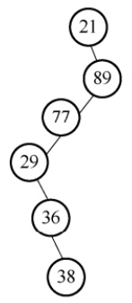

(c) 选项C的查找过程

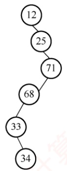

(d) 选项D的查找过程

26. B

所有非叶结点的平衡因子均为1，即平衡二叉树满足平衡的最少结点情况，如下图所示。对于高度为n、左右子树的高度分别为n-1和n-2、所有非叶结点的平衡因子均为1的平衡二叉树，计算总结点数的公式为 $C_{n}=C_{n - 1}+C_{n - 2}+1,C_{1}=1,C_{2}=2,C_{3}=2+1+1=4$ ，可推出 $C_{6}   =   20$ 0

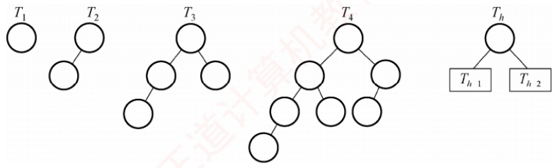

画图法:先画出 $T_{1}$ 和 $T_{2}$ ；然后新建一个根结点，连接 $T_{2}$ $T_{1}$ 构成 $T_{3}$ ；新建一个根结点，连接 $T_{3}  、  T_{2}$ 构成 $T_{4} {\cdots} {\cdots}$ 直到画出 $T_{6}$ ，可知 $T_{6}$ 的结点数为20。

排除法:对于选项A，高度为6、结点数为12的树怎么也无法达到平衡。对于选项C，结点较多时，考虑较极端的情形，即第6层只有最左叶子的完全二叉树刚好有32个结点，虽然满足平衡的条件，但显然再删去部分结点依然不影响平衡，不是最少结点的情况。同理，选项D错误。

27. C

由于在二叉排序树中插入结点的位置是一个新的叶结点，若删除的是叶结点，则重新插入后得到的二叉排序树与原来的二叉排序树相同。若删除的是非叶结点，在删除过程中会找其他结点填补，重新插入后变成叶结点，则得到的二叉排序树与原来的二叉排序树不同。

28. D

利用7个关键字构建平衡二叉树T，平衡因子为0的分支结点个数为3，构建的平衡二叉树及构造与调整过程如下图所示。

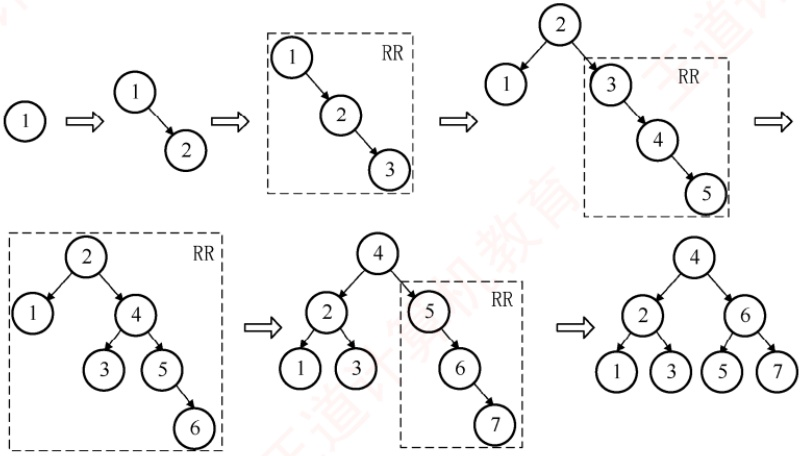

29. D

大多数教材将平衡二叉树定义为一种高度平衡的二叉排序树，二叉排序树的中序序列是一个升序序列，而题意正好相反。由此可知，命题老师认为平衡二叉树仅为一棵满足高度平衡的二叉树，不一定是二叉排序树。只有两个结点的平衡二叉树的根结点的度为1，选项A错误。中序遍历后得到一个降序序列（与二叉排序树正好相反），树中最大元素一定无左子树（可能有右子树），这与二叉排序树也正好相反，也因此不一定是叶结点，选项B错误，选项D正确。最后插入的结点可能会导致平衡调整，而不一定是叶结点，选项C错误。

30. C

根据二叉排序树的特性:中序遍历（LNR）得到的是一个递增序列。图中二叉排序树的中序遍历序列为 $x_{1} , x_{3} , x_{5} , x_{4} , x_{2}$ ，可知 $x_{3} < x_{5} < x_{4}$ 0

31. A

在非空平衡二叉树中插入结点，在失去平衡调整前，一定插入在叶结点的位置。

若删除的是 $T_{1}$ 的叶结点，则删除后平衡二叉树可能不会失去平衡，即不会发生调整，再插入此结点得到的二叉平衡树 $T_{1}$ 与 $T_{3}$ 相同；若删除后平衡二叉树失去平衡而发生调整，再插入结点得到的二叉平衡树 $T_{3}$ 与 $T_{1}$ 可能不同。说法Ⅰ正确。例如，如下图所示，删除结点0，平衡二叉树失衡调整，再插入结点0后，平衡二叉树和以前不同。

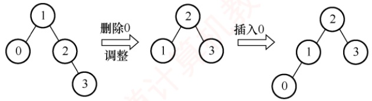

对于比较绝对的说法Ⅱ和Ⅲ，通常只需举出反例即可。

若删除的是 $T_{1}$ 的非叶结点，且删除和插入操作均没有导致平衡二叉树的调整（这时可以首先想到删除的结点只有一个孩子的情况），则该结点从非叶结点变成了叶结点， $T_{1}$ 与 $T_{3}$ 显然不同。例如，如下图所示，删除结点2，用右孩子结点3填补，再插入结点2，平衡二叉树和以前不同。

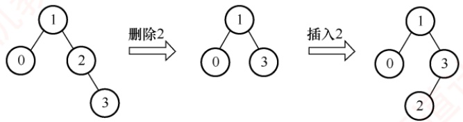

若删除的是 $T_{1}$ 的非叶结点，且删除和插入操作后导致了平衡二叉树的调整，则该结点有可能通过旋转后继续变成非叶结点， $T_{1}$ 与 $T_{3}$ 相同。例如，如下图所示，删除结点2，用右孩子结点3填补，再插入结点2，平衡二叉树失衡调整，调整后的平衡二叉树和以前相同。

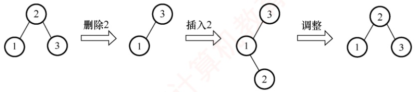

32. B

每个选项都逐一验证，选项B生成二叉排序树的过程如下图所示，显然错误。

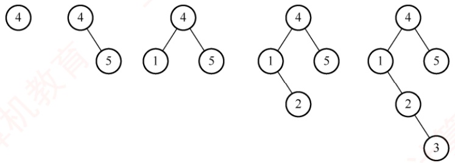

33.D

关键字23的插入位置为25的左孩子，此时破坏了平衡的性质，需要对平衡二叉树进行调整。最小不平衡子树就是该树本身，插入位置在根结点的右子树的左子树上，因此需要进行RL旋转，RL旋转过程如下图所示，旋转完成后根结点的关键字为25，所以选择选项D。

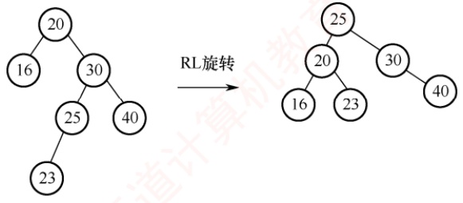

34. D

在二叉搜索树中，每个结点的左子树中的所有关键字都小于该结点的关键字，右子树中的所有关键字都大于该结点的关键字。 $k_{2}$ $k_{3}$ 所在结点都在 $k_{1}$ 所在结点的右子树中，因此 $k_{2} > k_{1} , k_{3} >$ $k_{1} ; k_{3}$ 所在结点在 $k_{2}$ 所在结点的左子树中，因此 $k_{3} < k_{2}$ ；子树T是 $k_{3}$ 所在结点的右子树，因此子树 T 中任意结点的关键字x满足 $x \geq k_{3}$ 。综合可得， $k_{3} < x < k_{2}$

#### 二、综合应用题

01. 【解答】

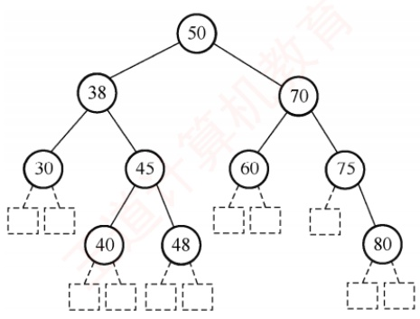

先序序列为(50, 38, 30,45,40,48,70, 60, 75,80),二叉树的中序序列是一个有序序列，所以为(30,38,40. 45,48,50,60,70,75,80)，由先序序列和中序序列可以构造出对应的二叉树，如左图所示。

查找成功的平均查找长度为

$$
\mathrm{ASL}=(1 \times 1+2 \times 2+3 \times 4+4 \times 3)/10=2.9
$$

图中的方块结点为虚构的查找失败结点，其查找路径为从根结点到其父结点（圆形结点）的结点序列，所以对应的查找失败平均长度为

$$
\mathrm{ASL}=(3 \times 5+4 \times 6)/11=39/11
$$

02. 【解答】

根据二叉排序树的定义，该序列所对应的二叉排序树如下图所示。

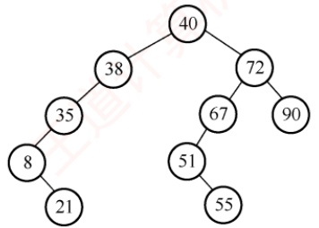

平均查找长度为 $\mathrm{ASL}=(1+2 \times 2+3 \times 3+4 \times 2+5 \times 2)/10=3.2$

03.【解答】

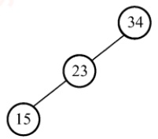


第一步:插入结点34,23,15后，需要根结点34的子树做LL调整。


第二步:插入结点98,115后，需要根结点34的子树做RR调整。


第三步:插入结点28后，需要根结点23的子树做RL调整。


第四步:插入结点107后，需要根结点98的子树做RL调整。

04.【解答】

当各关键字的查找概率相等时，最佳二叉排序树应是高度最小的二叉排序树。构造过程分两步走:首先对各关键字按值从小到大排序，然后仿照折半查找的判定树的构造方法构造二叉排序树。这样得到的就是最佳二叉排序树，结果如右图所示。

05. 【解答】


对二叉排序树来说，其中序遍历序列为一个递增有序序列。

因此，对给定的二叉树进行中序遍历，若始终能保持前一个值比后一个值小，则说明该二叉树是一棵二叉排序树。算法实现如下:

```c
KeyType predt=-32767; 道
int JudgeBST(BiTree bt){
int b1,b2;
if(bt==NULL)
return 1;
else{
b1=JudgeBST(bt->lchild) ;
if(b1==0|lpredt>=bt->data)
return 0;
predt=bt->data;
b2=JudgeBST(bt->rchild);
return b2;
```

```txt
//predt为全局变量，保存当前结点中序前驱
的值，初值为-∞
//空树
育
//判断左子树是否是二叉排序树
//若左子树返回值为0或前驱大于或等于当前结点
/不是二叉排序的关键字
//判断右子树
//返回右子树的结果
```

06.【解答】

算法思想:设二叉树采用二叉链表存储结构。在二叉排序树中，查找一次就下降一层。因此，查找该结点所用的次数就是该结点在二叉排序树中的层次。采用二叉排序树非递归查找算法，用n保存查找层次，每查找一次，n就加1，直到找到相应的结点。算法如下:

```c
int level(BiTree bt,BSTNode *p){
int n=0; //统计查找次数
BiTree t=bt;
if(bt!=NULL) {
n++;
while(t->data!=p->data) {
```

```c

if(p->data<t->data) //在左子树中查找
t=t->lchild;
else //在右子树中查找
t=t->rchild;
n++; //层次加1
1 道
return n;
```

07.【解答】

设置二叉树的平衡标记balance，以标记返回二叉树bt是否为平衡二叉树，若为平衡二叉树，则返回1，否则返回0；h为二叉树bt的高度。采用后序遍历的递归算法:

1）若bt为空，则高度为0，balance=1。

2）若bt仅有根结点，则高度为1，balance=1。

3）否则，对bt的左右子树执行递归运算，返回左右子树的高度和平衡标记，bt的高度为最高子树的高度加1。若左右子树的高度差大于1，则balance=0；若左右子树的高度差小于或等于1，且左右子树都平衡时，balance=1，否则balance=0。

```c
void Judge AVL(BiTree bt,int &balance,int &h){
int bl=0,br=0,hl=0,hr=0; //左右子树的平衡标记和高度
if(bt==NULL) { //空树，高度为0
h=0;
balance=1;
else if(bt->lchild==NULL&&bt->rchild==NULL){//仅有根结点，则高度为1
h=1;
balance=1;
道
else{
Judge AVL(bt->lchild,bl,hl); //递归判断左子树
Judge AVL(bt->rchild,br,hr); //递归判断右子树
h=(hl>hr?hl:hr)+1;
if (abs (hl-hr) <2) //若子树高度差的绝对值<2，则看左右子树是否都平衡
balance=bl&&br；//&&为逻辑与，即左右子树都平衡时，二叉树平衡
else
balance=0;
算机
```

08.【解答】

在一棵二叉排序树中，最左下结点即关键字最小的结点，最右下结点即关键字最大的结点，本算法只要找出这两个结点即可，而不需要比较关键字。算法如下:

```c
KeyType MinKey(BSTNode *bt) {
while(bt->lchild!=NULL)
bt=bt->lchild;
return bt->data;
1
KeyType MaxKey(BSTNode *bt)
//求出二叉排序树中最大关键字结点
while(bt->rchild!=NULL)
bt=bt->rchild;
return bt->data;
```

```txt
1）t->lchild->count==k-1，*t即第k小的元素，查找成功。
2）t->lchild->count>k-1，第k小的元素必在*t的左子树，继续到*t的左子树中查找。
3)t->1child->count<k-1，第k小的元素必在右子树，继续搜索右子树，寻找第k-(t->
1child->count+1)小的元素。
```

09.【解答】

### 7.4.3 本节试题精选

#### 一、单项选择题

01.右图所示是一棵（）。 12 25
A. 4阶B树
B. 3阶B树
C. 4 阶 B+树
D. 无法确定 05 10 15 19 22 26 28


02.下列关于m阶B树的说法中，错误的是（）
A. 根结点至多有 m棵子树
B. 所有叶结点都在同一层次上
C. 非叶结点至少有m/2（m为偶数）或(m+1)/2（m为奇数）棵子树
D. 根结点中的数据是有序的

03. 下列关于高度为3的3阶B树的说法中，正确的是（）。I. 每个内部结点至少有两棵非空子树Ⅱ. 树中每个结点至多有2个关键字I. 树中最多能存储26个关键字IV. 插入一个元素引起B树结点分裂后，树的高度变为4
A. I、ⅡI
B. I、II、III
C. III、IV
D. I、II、IV

04. 在一棵m阶B树中做插入操作前，若一个结点中的关键字个数等于（），则插入操作后必须分裂成两个结点；在一棵m阶B树中做删除操作前，若一个结点中的关键字个数等于（），则删除操作后可能需要同它的左兄弟或右兄弟结点合并成一个结点。
A. $m, \left \lceil m/2 \right \rceil -2$
B. $m - 1, \left\lceil m/2 \right\rceil - 1$
C. $m + 1, \left\lceil m/2 \right\rceil$
D. $m / 2, \left \lceil m / 2 \right \rceil + 1$

05. 具有n个关键字的m阶B 树，应有（）个叶结点。
A. n + 1
B. n−1
C. mn
D. $n m / 2$

06.高度为5的3阶B树至少有（）个结点，至多有（）个结点。
A. 32
B. 31
C. 120
D. 121

07. 含有n个非叶结点的m阶B 树中至少包含（）个关键字。
A. $n ( m + 1 )$
B. n IK
C. $n ( \lceil m / 2 \rceil - 1 )$
D. $(n - 1)(\left \lceil m/2 \right \rceil - 1) + 1$

08. 已知一棵5阶B树中共有53个关键字，则树的最大高度为（），最小高度为（）。
A. 2
B. 3
C. 4
D. 5

09. 已知一棵3阶B树中共有2047个关键字，则树的最大高度为（），最小高度为（）。
A. 11
B. 10
C. 8
D. 7

10. 在7阶B树中，按从上往下、从左往右的顺序搜索第2016个关键字，若根结点已读入内存，则最多需启动（）次I/O。
A. 4
B. 5
C. 6
D. 7

11. 在一棵高度为h的B树中插入一个新关键字，假设在插入过程中读入的结点一直在内存中，根结点的高度为1，且初始时未读入内存，则下列叙述中错误的是（）。（注意，本题中的新结点是指新产生的结点，如一次分裂才产生一个新结点。)
A. 若插入操作导致树的高度变为h+1，则本次插入一定导致了根结点的分裂
B. 若插入操作导致旧结点的分裂，则树的高度一定会变为h+1
C. 由于本次插入操作而产生的新结点的个数最多为h+1 算机
D. 由于本次插入操作而产生的读/写磁盘的次数最多为3h+1

12.下列关于B树和B+树的叙述中，错误的是（）。
A. B树和B+树都能有效地支持顺序查找
B. B树和B+树都能有效地支持随机查找
C. B树和B+树都是平衡的多叉树
D. B树和B+树都可以用于文件索引结构

13. 下列关于B树和B+树的查找操作的叙述中，错误的是（）。
A. B树查找成功时，不一定需要查找到最后一层的内部结点
B. B树查找失败时，一定需要查找到叶结点
C. B+树查找成功时，不一定需要查找到叶结点
D. B+树查找成功时，每次查找的长度都相等

14.【2009统考真题】下列叙述中，不符合m阶B树定义要求的是（）。
A. 根结点至多有 m 棵子树
B. 所有叶结点都在同一层上
C. 各结点内关键字均升序或降序排列
D. 叶结点之间通过指针链接

15.【2012统考真题】已知一棵3阶B树，如右图所示。删除关键字78得到一棵新B树，其最右叶结点中的关键字是（）。
A. 60
B. 60, 62
C. 62,65
D. 65


16.【2013统考真题】在一棵高度为2的5阶B树中，所含关键字的个数至少是（）。
A. 5
B. 7
C. 8
D. 14

17.【2014统考真题】在一棵有15个关键字的4阶B树中，含关键字的结点个数最多是（)。
A. 5
B. 6
C. 10
D. 15

18.【2016统考真题】B+树不同于B树的特点之一是（）。
A. 能支持顺序查找
B. 结点中含有关键字
C. 根结点至少有两个分支
D. 所有叶结点都在同一层上

19.【2017统考真题】下列应用中，适合使用B+树的是（）。
A. 编译器中的词法分析
B. 关系数据库系统中的索引
C. 网络中的路由表快速查找
D. 操作系统的磁盘空闲块管理

20.【2018统考真题】高度为5的3阶B树含有的关键字个数至少是（）。

A. 15
B. 31
C. 62灯T
D. 242

21.【2020统考真题】依次将关键字5，6，9，13，8，2，12，15插入初始为空的4阶B树后，根结点中包含的关键字是（）。
A. 8
B. 6, 9
C. 8, 13
D. 9, 12

22.【2021统考真题】在一棵高度为3的3阶B树中，根为第1层，若第2层中有4个关键字，则该树的结点数最多是（）。
A. 11
B. 10
C. 9
D. 8

23. 【2022统考真题】在下图所示的5阶B树T中，删除关键字260之后需要进行必要的调整，得到新的B树 $T_{1 \circ}$ 下列选项中，不可能是 $T_{1}$ 根结点中关键字序列的是（）。


A. 60, 90,280
B. 60, 90, 350
C. 60, 85, 110, 350
D. 60,90, 110, 350

24.【2023统考真题】下列关于非空B树的叙述中，正确的是（）。I. 插入操作可能增加树的高度 Ⅱ. 删除操作一定会导致叶结点的变化I. 查找某关键字总是要查找到叶结点 IV. 插入的新关键字最终位于叶结点中
A. 仅I
B. 仅I、Ⅱ
C. 仅ⅢI、IV
D. 仅I、ⅡI、IV

25. 【2025统考真题】给定7个不同的关键字，能构造的不同4阶B树的个数最多是（）。
A. 7
B. 8
C. 9
D. 10

#### 二、综合应用题

01. 给定一组关键字{20,30,50,52,60,68,70}，给出创建一棵3阶B树的过程。

02. 对如右图所示的3阶B树，依次执行下列操作，画出各步操作的结果。1）插入90 2）插入25 3）插入45 4）删除60 5）删除80


03. 利用B树做文件索引时，若假设磁盘页块的大小是 8 20 35 40 60 100 4000B(实际应是2的次幂，此处是为了计算方便)，指示磁盘地址的指针需要5B。现有20000000个记录构成的文件，每个记录为200B，其中包括关键字5B。试问在这个采用B树作索引的文件中，B树的阶数应为多少？假定文件数据部分未按关键字有序排列，则索引部分需要占用多少磁盘页块？

### 7.4.4 答案与解析

#### 一、单项选择题

01. D

关键字数目比子树数目少1，首先可排除B+树。对于4阶B树，根结点至少有2棵子树（关键字数至少为1），其他非叶结点至少有 $\left[ n / 2 \right] = 2$ 棵子树（关键字数至少为1）、至多有4棵子树（关键字数至多为3）。5阶B树和6阶B树的分析也类似。题目所示的B树，同时满足4阶B树、5阶B树和6阶B树的要求，因此不能确定是哪种类型的B树。

02. C

除根结点外的所有非叶结点至少有 $[ m / 2 ]$ 棵子树。对于根结点，最多有m棵子树，若其不是叶结点，则至少有2棵子树。

03. B

每个非根的内部结点必须至少有 $\lceil m / 2 \rceil$ 棵子树，而本题中的根结点不是叶结点，也至少要有两棵子树，说法Ⅰ正确。每个结点至多有 $m   -   1   =   2$ 个关键字，说法Ⅱ正确。在高度为h的m阶B树中，关键字个数至多为 $(m - 1)(1 + m + m^2 + \cdots + m^{h-1}) = m^h - 1$ ，代入 $m = 3, \quad h = 3$ ，即树中最多能存储26个关键字，说法Ⅲ正确。对于说法IV，插入一个元素引起B树结点分裂后，只要从根结点到该元素插入位置的路径上至少有一个结点未满，B树就不会长高，如图1所示；只有当结点的分裂传到根结点，并使根结点也分裂时，才会导致树高增1，如图2所示，说法IV错误。


图1 结点分裂不导致树高增1（3阶B树）


图2 结点分裂导致树高增1（3阶B树）

04. B

因为B树每个结点内的关键字个数最多为m-1，所以当关键字个数大于m-1时，则应该分裂。每个结点内的关键字个数至少为 $[ m / 2 ] - 1$ 个，所以当关键字个数少于m/2]-1时，则可能与其他结点合并（除非只有根结点）。若将本题题干改为B+树，请读者思考上述问题的解答。

05. A

B树的叶结点对应查找失败的情况，对有n个关键字的查找集合进行查找，失败的可能性有$n + 1$ 种。

**06. B、D**

由m阶B树的性质可知，根结点至少有2棵子树；根结点外的所有非终端结点至少有m/2棵子树，结点数最少时，3阶B树形状至少类似于一棵满二叉树，即高度为5的B树至少有 $2^{5}   -   1   =$ 31个结点。因为每个结点最多有m棵子树，所以当结点数最多时，3阶B树形状类似于满三叉树，结点数为 $(3^{5} - 1)/2 = 121$ (注意，这里求的是结点数而非关键字数，若求的是关键字数，则还应把每个结点中关键字数的上下界确定出来）。

07. D

除根结点外，m阶B树中的每个非叶结点至少有 $\lceil m / 2 \rceil - 1$ 个关键字，根结点至少有一个关键字，所以总共包含的关键字最少个数 $(n - 1)(\left\lceil m/2 \right\rceil - 1) + 1$ 0

**注意**

由以上题目可知B树和B+树的定义与性质尤为重要，需要熟练掌握。

**08. C、B**

5 阶B树中共有53 个关键字，由最大高度公式 $H \leqslant \log_{\left \lceil m/2 \right \rceil} \left ( \left ( n+1 \right )/2 \right ) +1$ 得最大高度 $H {\leqslant}$ $\log_{3} [ ( 53 + 1 ) / 2 ] + 1 = 4$ ，即最大高度为4；由最小高度公式 $h \geqslant \log_{m}(n + 1)$ 得最小高度 $h \geqslant \log_{5}54 \approx 2.5$从而最小高度为3。

**09. A、D**

利用前面的公式即最小高度 $h \geqslant \log_{m}(n + 1)$ 和最大高度 $H \leqslant \log_{\left \lceil m/2 \right \rceil} \left [ (n+1)/2 \right ] + 1$ ，易算出最大高度 $H \leqslant \log_{2}[(2047 + 1)/2] + 1 = 11$ ，最小高度 $h \geqslant \log_{3}2048 = 6.9$ ，从而最小高度取7（注意，有些辅导书针对本题算出的高度要比这里给出的答案多1，因为它们在对B树的高度定义中，把最底层不包含任何关键字的叶结点也算进去了）。

10. B

本题要计算的是最坏情况下第2016个关键字在7阶B树中的最大深度，即考查B树结点中关键字数最少的情况。按照B树的定义，根结点至少有1个关键字，第二层至少有2个结点，即$2 {\times} 3$ 个关键字；第三层至少有2×4个结点，即 $2 \times 4 \times 3$ 个关键字；第四层至少有 $2   \times   4^{2}$ 个结点，即 $2 \times 4^{2} \times 3$个关键字；以此类推，第h层至少有 $2   \times   4^{h - 2}$ 个结点，即 $2 \times 4^{h - 2} \times 3$ 个关键字，故前h层的关键字总数 $n = 1 + 2 \times 3 \times ( 1 + 4 + \cdots + 4^{h - 2} ) = 1 + 2 \times ( 4^{h - 1} - 1 )$ 。故当 $h   =   5$ 时， $n   =   511$ ;当 $h = 6$ 时， $n = 2047$说明5层高的7阶B树最少有511个关键字，而6层高的7阶B树最少有2047个关键字，故最坏情况下第2016个关键字在7阶B树的第6层，需启动5次/O操作。

11. B

考虑最坏情况，在待插入结点中插入一个关键码后，导致结点分裂，在该层分裂成2个结点，因此需要2次写磁盘操作；分裂操作逐层向上传导，导致每层都有结点分裂，因为结点分裂而导致的写磁盘操作共有2h次，加上最后一次结点分裂形成新根结点也需要1次写磁盘操作，写磁盘的总次数为2h+1，即由于本次插入而产生的新结点个数为h+1，加上寻找插入位置而引起的h次的读磁盘操作，整个过程中读/写磁盘的总次数为3h+1次，选项C、D正确。若插入操作导致了B树的高度增加，则分裂操作一定是从最底层传导至根结点的，即前面分析的最坏情况，选项A正确。若分裂操作没有传导至根结点，则B树的高度不变，选项B错误。

12. A

B树和B+树的差异主要体现在:①结点关键字和子树的个数；②B+树非叶结点仅起索引作用；③B树叶结点关键字和其他结点包含的关键字是不重复的；④B+树支持顺序查找和随机查找，而B树仅支持随机查找。B+树的所有叶结点中包含了全部的关键字信息，且叶结点本身依关键字从小到大顺序链接，因此可以进行顺序查找，而B树不支持顺序查找。B树和B+树都可用于文件索引结构，但B+树更适合做数据库索引和文件索引，因为它的磁盘读/写代价更低。

13. C

在B树的查找操作中，若目标元素在某个内部结点中，则查找结束，不需要进入叶结点；查找失败时，叶结点是所有路径的终点，选项A、B正确。B+树中仅叶结点包含信息，非叶结点仅起到索引作用，查找成功时一定会找到相应的叶结点，所经过的路径长度都相等，选项C错误，选项D正确。

14. D

m阶B树不要求将各叶结点之间用指针链接。选项D描述的实际上是B+树。

15. D

对于图中所示的3阶B树，被删关键字78所在的结点在删除前的关键字个数 $1 = \left[ 3 / 2 \right] - 1$且其左兄弟结点的关键字个数 $= 2 \geq \left\lceil 3 / 2 \right\rceil$ ，属于“兄弟够借”的情况，因此要把该结点的左兄弟结点中的最大关键字上移到父结点中，同时把父结点中大于上移关键字的关键字下移到要删除关键字的结点中，这样就达到了新的平衡，如下图所示。


16. A

对于5阶B树，根结点的分支数最少为2（关键字数最少为1），其他非叶结点的分支数最少为 $\left[ n / 2 \right] = 3$ （关键字数最少为2），因此关键字个数最少的情况如右图所示（叶结点不计入高度）。


**注意**

一般来说，对于某个具体的B树图形，并不能确定是几阶B树。对于本题所述的5阶B树，不要误认为:“存在至少有一个含关键字结点中的关键字达到4”才符合5阶B树的要求，因为5阶B树中各个结点包含的关键字个数最少为 $2 \left( \left\lceil 5 / 2 \right\rceil - 1 = 2 \right)$ ，最多为4（5-1=4）。当5阶B树中各个结点包含的关键字个数为2时，也满足5阶B树的要求。

17. D

关键字数量不变，要求结点数量最多，即要求每个结点中含关键字的数量最少。根据4阶B树的定义，根结点最少含1个关键字，非根结点中最少含[4/21-1=1个关键字，所以每个结点中关键字数量最少都为1个，即每个结点都有2个分支，类似于排序二叉树，而15个结点正好可以构造一个4层的4阶B树，使得终端结点全在第四层，符合B树的定义。

18. A

B+树的所有叶结点中包含了全部的关键字信息，且叶结点本身依关键字从小到大顺序链接，因此可以进行顺序查找，而B树不支持顺序查找（只支持多路查找）。

19. B

B+树是应文件系统所需而产生的B树的变形，前者比后者更加适用于实际应用中的操作系统的文件索引和数据库索引，因为前者的磁盘读/写代价更低，查询效率更加稳定。编译器中的词法分析使用有穷自动机和语法树。网络中的路由表快速查找主要靠高速缓存、路由表压缩技术和快速查找算法。系统一般使用空闲空间链表管理磁盘空闲块。

20. B

m阶B树的基本性质:除根结点外的非叶结点最少含有m/2]-1个关键字，代入 m=3得到每个非叶结点中最少包含1个关键字，而根结点含有1个关键字，因此所有非叶结点都有两个孩子。此时其树形与h=5的满二叉树相同，可求得关键字最少为31个。

21. B

一个4阶B树的任意非叶结点至多含有m-1=3个关键字，在关键字依次插入的过程中，会导致结点的不断分裂，插入过程如下图所示。得到根结点包含的关键字为6,9。


22. A

在阶为3的B树中，每个结点至多含有2个关键字（至少1个），至多有3棵子树。本题规定第二层有4个关键字，欲使B树的结点数达到最多，则这4个关键字包含在3个结点中，B树树形如下图所示，其中A,B,C,…,M表示关键字，最多有11个结点。


23. D

在5阶B树中，除根结点外的非叶结点的关键字数k需要满足 $2 \leq k \leq 4$ 。当被删关键字x不在终端结点（最底层非叶结点）时，可以用x的前驱（或后继）关键字y来替代x，然后在相应结点中删除y。情况①:删除260，将其前驱110放入260处，删除110后的结点<100>不满足5阶B树定义，从左兄弟中借85，将85放入根中，将根中的90移入结点<100>变为<90,100>。情况②:删除260，将其后继280放入260处，结点<300>不满足5阶B树定义且左右兄弟都不够借，结点<300>可以和左兄弟<100，110>以及关键字 280合并成一个新的结点<100，110,280. 300>。情况③:在情况②中，结点<300>也可以和右兄弟<400,500>以及关键字350合并成一个新的结点<300,350,400,500>。综上， $T_{1}$ 根结点中的关键字序列可能是<60,85,110,350>或<60,90. 350>或<60,90,280>，仅选项D不可能。

快速解法:假如选项D的60,90,110,350作为根结点，则在90和110之间只有100这一个数据，显然不符合5阶B树的定义，因此选项D不可能。

24. B

B树的插入操作可能导致叶结点分裂，叶结点分裂可能导致父结点分裂，甚至会传导到根结点，从而导致B树高度增1，说法Ⅰ正确。若被删结点是叶结点，则显然会导致叶结点变化；若被删结点不是叶结点，则要先将被删结点和它的前驱或后继交换，最终转换为删除叶结点，还是导致叶结点变化，说法Ⅱ正确。若在非叶结点中查找到了给定的关键字，则不用向下继续查找，说法Ⅲ错误。插入关键字的初始位置是最底层叶结点，但可能因结点分裂而被转移到父结点中，说法IⅣ错误。

**注意**

由本题可知，与大多数教材不同，统考真题中称最底层终端结点为叶结点。

25. C

对于4阶B树，每个结点包含1\~3个关键字（根结点可为1～3个，非根结点至少1个）。给定7个不同关键字，按树高分类讨论:①当树为2层时，若根含1个关键字，则其2个子结点需要分配6个关键字，唯一合法的分配为(3,3)，对应1种；若根含2个关键字，则3个子结点分配5个关键字，合法分配为(3,1,1)和(2,2,1)，考虑所有排列共6种；若根含3个关键字，则4个子结点各含1个关键字，对应1种；合计8种。②当树为3层时，仅当根及其两个子结点均含1个关键字时，剩余4个关键字恰好分配给4个叶子结点（各1个），满足最小关键字数要求，仅1种。综上，共可构造8+1=9种不同的4阶B树。

#### 二、综合应用题

01. 【解答】

m=3，因此除根结点外，非叶结点关键字个数为1～2。


如上图所示，首先插入20,30，结点内关键字个数不超过m-1=2，不会引起分裂；插入50，插入20,30所在的结点，引起分裂，结点内第m/2个关键字30上升为父结点。


如上图所示，插入52，插入50所在的结点，不会引起分裂；继续插入60，插入50,52所在的结点，引起分裂，52上升到父结点中，不会引起父结点的分裂。


如上图所示，插入68，插入60所在的结点，不会引起分裂；继续插入70，插入60,68所在的结点，引起分裂，68上升为新的父结点，68上升到30,52所在的结点后，会继续引起该结点的分裂，所以52上升为新的根结点。最后得到的B树如右图所示。


02. 【解答】

1）插入90:将90插入100所在的结点，插入90后该结点中的元素个数不超过「3/2=2，不会引起结点的分裂，插入后的B树如下图所示。


2）插入25:将25插入8,20所在的结点，插入后结点内的元素个数为3，引起分裂。所以将结点内的中间元素20上升到父结点中，此时父结点中的元素个数为2（元素20和30），不会引起继续分裂，插入25后的B树如右图所示。


3）插入45:将45插入35,40所在的结点，引起分裂，

中间元素40上升到父结点（20,30所在的结点）中，引起父结点分裂，中间元素30上升到父结点（50所在的结点）中，两次分裂后的B树如下图所示。


4）删除60:删除60后，其所在的结点元素为空，从而导致借用右兄弟结点的元素，调整后的B树如下图所示。 临村


5）删除80:删除80后，导致80所在结点的父结点与其右兄弟结点合并，这时父结点元素个数为0，再次对父结点进行调整。将50与40合并成一个新结点，则90，100所在结点为这个结点的子结点。从而构造的B树如下图所示。注意，这次调整的过程实际上包含多次调整过程，希望读者对照考点讲解中的删除过程仔细思考。


**注意**

B树中结点的插入、删除操作（特别是插入、删除后的结点分裂与合并）是本节的重点，也是难点，请读者务必熟练掌握。

03. 【解答】

根据B树的概念，一个索引结点应适应操作系统一次读/写的物理记录大小，其大小应取不超过但最接近一个磁盘页块的大小。假设B树为m阶，一个B树结点最多存放m-1个关键字（5B）和对应的记录地址（5B）、m个子树指针（5B）和1个指示结点中的实际关键字个数的整数（2B），则有

$$
(2 \times (m - 1) + m) \times 5 + 2 \leq 4000
$$

计算结果为 $m \leq 267$ C

一个索引结点最多可以存放 $m - 1 = 266$ 个索引项，最少可以存放 $\lceil m / 2 \rceil - 1 = 133$ 个索引项。全部有 $n = 20000000$ 个记录，每个记录占用空间200B，每个页块可以存放4000/200=20个记录，则全部记录分布在 $20000000 / 20 = 1000000$ 个页块中，最多需要占用 $1000000 / 133 = 7519$ 个磁盘页块作为B树索引，最少需要占用 $1000000 / 266 = 3760$ 个磁盘页块作为B树索引（注意B树与B+树的不同，B树所有对数据记录的索引项分布在各个层次的结点中，B+树所有对数据记录的索引项都在叶结点中）。

### 7.5.5 本节试题精选

#### 一、单项选择题

01. 只能在顺序存储结构上进行的查找方法是（）。
A. 顺序查找法
B. 折半查找法
C. 树形查找法
D. 散列查找法

02. 散列查找一般适用于（）的情况下的查找。
A. 查找表为链表
B. 查找表为有序表
C. 关键字集合比地址集合大得多
D. 关键字集合与地址集合之间存在对应关系

03.下列关于散列表的说法中，正确的是（）。I. 若散列表的填装因子α<1，则可避免碰撞的产生Ⅱ. 散列查找中不需要任何关键字的比较Ⅲ.散列表在查找成功时平均查找长度仅与表长有关IV. 若在散列表中删除一个元素，不能简单地将该元素删除
A. I和 IV
B. Ⅱ和 III
C. III
D. IV

04.在开放定址法中散列到同一个地址而引起的“堆积”问题是由（）引起的。
A. 同义词之间发生冲突
B. 非同义词之间发生冲突 机教育
C. 同义词之间或非同义词之间发生冲突
D. 散列表“溢出”

05. 下列关于散列冲突处理方法的说法中，正确的有（）。I. 采用平方探测法处理冲突时不易产生聚集Ⅱ. 采用线性探测法处理冲突时，所有同义词在散列表中一定相邻Ⅲ. 采用链地址法处理冲突时，若限定在链首插入，则插入任意一个元素的时间相同IV. 采用链地址法处理冲突易引起聚集现象
A. I和III
B. I、ⅡI 和 III
C. III 和 IV
D. I和 IV XIOT

06. 设有一个含有200个元素的散列表，用线性探测法解决冲突，按关键字查询时找到一个表项的平均探测次数不超过1.5，则散列表应至少能够容纳（）个元素（设查找成功的平均查找长度为 ASL= [1+1/(1-α)]/2，其中α为装填因子）。
A. 400
B. 526
C. 624
D. 676

07. 假定有K个关键字互为同义词，若用线性探测法把这K个关键字填入散列表，至少要进行（）次探测。
A. K-1
B. K
C. K+ 1
D. K(K + 1)/2

08. 对包含n个元素的散列表进行查找，平均查找长度（）。
A. 为 O(log2n)
B. 为 O(1)
C. 不直接依赖于 n
D. 直接依赖于表长 m

09. 采用开放定址法解决冲突的散列查找中，发生聚集的原因主要是（）。
A. 数据元素过多
B. 负载因子过大
C. 散列函数选择不当
D. 解决冲突的方法选择不当

10. 当用线性探测再散列法解决冲突时，计算出的一系列“下一个空位”的要求是（）。
A. 必须大于或等于原散列地址
B. 必须小于或等于原散列地址
C. 可以大于或小于但不等于原散列地址
D. 对地址在何处没有限制

11. 一组记录的关键字为{19,14,23,1,68,20,84,27,55,11,10,79}，用链地址法构造散列表，散列函数为 $H(\mathrm{key}) = \mathrm{key} \bmod 13$ ，散列地址为1的链中有（）个记录。
A. 1
B. 2
C. 3
D. 4

12. 在采用链地址法处理冲突所构成的散列表上查找某一关键字，则在查找成功的情况下，所探测的这些位置上的关键字值（）；若采用线性探测法，则（）。
A. 一定都是同义词
B. 不一定都是同义词
C. 都相同
D. 一定都不是同义词

13. 若采用链地址法构造散列表，散列函数为H(key)= key mod 17，则需（①）个链表。这些链的链首指针构成一个指针数组，数组的下标范围为（②）。①
A. 17
B. 13
C. 16
D. 任意 几教② A. 0\~17 B. 1\~17 C. 0\~16 D. 1\~16

14. 设散列表长 m= 14，散列函数为 $H(\mathrm{key}) = \mathrm{key}\%$ ，表中仅有4个结点 H(15)=4，H(38) = 5，H(61)=6，H(84)=7，若采用线性探测法处理冲突，则关键字为49的结点地址是（）。
A. 8
B. 3
C. 5
D. 9

15. 现有长度为17、初始为空的散列表HT，散列函数 $H(\mathrm{key}) = \mathrm{key}\%17$ ，用线性探查法解决冲突。将关键字序列26,25,72,38,8,18,59依次插入HT后，查找59需探查（）次。
A. 2
B. 3
C. 4N
D. 5

16. 现有长度为17、初始为空的散列表HT，散列函数 $H(\mathrm{key}) = \mathrm{key}\%17$ ，用平方探测法解决冲突: $H_{i}( key ) = (H( key ) \pm i^{2})\%17$ 。将关键字序列6,22,7,26,9,23依次插入HT后，则关键字23存放在散列表中的位置是（）。
A. 0
B. 2
C. 6
D. 15

17.将10个元素散列到100000个单元的散列表中，则（）产生冲突。
A. 一定会
B. 一定不会
C. 仍可能会
D. 不确定

18.【2011统考真题】为提高散列表的查找效率，可以采取的正确措施是（）。I. 增大装填（载）因子I. 设计冲突（碰撞）少的散列函数Ⅲ.处理冲突（碰撞）时避免产生聚集（堆积）现象
A. 仅I
B. 仅ⅡI
C. 仅I、ⅡI
D. 仅ⅡI、Ⅲ

19.【2014统考真题】用哈希（散列）方法处理冲突（碰撞）时可能出现堆积（聚集）现象，下列选项中，会受堆积现象直接影响的是（）。
A. 存储效率
B. 散列函数 道计
C. 装填（装载）因子
D. 平均查找长度

20. 【2018统考真题】现有长度为7、初始为空的散列表HT，散列函数 $H ( k ) = k \% 7$ ，用线性探测再散列法解决冲突。将关键字22，43，15依次插入HT后，查找成功的平均查找长度是（）。
A. 1.5
B. 1.6
C. 2
D. 3

21. 【2019统考真题】现有长度为11且初始为空的散列表HT，散列函数是 $H(\mathrm{key}) = \mathrm{key}\%7$采用线性探查（线性探测再散列）法解决冲突。将关键字序列87,40,30,6,11,22,98,20依次插入HT后，HT查找失败的平均查找长度是（）。
A. 4
B. 5.25
C. 6
D. 6.29

22.【2022统考真题】下列因素中，影响散列（哈希）方法平均查找长度的是（）。

I. 装填因子 II. 散列函数 III. 冲突解决策略
A. 仅I、ⅡI
B. 仅I、ⅢII
C. 仅ⅡI、II
D. I、ⅡI、ⅢII

23.【2023统考真题】现有长度为5、初始为空的散列表HT，散列函数 $H(k) = (k + 4)\%5$用线性探查再散列法解决冲突。若将关键字序列2022,12,25 依次插入HT，然后删除关键字25，则HT中查找失败的平均查找长度为（）。
A. 1
B. 1.6
C. 1.8
D. 2.2

24.【2025统考真题】下列关于散列方法处理冲突的叙述中，正确的是（）
A. 只要散列表不满，线性探查再散列一定能找到一个空闲位置
B. 只要散列表不满，二次探查再散列一定能找到一个空闲位置
C. 线性探查再散列处理的冲突，一定是发生在同义词之间的冲突
D. 二次探查再散列处理的冲突，一定是发生在非同义词之间的冲突

#### 二、综合应用题

01. 若要在散列表中删除一个记录，应如何操作？为什么？按照处理冲突的方法为开放地址法和拉链法分别说明。

02.假定把关键字key散列到有n个表项（从0到n-1编址）的散列表中。对于下面的每个函数H(key)（key为整数），这些函数能够当作散列函数吗？若能，它是一个好的散列函数吗？说明理由。设函数random(n)返回一个0到n-1之间的随机整数（包括0与n-1在内）。1) $H(\mathrm{key}) = \mathrm{key} / n$ 2) $H(\mathrm{key}) = 1$ 算机教3) $H(\mathrm{key}) = (\mathrm{key} + \mathrm{random}(n))\%n$ 4) $H(\mathrm{key}) = \mathrm{key}\%p(n);$ 其中 p(n)是不大于 n 的最大素数。

03. 使用散列函数H(key)=key%11，把一个整数值转换成散列表下标，散列表的长度为11，现在要把数据{1,13,12,34,38,33,27,22}依次插入散列表。1）使用线性探测法来构造散列表。2）使用链地址法构造散列表。试针对这两种情况，分别确定查找成功所需的平均查找长度，及查找不成功所需的平均查找长度。

04. 已知一组关键字为{26,36,41,38,44,15,68,12,6,51,25}，用链地址法解决冲突，假设装填因子 $\alpha = 0.73$ ，散列函数的形式为 $H(\mathrm{key}) = \mathrm{key}\%P$ ，P为不大于表长的最大素数，请回答以下问题:1）构造出散列函数。2）分别计算出等概率情况下查找成功和查找失败的平均查找长度（查找失败的计算中只将与关键字的比较次数计算在内即可）。

05. 设散列表为HT[0...12]，即表的大小为m=13。现采用双散列法解决冲突，散列函数和再散列函数分别为:$H_{0}(\mathrm{key}) = \mathrm{key}\%13$ 注:%是取模运算（=mod）$H_{i} = \left( H_{i - 1} +  REV ( key  + 1)\%11 + 1 \right)\%13; \quad i = 1,2,3,\cdots,m - 1$其中，函数REV(x)表示颠倒十进制数x的各位，如REV(37)=73、REV(7)=7等。若插入的关键码序列为(2,8,31,20,19,18,53,27)，请回答:1）画出插入这8个关键码后的散列表。

2）计算查找成功的平均查找长度ASL。

06.【2010统考真题】将关键字序列(7,8,30,11,18,9,14)散列存储到散列表中。散列表的存储空间是一个下标从0开始的一维数组，散列函数为 $H(\mathrm{key}) = (\mathrm{key} \times 3) \bmod 7$ ，处理冲突采用线性探测再散列法，要求装填（载）因子为0.7。

1）请画出所构造的散列表。

2）分别计算等概率情况下，查找成功和查找不成功的平均查找长度。

07. 【2024统考真题】将关键字序列20,3,11,18,9,14,7依次存储到初始为空、长度为11的散列表HT中，散列函数 $H(\mathrm{key}) = (\mathrm{key} \times 3)\% 11$ 。H(key)计算出的初始散列地址为 $H_{0}$发生冲突时探查地址序列是 $H_{1} , H_{2} , H_{3} , \cdots$ ，其中 $H_{k} = (H_{0} + k^{2})\%$ $k = 1, 2, 3, \cdots$请回答下列问题:

1）画出所构造的HT，并计算HT的装填因子。

2）给出在HT中查找关键字14的关键字比较序列。

3）在HT中查找关键字8，确认查找失败时的散列地址是多少？

### 7.5.6 答案与解析

#### 一、单项选择题

01. B

顺序查找可以是顺序存储或链式存储；折半查找只能是顺序存储且要求关键字有序；树形查找法要求采用树的存储结构，既可以采用顺序存储也可以采用链式存储；散列查找中的链地址法解决冲突时，采用的是顺序存储与链式存储相结合的方式。

02. D

关键字集合与地址集合之间存在对应关系时，通过散列函数表示这种关系。这样，查找以计算散列函数而非比较的方式进行查找。

03. D

冲突（碰撞）是不可避免的，与装填因子无关，因此需要设计处理冲突的方法，说法Ⅰ错误。散列查找的思想是计算出散列地址来进行查找，然后比较关键字以确定是否查找成功，说法Ⅱ错误。散列查找成功的平均查找长度与装填因子有关，与表长无直接关系，说法Ⅲ错误。在开放定址的情形下，不能随便删除散列表中的某个元素，否则可能会导致搜索路径被中断（因此通常的做法是在要删除的地方做删除标记，而不是直接删除），说法IV正确。

04. C

在开放定址法中散列到同一个地址而产生的“堆积”问题，是同义词冲突的探查序列和非同义词之间不同的探查序列交织在一起，导致关键字查询需要经过较长的探测距离，降低了散列的效率。因此要选择好的处理冲突的方法来避免“堆积”。

05. A

平方探测法采用的增量序列是非线性的，它可以跳过一些已被占用的单元，而不是顺序地探测下一单元，这样能减小冲突的概率，说法Ⅰ正确。散列地址i的关键字，和为解决冲突形成的某次探测地址为i的关键字，都争夺地址 $i,   i + 1, \cdots$ ，因此不一定相邻，说法Ⅱ错误。说法Ⅲ正确。同义词冲突不等于聚集，链地址法处理冲突时将同义词放在同一个链表中，不会引起聚集现象，说法IV错误。

06. A

若有200个元素要放入散列表，采用线性探测法解决冲突，限定查找成功的平均查找长度不

超过1.5，则

$$

\mathrm{ASL}_{成功} = \frac{1}{2}\left(1 + \frac{1}{1 - \alpha}\right) \leqslant 1.5 \Rightarrow \alpha = \frac{200}{m} \leqslant \frac{1}{2} \Rightarrow m \geqslant 400
$$

07. D

K个关键字在依次填入的过程中，只有第一个不会发生冲突，所以探测次数为 $1+2+3+\cdots+K=$ $K ( K + 1 ) / 2$ 0

08. C

散列表的平均查找长度与装填因子α直接相关，表的查找效率不直接依赖于表中已有表项个数n或表长m。若表中存放的记录全是某个地址的同义词，则平均查找长度为O(n)而非O(1)。

09. D

聚集是因选取不当的处理冲突的方法，而导致不同关键字的元素对同一散列地址进行争夺的现象。用线性探查法时，容易引发聚集现象。

10. C

“下一个空位”可以大于或小于但不等于原散列地址，等于原散列地址是没有意义的。

11. D

由散列函数计算可知，14,1,27,79散列后的地址都是1，所以有4个记录。

**12. A, B**

因为在链地址法中，映射到同一地址的关键字都会链到与此地址相对应的链表上，所以探测过程一定是在此链表上进行的，从而这些位置上的关键字均为同义词；但在线性探测法中出现两个同义关键字时，会把该关键字对应地址的下一个地址也占用掉，两个地址分别记为Addr、Addr+1，查找一个满足 $H(\mathrm{key}) = \mathrm{Addr} + 1$ 的关键字key时，显然首次探测到的不是key的同义词。

**13. A, C**

H的取值有17种可能，对应到不同的链表中，所以链表的个数应为17。因为H(key)的取值范围为0～16，所以数组下标为0～16。

14. A

线性探测法的公式为 $H_{i} = (H(\mathrm{key}) + d_{i})\%m$ ，其中 $d_{i}=1,2,\cdots,m-1 。H(49)=49\%11=5,$ ，有冲突；$H_{1}=(H(49)+1)\%14=6$ ，有冲突； $H_{2}=(H(49)+2)\%14=7$ ，有冲突； $H_{3}=(H(49)+3)\%14=8$ ，无冲突。15. C LK XK

插入过程如下: $H(26) = 9$ ，不冲突； $H ( 25 ) = 8$ ，不冲突； $H ( 72 ) = 4$ ，不冲突； $H(38) = 4$ ，冲突，冲突处理后的地址为5；H(8)=8，冲突，冲突处理后的地址为10；H(18)=1，不冲突； $H ( 59 ) = 8$冲突，冲突处理后的地址为11。因此，在表中查找59需要探查4次。

16. B

插入过程如下: $6\%17 = 6; 22\%17 = 5; 7\%17 = 7; 26\%17 = 9; 9\%17 = 9$ ，冲突，平方探测法探测10（无冲突）；23%17=6，冲突，平方探测法探测7（冲突），探测5（冲突），探测10（冲突），探测2（无冲突）。因此，关键字23应放在位置2。构造的散列表如下表所示。

| 地址 | 0 | 1 | 2 | 3 | 4 | 5 | 6 | 7 | 8 | 9 | 10 | 11 | 12 | 13 | 14 | 15 | 16 |
| --- | --- | --- | --- | --- | --- | --- | --- | --- | --- | --- | --- | --- | --- | --- | --- | --- | --- |
| 元素 |  |  | 23 |  |  | 22 | 6 | 7 |  | 26 | 9 |  |  |  |  |  |  |

17. C

由于散列函数的选取，仍然有可能产生地址冲突，冲突不能绝对地避免。

18. D

散列表的查找效率取决于散列函数、处理冲突的方法和装填因子。显然，冲突的产生概率与装填因子（表中记录数与表长之比）的大小成正比，说法Ⅰ与题意相反。说法Ⅱ显然正确。采用合适的冲突处理方法可避免聚集现象，也将提高查找效率，说法Ⅲ正确。例如，用链地址法处理冲突时不存在聚集现象，用线性探测法处理冲突时易引起聚集现象。

19. D

堆积现象因冲突而产生，它对存储效率、散列函数和装填因子均不会有影响，而平均查找长度会因为堆积现象而增大。散列函数是指将关键字映射到哈希地址的函数。存储效率和装填（装载）因子的定义相同，指哈希表中已存储的元素个数与哈希表长度的比值。这些因素都与堆积现象无关，而只与哈希表的结构和设计有关。

20. C

根据题意，得到的HT如下:

| 0 | 1 | 2 | 3 | 4 | 5 | 6 |
| --- | --- | --- | --- | --- | --- | --- |
|  | 22 | 43 | 15 |  |  |  |

ASL 成功 = (1 + 2 + 3)/3 = 2。

21. C

采用线性探查法计算每个关键字的存放情况如下表所示。

| 散列地址 | 0 | 1 | 2 | 3 | 4 | 5 | 6 | 7 | 8 | 9 | 10 |
| --- | --- | --- | --- | --- | --- | --- | --- | --- | --- | --- | --- |
| 关键字 | 98 | 22 | 30 | 87 | 11 | 40 | 6 | 20 |  |  |  |

由于 $H(\mathrm{key}) = 0 \sim 6$ ，查找失败时可能对应的地址有7个，对于计算出地址为0的关键字key0，只有比较完0～8号地址后才能确定该关键字不在表中，比较次数为9；对于计算出地址为1的关键字key1，只有比较完1～8号地址后才能确定该关键字不在表中，比较次数为8；以此类推。需要特别注意的是，散列函数不可能计算出地址7，因此有

$$
\mathrm{ASL}_{失敗} = (9 + 8 + 7 + 6 + 5 + 4 + 3)/7 = 6
$$

22. D

原题再现。填装因子越大，说明哈希表中存储的元素越满，发生冲突的可能性就越高，导致平均查找长度越大。散列函数、冲突解决策略也会影响发生冲突的可能性。说法I、Ⅱ、Ⅲ都正确。

23. C

当采用开放定址法时，不能随便物理删除表中的已有元素，因为若删除元素，则可能截断其他具有相同散列地址的元素的查找地址。因此，当要删除一个元素时，可给它做一个删除标记。依次将2022,12,25插入散列表，然后删除25，得到的散列表如下:

| 地址 | 0 | 1 | 2 | 3 | 4 |
| --- | --- | --- | --- | --- | --- |
| 关键字 |  | 2022 | 12 |  | 25（删除） |
| 查找失败次数 | 1 | 3 | 2 | 1 | 2 |

当查找位置是删除标记时，应继续往后查找。

查找失败的平均查找长度为 $(1 + 3 + 2 + 1 + 2)/5 = 1.8$

24. A

线性探查法按顺序依次探查下一个地址，其探查序列覆盖整个散列表，因此只要表中尚有空闲位置，该方法就一定能找到一个空位，选项A正确。二次探查法的探查序列仅访问部分地址（取决于表长是否为质数等条件），即使表未满，也可能无法遍历所有位置，从而找不到空位，选项B错误。线性探查处理的冲突不仅限于同义词（散列地址相同的关键词），非同义词因探查路径重叠也可能发生冲突，故选项C错误；同理，二次探查处理的冲突既可能来自同义词，又可能来自非同义词，选项D中“一定发生在非同义词之间”的说法同样错误。

#### 二、综合应用题

01. 【解答】

在散列表中删除一个记录，在拉链法情况下可以物理地删除。但在开放定址法情况下，不能物理地删除，只能做删除标记。该地址可能是该记录的同义词查找路径上的地址，物理地删除就中断了查找路径，因为查找时碰到空地址就认为是查找失败。

02.【解答】

1）不能作为散列函数，因为key/n可能大于n，这样就无法找到适合的位置。

2）能够作为散列函数，但不是一个好的散列函数，因为所有关键字都映射到同一位置，造成大量的冲突机会。

3）不能当作散列函数，因为该函数的返回值不确定，这样无法进行正常的查找。

4）能够作为散列函数，是一个好的散列函数。

03.【解答】

由散列函数可知散列地址的范围为0～10。

采用线性探测法构造散列表时，首先应计算出关键字对应的散列地址，然后检查散列表中对应的地址是否已经有元素。若没有元素，则直接将该关键字放入散列表对应的地址中；若有元素，则采用线性探测的方法查找下一个地址，从而决定该关键字的存放位置。

采用链地址法构造散列表时，在直接计算出关键字对应的散列地址后，将关键字结点插入此散列地址所在的链表。

具体解答如下。

1）线性探测法。

H(1)=1，无冲突，地址1存放关键字1。H(13)=2，无冲突，地址2存放关键字13。H(12)=1，发生冲突，根据线性探测法: $H_{1}   = 2$ ，发生冲突，继续探测 $H_{2}   = 3$ ，无冲突，于是12存放在地址为3的表项中。H(34)=1，发生冲突，根据线性探测法: $H_{1}   =   2$ ，发生冲突， $H_{2}   =   3$ ，发生冲突，$H_{3}   =   4$ ，没有冲突，于是34存放在地址为4的表项中。

同理，可以计算其他的数据存放情况，最后结果如下表所示。

| 散列地址 | 0 | 1 | 2 | 3 | 4 | 5 | 6 | 7 | 8 | 9 | 10 |
| --- | --- | --- | --- | --- | --- | --- | --- | --- | --- | --- | --- |
| 关键字 | 33 | 1 | 13 | 12 | 34 | 38 | 27 | 22 |  |  |  |
| 冲突次数 | 0 | 0 | 0 | 2 | 3 | 0 | 1 | 7 |  |  |  |

下面计算平均查找长度:

查找成功时，显然查找每个元素的概率都是1/8。对于33，因为冲突次数为0，所以仅需1次比较便可查找成功；对于22，因为计算出的地址为0，但需要8次比较才能查找成功，所以22的查找长度为8；其他元素的分析类似。因此有

$$
\mathrm{ASL}_{成功} = (1 + 1 + 1 + 3 + 4 + 1 + 2 + 8)/8 = 21/8
$$

查找失败时， $H(\mathrm{key}) = 0 \sim 10$ ，因此对每个位置查找的概率都是1/11，对于计算出的地址为0的关键字key0，只有探测完0～8号地址后才能确定该元素不在表中，比较次数为9；对于计算出的地址为1的关键字key1，只有探测完1～8号地址后，才能确定该元素不在表中，比较次数为8，以此类推。而对于计算出的地址为8,9,10的关键字，这些单元中没有存放元素，所以只需比较1次便可确定查找失败，因此有

$$

\mathrm{ASL}_{失败} = (9 + 8 + 7 + 6 + 5 + 4 + 3 + 2 + 1 + 1 + 1)/11 = 47/11
$$

2）链地址法构造的表如下:

在链地址表中查找成功时，查找关键字为33的记录需进行1次比较，查找关键字为22的记录需进行2次比较，以此类推。因此有

$$
\mathrm{ASL}_{成功} = (1 \times 4 + 2 \times 3 + 3)/8 = 13/8
$$


查找失败时，对于地址0，比较3次后确定元素不在表中（空指针算1次），所以其查找长度为3；对于地址1，其查找长度为4；对于地址2，查找长度为2；以此类推。因此有

$$
\mathrm{ASL}_{失败} = (3 + 4 + 2 + 1 + 1 + 3 + 1 + 1 + 1 + 1)/11 = 19/11
$$

**注意**

求查找失败的平均查找长度时有两种观点:其一，认为比较到空结点才算失败，所以比较次数等于冲突次数加1；其二，认为只有与关键字的比较才算比较次数。

04. 【解答】

由装填因子的计算公式 $( \alpha   =   n / N$ （n为关键字个数，N为表长），不难得出表长，而根据散列函数的选择要求，P应该取不大于表长的最大素数，从而可以确定P的大小，也就构造出了散列函数。采用链地址法解决冲突。具体解答如下。

1）由 $\alpha   =   n / N$ 得 $N   =   n / \alpha$ ，即 $N = n / \alpha \approx 15$ ，从而 $P = 13$ 。因此散列函数为 $H(\mathrm{key}) = \mathrm{key}\%13$

2）由1）求出的散列函数，计算各关键字对应的散列地址如下表所示。

| 关键字 | 26 | 36 | 41 | 38 | 44 | 15 | 68 | 12 | 6 | 51 | 25 |
| --- | --- | --- | --- | --- | --- | --- | --- | --- | --- | --- | --- |
| 散列地址 | 0 | 10 | 2 | 12 | 5 | 2 | 3 | 12 | 6 | 12 | 12 |

由此构造的链地址法处理冲突的散列表为


由上图不难计算出

$$
\mathrm{ASL}_{成功} = (1 \times 7 + 2 \times 2 + 3 \times 1 + 4 \times 1)/11 = 18/11
$$

$$
\mathrm{ASL}_{矢敏} = (1 + 0 + 2 + 1 + 0 + 1 + 1 + 0 + 0 + 0 + 1 + 0 + 4)/13 = 11/13
$$

05. 【解答】

1) $H_{0}(2)=2,H_{0}(8)=8,H_{0}(31)=5,H_{0}(20)=7,H_{0}(19)=6,$ ，没有冲突。 $H_{0}(18) = 5$ ，发生冲突， $H_{1} ( 18 )   =$ $(H_{0}(18)+REV (18+1)\% 11+1)\% 13=(5+3+1)\% 13=9$ ，没有冲突。 $H_{0} ( 53 ) = 1$ ，没有冲突。$H_{0} ( 27 ) = 1$ ，发生冲突， $H_{1}(27)=(H_{0}(27)+REV (27+1)\%11+1)\%13=(1+5+1)\%13=7$ ，发生冲突， $H_{2}(27)=(H_{1}(27)+REV (27+1)\%11+1)\%13=0$ ，没有冲突。构造的散列表如下:

| 散列地址 | 0 | 1 | 2 | 3 | 4 | 5 | 6 | 7 | 8 | 9 | 10 | 11 | 12 |
| --- | --- | --- | --- | --- | --- | --- | --- | --- | --- | --- | --- | --- | --- |
| 关键字 | 27 | 53 | 2 |  |  | 31 | 19 | 20 | 8 | 18 |  |  |  |
| 比较次数 | 3 | 1 | 1 |  |  | 1 | 1 | 1 | 1 | 2 |  |  |  |

2）由1）中散列表的构造过程，各个关键字查找成功的比较次数如上表所示，所以有

$$
\mathrm{ASL}_{成功} = (3 + 1 + 1 + 1 + 1 + 1 + 1 + 2)/8 = 11/8
$$

06.【解答】

1）由装填因子0.7和数据总数7，得一维数组大小为 $7 / 0 . 7 = 10$ ，数组下标为0～9。所构造的散列函数值如下所示:

| key | 7 | 8 | 30 | 11 | 18 | 9 | 14 |
| --- | --- | --- | --- | --- | --- | --- | --- |
| H(key) | 0 | 3 | 6 | 5 | 5 | 6 | 0 |

采用线性探测再散列法处理冲突，所构造的散列表为

| 地址 | 0 |  | 2 | 3 | 4 | 5 | 6 | 7 | 8 | 9 |
| --- | --- | --- | --- | --- | --- | --- | --- | --- | --- | --- |
| 关键字 | 7 | 14 |  | 8 |  | 11 | 30 | 18 | 9 |  |

2）查找成功时，在等概率情况下，查找每个表中元素的概率是相等的。因此，根据表中元素的个数来计算平均查找长度，各关键字的比较次数如下所示:

| key | 7 | 8 | 30 | 11 | 18 | 9 | 14 |
| --- | --- | --- | --- | --- | --- | --- | --- |
| 比较次数 |  |  | 1 |  | 3 | 3 | 2 |

所以 ASL 成功 = 查找次数/元素个数 $1 + 2 + 1 + 1 + 1 + 3 + 3 ) / 7 = 12 / 7 \text{。}$

在计算查找失败时的平均查找长度时，要特别注意防止思维定式，在查找失败的情况下既不是根据表中的元素个数，也不是根据表长来计算平均查找长度的。

查找失败时，在等概率情况下，经过散列函数计算后只可能映射到表中的0～6位置，且映射到0～6中任意一个位置的概率是相等的。因此，是根据散列函数（mod后面的数字）来计算平均查找长度的。在等概率情况下，查找失败的比较次数如下所示:

| H(key) | 0 | 1 | 2 | 3 | 4 | 5 | 6 |
| --- | --- | --- | --- | --- | --- | --- | --- |
| 比较次数 | 3 | 2 |  | 2 |  | 5 | 4 |

所以 $\mathrm{ASL_{不成功}} =$ 查找次数/散列后的地址个数 $(3 + 2 + 1 + 2 + 1 + 5 + 4) / 7 = 18 / 7$

07.【解答】

1) ① $H ( 20 ) = 5$ ，装入地址 $\textcircled{2} H ( 3 ) = 9$ ，装入地址9；③H(11)=0，装入地址0；④ $H ( 18 ) =$ 10，装入地址10；⑤ $H ( 9 )   =   5$ ，冲突， $H_{\mathrm{l}}(9)=(5+1)\%11=6$ ，装入地址6；⑥ $H ( 14 )   =   9$冲突， $H_{1}(14)=(9+1)\%11=10$ ，冲突， $H_{2}(14)=(9+4)\%11=2$ ，装入地址2。散列表如下。

| 散列地址 | 0 | 1 | 2 | 3 | 4 | 5 | 6 | 7 | 8 | 9 | 10 |
| --- | --- | --- | --- | --- | --- | --- | --- | --- | --- | --- | --- |
| 关键字 | 11 |  | 14 | 7 |  | 20 | 9 |  |  | 3 | 18 |

装填因子 $\alpha   =   7 / 11$

2) $H ( 14 ) = 9$ ，和关键字3比较，不命中； $H_{\mathrm{l}}(14)=(9+1)\%11=10$ ，和18比较，不命中；$H_{2}(14)=(9+4)\%11=2$ ，和14比较，命中。因此，关键字比较序列是3,18,14。

3) $H ( 8 ) = 2$ ，和关键字14比较，不命中； $H_{1}(8)=(2+1)\%11=3$ ，和7比较，不命中； $H_{2} ( 8 ) =$ $(2 + 4)\% 11 = 6$ ，和9比较，不命中； $H_{3}(8)=(2+9)\%11=0$ ，和11比较，不命中； $H_{4} ( 8 ) =$ $(2 + 16)\% 11 = 7$ ，是空位置，确认查找失败。因此，确认查找失败时的散列地址是7。
