# 第8章 排序

> 来源：27王道《数据结构》高清带书签.pdf（已清理水印、广告与 OCR 噪声）

**排序**

**【考纲内容】**

（一）排序的基本概念

（二）插入排序

直接插入排序；折半插入排序；希尔排序（shell sort）

（三）交换排序冒泡排序（bubble sort）；快速排序

（四）选择排序简单选择排序；堆排序

（五）2路归并排序（merge sort）


（六）基数排序

（七）外部排序

（八）排序算法的分析和应用

**【知识框架】**

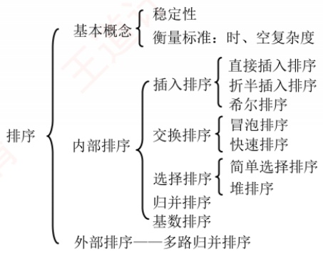

**【复习提示】**

堆排序、快速排序和归并排序是本章的重点与难点。读者应深入掌握各类算法的思想、排序过程（能动手模拟）及其特性，包括初始状态的影响、时空复杂度、稳定性和适用场景等。考试通常以选择题形式考查不同算法的对比。此外，应对常用排序算法的关键代码做到熟练编写，并能根据给定序列的特点，结合算法特性选择最合适的排序方法。

## 8.1 排序的基本概念

### 8.1.1 排序的定义

排序是指将表中的元素重新排列，使其按关键字有序的过程。在许多应用中，为了便于后续查找，通常会将表组织成有序形式。排序的确切定义如下。

输入:n个记录 $R_{1} , R_{2} , \cdots , R_{n} ,$ 对应的关键字为 $k_{1},k_{2},\cdots,k_{n} 。$

输出:输入序列的一个重排 $R_{1}^{\prime},R_{2}^{\prime},\cdots,R_{n}^{\prime}$ ，使得 $k_{1}^{\prime} \leqslant k_{2}^{\prime} \leqslant \cdots \leqslant k_{n}^{\prime}$ (其中 $\text{"} \leqslant  \text{"}$ 可根据需要替换为其他比较关系）。

算法的稳定性。若待排序表中有两个元素 $R_{i}$ 和 $R_{j}$ ，则其关键字相同 $\left( \mathrm{key}_{i} = \mathrm{key}_{j} \right)$ ，且排序前 $R_{i}$ 位于 $R_{j}$ 之前；若使用某一排序算法排序后， $R_{i}$ 仍位于 $R_{j}$ 之前，则称该排序算法是稳定的，否则，称为不稳定的。需要注意的是，稳定性并不能用来衡量算法的优劣，而只是描述其性质之一。当待排序关键字互不重复时，排序结果唯一，此时算法是否稳定就无关紧要了。

注意

对于不稳定的排序算法，只需举出一组关键字的实例，证明它的不稳定性即可。

在排序过程中，根据数据是否全部存放在内存中，可将排序算法分为两类:①内部排序，指排序期间所有元素都存放在内存中；②外部排序，指排序期间元素无法全部装入内存，需要在排序过程中频繁地在内、外存之间交换数据。

般情况下，内部排序算法在执行过程中主要涉及两种基本操作:比较和移动。通过比较关键字的大小来确定元素的相对顺序，并通过移动元素使整个序列达到有序状态。当然，并非所有内部排序都基于比较操作一—例如，基数排序就是一种典型的非比较排序。

各类排序算法各有优缺点，适用于不同场景。通常可将排序算法分为五大类:插入排序、交换排序、选择排序、归并排序和基数排序，后续几节将分别介绍。内部排序算法的性能主要由其时间复杂度和空间复杂度决定，而时间复杂度通常取决于比较和移动操作的次数。

注意

大多数内部排序算法更适用于顺序存储的线性表。

## 8.2 插入排序

插入排序是一种简单直观的排序算法，其基本思想是:每次将一个待排序的记录，按其关键字大小插入到前面已经排好序的子序列中，直到所有记录都插入完毕。基于这一思想，可以引申出三种重要的排序算法:直接插入排序、折半插入排序和希尔排序。

### 8.2.1 直接插入排序

根据上述插入排序的思想，不难得出一种最简单也最直观的直接插入排序算法。假设在排序过程中，待排序表L[1...n]在某一时刻的状态如下:

|  |  | 1 |
| --- | --- | --- |

要将元素L(i)插入到已有序的子序列L[1...i-1]中，需执行以下操作（为避免混淆，下文中用L[]表示一个表，而用L（）表示一个元素）:

1）查找L(i)在L[1...i-1]中的插入位置k。

2）将L[k...i-1]中的所有元素依次后移一个位置。

3）将L(i)放入位置k。

为实现对整个表L[1...n]的排序，可从L(2)开始，依次将L(2)到L(n)插入其前面已排好序的子序列中。初始时，L[1]可视为一个长度为1 的有序子序列。上述过程共执行n-1次，最终得到一个有序表。直接插入排序通常采用原地排序（空间复杂度为O(1)）。在从后往前的比较过程中，需要将已排序的元素逐个后移，为新元素腾出插入位置。

以下是直接插入排序的实现，其中再次使用了前面提到的“哨兵”（作用相同）。

$$
\begin{aligned}& void \ [  Inset \_isset \_[ [[[], ]\_\_\_] \_] \_\\&\quad \{int \_; ; ; \} \\&\quad\quad \{for \ (  i=2;  i<=n; ; ; ++ ) \\&\quad\quad\quad \} \{\&\ \& \& \& \& \& \& \& \& \& \& \& \& \& \& \& \& \& \& \& \& \& \& \& \& \& \& \& \& \& \& \& \& \& \& \& \& \& \& \& \& \& \& \& \& \& \& \& \& \& \& \& \& \& \& \& \& \& \& \& \& \& \& \& \& \& \& \& \& \& \& \& \& \& \& \& \& \& \& \& \& \& \& \& \& \& \& \& \& \& \& \& \& \& \& \& \& \& \& \& \& \& \& \& \& \& \& \& \& \& \& \& \& \& \& \& \& \& \& \& \& \& \& \& \& \& \& \& \& \& \& \& \& \& \& \& \& \& \& \& \& \& \& \& \& \& \& \& \& \& \& \& \& \& \& \& \& \& \& \& \& \& \& \& \& \& \& \& \& \& \& \& \& \& \& \& \& \& \& \& \& \& \& \& \& \& \& \& \& \& \& \& \& \& \& \& \& \& \& \& \& \& \& \& \& \& \& \& \& \& \& \& \& \& \& \& \& \& \& \& \& \& \& \& \& \& \& \& \& \& \& \& \& \& \& \& \& \& \& \& \& \& \& \& \& \& \& \& \& \& \& \& \& \& \& \& \& \& \& \& \& \& \& \& \& \& \& \& \& \& \& \& \& \& \& \& \& \& \& \& \& \& \& \& \& \& \& \& \& \& \& \& \& \& \& \& \& \& \& \& \& \& \& \& \& \& \& \& \& \& \& \& \& \& \& \& \& \& \& \& \& \& \& \& \& \& \& \& \& \& \& \& \& \& \& \& \& \& \& \& \& \& \& \& \& \& \& \& \& \& \& \& \& \& \& \& \& \& \& \& \& \& \& \& \& \& \& \& \& \& \& \& \& \& \& \& \& \& \& \& \& \& \& \& \& \& \& \& \& \& \& \& \& \& \& \& \& \& \& \& \& \& \& \& \& \& \& \& \& \& \& \& \& \& \& \& \& \& \& \& \& \& \& \& \& \& \& \& \& \& \& \& \& \& \& \& \& \& \& \& \& \& \& \& \& \& \& \& \& \& \& \& \& \& \& \& \& \& \& \& \& \& \& \& \& \& \& \& \& \&  \end{aligned}
$$

假定初始序列为49,38,65,97,76,13,27,49，初始时49可视为一个已排好序的子序列。按

> ①在本书中，凡是没有特殊注明的，通常默认排序结果为非递减有序序列。

照上述算法进行直接插入排序的过程如图8.1所示，括号内为当前已排好序的子序列。

| [初始关键字]: |  | (49) V | 38 」 | 65 | 97 | 76 | 13 | 27 | 49 |
| --- | --- | --- | --- | --- | --- | --- | --- | --- | --- |
| i=2: | (38) | (38 | 49) | 65 V | 97 | 76 | 13 | 27 | 49 |
| i=3: | (65) | (38 | 49 | 65) | 97 V | 76 | 13 | 27 | 49 |
| i=4: | (97) | (38 | 49 | 65 | 97) V | 76 | 13 | 27 | 49 |
| i=5: | (76) | (38 | 49 | 65 | 76 | 97) | 13 | 27 | 49 |
| i=6: | (13) | (13 | 38 | 49 | 65 | 76 | 97) | 27 | 49 |
| 育 i=7: | (27) | (13 | 27 | 38 | 49 | 65 | 76 | 97) | 49 |
| i=8: | (49) | (13 | 27 监视哨L.R[0] | 38 | 49 | 49 | 65 | 76 | 97) |

图8.1 直接插入排序示例

直接插入排序的性能分析如下。

空间效率:仅使用常数个辅助单元，空间复杂度为O(1)。

时间效率:整个排序过程共进行n-1趟插入操作，每趟包括关键字比较和元素移动，具体次数取决于初始序列的状态。最好情况下，表中元素已有序。每插入一个元素只需一次比较，无须移动，时间复杂度为 $O ( n )$ 。最坏情况下，表中元素完全逆序。此时每趟插入需比较i-1次并移动i-1个元素，总时间复杂度为 $O ( n^{2} )$ 。平均情况下，假设元素随机排列，平均比较次数和移动次数均约为 $n^{2} / 4$ ，故时间复杂度仍为 $O ( n^{2} )$ 。因此直接插入排序算法的时间复杂度为 $O ( n^{2} )$

稳定性:由于插入时总是从后往前比较，并在找到插入位置后才移动元素，因此相同关键字的元素相对顺序不会改变。直接插入排序是稳定的排序算法。

适用性:该算法适用于顺序存储和链式存储的线性表，采用链式存储时无须移动元素。

### 8.2.2 折半插入排序

从直接插入排序算法可以看出，每趟插入过程包含两项操作:①在前面的有序子表中查找待插入元素的正确位置；②为该位置腾出空间，并将待插入元素放入其中。在直接插入排序中，总是边比较边移动元素。而折半插入排序则将二者分离:先通过折半查找确定插入位置，再统一移动元素。当排序表采用顺序存储时，可以在查找有序子表时使用折半查找来提高效率。一旦确定了插入位置，便可将该位置及其后的所有元素统一后移一位，从而空出插入位置。

折半插入排序的排序过程示例见本书配套视频，其代码实现如下:

```txt
void BInsertSort(ElemType A[],int n){
int i,j,low,high,mid;
for(i=2;i<=n;i++) { //依次将A[2]～A[n]插入前面的已排序序列
A[0]=A[i]; //将A[i]暂存到A[O]
low=1;high=i-1; //设置折半查找的范围
while(low<=high) { //折半查找(默认递增有序)
mid=(low+high) /2; //取中间点
if(A[mid]>A[0]) high=mid-1； //查找左半子表
else low=mid+1; //查找右半子表
一
for(j=i-1;j>=high+1;--j)
A[j+1]=A[j]; //统一后移元素，空出插入位置
A[high+1]=A[0]; //插入操作
道
```

考点追踪直接插入排序和折半插入排序的比較（2012）

空间效率:与直接插入排序相同，仅使用常数个辅助单元，空间复杂度为 $O ( 1 )$ o

时间效率:折半插入排序的主要改进在于减少了关键字的比较次数。由于采用折半查找，比较次数约为O(nlog2n)，仅取决于元素个数n。然而，元素的移动次数并未减少，仍然依赖于初始序列的有序程度。因此，折半插入排序的时间复杂度仍为 $O ( n^{2} )$ 8

稳定性:在插入过程中保持了相同关键字元素的相对顺序，因此是稳定的排序算法。

适用性:该算法仅适用于顺序存储的线性表。

### 8.2.3 希尔排序

由前文分析可知，直接插入排序的时间复杂度为 $O ( n^{2} )$ ，但在待排序列接近正序时，其时间效率可提升至 $O ( n )$ 。因此，该算法更适用于基本有序或数据量较小的排序场景。希尔排序正是基于这一特性对直接插入排序进行改进，也称为缩小增量排序。

考点追踪希尔排序的特性与分析（2014、2015、2018、2025）

希尔排序的基本思想是:通过逐步缩小增量的方式，对表中相隔一定距离的元素构成的子序列进行多次直接插入排序，使整个表逐渐趋于基本有序，最终通过一趟完整的直接插入排序完成全局排序。具体而言，算法首先选取一个小于n的初始增量 $d_{1}$ ，将待排序表划分为 $d_{1}$ 个子序列（每个子序列包含下标间隔为 $d_{1}$ 的记录），并对各子序列分别进行直接插入排序；随后依次取更小的增量 $d_{2} , d_{3} , \cdots$ (满足 $d_{1} > d_{2} > \cdots > d_{t} = 1$ ，重复分组与排序操作。当增量减至1时，所有记录属于同一子序列，且序列已高度有序，此时执行最后一趟直接插入排序，即可快速获得最终结果。

注意，目前尚未找到理论上最优的增量序列。仍以8.2.1节的关键字为例，假定第一趟取 $d_{1}   =   5$形成5个子序列（对应图中第2至第6行），排序后结果如第7行所示；第二趟取 $d_{2}   =   3$ ，对3个子序列排序，结果见第11行；最后对整个序列进行一趟排序，完整过程如图8.2所示。

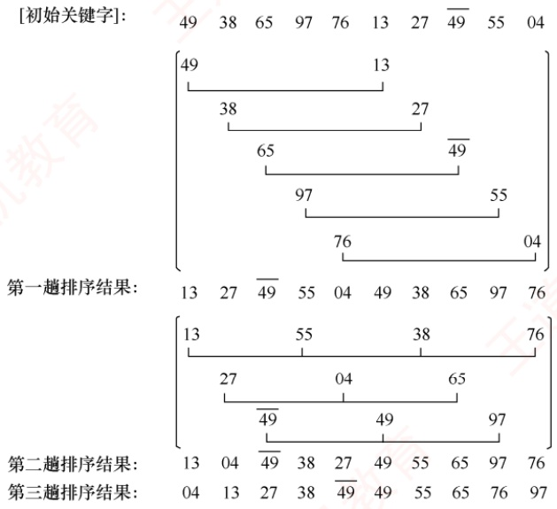

图8.2 希尔排序示例

希尔排序的算法实现如下:

void ShellSort(ElemType A[],int n){//A[0]只是暂存单元，不是哨兵，当 $j < = 0$ 时，插入位置已到int dk,i,j;

$$

\begin{aligned}& for   (\text{dk=n/2;dk>=1;dk=dk/2}) \quad // 增量变化  ( 无统一规定 ) \\& \quad  for   (\text{dk=dk+j;i<=n;+i}) \\& \quad \text {i f} (\text{h[ i <=0;i<=k;)}) \quad // 需将  h[ i ] 插入有序增量子表 \\& \quad \text {h[ 0]=h[ i ] ;} \quad // 借存在  \text{h[ 0]} \\& \quad  for   (j=i-dk;j>0;6 线 [ 0]<h[ j ; j==dk ) \\& \quad \text {h[ j+dk]=h[ j ] ;} \quad // 汇录后移 ,  查找插入的位置  \\& \quad \text {h[ j+dk]=h[ 0] ;} \quad // 插入  \\& \quad ) \end{aligned}
$$

希尔排序算法的性能分析如下:

空间效率:仅使用常数个辅助单元，空间复杂度为O(1)。

时间效率:时间复杂度依赖于所选增量序列，而最优增量序列仍是数学上的未解难题，因此精确分析较为困难。当n在常见范围内时，时间复杂度约为 $O ( n^{1 . 3} )$ ；最坏情况下退化为 $O ( n^{2} )$

稳定性:当相同关键字的记录被划分到不同子表时，可能会改变它们的相对次序，因此希尔排序是不稳定的排序算法。例如，图8.2中49与49在排序过程中相对顺序发生了变化。

适用性:希尔排序仅适用于顺序存储的线性表。

## 8.3 交换排序

所谓交换，是指根据序列中两个元素关键字的比较结果，互换它们在序列中的位置。基于交换思想的排序算法有很多，本书主要介绍冒泡排序与快速排序。其中，冒泡排序实现简单，一般较少直接考查；而快速排序则因效率高、应用广，通常是考查的重点。

### 8.3.1 冒泡排序

冒泡排序的基本思想是:从后往前（或从前往后）依次比较相邻元素的关键字，若为逆序（A[i-1]>A[i]），则交换它们的位置。每一趟排序都会将当前未排序部分中的最小（或最大）元素放到其最终位置一一最小元素如气泡上浮至水面（或最大元素如石头下沉至水底）。具体而言，第一趟冒泡将最小元素移至序列首部（或最大元素移至尾部）；第二趟对剩余子序列重复此过程，已确定位置的元素不再参与比较。如此最多进行n-1趟冒泡，即可完成整个排序。

图8.3所示为冒泡排序的过程，第一趟冒泡时:27<49，不交换；13<27，不交换；76>13，交换；97>13，交换；65>13，交换；38>13，交换；49>13，交换。通过第一趟冒泡后，元素13被移至第一个位置，及其最终位置；第二趟对后续子序列采用同样方法进行排序，如此重复，到第五趟结束后，未发生任何交换，说明序列已有序，算法提前终止。

冒泡排序算法的代码如下:

```txt
void BubbleSort(ElemType A[],int n){
道 for(int i=0;i<n-1;i++){
bool flag=false; //表示本趟冒泡是否发生交换的标志
for(int j=n-1;j>i;j--) //一趟冒泡过程
if(A[j-1]>A[j]){ //若为逆序
swap(A[j-1],A[j]); //使用封装的 swap 函数①交换
flag=true;
1 育
if(flag==false)
return; //本趟遍历后没有发生交换，说明表已经有序
算机
```

> ① 本章有多处要两两交换元素，为使代码更简洁，使用函数 swap(int &a，int &b)，其定义如下:int temp=a; a=b; b=temp;

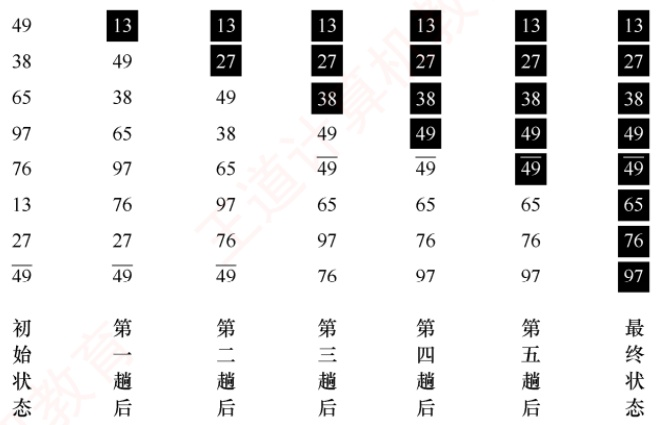

图 8.3 冒泡排序示例

冒泡排序的性能分析如下。

空间效率:仅使用常数个辅助单元，空间复杂度为O(1)。

时间效率:最好情况下（初始序列有序），仅需第一趟冒泡，共n-1次比较，0次移动，时间复杂度为 O(n)；最坏情况下（序列初始逆序），需n−1趟排序，第i趟进行n−i 次比较，且每次比较后都需3次移动来完成交换元素位置。这种情况下，

总比较次数 $\sum_{i = 1}^{n - 1}(n - i) = \frac{n(n - 1)}{2}$ ，移动次数 $\sum_{i = 1}^{n - 1}3(n - i) = \frac{3n(n - 1)}{2}$

因此，最坏情况下的时间复杂度为 $O ( n^{2} )$ 。平均时间复杂度也为 $O ( n^{2} )$

稳定性:比较相邻元素时，相等元素不会被交换，因此冒泡排序是稳定的排序算法。

适用性:冒泡排序适用于顺序存储和链式存储的线性表。

注意

冒泡排序每趟产生的有序子序列具有全局有序性一一已排序部分的所有元素均小于（或大于）未排序部分的所有元素。与直接插入排序的局部有序不同，冒泡排序每趟能将一个元素精确放置到其最终位置。

### 8.3.2 快速排序

**考点追踪快速排序的思想（2024）**

快速排序的基本思想是:在待排序表L[1...n]中任取一个元素作为枢轴（pivot，也称基准，通常取首元素），通过一趟排序将原表划分为两个独立的子表L[1...k-1]和L[k+1...n]，使得左子表中所有元素的关键字均小于枢轴，右子表中所有元素的关键字均大于或等于枢轴。此时，枢轴元素被放在了其最终位置工（k）上，这个过程称为一次划分。随后，分别对两个子表递归地执行相同的划分操作，直至每个子表仅包含一个元素或为空，此时整个序列已完全有序。

一趟快速排序的划分过程本质上是一个双向交替扫描与元素移动的过程，下面通过实例来介绍，附设两个指针i和j，初值分别为low和 high，取第一个元素49为枢轴pivot。

j从右向左扫描，找到第一个小于枢轴的元素27，将其复制到i所指位置。

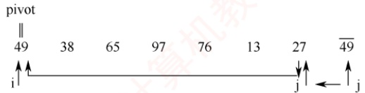

i 从左向右扫描，找到第一个大于枢轴的元素65，将其复制到j所指位置。

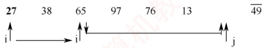

j继续向左扫描，找到小于枢轴的元素13，将其复制到i所指位置。

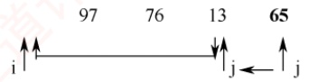

i 继续向右扫描，找到大于枢轴的元素97，将其复制到j所指位置。

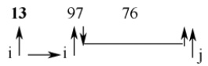

如此交替进行，直到i与j相遇（i==j）。

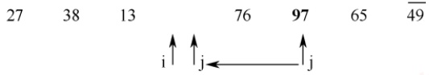

考点追踪快速排序的中间过程的分析（2014、2019、2023）

此时，i左侧的所有元素均小于49，右侧的所有元素均大于或等于49。将枢轴49放入i所指位置，即完成第一趟划分。原序列被分割为两个子序列，分别位于枢轴的左右两侧。

第一趟后: {27 38 13} 49 {76 97 65 49}

接下来，对这两个子序列分别递归地应用同样的快速排序过程。若某子序列仅包含一个元素，则该子序列自然有序，无须进一步处理。

第二趟后: {13} 27 {38} 49 {49 65} 76 {97}

第三趟后: 13 2738 49 49 {65} 76 97

第四趟后: 13 27 38 49 49 65 76 97

整个递归调用的层次结构可以用一棵二叉树来表示，如图8.4所示。

第一层快排处理后:

第二层快排要处理的部分:

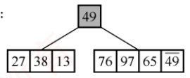

273813

第一层快排处理后:

第二层快排处理后:

第三层快排要处理的部分:

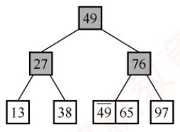

(a)第一层快排处理后

(b)第二层快排处理后

第一层快排处理后:

第一层快排处理后:

第二层快排处理后:

第二层快排处理后:

第四层快排要处理的部分:

第四层快排处理后:

(c)第三层快排处理后

(d)第四层快排处理后:最终结果

图8.4 快速排序的递归执行过程

假设划分操作已封装为函数Partition()，其功能是对子表A[low...high]进行一趟划分，并返回枢轴元素的最终位置k。在此基础上，快速排序的递归实现如下:

```javascript
void QuickSort(ElemType A[],int low,int high){
if(low<high) { //递归跳出的条件
//Partition()就是划分操作，将表A[low…high]划分为满足上述条件的两个子表
int pivotpos=Partition(A,low,high); //划分
QuickSort(A,low,pivotpos-1)；//依次对两个子表进行递归排序
QuickSort (A,pivotpos+1,high) ;
```

**考点追踪（算法题）快速排序中划分操作的应用（2016）**

考研所考查的划分操作，通常以子表的第一个元素作为枢轴来对表进行划分，将比枢轴小的元素逐步移至左侧，比枢轴大的元素移至右侧，最终使枢轴归位。典型实现如下:

```txt
int Partition(ElemType A[],int low,int high){ ∥—趟划分
ElemType pivot=A[low]； //将当前表中第一个元素设为枢轴，对表进行划分
while(low<high) { //循环跳出条件
while(low<high&&A[high]>=pivot) --high;
A[low]=A[high]； //将比枢轴小的元素移动到左端
while(low<high&&A[low]<=pivot) ++low;
A[high]=A[low]； //将比枢轴大的元素移动到右端
1
A[low]=pivot; //枢轴元素存放到最终位置
return low; //返回存放枢轴的最终位置
```

快速排序的性能高度依赖于划分的平衡性，其性能分析如下。

**考点追踪快速排序中递归次数的影响因素分析（2010）**

空间效率:由于采用递归实现，算法需借助系统栈保存每层递归的上下文信息，栈的容量等于递归调用的最大层数。最好情况下（每次划分均分）为O(log2n)；最坏情况下（划分极不平衡），需进行 n−1 次递归调用，栈的容量为 O(n)；平均情况下为 O(log2n)

时间效率:最坏情况发生在初始序列基本有序或基本逆序时，每趟划分仅减少一个元素，总比较次数约为 n(n-1)/2，时间复杂度为 $O ( n^{2} )$ 。最好情况是每次划分都将序列等分为两部分，此时时间复杂度为O(nlog2n)。值得注意的是，快速排序的平均运行时间非常接近其最优情况，远优于最坏情况，因此它是所有内部排序算法中平均性能最优的排序方法。

有很多方法可以提高划分的平衡性:一种是三数取中法，从子序列的首、尾及中间三个位置各取一个元素，以其中位数作为枢轴；或者随机选取子序列中的某个元素作为枢轴。

稳定性:在划分过程中，若右侧区域有两个关键字相等，且均小于枢轴，则交换到左侧区域后，它们的相对位置会发生改变，因此快速排序是不稳定的排序算法。例如，表L={3,2,2}，经过一趟排序后L={2,2,3}，也是最终排序结果，显然，2与2的相对次序已发生了变化。

**考点追踪快速排序适合采用的存储方式（2011）**

适用性:快速排序要求能够随机访问元素，因此仅适用于顺序存储的线性表。

**注意**

快速排序在每趟划分后并不产生全局有序的子序列。然而，每趟划分都能确保当前所选的枢轴元素被精确放置到其在整个序列中的最终位置上。这一特性是快速排序高效性的关键所在。

## 8.4 选择排序

选择排序的基本思想是:每一趟（如第i趟）在后面 $n - i + 1 \quad (i = 1, 2, \cdots, n - 1)$ 个待排序元素中选取关键字最小的元素，作为有序子序列的第i个元素。直到第n-1趟排序完成，待排序元素只剩下1个，无须再选。选择排序中的堆排序是历年统考考查的重点。

### 8.4.1 简单选择排序

根据上述选择排序的思想，可直观得出简单选择排序的算法思想:假设排序表为L[1...n]，第i趟排序从L[i...n]中选出关键字最小的元素，并将其与L(i)交换。每一趟排序均可确定一个元素的最终位置，经过n-1趟排序后，整个表即有序。

简单选择排序的过程较为直观，具体示例可参考配套视频。其代码实现如下:

```javascript
void SelectSort(ElemType A[],int n) {
for(int i=0;i<n-1;i++){ //共进行 n-1 趟
int min=i; //记录最小元素位置
for(int j=i+1;j<n;j++) //在 A[i...n-1]中选择最小元素
if(A[j]<A[min]) min=j; //更新最小元素位置
if(min!=i) swap(A[i],A[min]); //swap()函数共移动元素3次
```

简单选择排序算法的性能分析如下。

空间效率:仅使用常数个辅助单元，空间复杂度为O(1)。

考点追踪简单选择排序的性能分析（2025）

时间效率:排序过程中，总移动次数很少，最多不超过3(n-1)次，最好情况下为0次，即序列初始有序；但总比较次数与序列初态无关，始终为 $n ( n   -   1 ) / 2$ 次，因此时间复杂度恒为 $\mathcal {O} ( n^{2} )$

稳定性:在交换过程中，若被选中的最小元素与当前位置元素之间存在相同关键字的记录，则会改变其相对顺序。例如，表L={2,2,1}，经过一趟排序后 $L = \{1 , 2 , 2 \}$ ，也是最终排序结果，显然，2与2的相对次序已发生改变。因此，简单选择排序是不稳定的排序算法。

适用性:简单选择排序适用于顺序存储和链式存储的线性表，尤其适合关键字较少的情况。

### 8.4.2 堆排序

堆的定义如下，n个关键字序列L[1...n]称为堆，当且仅当该序列满足以下条件之一:

① L (i) ≥L (2i) 且 $\mathrm{L}(\mathrm{i}) \geqslant \mathrm{L}(2 \mathrm{i}+1)$ 或

② L (i) ≤L(2i) 且 $\mathrm{L}\left(\mathrm{i}\right) \leqslant \mathrm{L}\left(2 \mathrm{i}+1\right) \quad(1 \leqslant i \leqslant\left\lfloor n / 2\right\rfloor)$

考点追踪堆的性质与特点（2020）

可将堆视为一棵完全二叉树。满足条件①的堆称为大根堆（大顶堆），其最大元素位于根结点，且任意非根结点的值均不大于其双亲结点。满足条件②的堆称为小根堆（小顶堆），其最小元素位于根结点，性质与大根堆恰好相反。图8.5所示为一个大根堆。

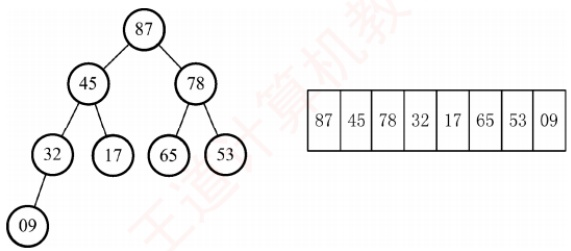

图 8.5 一个大根堆示意图

最新统考大纲新增了“堆的应用”考点，堆的主要应用包括堆排序、Top-K问题和优先队列（见本节综合题7），Top-K问题和优先队列均利用了堆的结构特性，本节主要介绍堆排序。

堆排序的基本思路是:首先将待排序序列L[1...n]构建成初始堆（以大顶堆为例），此时堆顶即为最大值。随后，交换堆顶元素与堆底元素，使最大值归位；接着将剩余n-1个元素重新调整为堆，再取出新的堆顶。重复此过程，直至堆中仅剩一个元素。因此，堆排序需解决两个问题:①如何将无序序列构造成初始堆？② 输出堆顶后，如何高效调整剩余元素为新堆?

考点追踪初始建堆的操作（2018、2021）

堆排序的关键在于初始堆的构建。建堆的基本策略是:按自底向上的顺序（从最后一个分支结点到根结点），依次对每个分支结点执行自上而下的筛选操作:若其不满足堆的性质，则调整其对应的子树。对于含n个结点的完全二叉树，最后一个分支结点的编号为n/2」。因此，建堆过程从 $i   =   \lfloor n / 2 \rfloor$ 开始，依次向前处理至i=1。具体而言:对每个结点i，若其关键字小于左右子结点中的较大者（大根堆情形），则将其与该较大的子结点交换；交换后可能破坏下层子树的堆性质，因此需要继续沿该路径向下调整，直至当前子树重新满足堆的定义。通过依次对各分支结点执行上述的向下调整操作，最终可将整个无序序列构建成一个完整的堆。

如图8.6所示，初始时调整L(4)子树，09<32，交换后满足堆定义；接着调整L(3)子树，78<左右孩子中的较大者87，交换后满足堆定义；再调整L(2)子树，17 <左右孩子中的较大者45，交换后满足堆定义；继续调整根结点L(1)，53 <左右孩子中的较大者87，交换后破坏了L(3)子树的堆，于是对L(3)重新调整，53<左右孩子中的较大者78，交换后，该完全二叉树满足堆定义。

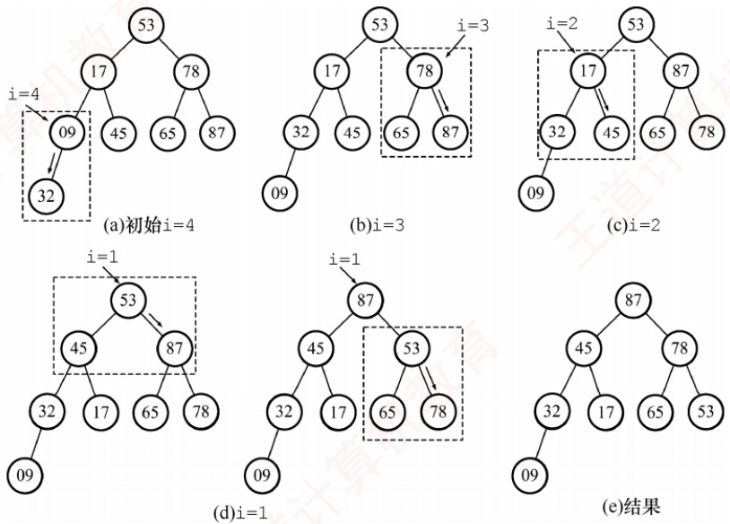

图8.6 自下往上逐步调整为大根堆

**考点追踪堆的删除操作及调整分析（2015、2024）**

每次输出堆顶后，将堆底元素移至堆顶，此时堆的性质可能被破坏，需要自上而下地进行筛选:将新堆顶与其左右孩子中的较大者比较，若小于该子结点，则交换；重复此过程，直至恢复堆性质。例如，当09移至堆顶后，先与左右孩子中的较大者78交换，交换后破坏了L(3)子树的堆；继续对L(3)子树向下筛选，将09与65交换，最终得到新堆，调整过程如图8.7所示。

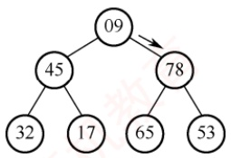

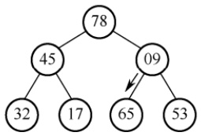

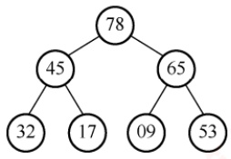

图8.7 输出堆顶后再将剩余元素调整成新堆

建立大根堆的算法如下:

```javascript
void BuildMaxHeap(ElemType A[],int len){
for(int i=len/2;i>0;i--) //从最后一个分支结点到根结点
HeapAdjust(A,i,len); //反复调整子树
1
void HeapAdjust(ElemType A[],int k,int len) {
//对以k为根的子树进行调整
A[0]=A[k]; //A[0]暂存子树的根结点
for(int i=2*k;i<=len;i*=2){ //沿关键字较大的子结点向下筛选
if(i<len&&A[i]<A[i+1])
i++; //取关键字较大的子结点的下标
if(A[0]>=A[i]) break; //筛选结束
else {
A[k]=A[i]; //将较大结点上移
k=i; //修改k值，以便继续向下筛选
1
育
A[k]=A[0]; //被筛选结点的值放入最终位置
```

堆调整的时间复杂度与树高成正比，为O(h)。构建含n个元素的堆时，关键字的总比较次数不超过4n，故建堆时间复杂度为O(n)，即可以在线性时间内将无序数组建成堆。

堆排序的完整算法如下:

```javascript
void HeapSort(ElemType A[],int len){
BuildMaxHeap(A,len); //初始建堆
for(int i=len;i>1;i--){ //执行 n-1 趟排序
Swap(A[i],A[1]); //输出堆顶元素（与堆底元素交换）
HeapAdjust(A,1,i-1); //把剩余i-1个元素重新整理为堆
```

**考点追踪堆的插入操作及调整操作分析（2009、2011）**

同时，堆也支持插入操作。插入时，先将新元素置于堆末端，然后自下而上地与其父结点比较:若违反堆性质，则交换，直至满足堆定义。图8.8展示了大根堆的插入操作示例。

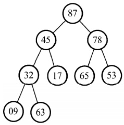

(a)初始，尾部插入63

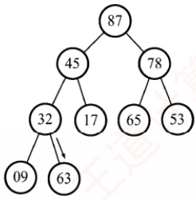

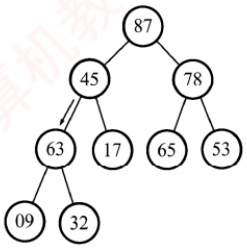

图8.8 大根堆的插入操作示例

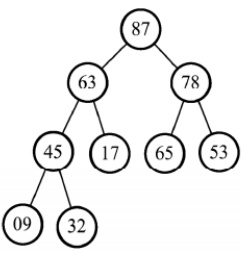

**考点追踪堆在海量数据中选出最小k个数的应用及效率分析（2022）**

堆排序适用于大规模数据的排序场景，还常用于解决Top-K问题。例如，在1亿个数中选出最大的100个数。首先使用一个大小为100的数组，读入前100个数，构建小顶堆，而后依次读入后续数字，若小于堆顶则舍弃，否则用该数替换堆顶并向下调整，待数据读取完毕，堆中100个数为所求。此方法的时间复杂度为O(nlog2k)，空间复杂度为O(k)，效率远高于全排序。

堆排序算法的性能分析如下。

空间效率:仅使用了常数个辅助单元，空间复杂度为O(1)。

时间效率:建堆的时间复杂度为O(n)，随后需进行n-1次堆顶输出与调整操作，每次调整的时间复杂度为O(log2n)。因此，堆排序在最好、最坏和平均情况下的时间复杂度均为O(nlog2n)。

稳定性:在堆调整过程中，相等关键字的元素可能因交换而改变其原始相对位置，因此堆排序是不稳定的排序算法。例如，表 L = {1,2,2}，建堆时可能将2 交换到堆顶，此时L = {2, 1,2}，最终排序序列为L= {1,2,2}，显然，2与2的相对次序已发生变化。

适用性:堆排序依赖完全二叉树的随机访问特性，因此仅适用于顺序存储的线性表。

## 8.5 归并排序、基数排序和计数排序

### 8.5.1 归并排序

**考点追踪2路归并操作的功能（2022）**

归并排序不同于基于交换或选择的排序方法，其核心思想是“归并”——即将两个或多个有序序列合并为一个更长的有序序列。具体地，对于含有n个记录的待排序表，可将其视为n个长度为1的有序子表；然后两两归并，得到「n/2个长度为2（或1）的有序子表；继续两两归并……如此重复，直至合并成一个长度为n的有序表为止，这种排序算法称为2路归并排序。

图8.9展示了一个2路归并排序的示例，经过三趟归并后合并为一个完整的有序序列。

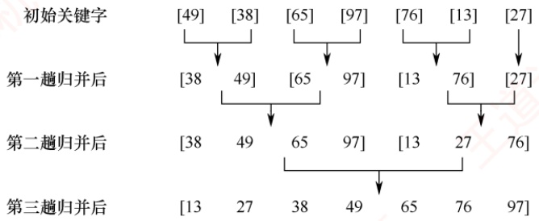

图 8.9 2路归并排序示例

**考点追踪（算法题）归并排序思想的应用（2011）**

归并操作由函数Merge()实现，其功能是将同一顺序表中前后相邻的两个有序子表合并为一个有序表。首先将这两个子表的所有元素复制到辅助数组B中。随后，设置两个指针分别指向B中两段的起始位置，依次比较当前元素的关键字，将较小者放入原数组A的对应位置。其中一段的所有元素均已复制完毕后，将另一段的剩余部分直接复制到A中。具体实现如下:

```javascript
ElemType *B=(ElemType *)malloc((n+1)*sizeof(ElemType)); ∥辅助数组B
void Merge(ElemType A[],int low,int mid,int high) {
//表A 的两段A[low...mid]和A[mid+1...high]各自有序，将它们合并成一个有序表
int i,j,k;
for(k=low;k<=high;k++)
B[k]=A[k]; //将 A 中所有元素复制到B 中
for(i=low,j=mid+1,k=i;i<=mid&&j<=high;k++) {
if (B[i]<=B[j]) //比较B 的两个段中的元素
A[k]=B[i++]; //将较小值复制到A中
else
A[k]=B[j++];
while(i<=mid) A[k++]=B[i++]；//若第一个表未检测完，复制 教
while(j<=high) A[k++]=B[j++]；//若第二个表未检测完，复制
```

**注意**

在上述代码中，最后两个while循环仅有一个会执行。

在非递归的归并排序中，一趟归并操作是指:将当前序列划分为若干长度为h的有序段，然后两两归并，形成长度为2h的有序段。若序列总长度为n，则每趟需调用n/(2h)]次Merge()函数。整个排序过程共需进行[1og2n]趟归并。

递归形式的2路归并排序基于分治策略，其过程如下。

分解:将含n个元素的待排序表从中间分为两个子表，每个子表含约n/2个元素。

递归求解:对两个子表分别递归地进行归并排序。

合并:合并两个已排序的子表得到排序结果。

2路归并排序的递归实现如下:

```txt
void MergeSort(ElemType A[],int low,int high) {
if(low<high) {
int mid=(low+high)/2; //从中间划分两个子序列
MergeSort(A,low,mid); //对左侧子序列进行递归排序
MergeSort(A,mid+1,high); //对右侧子序列进行递归排序
Merge(A,low,mid,high); //归并
```

**考点追踪2路归并比较次数的分析（2024）**

2路归并排序算法的性能分析如下:

空间效率:归并操作需要一个与待排序表等长的辅助数组，因此空间复杂度为O(n)。

时间效率:每趟归并需要遍历所有n个元素，时间复杂度为 O(n)；共需进行「1og2n趟，总时间复杂度为 O(nlog2n)。

稳定性:在归并过程中，当两个元素关键字相等时，优先取自前一段，从而保持了相同关键字元素的相对次序。因此2路归并排序是稳定的排序算法。

适用性:归并排序仅需顺序访问元素，因此适用于顺序存储和链式存储的线性表。

**注意**

一般而言，对N个元素进行k路归并排序时，排序的趟数m满足kⁿ=N，从而m=logkN，又考虑到m为整数，因此 $m = \lceil \log_{k} N \rceil .$ ，这与前述的2路归并排序算法是一致的。

### 8.5.2 基数排序

基数排序是一种很特别的排序算法，它不依赖于元素间的比较，而基于关键字各位的大小进行排序。基数排序是一种借助多关键字排序的思想对单逻辑关键字进行排序的方法。

假设长度为n的线性表中，每个结点 $a_{j}$ 的关键字由 $d$ 个分量 $(k_{j}^{d - 1},k_{j}^{d - 2},\cdots,k_{j}^{1},k_{j}^{0})$ 组成，满足 $0 \leqslant k_{j}^{i} \leqslant r - 1 \quad (0 \leqslant j < n, 0 \leqslant i \leqslant d - 1)$ 。其中 $k_{j}^{d - 1}$ 为最高位关键字， $k_{j}^{0}$ 为最低位关键字。

为实现多关键字排序，通常有两种方法:第一种是最高位优先（MSD）法，按关键字位权重递减依次逐层划分成若干更小的子序列，最后将所有子序列依次连接成一个有序序列；第二种是最低位优先（LSD）法，按关键字位权重递增依次进行排序，最后形成一个有序序列。

以下描述以基数r进行的最低位优先基数排序过程。算法使用r个队列 $Q_{0},Q_{1},\cdots,Q_{r-1}$ 对每一位 $i = 0 , 1 , \cdots , d - 1$ ，依次执行一次分配和收集操作（每轮本质上是一次稳定的排序）:

①分配:初始化所有队列为空，然后依次扫描线性表中的每个结点 $a_{j} (j = 0, 1, \cdots, n-1)$若 $a_{j}$ 在当前位上的关键字值为 $k ,$ 则将其加入队列 $Q_{k}$

②收集:按 $Q_{0} ,$ 到 $\mathcal {Q}_{r - 1}$ 的顺序，依次将各队列中的结点连接起来，形成新的线性表。

**考点追踪基数排序的中间过程的分析（2013、2021）**

通常采用链式基数排序。例如，对以下10个记录进行排序:

$$
\begin{array}{l}一 一 \boxed{278} 一 一 \boxed{109} 一 一 \boxed{063} 一 一 \boxed{930} 一 一 \boxed{589} 一 一 \boxed{184} 一 一 \boxed{505} 一 \boxed{269} 一 \boxed{008} 一 \boxed{083}\end{array}
$$

假设所有关键字均为小于1000的正整数，基数 $r = 10$ ，在排序过程中需借助10个链队列，关键字由3位子关键字构成: $\mathrm {K}^{1} \mathrm {K}^{2} \mathrm {K}^{3}$ ，分别代表百位、十位和个位，共需进行三趟分配与收集操作。第一趟分配用最低位子关键字 $\mathrm {K}^{3}$ （个位）进行，将所有记录按个位数字分配到 $Q_{0}$ 到 $Q_{9}$ 中，如图8.10(a)所示，随后按队列顺序收集，结果如图8.10(b)所示。

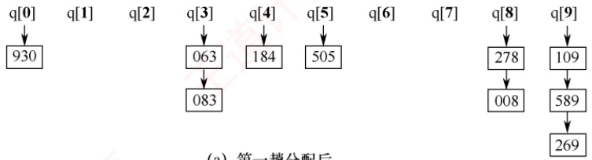

(a) 第一趟分配后

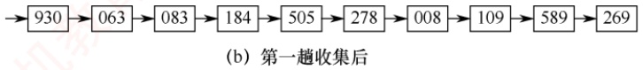

图 8.10 第一趟链式基数排序操作

第二趟分配用次低位子关键字 $\mathrm {K}^{2}$ （十位）进行，将所有十位相等的记录分配到同一个队列，如图8.11(a)所示。第二趟收集后的结果如图8.11(b)所示。

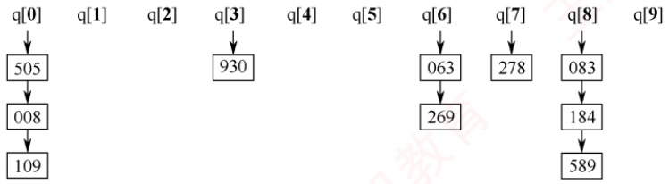

(a) 第二趟分配后

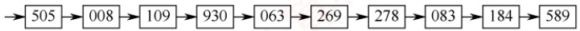

(b) 第二趟收集后

图8.11 第二趟链式基数排序操作

第三趟分配用最高位子关键字 $\mathrm {K}^{1}$ （百位）进行，将所有百位相等的记录分配到同一个队列，如图8.12(a)所示，第三趟收集后的结果如图8.12(b)所示，至此整个排序结束。

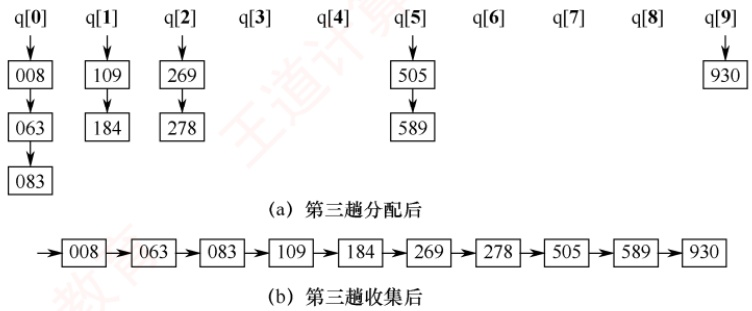

图8.12 第三趟链式基数排序操作

基数排序算法的性能分析如下。

空间效率:一趟排序需要的辅助空间为r（r个队列:r个队头指针和r个队尾指针），但这些结构在后续各趟排序中可重复使用，因此空间复杂度为O(r)。

**考点追踪元素的移动次数与序列初态无关的排序算法（2015）**

时间效率:共需进行d趟分配与收集。每趟分配需遍历n个元素，所需时间为O(n)；每趟收集需处理r个队列，所需时间为 $O ( r )$ 。总时间复杂度为O(d(n+ r))，它与序列的初始状态无关。

稳定性:由于每趟分配按原序列顺序入队，收集按队列编号顺序出队，相同关键字的元素相对次序不会改变，因此基数排序是稳定的排序算法。

适用性:基数排序适用于顺序存储和链式存储的线性表，链式结构尤其适合。

### *8.5.3 计数排序

考点追踪（算法题）计数排序思想的应用（2013、2015、2018）

计数排序也是一种不依赖于比较的排序算法。其核心思想是:对每个待排序元素x，统计小于x的元素个数，从而确定x在有序序列中的位置。例如，若有8个元素小于x，则x应排在第9位。当存在重复元素时，需对算法稍做调整，以保证排序的稳定性。 V0

**注意**

计数排序并不在统考大纲的范围内，但其排序思想在历年真题中多次涉及。

在计数排序的实现中，假设输入是一个数组A[n]，序列长度为n。算法还需两个辅助数组:B[n]用于存放排序结果，C[k]用于存储计数值。具体做法是:以A中的元素值作为C的下标（索引），而C[×]保存的是值为×的元素出现的次数。算法实现如下:

**考点追踪计数排序相关的思想和代码的分析（2021）**

```c
void CountSort(ElemType A[],ElemType B[],int n,int k){
int i,C[k];
for(i=0;i<k;i++)
C[i]=0; //初始化计数数组
for(i=0;i<n;i++) //遍历输入数组，统计每个元素出现的次数
C[A[i]]=C[A[i]]+1; //C[A[i]]保存的是等于 A[i]的元素个数
for(i=1;i<k;i++)
C[i]=C[i]+C[i-1]; //C [×]保存的是小于或等于x的元素总数
for(i=n-1;i>=0;i--){ //从后往前遍历输入数组
B[C[A[i]]-1]=A[i]; //将元素A[i]放置到输出数组B[]的正确位置
```


第一个for循环将计数数组c初始化为0。第二个for循环遍历输入数组A，对每个元素$\mathbf {x} \mathbf {=} \mathbb {A} \left[ \mathbf {\dot {\bot}} \right]$ ，将C[x]加1；循环结束后，C[x]保存的是值等于x的元素个数。第三个for循环通过累加计算后，使C[×]变为小于或等于x的元素总数，即×在最终有序序列中的最后可能出现的位置（从1开始计数）。第四个for循环从后往前遍历A:对于每个A[i]，将其放入输出数组B的 $\mathbb {C} \left[ \mathbb {A} \left[ \mathbb {\partial} \mathbb {\partial} \mathbb {\partial} \right] \right] - \mathbb {1}$ 位置（下标从0开始），然后将C[A[i]]减1。若A中无重复元素，则C[A[i]]-1即为A[i]在B中的唯一正确位置；若存在重复元素，“从后往前遍历+计数递减”的策略确保在A中先出现的相同元素，在B中仍排在前面，从而保证排序的稳定性。

假设输入数组A[]={2,4,3,0,2,3}，第二个for循环结束后，辅助数组c的状态如图8.13(a)所示；第三个for循环结束后，C的状态如图8.13(b)所示。图8.13(c)至图8.13(h)分别展示了第四个for循环每次迭代后，输出数组B和辅助数组C的变化情况。

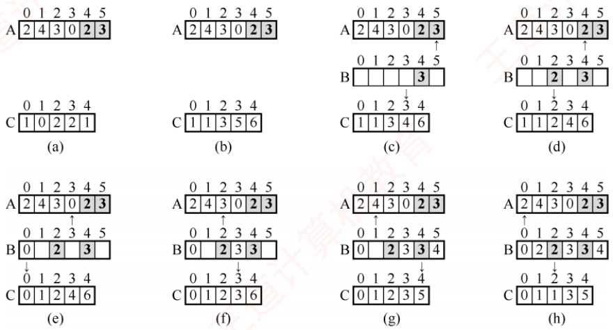

图 8.13 计数排序的过程

由上述过程可知，计数排序利用了数组下标天然有序的特性:将元素值映射为辅助数组的下标，通过统计频次并累加，再反向填充输出数组，从而完成排序。

计数排序算法的性能分析如下。

空间效率:计数排序是一种以空间换时间的算法。输出数组B的长度为n；计数数组C的长度为k，空间复杂度为 $O ( n + k )$ 。若不将输出数组视为辅助空间，则空间复杂度为O(k)。算法要求待排序元素为非负整数，取值范围（如0\~k-1）不宜过大，否则会导致辅助空间浪费。

时间效率:上述代码的第1和第3个for循环耗时O(k)，第2和第4个 $\mathbb {EOr}$ 循环耗时 O(n),总时间复杂度为 $O ( n + k )$ 。因此，当 $k   =   O ( n )$ 时，计数排序可达线性时间 $\mathcal {O} ( n )$ ；但当 $k \gg O(n \log_2 n)$时，其效率反而不如基于比较的排序算法（如快速排序、堆排序等）。

稳定性:上述代码的第4个for循环从后往前遍历输入数组，相同元素在输出数组中的相对次序得以保持，因此计数排序是稳定的排序算法。

适用性:计数排序适用于顺序存储的线性表。

## 8.6 各种内部排序算法的比较及应用

### 8.6.1 内部排序算法的比较

前面讨论的排序算法很多，各种排序算法的对比是考研常考的内容。通常从五个方面进行对比:时间复杂度、空间复杂度、稳定性、适用性和过程特征。

**考点追踪各种排序算法的特点和对比（2009、2010、2017、2020、2022、2025）**

从时间复杂度看:简单选择排序、直接插入排序和冒泡排序在平均情况下的时间复杂度均为${\cal O} ( n^{2} )$ ，且实现较为简单。其中，直接插入排序和冒泡排序在最好情况下可达O(n)，而简单选择排序的时间复杂度与序列初始状态无关。希尔排序作为插入排序的改进，对较大规模的数据通常具有较高效率，但目前未知其精确的渐近时间。堆排序利用堆这种数据结构，可在O(n)时间内完成建堆，整个排序过程的时间复杂度为O(nlog2n)。快速排序基于分治思想，最坏情况下的时间复杂度为 $O ( n^{2} )$ ，但平均性能可达O(nlog2n)，在实际应用中快速排序通常表现优异。归并排序同样基于分治思想，其分割过程与初始序列无关，因此最好、最坏和平均时间复杂度均为O(nlog2n)。

从空间复杂度看:简单选择排序、插入排序、冒泡排序、希尔排序和堆排序仅需常数级辅助空间，空间复杂度为O(1)。快速排序需要递归工作栈，平均空间复杂度为O(log2n)，最坏情况下可能达到O(n)。2路归并排序在合并操作中需要额外的辅助数组用于元素复制，空间复杂度为O(n)。虽有方法可减少辅助空间，但通常会导致算法复杂度显著增加，甚至影响时间效率。

**考点追踪各种排序算法的稳定性及分析（2021、2023）**

从稳定性看:插入排序、冒泡排序、归并排序和基数排序是稳定的排序算法，而简单选择排序、快速排序、希尔排序和堆排序都是不稳定的。在平均时间复杂度为O(nlog2n)的排序算法中，只有归并排序是稳定的。判断排序算法是否稳定，关键在于分析其操作是否会改变相等元素的相对次序；对于不稳定的算法，通常可通过构造一个反例加以验证。

**考点追踪各种排序算法的适用性（2017）**

从适用性看:折半插入排序、希尔排序、快速排序和堆排序适用于顺序存储。直接插入排序、冒泡排序、简单选择排序、归并排序和基数排序既适用于顺序存储，也适用于链式存储。

**考点追踪各种排序算法的过程特征（2012）**

从过程特征看:不同排序算法在一趟或几趟处理后的中间结果通常是不同的。考研题目常给出初始序列和部分排序后的结果，要求判断所用的排序方法。这就要求考生熟练掌握各类算法的过程特征。如冒泡排序、简单选择排序和堆排序在每趟处理后都能确定当前最大（或最小）元素的最终位置，而快速排序在一趟划分后，至少能确定一个元素（枢轴）的最终位置等。

表8.1列出了各种排序算法的时空复杂度和稳定性情况。其中，空间复杂度仅列出平均情况；由于希尔排序的时间复杂度依赖于所选的增量序列，因此无法给出精确表达式。

表8.1 各种排序算法的性质

<table><tr><td>算法种类</td><td colspan=3>时间复杂度</td><td rowspan=2>空间复杂度</td><td rowspan=2>是否稳定</td></tr><tr><td></td><td>最好情况</td><td>平均情况</td><td>最坏情况</td></tr><tr><td>直接插入排序</td><td>O(n)</td><td> $\boxed {\mathcal {O} ( n^{2} )}$ </td><td> $\overline {{\mathcal {O} ( n^{2} )}}$ </td><td>0(1)</td><td>是</td></tr><tr><td>冒泡排序</td><td>O(n)</td><td>O(n)</td><td>O(n²)</td><td>0(1)</td><td>是</td></tr><tr><td>简单选择排序</td><td>O(n2)</td><td>O(n2)</td><td>O(n2)</td><td>0(1)</td><td>否</td></tr><tr><td>希尔排序</td><td colspan=3></td><td>0(1)</td><td>否</td></tr><tr><td>快速排序</td><td>O(nlog2n)</td><td>O(nlog2n)</td><td>O(n2)</td><td>O(log2n)</td><td>否</td></tr><tr><td>堆排序</td><td>O(nlog2n)</td><td>O(nlog2n)</td><td>O(nlog2n)</td><td>0(1)</td><td>否</td></tr><tr><td>2 路归并排序</td><td>O(nlog2n)</td><td>O(nlog2n)</td><td>O(nlog2n)</td><td>O(n)</td><td>是</td></tr><tr><td>基数排序</td><td>O(d(n + r))</td><td>O(d(n + r))</td><td>O(d(n + r))</td><td>O(r)</td><td>是</td></tr></table>

### 8.6.2 内部排序算法的应用

通常情况，对排序算法的比较和应用应考虑以下情况。

考点追踪选取排序算法时需要考虑的因素（2019）

#### 1．选取排序算法需要考虑的因素

1）待排序元素的个数n。

2）待排序序列的初始状态（如是否基本有序）。

3）关键字的结构及其分布情况。

4）对稳定性的要求。

5）存储结构类型及辅助空间的限制等。

#### 2．排序算法选型小结

1）若n较小，可采用直接插入排序或简单选择排序。直接插入排序的记录移动次数通常多于简单选择排序，因此当记录本身信息量较大时，简单选择排序更为合适。

2）若n较大，应采用时间复杂度为O(nlog2n)的排序算法，如快速排序、堆排序或归并排序。当关键字随机分布时，快速排序通常被认为是最高效的基于比较的内部排序算法。堆排序所需辅助空间少于快速排序，且不会退化到最坏情况，但两者均为不稳定排序。若既要求稳定性，又希望达到O(nlog2n)的时间复杂度，则应选用归并排序。

3）若初始序列已基本有序，则直接插入或冒泡排序更为高效，因其最好时间复杂度为O(n)。

4）在基于比较的排序算法中，每次比较两个关键字仅有两种可能的结果，因此其执行过程可用一棵判定树来描述。由此可证明:对于n个关键字的随机排列，任何基于比较的排序算法，在最坏情况下至少需要O(nlog2n)的时间。

5）若n很大，且关键字位数较少、可分解为多个子关键字（如整数、字符串），则基数排序是更优选择，因其时间复杂度可接近线性。

6）当记录本身信息量较大（如包含大量字段或大对象）时，为避免因频繁移动记录而产生高昂开销，宜采用链表作为存储结构，此时插入类或归并类排序更具优势。

## 8.7 外部排序

外部排序可能会考查相关概念、方法及排序过程。本节的主要内容包括:

①外部排序是指对大文件进行排序，即待排序记录存储在外存中，且无法一次性全部装入内存，需在内存与外存之间多次交换数据，以完成整个文件的排序。

②为减少多路平衡归并中外存读/写次数可采取的方法:增大归并路数和减少归并段数。

③利用败者树可高效实现多路归并，从而增大归并路数。

④利用置换-选择排序可生成更长的初始归并段，从而减少归并段个数。

⑤由长度不等的归并段进行多路平衡归并时，需要构造最佳归并树。

### 8.7.1 外部排序的基本概念

此前介绍的排序算法均假设所有数据可一次性载入内存（称为内部排序）。而在许多应用中，常需对大规模文件进行排序；由于记录数量庞大，无法将整个文件一次性装入内存。此时，待排序记录必须存储在外存中，排序时仅能将部分数据调入内存处理，并通过多次内外存之间的数据交换，逐步完成整体排序。这类依赖内外存协同操作的排序算法，称为外部排序。

### 8.7.2 外部排序的方法

文件通常以块为单位存储在磁盘上，操作系统也按块对磁盘信息进行读/写操作。由于磁盘读/写的机械动作耗时远高于内存运算时间（相比而言后者可忽略不计），因此外部排序的时间代价主要取决于访问磁盘的次数，即I/O次数。

**考点追踪对大文件排序时使用的排序算法（2016）**

外部排序通常采用归并排序策略，包含两个阶段:①生成初始归并段。根据内存缓冲区大小，将外存上的文件划分为若于子文件，依次读入内存，利用内部排序算法对每个子文件排序后写回外存，形成多个有序的初始归并段（也称顺串）；②多路归并。对这些初始归并段进行逐趟多路归并，每趟将多个有序段合并为更长的有序段，逐步减少段数，最终得到整个有序文件。

例如，一个包含2000个记录的文件，每个磁盘块可容纳125个记录。首先通过8次内部排序，得到8个初始归并段R1～R8，每段包含250条记录。随后，对该文件执行如图8.15所示的2路归并，直至获得一个有序文件。具体实现时，可将内存工作区划分为三个缓冲区（见图8.14）:两个输入缓冲区和一个输出缓冲区。首先，从归并段R1和R2中各读入一个磁盘块，分别存入两个输入缓冲区；然后在内存中进行2路归并，将归并结果依次写入输出缓冲区；若输出缓冲区已满，则将其内容写入新的归并段R1'，清空后继续接收后续归并结果；若某个输入缓冲区取空，则从对应的归并段中读入下一块数据，继续参与归并。如此反复，直至R1与R2的所有记录均被归并完毕。接着归并R3与R4、R5与R6、R7与R8，完成第一趟归并。第二趟归并R1'与R2'、R3'与R4′。第三趟归并R1"与R2"，最终得到完整的有序文件，整个过程共进行3趟归并。

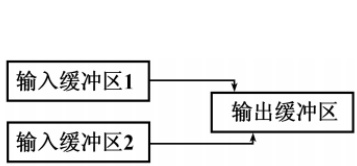

图 8.14 2 路归并

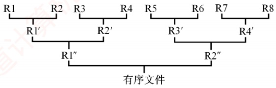

图 8.15 2 路归并的排序过程

在外部排序中实现两两归并时，通常无法将两个输入有序段及归并结果同时驻留于内存中，因此必须频繁地将数据从外存读入、再将结果写回磁盘，这会消耗大量时间。一般而言，有

$$
外部排序总时间  =  内部排序时间  +  外存读 / 写时间  +  内部归并时间
$$

显然，外存读/写时间远大于内部排序与内部归并所需的时间，因此应着力减少I/O次数。由于外存的读/写操作以磁盘块为单位进行，结合前例可知，每趟归并需进行16次读和16次写，共32次I/O；3趟归并加上初始内部排序阶段的32次I/O，总计32×3+32=128次I/O操作。

若改用4路归并，则仅需2趟归并，总I/O次数降至32×2+32=96次。由此可见，增大归并路数可有效减少归并趟数，从而显著降低总的磁盘I/0次数，如图8.16所示。

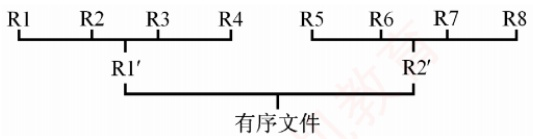

图 8.16 4 路归并的排序过程

一般地，对r个初始归并段进行k路归并（每趟将k个或更少的有序子文件合并为一个）。第一趟可将r个归并段合并为「r/k]个，后续每趟归并将m个归并段合并为「m/k]个，直至只剩一个归并段。树的高度-1 =「1ogkr]= 归并趟数 $S_{\circ}$ 因此，增大归并路数k，或减少初始归并段个数r，均可减少归并趟数S，进而减少磁盘I/O次数，有效提升外部排序效率。

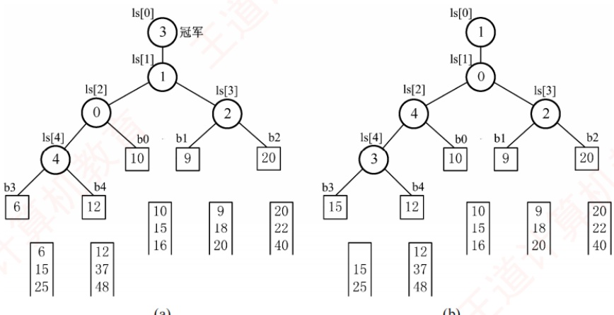

图 8.17 实现 5 路归并的败者树

### 8.7.3 多路平衡归并与败者树

增大归并路数k可减少归并趟数S，从而降低I/O次数。然而，随着k的增大，内部归并的时间开销也会显著增加。这是因为在k个元素中选出关键字最小者，每次选择需要进行k-1次比较；每趟归并n个元素，共需 $( n   -   1 ) ( k   -   1 )$ 次比较。S趟归并的总比较次数为

$$
S(n - 1)(k - 1) = \left\lceil \log_{k}r \right\rceil(n - 1)(k - 1) = \left\lceil \log_{2}r \right\rceil(n - 1)(k - 1) / \left\lceil \log_{2}k \right\rceil
$$

式中，（k-1)1og2k随 k增大而增大，因此内部归并时间也随之增长，这将部分抵消因减少I/O次数带来的性能收益。因此，不能直接使用普通的多路归并方法。

为使内部归并的时间复杂度不受k增大的影响，引入了败者树。败者树是树形选择排序的一种变体，可视为一棵完全二叉树。其k个叶结点分别存放k个归并段当前参与比较的元素，内部结点用于记录左右子树比较中的“败者”（关键字较大者），而“胜者”（较小者）继续向上参与比较，最终胜者的段号存于s[0]，其对应的关键字即为当前最小值。

**考点追踪败者树的实现原理（2024）**

如图8.17(a)所示，考虑5路归并，叶结点为b0,b1,b2,b3,b4:b3与b4比较，b4为败者，将其段号4写入父结点1s[4]；b1与b2比较，b2为败者，将段号2写入1s[3]；胜者b3与b0比较，b0为败者，将段号0写入ls[2]；最后，两个子树的胜者b3与b1比较，b1为败者，将段号1写入ls[1];而将胜者b3的段号3写入ls[0]，表明当前最小关键字来自第3段。输出b3中的关键字后，从第3段读入下一个关键字，更新b3，并沿路径向上重新调整败者树。

由于k路归并的败者树深度为 $\lceil \log_{2} k \rceil + 1$ ，因此从k个记录中选出最小关键字，仅需 $\left[ \log_{2} \vec {k} \right]$ 次比较。此时，总的比较次数约为

$$
S(n - 1)\left[ \log_{2}k \right] = \left[ \log_{k}r \right](n - 1)\left[ \log_{2}k \right] = (n - 1)\left[ \log_{2}r \right]
$$

可见，使用败者树后，内部归并的比较次数与归并路数k无关。因此，在内存空间允许的前提下，增大k可有效降低归并树高度，减少I/O次数，从而提高外部排序的效率。

> ①本节中出现的关于比较次数的公式只是为了帮助读者理解相关原理，无须死记硬背。

值得注意的是，归并路数k并非越大越好。增大k需要增加输入缓冲区的数量。若总内存容量固定，则每个缓冲区的容量将相应减小，导致每趟归并中外存读/写的次数增加。当k过大时，尽管归并趟数减少，但总体I/O次数反而可能增加，从而抵消性能增益。

### 8.7.4 置换-选择排序（生成初始归并段）

由8.7.2节可知，减少初始归并段个数r同样可减少归并趟数S。若待排序记录总数为n，每个归并段的平均长度为l，则归并段个数 $r = \lceil n / \ell \rceil$ 。采用普通内部排序方法生成的初始归并段长度通常固定（除最后一段外），其长度受限于内存工作区的大小。因此，有必要探索新方法以生成更长的初始归并段，从而减少r，这就是本节要介绍的置换-选择算法。

**考点追踪置换-选择排序生成初始归并段的实例（2023）**

设初始待排文件为FI，归并段输出文件为FO，内存工作区为 WA，其中 WA可容纳w个记录，初始时FO与WA均为空。置换-选择算法的执行步骤如下:

1）从FI读入w个记录至工作区WA。

2）从WA中选出当前关键字最小的记录，记为MINIMAX记录。

3）将该 MINIMAX记录写入FO。

4）若FI非空，则从FI读入下一个记录至WA。

5）从WA中所有关键字不小于当前MINIMAX关键字的记录中，选出关键字最小者，作为新的 MINIMAX 记录。

6）重复步骤3）～5），直至WA中不存在关键字不小于当前MINIMAX的记录为止，此时完成一个初始归并段的输出。

7）重复步骤2）～6），直至FI与WA均为空，从而生成全部初始归并段。

通过该方法，初始归并段长度不再受限于内存大小w，而取决于输入数据的分布。理想情况下（如输入基本有序），可生成长度远超w的归并段，显著减少归并段总数。

设待排文件FI= {17,21,05,44,10,12,56,32,29}，WA 容量为3，排序过程如表8.2所示。

表 8.2 置换-选择排序过程示例

<table><tr><td>输出文件FO</td><td></td><td colspan=2>工作区 WA</td><td></td><td>输入文件FI</td></tr><tr><td></td><td colspan=4>一</td><td>17, 21, 05, 44, 10, 12, 56, 32, 29</td></tr><tr><td>一</td><td colspan=4>17 21 05</td><td>44, 10, 12, 56, 32, 29</td></tr><tr><td>05</td><td colspan=4>[172144</td><td>10, 12, 56, 32, 29</td></tr><tr><td>05 17</td><td colspan=4>102144</td><td>12, 56, 32,29</td></tr><tr><td>05 17 21</td><td colspan=4>10 1244</td><td>56, 32, 29</td></tr><tr><td>05 17 21 44</td><td colspan=4>10 1256</td><td>32,29</td></tr><tr><td>05 17 21 44 56</td><td colspan=4>10 12 32</td><td>29</td></tr><tr><td>05 17 21 44 56 #</td><td colspan=2>1012</td><td colspan=2>32</td><td>29</td></tr><tr><td>10</td><td colspan=4>291232</td><td></td></tr><tr><td>10 12</td><td colspan=2>29</td><td colspan=2>32</td><td></td></tr><tr><td>10 12 29</td><td colspan=2></td><td colspan=2>32</td><td>一</td></tr><tr><td>10 12 29 32</td><td colspan=4>一</td><td>V            一</td></tr><tr><td>10 12 29 32 #</td><td colspan=4></td><td></td></tr></table>

上述算法，在WA中选择MINIMAX记录的过程需利用败者树来实现。

### 8.7.5 最佳归并树

文件经过置换-选择排序后，得到长度不等的初始归并段。下面讨论如何安排这些长度不等

的归并段的归并顺序，使得I/O次数最少。假设通过置换-选择排序得到9个初始归并段，其长度依次为9,30,12 18,3,17,2,6,24。若采用3路平衡归并，一种可能的归并树如图8.18所示。

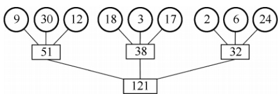

在图8.18中，各叶结点表示一个初始归并段，其上的权值表示该段的长度；叶结点到根的路径长度表示该图8.18 3路平衡归并的归并树

段参与归并的趟数；非叶结点表示归并生成的新段；根结点对应最终有序文件。树的带权路径长度WPL等于归并过程中读取的总记录数，因此总的I/O次数 $2 \times  WPL = 484$

**考点追踪构造三叉哈夫曼树及相关的分析和计算（2013）**

显然，不同的归并方案对应不同的归并树，其WPL（I/O次数）也不同。为最小化I/O开销，可将哈夫曼编码的思想推广至k叉树情形:优先归并长度较小的段，延后归并长度较大的段，从而构造出I/O次数最少的最佳归并树。对上述9个归并段，按此原则构造的最佳3路归并树如图8.19所示，按此方案归并，总I/O次数仅为446，显著优于普通方案。

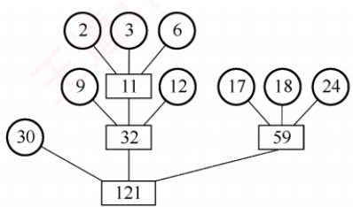

图8.19所示的归并树是一棵严格三叉树，即树中只有度为3或0的结点。然而，当初始归并段的数量不足以构成严格图8.19 3路平衡归并的最佳归并树

k叉树（也称正则k叉树）时，直接进行k路归并会导致某些归并轮次不足k路，从而降低效率。例如，若只有8个初始归并段（如删除上例中长度为30的段），如果强行在最后一次归并时降

为2路，其余仍为3路，则I/O次数将高达386，这并非最优方案。更优的做法是:引入若干长度为0的“虚段”（不包含实际数据的空归并段），使每趟归并都能满路（每次归并都处理3个段）。这些虚段不会产生实际的I/O开销，但能让归并树的结构更接近哈夫曼最优形态一一权值较小的段（包括虚段）被安排在更深的位置，避免过早参与归并。按照这一思路构造的最佳归并树如图8.20所示，其I/O次数显著降低至326。

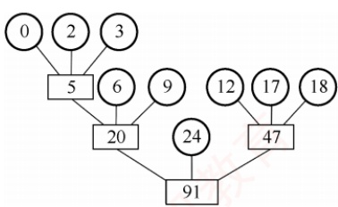

图8.20 8个归并段的最佳归并树

如何判定添加虚段的数目？

设度为0的结点有 $n_{0}$ 个，度为k的结点有 $n_{k}$ 个，归并树的结点总数为n，则有:

$n = n_{k} + n_{0}$ (总结点数 = 度为 k的结点数 + 度为 0的结点数)

$n = k n_{k} + 1$ (总结点数 = 所有结点的度数之和 +1)

因此，对严格k叉树有 $n_{0} = ( k - 1 ) n_{k} + 1$ ，由此可得 $n_{k} = ( n_{0} - 1 ) / ( k - 1 )$ o

接下来，根据 $n_{0}$ 和k的关系，判断是否需要添加虚段:

● 若 $(n_{0}-1)\%(k-1)=0$ （%为取模运算），则说明这 $n_{0}$ 个叶结点（初始归并段）正好可以构成一棵严格的k叉归并树。此时，内结点有 $n_{k}$ 个。

若 $(n_{0}-1)\%(k-1)=u\neq0$ ，则说明对于这 $n_{0}$ 个叶结点，其中有u个多余，不能直接纳入k叉归并树。为构造包含所有 $n_{0}$ 个初始归并段的k叉归并树，应在原有 $n_{k}$ 个内结点的基础上再增加1个内结点。该内结点将代替一个叶结点的位置，被代替的叶结点连同多出的u个叶结点，再加上k-u-1个空归并段，即可构建完整的归并树。

考点追踪实现最佳归并时需补充的虚段数量的分析（2019）

以图8.20为例，用8个归并段构造三叉树时， $(n_{0}-1)\%(k-1)=(8-1)\%(3-1)=1\ne0$ ，表明当前叶结点数无法构成严格的三叉树。因此，需要添加3-1-1=1个虚段，使叶结点总数增至9，满足 $(9 - 1)\%(3 - 1) = 0$ ，这样就可以构建一棵完整的严格三叉树。

## 归纳总结

下面对本章所介绍的排序算法进行一次系统的比较与复习。

**1. 基本排序算法:适用于元素个数n不是很大（n<10000）的情形。**

直接插入排序、冒泡排序和简单选择排序均属于此类，平均时间复杂度均为 $O ( n^{2} )$ ，实现简单。直接插入排序在小规模数据 $(n \leq 25)$ 时效率较高；在最好情况下，仅需n-1次比较。冒泡排序在最好情况下只需1趟扫描和n-1次比较。简单选择排序的比较次数恒为 $O ( n^{2} )$ ，与初始排列无关，但移动次数受初始状态影响，最多不超过 $3(n - 1)$ 次。这三类算法的空间复杂度均为O(1)，仅需一个辅助变量。其中，直接插入排序和冒泡排序是稳定的，而简单选择排序不稳定。

2. 对于中等规模数据 $(n \leqslant 1000)$ ，希尔排序是一种很好的选择。

它通过逐步缩小增量对子序列进行插入排序，初期移动距离大，后期接近有序，从而显著减

少总的比较与移动次数。希尔排序代码简洁，空间开销小（开销为O(1)），但属于不稳定排序。

**3. 大规模高效排序算法:当 n很大时，应选用时间复杂度为O(nlog2n)的算法。**

快速排序是最通用的高效内部排序方法，平均时间复杂度为O(nlog2n)，平均空间复杂度为O(log2n)，虽然在最坏情况下（如输入已有序）退化为O(n²)，但可通过“三者取中”等策略有效规避。堆排序的时间复杂度稳定为O(nlog2n)，无性能退化问题，且仅需O(1)的额外空间，但平均性能通常略逊于快速排序。归并排序的时间复杂度始终为O(nlog2n)，与输入无关，稳定性好，但需要O(n)的额外存储空间。基数排序具有线性时间复杂度O(d(n+r))，但其实际效率受限于关键字结构和平台支持，通用性较弱，应用不如比较类排序广泛。

**4. 混合策略:**

实际系统常结合多种算法以扬长避短。例如，在归并排序或快速排序的递归底层切换为直接插入排序，可减少函数调用开销并提升局部效率。

综上，排序算法的选择应综合考虑数据规模、内存限制、稳定性要求及输入特性。深入理解各类算法的优劣，有助于在实际应用中做出更合理、高效的决策。

## 思维拓展

一道看似吓人的题目:对n个整数进行排序，要求时间复杂度为O(n)，空间复杂度为O(1)。

**提示**

设待排序整数的范围为0\~65535，设定一个数组intcount[65535]并初始化为0，则所需空间与n无关，为O(1)。扫描一遍待排序列X[]，count[X[i]]++，时间复杂度为O(n);再扫描一次count[]，当count[i]>0时，输出count[i]个i，排序完毕所需的时间复杂度也为O(n);所以总时间复杂度为O(n)，空间复杂度为O(1)。另外，读者可能会问假如有负整数怎么办，这种情况下可以给所有整数都加上一个偏移量，使之都变成正整数，再使用上述方法。


**参考文献**

[1]严蔚敏，吴伟民.数据结构（C语言版）[M]. 北京:清华大学出版社，2018.

[2] 科尔曼，雷瑟尔森，李维斯特，等.算法导论[M].3版.殷建平，徐云，刘晓光，等译.北京:机械工业出版社，2013. XTA

[3]李春葆，陈良臣，尹为民，等.数据结构教程（C++语言描述）[M].北京:清华大学出版社，2009.

[4] 陈守孔，胡潇琨，李玲.算法与数据结构考研试题精析[M]. 北京:机械工业出版社，2007.

[5]夏清国.数据结构考研教案[M]. 西安:西北工业大学出版社，2006.

[6]全国考研计算机大纲配套教材专家委员会.全国硕士研究生入学统一考试计算机专业基础综合考试大纲解析[M].北京:高等教育出版社，2023.

[7]李春葆，尹为民，陈良臣.数据结构联考辅导教程[M]. 北京:清华大学出版社，2010.
