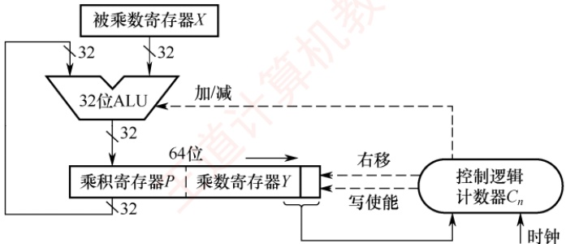
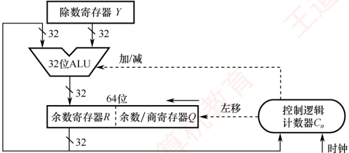

# 第2章 数据的表示和运算 · 习题与解析

> 由《第2章 数据的表示和运算》正文摘出；区块标题保留了原书的小节编号。

### 2.1.5 本节习题精选

**单项选择题**

01. 若十进制数为137.5，则其八进制数为（）。
A. 89.8
B. 211.4
C. 211.5
D. 1011111.101

02.一个16位无符号二进制数的表示范围是（）。
A. 0\~65536
B. 0\~65535
C. -32768\~32767
D. -32768\~32768

03.下列说法有误的是（）。
A. 任何二进制整数都可以用十进制表示
B. 任何二进制小数都可以用十进制表示
C. 任何十进制整数都可以用二进制表示
D. 任何十进制小数都可以用二进制表示

04. 对真值0表示形式唯一的机器数是（）。
A. 原码
B. 补码和移码
C. 反码
D. 以上都不对

05.若[X]补=1.1101010，则[X]原=（）。
A. 1.0010101
B. 1.0010110
C. 0.0010110
D. 0.1101010

06. 若X为负数，则由[X]补求[-X]补是将（）。
A. [X]补各值保持不变
B. [X]补符号位变反，其他各位不变
C. [X]补除符号位外，各位变反，末位加1
D. [X]补连同符号位一起变反，末位加1

07.8位原码能表示的不同数据有（）个。
A. 15
B. 16
C. 255
D. 256

08. 一个 n+ 1 位整数x原码的数值范围是（）。
A. $-2^{n}+1<x<2^{n}-1$
B. $-2^{n}+1 \leqslant x < 2^{n}-1$
C. $-2^{n}+1<x\leqslant 2^{n}-1$
D. $-2^{n}+1 \leqslant x \leqslant 2^{n}-1$

09. 若定点整数为64位，含1位符号位，则采用补码表示的绝对值最大的负数为（）。
A. $- 2^{64}$
B. $- ( 2^{64}   - 1 )$
C. $\pm 2^{63}$
D. $- ( 2^{63}   - 1 )$

10.下列关于补码和移码关系的叙述中，（）是不正确的。
A. 相同位数的补码和移码表示具有相同的数据表示范围
B. 0的补码和移码表示相同
C. 同一个数的补码和移码表示，其数值部分相同，而符号位相反
D. 一般用移码表示浮点数的阶码，而补码表示定点整数

11. 若 $[x]_{补}=1,x_{1}x_{2}x_{3}x_{4}x_{5}x_{6}$ ，其中 $x_{i}$ 取0或1，若要 $x > - 32$ ，应当满足（）。
A. $x_{1}$ 为0，其他各位任意
B. $x_{1}$ 为1，其他各位任意
C. $x_{1}$ 为1， $x_{2} \cdots x_{6}$ 中至少有一位为1
D. $x_{1}$ 为 $0 , x_{2} \cdots x_{6}$ 中至少有一位为1

12. 设 $x$ 为整数， $[x]_{补} = 1, x_{1}x_{2}x_{3}x_{4}x_{5}$ ，若要 $x < -16,\ x_{1} \sim x_{5}$ 应满足的条件是（）。
A. $x_{1}   \sim   x_{5}$ 至少有一个为1
B. $x_{1}$ 必须为 $0 , x_{2}   \sim   x_{5}$ 至少有一个为1
C. $x_{1}$ 必须为 $0 , x_{2}   \sim   x_{5}$ 任意
D. $x_{1}$ 必须为1， $x_{2}   \sim   x_{5}$ 任意

13. 设x为真值，x\*为其绝对值，满足 $\left[ -x^{*} \right]_{补} = \left[ -x \right]_{补}$ ，当且仅当（）。
A. x任意 XTI
B. x为正数
C. x为负数
D. 以上说法都不对

14. 假定一个十进制数为-66，按补码形式存放在一个8位寄存器中，该寄存器的内容用十六进制表示为（）。
A. C2H
B. BEH
C. BDH

15. 设机器数采用补码表示（含1位符号位），若寄存器内容为9BH，则对应的十进制数为
A. -27
B. -97
C. -101
D. 155

16. 若寄存器内容为10000000，若它等于-0，则为（）。
A. 原码
B. 补码
C. 反码
D. 移码

17. 若寄存器内容为11111111，若它等于+127，则为（）。
A. 反码
B. 补码
C. 原码
D. 移码

18. 若寄存器内容为11111111，若它等于-1，则为（）。
A. 原码
B. 补码
C. 反码
D. 移码

19. 若寄存器内容为00000000，若它等于-128，则为（）。
A. 原码
B. 补码
C. 反码
D. 移码

20. 若二进制定点小数真值是-0.1101，机器表示为1.0010，则为（）。
A. 原码
B. 补码
C. 反码
D. 移码

21. 下列为8位移码机器数[x]移，求[-x]移时，（）将会发生溢出。
A. 11111111
B. 00000000
C. 10000000
D. 01111111

22.一个8位的二进制整数由2个“0”和6个“1”组成，采用补码或者移码表示，则下列说法中正确的是（）。
A. 若采用移码表示，偏置值为127，则此整数最小为-64
B. 若采用移码表示，偏置值为128，则此整数最大为123 道计算机教
C. 若采用补码表示，则此整数最小为-96
D. 若采用补码表示，则此整数最大为252

23.用2个“1”和6个“0”组成的8位二进制补码，所能表示的最大整数和最小整数之差为（）。
A. 223
B. 128
C. 191
D. 159

24. 计算机内部的定点数大多用补码表示，以下是一些关于补码特点的叙述:I. 零的表示是唯一的 Ⅱ. 符号位可以和数值部分一起参加运算Ⅲ. 和其真值的对应关系简单、直观 IV. 减法可用加法来实现在以上叙述中，（）是补码表示的特点。
A. I和Ⅱ
B. I和III
C. I和ⅡI和ⅢII
D. I和ⅡI和IV

25. 在计算机中，通常用来表示主存地址的是（）。

A. 移码
B. 补码
C. 原码
D. 无符号数

26. 16 位补码整数 0x8FA0 扩展为 32 位应该是（）。
A. 0x0000 8FA0
B. 0xFFFF 8FA0
C. 0xFFFF FFA0
D. 0x8000 8FA0

27.【2012 统考真题】假定编译器规定 int 型和 short 型长度分别为 32位和16 位，执行下列C语言语句:unsigned short x=65530; unsigned int y=x;得到 y 的机器数为()
A. 0000 7FFAH
B. 0000 FFFAH
C. FFFF 7FFAH
D. FFFF FFFAH

28.【2015统考真题】由3个“1”和5个“0”组成的8位二进制补码，能表示的最小整数是（）。
A. -126
B. -125
C. -32

29.【2016统考真题】有如下C语言程序段:short si = -32767; unsigned short usi = si;执行上述两条语句后，usi的值为（）。
A. -32767
B. 32767
C. 32768
D. 32769

30. 【2018统考真题】冯·诺依曼结构计算机中的数据采用二进制编码表示，其主要原因是（）。I. 二进制的运算规则简单 I. 制造两个稳态的物理器件较容易Ⅲ. 便于用逻辑门电路实现算术运算
A. 仅I、Ⅱ
B. 仅I、ⅢII
C. 仅ⅡI、III
D. I、ⅡI和III

31.【2019统考真题】考虑以下C语言代码:unsigned short usi = 65535; short si = usi; 道执行上述程序段后，si的值是（
A. -1
B. -32767
C. -32768
D. -65535

32. 【2021 统考真题】已知有符号整数用补码表示，变量 x, y， z 的机器数分别为 FFFDH, FFDFH，7FFCH，下列结论中，正确的是（）。
A. 若x,y和z为无符号整数，则 $z < x < y$
B. 若x,y和 z为无符号整数，则 $x < y < z$ 算机教育
C. 若x,y和 z 为有符号整数，则 $x < y < z$
D. 若x,y和 z 为有符号整数，则 $y < x < z$

33.【2022统考真题】32位补码所能表示的整数范围是（）。
A. $- 2^{32} \sim 2^{31} - 1$
B. $- 2^{31}   \sim   2^{31}   - 1$
C. $- 2^{32}   \sim   2^{32}   - 1$ $- 2^{31} \sim 2^{32} - 1$

34.【2025统考真题】在32位计算机上执行下列C语言代码段后，ui的值是（）short si = -32767; unsigned int ui = si;
A. $2^{15}   - 1$
B. $2^{15}   + 1$
C. $2^{32} - 2^{15} - 1$
D. $2^{32} - 2^{15} \pm 1$

### 2.1.6 答案与解析

**单项选择题**

01. B

十进制数转换为八进制数，整数部分采用除基取余法:将整数除以8，所得余数即为转换后的八进制数个位上的数码，再将商除以8，余数为八进制数十位上的数码，如此反复进行，直到商是0为止。小数部分采用乘基取整法:将小数乘以8，所得积的整数部分即为八进制数十分位上的数码，再将此积的小数部分乘以8，得到百分位上的数码，如此反复直到积是1.0为止。经转换得到的八进制数为211.40。

02. B

一个16位无符号二进制数的表示范围是 $0 {\sim} 2^{16} - 1$ ，即0～65535。

03. D

选项A、B、C明显正确，二进制整数和十进制整数可以相互转换，仅仅是每位的位权不同而已。而二进制数的小数位只能表示1/2,1/4,1/8,…,1/2ⁿ，因此无法表示所有的十进制小数，选项D错误。

04. B

假设位数为5位（含1位符号位）， $[+0]_{原} = 00000, \quad [-0]_{原} = 10000, \quad [+0]_{反} = 00000, \quad [-0]_{反} = 11111$ $\left[ + 0 \right]_{补} = \left[ - 0 \right]_{补} = 00000, \quad \left[ + 0 \right]_{补} = \left[ - 0 \right]_{补} = 10000.$ 。可知，0的补码和移码的表示是唯一的。

05. B

若X为负数，则其补码转换为原码的规则是“符号位不变，数值位取反，末位加 $1^{\prime \prime}$ ，即 $[X]_{原} =$ $0010101+1=0010110$ 0

06. D

不论X是正数还是负数，由[]补求 $[ - X ]_{补}$ 的方法是连同符号位一起，每位取反，末位加1。

07. C

8个二进制位有 $2^{8} = 256$ 种不同表示。原码中0有两种表示，因此原码能表示的不同数据为$2^{8} - 1 = 255$ 个。0在反码中也有两种表示，因此若题目改为反码，答案也为选项C。0在补码与移码中只有一种表示，因此题目若改为补码或移码，答案为选项D。

08. D

n+1位整数原码的表示范围为 $-2^{n}+1 \leqslant x \leqslant 2^{n}-1$

09. C

对于长度为n+1（含1位符号位）定点整数x，用补码表示时， $x_{绝对值最大负数} = -2^n$ ，其中 $n = 63$

10. B

以机器字长5位为例， $[0]_{补} = 00000$ $[0]_{移} = 2^4 + 0 = 10000$ $[0]_{补} \neq [0]_{移}$ ，表示不相同，但在补码或移码中的表示形式是唯一的。

11. C

对于此类题型，先写出特定值的机器码表示，然后根据机器数判断大小的规则来推导数值位的特点（若条件允许，也可以取特殊值来推断）。-32的补码为1,100000，根据负数补码判断大小的规则:数值位部分越小，其绝对值越大，即负得越多。因此，若要 $x   >   - 32$ ，数值位 $x_{1} x_{2} x_{3} x_{4} x_{5} x_{6}$需大于100000，即 $x_{1}$ 必须为1，而 $x_{2} \ldots x_{6}$ 中至少有一位为1。

【特殊值法】对于选项A，取1,000000，真值为-64，错误。对于选项B，取1,100000，真值为-32，错误。对于选项C，取1,100001，真值为-31，符合。对于选项D，取1,000001，真值为-63，错误。

12. C

解题思路与上题类似（也可采用特殊值解法，请读者自行思考），-16的补码为1,10000，根据负数补码判断大小的规则:数值位部分越小，其绝对值越大，即负得越多。因此，若要 $x   <   - 16$数值位 $x_{1} x_{2} x_{3} x_{4} x_{5}$ 需小于10000，即 $x_{1}$ 必为0，而 $x_{2} \sim x_{5}$ 任意。

13. D

当x为0或为正数时，满足 $\left[ -x^{*} \right]_{补} = \left[ -x \right]_{补}$ ，B为充分条件，因此选项B错误。而x为负数时，-x为正数，而 $- x^{*}$ 为负数，补码的表示是唯一的，显然二者不等，因此选项C错误。

14. B

x = -66 用二进制数表示， $[x]_{原} = 11000010$ ，则有 $[x]_{补} = 1011110 =  BEH$

15. C

$9BH = (1001\ 1011)_2$ ，最高位的1表示负数，所以其真值为 $(1100101)_{2}=-(64+32+4+1)=-101$ 16. A

值等于-0说明只可能是原码或反码(因为补码和移码表示0时是唯一的，没有+0和-0之分)，$[ - 0 ]_{原} = 10000000 , \quad [ - 0 ]_{反} = 11111111$

17. D

这里寄存器长度为8， $\left[ + 127 \right]_{原} = \left[ + 127 \right]_{反} = \left[ + 127 \right]_{补} = 01111111$ ，又知同一数值的移码和补码除最高位相反外，其他各位相同，则 $[+127]_{移} = 11111111$ 或 $[ + 127 ]_{移} = 2^7 + 01111111 = 11111111$

18. B

这里寄存器长度为8， $\left[ - 1 \right]_{补} = \left[ 10000001 \right]_{补} = 11111111$

19. D

这里寄存器长度为8， $[ - 128]_{移} = 2^{7} + ( - 10000000 ) = 00000000$

20. C

真值-0.1101，对应的原码表示为1.1101，补码表示为1.0011，反码表示为1.0010，移码通常用于表示阶码，不用来表示定点小数。

21. B

选项B对应8位最小的值-128，而-x=128发生溢出，因此无法表示其移码。

22. A

当采用补码表示时，要使得数值最大，就要让符号位为0，且把“1”放在高位，得到的补码为01111110B=126；要使得数值最小，就要让符号位为1，且把“1”放在低位，得到的补码为10011111B=-97。当采用移码表示时，设偏置值为128，要使得数值最大，就要把“1”放在高位，得到的移码为 $1111\ 1100\mathrm{B}-1000\ 0000\mathrm{B}=252-128=124$ ；设偏置值为127，要使得数值最小，则应把“1”放在低位，得到的移码为 $00111111B-01111111B=1100000B=-64$ ，选项A正确。

23. A

在8位补码中，符号位为最高位。要使数值最大，符号位为0，其余位中将两个“1”尽可能置于高位，最大值为01100000=96。要使数值最小，符号位为1，此时需要将另一个“1”置于最低位（其余为0），得最小补码为10000001=-127。二者之差为96-(-127)=223。

24. D

[+0]补和[-0]补是相同的，所以说法Ⅰ正确。在进行补码定点数的加减运算时，符号位作为数的一部分参加运算，说法Ⅱ正确， $\left[ A \right]_{补} - \left[ B \right]_{补} = \left[ A \right]_{补} + \left[ - B \right]_{补}$ ，即将减法采用加法实现，说法IV正确。实际上，补码和其真值的对应关系远不如原码和其真值的对应关系简单直观，说法Ⅲ错误。

25. D

主存地址都是正数，因此不需要符号位，即直接采用无符号数表示。

26. B

16位扩展为32位，符号位不变，附加位是符号位的扩展。该数是一个负数，需用1来填补。A是一个正数，C的数值位发生变化，D用0来填充附加位，均不正确。

27. B

将一个 16 位 unsigned short 型数转换为 32 位 unsigned int 型数时，因为都是无符号数，新表示形式的高位用0填充。16位无符号整数所能表示的最大值为65535，其十六进制表示为FFFFH，因此x的十六进制表示为FFFFH-5H=FFFAH，所以y的十六进制表示为0000 FFFAH。

排除法:先直接排除C、D，然后分析余下选项的特征。A、B的值相差几乎近1倍，因此可以算出00010000H（接近B且好算的数）的值后，再推断出答案。

28. B

原码很容易判断大小。而负数的补码很难直接判断大小，可采用如下规则快速判断:对于负数，数值位部分越小，其绝对值越大，即负得越多。采用补码整数表示时，负数的符号位为1，因此剩下的两个“1”放在末位时其值最小，补码形式为10000011，转换为真值为-125。此外，考虑负数的补码转换为原码的方法，从右向左找到第一个数值为1的位，之后的每位进行取反操作，符号位不变，不难发现，当符号位为1，剩下的两个“1”放在末位时，补码的绝对值最大。

29. D

因C语言中的数据在内存中为补码表示形式，si对应的补码为1000 0000 0000 0001B，最前面的一位“1”为符号位，表示负数，即-32767。由 signed型数转换为等长的 unsigned型数时，符号位成为数据的一部分，即负数转换为无符号数（正数）时，其数值将发生变化。usi对应的补码与 si的相同，但表示正数，为32769。

30. D

对于说法I，二进制只有0和1两种数值，运算规则较简单，都通过ALU转换为加法运算。对于说法Ⅱ，二进制数只需要高电平和低电平两个状态就可表示，这样的物理器件很容易制造。对于说法Ⅲ，二进制数与逻辑量相吻合。二进制的0和1正好与逻辑量的“真”和“假”相对应，因此用二进制数表示二值逻辑显得十分自然，采用逻辑门电路很容易实现运算。

31. A

unsigned short 型为无符号短整型，长度为 2 字节，因此 unsigned short usi 型转换为二进制代码即 1111 1111 1111 1111。short型为短整型，长度为2字节，在采用补码的机器上，short si的二进制代码为 1111 1111 1111 1111，因此 si 的值为-1。

32. D

若 x, y和 z 均为无符号整数，则 $x > y > z$ ，选项A和B错误。若x,y和 z均为有符号整数，补码的最高位是符号位，0表示正数，1表示负数，因此z为正数，而x和y为负数。对于x和y的比较，数值位取反加1，可知x=-3， $y = - 33$ ，所以 $x   \geq   y .$ 。选项D正确。

33. B

n位补码整数的最小值是 $1 , 00 \ldots 0 ( - 2^{n - 1} )$ ；最大值是 $0,11\ldots1\left(2^{n-1}-1\right)$ 。n位补码整数所能表示的范围是 $-2^{n - 1} \sim 2^{n - 1} - 1$ ，32位补码整数所能表示的范围是 $-2^{31} \sim 2^{31} - 1$

34. D

在32位系统中，short通常为16位有符号整数。-32767的16位补码为1000 0000 0000 0001。将其赋值给 32 位 unsigned int 时，先按符号扩展转换为 32 位有符号整数 1111 1111 1111 1111 1000 000000000001，再以无符号方式解释，其值为 $2^{32}-(2^{15}-1)=2^{32}-2^{15}+1$

### 2.2.5 本节习题精选

**一、单项选择题**

01. 算术逻辑单元（ALU）的核心部件是（）。
A. 多路选择器
B. 移位器
C. 加法器
D. 寄存器

02. 算术逻辑单元（ALU）的功能通常包括（）。
A. 算术运算
B. 逻辑运算
C. 算术运算和逻辑运算
D. 加法运算

03. 补码定点整数 0101 0101算术左移两位后的值为（）。
A. 0100 0111
B. 0101 0100
C. 0100 0110
D. 0101 0101

04. 下列四个补码整数存放于8位寄存器中，算术左移不会发生溢出的是（）
A. 80H
B. 90H
C. BOH
D. COH

05. 补码定点整数1001 0101右移一位后的值为（）。X
A. 0100 1010
B. 01001010 1
C. 1000 1010
D. 1100 1010

06. 两个机器数7E5H和4D3H相加，得（）。
A. BD8H
B. CD8H
C. CB8H
D. CC8H

07. 设机器数字长为8位（含1位符号位），若机器数BAH为补码，算术左移1位和算术右移1位分别得（）。
A. F4H, EDH
B. B4H, 6DH
C. 74H, DDH
D. B5H, EDH

08. 在定点运算器中，无论是采用双符号位还是采用单符号位，必须有（）。
A. 译码电路，它一般用“与非”门来实现
B. 编码电路，它一般用“或非”门来实现
C. 溢出判断电路，它一般用“异或”门来实现
D. 移位电路，它一般用“与或非”门来实现

09. 机器运算发生溢出的根本原因是（）。
A. 寄存器的位数有限
B. 运算中将符号位的进位丢弃
C. 运算中将符号位的借位丢弃
D. 数据运算中发生错误

10. 假定有两个整数用8位补码分别表示为 $r_{1}   =   \mathrm {F 5 H}$ $r_{2} =$ EEH。若将运算结果存放在一个8位寄存器中，则下列运算会发生溢出的是（）。 草机
A. $r_{1} + r_{2}$
B. $r_{1} - r_{2}$
C. $r_{1} {\times} r_{2}$
D. $r_{1} / r_{2}$

11.关于模4补码，下列说法正确的是（）。
A. 模4补码和模2补码不同，它不容易检查乘除运算中的溢出问题
B. 每个模4补码存储时只需要一个符号位
C. 存储每个模4补码需要两个符号位
D. 模4补码，在算术与逻辑单元中为一个符号位

12. 若采用双符号位，则两个正数相加产生溢出的特征时，双符号位为（）。
A. 00
B. 01
C. 10
D. 11

13. 判断加减法溢出时，可采用判断进位的方式，若符号位的进位为 $C_{0} ,$ 最高位的进位为$C_{1}$ ，则 $产$ 生溢出的条件是（）。I. $C_{0}  产$ 生进位 ⅡI. $C_{1}  产$ 生进位III. $C_{0} 、 C_{1}$ 都产生进位 美IV. $C_{0} 、 C_{1}$ 都不产生进位

V. $C_{0}  产$ 生进位， $C_{1}$ 不产生进位 VI. $C_{0}$ 不产生进位， $C_{1}$ 产生进位
A. I和Ⅱ
B. III
C. IV
D. V和VI

14. 在补码的加减法中，用两位符号位判断溢出，两位符号位 $S_{\mathrm {s} 1} S_{\mathrm {s} 2} = 10$ 时，表示（）。
C. 结果负溢出 A. 结果为正数，无溢出 道 B. 结果正溢出
D. 结果为负数，无溢出

15. 若 $[X]_{补} = X_0 \cdot X_1X_2 \cdots X_n$ 其中 $X_{0}$ 为符号位， $X_{1}$ 为最高数位。若（），则当补码算术左移时，将会发生溢出。
A. $X_{0}   =   X_{1}$
B. $X_{0}   \neq   X_{1}$
C. $X_{1} = 0$
D. $X_{1} = 1$ XTA

16. 假设一次 ALU运算和一次移位操作各需1 个时钟周期，则 32 位无符号整数乘法电路完成一次乘法运算所需的时钟周期数约为（）。
A. 16
B. 64
C. 96
D. 100 机

17.下列关于移位运算的说法中，正确的是（）。I.补码算术左移时，高位移出，低位补0，若左移前后的符号位不同，则发生溢出Ⅱ.无符号数逻辑左移时，若最高位移出的是1，则发生溢出Ⅲ.逻辑左移和补码算术左移的结果都一样，都是移出最高位，并在低位补0
A. I、III
B. 仅Ⅱ
C. 只有
D. I、ⅡI、ⅢII

18. 某计算机字长为8位，CPU中有一个8位加法器。已知无符号数x=69，y=38，若在该加法器中计算x-y，则加法器的两个输入端信息和输入的低位进位信息分别为（）。
A. 0100 0101、0010 0110、0
B. 0100 0101、1101 1001、1
C. 0100 0101、1101 1010、0
D. 0100 0101、1101 1010、1

19. 某计算机中有一个8位加法器，有符号整数x和y的机器数用补码表示， $[x]_{补} =  F 5 H$ $[y]_{补} = 7 EH$ ，若在该加法器中计算x一y，则加法器的低位进位输入信息和运算后的溢出标志OF分别是（）。 王道
A. 1、1
B. 1、
C. 0、1
D. 0、0

20. 某8位计算机中，x和y是两个有符号整数，用补码表示， $[x]_{补} = 44\mathrm{H}$ $[y]_{补} =  DCH$ ，则$x / 2 + 2 y$ 的机器数及相出1OF分D（H、0 D. DAH. 1

21. 某8位计算机中，x和y是两个有符号整数，用补码表示， $[x]_{补} = 44\mathrm{H}$ $[y]_{补} =  DCH$ ，则$x^{-} 2 y$ 的机器数及相应的溢出标志OF分别是（）。 算村
A. 8CH、1
B. 8CH、0
C. 68H、1
D. 68H、0

22. 某 C 语言代码段如下:int si=65536; short i=si; $\mathtt {unsigned \_j = 0 ;}$ if(i<=j-1) printf("王道") else printf("计算机教育");

当上述代码段执行到if分支条件的判断时，会根据标志寄存器中的（）决定执行顺序。最终的输出结果是（）。
A. CF, 王道
B. CF, 计算机教育
C. OF, 王道
D. OF, 计算机教育

23. 下图是实现32位补码一位乘法的逻辑结构图，下列说法中正确的是（）。



A. 32位无符号整数的乘法电路和该图没有区别
B. 在执行过程中，ALU要么做加法，要么做减法，不可能执行空操作
C. 图中的乘积寄存器P和乘数寄存器Y所执行的右移是算术右移
D. 计算完成后，若乘积寄存器P中的值不全为0，则发生溢出 K

24. 某计算机采用下图所示的补码除法器执行32 位补码整数除法运算，当除数寄存器Y与余数/商寄存器Q的初始值为（）时，除法执行时间最短（Y、Q均为补码表示）。



A. Y = FFFF FFFF, Q = 8000 0000
B. Y = 8000 0000, Q = FFFF FFFF
C. Y = FFFF FFFF, Q = FFFF FFFF
D. Y = 8000 0000, Q = 8000 0000

25. 【2009统考真题】一个C语言程序在一台32位机器上运行。程序中定义了三个变量x，y, z，其中 x和 z 为 int 型，y 为 short 型。当 $x = 127, y = -9$ 时，执行赋值语句 $\mathbf {\boldsymbol {z}}   =   \mathbf {\boldsymbol {x}} + \mathbf {\boldsymbol {y}}$后，x, y, z的值分别是（）。
A. x = 0000007FH, y = FFF9H, z = 00000076H
B. x = 0000007FH, y = FFF9H, z = FFFF0076H
C. x = 0000007FH, y = FFF7H, z = FFFF0076H 算机教育
D. x = 0000007FH, y = FFF7H, z = 00000076H

26. 【2010统考真题】假定有四个整数用8位补码分别表示: $r_{1}   =   \mathrm {FEH}$ $r_{2}=\mathrm{F}2\mathrm{H}$ $r_{3}   =   90 \mathrm {H}$ $r_{4} = \mathrm{F8H}$ ，若将运算结果存放在一个8位寄存器中，则下列运算会发生溢出的是（）。$r_{1} {\times} r_{2}$
B. $r_{2} {\times} r_{3}$
C. $r_{1} {\times} r_{4}$
D. $r_{2} {\times} r_{4}$

27. 【2013统考真题】某字长为8位的计算机中，已知整型变量x、y的机器数分别为 $\left[ x \right]_{补} =$ 11110100，[y]补=10110000。若整型变量 $z = 2x + y / 2$ ，则z的机器数为（）。
A. 1 1000000
B. 0 0100100
C. 1 0101010
D. 溢出

28. 【2014统考真题】若x= 103，y=-25，则下列表达式采用8位定点补码运算实现时，会发生溢出的是（）。
A. $x + y$
B. $- x + y$ C $x   -   y$ D. $- x - y$

29. 【2018统考真题】假定有符号整数采用补码表示，若 int型变量x和y的机器数分别是FFFF FFDFH 和 0000 0041H，则 x、y 的值及 x -y 的机器数分别是（）。A. $x = -65, y = 41, x - y$ 的机器数溢出

B. x = -33, y = 65, x − y 的机器数为 FFFF FF9DH
C. x = -33, y = 65, x − y 的机器数为 FFFF FF9EH
D. x = -65, y = 41, x − y 的机器数为 FFFF FF96H

30. 【2018统考真题】整数x的机器数为11011000，分别对x进行逻辑右移1位和算术右移1位操作，得到的机器数各是（）。
A. 1110 1100、1110 1100
B. 0110 1100、1110 1100
C. 1110 1100、0110 1100
D. 0110 1100、 0110 1100

31.【2018 统考真题】减法指令“sub R1,R2, R3”的功能为“(R1)-(R2)→R3”，该指令执行后将生成进位/借位标志 CF 和溢出标志 OF。若(R1) = FFFF FFFFH，(R2) = FFFF FFFOH，则该减法指令执行后，CF与OF分别为（）。
A. CF = 0, OF = 0
B. CF = 1, OF = 0
C. CF = 0, OF = 1
D. CF = 1, OF = 1

32. 【2023 统考真题】已知 x, y 为 int 型，当 x = 100, y = 200 时，执行“x 减 y”指令得到的溢出标志 OF和借位标志CF分别为0,1，那么当 x = 10, y = -20时，执行该指令得到的OF和CF分别为（）。
A. OF = 0, CF = 0
B. OF = 0, CF = 1
C. OF = 1, CF = 0
D. OF = 1, CF = 1

33.【2024统考真题】C语言代码段如下，执行该代码段后，j的值是（）。int i=32777; short si=i; AIT int j=si;
A. -32777
B. -32759
C. 32759
D. 32777

34.【2024统考真题】下列关于整数乘法运算的叙述中，错误的是（）
A. 用阵列乘法器实现的乘运算可以在一个时钟周期内完成
B. 用ALU和移位器实现的乘运算无法在一个时钟周期内完成
C. 变量与常数的乘运算可编译优化为若干移位及加减运算指令
D. 两个变量的乘运算无法编译转换为移位及加法等指令的循环实现

35. 【2025统考真题】假设在8位字长的计算机中，两个带符号整数x和y的补码表示分别为[x]补=A3H、[y]补=75H,则通过补码加减运算器得到的x−y的值及OF标志分别为()。
A. 24,0
B. 24, 1
C. 46,0
D. 46, 1.

**二、综合应用题**

01. 已知 32 位寄存器 R1 中存放的变量 x 的机器码为 8000 0004H，unsigned int 型的乘除法采用逻辑移位操作，int型的乘除法采用算术移位操作，请问:当 x 是 unsigned int 型时，x 的真值是多少？x/2 存放在 R1 中的机器码是什么？x/2 H 的真值是多少？2x存放在R1中的机器码是什么？2x的真值是多少？

2）当 x是 int 型时，x 的真值是多少？x/2 存放在 R1 中的机器码是什么？x/2 的真值是多少？2x存放在R1中的机器码是什么？2x的真值是多少？

02. 假设有两个整数x=-68，y=-80，采用补码形式（含1位符号位）表示，x和y分别存放在寄存器A和B中。另外，还有两个寄存器C和D。A、B、C、D都是8位的寄存器。请回答下列问题（要求最终用十六进制数表示二进制数序列）:1）寄存器A和B中的内容分别是什么？2）x和y相加后的结果存放在寄存器C中，则寄存器C中的内容是什么？此时，溢出标志OF、符号标志 SF 各是什么？

3）x和y相减后的结果存放在寄存器D中，寄存器D中的内容是什么？此时，溢出标志 OF、符号标志 SF各是什么？

03.【2011统考真题】假定在一个8位字长的计算机中运行如下C程序段:

```txt
unsigned int x=134;
unsigned int y=246;
int m=x;
int n=y;
unsigned int z1=x-y;
unsigned int z2=x+y;
int k2=m+n;
```

若编译器编译时将 8 个 8 位寄存器 R1 \~ R8 分别分配给变量 x, y, m, n, z1, z2, k1 和 k2。请回答下列问题（提示:有符号整数用补码表示）。

1）执行上述程序段后，寄存器R1、R5和R6的内容分别是什么（用十六进制数表示）？

2）执行上述程序段后，变量m和k1的值分别是多少（用十进制数表示）？

3）上述程序段涉及有符号整数加减、无符号整数加减运算，这四种运算能否利用同一个加法器辅助电路实现？简述理由。

4）计算机内部如何判断有符号整数加减运算的结果是否发生溢出？上述程序段中，哪些有符号整数运算语句的执行结果会发生溢出？

04.【2020统考真题】有实现x×y的两个C语言函数如下:

```c
unsigned umul (unsigned x, unsigned y) { return x*y;
int imul (int x, int y) {return x * y; }
```

假定某计算机M中的ALU只能进行加减运算和逻辑运算。请回答下列问题。

1）若M的指令系统中没有乘法指令，但有加法、减法和位移等指令，则在M上也能实现上述两个函数中的乘法运算，为什么？

2）若M的指令系统中有乘法指令，则基于ALU、位移器、寄存器及相应控制逻辑实现乘法指令时，控制逻辑的作用是什么？

3）针对以下三种情况:a）没有乘法指令；b）有使用ALU和位移器实现的乘法指令；c）有使用阵列乘法器实现的乘法指令，函数umul()在哪种情况下执行的时间最长？在哪种情况下执行的时间最短？说明理由。

4）n位整数乘法指令可保存2n位乘积，当只取低n位作为乘积时，其结果可能发生溢出。当 $n = 32, x = 2^{31} - 1, y = 2$ 时，有符号整数乘法指令和无符号整数乘法指令得到的x×y的 2n位乘积分别是什么（用十六进制数表示）？此时函数 umul()和imul()的返回结果是否溢出？对于无符号整数乘法运算，当仅取乘积的低n位作为乘法结果时，如何用2n位乘积进行溢出判断？

### 2.2.6 答案与解析

**一、单项选择题**

01. C

ALU的核心功能是算术与逻辑运算，其中加法是最基础的操作:减法可用补码加法实现，乘除可由加法和移位组合而成。因此，加法器是ALU最核心的部件。

02. C

ALU既能进行算术运算又能进行逻辑运算。

03. B

该数是一个正数（最高位为0），按照补码算术移位规则，算术左移两位后，移出了最高位01，低位补0，因此算术左移两位后的结果是01010100。虽然移位后该数的符号位仍为0，但是移出了有效位1，所以本次算术移位发生了溢出。

04. D

$80\mathrm{H}=(10000000)\cdots1=00000000$ ，左移前的符号位为1，左移后的符号位为0，溢出。90H=(1001 $0000 \leq 1 = 00100000$ ，左移前的符号位为1，左移后的符号位为0，溢出。 $\mathrm{B0H}=(1011\ 0000)<<1=0110$ 0000，左移前的符号位为1，左移后的符号位为0，溢出。 $\mathrm{C0H}=(1100\ 0000)<<1=10000000$ ，左移前的符号位为1，左移后的符号位为1，未溢出，选项D正确。

05. D

该数是一个负数（最高位为1），按照算术补码移位规则，负数右移添1，负数左移添0，所以10010101右移一位后的值为11001010。 临村

06. C

在十六进制数的加减法中，逢十六进一，因此有 $7 E 5 H +4 D 3 H = CB 8 H$

07. C

算术左移时，低位补0；算术右移时，高位补符号位。 $\mathrm{BAH} = (1011, 1010)_2$ ，算术左移1位得$(0111\;0100)_{2}=74\mathrm{H}$ ，左移前后的符号位不同，溢出；算术右移1位得 $(1101\ 1101)_{2} = \mathrm{DDH}$ 0

08. C

三种溢出判别方法，均须有溢出判别电路，可用“异或”门来实现。

09. A

10. C

首先将 $r_{1}$ 和 $r_{2}$ 转换为真值， $\mathrm{F5H} = 11110101$ ，转换为原码是10001011，真值为-11；EEH= 11101110，转换为原码是1001 0010，真值为-18，8位补码的表示范围为[-128,127]， $r_{1} {\times} r_{2}$ 的结果为198，超出了8位补码的表示范围，发生溢出。

11. B

模4补码具有模2补码的全部优点且更易检查加减运算中的溢出问题，选项A错误。需要注意的是，存储模4补码仅需一个符号位，因为任何一个正确的数值，模4补码的两个符号位总是相同的，选项B正确。只在把两个模4补码的数送往ALU完成加减运算时，才把每个数的符号位的值同时送到ALU的双符号位中，即只在ALU中采用双符号位，选项C、D错误。

12. B

采用双符号位时，第一符号位表示最终结果的符号，第二符号位表示运算结果是否溢出。若第二位和第一位符号相同，则未溢出；若不同，则溢出。若发生正溢出，则双符号位为01，若发生负溢出，则双符号位为10。

13. D

采用进位位来判断溢出时，当最高有效位进位和符号位进位的值不相同时才产生溢出。两正数相加，当最高有效位产生进位 $( C_{1} = 1 )$ 而符号位不产生进位 $( C_{0} = 0 )$ 时，发生正溢出；两负数相加，当最高有效位不产生进位 $( C_{1}   =   0 )$ 而符号位产生进位 $( C_{0} = 1 )$ 时产生负溢出。因此溢出条件为 $\overline{C_{0}}C_{1}+C_{0}\overline{C_{1}}=C_{0}\oplus C_{1}$ 0 机

14. C

用两位符号位判断溢出时，两个符号位不同时表示溢出，即01时表示正溢出；10时表示负溢出；两个符号位相同时（11或00）表示未溢出。

15. B

补码左移时，若移出的高位不同于移位后的符号位，即左移前后的符号位不同，则发生溢出。补码左移时， $X_{0}$ 移出， $X_{1}$ 取代 $X_{0}$ 成为新的符号位，因此若 $X_{0}   \neq   X_{1}$ ，则表示发生了溢出。

16. B

32位无符号乘法通常采用“移位-相加”算法，共进行32轮迭代，每轮至少包含1次加法（或空操作）和1次移位。每轮消耗2个时钟周期（加法+移位），共需约 $32 \times 2 = 64$ 个时钟周期。

17. D

对于左移操作，逻辑左移和算术左移的结果都一样，高位移出，低位补0。逻辑移位不考虑符号位的问题，逻辑左移时，若最高位移出的是1，表示发生溢出。算术左移时，若移出的高位不同于移位后的符号位，即左移前后的符号位不同，表示发生溢出。因此说法Ⅰ、Ⅱ、Ⅲ均正确。

18. B

不管是补码减法，还是无符号数减法，都是用被减数加上减数的负数的补码来实现的。根据求补公式，减数y的负数的补码 $[-y]_{补} = \bar{Y} + 1$ ，因此，在加法器的Y'输入端用一个反向器实现，并用控制端Sub控制多路选择器是否将ν的各位取反后，输入Y'端，同时将Sub作为低位进位送到加法器。当Sub为1时，做减法，Sub=1控制将 $\bar {Y}$ 输入加法器 $Y^{\prime}$ 端，即实现“各位取反”功能；同时将 Sub=1作为低位进位送到加法器，实现“末位加1”功能。69的二进制数为0100 0101；38的二进制数为00100110，各位取反得11011001。做减法时，低位进位为Sub，即为1。

**注意**

若仅记忆补码加减运算的过程，而未掌握加法电路的原理，则本题易误选D。

19. A

对补码减法运算，控制端Sub为1，所以低位进位输入位 $\xi = \mathrm{Sub} = 1 \circ [x]_{补} = 11110101, \quad [y]_{补} = 0111$ 1110, $[ - y ]_{8} = 10000001 + 1 , [ x ]_{8} - [ y ]_{8} = [ x ]_{8} + [ - y ]_{8} = 11110101 + 10000010 = 01110111$ ，进位丢掉，参与运算的两个数的符号位均为1，结果的符号位为0，所以溢出标志OF为1。

20. C

$[x/2+2y]_{0}=[x]_{0}\gg1+[y]_{0}<<1=0100\ 0100\gg1+1101\ 1100<<1=0010\ 0010+1011\ 1000=$ $1101\ 1010= DAH$ x右移移出了0，没有溢出或损失精度；y为负数，左移后，符号位仍为1，没有溢出；且从最后一步加法操作来看，一个正数和一个负数相加，必然不会溢出。

21. A

$[x]_{补}=44 H =0100\ 0100,\ [y]_{补}=DCH =1101\ 1100 。$ 。执行x−2y时，先将y算术左移一位，得到10111000，未溢出，然后各位取反，再与x相加，做减法时Sub=1，即 $0100\;0100+0100\;0111+1=$ 10001100(8CH)，两个加数的符号都为0，而结果的符号为1，因此发生了溢出，即 $\mathrm {O F} = 1$

22. A

无符号数和有符号数一起参与运算时，计算机按无符号数来解释最终的执行结果，因此j-1的结果是32个全1，会被解释成最大的无符号数。 $65536 = 2^{16}$ ，当把 si 强制转换为 short 型时，直接保留机器数的末16位，即16个全0，因此，当i和j-1进行比较时，根据无符号数的解释，OF标志是没有意义的，即根据CF位可知i小于j-1，因此最终输出“王道”

23. C

无符号乘法无须辅助位，电路结构更简单。当控制逻辑的输入是“00”或“11”时，ALU执行空操作，仅移位。因结果为有符号数，P和Y的右移必须为算术右移，以保持符号位不变，选项C正确。溢出判断依据是P的所有位是否都等于Y的符号位，而非P是否全为0。

24. B

该补码除法器在正式迭代之前会先判断:若被除数的绝对值小于除数的绝对值，则直接置商为0、余数为被除数，跳过全部移位和加减操作，从而最快完成。在选项B中， $Y   =   - 2^{31}$ ，绝对值为 $2^{31}$ $Q   =   - 1$ ，绝对值为1。由于 $| Q | < | Y |$ ，满足快速退出条件，故执行时间最短。

25. D

C语言中的整型数据为补码形式，int型为32位，short型为16位，因此x、y的机器数写为0000 007FH、FFF7H。执行 $\mathrm {z}   =   \mathrm {x}   +   \mathrm {y}$ 时，x为 int 型，y 为 short 型，因此需将 y的类型强制转换为int型，在机器中通过符号位扩展实现，y的符号位为1，因此在y的前面添加16个1，即可将y强制转换为 int型，其十六进制形式为FFFF FFF7H。然后执行加法，即 0000 007FH+FFFF FFF7H= 00000076H，其中最高位的进位1自然丢弃。

26. B

本题的真正意图是考查补码的表示范围，采用补码乘法规则计算出四个选项是费力不讨好的做法，且极易出错。8位补码所能表示的整数范围为-128～+127。将四个数全部转换为十进制数:$r_{1}   =   - 2$ $r_{2} = -14$ $r_{3}   =   - 112$ $r_{4}   =   - 8$ ，得 $r_{2} \times r_{3} = 1568$ ，远超出了表示范围，发生溢出。

27. A

$x^{*} 2$ ，将x算术左移一位为1 1101000；y/2，将y算术右移一位为11011000，均无溢出或丢失精度。补码相加为 $1\ 1101000+1\ 1011000=1\ 1000000$ ，亦无溢出。

28. C

8位定点补码表示的数据范围为-128～127，若运算结果超出这个范围，则会溢出。对选项A，$x + y = 103 - 25 = 78$ ，符合范围。对选项B， $-x+y=-103-25=-128$ ，符合范围。对选项D， $-x - y =$ $-103+25=-78$ ，符合范围。对选项C， $x - y = 103 + 25 = 128$ ，超过127。

29. C

利用补码转换为原码的规则:负数的符号位不变数值位取反加1；正数补码等于原码。两个机器数对应的原码是 $[x]_{原} = 80000021  H ;$ 对应的数值是-33， $[y]_{原} = [y]_{补} = 00000041\mathrm{H} = 65$ 。排除选项A、 $D \circ x - y$ 直接利用补码减法准则， $\left[ x \right]_{补} - \left[ y \right]_{补} = \left[ x \right]_{补} + \left[ -y \right]_{补}$ ，-y的补码是连同符号位取反加1，最终减法变成加法，得出结果为FFFFFF9EH。

30. B

逻辑移位:左移和右移空位都补0，且所有数字参与移动；补码算术移位:仍然是所有数字参与移动，右移空位补符号位，左移空位补0。根据该规则，轻松选取选项B。

31. A

[x] $\left[ y \right]_{补} = \left[ x \right]_{补} + \left[ - y \right]_{补} , \left[ - R 2 \right]_{补} = 00000010 H$ ，很明显 $\left[ \mathrm{R1} \right]_{补} + \left[ -\mathrm{R2} \right]_{补}$ 的最高位进位和符号位进位都是1（当最高位进位和符号位进位的值不相同时才产生溢出），可以判断溢出标志OF为0。同时，减法操作只需判断借位标志，R1大于R2，所以借位标志为0。

32. B

ALU生成标志位时只负责计算，而不管运算对象是有符号数还是无符号数，CF =1表示当作无符号数运算时溢出，OF=1表示当作有符号数运算时溢出。当作有符号数时， $x = 10,   y = -20$ $x - y = 30$ ，未超过32位有符号数范围，不溢出， $\mathrm {O F} = 0$ 当作无符号数时， $x' = 10, \quad y' = 2^{32} - 20$（符号位读作数值位）， $x^{\prime}-y^{\prime}=30-2^{32}$ ，为负，超过32位无符号数范围，溢出， $\mathrm {C F} = 1$

33. B

$2^{15}=32768,\quad i=32768+9=8000\mathrm{H}+9\mathrm{H}=8009\mathrm{H}$ ，32位有符号数i的机器数为00008009H。将32 位有符号数i 强制转换为16 位有符号数 si，直接保留机器数的末 16 位即可，因此 si的机器数为8009H，真值为 $-2^{15}+9=-32759$ 。将16位有符号数 si强制转换为32位有符号数j，采用符号扩展（si的符号为1，因此高位补1），j的机器数变为FFFF8009H，对应的真值为-32759。

|  | int i | short si | int j |
| --- | --- | --- | --- |
| 机器数 | 0000 8009H | 8009H | FFFF 8009H |
| 真值 | 32777 | -32759 | -32759 |

34. D

阵列乘法器中的所有部分积同时产生并组成一个阵列，运用多操作数相加就能得到最终的积，因此可在一个时钟周期内完成。用ALU和移位器实现的乘运算通常采用串行的乘法算法，需要多个时钟周期才能完成。当一个乘数是常数时，编译器可将乘运算优化为若于移位和加减运算指令。两个变量的乘运算可通过移位和加法等指令循环实现，选项D错误。

35. D

要求计算x−y，即 $\left[ \bar{x} \right]_{补} + \left[ -y \right]_{补}$ 。首先求[-y]补:对[y]补按位取反得10001010，再加1，得1000 $1011 = 8 \mathrm {B H}$ 。然后计算 $[x]_{新}+[-y]_{新}=A3H+8BH=10100011+10001011=(1)0010.1110$ ，忽略进位后，结果为 $00101110 = 2\mathrm{EH}$ ，对应十进制数46。判断溢出:参与运算的两个操作数符号位均为1（负数），而结果符号位为0（正数），表明发生了溢出，因此 $\mathrm {O F} = 1$

**二、综合应用题**

01. 【解答】

1）对于无符号数，所有二进制位均为数值位。乘以2和除以2运算，相当于无符号数的逻辑左移和逻辑右移。x的真值为 $2^{31} + 2^{2}$ 。R1中的机器码逻辑右移一位（高位补0）为4000 0002H，相当于除以2，所以x/2的真值为 $2^{30} + 2$ 。R1中的机器码逻辑左移一位（低位补0）为00000008H，相当于乘以2，高位丢1，结果溢出，2x的真值为 $2^{3}$ （溢出）。

2）对于有符号数（补码），最高位为符号位。乘以2和除以2运算，相当于补码的算术左移和算术右移。8000 0004H对应二进制数的最高位为1，即为负数，其真值为 $r ( 2^{31}   - 2^{2} )$ 。R1中的机器码算术右移一位（高位补1）为C0000002H，相当于除以2，x/2的真值 $-(2^{30} - 2)$ R1中的机器码算术左移一位（低位补0）为00000008H，相当于乘以2，移位前后的符号位不同，表示溢出，2x的真值为8（溢出）

02. 【解答】

1）因为 $x = -68 = -(10000100)_2$ ，则 $\left[ -68 \right]_{补} = 1011\ 1100 =  BCH$ ；因 $y = - 80 = - (101\ 0000)_2$ 则$[-80]_{补} = 1011\ 0000 =  B0H$ ，所以寄存器A和B 中的内容分别是BCH、BOH。

2) $[x+y]_{种}=[x]_{种}+[y]_{种}=1011\ 1100+1011\ 0000=(1)\ 0110\ 1100=6\  CH$ ，所以寄存器C中的内容是6CH，其真值为108。此时，溢出标志 OF为1，表示溢出，说明寄存器C中的内容不是正确结果；符号标志SF为0，表示结果为正数（OF为1，说明SF也是错的）。

3) $[x-y]_{补}=[x]_{补}+[-y]_{补}=1011\ 1100+0101\ 0000=(1)\ 0000\ 1100=0CH$ ，最高位前面的一位被丢弃（取模运算），结果为12，所以寄存器D中的内容是0CH，其真值为12。此时，溢出标志OF为0，表示不溢出，也就是说，寄存器D中的内容是正确的结果；符号标志SF为0，表示结果为正数。

03. 【解答】

1）因为 $134 = 128 + 6 = 1000\;0110$ ，所以 x的机器数为1000 0110B，因此R1的内容为86H。$246 = 255 - 9 = 11110110B$ ，所以ν的机器数为11110110B， $x - y = 1000\ 0110 + 0000\ 1010 =$ (0)1001 0000，括号中为加法器的进位，因此R5的内容为90H。 $x + y = 1000\ 0110 + 1111$ $0110 = ( 1 ) 01111100$ ，括号中为加法器的进位，因此R6的内容为 $7 \mathrm {C H}$

2）m的机器数与x的机器数相同，皆为 $86\mathrm{H}=10000110\mathrm{B}$ ，解释为有符号整数m（用补码表示）时，其值为 $-111\;1010B=-122\;m-n$ 的机器数与x-y的机器数相同，皆为 $90 \mathrm {H} = 1001$

0000B，解释为有符号整数k1（用补码表示）时，其值为 $-111\ 0000B=-112$

3）能。n位加法器实现的是模2ⁿ无符号整数加法运算。对于无符号整数a和 $b , a + b$ 可以直接用加法器实现，而 $a   - b$ 可用a加-b的补数实现，即 $a - b = a + \left[ - b \right]_{补} \left( \bmod 2^n \right)$ ，所以n位无符号整数加减运算都可在n位加法器中实现。因为有符号整数用补码表示，补码加减运算公式为 $\left[ a + b \right]_{补} = \left[ a \right]_{补} + \left[ b \right]_{补} \left( \bmod 2^n \right) , \left[ a - b \right]_{补} =$ $[a]_{补}+[-b]_{补}\left(\bmod\ 2^{n}\right)$ ，所以n位有符号整数加减运算都可在n位加法器中实现。

4）有符号整数加减运算的溢出判断规则为:若加法器的两个输入端（加法）的符号相同，且不同于输出端（和）的符号，则结果溢出，或加法器完成加法操作时，若次高位（最高数位）的进位和最高位（符号位）的进位不同，则结果溢出。最后一条语句执行时会发生溢出。因为 $10000110 + 11110110 = ( 1 ) 01111100$ 括号中为加法器的进位，根据上述溢出判断规则可知结果溢出。或者，因为两个有符号整数均为负数，它们相加之后，结果小于8位二进制所能表示的最小负数。

04.【解答】

1）乘法运算可以通过加法和移位来实现。编译器可以将乘法运算转换为一个循环代码段，在循环代码段中通过比较、加法和移位等指令实现乘法运算。

2）控制逻辑的作用是控制循环次数，控制加法和移位操作。

3）a最长，c最短。对于a，需要用循环代码段实现乘法操作，因此需要反复执行很多条指令，而每条指令都需要取指令、译码、取数、执行并保存结果，所以执行时间很长；对于b和c，都只需用一条乘法指令实现乘法操作，不过b中的乘法指令需要多个时钟周期才能完成，而c中的乘法指令可在一个时钟周期内完成，所以c的执行时间最短。

4）当 $n = 32, x = 2^{31} - 1, y = 2$ 时，有符号整数和无符号整数乘法指令得到的64位乘积都是0000 0000 FFFF FFFEH。int 型的表示范围为 $[ - 2^{31} , 2^{31} - 1 ]$ ，所以函数 imul()的结果溢出；unsigned int 型的表示范围为 $[0,2^{32}-1]$ ，所以函数umul()的结果不溢出。对于无符号整数乘法，若乘积高n位全为0，即使低n位全为1也正好是 $2^{32} {}^{-} 1$ ，不溢出，否则溢出。

注意，无论是无符号数还是有符号数，用2n位来表示两个n位整数的相乘结果都不会溢出，因为2n位可以完整地存储两个n位整数的乘积。但是，若只用低n位来表示结果，则可能溢出。因此，要保证低n位转换为的真值与2n位转换为的真值相等才算是不溢出。对于无符号数，只要高n位全为0，就不会溢出，因为高n位在转换为真值后不会影响低n位的值。对于有符号数，要考虑符号位的影响。当结果是正数时，符号位为0，要求高n位也全为0，且低n位的最高位也为0（否则正数变负数）。当结果是负数时，符号位为1，要求高n位也全为1，且低n位的最高位也为1（否则负数变正数）。因此，在有符号数的情况下，高 $n + 1$位相同表示不溢出。

### 2.3.5 本节习题精选

**一、单项选择题**

01. 在C语言的不同类型的数据混合运算中，要先转换为同一类型后进行运算。设一表达式中包含有 int型、long型、char型和double型的变量与数据，则表达式最后的运算结果是（），这4种类型数据的转换规律是（）。
A. long, int→char→double→long
B. long, char→int→long→double
C. double, char→int→long→double
D. double, char→int→double→long

02. 长度相同但格式不同的两种浮点数，假设前者阶码长、尾数短，后者阶码短、尾数长其他规定均相同，则它们可表示的数的范围和精度为（）
A. 两者可表示的数的范围和精度相同
B. 前者可表示的数的范围大但精度低
C. 后者可表示的数的范围大且精度高
D. 前者可表示的数的范围大且精度高

03. 浮点数的IEEE 754 标准对尾数编码采用的是（）。
A. 原码
B. 反码
C. 补码
D. 移码

04. 在IEEE 754 标准规定的 64位浮点数格式中，符号位为1位，阶码为11位，尾数为 52位，则它所能表示的最小规格化负数为（）。
A. $- ( 2 - 2^{52} ) \times 2^{- 1023}$
B. $- ( 2 - 2^{- 52} ) \times 2^{+ 1023}$
C. $- 1 \times 2^{- 1024}$
D. $- ( 1 - 2^{- 52} ) \times 2^{+ 2047}$

05. 按照 IEEE 754 标准规定的 32 位单精度浮点数 41A4C000H 对应的十进制数是（）。
A. 4.59375
B. -20.59375
C. -4.59375
D. 20.59375

06. 在浮点数编码表示中，（）在机器数中不出现，是隐含的。
A. 阶码
B. 符号 I
C. 尾数
D. 基数

07. 若某单精度浮点数、某原码、某补码、某移码的32位机器数均为0xF0000000，则这些数从大到小的顺序是（）。
A. 浮原补移
B. 浮移补原
C. 移原补浮
D. 移补原浮

08. 采用规格化的浮点数最主要是为了（）。
A. 增加数据的表示范围
B. 方便浮点运算
C. 防止运算时数据溢出
D. 增加数据的表示精度

09. 设x是采用 IEEE 754 标准表示的 32 位单精度浮点数，下列说法中正确的是（）。I. 当|x| II. 当 $|x| > 1.0 \times 2^{127}$ $< 1.0 \times 2^{-126}$ 时，将发生溢出 时，x将被置为机器零 算机I. x所能表示的最小非规格化正数与最大非规格化负数的绝对值相等IV.x可表示的最大正数与最小负数的绝对值相等
A. I, II, III, IV
B. I, II
C. II, III, IV
D. III, IV

10.在浮点运算中，下溢指的是（）
A. 运算结果的绝对值小于机器所能表示的最小绝对值
B. 运算的结果小于机器所能表示的最小负数
C. 运算的结果小于机器所能表示的最小正数
D. 运算结果的最低有效位产生的错误，

11. 判断浮点数运算是否溢出，取决于（）
A. 尾数是否上溢
B. 尾数是否下溢
C. 阶码是否上溢
D. 阶码是否下溢

12. 假定采用IEEE754标准中的单精度浮点数格式表示一个数为45100000H，则该数的值是（）

A. $(+1.125)_{10} \times 2^{10}$
B. $(+1.125)_{10} \times 2^{11}$
C. $(+0.125)_{10} \times 2^{11}$
D. $(+0.125)_{10} \times 2^{10}$

13. 已知 float 型采用 IEEE 754 单精度浮点数格式，若x、y为 float型变量，且 $x = -126, y = 15.75$则执行语句z=x+y时，在浮点运算单元中进行对阶操作后的结果是（）。
A. x 不变，y 为 010000101,0.001111110...0
B. x 不变，y 为 010000110,0.001111110...0
C. y 不变，x 为 110000101,0.001111110...0
D. y 不变，x 为 110000110,0.001111110...0

14. 假设 x 和 y 均是 float 型变量，x 的真值为 1，y 的真值为 0.1。已知 0.1 的二进制表示为无限循环小数0.00011[0011]...（重复因子为 0011），某计算机采用 IEEE 754 单精度格式及就近舍入方式，则计算x+y的结果用十六进制机器数表示为（）。
A. 3F80 0000
B. 3F8C CCCD
C. 3F8C CCCC
D. 3F80 000C

15. 在IEEE 754标准浮点格式中，非规格化浮点数表示为（）。
A. 阶码为0，尾数为任意非0的二进制数
B. 阶码为 255，尾数全为0
C. 阶码为255，尾数为任意非0的二进制数 X
D. 阶码为0，尾数全为0

16. 在 IEEE 754 单精度浮点数加减运算的对阶阶段，若需将某操作数的尾数右移以对齐阶码，则关于其隐含的前导“1”，以下说法正确的是（）。
A. 隐含的“1”始终保留在最高位，在右移过程中不会被移出
B. 隐含的“1”参与右移，但为保持规格化形式，移位后仍重置为1
C. 对阶移位前，需先将隐含的“1”恢复到尾数高位，再整体右移
D. 非规格化数也包含隐含的“1”，因此同样需要恢复后再移位

17. 在IEEE 754 单精度浮点数加减运算中，若两个操作数阶码之差的绝对值为ΔE，当其大于或等于（）时，阶码较小的操作数对结果无影响，结果直接取阶码较大的操作数（假设采用就近舍入的方式）。
A. 24
B. 25
C. 126
D. 128

18.下列关于机器字长的叙述中，错误的是（）
A. 机器字长是指CPU中定点运算数据通路的宽度
B. 机器字长通常与 CPU通用寄存器的位数一致
C. 机器字长决定了定点数的表示范围和精度
D. 机器字长对计算机硬件造价没有影响

19.计算机中的信息按边界对齐方式存储的含义是（）。
A. 信息的字节长度必须是整数
B. 信息单元的字节长度必须是整数
C. 信息单元的存储地址必须是整数
D. 信息单元的存储地址是其字节长度的整数倍

20. 假设已定义三个 int 型变量 x、y 和 z，sizeof(int) = 4，double 型采用 IEEE 754 双精度浮点数格式，变量dx、dy和dz的声明和初始化如下:

$$
\begin{array} {r l} & {\mathtt {double \_d x} = \mathtt {( double )   x} ;} \\ & {\mathtt {double \_d y} = \mathtt {( double )   y} ;} \\ & {\mathtt {double \_d z} = \mathtt {( double )   z} ;} \end{array}
$$

则下列关系表达式中永远为真的是（）I. $\mathrm{dx}+\mathrm{dy}=(\mathrm{double})(\mathrm{x}+\mathrm{y})$ II. $\left( \mathrm{dx} + \mathrm{dy} \right) + \mathrm{dz} = \mathrm{dx} + \left( \mathrm{dy} + \mathrm{dz} \right)$

A. I和ⅡI
B. 仅I
C. 仅ⅡI
D. 无正确项

21. 在按字节编址的计算机中，采用小端方式存储数据，某静态二维数组b的声明如下:static short b[2][4] = {{2,9,-1,5},{3,1,-6,2}};若b的首地址为 0x8049820，采用按行优先存储，地址 0x804982c中的内容是（）。
A. FAH
B. FFH.
C. 00H
D. 05H

22. 在按字节编址的计算机中，数据在存储器中以小端方式存放。假定int型变量i的地址为08000000H，i的机器数为01234567H，地址 08000000H单元的内容是（）。
A. 01H
B. 23H
C. 45H
D. 67H

23. 在按字节编址的32位计算机中，按边界对齐方式为以下结构型变量x分配存储空间:struct cont info{char id; unsigned post; 算机教char phone; X;

若x的首地址为 0x8049820，则成员变量 phone的起始地址为（）。
A. 0x8049828
B. 0x8049826
C. 0x8049825
D. 0x8049822

24. 假定变量i、f的数据类型分别是int、float。已知i = 12345，f= 1.2345×23，则在一个32位机器中执行下列表达式时，结果为“假”的是（）。
A. i == (int)(double)i
B. f== (float)(double)f
C. i == (int)(float)i
D. f==(float)(int)f

25. 有以下 C 语言代码段:int m=13; float a=12.6,x; x=m/2+a/2; printf("%f\n",x);

执行上述代码后，输出的x值为（）
A. 12.000000
B. 12.300000
C. 12.800000
D. 12

26.【2009统考真题】浮点数加、减运算过程一般包括对阶、尾数运算、规格化、舍入和判断溢出等步骤。设浮点数的阶码和尾数均采用补码表示，且位数分别为5和7（均含2位符号位）。若有两个数 $X = 2^{7} \times 29 / 32$ 和 $Y = 2^{5} \times 5 / 8$ ，则用浮点加法计算X+Y的最终结. 011100
B. 01000
C. 0100000001
D. 发生溢出

27. 【2010统考真题】假定变量i、f和d 的数据类型分别为 int、float和 double（int 型用补码表示，float 型和 double型分别用 IEEE 754 单精度和双精度浮点数格式表示），已知i = 785、f = 1.5678E3、d = 1.5E100，若在 32 位机器中执行下列关系表达式，则结果为“真”的是（）。I. i == (int)(float)i II. f== (float)(int)f III. f ==(float)(double)f IV. (d+f)−d == f
A. 仅I和Ⅱ
B. 仅I和Ⅲ
C. 仅Ⅱ和ⅢI
D. 仅ⅢII和IV

28. 【2011 统考真题】float 型数据通常用 IEEE 754 单精度格式表示。若编译器将 float 型变量x 分配在一个 32 位浮点寄存器 FR1 中，且 $x = - 8.25$ ，则FR1的内容是（）。
A. C104 0000H
B. C242 0000H
C. C184 0000H
D. C1C2 0000H

29.【2012统考真题】float型（IEEE 754单精度浮点数格式）能表示的最大正整数是（）。
A. $2^{126}   - 2^{103}$
B. $2^{127} {-} 2^{104}$ FI
C. $2^{127}   -   2^{103}$
D. $2^{128}   - 2^{104}$

30.【2012统考真题】某计算机存储器按字节编址，采用小端方式存放数据。假定编译器规定 int型和 short型长度分别为 32位和16 位，并且数据按边界对齐存储。某C语言程序段如下:

struct{int a; char b; short C;

若 record 变量的首地址为 0xC008，地址 0xC008 中的内容及 record.c 的地址分别为（）。
A. $0 \mathrm {x} 00 , 0 \mathrm {x} \mathrm {C} 00 \mathrm {D}$
B. 0x00, 0xC00E
C. 0x11, 0xC00D
D. 0x11, 0xC00E

31. 【2013统考真题】某数采用 IEEE 754 单精度浮点数格式表示为 C640 0000H，则该数的品值A $-1.5 × 2^{13}$
B. $-1.5  ×  2^{12}$
C. $- 0 . 5   \times   2^{13}$
D. $-0.5 \times 2^{12}$

32. 【2014 统考真题】float 型数据常用 IEEE 754 单精度浮点格式表示。假设两个 float型变量 x和 y 分别存放在 32 位寄存器 f1 和 f2 中，若(f1) = CC90 0000H，(f2) = B0C0 0000H，则x和y之间的关系为（）。A. x < y 且符号相同
C. x > y 且符号相同
D. x >y 且符号不同

33.【2015统考真题】下列有关浮点数加减运算的叙述中，正确的是（）。I. 对阶操作不会引起阶码上溢或下溢 Ⅱ. 右规和尾数舍入都可能引起阶码上溢Ⅲ. 左规时可能引起阶码下溢 IV. 尾数溢出时结果不一定溢出
A. 仅Ⅱ、ⅢII
B. 仅I、Ⅱ、IV
C. 仅I、III、IV
D. I、II、III、IV

34.【2016统考真题】某计算机字长为32位，按字节编址，采用小端方式存放数据。假定有一个 double型变量，其机器数表示为 1122 3344 5566 7788H，存放在以 0000 8040H开始的连续存储单元中，则存储单元0000 8046H中存放的是（）。
A. 22H
B. 33HI
C. 77H
D. 66H

35.【2018统考真题】IEEE754单精度浮点格式表示的数中，最小的规格化正数是（）。
A. $1.0 × 2^{-126}$
B. $1.0 \times 2^{-127}$
C. $1.0 \times 2^{-128}$
D. $1.0 \times 2^{-149}$

36.【2018统考真题】某32位计算机按字节编址，采用小端方式。若语句 $\mathrm{int}_{i}^{\mathrm{m}} i = 0.$ 对应指令的机器代码为 $^{\circ}C745\;FC\;00\;00\;00\;00$ ，则语句 $\mathrm{int}_{i} = -64;$ 对应指令的机器代码是（）。れ
A. C7 45 FC C0 FF FF FF
B. C7 45 FC 0C FF FF FF 算机教
C. C7 45 FC FF FF FF CO
D. C7 45 FC FF FF FF 0C

37.【2020统考真题】在按字节编址、采用小端方式的32位计算机中，按边界对齐方式为以下C语言结构型变量a分配存储空间:struct record{short x1; int x2; à

若a的首地址为 2020 FE00H，a的成员变量x2的机器数为 1234 0000H，则其中 34H所在存储单元的地址是（）。
A. 2020 FE03H
B. 2020 FE04H
C. 2020 FE05H
D. 2020 FE06H

38.【2020统考真题】已知有符号整数用补码表示，float型数据用IEEE754标准表示，假定变量 x 的类型只可能是 int 或 float, 当 x 的机器数为 C800 0000H 时,x 的值可能是( )。
A. $- 7 {\times} 2^{27}$
B. $- 2^{16}$
C. $2^{17}$
D. $25 {\times} 2^{27}$

39.【2021统考真题】下列数值中，不能用IEEE754浮点格式精确表示的是（）。
A. 1.2
B. 1.25
C. 2.0
D. 2.5

40.【2022统考真题】-0.4375的IEEE 754单精度浮点数表示为（）。
A. BEE0 0000H
B. BF60 0000H
C. BF70 0000H
D. COEO 0000H

41.【2023 统考真题】若 short型变量x=-8190，则 x的机器数是（）。
A. E002H
B. E001H
C. 9FFFH
D. 9FFEH

42. 【2023 统考真题】已知 float 型变量用 IEEE 754 单精度浮点数格式表示。若 float 型变量A $- 2^{- 128}$ 改为 8020 000 $-1.01 \times 2^{-127}$ 值是 (C). $-1.01 \times 2^{-126}$ D. 非数（NaN）

43.【2024统考真题】某科学实验中，需要使用大量的整型参数，为了在保证表数精度的基础上提高运算速度，需要选择合理的数据表示方法。若整型参数α、β的取值范围分别为 $-2^{20} \sim 2^{20}, -2^{40} \sim 2^{40}$ ，则在下列选项中， $\alpha ,   \beta$ 最适合采用的数据表示方法分别是（）。
A. 32 位整数、32 位整数
B. 单精度浮点数、单精度浮点数
C. 32位整数、双精度浮点数
D. 单精度浮点数、双精度浮点数

44.【2025 统考真题】已知float 型变量用 IEEE 754 单精度浮点数格式表示。若 float 型变量x的机器数为 4730 0000H，则x的值是（）。
A. $0.375 \times 2^{14}$
B. $1 . 375 {\times} 2^{14}$
C. $0.375 \times 2^{15}$
D. $1 . 375   \times   2^{15}$

45.【2025统考真题】某32位计算机按字节编址，采用小端方式存放数据，编译器按边界对齐方式为下列 C 语言结构型数组变量 employee 分配存储空间。

```txt
struct record {
int id;
char name[10];
int salary;
} employee [200] ;
```

若 employee 的首地址为 0000 A0B0H，employee[1].id 的机器数为 1234 5678H，则该机器数中的56H所在存储单元的地址是（）。
A. 0000 A0C3H
B. 0000 A0C4H
C. 0000 A0C5H
D. 0000 A0C6H

**二、综合应用题**

01. 现有一计算机字长 32 位 $\left( \mathrm {~ D_{31} \sim D_{0} ~} \right)$ ，符号位是最高位。对于二进制 1000 1111 1110 1111 1100 0000 0000 0000，

1）表示一个补码整数，其十进制值是多少？

2）表示一个无符号整数，其十进制值是多少？

3）表示一个IEEE754标准的单精度浮点数，其值是多少？

02.假定变量i是一个32位的 int型整数，f和d分别为 float 型（32位）和double型（64位）实数。分析下列各布尔表达式，说明结果是否在任何情况下都是 $`` \mathrm{time}  ''$

1) i == (int) ((double) i)

2) $\mathrm{f} == (\mathrm{f} \mathrm{load}) (\mathrm{(int)~f})$

3) $\mathrm{f} == (\mathrm{final}) ((\mathrm{double}) \mathrm{f})$

4） $\mathrm{d} == (\mathrm{double})   ((\mathrm{final})   \mathrm{d})$

03. 已知两个实数 $x = -68, \quad y = -8.25$ ，它们在C语言中定义为float型变量，分别存放在寄存器A和B中。另外，还有两个寄存器C和D。A、B、C、D都是32位的寄存器。请问（要求用十六进制表示二进制序列）:

1）寄存器A和B中的内容分别是什么？

2）x和y相加后的结果存放在寄存器C中，寄存器C中的内容是什么？

3）x和y相减后的结果存放在寄存器D中，寄存器D中的内容是什么？

04. 对下列每个IEEE 754单精度数值，解释它们所表示的是哪种数字类型（规格化数、非规格化数、无穷大、0）。当它们表示某个具体数值时，请给出该数值。

1) 0000 0000 0000 0000 0000 0000 0000 0000

3) 1000 0000 0100 0000 0000 0000 0000 0000

4) 1111 1111 1000 0000 0000 0000 0000 0000

05.【2017统考真题】已知 $f(n) = \sum_{i = 0}^{n} 2^{i} = 2^{n + 1} - 1 = 1 \overbrace{11\cdots1 B}^{n + 1 位}$ ，计算f(n)的C语言函数f1如下:

```txt
int f1(unsigned n){
int sum=1,power=1;
for(unsigned i=0;i<=n-1;i++){
m power *= 2;
sum += power;
return sum;
```

将 f1 中的 int 都改为 float，可得到计算 f(n)的另一个函数 f2。假设 unsigned 型和 int 型数据都占32位，float型数据采用IEEE754单精度标准。请回答下列问题:

1）当n=0时，fl会出现死循环，为什么？若将f1中的变量i和n都定义为int型，则f1是否还会出现死循环？为什么？

2）f1(23)和f2(23)的返回值是否相等？机器数各是什么（用十六进制表示）？

3）f1(24)和f2(24)的返回值分别为33554431和33554432.0，为什么不相等？

4）f(31)=232-1，而f1(31)的返回值却为-1，为什么？若使f1(n)的返回值与f(n)相等，则最大的n是多少？

5）f2(127)的机器数为7F80 0000H，对应的值是什么？若使f2(n)的结果不溢出，则最大的n是多少？若使f2(n)的结果精确（无舍入），则最大的n是多少？

### 2.3.6 答案与解析

**一、单项选择题**

01. C

不同类型的数据混合运算时，遵循的原则是“类型提升”，即较低类型转换为较高类型，最终结果为 double 型。4 种类型数据的转换规律为 char→int→long→double。

例如，long 型数据与 int 型数据一起运算时，需先将 int型转换为long 型，然后两者再进行运算，结果为long型。float型数据和 double型数据一起运算时，虽然它们同为实型，但两者精度不同，仍要先将 float型转换为 double型再进行运算，结果亦为 double型。所有这些转换都是由系统自动进行的，这种转换通常称为隐式转换。

注意在强制类型转换中，从int型转换为float型时，虽然不会发生溢出，但因尾数位数的关系，可能有数据舍入，而转换为double型则能保留精度。double型转换为float型时亦是如此。从float型或double型转换为int型时，小数部分被截断，且由于int型的表示范围更小，还可能发生溢出。

02. B

在浮点数总位数不变的情况下，阶码位数越多，尾数位数越少；即表示的数的范围越大，精

度越差（数变稀疏）。

03. A

IEEE754标准中尾数采用原码表示，阶码部分用移码表示。

04. B

长浮点数，其阶码为11位，尾数为52位，采取隐藏位策略，因此其最小规格化负数为阶码取最大值 $2^{+1023} \quad (1023 = 2^{11-1} - 1)$ ，尾数取最大值 $2 - 2^{- 52}$ （注意其有隐藏位要加1），符号位为负。

05. D

在EEE754单精度浮点数中，最高位为符号位；其后是8位阶码，以2为底，用移码表示，阶码的偏置值为127；其后23位是尾数数值位。对于规格化的二进制浮点数，数值的最高位总是“1”，为了能使尾数多表示一位有效值，将这个“1”隐藏，因此尾数数值实际上是24位。隐藏的“1”是一位整数。在浮点格式中表示出来的23位尾数是纯小数，用原码表示。41A4C000H写成二进制为01000001101001001100000000000000，第一位为符号位0，表示是正数。之后的8位1000 0011表示阶码，真值为 $( 100 )_{\mathrm {B}}$ ，即4。剩下的是隐藏了最高位1的尾数，所以为1.010 01001100 0000 0000 0000，数值左移四位后整数部分10100表示为20。

06. D

在浮点数编码表示中，基数的值是约定好的，因此将其隐含。

07. D

这个机器数的最高位为1，对于原码、补码、单精度浮点数而言为负数，对于移码而言为正数，所以移码最大，而补码为 $- 2^{28}$ ，原码为 $- ( 2^{30} + 2^{29} + 2^{28} )$ ，单精度浮点数为 $-1.0 × 2^{97}$ ，大小依次递减。

08. D

与非规格化浮点数相比，采用规格化浮点数的目的主要是为了增加数据的表示精度。

09. D

IEEE754单精度浮点数的阶码偏置为127，规格化数的阶码范围为1～254（对应真值指数-126～+127），非规格化数用于表示接近零的数值。 $1.0 \times 2^{-126}$ 是最小规格化正数，最小非规格化正数为 $1.0 \times 2^{-149}$ ，仅当|x|小于此值时才舍入为机器零。最大可表示正数为 $(2 - 2^{-23}) \times 2^{127}$仅当|x超过该值时才溢出。IEEE754浮点数的表示范围在正负区间完全对称，故说法和IV正确。

10. A

运算结果在0至规格化最小正数之间时称为正下溢，运算结果在0至规格化最大负数之间时称为负下溢，正下溢和负下溢统称下溢。 临村

11. C

判断浮点数运算是否溢出，取决于阶码是否上溢。阶码下溢可以通过非规格化数来表示。尾数上溢或下溢，可以通过左移或右移进行调整。 自

12. B

写成二进制表示为01000101000100000000000000000000，第一位为符号位，0表示正数，随后8位（float型）10001010是用移码表示的阶码，因此减去01111111后得十进制数11，而IEEE754标准中单精度浮点数在阶码不为0时隐藏1，因此尾数为 $(1.0010)_{\mathrm{B}} = (1.125)_{\mathrm{D}}$ ，因此该数值为 $(+1.125)_{10} \times 2^{11}$

13. A

规格化 IEEE 754 浮点数尾数部分的数值范围为[1, 2)， $-111110B=-1.11110B\times2^{6}$ $\mathrm {y} =$ $1111.11\mathrm{B}=1.1111\mathrm{B}\times2^{3}$ ，所以浮点数x、y的阶数分别为6和3。对阶操作是小阶码向大阶码看齐，即y的阶数变为6,移码表示为 $6+127=133$ ，即10000101B,y的尾数右移3位，变为0.00111111B。

14. B

$x = 1.0 = (1.0)_{2} \times 2^{0}$ ，尾数为1.00...0（隐含的1加上23个0）。 $y = 0.1 = (1.1\overline{0011} \ldots )_{2} \times 2^{-4}$ ，尾数为1.10011001100110011001101（最低有效位之后的3位为110，故末位加1）。执行x+y时对阶:将y的尾数右移4位使其与x同阶 $( 2^{0} )$ ，得0.000110011001100110011001101。将其与x的尾数1.00...0相加，得1.000110011001100110011001101。根据1101进行就近舍入，末位加1，得1.00011001100110011001101。最终编码为:符号位为0，阶码为 $127 = 01111111$ ，尾数为（隐含1）00011001100110011001101，组合并转换成十六进制数为3F8CCCCD。

15. A

在EEE754标准浮点格式中，阶码全为0，尾数不全为0表示非规格化数，非规格化数可用于处理阶码下溢，使得出现比最小规格化数还小的数时程序也能继续进行下去。

16. C

IEEE 754 单精度规格化数的有效数字为 24 位 $(1.f_{22}f_{21}\cdots f_{0})$ ，其中前导“1”是隐含的，未实际存储。对阶时，必须先恢复该隐含位，与23位尾数拼接成24位，再整体右移（高位补0）以对齐阶码。因此，前导“1”会随尾数一同参与移位，可能被移出，选项A错误，选项C正确。右移是逻辑右移，高位补0；若补1，将导致数值错误，选项B错误。非规格化数无隐藏位，选项D错误。

17. B

IEEE754单精度浮点数的有效数字为24位（含隐含前导1）。对阶时，若阶差ΔE≥25，则小阶操作数的隐含1将右移至舍入位或更低位，导致保护位为0。根据就近舍入规则，此时无论舍入位和粘滞位为何值，均直接截断，不会进位。因此，结果直接取大阶操作数。

18. D

机器字长是CPU一次能处理的定点整数位数，通常等于通用寄存器位数和定点运算数据通路宽度。机器字长越长，定点数的表示范围越大，可精确表示的整数位数越多。机器字长直接影响寄存器、ALU、总线等硬件的位宽，字长越长，电路规模越大，硬件成本显著增加。

19. D

信息在存储器中按边界对齐方式存储的含义是信息单元的存储地址是其字节长度的整数倍。这样可以保证对一个字长数据的读/写只需要一次存储器访问，提高了访存效率，但有时会导致存储空间的浪费。因此，这是一种以空间换时间的办法。

20. D

说法I非永真，因为x + y可能溢出，而dx+dy不会溢出，两者结果可能不同。说法Ⅱ永真，由于 dx、dy和 dz均由 32位 int 转换而到，double可精确地表示 int，且对阶时尾数移动位数不会超过52位，因此尾数不会舍入，不会发生大数吃小数当两浮点数阶码相差超过尾数位宽（24/53位）时，小阶操作数在右移后有效位全部丢失，导致加法结果等于大阶操作数的情况。

21.A

二维数组b的元素是short型，占2字节，采用按行优先存储，b[0][0]的地址为0x8049820，b[0][1]的地址为0x8049822，以此类推，b[1][2]的地址为0x804982c。b[1][2]的值为-6，补码表示为1111111111111010，采用小端方式存储，因此地址0x804982c存放的是低位字节FAH。

22. D

小端方式是将最低有效字节存储在最小位置。在数01234567H中，最低有效字节为67H。

23. A

结构体按边界对齐存放的要求:数据成员的起始地址是其数据类型大小的整数倍，char型占1字节，char型的起始地址必须是1字节的整数倍；unsigned型占4字节，所以unsigned型的起始地址必须是 4 字节的整数倍。据此分析，id 的起始地址为 0x8049820，post 的起始地址为

0x8049824，所以 phone的起始地址为0x8049828。结构体x的存放方式如下所示。

<table><tr><td rowspan=6>地址地址地址</td><td>8049820H</td><td>8049821H</td><td>8049822H</td><td>8049823H</td></tr><tr><td>char</td><td></td><td></td><td></td></tr><tr><td>8049824H</td><td>8049825H</td><td>8049826H</td><td>8049827H</td></tr><tr><td colspan=4>post</td></tr><tr><td>8049828H</td><td>8049829H</td><td>804982AH</td><td>804982BH</td></tr><tr><td>phone</td><td></td><td></td><td></td></tr></table>

24. D

对于选项A 和 B,int 型的有效位数不会超过 31 位，float型的有效位数比 double型的小得多，因此都能精确转换为具有53位有效位的double型。对于选项 $12345 < 1024 \times 16 = 2^{14}$ ，因此12345对应的二进制的位数一定小于14，因此可精确转换为具有24位有效位的float型。对于选项D，f=1234.5，转换为int型后，小数点后面的数字丢失，因此与原来的f不相等。

25. B

整数与整数运算，结果为整数，所以m/2的结果为6。实数与整数运算，结果为实数，所以$a / 2$ 的结果为6.3,相加为12.3。C语言的输出格式可使输出值保留小数点后6位，输出为12.300000。

26. D

X的浮点数格式为00,111；00,11101（分号前为阶码，分号后为尾数），Y的浮点数格式为00,101;00,10100。然后根据浮点数的加法步骤进行运算。

①对阶。X、Y阶码相减，即 $00,111-00,101=00,111+11,011=00,010$ ，可知X的阶码比Y的阶码大2（这一步可直接目测）。根据小阶码向大阶码看齐的原则，将Y的阶码加2，尾数右移2位，将Y变为00,111;00,00101。

②尾数相加。即 $00,11101+00,00101=01,00010$ ，尾数相加结果符号位为01，因此需要右规。

③规格化。将尾数右移1位，阶码加1，得X+Y为01,000;00,10001。

④判断溢出。阶码符号位为01，说明发生溢出。

本题容易误选选项B、C，因为选项B、C本身并无计算错误，只是它们不是最终结果，选项B少了第3步和第4步，选项C少了第4步。

27. B

题中三种数据类型强制类型转换的顺序为 int→float→double。若将float型转换为int型，小数位部分会被舍去，int型是精确到32位的整数，而float型只保存到1+23位，因此一个32位的int型整数在转换为float型时可能有损失，具体判断方法如下:先将int型整数转换为二进制真值，然后将真值写为 $x \geq 1 \quad x \quad x \quad x \quad x \quad x \quad x \quad x \quad x \quad x \quad x \quad x \quad x \quad x \quad x \quad x \quad x \quad x \quad x \quad x \quad x \quad x \quad x \quad x \quad x \quad x \quad x \quad x \quad x \quad x \quad x \quad x \quad x \quad x \quad x \quad x \quad x \quad x \quad x \quad x \quad x \quad x \quad x \quad x \quad x \quad x \quad x \quad x \quad x \quad x \quad x \quad x \quad x \quad x \quad x \quad x \quad x \quad x \quad x \quad x \quad x \quad x \quad x \quad x \quad x \quad x \quad x \quad x \quad x \quad x \quad x \quad x \quad x \quad x \quad x \quad x \quad x \quad x \quad x \quad x \quad x \quad x \quad x \quad x \quad x \quad x \quad x \quad x \quad x \quad x \quad x \quad x \quad x \quad x \quad x \quad x \quad x \quad x \quad x \quad x \quad x \quad x \quad x \quad x \quad x \quad x \quad x \quad x \quad x \quad x \quad x \quad x \quad x \quad x \quad x \quad x \quad x \quad x \quad x \quad x \quad x \quad x \quad x \quad x \quad x \quad x \quad x \quad x \quad x \quad x \quad x \quad x \quad x \quad x \quad x \quad x \quad x \quad x \quad x \quad x \quad x \quad x \quad x \quad x \quad x \quad x \quad x \quad x \quad x \quad x \quad x \quad x \quad x \quad x \quad x \quad x \quad x \quad x \quad x \quad x \quad x \quad x \quad x \quad x \quad x \quad x \quad x \quad x \quad x \quad x \quad x \quad x \quad x \quad x \quad x \quad x \quad x \quad x \quad x \quad x \quad x \quad x \quad x \quad x \quad x \quad x \quad x \quad x \quad x \quad x \quad x \quad x \quad x \quad x \quad x \quad x \quad x \quad x \quad x \quad x \quad x \quad x \quad x \quad x \quad x \quad x \quad x \quad x \quad x \quad x \quad x \quad x \quad x \quad x \quad x \quad x \quad x \quad x \quad x \quad x \quad x \quad x \quad x \quad x \quad x \quad x \quad x \quad x \quad x \quad x \quad x \quad x \quad x \quad x \quad x \quad x \quad x \quad x \quad x \quad x \quad x \quad x \quad x \quad x \quad x \quad x \quad x \quad x \quad x \quad x \quad x \quad x \quad x \quad x \quad x \quad x \quad x \quad x \quad x \quad x \quad x \quad x \quad x \quad x \quad x \quad x \quad x \quad x \quad x \quad x \quad x \quad x \quad x \quad x \quad x \quad x \quad x \quad x \quad x \quad x \quad x \quad x \quad x \quad x \quad x \quad x \quad x \quad x \quad x \quad x \quad x \quad x \quad x \quad x \quad x \quad x \quad x \quad x \quad x \quad x \quad x \quad x \quad x \quad x \quad x \quad x \quad x \quad x \quad x \quad x \quad x \quad x \quad x \quad x \quad x \quad x \quad x \quad x \quad x \quad x \quad x \quad x \quad x \quad x \quad x \quad x \quad x \quad x \quad x \quad x \quad x \quad x \quad x \quad x \quad x \quad x \quad x \quad x \quad x \quad x \quad x \quad x \quad x \quad x \quad x \quad x \quad x \quad x \quad x \quad x \quad x \quad x \quad x \quad x \quad x \quad x \quad x \quad x \quad x \quad x \quad x \quad x \quad x \quad x \quad x \quad x \quad x \quad x \quad x \quad x \quad x \quad x \quad x \quad x \quad x \quad x \quad x \quad x \quad x \quad x \quad x \quad x \quad x$ 的形式，若小数点后的位数超过23位，则转换为float型会发生精度损失。本题中i=785，转换为二进制真值为 $1.100010001 \times 2^{9}$ ，小数点后只有9位，不会发生精度损失，说法Ⅰ正确。对于说法Ⅱ，将float型的f转换为int型，小数点后的数位丢失，结果非真。double型的精度和范围都比float型的大，float型转换为double型不会有损失，说法Ⅲ正确。对于说法IV，初看似乎没有问题，但浮点运算d+f时需要对阶，对阶后f的尾数有效位被舍去而变为0，因此d+f仍然为d，再减去d后结果为0，结果非真。注意，从int型转换为float型时，虽然不会发生溢出，但由于尾数位数的关系，可能有数据舍入，影响精度，而转换为double型则能保留精度。

28. A

本题的目的在于考查IEEE754单精度浮点数的表示。首先先将x转换为二进制数，即-1000.01= $-1.000\ 01 \times 2^{3}$ ，然后计算阶码E，根据IEEE754单精度浮点数格式，有 $E - 127 = 3$ ，因此 $E = 130 ,$转换为二进制数，即10000010。最后，根据IEEE754标准，最高位的1是被隐藏的。

IEEE754单精度浮点数格式:符号（1位）+阶码（8位）+尾数（23位）。

因此 FR1 的内容为 1; 1000 0010; 0000 1000 0000 0000 0000 000。

即 1100 0001 0000 0100 0000 0000 0000 0000 = C104 0000H.

本题易误选选项D，未考虑IEEE754标准隐藏最高位1的情况，把偏置值认为是128。

29. D

IEEE754单精度浮点数是尾数用采取隐藏位策略的原码表示，且阶码用移码（偏置值为127)表示的浮点数。规格化短浮点数的真值为 $( - 1 )^{S} \times 1 . m \times 2^{E - 127}$ ，其中S为符号位，阶码E的取值为1～ 254（8位表示），尾数m为23位，共32位；因此，float型能表示的最大整数是 $1.111 \ldots 1 \times 2^{254 - 127} =$ $2^{127} \times (2 - 2^{-23}) = 2^{128} - 2^{104}$

【另解】IEEE754单精度浮点数格式如下图所示。

|  |  |  |
| --- | --- | --- |

表示最大正整数时:符号取0；阶码取最大值127；尾数部分隐藏了整数部分的“1”，23位尾数全取1时尾数最大，为 $2 - 2^{- 23}$ ，此时浮点数的大小为 $(2 - 2^{-23}) \times 2^{127} = 2^{128} - 2^{104}$

30. D

尽管record大小为7B（成员a有4B，成员b有1B，成员c有2B），因为数据按边界对齐方式存储，所以record共占用8B。record.a的十六进制表示为0x00000111，因为采用小端方式存放数据，所以地址 0xC008中的内容应为低字节 0x11；record.b 只占1B，后面的1B 留空；record.c占2B，因此其地址为0xC00E。各字节的存储分配如下表所示。

| 地址 | 0xC008 | 0xC009 | 0xC00A | 0xC00B |
| --- | --- | --- | --- | --- |
| 内容 | record.a (0x11) | record.a (0x01) | record.a (0x00) | record.a (0x00) |
| 地址 | 0xC00C | 0xC00D | 0xC00E | 0xC00F |
| 内容 | record.b |  | record.c | record.c |

31. A

IEEE 754 单精度浮点数格式为 C640 0000H，二进制格式为 1100 0110 0100 0000 0000 0000 00000000，转换为标准的格式为

| 符号 | 阶码 | 尾数 |
| --- | --- | --- |
| 1 | U 1000 1100 | 100 0000 0000 0000 0000 0000 |

符号为1表示负数；阶码为10001100- 01111111= 00001101 =13；尾数为1.5（注意其有隐藏位，要加1）。因此，浮点数的值为 $-1.5 \times 2^{13}$ 0 X

32. A

(f1)和(f2)对应的二进制分别是(110011001001...)₂和(101100001100...)2，根据IEEE 754 浮点数标准，可知(f1)的符号为1，阶码为10011001，尾数为1.001，而(f2)的符号为1，阶码为01100001，尾数为1.1，可知两数均为负数，符号相同，B、D排除；(f1)的绝对值为 $1 . 001   \times   2^{26}$ ，(f2)的绝对值为 $1.1 \times 2^{-30}$ ，(f1)的绝对值比(f2)的绝对值大，而符号为负，真值大小相反，即(f1)的真值比(f2)的真值小，即 $\mathrm {x} \leq \mathrm {y}$

33. D

对阶是较小的阶码向较大的阶码对齐，所以对阶后的阶码是当前那个较大的阶码而不会导致阶码溢出，说法Ⅰ正确。右规和尾数舍入过程，阶码加1而可能上溢，说法Ⅱ正确，同理说法Ⅲ也正确。尾数溢出时可能仅产生误差，结果不一定溢出，说法IV正确。

34. A

大端方式:一个字中的高位字节存放在内存中这个字区域的低地址处。小端方式:一个字中

的低位字节存放在内存中这个字区域的低地址处。各字节的存储分配如下表所示。

| 地址 | 0000 8040H | 0000 8041H | 0000 8042H | 0000 8043H |
| --- | --- | --- | --- | --- |
| 内容 | 88H | 77H | 66H | 55H |
| 地址 | 0000 8044H | 0000 8045H | 0000 8046H | 0000 8047H |
| 内容 | 44H | 33H | 22H | 11H |

从而存储单元0000 8046H中存放的是22H。

35. A

IEEE754单精度浮点数的符号位、阶码位、尾数位（省去正数位1）所占的位数分别是1、8、23。最小正数，符号位取0，移码的取值范围是1～254，取1，得阶码1-127=-126（127为我们规定的偏置值），尾数取全0，最终推出最小规格化正数为A。

36. A

按字节编址，采用小端方式，低位的数据存储在低地址位、高位的数据存储在高地址位，并且按照一字节相对不变的顺序存储。由题意，存储0的位数是后32位，则我们只需要把-64的补码按字节存储在其中即可，而-64表示成32位的十六进制是FFFFFFC0，根据小端方式的特点，低位字节存储在低地址位，就是C0FFFFFF。

37. D

在32位计算机中，按字节编址，根据小端方式和按边界对齐的定义，变量a的存放方式:

<table><tr><td>地址</td><td>2020 FE00H</td><td>2020 FE01H</td><td>2020 FE02H</td><td>2020 FE03H</td></tr><tr><td rowspan="4">说明 地址</td><td>未知</td><td>未知</td><td></td><td></td></tr><tr><td>x1 (LSB)</td><td>x1 (MSB)</td><td></td><td></td></tr><tr><td>2020 FE04H</td><td>2020 FE05H</td><td>2020 FE06H</td><td>2020 FE07H</td></tr><tr><td>00H</td><td>00H</td><td>34H</td><td>12H</td></tr><tr><td>说明</td><td colspan="3">x2 (LSB)</td><td>x2 (MSB)</td></tr></table>

于是，34H所在存储单元的地址为2020FE06H。

38. A

C800 0000H= 1100 1000 0000 0000 0000 0000 0000 0000 。

将其转换为对应的 float 型或 int型。

1）若为float型，则尾数隐藏最高位1，符号为1表示负数，阶码 $1001\ 0000=2^{7}+2^{4}=128+16$再减去偏置值127得到17，算出x值为 $- 2^{17}$

2）若为int型，则有符号补码，为负数，数值部分取反加1，得011100000000000 0000 0000 00000000，算出 x值为 $- 7   \times   2^{27}$ 0

39. A

使用排除法。选项B: $1.25 = 1.01  B  \times 2^{0}$ 选项C: $2.0 = 1.0 \times 2^{1}$ ；选项D: $2.5 = 1.01\mathrm{B} \times 2^{1}$ 。因此，选项B、C和D均可以用IEEE754浮点格式精确表示。选项A的十进制小数1.2转换为二进制的结果是无限循环小数1.001100110011...，无法用精度有限的IEEE754浮点格式精确表示。

40. A

IEEE754单精度浮点数格式中依次为符号1位、阶码8位（偏置值127）、尾数23位（隐藏1位）。 $-0.4375 = -1.75 \times 2^{-2}$ ，保证小数点前是1。根据单精度浮点数格式，符号为1；阶码为移码表示， $-2 + 127 = 125$ ，写成8位二进制数为01111101；尾数隐藏小数点前的1，剩下的0.75写成二进制数为0.11，所以尾数部分是1100…0。该浮点数的二进制格式为101111101110 00000000 0000 0000 0000，对应的十六进制格式为BEE0 0000H。

41. A

short型变量是补码表示的16位有符号整数。x是负数，可先求出8190的机器数，8190=8192- $2 = 2^{13} - 2^{1}$ ，8190 的机器数为 0010 0000 0000 0000B - 0000 0000 0000 0010B = 0001 1111 1111 1110B，因此-8190的机器数为1110000000000010B=E002H（按位取反，末位加1）。

42. A

把x的机器数按二进制展开，8020 0000H=1000 0000 0010 0000 0000 0000 0000 0000B，符号为负，阶码全为0，尾数不全为0，由下表可知，这是非规格化数，对于32位非规格化负数，若尾数的二进制为 $f ,$ 则真值为 $-2^{-126} \times 0.f = -2^{-126} \times 0.01 = -2^{-128}$ 0

<table><tr><td rowspan=2>值的类型</td><td colspan=4>单精度（32位）</td></tr><tr><td>符号</td><td>阶码</td><td>尾数</td><td>值</td></tr><tr><td>非规格化正数</td><td>0</td><td>0</td><td> $f \neq 0$ </td><td> $2^{- 126} ( 0 . f )$ </td></tr><tr><td>非规格化负数</td><td>1</td><td>0</td><td> $f \neq 0$ </td><td> $- 2^{- 126} ( 0 . f )$ </td></tr></table>

43. C

表示整数时，相同位数的浮点型的精度不如整型，因此在能满足α、β的取值范围的前提下，应优先选择整型；否则，才选择浮点型。32位补码整数的表示范围为 $- 2^{31} \sim 2^{31} - 1$ ，满足α的取值范围，因此α应采用32位整数。双精度浮点数的精度比单精度浮点数的更高， $- 2^{40} {\sim}$ $2^{40}$ 超出了单精度浮点数可以表示的精度（由尾数位数+隐含位决定），因此β应采用双精度浮点数。

44. D

根据IEEE754单精度浮点数格式，机器数4730 0000H对应的二进制数为0,100 0111 0,011 00000000000000000000。符号位为0，表示正数；8位阶码10001110的十进制值为142，减去偏置127，得到实际指数为15；23位尾数为01100000000000000000000，规格化形式隐含了前导1，故有效数字为1.011（二进制），即十进制数1.375，因此x的值为 $1 . 375   \times   2^{15}$

45. C

首先分析结构体 record 的内存布局:int id 占4字节；char name[10]占10字节，为使后续 int salary对齐到4字节边界，需要在 name后填充2字节，使 salary从4的整数倍偏移处开始。因此结构体总大小为4+10+2+4=20字节。employee[1]的首地址为0000A0B0H+20=0000A0C4H，id为其第一个成员，起始地址即为0000A0C4H。已知id的值为12345678H，在小端方式下，字节按78H、56H、34H、12H的顺序存放，故56H位于0000A0C5H。

**二、综合应用题**

01.【解答】

1）最高位为符号位，符号位为1，表示是一个负数，对应真值的二进制为

-1110000000100000100000000000000（数值位取反，末位加1）

对应的十进制值为 $- ( 2^{30} + 2^{29} + 2^{28} + 2^{20} + 2^{14} )$

2）全部32位均为数值位，按权相加可知其十进制值为

$$
2^{31}+2^{27}+2^{26}+2^{25}+2^{24}+2^{23}+2^{22}+2^{21}+2^{19}+2^{18}+2^{17}+2^{16}+2^{15}+2^{14}
$$

3）表示一个EEE754标准的单精度浮点数:

| 符号 | 阶码 | 尾数 |
| --- | --- | --- |
| 1 | 00011111 | 11011111100000000000000 |

因为阶码为00011111，所以对应的十进制数为31。IEEE 754 标准中的阶码用移码表示，其

偏置值为127，所以阶码的十进制真值为 $31 - 127 = -96$ K。

因为尾数为1.11011111100000000000000。IEEE754标准中的尾数用原码表示，且采用隐藏尾数最高数位1的方法，隐藏的1是一位整数。所以尾数真值为

$$
1 + 2^{-1} + 2^{-2} + 2^{-4} + 2^{-5} + 2^{-6} + 2^{-7} + 2^{-8} + 2^{-9}
$$

因为符号为1，表示这个浮点数是个负数。所以单精度浮点数的真值为

$$
- ( 1 + 2^{- 1} + 2^{- 2} + 2^{- 4} + 2^{- 5} + 2^{- 6} + 2^{- 7} + 2^{- 8} + 2^{- 9} ) \times 2^{- 96}
$$

02.【解答】

强制类型转换，转换过程有两个，一是 unsigned int→int→long→double，二是 float→double，从后向前转换会使得数据丢失，进而使等号不成立。

1)是。因为 double型比 int 型精度高，所以 int 型变量转换为 double型变量时不会有精度损失。

2）不是。因为float型有小数部分，而 int型没有小数部分，所以把float型变量转换为 int型变量时，可能丢失小数部分。

3）是。因为 double型比 float 型精度高，所以 float 型变量转换为 double型变量时不会有精度损失。

4）不是。因为 float型比 double型的有效位数少，所以 double型变量转换为 float型变量时会有精度损失。

03. 【解答】

1）float 型变量在计算机中都被表示成 IEEE754 单精度格式。 $X = -68 = -(1000100)_2 =$ -1.0001×2⁶，符号位为1，阶码为 $127+6=128+5=(1000\;0101)_{2}$ ，尾数为1.0001，所以小数部分为 000 1000 0000 0000 0000 0000，合起来整个浮点数表示为1 1000 0101 000 1000 0000 00000000 0000，写成十六进制为C2880000H。$Y = - 8.25 = - (1000.01)_{2} = - 1.00001 \times 2^{3};$ 符号位为1，阶码为 $127+3=128+2=(1000\;0010)_{2}$尾数为1.00001，所以小数部分为00001000000000000000000，合起来整个浮点数表示为11000 0010 000 0100 0000 00000000 0000，写成十六进制为C1040000H。因此，寄存器A和B的内容分别为C2880000H、C1040000H。

2）两个浮点数相加的步骤如下。

① 对阶: $E_{x}=10000101,\ E_{y}=10000010$ ，则

$$
\left[ E_{x} - E_{y} \right]_{补} = \left[ E_{x} \right]_{补} + \left[ - E_{y} \right]_{补} = 10000101 + 01111110 = 00000011
$$

$E_{x}$ 大于 $E_{y} ,$ 所以对y进行对阶。对阶后， $y = -0.00100001 \times 2^{6}$

② 尾数相加:x的尾数为-1.0001000 0000 0000 0000 0000,y的尾数为-0.001 0000 1000 0000 00000000，用原码加法运算实现，两数的符号相同，做加法，结果为-1.001100010000000 0000 0000。即 x加y的结果为 $-1.001\ 1000\ 1 \times 2^{6}$ ，所以符号位为1，尾数为00110001000 0000 0000 0000，阶码为 $127+6=128+5$ ，即10000101。合起来为11000 0101001100010000000 00000000，转换为十六进制形式为C2988000H。所以寄存器 C 中的内容是 C2988000H。

3）两个浮点数相减的步骤同加法，对阶的结果也一样，只是尾数相减。

尾数相减:x的尾数为-1.000 1000 0000 0000 0000 0000，y的尾数为-0.001 0000 1000 0000 0000 0000.

用原码减法运算实现，两数的符号相同，做减法；符号位:取大数的符号，负数，为1；数值部分:大数加小数负数的补码:

| 1000 0000 0000 0000 0000 000 1. 1111 1000 0000 0000 0000 110 1. + |
| --- |
| 0111 1000 0000 0000 0000 111 0. |

x 减 y 的结果为 $-0.11101111 \times 2^{6} = -1.1101111 \times 2^{5}$ ，所以符号位为1，尾数为110111100000000 0000 0000，阶码为 $127+5=128+4$ 即 $10000100_{\circ}$ 3

合起来为1100001001101111000000000000 0000，转换为十六进制形式为C26F0000H。所以寄存器D中的内容是 C26F0000H。

**提示**

若为选择题，则第二问可先计算十进制数 $x + y , x - y$ 的结果，再将其转成 IEEE 754 格式。

04. 【解答】

1）因为该数的阶码字段内容为0，符号位为0，尾数字段内容也为0，所以它表示IEEE浮点格式的+0。 道

2）该数的阶码字段内容为132，尾数字段内容为10000000000000000000000，因为阶码字段的内容既不全部为0，也不全部为1，所以它表示一个规格化数，其实际值为 $(1.1)_{2} \times 2^{5} = 48$

3）因为该数的阶码字段内容全部为0，且尾数字段内容不全部为0，所以它表示一个非规格化数，其实际值为 $(-0.1)_{2} \times 2^{-126} = -2^{-127} = -5.877 \times 10^{-39}$ （表示成4位有效数字形式）。

4）因为该数的阶码字段内容全部为1，且尾数字段内容为0，符号位为1，所以它表示负无穷大。

05.【解答】

1）i 和 n 是 unsigned 型，因此 $\mathrm{i} \Leftarrow \mathrm{n}-\mathrm{l}$ 是无符号数比较，n=0时，n−1的机器数为全1，值是 $2^{32} {-} 1$ ，为unsigned型可表示的最大数，条件 $\mathrm{i} <= \mathrm{n} - 1$ 永真，因此出现死循环。若i 和 n 改为 int型，则不会出现死循环。因为 $i \Leftarrow n-1$ 是有符号整数比较，当n=0时，n−1的值是-1，当i = 0时，条件“i <= $n -1 "$ 不成立，此时退出 for循环。

2）f1(23)与f2(23)的返回值相等。 $\mathrm{f}(23)=2^{23+1}-1=2^{24}-1$ ，其二进制形式是24个1。int型数占32位，没有溢出。float型数有1个符号位，8个指数位，23个底数位，23个底数位可以表示24位的底数，所以两者返回值相等。 算机f1(23)的机器数是 00FF FFFFH，f2(23)的机器数是 4B7FFFFFH。显而易见，前者是24个1，即 $0000 \; 0000 \; 1111 \; 1111 \; 1111 \; 1111 \; 1 \underline {{111}} \; 1 \underline {{11}} \; 11_{( 2 )}$ ，后者的符号位是0，指数位为 $23+127_{(10)}=10010110_{(2)}$ ，底数位是 $11111111111111111111111111_{( 2 )} .$

3）当 n= 24时，f(24)=1 1111 1111 1111 111111111111B，而 float 型数只有24 位有效位，舍入后数值增大，所以f2(24)比f1(24)大1。

4）显然f(31)已超出了int型数的表示范围，用f1(31)实现时得到的机器数为32个1，作为 int型解释时其值为-1，即f1(31)的返回值为-1。因为 int型最大可表示的数是0后面加 31个1，因此使f1(n)的返回值与 f(n)相等的最大n值是30。

5）IEEE754标准使用“阶码全1、尾数全 $0^{\prime \prime}$ 表示无穷大。f2的返回值为float型，机器数 7F80 0000H 对应的值是+∞。当 $n = 126$ 时， $\mathrm{f}(126)=2^{127}-1=1.1 \times 1 \times 2^{126}$ ，对应的阶码为 $127 + 126 = 253$ ，尾数部分舍入后阶码加1，最终阶码为254，是IEEE754单精度格式表示的最大阶码。因此使f2结果不溢出的最大n值为126。

当n = 23时，f(23)为24个1，float型数有24位有效位，所以不需要舍入，结果精确。因此使f2获得精确结果的最大n值为23。
