# 第2章 数据的表示和运算

> 来源：27王道《计算机组成原理》高清带书签.pdf（已清理水印、广告与 OCR 噪声）

**【考纲内容】**

（一）数制与编码

进位计数制及其相互转换；定点数的编码表示

（二）运算方法和运算电路

基本运算部件:加法器；算术逻辑单元（ALU）


加减运算:补码加减运算器；标志位的生成

乘除运算:乘除运算的基本原理；乘法电路和除法电路的基本结构

（三）整数的表示和运算

无符号整数的表示和运算；有符号整数的表示和运算

（四）浮点数的表示和运算

浮点数的表示:IEEE754标准；浮点数的加减运算

**【复习提示】**

本章内容较为繁杂，由于计算机采用二进制表示数据，其表示与运算机制不同于日常使用的十进制，理解起来有一定的难度。纵观历年统考真题，C语言中unsigned、short、int、long、float、double等基本数据类型的表示范围、运算规则、溢出判断，以及类型转换，IEEE754浮点数的表示、特点与加减运算，均为考查重点，需要牢固掌握。

在学习本章时，建议读者思考以下问题:

1）在计算机中，为什么要采用二进制来表示数据？

2）计算机在字长足够的情况下能够精确地表示每个数吗？若不能，请举例说明。

3）字长相同的情况下，浮点数和定点数的表示范围与精度有什么区别？

4）用移码表示浮点数的阶码有什么好处？

建议读者在学习过程中尝试回答这些问题，本章末尾将提供参考答案。

## 2.1 数制与编码

### 2.1.1 进位计数制及其相互转换

考点追踪采用二进制编码的原因（2018）

在计算机系统内部，所有信息均采用二进制进行编码，主要原因如下。

1）二进制只有两个状态，只需使用具有两种稳定物理状态的器件即可表示每一位，硬件实现成本较低。例如，可用高电平和低电平分别表示1和0。

2）二进制的1和0恰好对应逻辑值“真”与“假”，为计算机实现逻辑运算和程序中的条件判断提供了直接支持。

3）二进制的运算规则极为简单，可通过基本的逻辑门电路高效实现各类算术与逻辑操作。

**1. 进位计数制**

常用的进位计数制包括十进制、二进制、八进制和十六进制。十进制是日常生活中最常用的计数制，而计算机内部主要使用二进制，并常借助八进制和十六进制来简化表示。

在进位计数制中，基数是指每个数位所能使用的不同数码的个数。例如，十进制的基数为10（数码为0～9），计数时遵循“逢十进一”的规则。以十进制数101为例，百位的1表示100，个位的1表示1，二者数值不同，是因为每一位的实际值等于该数码乘以其所在位置的位权。个进位制数的数值，等于各位数码与其位权的乘积之和。

一个 r 进制数 $( K_{n} K_{n - 1} \ldots K_{0} K_{- 1} \ldots K_{- m} )$ 的数值可表示为

$$
K_{n}r^{n}+K_{n-1}r^{n-1}+\cdots+K_{0}r^{0}+K_{-1}r^{-1}+\cdots+K_{-m}r^{-m}=\sum_{i=n}^{-m}K_{i}r^{i}
$$

式中，r是基数； $r^{i}$ 是第i位的位权； $K_{i}$ 是第i位的数码，取值范围为 $0,1,\cdots,r-1$

1）二进制。基数为2，数码为0和1，计数“逢二进一”。第i位的位权为 $2^{i} ,$

2）八进制。基数为8，数码为0～7，计数“逢八进一”。由于 $8 = 2^{3}$ 每3位二进制数恰好对应1位八进制数，两者转换十分便捷。

3）十六进制。基数为16，数码为0～9和A～F（A～F分别代表10～15），计数“逢十六进一”。由于 $16 = 2^{4}$ ，每4位二进制数对应1位十六进制数，转换同样便捷。

为便于区分，常在数字后添加后缀字母来标识进制:B表示二进制数，O表示八进制数，D表示十进制数（通常省略），H表示十六进制数；此外，也常用前缀0x表示十六进制数。

**2. 不同进制数之间的相互转换**

**（1）二进制数转换为八进制数和十六进制数**

对于一个既有整数部分又有小数部分的二进制数，转换时以小数点为界分别处理:整数部分，从小数点向左，每3位（八进制）或每4位（十六进制）分为一组，若最左侧不足3位或4位，则在高位补0；小数部分，从小数点向右，同样每3位或4位分为一组，若最右侧不足，则在低位补0。分组完成后，将每组直接替换为对应的八进制或十六进制数码即可。

【例2.1】将二进制数1111000010.01101转换为八进制数和十六进制数。解:

$$
\begin{array}{l} 高位补  0 ,  凑足  3  位  \quad  分界点  \quad  低位补  0 ,  凑足  3  位  \\\quad \downarrow \quad \downarrow \quad \downarrow \quad \downarrow \\\quad \underline{001} \quad \underline{111} \quad \underline{000} \quad \underline{010} \quad \cdot \quad \underline{011} \quad \underline{010} \\\quad \underline{011} \quad \underline{111} \quad \underline{000} \quad \underline{010} \quad \cdot \quad \underline{011} \quad \underline{010} \\\quad \underline{011} \quad \underline{010} \\\end{array}
$$

所以，对应的八进制数为(1702.32)8。

$$
\begin{array}{l} 高位补    0 ,   凑足    4    位  \quad  分界点  \quad  低位补    0 ,   凑足    4    位  \\\quad \downarrow \quad \downarrow \quad \downarrow \quad \downarrow \\\quad \underline{0011} \quad \underline{1100} \quad \underline{0010} \quad \cdot \quad \underline{0110} \quad \underline{1000} \\\quad \underline{0011} \quad \underline{1100} \quad \underline{0010} \quad \cdot \quad \underline{0110} \quad \underline{1000} \\\quad \underline{0011} \quad \underline{0010} \quad \underline{0010} \quad \underline{0010} \\\quad \underline{0011} \quad \underline{0010} \quad \underline{0010} \quad \underline{0010} \\\quad \underline{0011} \quad \underline{0010} \quad \underline{0010} \\\quad \underline{0011} \quad \underline{0010} \quad \underline{0010} \\\quad \underline{0011} \quad \underline{0010} \\\quad \underline{0011} \quad \underline{0010} \\\quad \underline{0011} \quad \underline{0010} \\\quad \underline{0011} \quad \underline{0010} \\\quad \underline{0011} \quad \underline{0010} \\\quad \underline{0011} \quad \underline{0011} \\\quad \underline{0011} \quad \underline{0010} \\\quad \underline{0110} \\\quad \underline{0110} \\\quad \underline{0111} \\\quad \underline{011} \\\quad \underline{011} \\\quad \underline{011} \\\quad \underline{011} \\\quad \underline{111} \\\quad \underline{011} \\\quad \underline{11} \\\quad \underline{011} \\\quad \underline{011} \\\quad \underline{11} \\\quad \underline{011} \\\quad \underline{11} \\\quad \underline{01} \\\quad \underline{11} \\\quad \underline{01} \\\quad \underline{1} \\\quad \underline{1} \\\quad \underline{01} \\\quad \underline{1} \\\quad \underline{1} \\\quad \underline{1} \\\quad \underline{1} \\\quad \underline{1} \\\quad \underline{1} \\\quad \underline{1} \\\quad \underline{1} \\\quad \underline{1} \\\quad \underline{1} \\\quad \underline{1} \\\quad \underline{1} \\\quad \underline{1} \\\quad \underline{1} \\\quad \underline{1} \\\quad \quad \underline{1} \quad \underline{1} \\\quad \underline{1} \\\quad \underline{1} \\\quad \quad \underline{1} \quad \underline{1} \\\quad \quad \underline{1} \quad \underline{1} \\\quad \quad \underline{1} \quad \underline{1} \quad \quad \underline{1} \quad \quad \underline{1} \quad \quad \underline{1 \underline{0} \quad \quad \underline{1} \quad \quad \underline{1 \underline{0} \quad \quad \underline{1} \quad \quad \underline{1} \quad \quad \underline{\underline{\quad \underline{1} \quad \quad \underline{\quad \underline{\quad \quad \quad \underline{\quad \quad \quad \quad \quad \quad \quad \quad \quad \quad \quad \quad \quad \quad \quad \quad \quad \quad \quad \quad \quad \quad \quad \quad \quad \quad \quad \quad \quad \quad \quad \quad \quad \quad \quad \quad \quad \quad \quad \quad \quad \quad \quad \quad \quad \quad \quad \quad \quad \quad \quad \quad \quad \quad \quad \quad \quad \quad \quad \quad \quad \quad \quad \quad \quad \quad \quad \quad \quad \quad \quad \quad \quad \quad \quad \quad \quad \quad \quad \quad \quad \quad \quad \quad \quad \quad \quad \quad \quad \quad \quad \quad \quad \quad \quad \quad \quad \quad \quad \quad  \end{array}
$$

所以，对应的十六进制数为(3C2.68)16。

反之，将八进制数或十六进制数转换为二进制数时，只需将每位数码分别替换为对应的3位或4位二进制数（必要时去掉整数最高位或小数最低位的0）。八进制数与十六进制数之间的转换，通常先转换为二进制数，再转为目标进制，这是最直接且不易出错的方式。

**（2）任意进制数转换为十进制数**

采用按权展开相加法:将各位数码与其对应位权（基数的幂次）相乘，再求和。

例如， $(11011.1)_{2}=1 \times 2^{4}+1 \times 2^{3}+0 \times 2^{2}+1 \times 2^{1}+1 \times 2^{0}+1 \times 2^{-1}=27.5$

**（3）十进制数转换为任意进制数**

考点追踪十进制小数转换为二进制小数（2021、2022）

通常采用基数乘除法，对整数部分和小数部分分别处理:

1）整数部分使用除基取余法:不断除以目标进制的基数，记录余数，直至商为0；最先得到的余数为最低位，最后得到的为最高位。

2）小数部分使用乘基取整法:不断乘以基数，记录整数部分，直至小数部分为0或达到所需精度。最先得到的整数为最高位，最后得到的为最低位。

最终将两部分的转换结果拼接，即得到目标进制数。

【例2.2】将十进制数123.6875转换为二进制数。

解:

整数部分（除2取余）:

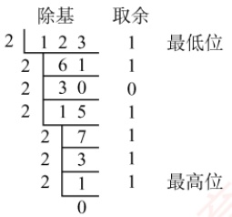

**所以，整数部分123=(1111011)2。**

小数部分（乘2取整）:

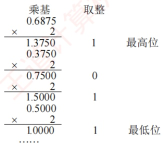

所以，小数部分 $0.6875 = (0.1011)_2$ ，因此， $123 . 6875 {=} ( 1111011 . 1011 )_{2}$

**注意**

关于除基取余法和乘基取整法的原理，建议结合r进制数的数值定义公式理解，避免死记硬背。并非所有十进制小数都能用有限位二进制小数精确表示。一个十进制小数能被有限位二进制精确表示，当且仅当它可以表示成形如k/2”的分数。例如，0.3=3/10，而10不是2的幂（其质因数包含5），因此无法用有限位二进制精确表示。相反，任何有限位二进制小数都对应一个分母为2的幂的分数，因此总能精确地转换为十进制小数。这一特性在浮点数的表示与运算中尤为重要，需特别注意。

### 2.1.2 定点数的编码表示

**1. 真值和机器数**

在日常生活中，数通常用“+”或“-”号表示正负（正号常省略），如+15、-8。这类带有符号的数称为真值，即机器数所代表的实际数值。在计算机中，数的符号与数值部分一同编码:通常用“0”表示正，“1”表示负。这种将符号数字化的表示形式称为机器数。

例如，机器数0,101（逗号仅用于分隔符号位与数值位）表示真值+5。

**2. 机器数的定点表示**

根据小数点位置是否固定，计算机中的数值表示分为定点表示和浮点表示。

定点表示用于表示定点小数和定点整数。

1）定点小数。表示纯小数，约定小数点位于符号位之后、数值部分最高位之前。若数据 $X   =$ $x_{0}.x_{1}x_{2}.\cdots x_{n}$ (其中 $x_{0}$ 为符号位， $x_{1} \sim x_{n}$ 为数值位， $x_{1}$ 为最高有效位），其在计算机中的表示形式如图2.1所示。

2）定点整数。表示纯整数，约定小数点位于数值部分最低位之后。若数据 $X = x_{0}x_{1}x_{2}\cdots x_{n}$ (其中 $x_{0}$ 为符号位， $x_{1} {\sim} x_{n}$ 为数值位， $x_{n}$ 为最低有效位），其表示形式如图2.2所示。

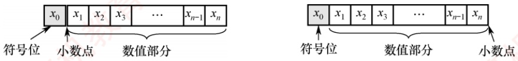

图2.1 定点小数表示

图2.2 定点整数表示

事实上，在机器内部并没有小数点，只是人为约定了小数点的位置。因此，在定点数的编码和运算中，无须区分该数表示的是小数还是整数，而只需关心符号位和数值位即可。

定点数的编码表示法主要有四种:原码、补码、反码和移码。

**3. 原码、补码、反码、移码**

**(1)原码表示法**

用机器数的最高位表示数的符号，其余各位表示数的绝对值。原码的定义如下。

$$
\left[ x \right]_{原} = \left\{\begin{aligned} & 0,x, & 0 \leqslant x < 2^{n} \\ & 2^{n} - x = 2^{n} + \left| x \right|, & - 2^{n} < x \leqslant 0 \end{aligned} \right. \quad (x  是真值 , 字长为  \; n + 1)
$$

例如，若字长为8位， $x_{1} = + 1110, x_{2} = - 1110$ ，则其原码表示分别为 $[x_{1}]_{原} = 0, 0001110, [x_{2}]_{原} =$ $2^{7}+1110=1,0001110$

对于 $n + 1$ 位原码整数，其表示范围为 $- ( 2^{n} - 1 ) \leqslant x \leqslant 2^{n} - 1$ （关于原点对称）。

**注意**

零的原码表示有正零和负零两种形式，即 $\left[ + 0 \right]_{原} = 0,0000000  和  \left[ - 0 \right]_{原} = 1,0000000$

原码表示的优点:①与真值的对应关系简单、直观，转换简便；②用原码实现乘除运算比较简便。缺点:①零的表示不唯一，存在±0两种编码；②用原码实现加减运算比较复杂。

**(2) 补码表示法**

补码表示法的加法和减法运算均可通过加法器统一实现。正数的补码与原码相同，负数的补码等于模（n+1位补码的模为 $2^{n + 1} )$ )与该负数绝对值之差。补码的定义如下。

$$
\left[ x \right]_{补} = \left\{\begin{aligned} 0, x, \quad 0 \leqslant x < 2^{n} \\ 2^{n + 1} + x = 2^{n + 1} - \left| x \right|, \quad - 2^{n} \leqslant x < 0 \end{aligned} \right. \quad ( mod  2^{n + 1} )
$$

等价地，无论是正数还是负数， $[x]_{补} = 2^{n + 1} + x \quad (-2^n \leq x \leq 2^n$ ${\bmod {~ 2^{n + 1} )}}$ 0

例如，若字长为8位， $x_{1}=+1010,\ x_{2}=-1101$ ，则其补码表示分别为 $\left[ x_{1} \right]_{补} = 0, 0001010, \left[ x_{2} \right]_{补} =$ $2^{8}-|x_{2}|=1,1110011$ 0 X

**考点追踪补码的表示范围（2010、2013、2014、2022）**

对于n+1位补码整数，其表示范围为 $-2^{n} \leqslant x \leqslant 2^{n}-1$ （比原码多表示一个负数，即-2ⁿ）。

• 几个特殊值的补码（n+1位）:

1) $\left[ + 0 \right]_{补} = \left[ - 0 \right]_{补} = 0,00 \ldots 0$ （全0），零的补码表示是唯一的。

2) $[ - 1 ]_{\#} = 2^{n + 1} - 1 = 1 , 11 \cdots 1$ (全1)。

3）最大正整数: $\left[ 2^{n} - 1 \right]_{\#} = 0 , 11 \ldots 1$ （符号位为0，数值位全1）。

4）最小负整数: $\left[ -2^n \right]_{补} = 1, 00 \cdots 0$ （符号位为1，数值位全0）。

**● 模运算（了解）**

在模运算中，一个数与它除以“模”后得到的余数是等价的。如A、B、M满足 $A = B + K \times M   (K$为整数），记为 $A \equiv B \pmod{M}$ ，即A、B各除以M后的余数相同。在补码运算中， $\left[ A \right]_{补} - \left[ B \right]_{补} = \left[ A \right]_{补} +$ $M - [B]_{补}$ ，而 $M - \left[ B \right]_{补} = \left[ - B \right]_{补}$ ，因此补码能够借助加法运算实现减法运算。

**● 补码与真值之间的转换**

**考点追踪补码和真值的相互转换（2020、2023）**

真值转换为补码:对于正数，与原码的方式一样。对于负数，符号位取1，其余各位由其绝对值“按位取反，末位加1”得到。补码转换为真值:若符号位为0，则直接读作正数。若符号位为1，则真值为负数，其绝对值由补码数值部分“按位取反，末位加1”得到。

**• 变形补码**

为便于溢出检测，可采用双符号位的补码表示（又称变形补码），双符号位00表示正数，11表示负数。若总位数为 $n + 2$ （高2位为符号位，其余为数值位），则变形补码定义为

$$
\left[ x \right]_{变补} = \left\{\begin{aligned} & 00, x, & 0 \leqslant x < 2^n \\ & 2^{n+2} + x = 2^{n+2} - \left| x \right|, & -2^n \leqslant x < 0 \end{aligned} \right. \quad ( mod  \quad 2^{n+2} )
$$

在双符号位中，左符表示真正的符号位，右符用于判断“溢出”。

**（3）反码表示法（了解即可）**

反码可视为从原码转换为补码的中间表示形式。

正数的反码与其原码相同。负数的反码由其原码的数值部分按位取反（末位不加1）得到。

反码表示存在明显不足:①零的表示不唯一（存在±0两种编码）；②表示范围与相同字长的原码相同，比补码少一个最小负数 $( - 2^{n} )$ 。因此，反码在计算机中极少使用。

**(4)移码表示法**

移码主要用于表示浮点数的阶码，且用于表示整数。其核心思想是将真值x加上一个固定偏置值，实现数轴整体右移。设字长为 $n + 1$ 位，偏置值通常取2”，则移码定义为 XO

$$
[x]_{移} = 2^n + x \qquad (-2^n \leqslant x < 2^n)
$$

**注意**

在IEEE 754 标准的浮点数中，k位阶码的偏置值为 $2^{k - 1} - 1$ ，如8位阶码的偏置值为127。

例如，若字长为8位，偏置值为 $2^{7}, x_{1} = + 10101$ $x_{2} = - 10101$ ，则其移码表示分别为 $[x_{1}]_{移} = 2^{7} +$ $10101 = 1,0010101; \left[ x_{2} \right]_{标} = 2^{7} + ( - 10101) = 0,1101011$

移码（设字长为 $n + 1$ ，偏置值为2ⁿ）的主要特点如下:

①零的表示唯一， $\left[ + 0 \right]_{移} = 2^{n} + 0 = \left[ - 0 \right]_{移} = 2^{n} - 0 = 1,00\ldots0\left( n  个  0 \right)$ 0

②在相同字长下，移码与补码仅符号位相反（将补码的最高位取反即得移码）。

③移码全0时，对应真值的最小值-2ⁿ；移码全1时，对应真值的最大值 $2^{n} {-} 1$

④移码保持真值的大小顺序:移码值越大，对应真值越大，便于阶码比较。

四种编码表示的总结如下:

**考点追踪补码大小的判断（2015）**

①正数的原码、反码、补码相同；移码则不同。

②原码与反码在数轴上关于原点对称，二者都存在+0与-0。

③补码与移码的表示不对称，零的表示唯一，且比原码和反码多表示一个负数（-2”）。

④原码可直观的比较大小（因数值部分即绝对值），而负数的补码和反码不能像原码那样直观判断。不过，在同为负数的前提下，补码或反码的数值部分越大，其真值也越大。

### 2.1.3 整数的表示

**1. 无符号整数的表示**

**考点追踪机器码与补码、无符号数之间的转换（2021）**

当所有二进制位均用于表示数值（无符号位）时，该编码称为无符号整数，简称无符号数。此时，数值隐含为非负整数。由于无须保留符号位，在相同字长下，无符号整数能表示的最大值大于有符号整数。无符号整数适用于仅涉及非负整数且结果不会产生负值的场景。例如，可用无符号整数进行地址运算，或用它来表示指针。

例如，8位无符号整数的最小值为00000000（0），最大值为 $1111\ 111\ (2^{8}-1=255)$ ，表示范围为0～255；而8位有符号整数（补码表示）的最小值为 $1000\ 0000(-2^{7}=-128)$ ，最大值为0111 1111 $(2^{7} - 1 = 127)$ ，表示范围为-128～127。

**2. 有符号整数的表示**

有符号整数通过在数值位前增设一位符号位（0表示正，1表示负）来表示正负。虽然原码、反码和补码均可用于表示有符号整数，但现代计算机统一采用补码，因其具有以下优势:

①零的表示唯一（无+0与-0之分）。

②符号位可与数值位一同参与运算，使加减法统一为加法操作。

③表示范围更大，比原码和反码多表示一个最小负数。

因此，n位有符号整数（补码）的表示范围为- $- 2^{n - 1} {\sim} 2^{n - 1} - 1$

### 2.1.4 C语言中的整数类型及类型转换

统考大纲要求考生具备分析高级程序设计语言（如C语言）中相关问题的能力，其中变量之间的类型转换是高频考点，需要深入掌握。

**1. C语言中的整型数据类型**

考点追踪int型数据的表示范围（2017、2019、2024）

C语言提供了多种整型类型，其具体长度依赖于编译器和目标平台。常见情况如下:

●短整型:short（或 short int），通常为 16 位。

● 整型:int，通常为 32 位。

•长整型:long（或 long int），在 32位系统中为 32位，在 64 位系统中通常为 64 位。

在上述类型前添加 unsigned 关键字，可定义对应的无符号类型(如 unsigned int、unsigned short等）。若未显式指定 signed或 unsigned，则默认为有符号类型。

字符型（char，通常为8位）是一种特殊的整型，通常可按无符号整数解释。

在现代系统中，所有有符号整型均以补码形式存储。无符号整型则将全部位用于表示非负数值。因此，在相同位宽下，两者的取值范围不同。

**2. 整型数据的类型转换**

定点数在类型转换过程中，若涉及字长变化，则会触发两种基本操作:位截断与位扩展。

1）位截断:当长类型转换为短类型时，系统直接丢弃高位，仅保留低位部分。由于目标类型的表示范围较小，截断可能导致数值发生变化，具有较强的隐蔽性。

```txt
考点追踪零扩展和符号扩展的应用（2012、2021、2024）
```

2）位扩展:当短类型转换为长类型时，系统通过填充高位来保持数值语义不变。具体扩展的方式取决于源数据的符号性: X

● 零扩展:用于无符号数，在高位补0。

● 符号扩展:用于补码表示的有符号数，高位重复填充符号位。

C 语言支持通过强制类型转换实现不同类型间的转换，其语法为“TYPEb=(TYPE)a”，转换结果是一个TYPE类型的值。根据源类型与目标类型的字长和符号性，可分为三种情形。

```txt
考点追踪整型类型的相互转换（2011、2016、2019、2024）
```

（1）长类型转换为短类型:位截断

转换规则:保留低位，丢弃高位。

考虑如下代码片段:

```txt
int x=165537, u=-34991; //int 型为 32 位
short y=(short)x, v=(short)u; //short 型为 16 位
printf("x=%d, y=%d\n", x, y);
printf("u=%d, v=%d\n", u, v);
运行结果如下：
x=165537, y=-31071
u=-34991, v=30545 育
```

其中，x,y,u,v的十六进制表示分别为0x000286A1,0x86A1,0xFFFF7751,0x7751。可见，当长类型转换为短类型时，系统直接截断高位，仅保留低位部分。由于目标类型的数值范围较小，这种位截断可能导致结果与原值在语义上不一致。由于x=165537超出了16位有符号整数的最大值（32767），截断后的位模式被解释为-31071，这并非运算溢出，而是位截断引起的语义变化。需要注意的是，此类转换不会触发任何异常或错误报告，具有很强的隐蔽性。

**（2）相同字长的转换:仅改变解释方式**

转换规则:二进制位模式保持不变，仅重新解释其含义。

考虑如下代码片段:

```txt
short x=-4321;
unsigned short y=(unsigned short)x;
printf("x=%d, y=%u\n", x, y);
运行结果如下：
x=-4321, y=61215
```

有符号数x为负数，而无符号数y只能表示非负值。从输出结果看，y的值似乎与x毫无关联；但将二者转换为二进制形式后（见表2.1），可观察到:short型强制转换为 unsigned short型后，所有二进制位均保持不变，x按补码规则解释为有符号数，而y则按无符号规则解读。

表 2.1 y 与 x 的位级表示对比

<table><tr><td>变 量</td><td>值</td><td colspan=16>二进制位</td></tr><tr><td></td><td></td><td>15</td><td>14</td><td>13</td><td>12</td><td>11</td><td>10</td><td>9</td><td>8</td><td>7</td><td>6</td><td>5</td><td>4</td><td>3</td><td>2</td><td>1</td><td>0</td></tr><tr><td>X</td><td>-4321</td><td>1</td><td>1</td><td>1</td><td>0</td><td>1</td><td>1</td><td>1</td><td>1</td><td>0</td><td>0</td><td>0</td><td>1</td><td>1</td><td>1</td><td>1</td><td>1</td></tr><tr><td>y</td><td>61215</td><td>1</td><td>1</td><td>1</td><td>0</td><td>1</td><td>1</td><td>17</td><td>1</td><td>0</td><td>0</td><td>0</td><td>1</td><td>1</td><td>1</td><td>1</td><td></td></tr></table>

这表明:相同字长的整型类型转换不改变位模式，仅改变对这些位的解释方式。

（3）短类型转换为长类型:位扩展

转换规则:若源数据为有符号数，则执行符号扩展；若源数据为无符号数，则执行零扩展。考虑如下代码片段:

```txt
运行结果如下：

x=-4321, y=-4321
u=61215, v=61215
```

```txt
short x=-4321;
int y=x;
unsigned short u=(unsigned short)x;
unsigned int v=u;
printf("x=%d, y=%d\n", x, y);
printf("u=%u, v=%u\n", u, v);
```

其中，x,y,u,v的十六进制表示分别为 0xEF1F,0xFFFFEF1F,0xEF1F,Ox0000EF1F。可见，短类型转换为长类型时，要对高位部分进行扩展，扩展方式取决于源数据的符号性。可见，x为有符号数，符号位为1，扩展时高16位补1；u为无符号数，扩展时高16位补0。

## 2.2 运算方法和运算电路

### 2.2.1 基本运算部件

在计算机中，运算器由算术逻辑单元（ArithmeticLogicUnit，ALU）、移位器、状态寄存器（PSW）和通用寄存器组等组成。运算器的基本功能包括加、减、乘、除四则运算，与、或、非、异或等逻辑运算，以及移位、求补等操作。ALU的核心部件是加法器。

**1.一位全加器**

全加器（FA）是最基本的加法单元，有三个输入:加数 $A_{i^{\vee}}$ 加数 $B_{i}$ 与来自低位的进位 $C_{i - 1}$两个输出:本位和 $S_{i}$ 及向高位的进位 $C_{i^{\circ}}$ 其逻辑表达式如下。

和表达式: $S_{i}   =   A_{i}   \oplus   B_{i}   \oplus   C_{i - 1}$ (当 $A_{i};~B_{i}、~C_{i-1}$ 中有奇数个1时， $S_{i}   = 1$ ，否则 $S_{i}   =   0   )$

进位表达式: $C_{i} = A_{i} B_{i} + ( A_{i} \oplus B_{i} ) C_{i - 1}$

一位全加器的逻辑结构如图2.3(a)所示，其逻辑符号如图2.3(b)所示。

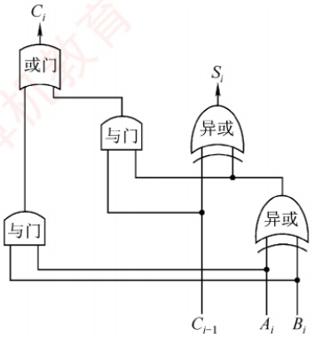

(a)一位全加器的逻辑结构

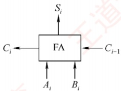

(b)逻辑符号

图 2.3 一位全加器

**2. 串行进位加法器**

将n个全加器级联可构成n位串行进位加法器（又称行波进位加法器），如图2.4所示。其特点是进位信号逐级传递，每一级的进位输出直接作为下一级的进位输入。

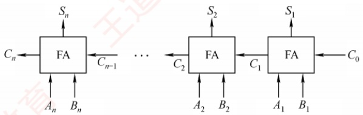

图 2.4 n 位串行进位加法器

图 2.4 中的加法器实现两个 n 位二进制数 $A = A_{n}A_{n - 1}\cdots A_{1}$ 和 $B = B_{n}B_{n - 1} \cdots B_{1}$ 逐位相加的功能，得到和 $S = S_{n}S_{n - 1} \cdots S_{1}$ 及最终进位 $C_{n^{\circ}}$ 例如，当A=1111，B=0001（4位）时，输出 $S = 0000, \quad C_{4} = 1$由于位数固定，结果实际为模 $2^{n}$ 的加法（溢出部分被丢弃）。

在串行进位加法器中，总运算延迟主要由进位信号从最低位传播到最高位的时间决定。位数越多，进位链越长，延迟越大。因此，缩短进位传递路径是提升加法器性能的关键。

**\*3. 并行进位加法器**

并行进位（也称先行进位）加法器能够显著提升加法运算速度，因为它能以几乎同时生成所有进位信号的方式工作，而非逐级传递进位。为了实现这一目标，n个一位全加器被连接至一个n位先行进位逻辑部件（CLA部件），以便几乎同时生成所有进位信号。因此，并行进位加法器对于较大位数的数据处理效率要高于串行进位加法器。图2.5展示了一个4位全先行进位加法器的例子。随着加法器位数的增加，电路设计复杂度也会相应提高，此处不再详述。

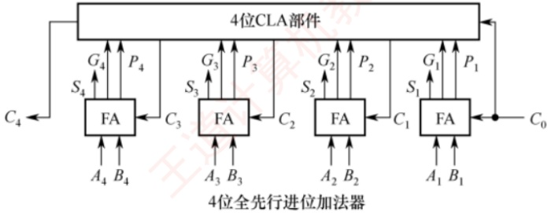

图 2.5 一个4位全先行进位加法器

**4. 带标志加法器**

对于n位加法器来说，除了得到运算结果外，还要关注加法运算过程中是否发生了溢出、结果的正负性、结果是否为零等，这些信息对于程序的执行控制非常关键。为此，在n位加法器的基础上增加了额外的逻辑电路，不仅支持计算和/差，还能生成以下标志位:OF、CF、SF和ZF，每个标志占1位。图2.6展示了用全加器实现n位带标志加法器的电路示意图。

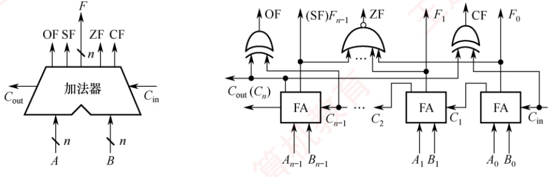

(a) 带标志加法器符号

(b) 带标志加法器的逻辑电路

图2.6 用全加器实现 n位带标志加法器的电路

在图2.6中，溢出标志OF通过检测最高有效位的进位输入 $C_{n - 1}$ 与进位输出 $C_{n}$ 是否不同决定，即 $\mathrm {O F} = C_{n} \oplus C_{n - 1}$ ，用于判断有符号数加法运算是否溢出:OF=1表示溢出，OF=0表示未溢出。符号标志SF等于结果的最高有效位，即 $\mathrm {S F} = F_{n - 1}$ ，用于指示有符号数加法运算结果的正负性:SF=0表示结果为正，SF=1表示结果为负。零标志ZF在结果的所有位均为0时设置为1，用于指示加减运算的结果是否为零:ZF=1表示结果为0，ZF=0表示结果非零。进位/借位标志CF用于判断无符号数的加减运算是否发生溢出:CF=1表示溢出，CF=0表示未溢出。

**5. 算术逻辑单元（ALU）**

ALU是一种功能较强的组合逻辑电路，能够执行多种算术与逻辑运算。其中，加法和减法由带标志加法器直接完成；乘法和除法则通常通过ALU配合控制逻辑，以多次加减和移位的方式迭代实现。此外，ALU还能执行与、或、非等基本逻辑运算。其基本结构如图2.7所示:A和B为两个n位操作数输入端， $C_{\mathrm {i n}}$ 为进位输入端，ALUop为操作控制信号，用于选择ALU执行的具体功能。例如，当ALUop选择加法（Add）时，ALU输出 $A + B + C_{in}$ ALUop的位数决定了可支持的操作种类数量。例如，3位ALUop最多可支持8种不同操作。

图2.8展示了一位ALU的结构，可完成“与”“或”“加法”三种操作。其中，加法由一个全加器实现，逻辑运算由专用门电路并行计算，最终通过多路选择器（MUX）根据ALUop选择输出结果。由于有3种操作，ALUop至少需要2位。

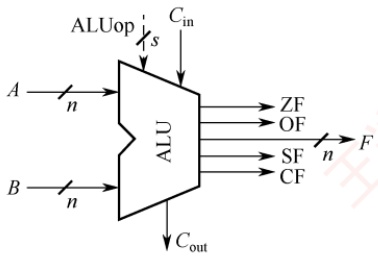

图 2.7 ALU 的基本结构

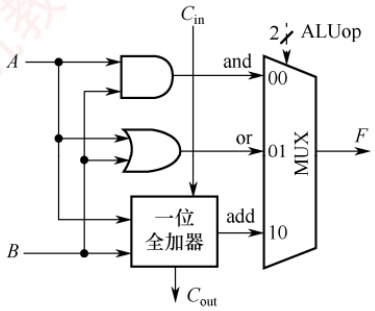

图 2.8 一位 ALU 结构图

### 2.2.2 定点数的移位运算

当计算机中没有乘/除运算电路时，可以通过加法和移位相结合的方法来实现乘/除运算。对于任意二进制整数，左移一位，若未发生溢出，相当于乘以2（类似于十进制数左移一位相当于乘以10）；右移一位，若忽略因移出而舍去的末位尾数，相当于除以2。

根据操作数的类型不同，移位运算可以分为逻辑移位和算术移位。

**1. 逻辑移位**

**考点追踪逻辑移位运算（2018）**

逻辑移位将操作数视为无符号整数。逻辑移位的规则:左移时，高位移出，低位补0。若高位的1移出，则发生溢出。右移时，低位移出，高位补0。

例如，4位无符号数0001（+1）左移一位变为0010（+2），相当于乘以2，未溢出；0001（+1）右移一位变为0000（0），相当于除以2并舍弃小数部分。又如，1000（+8）左移一位变为0000（0），相当于乘以2，但结果超出了4位无符号数的表示范围，发生溢出。

**2. 算术移位**

考点追踪算术移位运算（2012、2017、2018）

算术移位需要考虑符号位的问题，即将操作数视为有符号整数。有符号整数采用补码表示，因此对于有符号整数的移位操作应采用补码算术移位方式。算术移位的规则:左移时，高位移出，低位补0。若移出的高位与原符号位不同（左移后符号位改变），则发生溢出。右移时，低位移出，高位补符号位。若低位的1移出，则影响精度。

例如，4位补码0010（+2）左移一位变为0100（+4），未溢出；1001（-7）左移一位变为0010，符号由负变正，表明发生溢出（因为-14超出了4位补码的表示范围）。又如，1001（-7）右移一位变为1100（-4），保留了符号位，但丢失了最低有效位，影响精度。

### 2.2.3 定点数的加减运算

**1. 补码加减运算**

考点追踪补码的加减运算（2009、2011、2017、2025）

补码加减运算规则简单，易于硬件实现。补码加减运算的公式如下（设字长为n+1）。

$$
\begin{aligned} &\left[A+B\right]_{补}=\left[A\right]_{补}+\left[B\right]_{补}\left(\bmod 2^{n+1}\right)\\ &\left[A-B\right]_{补}=\left[A\right]_{补}+\left[-B\right]_{补}\left(\bmod 2^{n+1}\right)\\ \end{aligned}
$$

补码运算具有以下特点:

1）按二进制加法规则运算，逢二进一。

2）若做加法，则两个数的补码直接相加；若做减法，则将被减数与减数的负数补码相加。

3）符号位与数值位一同参与运算，结果的符号位由运算自然得出。

4）运算结果自动截断为n+1位（模 $2^{n   +   1} )$ ，高位进位被丢弃，结果仍为补码形式。

【例2.3】设字长为8位（含1位符号位），A=15，B=24，求 $[A + B]_{补}$ 和 $[A - B]_{补}$ C解: X

$A = + 0001111$ ，B=+0011000；求得 $[A]_{补} = 00001111$ $[B]_{补} = 00011000$ $[ - B ]_{补} = 11101000$ 。则:$\left[ A + B \right]_{补} = \left[ A \right]_{补} + \left[ B \right]_{补} = 00001111 + 00011000 = 00100111$ ，符号位为0，真值为+39。$[A-B]_{补}=[A]_{补}+[-B]_{补}=00001111+11101000=11110111$ ，符号位为1，真值为-9。

**2. 溢出判别方法**

**考点追踪补码运算的溢出判断（2010、2011、2014、2018、2021、2025）**

补码加减运算仅在同号相加或异号相减时可能发生溢出。例如，两个正数相加结果为负，或一个负数减去一个正数结果为正。常用的溢出判别方法有以下三种。

**（1）采用一位符号位**

减法运算在机器中是用加法器实现的，因此加法和减法均可统一视为两个补码数相加。溢出仅发生在参与运算的两个数符号相同，而结果符号与之不同的情况下。设参与运算的两个操作数的符号位分别为 $A_{\mathrm {s}}$ 和 $B_{\mathrm {s}}$ ，运算结果的符号为 $S_{\mathrm {s}}$ ，则溢出逻辑表达式为

$$
V = A_{\mathrm{s}}B_{\mathrm{s}}\overline{S_{\mathrm{s}}} + \overline{A_{\mathrm{s}}B_{\mathrm{s}}}S_{\mathrm{s}}
$$

**(2）采用一位符号位并结合进位情况**

设符号位（最高位）产生的进位为 $C_{n} ,$ 最高数值位（次高位）产生的进位为 $C_{n - 1}$ 。若 $C_{n}$ 与 $C_{n - 1}$不同，则表示溢出。溢出逻辑表达式为

$$
V = C_{n} \oplus C_{n - 1}
$$

**(3)采用双符号位**

使用两个符号位 $S_{\mathrm {s} 1} S_{\mathrm {s} 2} ~ \left( S_{\mathrm {s} 1} \right.$ 为高位符号位），若两个符号位不同，则表示溢出。 $S_{\mathrm {s} 1} S_{\mathrm {s} 2}$ 的各种情况如下: $S_{\mathrm{sl}}S_{\mathrm{s}2}=00$ 表示结果为正数，无溢出。② $S_{\mathrm {s} 1} S_{\mathrm {s} 2}   {=}   01$ :表示结果正溢出。③ $S_{\mathrm {s} 1} S_{\mathrm {s} 2} =$ 10:表示结果负溢出。 $S_{\mathrm{sl}}S_{\mathrm{s}2}=11$ :表示结果为负数，无溢出。溢出逻辑表达式为

$$
V   =   S_{\mathrm {s} 1}   \oplus   S_{\mathrm {s} 2} ,
$$

在上述三种方法中，若V=0，则表示无溢出；若 $V   =   1$ ，则表示有溢出。

**3. 加减运算电路**

**考点追踪补码加法器的实现原理（2011）**

在计算机中，无论是无符号数还是有符号数的加减运算，均采用同一套硬件电路实现，即“一套电路，两种语义”。图2.9所示为一个加减运算部件，其输入端包括两个n位操作数X和Y，以及一个控制信号Sub。其中，Y分成两路:一路直接接入二选一多路选择器（MUX），另一路经n位反相器后接入同一选择器。控制信号 Sub不仅决定选择哪一路数据进入加法器，还在执行减法时作为最低位的进位输入。输出端包括n位运算结果F以及各类标志位。

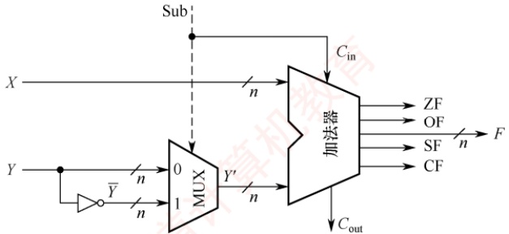

图 2.9 加减运算部件

**（1）加法运算的工作原理**

无论是无符号数还是补码表示的有符号数，其加法均通过同一加法器电路完成。当执行加法操作时 $( Sub = 0 )$ ，电路实现过程如下。

输入:X直接接入加法器的一端；Y接入MUX。

控制信号: $\mathsf {Sub}   =   0$ ，同时作为加法器的最低位进位输入 $C_{\mathrm {i n}} {=} 0$

运算:MUX在 $\mathrm {Sub   =   0}$ 时选择Y直接通过，加法器执行 $X + Y + C_{in} (X + Y)$ ，输出 n 位结果F和进位输出 $C_{\mathrm {out}}$ ，并生成状态标志位。

语义解释:

1）若X、【被视为无符号数，则结果 $F = (X + Y) \bmod 2^n$ 当 $X + Y \geqslant 2^{n}$ 时，产生进位 $C_{out} = 1$表示发生无符号溢出；此时，标志 $\mathrm {C F}   =   C_{\mathrm {out}}$ 反映进位状态。 妮

2）若X、Y被视为有符号数 $([X]_{补} 、 [Y]_{补})$ ，则结果 $F = [X + Y]_{补}$ 。此时，若两个操作数同号而结果异号（如正+正→负），则表示有符号溢出，由溢出标志OF指示。

**(2)减法运算的工作原理**

无论是无符号数还是补码表示的有符号数，其减法也通过同一加法器电路实现。当执行减法操作时（Sub=1），电路实现过程如下:

输入:X直接接入加法器的一端；Y接入MUX。

控制信号:Sub=1，同时作为加法器的最低位进位输入 $C_{\mathrm {i n}}   =   1$

运算:MUX在Sub=1时选择反相后的输出，加法器执行 $X + \overline{Y} + C_{in} \left( X + \overline{Y} + 1 \right)$ ，输出n位结果F和进位输出 $C_{\mathrm {out}} ,$ ，并生成状态标志位。

语义解释:

1）若X、Y被视为无符号数，则该运算等价于计算 $X - Y + 2^{n}$ （模2ⁿ运算）①:

$\bullet X \geqslant Y$ 时， $X - Y + 2^{n} \geqslant 2^{n}$ ，有进位 $C_{\mathrm {out}} {=} 1$ ，舍去高位后 $F   =   X   -   Y ,$ 表示无借位（结果非负）。$X {\leq} Y$ 时， $0 < X - Y + 2^{n} < 2^{n}$ ，无进位 $C_{out} = 0$ ，表示有借位（结果为负，超出n位无符号数范围），表示发生无符号溢出。此时，标志 $\scriptstyle \mathrm {C F} = C_{\mathrm {out}}$ 反映借位状态。

2）若X、Y被视为有符号数 $([X]_{补} \cup [Y]_{补})$ ，则该运算等价于 $\left[ X - Y \right]_{补} = \left[ X \right]_{补} + \left[ - Y \right]_{补}$ :

● 结果F即为 $[ X   -   Y ]_{补}$ C

●若运算导致结果超出n位补码表示范围（例如，正减负得负，或负减正得正），则发生有符号溢出，由溢出标志OF指示。

**注意**

运算器本身无法识别所处理的二进制串是有符号数还是无符号数。例如， $0 - 1 = 00 \ldots 0 + 11 \ldots 1 =$ 11...1，若解释为有符号数，对应值为-1，结果正确；若解释为无符号数，对应值为 $2^{n} - 1$ (n位无符号数的最大值），与数学结果不符。此类易混点是统考极易考查的内容。

**(3)各类标志位的含义**

考点追踪各类标志位的分析（2011、2018、2022-2024）

可通过状态标志位来区分有符号数与无符号数的运算结果，各类标志位的含义如下。

零标志 ZF:当结果F = 0时， $\mathrm {Z F}   =   1$ ；否则 $\mathrm {Z F   =   0}   \mathrm {{_{\circ}}}$ 对无符号数和有符号数均有意义。

溢出标志OF:用于判断有符号数运算是否发生溢出， $\mathrm{OF} = C_n \oplus C_{n-1}$ (符号位进位与最高数值位进位的异或）。对无符号数运算无意义。即无法依据OF判断无符号数运算是否溢出。例如，无符号加法 $010+011=101$ ，虽然 $\mathrm {O F} = 1$ ，但结果并未溢出。

> X-Y = X + (2ⁿ−Y)−2"

> Y + Y = 2ⁿ− 1

> X+Y+1−2ⁿ

> X+Y+1

> 2″-Y=Y+1

> X-Y + 2ⁿ

> ①无符号减法可表示为X-Y=X+(2”-Y)-2”。其中，2”-Y可视为Y的无符号补码（模2”意义下的补数）。若用表示Y的按位取反，则根据二进制运算性质有Y+Y=2″-1（结果为n位全1）。由此可得2″-Y=Y+1。因此，X-Y可进一步转换为加法形式X+Y+1-2″。其中，X+Y+1是一个纯加法运算，可直接由加法器完成，结果等于X-Y+2″。

符号标志SF:等于结果F的最高位（符号位）。仅对有符号数有意义。

**考点追踪CF标志位的作用（2024）**

进/借位标志CF:用于表示无符号数运算中的进位/借位情况，判断是否溢出。仅对无符号数有意义。加法 $( Sub = 0 )$ 时， $\mathrm {C F} = 1$ 表示有进位，即发生上溢， $\mathrm {C F} = C_{\mathrm {out}} ,$ 减法 $( \mathrm{Sub} = 1 )$ 时， $\mathrm {C F} = 1$表示有借位，即不够减，CF等于 $C_{\mathrm {out}}$ 取反。综合得 $\mathrm {C F} = \mathrm {Sub} \oplus C_{\mathrm {out}} .$ 例如，无符号数加法 $110 \pm 011$产生进位；无符号数减法 $000 - 111$ 产生借位，结果均发生溢出 $( \mathrm {C F} = 1 )$ 0

**(4)无符号数大小的比较**

在无符号数运算中，零标志ZF和进/借位标志CF是判断大小关系的关键。设A和B为两个无符号数，执行运算 $\mathcal {A} - B$ 后，根据ZF和 CF的值可判断A和 B的大小。

若 $A   =   B_{\circ}$ 如 $A - B = 011 - 011 = 000$ ，结果为零 $\mathrm {Z F} = 1$ ，无借位 $CF  = 0.$ 0

若 $A \geq B$ 如 $A - B = 010 - 001 = 001$ ，结果非零 $\mathrm {Z F} = 0$ ，无借位 $\mathrm{CF} \equiv 0$

若 $A < B$ 如 $A-B=000-001=(1)000-001=111$ ，结果非零 $\mathrm{ZF} = 0$ ，有借位 $\mathrm {C F} = 1$

综上，判断规则如下:当 $\mathrm {Z F} = 1$ 时（无须检查CF），说明 $A = B;$ 当 $\mathrm {Z F} = 0$ 且 $\mathrm {C F} = 0$ 时，说明 $A \geq B ;$ 当 $\mathrm {C F} = 1$ 时（此时ZF必为0，无须额外检查），说明 $A \leq B ,$

**(5）有符号数大小的比较**

在有符号数运算中，零标志ZF、溢出标志OF和符号标志SF共同用于判断大小关系。设A和B为两个有符号数，执行运算 $\left[ A \right]_{补} - \left[ B \right]_{补}$ 后，根据ZF、OF、SF的值可判断A和B的大小。

若 $A   =   B \circ$ 如 $\left[ A \right]_{补} - \left[ B \right]_{补} = 011 - 011 = 011 + 101 = (1)000$ ，得 $\mathrm{ZF}=1,\mathrm{OF}=C_{3}\oplus C_{2}=0,\mathrm{SF}=0。$

若 $A   \geq   B_{\circ}$ 无溢出示例: $\left[ A \right]_{补} - \left[ B \right]_{补} = 010 - 001 = 010 + 111 = (1)001$ ，得 $\mathrm{ZF} = 0,\ \mathrm{OF} = 0$ $\mathrm {S F = 0} ;$ 有溢出示例: $\left[ A \right]_{补} - \left[ B \right]_{补} = 011 - 101 = 011 + 011 = 110$ ，得 $\mathrm{ZF}=0,\ \mathrm{OF}=1,\ \mathrm{SF}=1.$

$$
A   \leq   B ,
$$

$$
\left[ A \right]_{补} - \left[ B \right]_{补} = 000 - 001 = 000 + 111 = 111
$$

$$
\mathrm{ZF} = 0,\ \mathrm{OF} = 0
$$

$$
\mathrm {S F} = 1
$$

$$
\left[ A \right]_{补} - \left[ B \right]_{补} = 101 - 011 = 101 + 101 = (1)010
$$

$$
\mathrm{ZF}=0,\ \mathrm{OF}=1,\ \mathrm{SF}=0
$$

综上，判断规则如下:当 $\mathrm {Z F} = 1$ 时，说明 $A = B ;$ 当 $\mathrm {Z F} = 0$ 且 $\mathrm {O F} = \mathrm {S F}$ (或 $\mathrm {O F} \oplus \mathrm {S F} = 0$ 时，说明 $A   \geq   B ;$ 当 $\mathrm {Z F} = 0$ 且 $\mathrm {O F} \neq \mathrm {S F}$ (或 $\mathrm {O F} \oplus \mathrm {S F} = 1 )$ 时，说明 $A \leq B_{\circ}$

**注意**

当 $\mathrm {Z F} = 0$ 且未发生溢出时，即 $\mathrm {O F = 0}$ 时，若 $\mathrm {S F} = 0$ ，则表示结果非负，说明 $A \geq B;$ 当发生溢出时，即 $\mathrm {O F} = 1$ 时，若 $\mathrm {S F} = 1$ ，则必然是正数减去负数发生溢出导致结果为负，说明 $A   \geq   B ,$ I

当 $ZF  = 0$ 且未发生溢出时，即 $\mathrm {O F = 0}$ 时，若 $\mathrm {S F} = 1$ ，则表示结果为负，说明 $A \leq B;$ 当发生溢出时，即 $OF  = 1$ 时，若 $\mathrm {S F} = 0$ ，则必然是负数减去正数发生溢出导致结果为正，说明 $A \leq B_{\circ}$

**\*4. 原码的加减运算（了解）**

在原码加减运算中，需将符号位与数值位分开处理，规则较为复杂，具体如下。

加法规则:遵循“同号求和，异号求差”的原则，先判断两个操作数的符号。具体来说，若符号相同，则数值位相加，结果符号位不变，若数值位相加时最高位产生进位，则发生溢出；若符号不同，则用绝对值较大的数减去绝对值较小的数，结果符号位与绝对值较大的数相同。

减法规则:先将减数的符号取反，再将被减数与符号取反后的减数按原码加法进行运算。

**注意**

由于原码加减法需要先比较两数的绝对值大小，再决定是执行加法还是执行减法，控制逻辑复杂难以用单一加法器高效实现。因此，现代计算机普遍采用补码进行加减运算，以简化硬件设计。

### 2.2.4 定点数的乘除运算

**1. 乘法运算**

**（1）原码乘法的运算原理**

原码乘法的特点是符号位与数值位分别处理，其运算过程分为两步:①乘积的符号位由两个乘数的符号位异或得到；②乘积的数值位是两个乘数绝对值的乘积。数值位的乘法可归结为两个无符号数的相乘。以下是两个无符号数相乘的手算过程。

$$
\begin{aligned}& 被乘数  X = x_{4}x_{3}x_{2}x_{1} = 1\ 1\ 0\ 1\ (13) \\\hline& \quad \times \quad 1\ 0\ 1\ 1\ 1 \quad - \quad - \quad - \quad - \quad - \quad - \quad X \times y_{1} \times 2^{0} & \quad &X \times 1\ 1 \\& \quad \quad \quad \quad \quad \quad \quad \quad \quad \quad \quad \quad \quad \quad \quad \quad \quad \quad \quad \quad \quad \quad \quad \quad \quad \quad \quad \quad \quad \quad \quad \quad \quad \quad \quad \quad \quad \quad \quad \quad \quad \quad \quad \quad \quad \quad \quad \quad \quad \quad \quad \quad \quad \quad \quad \quad \quad \quad \quad \quad \quad \quad \quad \quad \quad \quad \quad \quad \quad \quad \quad \quad \quad \quad \quad \quad \quad \quad \quad \quad \quad \quad \quad \quad \quad \quad \quad \quad \quad \quad \quad \quad \quad \quad \quad \quad \quad \quad \quad \quad \quad \quad \quad \quad \quad \quad \quad \quad \quad \quad \quad \quad \quad \quad \quad \quad \quad \quad \quad \quad \quad \quad \quad \quad \quad \quad \quad \quad \quad \quad \quad \quad \quad \quad \quad \quad \quad \quad \quad \quad \quad \quad \quad \quad \quad \quad \quad \quad \quad \quad \quad \quad \quad \quad \quad \quad \quad \quad \quad \quad \quad \quad \quad \quad \quad \quad \quad \quad \quad \quad \quad \quad \quad \quad \quad \quad \quad \quad \quad \quad \quad \quad \quad \quad \quad \quad \quad \quad \quad \quad \quad \quad \quad \quad \quad \quad \quad \quad \quad \quad \quad \quad \quad \quad \quad \quad \quad \quad \quad \quad \quad \quad \quad \quad \quad \quad \quad \quad \quad \quad \quad \quad \quad \quad \quad \quad \quad \quad \quad \quad \quad \quad \quad \quad \quad \quad \quad \quad \quad \quad \quad \quad \quad \quad \quad \quad \quad \quad \quad \quad \quad \quad \quad \quad \quad \quad \quad \quad \quad \quad \quad \quad \quad \quad \quad \quad \quad \quad \quad \quad \quad \quad \quad \quad \quad \quad \quad \quad \quad \quad \quad \quad \quad \quad \quad \quad \quad \quad \quad \quad \quad \quad \quad \quad \quad \quad \quad \quad \quad \quad \quad \quad \quad \quad \quad \quad \quad \quad \quad \quad \quad \quad \quad \quad \quad \quad \quad \quad \quad \quad \quad \quad \quad \quad \quad \quad \quad \quad \quad \quad \quad \quad \quad \quad \quad \quad \quad \quad \quad \quad \quad \quad \quad \quad \quad \quad \quad \quad \quad \quad \quad \quad \quad \quad \quad \quad \quad \quad \quad \quad \quad \quad \quad \quad \quad \quad \quad \quad \quad \quad \quad \quad \quad \quad \quad \quad \quad \quad \quad \quad \quad \quad \quad \quad \quad \quad \quad \quad \quad \quad \quad \quad \quad \quad \quad \quad \quad \quad \quad \quad \quad \quad \quad \quad \quad \quad \quad \quad \quad \quad \quad \quad \quad \quad \quad \quad \quad \quad \quad \quad \quad \quad \quad \quad \quad \quad \quad \quad \quad \quad \quad \quad \quad \quad \quad \quad \quad \quad \quad \quad \quad \quad \quad \quad \quad \quad \quad \quad \quad \quad \quad \quad \quad \quad \quad \quad \quad \quad \quad \ \end{aligned}
$$

上述过程可写成数学推导形式:

$$
X \times Y = X \times (y_{4} \times 2^{3} + y_{3} \times 2^{2} + y_{2} \times 2^{1} + y_{1} \times 2^{0}) = \{[(X \times y_{4}) \times 2 + X \times y_{3}] \times 2 + X \times y_{2} \} \times 2 + X \times y_{1}
$$

**考点追踪乘法运算的原理及分析（2020、2024）**

在硬件实现中，通常采用部分积右移的方式将上述求和过程转换为迭代形式。设乘数 $Y   =   y_{n} {\cdots}$ $y_{2} y_{1}$ (其中 $y_{1}$ 为最低位），定义部分积序列 $P_{0} , P_{1} , \cdots , P_{n}$ 如下:

$$
\begin{aligned} &P_{0}=0 \\&P_{1}=(P_{0}+X \times y_{1}) \gg 1 \\&P_{2}=(P_{1}+X \times y_{2}) \gg 1 \\&\cdots \\&P_{n}=(P_{n-1}+X \times y_{n}) \gg 1\\ \end{aligned}
$$

其中， $\text{"} \gg 1 \text{"}$ 表示逻辑右移一位。需要注意的是，这里的右移是位操作的一部分，而非数学上的除法；所有中间结果均在2n位存储空间中保留完整精度。经过n次迭代后，最终得到的2n位部分积 $P_{n}$ 即为乘积X×Y的完整二进制表示。因此，乘法运算可通过加法和移位实现。

为了保证精度，部分积需要使用2n位寄存器存储。原码乘法的过程可归纳如下:

①被乘数和乘数均取绝对值，作为无符号整数参与运算，结果的符号位为 $x_{s}$ ⊕ $y_{s}$ o

②初始化部分积 $P_{\mathrm {0}}   =   0$ ，从乘数的最低位 $y_{1}$ 开始，将当前部分积 $P_{i - 1}$ 加上 $X {\times} y_{i}$ ，然后逻辑右移1位。重复此步骤n次，最终所得的2n位部分积即为数值乘积。

(2）无符号整数的乘法运算电路

**考点追踪乘法运算电路中控制逻辑的作用（2020）**

图2.10展示了一个32位无符号数乘法运算器的逻辑结构。该电路采用加法与移位相结合的方法来完成乘法运算，其设计思想源自手算乘法的基本原理。

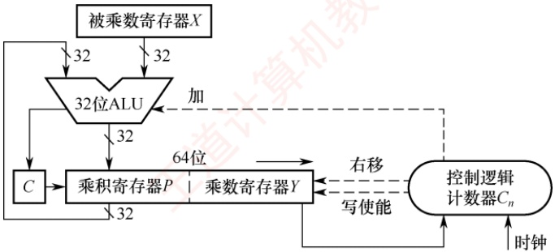

图2.10 一个32 位无符号数乘法运算器的逻辑结构

下面介绍其主要组成部分及其工作原理。

**1）初始化**

● 被乘数寄存器X:存储32 位被乘数X，在整个乘法过程中保持不变。

• 乘数寄存器 $Y ;$ 初始时存储32 位乘数 Y。

• 乘积寄存器 $P ;$ 初始化为0，用于存放累加的部分积（高32位结果）。

· 计数器 $C_{n} ;$ 初始化为n（本例为32），表示需进行 n次迭代。

2）执行过程（循环n次）

①判断:将乘数寄存器Y的最低位，送入控制逻辑。

②加法操作:若Y的最低位为1，则将当前部分积P加上被乘数X，并将进位存入进位触发器C；若Y的最低位为0，则执行空操作。

③移位操作:将C、P和Y视为一个整体，执行一次逻辑右移。具体来说，进位C移入P的最高位；P的最低位移入Y的最高位；Y的最低位被丢弃。

④更新计数器:计数器 $C_{n}$ 减1。若 $C_{n} \neq 0$ ，则继续下一轮迭代，否则算法结束。

**考点追踪无符号数乘法指令的溢出判断（2019、2020）**

**3）结果与溢出判断**

● 最终结果:64位乘积结果存储在寄存器对[P:Y]中，其中P为高32位，Y为低32 位。

● 溢出判断:若高32 位结果P不为零，则表明乘积超出了32 位无符号数的表示范围，发生溢出。此时，处理器将溢出标志OF与进位标志CF同时置1。

**4）溢出处理**

溢出处理属于软件层面的操作，通过检查CF或OF标志位即可判断是否发生溢出。若检测到溢出，则可在乘法指令后插入一条溢出自陷指令，自动触发异常处理程序，以处理错误（如报告错误、转为高精度计算等）。对于不要求结果精确性的应用，程序员可选择忽略溢出。

**(3）有符号整数的乘法运算电路**

有符号整数采用补码表示，其乘法需要同时处理符号与数值。A. D. Booth提出的 Booth 算法让符号位与数值位统一参与运算，直接生成补码形式的乘积，且对正数和负数一视同仁。

图2.11所示为32位补码一位乘法器的逻辑结构，其整体架构与图2.10中的无符号乘法器非常相似，主要区别在于控制逻辑。需要说明的是，Booth

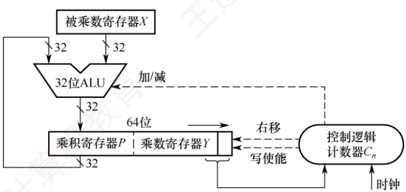

图2.11 32位补码一位乘法器的逻辑结构

算法的数学推导较为复杂，通常不在考研考查范围内，因此本书仅介绍其实现结构，不深入讨论其背后的原理。 临村

下面介绍其主要组成部分及其工作原理。

**1）初始化**

● 被乘数寄存器X:存储32 位被乘数，在整个乘法过程中保持不变。

● 乘积寄存器P:初始化为0，用于存放累加的部分积（高32位结果）。

● 乘数寄存器Y:初始时存储32 位乘数；在其右侧附加一个辅助位 $y_{- 1}$ ，且初始化为0。

• 计数器 $C_{n} ;$ 初始化为n（本例为32），表示需要进行n次迭代。

2）执行过程（循环n次）

①判断:将Y的最低位 $y_{0}$ 与辅助位 $y_{- 1}$ 组合形成两位二进制码，送入控制逻辑。

②加减法:若组合为10，则执行 $P   =   P   -   X$ （减去被乘数）；若为01，则执行 $P = P + X$ (加上被乘数）；若为00或11，则执行空操作（Booth算法的原理请参见教材）。

③移位:将P、Y和辅助位 $y_{- 1}$ 视为一个整体，执行一次算术右移。具体来说，P的最低位移入Y的最高位；Y的最低位移入辅助位 $y_{- 1}$ ；原辅助位 $y_{- 1}$ 被丢弃。

④循环控制:计数器 $C_{n}$ 减1。若 $C_{n}   \neq   0$ ，则继续下一轮迭代，否则算法结束。

**考点追踪有符号数乘法指令的溢出判断（2021）**

**3）结果与溢出判断**

● 最终结果:64 位乘积存储在寄存器对[P:Y]中，其中 P为高 32位，Y为低 32位。

•溢出判断:若高32位结果P不是低32位结果Y的符号扩展（P的所有位不等于Y的符号位），则判定为溢出。此时，处理器将溢出标志OF与进位标志CF同时置1。

**4）溢出处理**

其溢出处理同样由软件完成。执行有符号乘法指令（如imul）后，应检查OF标志位:若发生溢出，则可通过条件跳转进入错误处理程序，或者利用溢出自陷机制由硬件自动触发异常处理程序，以确保程序的健壮性；若已知操作数不会导致溢出，则也可选择忽略该标志。

(4)乘法运算的三种实现方式

1）迭代式乘法器:即前文所述的经典实现结构，由ALU、移位器、寄存器和控制逻辑构成。通过多次迭代完成乘法，每次迭代处理一位乘数，若一次ALU运算和一次移位各需1个时钟周期，则完成n位乘法约需2n个时钟周期。

2）阵列乘法器:一种全并行的快速乘法器。所有部分积同时生成，并以二维阵列形式组织，再通过加法器网络逐级压缩求和，从而直接得到最终乘积。由于整个数据通路为组合逻辑，在时钟周期足够长的前提下，可在单个时钟周期内完成一次乘法运算。

3）移位-加减法:利用移位与加法（或减法）的组合来模拟乘法运算（例如，乘以13可分解为 $X \ll 3 + X \ll 2 + X$ 。该方法的硬件成本最低，但运算速度最慢。

**2. 除法运算**

在进行定点数除法运算之前，需要先对被除数和除数的取值进行预判，以识别异常或确定结果是否为零。具体规则如下:

1）若被除数为0、除数不为0，或|被除数|<|除数|，则商为0，余数等于被除数。

2）若被除数不为0、除数为0，则发生“除数为 $0^{\prime \prime}$ 异常。

3）若被除数和除数均为0，则发生除法错误异常。

仅当被除数和除数均不为0且|被除数|≥除数|时，才进入正式的除法计算过程。

**（1）无符号整数的除法运算原理**

**考点追踪除法运算的异常及处理（2025）**

无符号整数除法与乘法类似，也是一种基于移位与加减的迭代过程，但流程更为复杂。下面以两个无符号数为例，说明手算除法步骤。

$$
\begin{array}{l}\text {1} \quad \text {2} \quad \text {3} \quad \text {4} \quad \text {1} \quad \text {1} \quad \text {1} \quad \text {2} \quad \text {3} \quad \text {1} \quad \text {1} \quad \text {1} \quad \text {1} \quad \text {2} \quad \text {1} \quad \text {1} \quad \text {1} \quad \text {1} \quad \text {1} \quad \text {1} \quad \text {1} \quad \text {1} \quad \text {1} \quad \text {1} \quad \text {1} \quad \text {1} \quad \text {1} \quad \text {1} \quad \text {1} \quad \text {1} \quad \text {1} \quad \text {1} \quad \text {1} \quad \text {1} \quad \text {1} \quad \text {1} \quad \text {1} \quad \text {1} \quad \text {1} \quad \text {1} \quad \text {1} \quad \text {1} \quad \text {1} \quad \text {1} \quad \text {1} \quad \text {1} \quad \text {1} \quad \text {1} \quad \text {1} \quad \text {1} \quad \text {1} \quad \text {1} \quad \text {1} \quad \text {1} \quad \text {1} \quad \text {1} \quad \text {1} \quad \text {1} \quad \text {1} \quad \text {1} \quad \text {1} \quad \text {1} \quad \text {1} \quad \text {1} \quad \text {1} \quad \text {1} \quad \text {1} \quad \text {1} \quad \text {1} \quad \text {1} \quad \text {1} \quad \text {1} \quad \text {1} \quad \text {1} \quad \text {1} \quad \text {1} \quad \text {1} \quad \text {1} \quad \text {1} \quad \text {1} \quad \text {1} \quad \text {1} \quad \text {1} \quad \text {1} \quad \text {1} \quad \text {1} \quad \text {1} \quad \text {1} \quad \text {1} \quad \text {1} \quad \text {1} \quad \text {1} \quad \text {1} \quad \text {1} \quad \text {1} \quad \text {1} \quad \text {1} \quad \text {1} \quad \text {1} \quad \text {1} \quad \text {1} \quad \text {1} \quad \text {1} \quad \text {1} \quad \text {1} \quad \text {1} \quad \text {1} \quad \text {1} \quad \text {1} \quad \text {1} \quad \text {1} \quad \text {1} \quad \text {1} \quad \text {1} \quad \text {1} \quad \text {1} \quad \text {1} \quad \text {1} \quad \text {1} \quad \text {1} \quad \text {1} \quad \text {1} \quad \text {1} \quad \text {1} \quad \text {1} \quad \text {1} \quad \text {1} \quad \text  \end{array}
$$

在手算二进制除法中，为便于从最高位开始逐位试商，通常按固定位宽书写被除数，并在高位补0（例如将4位的1111写成00001111），这些前导零不改变数值大小。具体步骤如下:

1）取被除数的高n位部分（与除数同宽）作为初始部分被除数，与除数相减。若够减，则上商1，并将差值作为中间余数；若不够减，则上商0，中间余数即为该部分被除数。

2）将被除数的下一位“带下来”，拼接到当前余数末尾，形成新的n位部分被除数；再与除数相减，确定下一位商。如此重复，直到所有位处理完毕。

手算中在被除数前补0主要是为了便于对齐和观察；硬件设计采用类似的策略，将n位被除数高位补0扩展为2n位，以支持统一的迭代过程。

**(2)无符号整数的除法运算电路**

**考点追踪除法运算器的结构（2025）**

图2.12所示为一个32位除法逻辑结构图。为了适应逐位试商的迭代过程，需要将被除数加载到一个64位寄存器中（高32位为0，低32位为实际被除数）。一般而言，n位无符号数除法采用一个2n位的被除数（高位补0）除以一个n位的除数，产生n位的商和n位的余数。

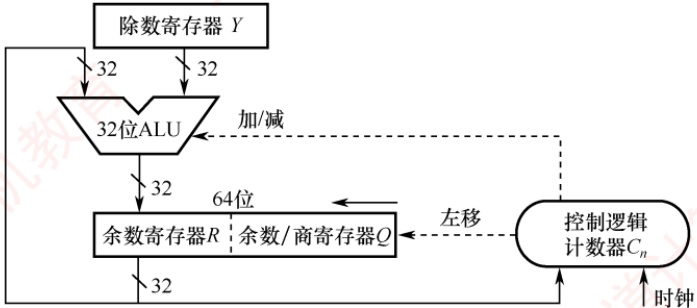

图 2.12 一个 32 位除法逻辑结构图

下面介绍其主要组成部分及其工作原理。

**1）初始化**

● 除数寄存器 $Y ;$ 存储n位除数，在整个除法过程中保持不变。

• 余数/商寄存器 Q:初始时存储 n位被除数；在迭代过程中逐步生成 n位商。

● 余数寄存器R:初始化为 0，用于暂存中间余数。

• 计数器 $C_{n} \colon$ 初始化为n，表示需要执行n轮迭代。

●异常预检:若除数为0，则立即触发“除零错误”异常，停止除法运算；若被除数<除数，则商=0，余数=被除数，无须进入执行过程。

**2）执行过程（循环n次）**

①移位:将R与Q视为一个整体，执行一次逻辑左移。具体来说，R的最高位被移出（通常丢弃），Q的最高位移入R的最低位，Q的最低位空出以接收新商位。

②试商与减法:计算[R]-[Y]；若结果大于或等于0，则当前商位为1，并将结果（差值）写回R；若结果小于0，则当前商位为0，并执行 $[ R ] + [ Y ]$ 以恢复余数（撤销减法）。

③循环控制:计数器 $C_{n}$ 减1。若 $C_{n} \neq 0$ ，则继续下一轮迭代，否则算法结束。

**3）最终结果**

最终的n位商存储在寄存器Q中，n位余数存储在寄存器R中。

**4）异常处理**

当检测到“除数为 $0^{\circ}$ 时，除法器立即停止运算，并置位“除零”异常标志。该异常通常由硬件自动捕获，并通过中断向量表跳转至预设的异常处理程序。 临村

**注意**

两个n位无符号数相除不会发生溢出。因为被除数最大为 $2^{n} - 1$ ，最小的非零除数为1，此时商为最大值，即为 $2^{n}   - 1$ ，恰好可用n位无符号数表示。

**（3）补码除法运算的工作原理**

补码作为有符号整数的标准表示形式，其除法运算需要同时处理符号与数值。补码除法让符号位与数值位统一参与运算，商的符号在运算过程中自然生成。对于两个n位补码数相除，被除数需要先进行符号扩展至2n位；若被除数为2n位，除数为n位，则无须扩展。

由于补码除法涉及有符号数的比较、加减和移位，其试商规则要比无符号除法复杂得多。根据考试大纲要求，仅需掌握其基本实现，底层的原理可参见教材。补码除法的硬件结构与图2.11所示的无符号除法电路基本一致，下面结合该图说明其基本工作过程。

**考点追踪除法运算器的初始化步骤（2025）**

1）初始化:

● 除数寄存器Y:存储n位除数，在整个除法过程中保持不变。

• 余数/商寄存器 $Q ;$ 初始时存储n位被除数；在迭代过程中逐步生成n位商。

● 余数寄存器R:所有位都初始化为被除数的符号位，即完成符号扩展。

• 计数器 $C_{n} ;$ 初始化为 n，表示需要执行n轮迭代。

● 异常预检:若除数为0，则立即触发“除零错误”异常，停止除法运算；若|被除数|< |除数|，则商=0，余数=被除数，无须进入执行过程。

2）执行过程（循环n次）

①移位:将R与Q视为一个整体，执行一次算术左移。

②试商与加减:控制逻辑根据[R]与[Y]的关系，发出加法或减法信号以确定当前商位。由于涉及有符号数的恢复机制，具体判定规则较复杂，此处不展开。

③循环控制:计数器 $C_{n}$ 减1。若 $C_{n}   \neq   0$ ，则继续下一轮迭代，否则算法结束。

**3）最终结果**

最终的商存储在Q中，余数（符号与被除数相同）存储在R中。

**4）异常处理**

当检测到除数为0或发生商溢出时，除法器立即停止运算，并置位相应异常标志，该异常的捕获和处理方式与无符号除法类似。值得注意的是，在两个n位补码除法中，商溢出仅有一种情形:被除数为最大负数 $- 2^{n - 1}$ ，且除数为-1，此时结果 $2^{n - 1}$ 无法用n位补码表示。

## 2.3 浮点数的表示与运算

浮点数表示法通过将比例因子嵌入数据中，使小数点位置可根据需要浮动。这样，在有限位数下，既能扩大数值的表示范围，又能保持较高的有效精度。例如，用定点数表示电子质量$(9 \times 10^{-28}  g )$ 或太阳质量 $(2 \times 10^{33} \mathrm{g})$ 极为不便，而浮点数则能高效处理此类极大或极小的数值。

通常，浮点数表示为

$$
N = (-1)^{S} \times M \times R^{E}
$$

其中，S（取值0或1）决定浮点数的符号；M是一个非负的定点小数，称为尾数，通常用原码表示；E是一个定点整数，称为阶码（或指数），通常采用偏置表示（一种移码形式）。R是基数（通常隐含约定为2、4或16）。可见，浮点数由符号、尾数和阶码三部分组成。

在IEEE754浮点数标准广泛使用之前，不同计算机所用的浮点数表示格式各不相同。图2.13展示了一种典型的32位短浮点数格式示例。

| 1 0 | 78 | 31 |
| --- | --- | --- |
| 符号 | 阶码 | 尾数 |

图 2.13 一种典型的 32 位浮点数格式示例

其中，第0位为符号 $S ;$ 第1～7位为阶码E，采用偏置值为64的移码表示；第8～31位为24位尾数M，以二进制原码小数表示；基数R为2。在该格式中，阶码的值决定了小数点的实际位置；阶码的位数决定了浮点数的表示范围；尾数的位数则决定了数值的精度。

### 2.3.1 IEEE754标准的浮点数

**1. IEEE 754 标准的浮点数格式**

**考点追踪IEEE754单精度数大小的比较（2014）**

现代系统普遍采用IEEE754浮点数标准。该标准定义了两种常用格式:32位单精度浮点数（float型）和64位双精度浮点数（double型），其基数隐含为2，其格式如图2.14所示。

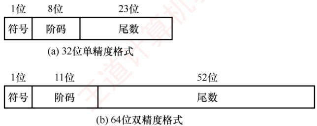

图 2.14 IEEE 754 标准浮点数的格式

32位单精度格式包含1位符号 s、8位阶码e和23位尾数 f；64位双精度格式包含1位符号s、11位阶码e和52位尾数f。基数隐含为2；尾数用原码表示。对于规格化的二进制浮点数，尾数的最高位恒为1。为提升精度，IEEE754不显式存储该位，而是将其隐含在小数点之前，称为隐藏位。因此，单精度格式的23位尾数实际提供了24位有效数字，双精度格式的52位尾数实际提供了53位有效数字。例如， $(12)_{10} = (1100)_{2}$ ，规格化后为 $1 . 1   \times   2^{3}$ 。其中，小数点前的“1”不实际存储，尾数f仅保存小数部分 $\text{"}100  \text{...}0 \text{"}$ ，而阶码保存的是指数3的编码值。

IEEE754标准的阶码采用移码表示，但偏置值并不是通常n位移码所用的 $2^{n - 1}$ ，而是 $2^{n - 1}   - 1$因此，单精度和双精度格式的偏置值分别为127和1023。上例中，指数真值为3，因此在单精度格式中，阶码为 $127+3=130\left ( 82H \right )$ ；在双精度格式中，阶码为1023+3=1026（402H）。

IEEE754标准的规格化单精度浮点数的真值为

$$
(-1)^{s} \times 1, f \times 2^{e-127}
$$

规格化双精度浮点数的真值为

$$
(-1)^{s} \times 1.f \times 2^{e-1023}
$$

其中，规格化单精度浮点数的阶码e的取值范围为1～254（8位，全0和全1保留用于特殊值）；规格化双精度浮点数的阶码e的取值范围为1～2046（11位，保留用途相同）。

**2. IEEE 754 格式浮点数的表示范围**

考点追踪IEEE754浮点数的表示范围和有效位（2017、2018、2024）

IEEE754规格化浮点数的表示范围见表2.2。

表 2.2 IEEE 754 规格化浮点数的表示范围

| 格式 | 最小值 | X 最大值 |
| --- | --- | --- |
| 单精度 | $e = 1, \; f = 0$$1.0 \times 2^{1-127} = 2^{-126}$ | $e = 254, \quad f = 111..., \quad 1.111...1 \times 2^{254-127} = 2^{127} \times (2 - 2^{-23})$ |
| 双精度 | $e = 1, \; f = 0$$1.0 \times 2^{1 - 1023} = 2^{-1022}$ | $e = 2046, \quad f = 1111\ldots, \quad 1.111\ldots 1 \times 2^{2046 - 1023} = 2^{1023} \times (2 - 2^{-52})$ |

当浮点运算结果的绝对值超过最大规格化数时，发生上溢（也称溢出），可分为:

● 正上溢:若结果为正且大于最大规格化正数。

● 负上溢:若结果为负且小于最小规格化负数（绝对值过大）。

IEEE 754 对上溢的处理规则:① 将结果设为+∞或-∞；②置位浮点溢出异常标志，IEEE 754规定，默认情况下不触发异常中断，程序继续执行，除非显式开启此类异常响应。

当运算结果的绝对值小于最小规格化正数但不为零时，发生下溢，可分为:

● 正下溢:若结果为正，且处在0到最小规格化正数之间。

● 负下溢:若结果为负，且处在最大规格化负数到0之间。

对下溢的处理采用渐进下溢机制:①若结果落在非规格化数可表示范围内，则以非规格化形式存储，保留部分有效精度；②若结果过于接近零（舍入后为零），则存储为+0或-0，并置位浮点下溢异常标志。同样，默认不响应下溢异常，程序继续运行，除非显式启用异常处理。

IEEE754标准的单精度浮点数的表示范围如图2.15所示。

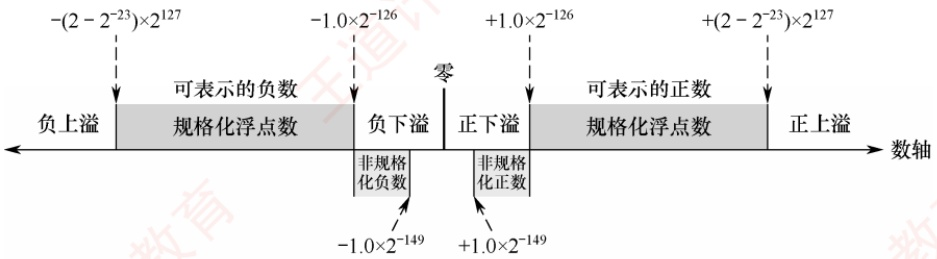

图 2.15 IEEE 754 标准的单精度浮点数的表示范围

**3. 几种特殊的 IEEE 754 浮点数**

考点追踪IEEE754标准中的特殊浮点数（2017、2023）

在IEEE754标准中，当阶码全为0或全为1时，浮点数具有特殊含义，如表2.3所示。

表2.3 阶码全为0或全为1时IEEE 754 浮点数的解释

<table><tr><td rowspan=2>值的类型</td><td colspan=4>单精度（32位）</td><td colspan=4>双精度（64位）</td></tr><tr><td>符号</td><td>阶码</td><td>尾数</td><td>值</td><td>符号</td><td>阶码</td><td>尾数</td><td>值</td></tr><tr><td>正零</td><td>0</td><td>0</td><td>0</td><td>0</td><td>70</td><td>0</td><td>0</td><td>0</td></tr><tr><td>负零</td><td>1</td><td>0</td><td>0</td><td>-0</td><td>1</td><td>0</td><td>0</td><td>-0</td></tr><tr><td>正无穷大</td><td>0</td><td>255（全1）</td><td>0</td><td>8</td><td>0</td><td>2047（全1）</td><td>0</td><td>8</td></tr><tr><td>负无穷大</td><td>1</td><td>255（全1）</td><td>0</td><td> $- \infty$ </td><td>1</td><td>2047（全1）</td><td>0</td><td>-∞</td></tr><tr><td>无定义数（非数）</td><td>0或1</td><td>255（全1）</td><td>f≠0</td><td>KU $\mathrm {NaN}$ </td><td>0或1</td><td>2047（全1）</td><td>f≠0</td><td>NaN</td></tr><tr><td>非规格化正数</td><td>0</td><td>0</td><td>f≠0</td><td> $2^{- 126} ( 0 . f )$ </td><td>0</td><td>0</td><td>f≠0</td><td> $\underline {{2^{- 1022} ( 0 . f )}}$ </td></tr><tr><td>非规格化负数</td><td>1</td><td>0</td><td>f≠0</td><td> $- 2^{- 126} ( 0 . f )$ </td><td>1</td><td>0</td><td>f≠0</td><td> $- 2^{- 1022} ( 0 . f )$ </td></tr></table>

1）全0阶码全0尾数:+0/-0。符号s决定其正负，通常情况下+0和-0是等效的。

2）全1阶码全0尾数: $+ \infty / - \infty 。  + \infty ;$ 在数值上大于所有有限数，-∞则小于所有有限数。引入无穷大数的目的是，使程序在溢出等异常情况下仍能继续执行。

3）全1阶码非0尾数:NaN（Not aNumber）。表示一个没有定义的数，称为非数。

4）全0阶码非0尾数:非规格化数。非规格化数的特点是阶码为全0，不使用隐藏位，尾数字段不全为0。因此，单精度和双精度浮点数的指数分别为-126和-1022。非规格化数用于实现渐进下溢，填补0与最小规格化数之间的数值间隙。

考点追踪实数与IEEE754浮点数的相互转换（2011、2013、2020、2022、2023、2025）

【例2.5】将十进制数-8.25转换为IEEE754单精度浮点数格式表示。

解:

IEEE754单精度浮点数的偏置值是127；尾数最高位的“1”是被隐藏的。

先将-8.25转换为二进制，即 $-1000.01=-1.000\ 01\times2^{3}$ ，尾数部分取小数点后的23位（00001后补0至23位）；再计算阶码E， $E - 127 = 3$ ，因此 $E   =   130$ ，转换为二进制为10000010。

IEEE754单精度浮点数格式:符号（1位）+阶码（8位）+尾数（23位），即为

$$
1 ;   10000010 ;   000010000000000000000000
$$

因此，其单精度浮点数格式表示为1100 0001 0000 0100 0000 0000 0000 0000= C104 0000H。

【例2.6】求 IEEE 754 单精度浮点数 C640 0000H 的值是多少。

解:

先将C6400000H按二进制展开为

$$
1100011001000000000000000000000000
$$

按IEEE754单精度浮点数格式划分:

| 符号 | 阶码 | 尾数 |
| --- | --- | --- |
| 1 | 1000 1100 | 100 0000 0000 0000 0000 0000 |

因此，符号=1表示负数；阶码真值为1000 $1100 - 01111111 = ( 00001101 )_{2} = 13$ ；尾数真值为 $1+(0.1)_{2}=1.5$ （注意，尾数含隐藏位1）。因此，该单精度浮点数的值为 $-1.5  ×  2^{13}$ 。T

### 2.3.2 浮点数的加减运算

浮点数运算的特点是阶码与尾数分开处理，浮点数加减运算分为以下几个步骤。

考点追踪float型能否通过左移实现乘以2运算（2017）；浮点数的加减运算（2009）

**1. 对阶**

对阶的目的是使两个操作数的小数点位置对齐，即令它们的阶码相等，以便尾数可以直接相加减。对阶的原则是:小阶向大阶看齐，即将阶码较小的数的尾数右移，右移位数等于两阶码差的绝对值。对于EEE754标准的浮点数，对阶时需要进行移码减法运算，以求得阶码差。尾数右移时，仅移动数值位，符号位不参与移位；对于规格化数，隐藏位1会随尾数右移而进入小数部分，空出的高位补0。为保证运算精度，移出的低位不应丢弃，而应保留并参与后续尾数运算。

**注意**

若采用大阶向小阶看齐，则需将尾数左移，导致最高有效位被移出，造成不可逆的精度错误。

**2. 尾数加减**

由于IEEE754标准采用定点原码小数表示尾数，因此尾数加减运算实质上是定点原码小数的加减运算，应根据相应的规则执行。对于规格化数，在运算前还需要将隐藏位还原到尾数部分，形成完整的 $1 . f 1$ 形式。此外，对阶过程中为保持精度而保留的附加位也要参与尾数加减运算。

**3. 尾数规格化**

为在浮点运算中最大限度保留有效数字，需要对运算结果进行规格化处理。所谓规格化，是指通过调整尾数与阶码，使浮点数的尾数满足最高有效位为1的形式。

IEEE 754 规格化尾数的形式为 $1 . \times . . . \times$ 。尾数相加减后可能出现两类非规格化结果:

$$
1. \times \cdots \times + 1. \times \cdots \times = 1 \times \cdots
$$

$$
1. \times \ldots \times - 1. \times \ldots \times = 0.0 \ldots 01 \times \ldots \times
$$

1）右规:当结果为1×.×...×时，需要进行右规。尾数每右移一位，阶码加1。尾数右移时，最高位1被移到小数点前一位作为隐藏位，最后一位移出时，要考虑舍入。

2）左规:当结果为0.0...01×...×时，需要进行左规。尾数每左移一位，阶码减1。可能需要左规多次，直到将第一位1移至小数点左边。

**注意**

①左规一次相当于乘以2，右规一次相当于除以2；②需要右规时，只需进行一次。

**4. 舍入**

在对阶和右规过程中，尾数右移可能导致低位丢失。为保证精度，移出的低位通常被保留用于中间计算。最终结果需通过舍入处理，还原为标准的IEEE754格式。

为此，IEEE754引入三个辅助位以指导精确舍入。

1）保护位:紧邻尾数最低有效位之后的第一位，用于初步判断舍入方向。

2）舍入位:位于保护位之后，与保护位和粘滞位共同构成完整的舍入信息。

3）粘滞位:只要舍入位之后被移出的位中存在至少一个1，粘滞位就置为1，否则为0。IEEE754定义了四种可选的舍入模式。

1）就近舍入（默认方式）:选择最接近真实值的可表示数。若真实值恰好位于两个可表示数的正中间，则选择尾数最低有效位为0的那个（偶数）。具体规则:①若保护位=0，直接舍去；②若保护位=1且（舍入位=1或粘滞位=1），则尾数加1；③若保护位=1、舍入位=0、粘滞位=0，则在尾数末位为奇数时向其加1，以符合向偶数舍入的要求。

例如，运算后得到浮点数的临时尾数 $M_{1}$ ，舍入过程如下: $\mathbf {M}_{1}$

$$
M_{1} = 1 . \underline {{\underline {{1011 \; 0011 \; 1100 \; 1100 \; 1101 \; 010}}}} \quad \mathbf {1} \; \mathbf {0} \; \mathbf {1}
$$

注意，下划线部分为保留的23位尾数，其后依次为保护位、舍入位、粘滞位。

由于保护位 = 1、舍入位 = 0、粘滞位 = 1，结果属于非中间值，需要向尾数加1。加1后的23 位尾数为1011 0011110011001101 011。

若运算后得到临时尾数 $M_{2} ,$ ，则舍入过程如下:

$$
M_{2} = 1 . \underline {{\underline {{1011 \; 0011 \; 1100 \; 1100 \; 1101 \; 010}}}} \quad \textbf {100}
$$

由于保护位= 1、舍入位 = 0、粘滞位= 0，结果恰好位于两个可表示数的正中间。此时尾数最低有效位为偶数，无须加 $1_{\circ}$ 最终的23位尾数保持为10110011110011001101010。

2）正向舍入:朝数轴+∞方向舍入，即选择数值更大的可表示数。

3）负向舍入:朝数轴-∞方向舍入，即选择数值更小的可表示数。

4）截断法:直接截取所需位数，丢弃后面的所有位，实现最为简单。对正数或负数来说，都是选择更接近原点的那个可表示数，也称为朝原点舍入。

**5. 溢出判断**

**考点追踪 浮点数运算时的溢出判断（2015）**

在尾数规格化或舍入过程中，可能对阶码进行加减操作，因此需要判断指数是否溢出。在EEE 754中，浮点数的溢出由阶码是否超出可表示范围决定；尾数溢出可通过右规修正，而真正的溢出仅发生在阶码上溢或下溢时。

1）上溢判断。尾数相加后若结果≥2，或舍入时尾数末位加1引发进位（如1.111…+1= 10.000…），则均需右规:尾数右移一位，阶码加1。若原阶码已为最大正规格化值（单精度阶码字段为11111110，对应真值+127），加1后变为11111111（该编码保留用于表示无穷大或NaN），则视为指数上溢，通常会引发异常。

2)下溢判断。左规时尾数左移，阶码减1。若阶码真值减至低于最小正规格化值（单精度-126，双精度-1022），则进入非规格化数范围（阶码字段为0）。若结果进一步小于最小可表示非规格化数（如2-149或2-1074），则视为指数下溢，通常将结果置为机器零。

【例2.7】设 x和y为 float型变量， $x=10.5,\ y=-120.625$ ，请给出x +y的计算过程。解:

$x=10.5=(1010.1)_{2}=(1.0101)_{2}\times2^{3}$ 。其IEEE754单精度:符号位为0；阶码为3+127=130，即1000 0010；机器数（注意隐含尾数最高位）为0;10000010;0101000 00000000 0000 0000。

$y=-120.625=-(1111000.101)_{2}=-(1.111000101)_{2}\times2^{6}$ 。其IEEE754单精度:符号位为1，阶码为 6+127=133，即10000101；机器数为1;1000 0101;111 0001 010 0000 0000 0000。

1）对阶。求阶差 $E_{x} - E_{y} {=} {-} 3$ 。故将x的尾数右移3位，阶码调整为 $E_{y}   =   133$ 。对阶后，x的尾数变为0.00101010000000000000000 000（含保留的附加位），此时无隐藏位。

2）尾数相加。0.0010 1010 0000 0000 0000 000 0 0 0+(-1.1110 0010 1000 0000 0000 000) = -1.10111000100000000000000 000（注意，附加位参与运算，但不会存储）。

3）规格化。尾数相加结果-1.1011100010…×26，已是规格化形式。

4）舍入。单精度尾数保留23位，附加位全为0，按就近舍入规则，直接截断。因此，x +y的机器数为 1;1000 0101;1011 1000 1000 0000 0000 000。其真值为 $-(1.101110001)_{2} \times 2^{6} = -(1101110.001)_{2} = -110.125$

### 2.3.3 C语言中的浮点数类型

**考点追踪不同类型数据转换后数值的变化（2010）**

C 语言中的 float 型和 double 型分别对应 IEEE 754 单精度和双精度浮点数。long double 型通常对应扩展双精度格式，其长度和格式依赖于编译器与目标平台。在C语言中，表达式中的赋值、运算或比较操作会触发自动类型转换，常见的转换序列为 char→int→long→double 和 float→ double，这些转换通常由范围和精度较低的类型向更高者进行，一般不会丢失信息。

当不同类型的数据混合运算时，遵循类型提升原则:较低类型自动转换为较高类型。例如，long与 int 运算时，先将 int 转换为 long，然后进行运算，结果为 long；float 与 double 运算时，先将 float转换为double，结果为double。这类由编译器自动完成的转换称为隐式类型转换。

**考点追踪int 和 float型的精度和范围分析（2017）**

1）int 转 float时，虽然不会发生溢出，但由于float 尾数（含隐藏位）仅24位有效，而 int

为32位，当整数值的二进制有效位超过24位时，需做舍入处理，导致精度损失。

2）int或float转double时，因double的有效位更多，通常能精确表示原值。

3）double转float时，一方面 float的表示范围较小，大数值转换时可能发生溢出；另一方面float的尾数有效位变少，高精度数转换时会发生舍入误差。

4）float或double转 int时，由于int没有小数部分，小数部分被直接丢弃（向零截断）；同时，若浮点数值超出int的表示范围，则会发生整数溢出。

不同数据类型之间的转换常隐藏不易察觉的精度损失或溢出风险，编程时需格外谨慎。

### 2.3.4 数据的宽度和存储

**1. 数据的宽度和单位**

在计算机中，比特（bit，也称位，符号为b）是最小的信息单位，表示一个二进制位（0或1）；字节（byte，符号为B）是基本的存储和寻址单位，1字节=8比特。随着信息规模增大，常在B（字节）或b（位）前添加前缀以表示更大的容量，如KB、MB、GB等。在传统计算机系统中，这些前缀通常按2的幂定义，如 $1 \mathrm{KB} = 2^{10} \mathrm{B} = 1024 \mathrm{B}$

此外，字（word）也是常用的数据组织单位。它是由体系结构定义的逻辑单位，通常用于表示整数、地址等基本数据类型的宽度，其长度因架构而异，常见的有2、4或8字节。

与字不同，字长（也称机器字长）指CPU内部整数运算的数据通路的宽度，通常等于通用寄存器的宽度。字长反映计算机一次能处理的整数数据的位数，是衡量机器性能的重要指标。日常所说的“32位机”或“64位机”，其中的 32或64即指字长。例如，在Intel x86架构中，自80386起字长为32位（32位机），但其体系结构仍将16位定义为一个字，32位称为双字。这表明:字是架构层面的约定，而字长体现的是硬件的实际处理能力。

**2. 数据的“大端方式”和“小端方式”存储**

在存储数据时，数据从低位到高位可以按从左到右排列，也可以按从右到左排列。因此，不宜用最左或最右来表征数据的最高位或最低位，通常使用最低有效字节（LSB）和最高有效字节（MSB）来分别表示数据的最低位和最高位。例如，在32位计算机中，一个int型变量i的机器数为01234567H，其最高有效字节 $\mathrm{MSB} = 01\mathrm{H}$ ，最低有效字节LSB= 67H。

考点追踪数据的大小端存储（2016、2018、2019、2024、2025）

现代计算机普遍采用字节编址，即每个地址对应1字节。不同类型的数据占用不同字节数(如int和float占4字节，double占8字节），而程序中每个变量仅分配一个起始地址。假设变量i的地址为0800H，那么其4个字节01H、23H、45H、67H将占据连续的4个内存单元。这些字节在内存中的排列方式分为两种（见图2.16）: 首

<table><tr><td>…</td><td>01H</td><td>23H</td><td>45H</td><td>67H</td><td>…</td></tr><tr><td colspan=6>0800H     0801H     0802H    0803H</td></tr><tr><td>…</td><td>67H</td><td>45H</td><td>23H</td><td>01H</td><td>…</td></tr></table>

图2.16 采用大端方式和小端方式存储数据

**考点追踪  根据存放顺序判断大小端方式（2019、2023）**

1）大端方式（big endian）:MSB存储在低地址，LSB存储在高地址，字节顺序与数值的标准十六进制书写顺序一致。

2）小端方式（little endian）:LSB存储在低地址，MSB存储在高地址，字节顺序与标准书写顺序相反。

在分析机器代码时，需特别注意字节顺序。例如，以下是由反汇编器生成的一行代码:

|  |
| --- |

其中，4004d3是指令地址，0105649404.08是指令的机器码，add eax,0x08049464是其汇编形式。指令的第二个操作数是立即数0x08049464，其在内存中按地址递增顺序存储为:64H、94H、04H、08H。由于低地址存放的是LSB（64H），高地址存放的是MSB（08H），符合小端方式的特征。将这4个字节按小端规则重组，即可得到正确的立即数0x08049464。因此，在阅读小端机器代码时，需要将连续字节按逆序组合才能还原其逻辑数值。

**3. 数据按“边界对齐”方式存储**

在字长为32位的系统中，边界对齐要求数据的存储地址是其对齐值（通常等于该类型大小，单位:字节）的整数倍:字节可位于任意地址，半字地址须为2的倍数，字地址须为4的倍数。满足此条件时，CPU可通过一次访存读取完整数据；否则，若数据跨越两个存储单元，则需两次访存并拼接字节，显著降低效率。为满足对齐要求，编译器会在必要时填充空白字节。这种“以空间换时间”的策略虽略微增加内存占用，但能大幅提升访问速度。

例如，数据序列“字节1、字节2、字节3、半字1、半字2、半字3、字1”按边界对齐与非对齐方式存储的格式分别如图2.17和图2.18所示。

<table><tr><td>字节1</td><td>字节2</td><td>字节3</td><td>填充</td></tr><tr><td colspan=2>半字1</td><td colspan=2>半字2</td></tr><tr><td colspan=2>半字3</td><td colspan=2>填充</td></tr><tr><td colspan=4>字1</td></tr></table>

图2.17 按边界对齐方式存储

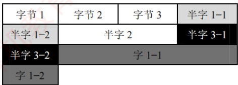

图2.18 按边界不对齐方式存储

**考点追踪  结构体的小端、边界对齐存储（2012、2020）**

C语言中，struct型的内存布局遵循以下对齐规则:①每个成员的起始地址必须是其对齐值的整数倍（例如:char为1，short为2，int为4）；②整个结构体的大小必须是其最大成员对齐值的整数倍（不足则在尾部填充）。这确保了每个结构体成员的起始地址均满足对齐要求。

先看两个例子（基于32位x86环境，GCC编译器）:

| struct A{ | struct B{ |
| --- | --- |
| int a; | char b; |
| char b; | int a; |
| short c; | short c; |
|  | 1 |

结果却是:sizeof(A) = 8，sizeof(B)= 12。

设B从地址0x0000开始，成员b的对齐值是1，其存放地址符合0x0000%1= 0；成员a的对齐值是4，需对齐到4字节边界，故起始于0x0004，占据0x0004～0x0007；成员c的对齐值是2，起始于0x0008，占据0x0008～0x0009。此外，结构体长度必须是最大对齐值（4）的整数倍，当前大小10字节，需填充至12字节（0x000A～0x000B）。

设A也从地址0x0000开始，成员a的对齐值是4，存放在0x0000～0x0003；成员b的对齐值是1，存放在0x0004；成员c的对齐值是2，为满足“起始地址%对齐值=0”的条件，只能存放在0x0006～0x0007，总大小为8字节，无须尾部填充。

精简指令集计算机（RISC）普遍采用边界对齐，以支持高效的指令流水线。

## 2.4 本章小结

本章开头提出的问题的参考答案如下:

1）在计算机中，为什么要采用二进制来表示数据？

答案已在本章开头给出。

2）计算机在字长足够的情况下能够精确地表示每个数吗？若不能，请举例说明。

不能。对于整数，只要其数值在当前字长可表示的范围内，即可精确表示。但对于小数（实数），由于采用二进制表示，只能精确表示形如若干个1/(2）（k为正整数）之和的有理数。许多十进制有限小数在二进制下是无限循环小数，无法用有限位精确表示。例如，0.1=(0.000110011 0011…)₂。因此，即使字长很长，这类数值也只能被近似表示。

3）字长相同的情况下，浮点数和定点数的表示范围与精度有什么区别？

在相同字长下，浮点数与定点数存在“范围vs精度”的权衡:

● 表示范围:浮点数通过阶码可表示极大或极小的数值，远大于定点数

●表示精度:定点数将所有位用于数值本身，具有恒定且较高的绝对精度；而浮点数需分配部分位给阶码，导致尾数位数减少，有效精度降低，且精度随数值增大而下降。

因此，浮点数以牺牲精度换取更大的表示范围，定点数以固定精度为代价限制其数值范围。

4）用移码表示浮点数的阶码有什么好处？

IEEE754标准采用移码表示阶码，主要有以下优势:

①便于阶码比较。浮点数加减运算时需比较两个数的阶码大小，而移码比较更方便。

②支持特殊值的统一编码。阶码全0:当尾数也为0时，表示±0；尾数非零时，表示非规格化数。阶码全1:保留作特殊用途 当尾数为0时，表示±∞；尾数非零时，表示NaN（如0/0、∞-∞等无效运算结果）。

## 2.5 常见问题和易混淆知识点

1. 如何表示一个数值数据？计算机中的数值数据都是二进制数吗？

在计算机内部，数值数据主要有两类表示方式

①二进制数值表示:包括无符号数（如地址）、有符号数（通常用补码表示）和浮点数。

②二进制编码的十进制数（BCD码）:用4位二进制编码一位十进制数。

需要强调的是，所有数据在物理存储上都是二进制比特序列，区别仅在于解释规则。BCD并非真正的“十进制表示”，而是按十进制语义解释的二进制编码。

2. 什么称为无符号整数的“溢出”？

对于n位无符号整数，其表示范围为0到 $2^{n} - 1$ 。当运算结果大于或等于2”时，硬件仅保留低n位（结果对2ⁿ取模），舍去高位，导致截断后的值不等于真实结果，这种现象称为无符号溢出。在运算器中，通常通过进位标志（CF）来检测无符号溢出。

3. 对于位数相同的定点数和浮点数，可表示的浮点数个数比定点数多吗？

不是。n位编码最多表示2ⁿ个不同比特模式。定点数（如n位补码）通常能表示2ⁿ个互异的有效数值；浮点数中，部分编码用于表示±0、±∞和NaN等特殊值，实际可表示的有效实数个数少于2”。因此，在相同位数下，定点数通常能表示更多有效数值。

4. 现代计算机中是否要考虑原码加减运算？如何实现？

现代计算机一般不实现原码加减运算。尽管IEEE754浮点数的尾数采用原码表示，但尾数本身是无符号的，符号由独立的符号位表示。在加减运算时，硬件根据操作数符号和运算类型，将尾数作为无符号整数送入通用ALU进行加或减运算，结果符号由控制逻辑生成。

因此，浮点尾数运算本质上是无符号整数运算，无须原码加减机制。

购买王道书，就上王道官方考研书店


