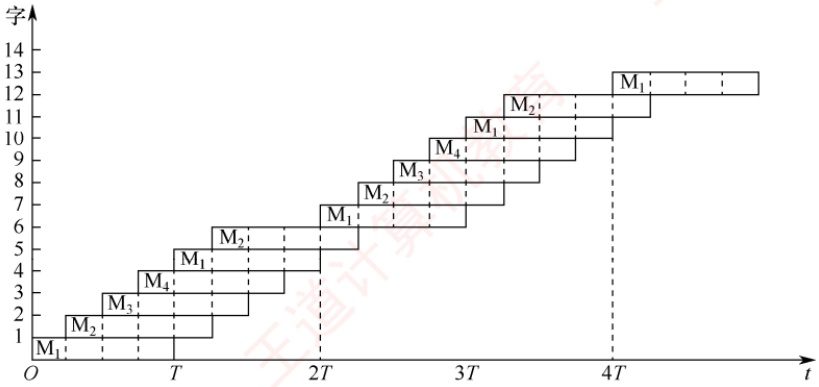
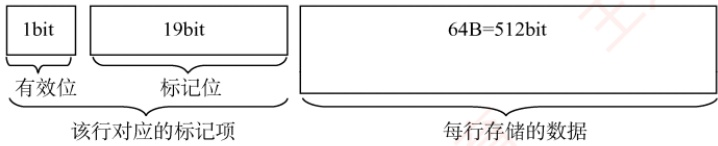
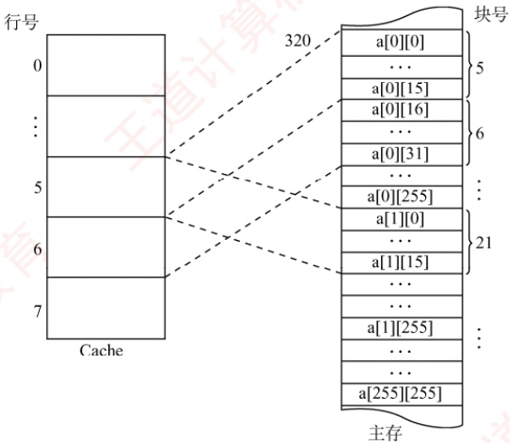
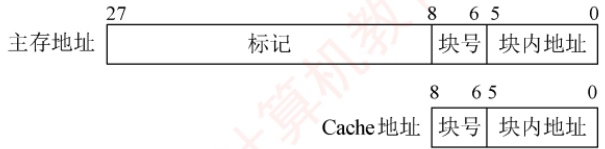
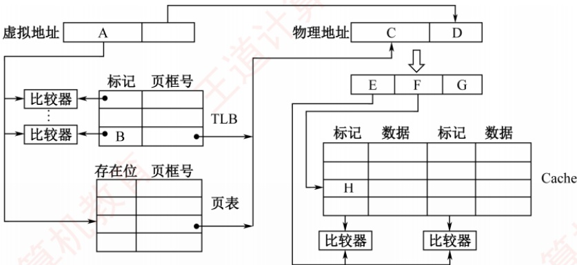
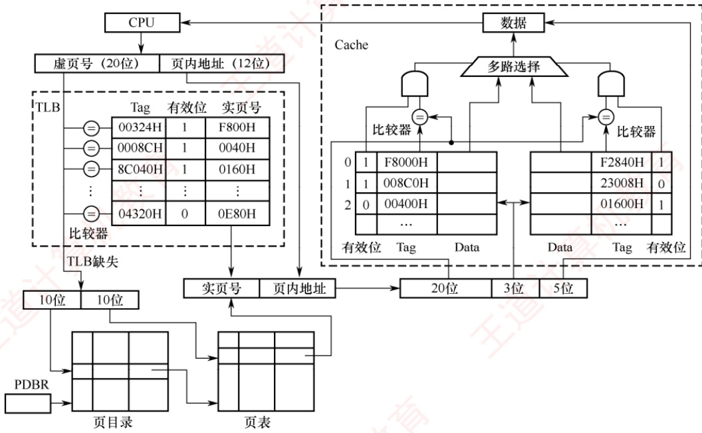

# 第3章 存储系统 · 习题与解析

> 由《第3章 存储系统》正文摘出；区块标题保留了原书的小节编号。

### 3.1.5 本节习题精选

**单项选择题**

01.磁盘属于（）类型的存储器。
A. 随机存储器（RAM）
B. 只读存储器（ROM）
C. 顺序存取存储器（SAM）
D. 直接存取存储器（DAM）

02.存储器的存取周期是指（）。
A. 存储器的读出时间 道
B. 存储器的写入时间
C. 存储器进行连续读/写操作所允许的最短时间间隔
D. 存储器进行一次读/写操作所需的平均时间

03. 相联存储器是一种特殊的存储器，其主要特点是（）。
A. 通过地址总线指定存储单元进行读/写
B. 按照“后进先出”原则访问数据
C. 根据存储内容进行并行匹配查找
D. 仅用于实现高速缓存中的直接映射结构

04.在下列几种存储器中，CPU不能直接访问的是（）。 道
A. 硬盘
B. 内存
C. Cache
D. 寄存器

05. 计算机的存储器采用分级方式是为了（）。
A. 方便编程
B. 解决容量、速度、价格三者之间的矛盾
C. 保存大量数据方便
D. 操作方便

06. 计算机的存储系统包括（）。
A. RAM
B. ROM
C. 主存储器
D. 寄存器、Cache、主存储器和外存储器

07. 在计算机系统中，关于MAR和MDR的位数，以下说法正确的是（）。A. MAR的位数等于地址总线的宽度，MDR的位数等于数据总线的宽度

B. MAR的位数等于数据总线的宽度，MDR的位数等于地址总线的宽度
C. MAR和MDR 的位数都等于地址总线的宽度
D. MAR和MDR 的位数都等于数据总线的宽度

08. 在多级存储系统中，“Cache-主存”结构的作用是解决（）的问题。
A. 主存容量不足 道
B. 主存与辅存速度不匹配
C. 辅存与 CPU速度不匹配
D. 主存与 CPU 速度不匹配

09. 存储器分层体系结构中，存储器从速度最快到最慢的排列顺序是（）。
A. 寄存器-主存-Cache-辅存
B. 寄存器-主存-辅存-Cache
C. 寄存器-Cache-辅存-主存
D. 寄存器-Cache-主存-辅存

10.下列关于多级存储系统的说法中，正确的有（）。I. 多级存储系统是为了降低存储成本 算机Ⅱ. 虚拟存储器中主存和辅存之间的数据调动对任何程序员是透明的III. CPU 只能与 Cache 直接交换信息，CPU 与主存交换信息也需要经过 Cache
A. 仅I
B. 仅I和Ⅱ
C. I、ⅡI和ⅢII
D. 仅Ⅱ

11.若某存储器存取周期为250ns，每次读出16位，该存储器的数据传输速率是（）。
A. $4 {\times} 10^{6} \mathrm {B / s}$
B. 16MB/s
C. $8   \times   10^{6} \mathrm {B / s}$
D. $8  ×  2^{20}  B / s$

### 3.1.6 答案与解析

**单项选择题**

01. D

磁盘属于直接存取存储器，其速度介于随机存储器和顺序存取存储器之间。

02. C

存取时间 $T_{\mathrm {a}}$ 是指从存储器读/写一次信息所需要的平均时间；存取周期 $T_{\mathrm {m}}$ 是指连续两次访问存储器之间所必需的最短时间间隔。对 $T_{\mathrm {m}}$ 一般有 $T_{\mathrm {m}} = T_{\mathrm {a}} + T_{\mathrm {r}}$ ，其中 $T_{\mathrm {r}}$ 为复原时间；对 SRAM指存取信息的稳定时间，对DRAM指刷新的又一次存取时间。选项D指的是存取时间。

03. C

相联存储器按内容寻址，能并行比较所有存储单元的内容以匹配关键字，直接返回结果或位置，常用于TLB 和 Cache标记阵列等高速查找场景。

04. A

CPU不能直接访问硬盘，需先将硬盘中的数据调入内存才能被CPU访问。

05. B

存储器有三个主要性能指标:存储速度、存储容量和单位成本。存储器采用分级方式是为了解决这三者之间的矛盾。

06. D

计算机的存储系统包括CPU内部寄存器、Cache、主存和外存。

07. A

MAR用于存放内存地址，其位数需覆盖主存全部可寻址单元，故等于地址总线宽度；MDR用于暂存读/写数据，其位数决定单次传输的数据量，故等于数据总线宽度。

08. D

Cache中的内容只是主存内容的部分副本（拷贝），因此“Cache-主存”结构并未增加主存容量，目的是解决主存与CPU速度不匹配的问题。

09. D

在存储器分层结构中，寄存器在CPU中，因此速度最快，Cache次之，主存再次之，最慢的是辅存（如磁盘、光盘等）。

10. A

主存和辅存之间的数据调动是由硬件和操作系统共同完成的，仅对应用级程序员透明。CPU与主存可直接交换信息。

11. C

每个存取周期读出16bit=2B，因此数据传输速率为 $2\mathrm{B} \div (250 \times 10^{-9})\mathrm{s}$ ，即 $8   \times   10^{6} \mathrm {B / s}$

### 3.2.4 本节习题精选

**一、单项选择题**

01. 某一SRAM芯片，容量为1024×8位，该芯片的地址引脚和数据引脚总数至少是（）。
A. 8
B. 10
C. 18
D. 13

02.某存储器容量为32K×16位，则（）。
A. 地址线为16根，数据线为 32根
B. 地址线为 32根，数据线为16根
C. 地址线为15根，数据线为16根
D. 地址线为 15 根，数据线为 32根

03. DRAM的刷新是以（）为单位的。
A. 存储单元
B. 行
C. 列
D. 存储字

04. 下面是有关 DRAM和 SRAM存储芯片的叙述:

I. DRAM 芯片的集成度比 SRAM 芯片的高II. DRAM 芯片的成本比 SRAM 芯片的高III. DRAM 芯片的速度比 SRAM 芯片的快IV. DRAM芯片工作时需要刷新，SRAM芯片工作时不需要刷新

通常情况下，错误的是（）。
A. I和Ⅱ
B. Ⅱ和ⅢII
C. III和 IV
D. I和IV

05.下列关于随机存储器的说法中，正确的是（）。
A. 半导体RAM 中的信息可读可写，且断电后仍能保持记忆
B. DRAM是易失性 RAM，而 SRAM 中的存储信息是不易失的
C. 半导体RAM是易失性 RAM，但只要电源不断电，所存信息是不丢失的
D. 半导体 RAM 是非易失性 RAM

06.下列关于存储器的说法中，不正确的是（）
A. 随机存储器和只读存储器不可以统一编址
B. 在访问随机存储器时，访问时间与存储单元的物理位置无关
C. 随机存储器（RAM）芯片可随机存取信息，掉电后信息会丢失
D. 只读存储器（ROM）芯片可随机存取信息，掉电后信息不会丢失

07.关于半导体存储器的组织，下列选项中（）是不正确的。
A. 在同一个存储器中，每个存储单元的宽度可以不同
B. 所谓“编址”，是指给每个存储单元一个编号
C. 存储器的核心部分是存储阵列，由若干存储单元构成
D. 每个存储单元由若干存储元件构成，每个存储元件存储一个比特位

08. 关于 SRAM和DRAM，下列叙述中正确的是（）。
A. 通常SRAM依靠电容暂存电荷来存储信息，电容上有电荷为1，无电荷为0
B. DRAM依靠双稳态电路的两个稳定状态来分别存储0和1
C. SRAM速度较慢，但集成度稍高；DRAM速度稍快，但集成度低
D. SRAM速度较快，但集成度稍低；DRAM速度稍慢，但集成度高

09. 某一DRAM芯片，采用地址复用技术，容量为1024×8位，该芯片的地址引脚和数据引脚总数至少是（）。
A. 18
B. 13
C. 8
D. 17机

10. 下列几种存储器中，（）是易失性存储器。
A. Cache
B. EPROM
C. Flash 存储器
D. CD-ROM

U盘属于（）类型的存储器。
A. 高速缓存
B. 主存
C. 只读存储器
D. 随机存储器

12.下面有关ROM和RAM的叙述中，错误的是（）
A. RAM是可读可写存储器，ROM是只读存储器
B. ROM和 RAM 都采用随机访问方式进行读/写
C. 系统的主存由 RAM 和 ROM 组成
D. 系统的主存都用 DRAM 芯片实现 利

13. 下列说法正确的是（）。
A. EPROM是可改写的，因此可以作为随机存储器
B. EPROM是可改写的，但不能作为随机存储器
C. EPROM是不可改写的，因此不能作为随机存储器
D. EPROM只能改写一次，因此不能作为随机存储器

14. 下列（）是动态半导体存储器的特点。I. 在工作中存储器内容会产生变化Ⅱ. 每隔一定时间，需要根据原存内容重新写入一遍Ⅲ.一次完整的刷新过程需要占用两个存取周期IV. 一次完整的刷新过程只需要占用一个存取周期
A. I、III
B. II、III
C. II、IV

15. 下列关于存储器层次结构的说法中，错误的是（）。 教
A. Flash存储器读/写速度差异显著，读速接近RAM，写速接近ROM
B. 存储器层次结构基于程序局部性原理，通常采用缓冲技术缓解层级间速率差异
C. Cache位于CPU与主存之间，容量通常大于主存，旨在提升平均访问速率
D. 辅存（如机械硬盘）容量大、成本低但速度慢，仅作为主存的补充与备份

16. 下列关于Flash存储器特性与应用的说法中，正确的是（
A. 读写速度一致，均接近DRAM的访问速率
B. 属于易失性存储器，断电后数据丢失
C. 写操作前需先擦除目标块，故写速慢于读速育
D. 仅能用作辅助存储器（如U盘）

17. DRAM具有破坏性读出的特性，需要定时刷新，下列说法中不正确的是（）
A. 刷新是以行为单位的
B. 刷新是为了给DRAM存储单元中的存储电容重新充电
C. 刷新是通过对存储单元进行“读但不输出数据”，即“假读”的操作来实现的
D. DRAM 内部设有专门的刷新电路，不会影响到 CPU 的正常访存

18. 下列关于DRAM和 SDRAM的说法中，不正确的是（）。
A. 传统 DRAM 芯片与 CPU 采用异步方式交换数据
B. SDRAM 芯片与 CPU 采用同步方式交换数据
C. DRAM 需要定期刷新，而 SDRAM 不需要定期刷新
D. SDRAM 的行缓冲器通常用 SRAM 实现

19. 每推出新一代DRAM芯片，地址引脚至少增加1根，则容量至少提高到原来的（）倍。
A. 2
B. 4
C. 8
D. 16

20. 若一个内存条中有16个DRAM芯片，每个芯片中有4个位平面，每个位平面的存储阵列为4096行×4096列，则内存条的总容量为（）MB。
A. 64
B. 128
C. 256
D. 512

21. 某 DRAM 芯片容量为 4M×4 位，下列说法中错误的是（）。
A. 芯片有11个地址引脚
B. 芯片内部的行地址生成器（刷新计数器）为11位
C. 芯片内部的行缓冲器容量为 2Kb
D. 芯片有4个数据引脚

22. 已知单个存储体的存取周期为110ns，总线传输周期为10ns，采用低位交叉编址的多模块存储器时，存储体数应（）
A. 小于 11
B. 等于11
C. 大于11
D. 大于或等于 11

23. 一个四体并行低位交叉存储器，每个模块的容量是64K×32位，存取周期为 200ns，总线周期为50ns，在下述说法中，（）是正确的。
A. 在 200ns 内，存储器能向 CPU 提供 256 位二进制信息
B. 在 200ns 内，存储器能向 CPU 提供 128 位二进制信息
C. 在 50ns 内，每个模块能向 CPU 提供 32 位二进制信息
D. 以上都不对

24. 某机器采用四体低位交叉存储器，现分别执行下述操作:①读取6个连续地址单元中存放的存储字，重复80次；②读取8个连续地址单元中存放的存储字，重复60次。则①、②所花费的时间之比为（）。
A. 1:1 M
B. 2:1
C. 4:3
D. 3:4 教

25. 假定用若干16K×8位的存储芯片组成一个64K×8位的存储器，芯片各单元采用交叉编址方式，则地址BFFFH所在的芯片的最小地址为（）。
A. 0000H
B. 0001H
C. 0002H
D. 0003H

26.下列关于单体多字存储器的说法中，不正确的是（）。 王足
A. 单体多字存储器主要解决主存容量太小的问题
B. 单体多字存储器中，每个存储单元存储多个字
C. 指令与数据的连续存放有利于单体多字存储器提高主存的读/写速度
D. 过多的转移指令会严重影响单体多字存储器的工作效率

27. 多模块存储器之所以能提高存储器的访问速度，是因为（）。
A. 采用了高速元器件 C. 采用了信息预读技术 算
B. 各模块有独立的读/写电路 D. 模块内各单元地址连续

28. 某存储器总线的宽度是 64 位，若用 8 个 16M×8 位的 DRAM 芯片扩展构成 16M×64 位的内存条，按字节编址，支持突发传送方式，某double型的变量x的主存地址为2026 0000H，某int型的变量y的主存地址为2026 1006H，则下列叙述中错误的是（）
A. 该内存条可不采用多模块交叉编址
B. DRAM 芯片的行缓冲采用的是SRAM
C. 读取变量x只需要一个存取周期
D. 读取变量y需要两个存取周期

29.【2010统考真题】下列有关RAM和ROM的叙述中，正确的是（）。I. RAM 是易失性存储器，ROM 是非易失性存储器II. RAM和 ROM 都采用随机存取方式进行信息访问 计算机教III. RAM 和 ROM 都可用作 Cache IV. RAM 和 ROM 都需要进行刷新
A. 仅I和Ⅱ
B. 仅ⅡI和ⅢII
C. 仅I、ⅡI和III
D. 仅ⅡI、II和IV

30.【2011统考真题】下列各类存储器中，不采用随机存取方式的是（）。
A. EPROM
B. CD-ROM
C. DRAM
D. SRAM

31.【2012统考真题】下列关于闪存的叙述中，错误的是（）。
A. 信息可读可写，并且读、写速度一样快
B. 存储元件由MOS管组成，是一种半导体存储器
C. 掉电后信息不丢失，是一种非易失性存储器
D. 采用随机访问方式，可替代计算机外部存储器

32.【2014 统考真题】某容量为 256MB 的存储器由若干 4M×8 位的 DRAM 芯片构成，该DRAM芯片的地址引脚和数据引脚总数是（）。

A. 19
B. 22
C. 30XT
D. 36

33.【2015统考真题】下列存储器中，在工作期间需要周期性刷新的是（）。
A. SRAM
B. SDRAM
C. ROM
D. Flash 存储器

34.【2015统考真题】某计算机使用四体交叉编址存储器，假定在存储器总线上出现的主存地址（十进制）序列为8005,8006,8007,8008,8001,8002,8003,8004,8000，则可能发生访存冲突的地址对是（）。
A. 8004 和 8008
B. 8002 和 8007
C. 8001 和 8008
D. 8000 和 8004

35. 【2017统考真题】某计算机主存按字节编址，由4个64M×8位的DRAM芯片采用交叉编址方式构成，并与宽度为32位的存储器总线相连，主存每次最多读/写32位数据。若double型变量x的主存地址为 804 001AH，则读取x需要的存取周期数是（
A. 1
B. 2
C. 3

36. 【2018 统考真题】假定DRAM 芯片中存储阵列的行数为 r、列数为 c，对于一个2K×1位的DRAM芯片，为保证其地址引脚数最少，并尽量减少刷新开销，则r、c的取值分别是（）。
A. 2048, 1
B. 64, 32
C. 32, 64
D. 1,2048

37.【2022统考真题】某内存条包含8个8192×8192×8位的DRAM芯片，按字节编址，支持突发（burst）传送方式，对应存储器总线宽度为64位，每个DRAM芯片内有一个行缓冲区（rowbuffer）。下列关于该内存条的叙述中，不正确的是（）。
A. 内存条的容量为 512 MB
B. 采用多模块交叉编址方式
C. 芯片的地址引脚为 26位
D. 芯片内行缓冲有8192×8位

**二、综合应用题**

01. 在显示适配器中，用于存放显示信息的存储器称为刷新存储器，它的重要性能指标是带宽。具体工作中，显示适配器的多个功能部分要争用刷新存储器的带宽。设总带宽50%用于刷新屏幕，保留50%的带宽用于其他非刷新功能，且采用分辨率为1024×768像素、颜色深度为3B、刷新频率为72Hz的工作方式。2）为达到这样高的刷新存储器带宽，应采取何种技术措施？ 1）试计算刷新存储器的总带宽。 教育

02. 一个四体并行交叉存储器，每个模块的容量是64K×32位，存取周期为200ns，问:1）在一个存取周期中，存储器能向CPU提供多少位二进制信息？2）若存取周期为400ns，则在0.1μs内存储器可向CPU提供32位二进制信息，该说法正确否？为什么？ 道

03. 设存储器容量为32个字，字长为64位，模块数m=4，分别采用顺序方式和交叉方式进行组织。存取周期 T = 200ns，数据总线宽度为 64 位，总线传输周期 r = 50ns。在连续读出4个字的情况下，求顺序存储器和交叉存储器各自的带宽。

04. 某计算机字长 32 位，存储体的存取周期为 200ns。

1）采用四体交叉工作，用低2位的地址作为体地址，存储数据按地址顺序存放。主机最快多长时间可以读出一个数据字？存储器的带宽是多少？

2）若4个体分别保存主存中前1/4、次1/4、再下个1/4、最后1/4这四段的数据，即选用高2位的地址作为体地址，可以提高存储器顺序读出数据的速度吗？为什么？

3）若把存储器改成单体4字宽度，会带来什么好处和问题？

4）比较采用四体低位地址交叉的存储器和四端口读出的存储器这两种方案的优缺点。05. 假定一个存储器系统支持四体交叉存取，某程序执行过程中访问地址序列为3,9,17,2,51 37,13,4,8,41,67,10，哪些地址访问可能发生体冲突?

### 3.2.5 答案与解析

**一、单项选择题**

01. C

芯片容量为1024×8位，8位说明数据线要8根，地址线要10根 $( 1024 = 2^{10} )$ 。因此，该芯片的地址引脚和数据引脚总数至少需要18根。 uK

02. C

该芯片为16位，所以数据线为16根，寻址空间 $32 \mathrm {K}   =   2^{15}$ ，所以地址线为15根。

03. B

DRAM的刷新按行进行。

04.B

DRAM芯片的集成度高于SRAM，说法I正确；SRAM芯片的速度高于DRAM，说法Ⅲ错误；可以推出 DRAM芯片的成本低于 SRAM，说法Ⅱ错误；SRAM芯片工作时不需要刷新，DRAM芯片工作时需要刷新，说法IV正确。本题要求选择描述错误的表述，所以选择说法Ⅱ和Ⅲ。

05. C

RAM属于易失性半导体，SRAM和DRAM的区别在于是否需要动态刷新。

06. A

主存由RAM和ROM构成，两者统一编址，选项A错误。选项B描述的是随机访问特性，正确。RAM芯片具有随机访问特性和易失性，选项C正确。ROM芯片具有随机访问特性和非易失性，选项D正确。

07. A

同一个存储器中，每个存储单元的宽度必须相同，即每个存储单元存储的比特位数必须相同。

08. D

SRAM依靠双稳态电路的两个稳定状态来分别存储0和1；SRAM速度较快，不需要动态刷新，但集成度稍低，功耗大，单位价格高。DRAM依靠电容暂存电荷来存储信息，电容上有电荷为1，无电荷为0；DRAM集成度高，功耗小，单位价格较低，需定时刷新，速度慢。

09. B

1024×8位，寻址范围是 $1024 = 2^{10}$ 。采用地址复用技术时，分两次传送行、列地址，地址引脚减半为5根，数据引脚仍为8根，因此地址引脚和数据引脚总数至少为13根。

注意 SRAM和 DRAM的区别，DRAM采用地址复用技术，而 SRAM 不采用。

10. A

Cache由 SRAM组成，掉电后信息即消失，属于易失性存储器。

11. C

U盘采用Flash存储技术，它是在E²PROM的基础上发展起来的，属于ROM的一种。擦写速度和性价比均很可观，因此常用作辅存。值得注意的是，随机存取与随机存储器是两个不同的概念，只读存储器也是随机存取的。因此，支持随机存取的存储器并不一定是随机存储器。

12. D

系统主存主要由DRAM构成，但通常也包含用于存放BIOS或固件的ROM（如Flash），因此并非全部由DRAM实现，D选项的说法错误。

13. B

EPROM可多次改写，但改写较为烦琐，写入时间过长，且改写的次数有限，速度较慢，因此不能作为需要频繁读/写的RAM使用。

14. C

动态半导体存储器利用电容存储电荷的特性记录信息，电容会放电，因此必须在电荷流失前对电容充电，即刷新。方法是每隔一定的时间，根据原存内容重新写入一遍，因此说法Ⅰ错误。这里的读并不是把信息读入CPU，也不是从CPU向主存存入信息，它只是把信息读出，通过一个刷新放大器后又重新存回存储单元，而刷新放大器是集成在RAM上的。因此，这里只进行了一次访存，也就是占用一个存取周期，说法Ⅱ、IV正确，说法Ⅲ错误。

15. C

Flash存储器的读速接近RAM，但写/擦除速度慢，类似ROM，读写性能显著不对称。存储器层次结构以局部性原理为设计基础，通过缓冲机制有效缓解各级存储器间的速率差异。Cache虽位于CPU与主存之间且访问速度快，但其容量远小于主存，并非“大于主存”，选项C错误。辅存（如机械硬盘）因速度慢，不参与CPU实时访存，仅用于主存扩展或持久性存储。

16. C

Flash存储器是非易失性存储器，断电后数据不会丢失。其读操作速度较快（接近RAM），但写入和擦除必须以块为单位进行，且需要先擦除再写入，因此写速显著慢于读速，选项C正确。此外，Flash存储器广泛应用于电脑、手机、智能手表等设备的内部存储，而非限于U盘等辅助存储器。

17. D

刷新也是一个读取的过程，根据读出内容对相应单元进行重写，因此会和CPU的访存冲突，会有访存“死时间”。刷新是指每隔一定的时间必须向栅极电容补充一次电荷，并以行为单位。

18. C

SDRAM（同步 DRAM）与 SRAM 不同，其与 CPU 采用同步方式交换数据。SDRAM 也是DRAM的一种，需要定期刷新。行缓冲器用来缓存指定行中整行的数据，通常用SRAM实现。

19. B

DRAM芯片采用地址线复用技术，行地址和列地址分时复用，每增加1根地址线，则行地址和列地址各增加1位，所以行数和列数各增加1倍，因此容量至少提高到原来的4倍。

20. B

DRAM芯片的容量=位平面数×行数×列数，即由位平面数、存储阵列的行数和列数决定。因此，一个DRAM 芯片的容量为4096×4096×4b= 8MB，内存条的总容量为8MB×16=128MB。

21. C

4M×4位DRAM芯片需22位地址，采用地址复用技术，行、列地址分时共用引脚，地址引脚数为22/2=11。行地址位数为11位，刷新计数器位数与行地址位数相同。行缓冲器需暂存整行数据，每行包含2048×4位=8Kb数据，选项C错误。芯片字长为4位，对应4个数据引脚。

22. D

低位交叉编址多模块存储器，采用轮流启动的方式时，类似于流水线的工作方式，为保证某个模块再次启动时，其上次的存取操作已完成（流水线不间断），要求两次启动间隔的时间必须大于或等于一个存取周期，即“模块数×总线周期≥存取周期”，得出存储体数应大于或等于11。

23. B

低位交叉存储器采用流水线技术，可以在一个存取周期内连续访问4个模块，32位×4=128位。本题答案为B。

注:本题若作为计算题来考虑，从第一个字的读/写请求发出，到第4个字读/写结束，共需要350ns，但这里考查的是整体工作性能，可从以下角度理解:

1）连续取m个字耗时 $t_{1} = T + ( m - 1 ) r$ ，平均每个字的存取时间是 $t_{1} / m$ ，实际工作时 m非常大，因此 $t_{1} / m$ 也就非常接近r，可认为存储器在每个总线周期r都能给CPU提供一个字。

2）流水线充分流动起来后，每个总线周期后都能完成一个字的读/写，所以本题中每4个总线周期（200ns）都能完成4个字的读/写。

24. C

1）在每轮读取存储器的前6个T/4时间（共3T/2）内，依次进入各个存储体。下一轮读取存储器时，最近访问的 $\mathbf {M}_{1}$ 还在占用中（才过T/2的时间），因此必须再等待 T/2的时间才能开始新的读取 $\mathbf {( M_{1}}$ 连续完成两次读取，也即总共2T的时间才可进入下一轮）。

**注意**

进入下一轮不需要第6个字读取结束，第5个字读取结束时 $\mathbf {M}_{1}$ 就已空出，即可马上进入下一轮。

最后一轮读取结束的时间是本轮第6个字读取结束，共 $(6 - 1) \times (T/4) + T = 2.25T$

情况1）的总时间为 $( 80 - 1 ) \times 2 T + 2 . 25 T = 160 . 25 T$



2）每轮读取8个存储字刚好经过2T的时间，每轮结束后，最近访问的 $\mathbf {M}_{1}$ 刚好经过了时间T，此时可以立即开始下一轮的读取。情况2）的总时间为 最后一轮读取结束的时间是本轮第8个字读取结束，共 $(60 - 1) \times 2T + 2.75T = 120.75T$ $(8 - 1) \times (T/4) + T = 2.75T$ 算机教育因此情况1）和2）所花费的总时间比为4:3。

25. D

64K×8位 $/ 16 \mathrm {K} {\times} 8$ 位=4，可知芯片数为4。芯片各单元采用交叉编址，所以每个芯片的片选信号由最低两位地址确定，高14位为片内地址。4个芯片内各存储单元的最低两位地址分别为00、01、10、11，即最小地址分别为0000H、0001H、0002H、0003H。地址BFFFH最低两位为11，因此该存储单元所在芯片的最小地址为0003H。

26. A

单体多字存储器主要解决访存速度的问题，并没有解决主存容量太小的问题。在单体多字存储器中，每个存储单元存储多个字，当指令和数据连续存放，且没有过多的转移指令时，单体多字存储器能有效地提高主存的读/写速度。

27. B

多模块存储器各模块有独立的读/写电路，可以实现并行操作，所以多模块存储器能进行高速的读/写操作。采用低位交叉编址的多模块存储器各单元地址不连续。

28. A

存储器总线的宽度是64位，内存条一次向计算机提供8B的数据，每个DRAM芯片提供1B的数据，因此一定采用多模块交叉编址，选项 A错误。DRAM芯片的行缓冲采用 SRAM。在此内存条中，同时读出的64位只可能是第0～7单元、第8～15单元……第8k～8k+7单元，根据变量x和y的主存地址可知，读取x需要一个存取周期，读取y需要两个存取周期。

29. A

RAM（分DRAM和SRAM）断电后会失去信息，而ROM断电后不会丢失信息，它们都采用随机存取方式。Cache 一般采用高速的 SRAM 制成，而 ROM 只可读，不能用作 Cache，说法ⅢⅢ错误。DRAM需要定期刷新，而ROM不需要刷新，所以说法IV错误。

30. B

随机存取是指CPU可对存储器的任意一个存储单元中的内容随机存取，而且存取时间与存储单元的物理位置无关。选项A、C和D均采用随机存取方式，CD-ROM即光盘，采用串行存取方式（直接存取）。注意，CD-ROM是只读型光盘存储器，不属于只读存储器（ROM）。

31. A

闪存是E²PROM的进一步发展，可读可写，用MOS管的浮栅上有无电荷来存储信息。闪存依然是ROM的一种，写入时必须先擦除原有数据，所以写速度要比读速度慢。闪存是一种非易失性存储器，它采用随机访问方式。现在常见的SSD固态硬盘，即由Flash存储器芯片组成。

32. A

4M×8位的芯片数据线应为8根，地址线应为1og₂4M=22根，而DRAM采用地址复用技术，地址线是原来的1/2，且地址信号分行、列两次传送。地址线数为22/2=11根，所以地址引脚与数据引脚的总数为11 + 8=19根，选择选项A。此题需要注意DRAM采用的是传两次地址的策略，所以地址线为正常的一半，这是很多考生容易忽略的地方。

33. B

DRAM使用电容存储，所以必须隔一段时间刷新一次，若存储单元未被刷新，则存储的信息就会丢失。同步动态随机存储器SDRAM是现在最常用的一种DRAM。

34. D

每个访存地址对应的存储模块序号（0,1,2,3）如下所示:

| 访存地址 | 8005 | 8006 | 8007 | 8008 | 8001 | 8002 | 8003 | 8004 | 8000 |
| --- | --- | --- | --- | --- | --- | --- | --- | --- | --- |
| 模块序号 | 1 | 2 | 3 | 0 | 1 | 2 | 3 | 0 | 0 |

其中，模块序号=访存地址%存储器交叉模块数。

判断可能发生访存冲突的规则如下:给定的访存地址在相邻的四次访问中出现在同一个存储模块内。据此，根据上表可知8004和8000对应的模块号都为0，即表明这两次的访问出现在同一模块内且在相邻的访问请求中，满足发生冲突的条件。

35. C

交叉编址多模块存储器有轮流启动和同时启动两种方式，本题中所有存储模块一次并行读写的总位数正好等于系统总线中的数据线数，所以可以判定采用的是同时启动方式。在同时启动方式下，一个存取周期可以对所有芯片的同一行都读取一个字节。double型变量占64位（8B）。其主存地址804001AH的最低两位是10，说明它从编号为2的芯片开始存储（编号从0开始），共占3行，因此需要同时启动3轮才能完成对double型变量的读取。从本题也可发现，采用同时启动方式时，一次读行也许会有没用的数据读入。

| 第i轮 |  |  |  |  |
| --- | --- | --- | --- | --- |
| 第i+1轮 |  | V |  |  |
| 第i+2轮 | KO |  |  |  |
| 第i+3轮 |  |  |  |  |
| 第i+4轮 |  |  |  |  |
| 体号 | 00 | 01 | 10 | 11 |

36. C

由题意，首先根据DRAM采用的是行列地址线复用技术，我们尽量选用行列差值不要太大的，选项B、C的地址线只需6根（取行或列所需地址线的最大值），轻松排除选项A和D。其次，为了减小刷新开销，而DRAM一般是按行刷新的，所以应选行数值较少的。

37. C

$8 \times 8192 \times 8192 \times 8bit = 512MB$ ，内存条的容量为512MB，选项A正确。存储器总线宽度 $64   =$ 8×8bit，而每个芯片一次只能传输8bit，需要8体多模块交叉编址采用同时启动方式才能实现，选项B正确。芯片容量为8192×8192×8bit，按字节编址，地址线数应为1og2(8192×8192)=26，DRAM采用地址复用技术，地址信号分行、列两次传送，因此地址引脚数为 $26/2 = 13$ 根，选项C错误。芯片内行数是8192，一行的大小是8192×8bit，行缓冲长度就是一行的大小，选项D正确。

**二、综合应用题**

01.【解答】

1）因为刷新带宽W₁=分辨率×像素点颜色深度×刷新频率= 1024×768×3B×72/s = 169869KB/s 机教

所以刷新总带宽 $\begin{aligned} &W_{0} = W_{1}(W_{0}/W_{1}) \\&\quad = 169869\mathrm{KB/s} \times 100/50 = 339738\mathrm{KB/s} \\&\quad = 339.738\mathrm{MB/s} (其中  1\mathrm{K} = 1000)\\ \end{aligned}$

2）要提高刷新存储器带宽，可采用以下技术:①采用高速DRAM芯片；②采用多体交叉存储器结构；③刷新存储器到显示控制器的内部总线宽度加倍；④采用双端口存储器将刷新端口和更新端口分开。

02.【解答】

1）一个存取周期，四体并行交叉存储器可取32位×4=128位，其中32位为总线宽度，4为交叉存储器内的存储体个数。

2）该说法不正确。因为在0.1μs内整个存储器可向CPU提供32位二进制信息，但每个存储体必须经过400ns 才能向 CPU 提供 32 位二进制信息。

03.【解答】

顺序存储器和交叉存储器连续读出m=4个字的信息总量均是

$$
q = 64   位  \times 4 = 256   位
$$

顺序存储器和交叉存储器连续读出4个字所需的时间分别是

$$
t_{1}=mT=4\times200\mathrm{ns}=800\mathrm{ns}=8\times10^{-7}\mathrm{s}
$$

$$
t_{2}=T+(m-1)r=200ns+3\times50ns=350ns=35\times10^{-8}s
$$

顺序存储器和交叉存储器的带宽分别是

$$
W_{1}=q/t_{1}=256\div(8\times10^{-7})=32\times10^{7}\mathrm{b/s}
$$

04. 【解答】

交叉存储器在统考真题中曾多次考查，希望能引起读者重视，本题是这一类题中较难的。

1）因为每个体的存取周期是200ns。四体交叉工作，每两个体间读出操作的延时为1/4个存取周期，理想情况是每个存取周期平均可读出4个数据字，读出一个数据字的时间平均为 $200 ns /4 = 50 ns$ 。数据字长为32位，数据传输速率为32位 $/50ns=640Mb/s=80MB/s$

2）若对多体结构的存储器选用高位地址交叉，通常起不到提高存储器读/写速度的作用，因为它不符合程序运行的局部性原理，一次连续读出彼此地址相差一个存储体容量的4个字的机会太少。因此，通常只有一个存储模块在不停地忙碌，其他存储模块是空闲的。

3）若把存储器的字长扩大为原来的4倍，实现的则是一个单体4字结构的存储器，每次读可以同时读出4个字的内容，有利于提高存储器每个字的平均读/写速度，但其灵活性不如多体单字结构的存储器，还会多用到几个缓冲寄存器。

4）多端口存储器是对同一个存储体使用多套读/写电路实现的，扩大存储容量的难度显然比多体结构的存储器要大，而且不能对多端口存储器的同一个存储单元同时执行多个写入操作，而多体结构的存储器则允许在同一个存取周期对几个存储体执行写入操作。

05. 【解答】

对于四体交叉访问的存储系统，每个存储模块的地址分布如下:

Bank0: 0, 4, 8, 12, 16,

Bank1: 1, 5, 9, 13, 17, , 37,, 41,

Bank2: 2, 6, 10, 14, 18,

Bank3: 3, 7, 11, 15, 19, , 51,  , 67

若给定的访存地址在相邻的4次访问中出现在同一个模拟内，则可能发生访存冲突。所以17和9、37和17、13和37、8和4可能发生冲突。易错点:虽然41和13号单元也在同一个模块内，并且访问间隔小于4，但是由于访问8号单元发生冲突而使其访问延迟3个间隔，进而使41号单元的访问也延迟3个间隔，因此其访问不会和13号单元的访问发生冲突。

### 3.3.3 本节习题精选

**一、单项选择题**

01. 用存储容量为16K×1 位的存储芯片来组成一个 64K×8位的存储器，则在字方向和位方向分别扩展了（）倍。
A. 4,2
B. 8, 4
C. 2,4
D. 4, 8

02. 80386DX是32位系统，以4B为编址单位，当在该系统中用8KB（8K×8位）的存储芯片构造32KB的存储体时，应完成存储器的（）设计。 育
A. 位扩展
B. 字扩展
C. 字位扩展
D. 字位均不扩展

03. 4个16K×8位的存储芯片，可设计为（）容量的存储器。 木
A. $32K \times 16$ 位
B. 16K×16 位
C. 32K×8位
D. 8K×16位

04. 16 片2K×4位的存储器可以设计为（）存储容量的16位存储器。
A. 16K
B. 32K
C. 8K
D. 2K

05. 设 CPU 地址总线有 24 根，数据总线有 32 根，用 512K×8 位的 RAM 芯片构成该计算机的主存储器，则该计算机主存最多需要（）片这样的存储芯片。
A. 256
B. 512
C. 64
D. 128

06. 地址总线 $\mathrm {A_{0}}$ (高位) $\sim \mathrm {A}_{15}$ （低位），用4K×4位的存储芯片组成16KB存储器，则产生片选信号的译码器的输入地址线应该是（）。
A. $\mathrm {A}_{2} \mathrm {A}_{3}$
B. $\mathbf {A}_{0} \mathbf {A}_{1}$
C. $\mathbf {A}_{12} \mathbf {A}_{13}$
D. $\mathrm {A}_{14} \mathrm {A}_{15}$

07. 若内存地址区间为4000H\~43FFH，每个存储单元可存储16位二进制数，该内存区域用4片存储芯片构成，构成该内存所用的存储芯片的容量是（）。
A. $512 \times 16 \dot {\mathrm {bit}}$
B. 256×8bit
C. 256×16bit
D. $1024 {\times} 8 {\mathrm {bit}}$

08. 内存按字节编址，地址从 90000H到CFFFFH，若用存储容量为16K×8 位的芯片构成该内存，至少需要的芯片数是（）。
A. 2
B. 4
C. 8
D. 16

09. 若片选地址为111时，选定某一32K×16位的存储芯片工作，则该芯片在存储器中的首地址和末地址分别为（） 上道
A. 00000H, 01000H
B. 38000H, 3FFFFH
C. 3800H, 3FFFH
D. 0000H, 0100H

10. 【2009 统考真题】某计算机主存容量为 64KB，其中 ROM 区为 4KB，其余为 RAM 区，按字节编址。现要用2K×8位的ROM 芯片和4K×4 位的 RAM芯片来设计该存储器，需要上述规格的 ROM 芯片数和RAM 芯片数分别是（）。
A. 1, 15
B. 2, 15
C. 1,30

11. 【2010统考真题】假定用若干2K×4位的芯片组成一个 8K×8位的存储器，则地址0B1FH所在芯片的最小地址是（）。
A. 0000H
B. 0600H
C. 0700H D 0800H

12. 【2011统考真题】某计算机存储器按字节编址，主存地址空间大小为64MB，现用4M×8位的 RAM 芯片组成 32MB 的主存储器，则存储器地址寄存器 MAR 的位数至少是（）。
A. 22 位
B. 23 位
C. 25位
D. 26 位

13. 【2016统考真题】某存储器容量为 64KB，按字节编址，地址 4000H\~5FFFH为ROM 区，其余为 RAM 区。若采用 8K×4 位的 SRAM 芯片进行设计，则需要该芯片的数量是（）。
A. 7
B. 8 X
C. 14
D. 16

14. 【2021统考真题】某计算机的存储器总线中有24位地址线和32位数据线，按字编址，字长为 32 位。若 00 0000H\~3F FFFFH 为 RAM 区，则需要 512K×8 位的 RAM 芯片数为（)。
A. 8
B. 16
C. 32
D. 64

15.【2023统考真题】某计算机的CPU有30根地址线，按字节编址，CPU和主存连接时，要求主存芯片占满所有可能的存储地址空间，且RAM 区和 ROM 区所分配的空间大小比是3:1。若RAM在低地址区，ROM 在高地址区，则 ROM 的地址范围是（
A. 0000 0000H\~ 0FFF FFFFH
B. 1000 0000H \~ 2FFF FFFFH 教育
C. 3000 0000H\~ 3FFF FFFFH
D. 4000 0000H\~ 4FFF FFFFH

**二、综合应用题**

01. 用一个 512K×8 位的 Flash 存储器芯片组成一个 4M×32 位的半导体只读存储器，存储器按字编址，试回答以下问题:

1）该存储器的数据线数和地址线数分别为多少？

2）共需要几片这样的存储芯片？

3）说明每根地址线的作用。

### 3.3.4 答案与解析

**一、单项选择题**

01. D

字方向扩展了64K/16K = 4 倍，位方向扩展了8bit/1bit = 8 倍。

02. A

因为以4B为编址单位，要扩展到32KB，即扩展到8K×32bit，所以只用进行位扩展。

03. A

4个16K×8位的存储芯片构成的存储器容量 $4 \times 16  K  \times 8$ 位 =512K 位或64KB，只有选项 A的容量为64KB。注意，若有某项为128K×4位，则此选项不能选，因为芯片为8位，不可能将字长“扩展”成4位。

04. C

设存储容量为M，则有 $(M \times 16) \div (2K \times 4) = 16$ ，因此 $M   =   8 \mathrm {K}$ 0

05. D

地址线为24根，寻址范围是 $2^{24}$ ；数据线为32根，字长为32位。主存的总容量 $= 2^{24} \times 32$ 位，因此所需存储芯片数 $(2^{24} \times 32) \div (512K \times 8) = 128$ o

06. A

$\mathrm {A}_{15}$ 为地址线的低位，接入各芯片地址端的是地址线的低12位，即 $A_{4} \begin{aligned}  \sim   A_{15}, \end{aligned}$ 共有8个芯片（16KB/4K= 4B，并且位扩展时每组两片共分为4组）组成16KB的存储器，因此由高两位地址$\mathrm {A}_{2} \mathrm {A}_{3}$ 作为译码器的输入。

07. C

43FF-4000+1=400H，即内存区域为1K个单元，总容量为1K×16位。现该内存由4片存储芯片构成，则构成该内存的芯片容量为1K×16位/4=256×16位。

08. D

CFFFF-90000+1=40000H，即内存区域有256K个单元。若用存储容量为16K×8位的芯片，则需要的芯片数 $(256K \times 8) \div (16K \times 8) = 16$

09. B

32K×16的存储芯片有地址线15根（片内地址），片选地址为3位，因此地址总位数为18位，现高3位为111，则首地址为111000000000000000=38000H，末地址为111111111111111111= 3FFFFH。

10. D

首先确定 ROM 的个数，ROM 区为 4KB，选用 2K×8 位的 ROM 芯片，需要(4K×8)÷(2K×8) = 2片，采用字扩展方式；RAM 区为 60KB，选用4K×4 位的 RAM芯片，需要(60K×8)÷(4K×4)= 30片，采用字和位同时扩展的方式。

11. D

用2K×4位的芯片组成一个8K×8位的存储器，共需8片2K×4位的芯片，分为4组，每组由2片2K×4位的芯片并联组成2K×8位的芯片，各组芯片的地址分配如下:

第一组（两个芯片并联）:0000H～07FFH。

第二组（两个芯片并联）:0800H～0FFFH。

第三组（两个芯片并联）:1000H～17FFH。

第四组（两个芯片并联）:1800H～1FFFH。

地址0B1FH所在的芯片属于第二组，所以其所在芯片的最小地址为0800H。

12. D

主存按字节编址，地址空间大小为64MB，MAR的寻址范围为 $64M = 2^{26}$ ，因此是26位。实际的主存容量32MB不能代表MAR的位数，考虑到存储器扩展的需要，MAR应保证能访问到整个主存地址空间，反过来，MAR的位数决定了主存地址空间的大小。

13. C

5FFF – 4000 + 1 = 2000H，即 ROM 区容量为 $2^{13}\mathrm{B}=8\mathrm{KB}\ (2000\mathrm{H}=2\times16^{3}=2^{13})$ ，RAM区容量为 56KB（64KB- 8KB= 56KB）。需要8K×4 位的 SRAM芯片的数量为14（56KB/8K×4 位= 14）。

14. C

000000～3FFFFF，共有3FFI $\mathrm{FFH}-000000\mathrm{H}+1\mathrm{H}=400000\mathrm{H}=2^{22}$ 个地址，按字编址，字长为32位（4B），因此RAM区大小为 $2^{22} \times 4B = 2^{22} \times 32bit$ 每个RAM芯片的容量为 $512K \times 8bit = 2^{19} \times 8bit$所以需要RAM 芯片的数量为 $(2^{22} \times 32bit) \div (2^{19} \times 8bit) = 32$ 0

15. C

地址空间为 $2^{30}$ ，地址范围为 0000 0000H\~3FFF FFFFH。RAM:ROM = 3:1，则 ROM 可分配的地址空间为 $2^{28}$ ，从 3FFF FFFFH 往前数 $2^{28}$ 个地址，即 ROM的地址范围是3000 0000H\~3FFF FFFFH。

**二、综合应用题**

01.【解答】

1）因为所需的组成存储器的最终容量为4M×32位，所以需要32根数据线。而存储器又是按字编址的，所以此时不需要将存储器的容量先转换成16M×8位，直接是4M×32位中的4M，所以只需要22根地址线 $(2^{22} = 4M)$

2）采用 512K×8 位的 Flash 存储器芯片组成4M×32 位的存储器时，需要同时进行位扩展和字扩展。位扩展:4片 512K×8位的 Flash 存储器芯片位扩展可组成 512K×32 位的 Flash存储器芯片。字扩展:8片512K×32位的Flash存储器芯片字扩展可组成4M×32位的存储器。综上可知，一共需要4×8=32片512K×8位的存储芯片。

3）在CPU的 22根地址线中 $( \mathrm {A}_{0} \mathrm {\sim} \mathrm {A}_{21} )$ ，地址线的作用分配如下:首先，此时不需要指定$\mathrm {A_{0}  、  A_{1}}$ 来标识每组中的4片存储器，因为此时是按字寻址的，所以4片每次都是一起取的，而不是按字节编址时需要取4片中的某一片。

$A_{0} \text{~\sim}  A_{18} \text{:}$ 每片都是512K，所以需要19位 $( 2^{19} = 512 \mathrm {K} )$ 来表示。

$A_{19} 、  A_{20} 、  A_{21}$ :因为在扩展中4片一组，一共有8组 $( = 2^{3} )$ ，所以需要用3位地址线来决定取哪一组（通过3/8译码器形成片选信号）。

### 3.4.3 本节习题精选

**一、单项选择题**

01. 下列关于磁盘的说法中，错误的是（）。
A. 本质上，U盘（闪存）是一种只读存储器
B. RAID技术可以提高磁盘的磁记录密度和磁盘利用率
C. 未格式化的硬盘容量要大于格式化后的实际容量
D. 计算磁盘的存取时间时，“寻道时间”和“旋转等待时间”常取其平均值

02.下列关于磁盘驱动器的叙述中，错误的是（）。
A. 送到磁盘驱动器的地址由磁头号、盘面号和扇区号组成
B. 能控制磁头移动到指定磁道，并发回“寻道结束”信号
C. 能控制磁盘片转过指定的扇区，并发回“扇区符合”信号
D. 能控制对指定盘面的指定扇区进行数据的读/写操作

03.下列有关磁盘存储器读/写操作的叙述中，错误的是（）。
A. 最小读/写单位可以是一个扇区
B. 采用直接存储器存取DMA方式进行输入/输出
C. 按批处理方式进行一个数据块的读/写
D. 磁盘存储器可与CPU交换盘面上的存储信息

04.若磁盘的转速提高一倍，则（）。
A. 平均寻道时间减少一半
B. 存取速度也提高一倍
C. 平均旋转等待时间减少一半
D. 不影响磁盘传输速率

05.下列关于固态硬盘（SSD）的叙述中，不正确的是（）。
A. 固态硬盘的读/写是以页为单位的
B. 固态硬盘的擦除是以页为单位的 教育
C. 固态硬盘的写入速度比读取速度慢很多
D. 固态硬盘的写入次数有限，引入磨损均衡可以延长使用寿命

06.下列关于固态硬盘（SSD）的说法中，错误的是（）。
A. 基于闪存的存储技术 道
B. 随机读/写性能明显高于磁盘
C. 随机写比较慢
D. 读/写速度快，常用作主存

07. 一个磁盘的转速为7200转/分，每个磁道有160个扇区，每个扇区有512字节，则在理想情况下，磁盘每秒传输的数据量是（）。
A. 7200×160KB
B. 7200KB
C. 9600KB
D. 19200KB

08. 某磁盘盘面共有 200个磁道，盘面总存储容量为 60MB，磁盘旋转一周的时间为 25ms，每个磁道有8个扇区，各扇区之间有一间隙，磁头通过每个间隙需1.25ms。则磁盘接口所需的最大传输速率是（）。
A. 10MB/s
B. 60MB/s
C. 83.3MB/s
D. 20MB/s

09.【2013统考真题】某磁盘的转速为10000转/分，平均寻道时间是6ms，磁盘传输速率是20MB/s，磁盘控制器延迟为0.2ms，读取一个4KB的扇区所需的平均时间约为（）。
A. 9ms
B. 9.4ms
C. 12ms
D. 12.4ms

10.【2013统考真题】下列选项中，用于提高RAID可靠性的措施有（）。I. 磁盘镜像 I. 条带化 III. 奇偶校验IV. 增加 Cache 机制
A. 仅I、Ⅱ
B. 仅I、
C. 仅I、ⅢII和IV
D. 仅ⅡI、II和IV

11. 【2015统考真题】若磁盘转速为7200转/分，平均寻道时间为8ms，每个磁道包含1000个扇区，则访问一个扇区的平均存取时间大约是（）。
A. 8.1ms
B. 12.2ms
C. 16.3ms
D. 20.5ms

12.【2019统考真题】下列关于磁盘存储器的叙述中，错误的是（）。

B. 扇区中包含数据、地址和校验等信息 A. 磁盘的格式化容量比非格式化容量小 草机字
C. 磁盘存储器的最小读/写单位为1字节
D. 磁盘存储器由磁盘控制器、磁盘驱动器和盘片组成

**二、综合应用题**

01. 某个硬磁盘共有4个记录面，存储区域内半径为10cm，外半径为15.5cm，道密度为60道/cm，外层位密度为600bit/cm，转速为6000转/分。

1）硬磁盘的磁道总数是多少？

2）硬磁盘的容量是多少？

3）将长度超过一个磁道容量的文件记录在同一个柱面上是否合理？

4）采用定长数据块记录格式，直接寻址的最小单位是什么？寻址命令中磁盘地址如何表示？

5）假定每个扇区的容量为512B，每个磁道有12个扇区，寻道的平均等待时间为10.5ms，试计算磁盘平均存取一个扇区的时间。

### 3.4.4 答案与解析

**一、单项选择题**

01. B

闪存是在E²PROM的基础上发展起来的，本质上是只读存储器。RAID将多个物理盘组成像单个逻辑盘，不会影响磁记录密度，也不可能提高磁盘利用率。在磁盘的格式化过程中，要对磁盘划分扇区，每个扇区要写入一些控制信息，扇区尾部还要留有一定的空隙，这些均需占用一些存储空间，因此导致格式化后的实际容量比非格式化的容量要小。

02. A

因为每个盘面对应一个磁头，所以盘面号和磁头号是同一个概念，显然A的说法是错误的，磁盘地址应该由磁道号（柱面号）、磁头号（盘面号）和扇区号组成。

03. D

磁盘存储器以成批（组）方式进行数据读/写，CPU中没有那么多通用寄存器用于存放交换的数据，且磁盘与通用寄存器的传输速率相差过大，因此磁盘存储器通常直接和主存交换信息。

04. C

磁盘存取的步骤为:启动磁头、寻找磁道（寻道时间）、查找扇区（旋转等待时间）、传输数据，转速提高对寻道时间无影响；存取速度取决于所有步骤的时间，虽然会提高，但不会提高一倍；平均旋转等待时间为旋转半圈的时间，因此会减少一半；转速提高则传输速率也提高。

05. B

固态硬盘的擦除以块为单位，读/写以页为单位，选项B错误。固态硬盘的写入速度比读取速度要慢很多，因为在写入时需要擦除，且写入次数有限，否则相应块就会因为磨损而无法再次写入。

06. D

固态硬盘基于闪存技术，没有机械部件，随机读/写不需要机械操作，因此速度明显高于磁盘，选项A和B正确。选项C已在考点讲解中解释过。SSD常用作外存而非主存，选项D错误。

07. C

磁盘的转速为7200转/分 = 120转/秒，转一圈经过160个扇区，每个扇区为512B，所以磁盘每秒传输的数据量为 $120 \times 160 \times 512 / 1024 = 9600 \mathrm{KB}$

08. D

每个磁道的容量 $60MB/200=0.3MB$ ，读一个磁道数据的时间等于磁盘旋转一周的时间减去通过扇区间隙的总时间（每个磁道有8个间隙），即 $25 ms  - 1.25 ms  \times 8 = 15 ms$ ，数据传输速率 = $0.3  MB/L \% = 20  MB/s$

09. B

磁盘转速是10000转/分，转一圈的时间为6ms，因此平均查询扇区的时间为3ms，平均寻道时间为6ms，读取4KB扇区信息的时间为 $4\mathrm{KB} \div 20\mathrm{MB/s}=0.2\mathrm{ms}$ ，磁盘控制器延迟为0.2ms，总时间为 $3+6+0.2+0.2=9.4 \mathrm{ms}$ 0 饰村

10. B

RAID0方案是无冗余和无校验的磁盘阵列技术，而RAID1～RAID5方案均是加入了冗余（镜像）或校验的磁盘阵列技术。因此，提高RAID可靠性的措施主要是对磁盘进行镜像和奇偶校验，其余选项不符合条件。条带化是一种将数据分片，分别存储至不同的磁盘，提高读/写速度的技术。条带化的优点是读/写速度快，缺点是没有冗余，若其中一块磁盘损坏，则数据就会丢失。因此，条带化通常和其他技术如磁盘镜像或奇偶校验结合使用，形成不同的RAID级别。

11. B

存取时间 =寻道时间 +旋转等待时间 +传输时间。存取一个扇区的平均旋转等待时间为旋转半周的时间，即 $(60/7200)/2 = 4.17  ms$ ，传输时间为 $(60/7200)/1000 = 0.01  ms$ ，因此访问一个扇区的平均存取时间为 $4.17 + 0.01 + 8 = 12.18  ms$ ，保留一位小数则为12.2ms。

12. C

磁盘存储器的最小读/写单位为一个扇区，即磁盘按块存取。磁盘存储数据之前需要进行格式化，将磁盘分成扇区并写入信息，因此磁盘的格式化容量比非格式化容量小。磁盘扇区中包含数据、地址和校验等信息。磁盘存储器由磁盘控制器、磁盘驱动器和盘片组成。

**二、综合应用题**

01. 【解答】

1）有效存储区域 $15.5 - 10 = 5.5   cm$ ，道密度=60道/cm，因此每个面为 $60 \times 5.5 = 330$ 道，即有330个柱面，因此磁道总数 $4 \times 330 = 1320$ 个磁道。 算

2）外层磁道的长度为 $2\pi R = 2 \times 3.14 \times 15.5 = 97.34  cm$ U

每道信息量 $600bit/cm \times 97.34cm = 58404bit = 7300B$

利用1）的结果，可得磁盘总容量 $7300B \times 1320 = 9636000B$ （非格式化容量）。

3）若长度超过一个磁道容量的文件，将它记录在同一个柱面上是比较合理的，因为不需要重新寻找磁道，这样数据读/写速度快。

4）采用定长数据块格式，直接寻址的最小单位是一个扇区，每个扇区记录固定字节数目的信息，在定长记录的数据块中，活动头磁盘组的编址方式可用如下格式:

|  |  |  |
| --- | --- | --- |
|  |  |  |

5）读一个扇区中数据所用的时间=找磁道的时间+找扇区的时间+磁头扫过一个扇区的时间。找磁道的时间是指磁头从当前所处磁道运动到目标磁道的时间，一般选用磁头在磁盘径向方向上移动1/2个半径长度所用的时间为平均值来估算，题中给出的是10.5ms。

找扇区的时间是指磁头从当前所处扇区运动到目标扇区的时间，一般选用磁盘旋转半周所用的时间作为平均值来估算，题中给出磁盘转速为6000转/分，即100转/秒，所以磁盘转一周用时10ms，转半周用时 5ms。

题中给出每个磁道有12个扇区，磁头扫过一个扇区用时为10/12= 0.83ms，因此磁盘平均存取时间为 $10.5 + 5 + 0.83 = 16.33  ms$ o

### 3.5.8 本节习题精选

**一、单项选择题**

01. 在高速缓存系统中，主存容量为12MB，Cache容量为400KB，则该存储系统的容量为（）。
C. 12MB- 12MB+ 400KB 道
D. 12MB-400KBB

02. 访问 Cache 系统失效时，通常不仅主存向 CPU 传送信息，同时还需要将信息写入 Cache，在此过程中传送和写入信息的数据宽度各为（）。C. 块学、页块 K TIT B.字共、字央

03. 假定用作 Cache 的 SRAM 的存取时间为 2ns，用作主存的 SDRAM 的存取时间为 40ns。为使存储系统的平均存取时间达到3ns，则Cache命中率应达到（）左右。
A. 92.5%
B. 85%
C. 97.5%
D. 99.9%

04. 关于Cache的更新策略，下列说法中正确的是（）。
A. 读操作时，全写法和回写法在命中时应用
B. 写操作时，回写法和写分配法在命中时应用
C. 读操作时，全写法和写分配法在失效时应用
D. 写操作时，写分配法、非写分配法在失效时应用

05. 在不同的情况下，需要采用适合的Cache写策略。对于下面两种情况:① 主要运行访问密集型应用，其中包含写操作；②安全性要求很高，不允许有任何数据不一致的情况发生。适合它们的写策略分别是（）。
A. 回写法，全写法
B. 全写法，回写法
C. 回写法，回写法
D. 全写法，全写法

06. 局部性通常有两种不同的形式:时间局部性和空间局部性。程序员是否能编写出高速缓存友好的代码，就取决于这两方面的问题。对于下面这个函数，说法正确的是（）。int sumvec(int v[N]) {int i,sum=0; for(i=0;i<N;i++) 道计算机sum+=v[i]; return sum;
A. 对于变量i和 sum，循环体具有良好的空间局部性
B. 对于变量i、sum 和v[N]，循环体具有良好的空间局部性
C. 对于变量i和sum，循环体具有良好的时间局部性
D. 对于变量i、sum和 v[N]，循环体具有良好的时间局部性 育

07. 对于下列代码，以下哪种变化将使其具有更好的空间局部性（）。① int i,j,k,sum=0; ② for(i=0;i<n;i++) 计算机3 for(j=0;j<n;j++) for(k=0;k<n;k++) 道sum+=a[k][j][i];
A. 将第 2 行与第 3 行互换
B. 将第 2行与第 4行互换
C. 将第 5 行改为 sum+=a[i][k][i];
D. 将第 5 行改为 sum+=a[j][i][k];

08. 下列关于高速缓存 Cache的描述中，正确的是（
A. Cache 的功能全部由硬件实现 育
B. Cache 替换时的单位为字
C. Cache与主存统一编址，即主存地址空间的某一部分属于Cache
D. 无论何时，Cache中的信息一定与主存中的信息一致

09. 下列关于Cache的描述中，比较合理的是（）。I. 指令 Cache 通常比数据 Cache 具有更好的空间局部性I. 由于空间局部性，适当增加Cache块大小通常会提高命中率Ⅲ. 回写法的写主存操作次数少于直写法
A. ⅢI
B. Ⅰ和Ⅱ
C. Ⅱ和ⅢⅢ
D. I和Ⅱ和ⅢI

10. 假设 Cache采用 2路组相联映射方式，Cache 共有4行（分为 2组，每组2行），Cache每行可存放一个主存块。组内采用LRU算法进行替换。给定主存块访问序列为若Cache初始为空，则该访问序列的 Cache缺失率为（）。 1, 8, 1, 7, 8, 2, 7, 2, 1, 8, 3, 8, 2, 1, 3, 1, 7, 1, 3, 7 算机
A. 30%
B. 50%
C. 40%
D. 45%

11. 已知某程序运行期间，L1 Cache的命中率为 94%，而 L2 Cache 的局部命中率（在 L1 不命中情况下的命中率）为85%。请问该存储系统的全局命中率（CPU的访存请求最终在L1或L2中得到满足的比例）是多少？
A. 97.9%
B. 98.5%
C. 99.1%
D. 99.4%

12. 假设一个Cache中共有M块，每K块组成一个组，则下列描述中正确的是（）。
A. 若 K= 1，则该 Cache 是直接映射 Cache
B. 若 K= 1，则该 Cache 是全相联映射 Cache
C. 若 K= M， 则该 Cache 是直接映射 Cache
D. 若 K> 1 且 K < M， 则该 Cache 是 M/K路组相联映射 Cache

13. 在Cache中，常用的替换策略有随机（RAND）算法、先进先出（FIFO）算法、近期最少使用（LRU）算法，其中与局部性原理有关的是（）。

A. 随机（RAND）算法
B. 先进先出（FIFO）算法
C. 近期最少使用（LRU）算法
D. 都不是

14. 某存储系统中，主存容量是 Cache容量的 4096 倍，Cache被分为 64 个块，采用直接映射方式、随机替换算法和全写法，则标记阵列（所有标记信息）的大小应为（）。
A. 6×4097bit
B. 64×12bit
C. 6×4096bit
D. 64×13bit

15. 有效容量为 128KB 的 Cache，每块 16B，采用 8 路组相联。字节地址为 1234567H 的单元调入该Cache，则其标记位字段应为（）。
A. 1234H
B. 2468H
C. 048DH
D. 12345H

16. 某个主存-Cache层的存储器，按字节编址，主存容量为1MB，Cache容量为16KB，每块有8个字，每字32位，采用直接映射方式，Cache起始字块为第0块，若主存地址为35301H，且CPU访问 Cache命中，则在Cache的第（）（十进制表示）字块中。
A. 152
B. 153
C. 154
D. 151

17. 对于由高速缓存、主存、硬盘构成的三级存储系统，CPU直接根据（）进行访问。
A. 高速缓存地址
B. 虚拟地址
C. 主存物理地址
D. 磁盘地址

18. 设有8页的逻辑空间，每页有1024B，它们被映射到32个物理块中，则按字节编址逻辑地址的有效位是（），物理地址至少是（）位。
A. 10, 12
B. 10, 15
C. 13, 15
D. 13, 12

19. 对于n路组相联映射 Cache，在保持n及主存和 Cache 总容量不变的前提下，将主存块大小和Cache块大小都增加一倍，则下列描述中正确的是（）。
A. 字块内地址的位数增加1位，主存标记字段的位数增加1位
B. 字块内地址的位数增加1位，主存标记字段的位数不变
C. 字块内地址的位数减少1位，主存标记字段的位数增加1位
D. 字块内地址的位数增加1倍，主存标记字段的位数减少一半

20. 某计算机的 Cache有16 行，块大小为 16B，其映射方式可配置为直接映射或 2 路组相联映射，主存按字节编址，主存单元从0开始编号。若依次访问下列主存单元，则不论采取上述哪种映射方式都可能引起Cache冲突的是（）。
A. 52 号和 102 号单元 C. 60号和160号单元
B. 48号和 308号单元 D. 46号和236号单元 教育

21. 假设主存地址位数为 32位，按字节编址，主存和Cache之间采用全相联映射方式，主存块大小为1个字，每字32位，采用回写法（Write Back）方式和随机替换策略，则能存放 32K字数据的 Cache的总容量至少应有（）位。
A. 1536K
B. 1568K
C. 2016K
D. 2048K

22. 假设主存按字节编址，Cache共有64行，采用4路组相联映射方式，主存块大小为32字节，所有编号都从0开始。则第2593号存储单元所在主存块的Cache组号是（）。
A. 1
B. 15
C. 14
D. 4

23. 假定CPU通过存储器总线读取数据的过程为:发送地址和读命令需1个时钟周期，存储器准备一个数据需8个时钟周期，总线上每传送1个数据需1个时钟周期。若主存和Cache之间交换的主存块大小为64B，存取宽度和总线宽度都为8B，则Cache的一次缺失损失至少为（）个时钟周期。
A. 64
B. 72
C. 80
D. 160

24. 假定8个存储器模块采用交叉方式组织，存储芯片和总线支持突发传送，CPU通过存储器总线读取数据的过程为:发送首地址和读命令需1个时钟周期，存储器准备第一个数据需8个时钟周期，随后每个时钟周期总线上传送1个数据，可连续传送8个数据（突发长度为8）。若主存和Cache之间交换的主存块大小为64B，存取宽度和总线宽度都为8B，则Cache的一次缺失损失至少为（）个时钟周期。
A. 17
B. 20
C. 33
D. 80

25. 下列关于Cache替换算法的叙述中，错误的是（）。
A. 组相联映射和全相联映射都必须考虑如何进行替换
B. 先进先出算法无须对每个Cache行记录替换信息
C. 直接映射是多对一的映射，无须考虑替换问题
D. LRU 算法需要对每个 Cache 行记录替换信息

26. 下列关于Cache大小、主存块大小和Cache缺失率之间关系的叙述中，错误的是（）。
A. 主存块大小和 Cache 容量无直接关系
B. Cache 容量越大，Cache 缺失率越低
C. 主存块大小通常为几十到上百字节 道计算机
D. 主存块越大，Cache 缺失率越低

27. 若计算机按字编址，Cache数据区容量为8K字，主存块大小为 512 字，主存地址空间为1M字，采用2路组相联映射方式。每次根据主存地址访问Cache时，需要同时进行（）次标记位的比较，每次需要比较的位数是（）
A. 2,8
B. 2, 16
C. 4,8
D. 4, 16

28. 【2009统考真题】假设某计算机的存储系统由Cache和主存组成，某程序执行过程中访存1000次，其中访问Cache缺失（未命中）50次，则Cache的命中率是（）。
A. 5%
B. 9.5% I
C. 50%
D. 95%

29. 【2009统考真题】某计算机的Cache共有16块，采用2路组相联映射方式（每组2块）。每个主存块大小为32B，按字节编址，主存129号单元所在主存块应装入的Cache组号是（）。
A. 0
B. 2
C. 4
D. 6

30.【2012统考真题】假设某计算机按字编址，Cache有4行，Cache和主存之间交换的块大小为1个字。若Cache的内容初始为空，采用2路组相联映射方式和LRU算法，则访问的主存地址依次为0,4,8,2,0,6,8,6,4,8时，命中Cache的次数是（）。【提示，本题的映射方式与本书所讲的映射方式不同，具体见解析部分的“注意”】
A. 1
B. 2
C. 3
D. 4

31. 【2015统考真题】假定主存地址为32位，按字节编址，主存和Cache之间采用直接映射方式，主存块大小为4个字，每字32位，采用回写方式，则能存放4K字数据的Cache的总容量的位数至少是（）。
A. 146K
B. 147K
C. 148K
D. 158K

32.【2016统考真题】有如下C语言程序段:$\begin{aligned} &\texttt{子} \texttt{子} (\texttt{k}=0 \text {;} \texttt{k}<1000 \text {;} \texttt{k}++) \texttt{子} \texttt{a}[\texttt{k}]=\texttt{a}[\texttt{k}]+32 \texttt{;}\\ \end{aligned}$

若数组 a和变量k均为 int型，int 型数据占 4B，数据 Cache采用直接映射方式，数据区大小为1KB、块大小为16B，该程序段执行前Cache为空，则该程序段执行过程中访问数组 a 的 Cache 缺失率约为（）。
A. 1.25%
B. 2.5% X
C. 12.5%
D. 25%

33. 【2017统考真题】某C语言程序段如下:

for(i=0;i<=9;i++){temp=1; for(j=0;j<=i;j++)temp\*=a[j]; sum += temp;

下列关于数组a的访问局部性的描述中，正确的是（）。
A. 时间局部性和空间局部性皆有
B. 无时间局部性，有空间局部性
C. 有时间局部性，无空间局部性
D. 时间局部性和空间局部性皆无

34. 【2021统考真题】若计算机主存地址为32位，按字节编址，Cache数据区大小为32KB，主存块大小为 32B，采用直接映射方式和回写法（Write Back），则 Cache行的位数至少是（）。
A. 275 xK
B. 274
C. 258
D. 257 X北

35. 【2022 统考真题】若计算机主存地址为32位，按字节编址，某Cache的数据区容量为32KB，主存块大小为64B，采用8路组相联映射方式，该Cache中比较器的个数和位数分别为（）。
A. 8, 20
B. 8, 23
C. 64,20
D. 64, 23

**二、综合应用题**

01. 某计算机的主存地址位数为 32位，按字节编址。假定数据Cache中最多存放128个主存块，采用4路组相联映射方式，块大小为64B，每块设置了1位有效位。采用随机替换算法，写磁盘采用回写法，为此每块设置了1位脏位。要求:1）分别指出主存地址中标记（Tag）、组号（Index）和块内地址（Offset）三部分的位2）计算该数据Cache的总位数。 置与位数。 算机

02. 某个 Cache 的容量大小为 64KB，行长为 128B，且是 4 路组相联 Cache，主存使用 32位地址，按字节编址。 首

2）该Cache的标记阵列中需要有多少标记项？每个标记项中标记位长度是多少？

3）该 Cache采用 LRU 算法，若当该 Cache 为全写法 Cache时，标记阵列总共需要多大的存储容量？回写法又该如何？（提示:4 路组相联 Cache 使用 LRU算法的替换控制位为2位。）

03. 某计算机有容量为 256B 的数据 Cache，主存块大小为 32B。现有如下 C语言程序段:int i,j,c,s,a[128]; $\mathrm{Cov}(\mathrm{i}=0;\mathrm{i}<10000;\mathrm{i}++) \quad \mathrm{Cov}(\mathrm{j}=0;\mathrm{j}<128;\mathrm{j}=\mathrm{j}+\mathrm{s}) \quad \mathrm{c}=\mathrm{a}[\mathrm{j}];$ 道计算

int型数据用 32 位补码表示，编译器将变量 i, j, c, s都分配在通用寄存器中，因此，只需考虑数组元素的访存情况，假定数组起始地址正好在一个主存块的开始。请回答:

1）若Cache采用直接映射方式，则当s=64和s=63时，缺失率分别为多少？

2）若Cache采用2路组相联映射方式，则当s=64和s= 63时，缺失率分别为多少？

04.【2010统考真题】某计算机的主存地址空间大小为256MB，按字节编址。指令Cache和数据 Cache 分离，均有 8 个 Cache 行，每个 Cache 行大小为 64B，数据 Cache 采用直接映射方式。现有两个功能相同的程序A和B，其伪代码如下所示:

程序B:int a[256][256];

```c

int sum_array1() int sum_array2()
int i, j, sum=0; for(i=0;i<256;i++) 算 for(j=0;j<256;j++) int i, j, sum=0;
for(j=0;j<256;j++) for(i=0;i<256;i++)
sum += a[i][j]; sum += a[i][j];
return sum; return sum;
```

假定 int型数据用 32 位补码表示，程序编译时，i、j 和 sum 均分配在寄存器中，数组 a按行优先方式存放，其首地址为320（十进制数）。请回答下列问题，要求说明理由或给出计算过程。

1）不考虑用于Cache一致性维护和替换算法的控制位，数据Cache的总容量为多少？

2）数组元素 a[0][31]和 a[1][1]各自所在的主存块对应的 Cache 行号是多少（Cache 行号从0开始）？

3）程序A和B的数据访问命中率各是多少？哪个程序的执行时间更短？

05.【2013 统考真题】某32位计算机，CPU 主频为 800MHz，Cache命中时的 CPI为4，Cache块大小为32B；主存采用8体交叉存储方式，每个体的存储字长为32位、存取周期为40ns；存储器总线宽度为32位，总线时钟频率为200MHz，支持突发传送总线事务。每次读突发传送总线事务的过程包括:传送首地址和命令、存储器准备数据、传送数据。每次突发传送32B，传送地址或32位数据均需要一个总线时钟周期。请回答下列问题，要求给出理由或计算过程。

1）CPU和总线的时钟周期各为多少？总线的带宽（最大数据传输速率）为多少？

2）Cache缺失时，需要用几个读突发传送总线事务来完成一个主存块的读取？

3）存储器总线完成一次读突发传送总线事务所需的时间是多少？

4）若程序 BP执行过程中共执行了100条指令，平均每条指令需进行1.2次访存，Cache缺失率为5%，不考虑替换等开销，则 BP的CPU执行时间是多少？

06.【2020统考真题】假定主存地址为 32位，按字节编址，指令Cache和数据Cache与主存之间均采用8路组相联映射方式，直写法（Write Through）和LRU算法，主存块大小为64B，数据区容量各为32KB。开始时Cache均为空。请回答下列问题。

1）Cache每一行中标记、LRU位各占几位？是否有修改位？

2）有如下C语言程序段:

```txt
for (k = 0; k < 1024; k++)
```

```txt
s[k] = 2 * s[k];
```

若数组s 及其变量k均为 int 型，int型数据占4B，变量k分配在寄存器中，数组s在主存中的起始地址为008000C0H，则在该程序段执行过程中，访问数组s的数据Cache缺失次数为多少？

3）若CPU最先开始的访问操作是读取主存单元0001 0003H中的指令，简要说明从Cache中访问该指令的过程，包括Cache缺失处理过程。

### 3.5.9 答案与解析

**一、单项选择题**

01. B

选项A为干扰项。各层次的存储系统不是孤立工作的，三级结构的存储系统是围绕主存储器来组织、管理和调度的存储器系统，它们既是一个整体，又要遵循系统运行的原理，其中包括包含性原则。因为Cache中存放的是主存中某一部分信息的副本，所以不能认为总容量为两个层次容量的简单相加。 临村

02. C

一个块通常由若干字组成，CPU与Cache（或主存）间信息交互的单位是字，而Cache与主存间信息交互的单位是块。当 CPU访问的某个字不在 Cache 中时，将该字所在的主存块调入Cache，这样 CPU 下次要访问的字才有可能在 Cache 中。

03. C

Cache命中时的存取时间为 2ns；Cache 不命中时先访问 Cache，再访问主存，总存取时间为42ns。设 Cache 命中率为 x，则平均存取时间为 2x + 42(1− x) = 3，解得 x = 97.5%。

04. D

在写不命中时，加载相应的低一层中的块到Cache中，然后更新这个高速缓存块，称为写分配法；而避开Cache，直接把这个字写到主存中，则称为非写分配法。这两种方法都是在不命中Cache的情况下使用的，而回写法和全写法是在命中Cache的情况下使用的。在写Cache时，写分配法和回写法搭配使用，非写分配法和全写法搭配使用。

05. A

写操作比较密集，采用回写法速度快，更适合访问密集型的应用。全写法每次均写入主存和Cache，能够随时保持主存数据的一致性，适合安全性要求很高的应用。

06. C

时间局部性是指一个内存位置被重复引用，循环体中的变量i和sum具有良好的时间局部性。空间局部性是指若一个内存位置被引用，则它附近的位置很快也会被引用，因为指令通常是顺序存放、顺序执行的，数据一般也是以向量、数组等形式存储的，v[N]具有良好的空间局部性。

07. B

空间局部性是指程序在一段时间内所访问的存储空间的集中度。为了提高空间局部性，应尽量按照数组在内存中的存储顺序依次访问数组元素。根据C语言的规定，数组a在内存中是按最右下标变化最快的方式存储的，即a[0][0][0]，a[0][0][1],…，a[0][0][n-1]，a[0][1][0],… a[0][n-1][n-1], a[1][0][0],…,a[n-1][n-1][n-1]。因此，若将代码的第2 行与第4 行互换，则可使得对数组a的访问变成顺序访问，从而提高其空间局部性。

08. A

Cache的功能完全由硬件实现，选项A正确。Cache替换时的单位是块，而不是字或字节，因为Cache和主存是以块为单位进行数据交换的。Cache地址空间和主存地址空间相互独立，通过地址映射把主存地址空间映射到Cache地址空间。Cache中的信息不一定与主存中的信息一致，因为Cache可能采用回写策略，只有当被修改的块被换出时才写回主存。

09. D

指令Cache通常比数据Cache具有更好的空间局部性，这是因为指令流通常是顺序执行的，而数据流转移或随机访问的概率较高，说法Ⅰ正确。因为空间局部性，同一主存块中的数据的访问概率较高，所以增加Cache块大小会提高命中率，说法Ⅱ正确。写回法只有在被修改的块被换出时才写回主存，而直写法每次写操作都会同时写回主存，说法Ⅲ正确。

10. C

Cache 为 2 路组相联，组号 = 块号 mod 2，组内采用 LRU算法。对 20 次主存块访问序列模拟，缺失发生在第1、2、4、6、11、17、19、20次，共8次。缺失率=8/20=40%。

11. C

L1 命中率为 94%，故L1未命中率为 6%。L2在L1 未命中时的局部命中率为 85%，因此 L2命

中的比例为 $6\% \times 85\% = 5.1\%$ 。全局命中率 = L1 命中率+L2 命中比例 $94\% + 5.1\% = 99.1\%$

12. A

当K=1时，每组仅含1块，主存块只能映射到唯一Cache位置，属于直接映射，选项A正确，选项B错误。当 $K = M$ 时所有块组成一组，即全相联映射，选项C错误。若Cache共M块、每组K块，则组数为M/K，应称为K路组相联，而非“M/K路”，故选项D错误。

13. C

LRU算法根据程序访问局部性原理选择近期使用得最少的存储块作为替换的块。

14. D

Cache采用随机替换算法和全写法，因此无须脏位和替换算法控制位，每行仅需标记字段和1 位有效位。Cache共 64 块，直接映射下每块对应一组，故有 64 个标记项。主存容量是 Cache容量的4096倍，即 $2^{12}$ 倍，说明主存地址比Cache地址多12位，这12位即为标记字段长度。因此每个标记项含12位标记+1位有效位=13位，标记阵列总大小为64×13bit。

15. C

块大小为16B，所以块内地址字段为4位；Cache容量为128KB，采用8路组相联，共有$128\mathrm{KB} \div (16\mathrm{B} \times 8) = 1024$ 组，组号字段为10位；剩下的为标记字段。1234567H转换为二进制数0001 00100011010001010110 0111，标记字段对应高14位，即 048DH。

16. A

先写出主存地址的二进制形式，然后分析Cache块内地址、Cache字块地址和主存字块标记。主存地址的二进制数00110101001100000001，根据直接映射的地址结构，字块内地址为低5位（每个字块32B， $2^{5}   =   32$ ，因此为5位），主存字块标记为高6位（1MB/16KB=64， $2^{6}   =   64$ ，因此为6位），其余010011 000即为Cache字块地址，转换为十进制数152。

17. C

当 CPU 访存时，先要到 Cache 中查看该主存地址是否在 Cache 中，所以发送的是主存物理地址。只有在虚拟存储器中，CPU发出的才是虚拟地址，这里并未指出是虚拟存储系统。磁盘地址是外存地址，外存中的程序由操作系统调入主存中，然后在主存中执行，因此CPU不可能直接访问磁盘。

18. C

对于逻辑地址，因为 $\widehat {8 = 2^{3}}$ 页，所以表示页号的地址有3位，又因为每页有 $1024 = 2^{10}\mathbf{B}$ ，所以页内地址有10位，因此逻辑地址共13位。

对于物理地址，块内地址和页内地址一样有10位，内存至少有 $32 = 2^{5}$ 个物理块，所以表示块号的地址至少有5位，因此物理地址至少有15位。

19. B

组相联映射的主存地址结构为:标记 + Cache组号 + 块内地址。Cache 块大小增加一倍，则字块内地址的位数增加 1 位。Cache 组数 = (Cache 总容量/Cache 块大小)/n，所以 Cache 组数减少一半；Cache 组号 = 主存块号 MOD Cache 组数，所以 Cache 组号也减少 1 位。主存总容量不变，则主存地址总长度不变，字块内地址和Cache组号一个增1位，一个减1位，因此标记字段的位数不变。

20. B

块大小为 $16 \mathbf {B} = 2^{4} \mathbf {B}$ ，所以块内地址占4位。若采用直接映射方式，Cache共16行，主存地址的第 5～8 位为 Cache 行号，Cache 行号 = 主存块号%Cache 总行数 = （主存地址/16)%16，选项B的地址48和308的Cache行号均为3，产生冲突。若采用2路组相联映射方式，共有 $16 / 2 =$

8 组，主存地址中块内地址的前 3 位为 Cache 组号，Cache组号 = 主存块号%Cache 组数 = (主存地址/16)%8，选项 B的地址 48和308的 Cache组号均为 3，可能产生冲突。

21. D

主存块大小为1个字，即32位，按字节编址，所以块内地址占2位。在全相联映射方式下，主存地址只有两个字段，所以标志占32-2=30位。因为采用回写法，所以需1位修改位；因为采用随机替换算法，所以无须替换控制位。每个Cache行的总位数为32bit（数据位）+30bit（标记位）+1bit（修改位）+1bit（有效位）=64bit。综上，Cache总容量至少应有32K×64bit=2048Kbit。

22. A

主存块大小为32字节，按字节编址，所以块内地址占5位。采用4路组相联映射方式，共64行，分64/4=16组，所以组号占4位。因为2593=0…0101000100001，根据主存地址划分的结果，可以看出第2593号存储单元所在主存块的Cache组号为0001。

23. C

一次缺失损失需要从主存读出一个主存块（64B），每个总线事务读取8B，因此需要8个总线事务。每个总线事务所用的时间为1+8+1=10个时钟周期，共需要80个时钟周期。

24. A

一次缺失损失需要从主存读出一个主存块(64B)，每个突发传送总线事务可读取8B×8=64B，因此只需要一个突发传送总线事务。首先，发送首地址和读命令需要一个时钟周期，然后轮流启动每个存储器模块，每隔一个时钟周期启动一个存储器模块，采用流水线工作方式，所以每个突发传送总线事务所用的时间为1+8+8=17个时钟周期，因此共需17个时钟周期。

25. B

对于直接映射，主存中的每一块只能装入Cache中的唯一位置，若产生块冲突，原来的块将被无条件换出，因此无须考虑替换问题，而组相联映射和全相联映射都需要考虑替换问题。先进先出算法需要对每个Cache行打一个时间戳，记录何时装入了一个新主存块。

26. D

主存块太小，不能很好地利用空间局部性，从而导致缺失率变高；但主存块太大也会使得Cache行数变少，即Cache中可以存放主存块的位置变少，从而也会降低命中率。因此，主存块大小应该适中，既不能太大，又不能太小，通常为几十字节到上百字节。

27. A

Cache中比较器的个数取决于Cache的关联度（这个名词不常见，了解即可），即一个主存块可能映射到Cache中的几个行。在2路组相联映射方式中，关联度是2，因此Cache中有2个比较器，每次根据主存地址访问Cache时，需要同时进行2次比较。比较器的作用是比较主存地址中的标记字段和Cache中的标记位，因此比较器的位数取决于主存地址中标记位占多少位。主存地址空间是1M字，主存地址的位数是20，其中块内地址占9位，Cache共有 8K/1K = 8组，组号占3位，因此标记位的位数是20-9-3=8，即每次需要比较的位数是8。

28. D

命中率 = Cache命中次数/总访问次数。注意看清题目，题中说明的是缺失50次，而不是命中50次，仔细审题是做对题的第一步。

29. C

因为Cache共有16块，采用2路组相联映射方式，共分为8组，组号为0,1,2,…，7，组号占3位。主存块大小为32B，按字节编址，块内地址占5位。主存单元地址129=0…010000001，后5位是块内地址，块内地址的前3位是组号，所以将映射到组号4的任意一个Cache块中。

30. C

地址映射采用2路组相联，主存字地址为0～1、4～5、8～9可映射到第0组Cache中，主存地址为2～3、6～7可映射到第1组Cache中。Cache置换过程如下表所示。

<table><tr><td colspan=2>走向</td><td>0</td><td>4</td><td>8</td><td>2</td><td>0</td><td>6</td><td>8</td><td>6</td><td>4</td><td>8</td></tr><tr><td rowspan=2>第0组</td><td>块0</td><td></td><td>0</td><td>4</td><td>4</td><td>8</td><td>8</td><td>0</td><td>0</td><td>8</td><td>4</td></tr><tr><td>块1</td><td>0</td><td>4</td><td>8</td><td>8</td><td>0</td><td>0</td><td>8*</td><td>8</td><td>4</td><td>8*</td></tr><tr><td rowspan=2>第1组</td><td>块2</td><td></td><td></td><td></td><td></td><td></td><td>2</td><td>2</td><td>2</td><td>2</td><td>2</td></tr><tr><td>块3</td><td></td><td></td><td></td><td>2</td><td>2</td><td>6</td><td>6</td><td>6*</td><td>6</td><td>6</td></tr></table>

注:“\_”表示当前访问块，“\*”表示本次访问命中。

**注意**

在不同的计算机组成原理教材中，关于组相联映射的介绍并不相同。通常是采用上题中的方式，也是本书及唐朔飞所编教材中的方式，但本题中采用的是蒋本珊所编教材中的方式。可以推断两次命题的老师应该不是同一老师，这也给考生答题带来了困扰。 -XN

31. C

直接映射的地址结构为

|  |  |  |
| --- | --- | --- |
|  |  |  |

按字节编址，块大小为4×32位 $16\mathbf{B} = 2^4\mathbf{B}$ ，则“字块内地址”占4位；“能存放4K字数据的 Cache”即 Cache的存储容量为 4K字（注意单位），则 Cache 共有 $1 \mathrm {K}   =   2^{10}$ 个 Cache 行，Cache字块标记占10位；主存字块标记占 $32-10-4=18$ 位。

Cache总容量包括:存储容量和标记阵列容量（有效位、标记位、脏位和替换算法控制位）。标记阵列中的有效位和标记位一定存在，而脏位和替换算法控制位的取舍需要看题意，题目中明确说明了采用回写法，则一定包含一致性维护位，而关于替换算法的词眼题目中未提及，所以不予考虑。因此，每个Cache行标记项包含 $18 \pm 1 \pm 1 = 20$ 位，标记阵列容量为 $2^{10} {\times} 20$ 位=20K位，存储容量为4K×32位 =128K位，总容量为 $128\mathrm{K}+20\mathrm{K}=148\mathrm{K}$ 位。

32. C

分析语句 $a [ k ] =  a [ k ] + 32$ :首先读取 a[k]需要访问一次a[k]，之后将结果赋值给 a[k]需要访问一次，共访问两次。第一次访问a[k]未命中，并将该字所在的主存块调入Cache对应的块中，对该主存块中的4个整数的两次访问中，只在访问第一次的第一个元素时发生缺失，其他的7次访问中全部命中，因此该程序段执行过程中访问数组 a的Cache缺失率约为12.5%。

33. A

时间局部性是指最近的未来要用到的信息，很可能是现在正在使用的信息，本题的外层循环每次都会访问一次数组a，体现了时间局部性。空间局部性是指最近的未来要用到的信息，很可能与现在正在使用的信息在存储空间上是邻近的，本题在访问数组a的过程中是顺序访问的，体现了空间局部性。

34. A

Cache数据区大小为 32KB，主存块的大小为 32B，于是 Cache 中共有 1K个 Cache 行，物理地址中偏移量部分的长度为5bit。因为采用直接映射方式，所以1K个Cache行映射到1K个分组，物理地址中组号部分的长度为10bit。32bit的主存地址除去5bit的偏移量和10bit的组号后，还剩17bit的标记部分。又因为Cache采用回写法，所以Cache行的总位数应为32B（数据位）+17bit（标记位）+1bit（脏位）+1bit（有效位）=275bit。

35. A

Cache采用组相联映射，主存地址结构应分为标记、组号、块内地址三部分。主存块大小= Cache 块大小 $= 64 \mathbf {B} = 2^{6} \mathbf {B}$ ，因此块内地址占6位。Cache数据区容量为32KB，每个Cache块大小为 64B，则 Cache 总块数 $32\mathrm{KB}/64\mathrm{B}=2^{9}$ 因为采用8路组相联映射，即每8个Cache块为一个分组，所以共被分为 $2^{9} / 8 = 2^{6}$ 组，因此，组号占6位。除了块内地址和组号，剩余的位为标记位，占 $32 - 6 - 6 = 20$ 位。地址结构如下所示。

| 标记 | 组号 | 块内地址 |
| --- | --- | --- |
| 20位 | 6位 | 6位 |

Cache采用8路组相联映射，因此在访问一个物理地址时，要先根据组号定位到某一分组，然后用物理地址的高20位(标记)与分组中8个Cache行的标记做并行比较(用8个20位“比较器实现），若某个Cache行的标记与物理地址的高20位完全一致，则选中该Cache行。综上所述在组相联映射的Cache中，“比较器”用于并行地比较分组中所有Cache行的标记位与要访问物理地址的标记位，因此比较器的个数就是分组中的Cache行数8，比较器的位数就是标记位数20。

**二、综合应用题**

01.【解答】

块大小为64B，因此块内地址字段占6位；Cache中有128个主存块，采用4路组相联，所以 Cache 分为 32 组 $( 128 / 4 = 32 )$ ，因此组号字段占5位；标记字段为剩余的 $32 - 5 - 6 = 21$ 位。

数据Cache的总位数应包括标记项的总位数和数据块的位数。每个Cache块对应一个标记项，标记项中应包括标记字段、有效位和“脏”位（仅适用于回写法）。

1）主存地址中标记为21位，位于主存地址前部；Index为5位，位于主存地址中部；Offset为6位，位于主存地址后部。

2）标记项的总位数 $128 \times (21 + 1 + 1) = 128 \times 23 = 2944$ 位，数据块位数 $128 \times 64 \times 8 = 65536$位，所以数据Cache的总位数 $2944 + 65536 = 68480$ 位。

02.【解答】

1）64KB/128B=512，因此有512行。而该Cache是4路组相联，所以512/4=128组。

2）每行有一个标记项，因此有512个标记项。主存字块标记长度就是标记位的长度，因为该 Cache 有 128 组 $( = 2^{7} )$ ，所以7位为组地址。而行长 $128 \mathrm {B} \left( = 2^{7} \right)$ ，7位为字块内地址，因此该标记项中的标记位长度为 $32 - 7 - 7 = 18$ 位。

3）LRU算法要记录每个Cache行的生存时间，故每个标记项有两位替换控制位。而全写法没有脏位（一致性控制位），再加一个有效位即可。因此每个标记项位数是 $18 + 2 + 1 =$ 21位，因此总大小为 $512 \times 21 = 10752$ 位。

回写法则是每个标记项加一个一致性控制位，因此为512×22=11264位。

03.【解答】

块大小为32B，数组起始地址正好是一个主存块的开始，因此每8个数组元素占一个主存块；Cache 共有 $256\mathrm{B}/32\mathrm{B}=8$ 行，采用2路组相联映射方式时，Cache有4组。下面分析两种情况。

1）直接映射。当s= 64时:访存顺序为a[0], a[64];a[0], a[64],…；循环10000次。因为a[0]所在主存块和a[64]所在主存块正好相差8个主存块，在直接映射方式下，除以8同余，这两个主存块会映射到同一个Cache行，每次都会发生冲突，缺失率为100%。当s=63时:访存顺序为 a[0], a[63], a[126]; a[0], a[63], a[126],…；循环 10000 次。因为 a[63]所在主存块和a[126]所在主存块正好相差8个主存块，在直接映射方式下，这两个主存块会映射到同一个Cache行，每次都会发生冲突，而a[0]不会发生冲突，缺失率约为67%。

2）2路组相联映射。当s=64时:访存顺序为a[0],a[64];a[0], a[64]，…；循环10000次。因为a[0]所在主存块和a[64]所在主存块正好相差8个主存块，在2路组相联映射方式下，除以4同余，这两个主存块会映射到同一组，可放在同一组的不同Cache行中，不会发生冲突，总缺失次数仅为2次，缺失率近似为0。当 $s   =   63$ 时:访存顺序为 a[0], a[63], a[126]; a[0], a[63], a[126],…；循环 10000 次。因为 a[63]所在主存块和 a[126]所在主存块正好相差8个主存块，这两个主存块会映射到同一组，可放在同一组的不同Cache行中，而a[0]不会发生冲突，总缺失次数仅为3次，缺失率近似为0。

04. 【解答】

1）每个Cache行对应一个标记项，如下图所示。

|  |  | 制位 |  |
| --- | --- | --- | --- |
|  |  |  |  |

不考虑用于Cache一致性维护和替换算法的控制位。地址总长度为28位 $2^{28} = 256    M$ ，块内地址为6位 $( 2^{6}   =   64 )$ ，Cache 块号为3位 $( 2^{3}   =   8 )$ ，因此标记的位数为 $28 - 6 - 3 = 19$位，还需使用一个有效位，因此题中数据Cache行的结构如下图所示。



数据 Cache 共有 8 行，因此数据 Cache的总容量为 $8 \times ( 64 + 20 / 8 ) \mathrm{B} = 532 \mathrm{B}$

2）数组a在主存的存放位置及其与Cache之间的映射关系如下图所示。



数组按行优先方式存放，首地址为320，数组元素占4B。a[0][31]所在的主存块对应的Cache 行号为 $\left[ \left( 320 + (0 \times 256 + 31) \times 4 \right) \mathrm{div} 2^6 \right] \bmod 2^3 = 6$ ；a[1][1]所在的主存块对应的 Cache行号为 $\left[ \left( 320 + (1 \times 256 + 1) \times 4 \right) \mathrm{div} 2^6 \right] \bmod 2^3 = 5$

【另解】由1）可知主存和Cache的地址格式如下图所示。



数组按行优先方式存放，首地址为320，数组元素占4B。a[0][31]的地址为 $320 + 31 \times 4 =$ $110111100_{\mathrm {B}}$ ，因此其对应的 Cache行号为 $110_{\mathrm {B}} = 6$ ；a[1][1]的地址为 $320 + 256 \times 4 + 1 \times 4 =$

$1348 = 10101000100_{\mathrm {B}}$ ，因此其对应的 Cache 行号为 $101_{\mathrm {B}}   {=}   5$ 0

3）编译时i,j, sum均分配在寄存器中，所以数据访问命中率仅考虑数组a的情况。数组a的大小为 $256 \times 256 \times 4\mathrm{B} = 2^{18}\mathrm{B}$ ，占用 $2^{18} / 64 = 2^{12}$ 个主存块，按行优先存放，程序A逐行访问数组a，共需访问的次数为 $2^{16}$ 次，未命中次数为 $2^{12}$ 次（每个字块的第一个数未命中），因此程序A的命中率为 $(2^{16} - 2^{12})/2^{16} \times 100\% = 93.75\%$【另解】数组a按行存放，程序A按行存取。每个字块中存放16个int型数据，除访问的第一个不命中外，随后的15个全都命中，访问全部字块都符合这一规律，且数组大小为字块大小的整数倍，因此程序A的命中率为 $15/16 = 93.75\%$程序 B逐列访问数组 a，Cache 总数据容量为 $64\mathrm{B} \times 8 = 512\mathrm{B}$ ，数组a一行的大小为1KB，正好是Cache容量的2倍，可知不同行的同一列数组元素使用的是同一个Cache单元，因此逐列访问每个数据时，都会将之前的字块置换出，即每次访问都不会命中，命中率为0。因为从Cache读数据比从主存读数据快很多，所以程序A的执行比程序B快得多。

05. 【解答】

1）CPU的时钟周期是主频的倒数，即 $1/800 MHz =1.25 ns$王道总线的时钟周期是总线频率的倒数，即 $1/200 MHz  = 5 ns$总线宽度为32位，因此总线带宽为 $4\mathrm{B} \times 200\mathrm{MHz}=800\mathrm{MB/s} 或 4\mathrm{B/5ns}=800\mathrm{MB/s} 。$ 2）Cache块大小是32B，因此Cache缺失时需要一个读突发传送总线事务读取一个主存块。

3）一次读突发传送总线事务包括一次地址传送、32B数据准备和传送:用一个总线时钟周期传输地址；之后每隔40ns/8=5ns启动一个存储体（各进行一次读操作），第一个体准备数据花费40ns，之后这个字的传送操作与下一个字的准备操作重叠；用8个总线时钟周期传送数据。读突发传送总线事务时间为 $5 ns + 40 ns + 8 \times 5 ns = 85 ns$另解:首先5ns的传送地址和命令，然后把存储体准备数据的时间视为流水线，因为总线周期是 $5 \mathrm {n s}$ ，存储体的存取周期是40ns，所以相当于准备数据是一个8段流水线，因此准备8个数据的时间是 $40 + 5 \times 7$ 最后再花5ns传输最后一个数据，因为之前的7个存储体的数据的传输时间和其下一个存储体准备数据的时间是并行的，所以共需要 $5+40+5\times7+$ 5=85ns。也可以这样理解，将从数据准备到传输结束视为一个完整的流水线，也就是共视为9个流水段，每个流水段的时间是5ns，这样总共花费的时间就是 $5+45+7\times5=85\mathrm{n}$只要是有关于流水线思想的，最关键的就是分清楚流水段，剩下的就是简单计算，不同的算法不是关键，本质上都是一样的。

4） CPU 执行时间 = Cache 命中时的指令执行时间 + Cache 未命中时的额外访存开销×缺失率。一条指令在 Cache 命中时的执行时间 = Cache 命中时的 CPI×时钟周期 $4 \times 1.25  ns  = 5  ns$条指令因 Cache缺失而导致的平均访存开销 = 平均访存次数×一次突发传送总线事务时间 $1.2 \times 85 \mathrm{ns} = 102 \mathrm{ns}$ 。因此BP的CPU执行时间 $(5 ns  + 102 ns  \times 5\%) \times 100 = 1010 ns$ 100条指令中，平均有 95%的指令 Cache命中，只需要 5ns；平均有 5%的指令 Cache缺失，需要 $5 ns  + 102 ns  = 107 ns$ 。本题说明了408真题采用先访问Cache再访问主存的方式。

06.【解答】

1）主存块大小为 $64 \mathrm {B}   =   2^{6}$ 字节，故主存地址低6位为块内地址，Cache组数为 $32\mathrm{KB} \div (64\mathrm{B} \times 8)=$ $64   =   2^{6}$ ，所以主存地址中间6位为Cache组号，主存地址中高 $32 - 6 - 6 = 20$ 位为标记，采用8路组相联映射，所以每行中的LRU位占3位，采用直写方式，所以没有修改位。

$2 ) 008000000 \mathrm {H} = 0000000001000000000000000011000000 \mathrm {B}$ ，主存地址的低6位为块内地址，为全0，所以s位于一个主存块的开始处，占 $1024 \times 4B / 64B = 64$ 个主存块；在执行程序段的过程中，每个主存块中的 $64\mathrm{B}/4\mathrm{B}=16$ 个数组元素依次读、写1次，因此对每个主存块，总是第一次访问缺失，此时会将整个主存块调入Cache，之后每次都命中。综上，数组 s 的数据 Cache 访问缺失次数为 64 次。

3）00010003H=00000000000000010000000000000011B，根据主存地址划分可知，组索引为0，所以该地址所在主存块被映射到指令Cache的第0组；因为Cache初始为空，所有Cache行的有效位均为0，所以Cache访问缺失。此时，将该主存块取出后存入指令Cache的第0组的任意一行，并将主存地址高20位（00010H）填入该行标记字段，设置有效位，修改LRU位，最后根据块内地址000011B从该行中取出相应的内容。

### 3.6.6 本节习题精选

**一、单项选择题**

01. 为使虚拟存储系统有效地发挥其预期的作用，所运行程序应具有的特性是（）。
A. 不应含有过多的I/O 操作
B. 大小不应小于实际的内存容量
C. 应具有较好的局部性
D. 顺序执行的指令不应过多

02. 虚拟存储管理系统的基础是程序访问的局部性原理，此理论的基本含义是（）。
A. 在程序的执行过程中，程序对主存的访问是不均匀的
B. 空间局部性
C. 时间局部性 筒机教
D. 代码的顺序执行

03. 虚拟存储器的常用管理方式有段式、页式、段页式，对于它们在与主存交换信息时的单位，以下表述正确的是（）。
A. 段式采用“页”
B. 页式采用“块” D. 页式和段页式均仅采用“页”

04.下列关于虚拟存储器的叙述中，正确的是（）。
A. 对应用程序员透明，对系统程序员不透明
B. 对应用程序员不透明，对系统程序员透明
C. 对应用程序员、系统程序员都不透明
D. 对应用程序员、系统程序员都透明

05. 在虚拟存储器中，当程序正在执行时，由（）完成地址映射。
A. 程序员
B. 编译器
C. 装入程序
D. 操作系统

06.采用虚拟存储器的主要目的是（）。
A. 提高主存储器的存取速度
B. 扩大主存储器的存储空间
C. 提高外存储器的存取速度
D. 扩大外存储器的存储空间

07.下列有关虚拟存储管理机制中地址转换的叙述，错误的是（）。
A. 地址转换是指把逻辑地址转换为物理地址
B. 通常逻辑地址的位数比物理地址的位数少
C. 地址转换过程中会发现是否“缺页”
D. 内存管理单元（MMU）在地址转换过程中要访问页表项

08.下列有关虚拟存储管理机制的页表的叙述中，错误的是（）。

A. 系统中每个进程有一个页表
B. 页表中每个表项与一个虚页对应
C. 每个页表项中都包含装入位（有效位）
D. 所有进程都可以访问页表

09.下列有关缺页处理的叙述中，错误的是（）。
A. 若对应页表项中的有效位为0，则发生缺页
B. 缺页是一种外部中断，需要调用操作系统提供的中断服务程序来处理
C. 缺页处理过程中需根据页表中给出的磁盘地址去读磁盘数据
D. 缺页处理完后要重新执行发生缺页的指令

10.下列关于段式虚拟存储管理的叙述中，错误的是（）
A. 段是逻辑结构上相对独立的程序块，因此段是可变长的
B. 按程序中实际的段来分配主存，所以分配后的存储块是可变长的
C. 每个段表项必须录对应段在主存的 置和段的长度

11.虚拟存储器中的页表有快表和慢表之分，下面关于页表的叙述中正确的是（）。
A. 快表与慢表都存储在主存中，但快表比慢表容量小
B. 快表采用了优化的搜索算法，因此查找速度快
C. 快表比慢表的命中率高，因此快表可以得到更多的搜索结果
D. 快表采用相联存储器件组成，按照查找内容访问，因此比慢表查找速度快

12.【2010统考真题】下列命令组合的一次访存过程中，不可能发生的是（）。
A. TLB 未命中，Cache 未命中，Page 未命中
B. TLB 未命中，Cache 命中，Page 命中
C. TLB 命中，Cache 未命中，Page 命中
D. TLB 命中，Cache 命中，Page 未命中

13.【2013统考真题】某计算机主存地址空间大小为256MB，按字节编址。虚拟地址空间大小为4GB，采用页式存储管理，页面大小为4KB，TLB（快表）采用全相联映射，有4个页表项，内容如下表所示。

| 有效位 | 标记 | 页框号 |  |
| --- | --- | --- | --- |
| 0 | FF180H | 0002H | … |
| 1 | 3FFF1H | 0035H | … |
| 0 | 02FF3H | 0351H |  |
| 1 | 03FFFH | 0153H | … |

则对虚拟地址 03FF F180H进行虚实地址变换的结果是（）
A. 015 3180H
B. 003 5180H
C. TLB 缺失
D. 缺页

14.【2015统考真题】假定编译器将赋值语句“x=x+3;”转换为指令“add xaddr,3”，其中xaddr是x对应的存储单元地址。若执行该指令的计算机采用页式虚拟存储管理方式，并配有相应的TLB，且Cache使用直写方式，则完成该指令功能需要访问主存的次数至少是（）。
A. 0
B. 1
C. 2
D. 3

15.【2019统考真题】下列关于缺页处理的叙述中，错误的是（）。A. 缺页是在地址转换时CPU检测到的一种异常

B. 缺页处理由操作系统提供的缺页处理程序来完成
C. 缺页处理程序根据页故障地址从外存读入所缺失的页
D. 缺页处理完成后回到发生缺页的指令的下一条指令执行

16.【2020统考真题】下列关于TLB和Cache的叙述中，错误的是（）。
A. 命中率都与程序局部性有关
B. 缺失后都需要去访问主存
C. 缺失处理都可以由硬件实现
D. 都由 DRAM 存储器组成

17.【2022统考真题】某计算机主存地址为24位，采用分页虚拟存储管理方式，虚拟地址空间大小为4GB，页大小为4KB，按字节编址。某个进程的页表部分内容如下表所示。

| 虚页号 | 实页号（页框号） | 存在位 |
| --- | --- | --- |
| 82 | 024H | 0 |
| .… | … | … |
| 129 | 180H | 1 |
| 130 | 018H | 1 |

当CPU访问虚拟地址 0008 2840H时，虚-实地址转换的结果是（）。
A. 得到主存地址 02 4840H
B. 得到主存地址 18 0840H
C. 得到主存地址 01 8840H
D. 检测到缺页异常

18.【2024统考真题】对于页式虚拟存储管理系统，下列关于存储器层次结构的叙述中，错误的是（）。
A. Cache-主存层次的交换单位为主存块，主存-外存层次的交换单位为页
B. Cache-主存层次替换算法由硬件实现，主存-外存层次替换算法由软件实现
C. Cache-主存层次可采用回写法，主存-外存层次通常采用回写法
D. Cache-主存层次可采用直接映射方式，主存-外存层次通常采用直接映射方式

19. 【2024统考真题】某计算机按字节编址，采用页式虚拟存储管理方式，虚拟地址为32位，主存地址为30位，页大小为1KB。若TLB共有32个表项，采用4路组相联映射方式，则TLB表项中标记字段的位数至少是（）。
A. 17
B. 18
C. 19
D. 20

20.【2024统考真题】下列事件中，不是在MMU地址转换过程中检测的是（）。
A. 访问越权
B. Cache 缺失
C. 页面缺失
D. TLB 缺失

**二、综合应用题**

01. 某计算机系统采用虚拟页式存储管理，某个进程的页表见下表，每项的起始编号是0，所有的地址均按字节编址，每页大小为1024B。分别将逻辑地址0793,1197,2099,3320，4188,5332，转换为物理地址，写出计算过程，对不能计算的说明为什么。

| 逻辑页号 | 存在位 | 引用位 | 修改位 | 页框号 |
| --- | --- | --- | --- | --- |
| 0 | 1 | 1 | 0 | 4 |
| 1 | 1 | 1 |  | 3 |
| 2 | 0 | 0 | 0 | 二 |
| 3 | 1 | 0 | 0 | 1 |
| 4 | 0 | 0 | 0 | 二 |
| 5 | 1 | 0 | 1 | 5 |

02.下图表示使用快表（页表）的虚实地址转换条件，快表存放在相联存储器中，其容量为8个存储单元。 道

| 页号 | 该页在主存中的起始位置 |
| --- | --- |
| 32 | 42000 |
| 25 | 38000 |
| 7 | 96000 |
| 6 | 60000 |
| 4 | 40000 |
| 15 | 80000 |
| 5 | 50000 |
| 34 | 70000 |

| 虚拟地址 | 页号 | 页内地址 |
| --- | --- | --- |
| 1 | 15 | 0324 |
| 2 | 7 | 0128 |
| 3 | 48 | 0516 |

1）当CPU按虚拟地址1去访问主存时，主存的实地址码是多少？

2）当CPU按虚拟地址2去访问主存时，主存的实地址码是多少？

3）当CPU按虚拟地址3去访问主存时，主存的实地址码是多少？

03. 一个两级存储器系统有8个磁盘上的虚拟页面需要映像到主存中的4个页中。某程序生成以下访存页面序列:1,0,2,2,1,7,6,7,0,1,2,0,3,0,4,5,1,5,2,4,5,6,7,6,7,2,4,2,7,3。采用LRU算法，设初始时主存为空。

1）画出每个页号访问请求之后存放在主存中的位置。

2）计算主存的命中率。

04. 【2011统考真题】某计算机存储器按字节编址，虚拟（逻辑）地址空间大小为16MB，主存（物理）地址空间大小为1MB，页面大小为4KB；Cache采用直接映射方式，共8行；主存与Cache之间交换的块大小为32B。系统运行到某一时刻时，页表的部分内容和Cache的部分内容分别如下的左图和右图所示，图中页框号及标记字段的内容为十六进制形式。回答下列问题:

1）虚拟地址共有几位，哪几位表示虚页号？物理地址共有几位，哪几位表示页框号（物理页号）？

2）使用物理地址访问Cache时，物理地址应划分成哪几个字段？要求说明每个字段的位数及在物理地址中的位置。

| 虚页号 | 有效位 | 页框号 |  |
| --- | --- | --- | --- |
| 0 | 1 | 06 | … |
| 1 | 1 | 04 |  |
| 2 |  | 15 |  |
| 3 |  | 02 | … |
| 4 | 0 |  | . |
| 5 | 1 | 2B |  |
| 67 | 0 | 一 |  |
|  | 1 | 32 | . |

| 行号 | 有效位 | 标记 |  |
| --- | --- | --- | --- |
| 0 | 1 | 020 | … |
| 1 | 0 | 一 | .. |
| 2 | 1 | 01D |  |
| 3 | 1 | 105 |  |
| 4 | 1 | 064 | … |
| 5 | 1 | 14D |  |
| 6 | 0 |  | … |
| 7 | 1 | 27A |  |

3）虚拟地址001C60H所在的页面是否在主存中？若在主存中，则该虚拟地址对应的物理地址是什么？访问该地址时是否Cache命中？要求说明理由。

4）假定为该机配置一个4路组相联的TLB，共可存放8个页表项，若其当前内容（十六进制)如下图所示，则此时虚拟地址024BACH所在的页面是否存在主存中？要求说明理由。

组号 有效位 标记 页框号 有效位 标记 页框号 有效位 标记 页框号 有效位 标记 页框号

| 0 |  |  |  | 1 | 001 | 15 |  | 0 | 1 |  |  | 1 | 012 | 1F |
| --- | --- | --- | --- | --- | --- | --- | --- | --- | --- | --- | --- | --- | --- | --- |
| 1 | 013 | 2D |  | 0 |  |  |  | 1 | 008 | 7E |  | 0 | 一 |  |

05.【2016统考真题】某计算机采用页式虚拟存储管理方式，按字节编址，虚拟地址为32位，物理地址为24位，页大小为8KB；TLB采用全相联映射；Cache数据区大小为64KB，按2路组相联映射方式组织，主存块大小为64B。存储访问过程的示意图如下。



回答下列问题:

1）图中字段A\~G的位数各是多少？TLB标记字段B中存放的是什么信息？

2）将块号为 4099 的主存块装入 Cache 时，所映射的 Cache 组号是多少？对应的 H 字段内容是什么？

3）是Cache缺失处理的时间开销大还是缺页处理的时间开销大？为什么？

4）为什么Cache可以采用直写法，而修改页面内容时总是采用回写法？

06.【2018统考真题】某计算机采用页式虚拟存储管理方式，按字节编址。CPU进行存储访问的过程如下图所示。根据该图回答下列问题。



1）主存物理地址占多少位？

2）TLB 采用什么映射方式？TLB 是用 SRAM 还是用 DRAM 实现？

3）Cache采用什么映射方式？若Cache采用 LRU 算法和回写法，则 Cache 每行中除数据（Data）、标记和有效位外，还应有哪些附加位？Cache总容量是多少？Cache中有效位的作用是什么？

4）若 CPU给出的虚拟地址为 0008 C040H，则对应的物理地址是多少？是否在 Cache中命中？说明理由。若CPU给出的虚拟地址为0007C260H，则该地址所在主存块映射到的 Cache 组号是多少？

07. 【2021统考真题】假设计算机M的主存地址为24位，按字节编址；采用分页存储管理方式，虚拟地址为30位，页大小为4KB；TLB 采用 2路组相联映射方式和LRU算法，共8组。请回答下列问题。

1）虚拟地址中哪几位表示虚页号？哪几位表示页内地址？

2）已知访问TLB时虚页号高位部分用作TLB标记，低位部分用作TLB组号，M的虚拟地址中哪几位是TLB 标记？哪几位是TLB组号？ xK

3）假设TLB初始时为空，访问的虚页号依次为10,12,16,7,26,4,12和20，在此过程中，哪一个虚页号对应的TLB表项被替换？说明理由。

4）若将M中的虚拟地址位数增加到32位，则TLB表项的位数增加几位？

08.【2023统考真题】已知计算机M的字长为32位，按字节编址，采用请求调页策略的虚拟存储管理方式，虚拟地址为32位，页大小为4KB；数据Cache采用4路组相联映射X方式，数据区大小为8KB，主存块大小为32B。现有C语言程序段如下:

```javascript
int a[24][64];
for(i=0;i<24;i++)
for(j=0;j<64;j++) a[i][j]=10;
```

已知二维数组a按行优先存放，在虚拟地址空间中分配的起始地址为00422000H,sizeof(int)=4，假定在M上执行上述程序段之前数组a不在主存，且在该程序段执行过程中不会发生页面置换。请回答下列问题:

1）数组a分布在几个页面中？对于数组a的访问，会发生几次缺页异常？页故障地址各是什么？

2）不考虑变量i和j，该程序段的数据访问是否具有时间局部性？为什么？

3）计算机M的虚拟地址（A31\~A0）中哪几位用作块内地址？哪几位用作Cache组号？a[1][0]的虚拟地址是多少？其所在主存块对应的 Cache 组号是多少？

4)数组a占用多少主存块？假设上述程序段执行过程中数组a的访问不会和其他数据发生 Cache 访问冲突，则数组 a 的 Cache 命中率是多少？若将循环中 i 和 j 的次序按如下方式调换: KKTN

```javascript
for(j=0;j<64;j++)
for(i=0;i<24;i++) a[i][j]=10;
```

则数组 a 的 Cache 命中率又是多少？

09.【2025统考真题】现有C语言程序P的部分代码如下所示。假定运行程序P的计算机M字长为32位，按字节编址，数据Cache的数据区大小为32KB，采用8路组相联映射方式，主存块大小为64B，Cache的命中时间为2个时钟周期，缺失损失为200个时钟周期；采用页式虚拟存储管理方式，页大小为4KB。数组d的起始虚拟地址 $\mathrm {V A}_{31}   \sim   \mathrm {V A}_{0}$为0180 0020H。请回答下列问题。

```javascript
int x,d[2048],i;
for(i=0;i<2048;i++)
d[i]=d[i]/x;
```

1）主存地址中Cache组号字段和块内地址字段分别占几位？虚拟地址中哪些位可作

为 Cache 索引?

2）d[100]的虚拟地址为多少？d[100]所在主存块对应的Cache组号是多少？

3）假定执行for语句时对应代码已在Cache中，变量i和x已装入寄存器，数组d已调入主存但不在Cache中，则d[0]在其所在主存块内的偏移量是多少（用十六进制数表示）？在for语句的执行过程中，访问数组d的Cache缺失率和数组元素的平均访问时间分别是多少（Cache缺失率的计算结果要求用百分比表示，保留两位小数）？

4)数组d分布在几个页中？若执行for语句时对应代码已在主存中，但数组d还未调入主存，则在执行for语句的过程中，访问数组d所引起的缺页次数是多少？

### 3.6.7 答案与解析

**一、单项选择题**

01. C

虚拟存储系统利用的是局部性原理，程序应当具有较好的局部性，选项C正确。而含有输入、输出操作产生中断，与虚拟存储器无关，选项A错误。大小较小但可以多个程序并发执行，也可以发挥虚拟存储器的作用，选项B错误。顺序执行的指令应当占较大比重为宜，这样可增强程序的局部性，选项D错误。

02. A

局部性原理的含义是在一个程序的执行过程中，其大部分情况下是顺序执行的，某条指令或数据使用后，在最近一段时间内有较大的可能再次被访问（时间局部性）；某条指令或数据使用后，其邻近的指令或数据可能在近期被使用（空间局部性）。在虚拟存储管理系统中，程序只能访问主存获得指令和数据，选项A正确。选项B、C、D均是局部性原理的一个方面而已。

03. D

页式虚拟存储方式对程序分页，采用页进行交互；段页式则先按照逻辑分段，然后分页，以页为单位和主存交互，选项D正确。

04. A

虚拟存储器需要通过对操作系统实现地址映射，因此对操作系统的设计者即系统程序员是不透明的。而应用程序员写的程序所使用的是逻辑地址（虚地址），因此对其是透明的。

05. D

虚拟存储器中，地址映射由操作系统来完成，但需要一部分硬件基础的支持，如快表、地址映射系统等。

06. B

引入虚拟存储器的目的是解决内存容量不够大的问题。

07. B

虚拟存储管理的目的是让程序员可以在一个比主存地址空间大得多的虚拟地址空间中编程，显然逻辑地址空间比主存空间大，因此逻辑地址的位数比物理地址的位数多，选项B错误。在执行程序时，由CPU中的MMU进行逻辑地址到物理地址的转换。在转换过程中，MMU需要查找对应的页表项，根据页表项中的装入（有效）位是否为1来确定是否发生缺页。

08. D

选项A、B和C都正确。页表中的每个表项反映的是对应虚拟页面的位置和使用等信息，通常只能由操作系统和硬件进行访问，虚拟存储管理机制对用户进程来说是透明的，选项D错误。

09. B

缺页是CPU在执行指令过程中进行取指令或读/写数据时发生的一种故障，属于内部异常。

10. D

选项A、B和C都正确。分段方式对低级语言程序员和编译器来说是不透明的，因为低级语言程序员需要使用段号来编程，编译器需要使用段号来链接，选项D错误。

11. D

快表采用高速相联存储器，它的速度快来源于硬件本身，而不是依赖搜索算法来查找的；慢表存储在内存中，通常是依赖于查找算法，所以选项A和B错误。快表与慢表的命中率没有必然联系，快表仅是慢表的一个部分拷贝，不能够得到比慢表更多的结果，选项C错误。

12. D

Cache的内容是主存的一部分副本，TLB的内容是Page（页表）的一部分副本。在同时具有TLB 和 Cache的虚拟存储系统中，CPU 发出访存命令，先查找对应的 Cache 块。

1）若Cache命中，则说明所需内容在 Cache内，其所在页面必然已调入主存，因此 Page必然命中，但TLB不一定命中。

2）若Cache未命中，则并不能说明所需内容未调入主存，和TLB、Page命中与否没有联系。但若TLB 命中，Page也必然命中；而当 Page命中，TLB则未必命中，因此 D不可能发生。

13. A

按字节编址，页面大小为4KB，页内地址共12位。地址空间大小为4GB，虚拟地址共32位，前20位为页号。虚拟地址为03FFF180H，因此页号为03FFFH，页内地址为180H。查找页标记03FFFH所对应的页表项，页框号为0153H，页框号与页内地址拼接即为物理地址0153180H。

14. B

上述指令的执行过程可划分为取数、运算和写回过程，取数时读取xaddr可能不需要访问主存而直接访问Cache，而直写方式需要把数据同时写入Cache和主存，因此至少访问1次。

15. D

在请求分页系统中，每当要访问的页面不在内存中时，CPU检测到异常，便会产生缺页中断，请求操作系统将所缺的页调入内存。缺页处理由缺页中断处理程序完成，根据发生缺页故障的地址从外存读入所缺失的页，缺页处理完成后回到发生缺页的指令继续执行。选项D中描述回到发生缺页的指令的下一条指令执行，明显错误。

16. D

Cache由 SRAM 组成；TLB 也由 SRAM 组成。DRAM 需要不断刷新，性能偏低，不适合组成 TLB 和 Cache。选项 A、B 和 C 都是 TLB 和 Cache 的特点。

17.C

页大小为 $4\mathrm{KB}=2^{12}\mathrm{B}$ ，按字节编址，因此页内地址为12位。虚拟地址空间大小为 $4 \mathrm {G B} = 2^{32} \mathrm {B}$因此虚拟地址共32位，其中低12位为页内地址，高20位为虚页号。题中给出的虚拟地址为0008 2840H，虚页号为高20位即00082H（页内地址为低12位即840H），82H对应的十进制数为130（注意题中页表的虚页号部分末尾未写H，所以是十进制数，因此查找时要先将虚页号转换为十进制数），查页表命中，并且存在位为1，对应页框号为018H。将查找到的页框号018H和页内地址 840H拼接，得到主存地址为01 8840H。

18. D

Cache与主存之间交换的是主存块，主存与外存之间交换的是页。Cache-主存层次和主存-外存层次的区别在于前者主要解决速度不匹配问题，用软件实现会影响速度，因此Cache-主存层次替换算法由硬件实现；而主存-外存层次替换算法由软件实现。Cache-主存层次可采用回写法或全写法；主存-外存层次通常采用回写法，即页面被修改后，仅当被换出时才写回外存，访问外存的代价很大，采用全写法的开销过高。访问外存的代价很大，提高命中率是关键，因此主存-外存层次通常采用全相联映射；而Cache-主存层次可采用直接映射、组相联或全相联，选项D错误。

19. C

按字节编址，页大小为 $2^{10} \mathbf {B}$ ，因此页内地址占10位；TLB有32个表项，采用4路组相联映射，被分为 $2^{3}   = 8$ 组，因此TLB组号占3位；于是，标记字段的位数至少是32-3-10=19。

20. B

在地址转换的过程中，MMU会检查页表项的访问权限，以确保进程有权访问某个页面，否则就会访问越权。为了获得对应的页表项，先查找TLB，若找不到，则TLB缺失，然后查找页表，若找不到，则页面缺失。访问Cache是在获得物理地址后使用物理地址存取数据的过程中才执行的操作，而MMU地址转换过程是在获得物理地址之前进行的，选项B错误。

**二、综合应用题**

01.【解答】

所有地址均可转换为页号和页内偏移量。地址转换时，先取出逻辑页号，然后查找页表，得到页框号，再将页框号与页内偏移量拼接，即可获得物理地址。根据题意，计算逻辑地址的页号和页内偏移量，拼接的物理地址如下表所示。

| 逻辑地址 | 逻辑页号 | 页内偏移量 | 页框号 | 物理地址 |
| --- | --- | --- | --- | --- |
| 0793 | 0 | 793X | 4 | 4889 |
| 1197 | 1 | 173 | 3 | 3245 |
| 2099 | 2 | 51 | 一 | 缺页中断 |
| 3320 | 3 | 248 | 1 | 1272 |
| 4188 | 4 | 92 | 一 | 缺页中断 |
| 5332 | 5 | 212 | 5 | 5332 |

注:在本题中，物理地址=页框号×1024B+页内偏移量，页内偏移量=逻辑地址-逻辑页号×1024B，逻辑页号=逻辑地址/1024B（结果向下取整）。

02.【解答】

1）虚拟地址1的页号为15，页内地址为0324，在左表中页号15对应的主存起始位置为80000，则主存的实地址码为0324+80000=80324。

2）按1）中的方法易知，主存的实地址码为 $0128+96000=96128$

3）虚拟地址3的页号为48，在左表中无对应项，因此该页面在快表（页表）中无记录。

03.【解答】

1）LRU算法是换出最近最久未使用的页面，因此每个页号访问请求之后存放在主存中的位置如下图所示。

<table><tr><td>页框号</td><td colspan=30>虚拟页号</td></tr><tr><td>4</td><td></td><td></td><td></td><td></td><td></td><td>7</td><td>7</td><td>7</td><td>7</td><td>7</td><td>7</td><td>7</td><td>3</td><td>3</td><td>3</td><td>3</td><td></td><td>1</td><td>1</td><td>1</td><td>1</td><td>6</td><td>6</td><td>6</td><td>6</td><td>6</td><td>6</td><td>6</td><td>6</td><td>3</td></tr><tr><td>3</td><td></td><td></td><td>2</td><td>2</td><td>2</td><td>2</td><td>2</td><td>2</td><td>0</td><td>0</td><td>0</td><td>0</td><td>0</td><td>0</td><td>0</td><td>0</td><td>0</td><td>0</td><td>2</td><td>2</td><td>2</td><td>2</td><td>7</td><td>7</td><td>7</td><td>7</td><td>7</td><td>7</td><td>7</td><td>7</td></tr><tr><td>2</td><td></td><td>0</td><td>0</td><td>0</td><td>0</td><td>0</td><td>6</td><td>6</td><td>6</td><td>6</td><td>2</td><td>2</td><td>2</td><td>2</td><td>2</td><td>5</td><td>5</td><td>5</td><td>5</td><td>5</td><td>5</td><td>5</td><td>5</td><td>5</td><td>5</td><td>5</td><td>4</td><td>4</td><td>4</td><td>4</td></tr><tr><td>1</td><td>1</td><td>1</td><td>1</td><td>1</td><td>1</td><td>1</td><td>1</td><td>1</td><td>1</td><td>1</td><td>1</td><td>1</td><td>1</td><td>1</td><td>4</td><td>4</td><td>4</td><td>4</td><td>4</td><td>4</td><td>4</td><td>4</td><td>4</td><td>4</td><td>4</td><td>2</td><td>2</td><td>2</td><td>2</td><td>2</td></tr><tr><td>命中</td><td></td><td></td><td></td><td>*</td><td>*</td><td></td><td></td><td>*</td><td></td><td>*</td><td></td><td>*</td><td></td><td></td><td></td><td></td><td></td><td>*</td><td></td><td>*</td><td>*</td><td></td><td></td><td>*</td><td>*</td><td></td><td></td><td></td><td>*</td><td></td></tr></table>

2）共30次访存，有13次命中，因此主存的命中率为 $13/30 = 43\%$ 0

04. 【解答】

1）存储器按字节编址，虚拟地址空间大小为 $16MB = 2^{24}B$ ，因此虚拟地址为24位；页面大小为 $4\mathrm{KB}=2^{12}\mathrm{B}$ ，因此高12位为虚页号。主存地址空间大小为 $1 \mathrm {M B} = 2^{20} \mathrm {B}$ ，因此物理地址为20位；页内地址为12位，因此高8位为物理页号。

2）因为Cache采用直接映射方式，所以物理地址各字段的划分如下:

| 主存字块标记 | Cache 字块标记 | 字块内地址 |
| --- | --- | --- |
|  |  |  |

块大小为 32B，因此字块内地址占5 位；Cache共8 行，因此 Cache 字块标记占 3位；主存字块标记占 $20-5-3=12$ 位。

3）虚拟地址001C60H的前12位为虚页号，即001H，查看001H处的页表项，其对应的有效位为1，因此虚拟地址001C60H所在的页面在主存中。页表001H处的页框号为04H，与页内偏移（虚拟地址后12位）拼接成物理地址04C60H。物理地址04C60H=00000100 1100 0110 0000B，主存块只能映射到Cache的第3行（第011B行），该行的有效位=1，标记（值为105H）≠04CH（物理地址高12位），因此未命中。

4）TLB采用4路组相联，TLB被分为8/4= 2个组，因此虚页号中高11位为TLB标记、最低1位为TLB组号。虚拟地址 $024 \mathrm {BACH} = 000000100100101110101100 \mathrm {B}$ ，虚页号为0000 00100100B，TLB标记为0000 0010010B（012H），TLB组号为0B，因此该虚拟地址所对应的物理页面只能映射到TLB的第0组。组0中存在有效位 =1、标记=012H的项，因此访问TLB命中，即虚拟地址024BACH所在的页面在主存中。

05.【解答】

1）页大小为8KB，页内偏移地址为13位，因此 $\mathrm{A}=\mathrm{B}=32-13=19;\mathrm{D}=13;\mathrm{C}=24-13=$ 11；主存块大小为64B，因此G=6。2路组相联，每组数据区容量有 $64\mathrm{B} \times 2 = 128\mathrm{B}$ ，共有 $64\mathrm{KB}/128\mathrm{B}=512$ 组，因此 $\mathrm{F}=9;\quad \mathrm{E}=24-\mathrm{G}-\mathrm{F}=24-6-9=9$因此 A = 19， B = 19， C = 11， D = 13， E = 9， F = 9, G = 6。

TLB中标记字段B的内容是虚页号，表示该TLB项对应哪个虚页的页表项。

2）块号 4099 = 00 0001 0000 0000 0011B，因此所映射的Cache 组号为 $000000011B = 3$ ，对应的H字段内容为000001000B。

3）Cache缺失带来的开销小，而处理缺页的开销大。因为缺页处理需要访问磁盘，而Cache缺失只要访问主存。

4）因为采用直写法时需要同时写快速存储器和慢速存储器，而写磁盘比写主存慢很多，所以在Cache-主存层次，Cache可以采用直写法，而在主存-外存（磁盘）层次，修改页面内容时总是采用回写法。

06. 【解答】

1）物理地址由实页号和页内地址拼接，因此其位数为 $16+12=28;$ 或直接得 $20+3+5=28$

2）TLB采用全相联映射，可把页表内容调入任意一块空TLB项中，TLB中的每项都有一个比较器，没有映射规则，只要空闲就行。TLB采用静态存储器（SRAM），读/写速度快，但成本高，多用于容量较小的高速缓冲存储器。

3）图中可看到，Cache中每组有两行，因此采用2路组相联映射方式。因为是2路组相联并采用LRU算法，所以每行需要1位LRU位；因为采用回写法，所以每行有1位修改位（脏位），根据脏位判断数据是否被更新，若脏位为1，则需要写回内存。28位物理地址中标记字段占20位，组索引字段占3位，块内偏移地址占5位，因此Cache共有 $2^{3} = 8$ 组，每组2行，每行有 $2^{5}   =   32 \mathrm {B}$ ；Cache的总容量为 $8 \times 2 \times (20 + 1 + 1 + 1 + 32 \times 8) = 4464 \times 6 = 558$ 0 Cache中有效位用来指出所在Cache行中的信息是否有效。

4）虚拟地址分为两部分:虚页号、页内地址；物理地址分为两部分:实页号、页内地址。利用虚拟地址的虚页号部分去查找TLB表（缺失时从页表调入），将实页号取出后和虚拟地址的页内地址拼接，形成物理地址。虚页号0008CH恰好在 TLB 表中对应实页号0040H（有效位为1，说明存在），虚拟地址的后3位为页内地址040H，对应的物理地址是0040040H。物理地址为0040040H，其中高20位00400H为标志字段，低5位00000B为块内偏移量，中间3位010B 为组号2，因此将00400H与Cache 中的第2组两行中的标志字段同时比较，可以看出，虽然有一个Cache行中的标志字段与00400H相等，但对应的有效位为0，而另一 Cache行的标志字段与 00400H不相等，因此访问Cache不命中。因为物理地址的低12位与虚拟地址的低12位相同，即为001001100000B。根据物理地址的结构，物理地址的后八位01100000B的前三位011B是组号，因此该地址所在的主存映射到 Cache 组号为 3。

07.【解答】

注意:对于本题的 TLB，需要采用处理Cache的方式求解。

1）按字节编址，页面大小为 $4   \mathrm {K B} = 2^{12} \mathrm {B}$ ，页内地址为12位。虚拟地址中高30-12=18位表示虚页号，虚拟地址中低12位表示页内地址。

2）TLB采用2路组相联映射方式，共 $8 = 2^{3}$ 组，用3位来标记组号。虚拟地址（或虚页号）中高 $18 - 3 = 15$ 位为TLB标记，虚拟地址中随后3位（或虚页号中低3位）为TLB组号。

3）虚页号4对应的TLB表项被替换。因为虚页号与TLB组号的映射关系为TLB组号=虚页号 mod TLB 组数 = 虚页号 mod 8，因此，虚页号 10, 12, 16, 7, 26, 4, 12, 20 映射到的 TLB组号依次为2,4,0,7,2,4,4,4。TLB采用2路组相联映射方式，从上述映射到的TLB组号序列可以看出，只有映射到4号组的虚页号数量大于2，相应虚页号依次是12,4,12和20。根据LRU算法，当访问第20页时，虚页号4对应的TLB表项被替换出来。

4）虚拟地址位数增加到32位时，虚页号增加了 $32 - 30 = 2$ 位，使得每个TLB表项中的标记字段增加2位，因此，每个TLB表项的位数增加2位。

08.【解答】

1）数组a的起始地址为00422000H，页大小为4KB，所以页内偏移量占12位，数组a共有$24 \times 64 = 1536$ 个元素，每个int型数据占4字节，因此数组a共占 $1536 \times 4B = 6KB$ ，的怪分布在2个相邻的页面中。页号分别为00422H和00423H，当访问这两个页面的第一个数组元素的地址时，因为页面尚未调入内存，所以会发生2次缺页异常，两个页故障地址分别是00422000H和 00423000H。

2）若不考虑变量i和j，该程序段的数据访问只涉及对数组元素的访问，每个数组元素只访问一次，因此该程序段的数据访问没有时间局部性。

3）在组相联映射方式下，物理地址结构为标记+Cache组号+块内地址，主存块大小为32B，因此块内地址占5位；Cache数据区共有8KB÷32B=256行，采用4路组相联，共有64组，所以Cache组号占6位，因此虚拟地址中低5位（A4～A0）用作块内地址；低11位虚拟地址中高6位（A10～A5）用作Cache组号。a[1][0]的虚拟地址为 $00422000\mathrm{H}+1\times64\times4+0\times4=$ 00422100H。虚拟地址为32位，页框大小为4KB，虚拟地址的低12位表示页内偏移量因此物理地址的低12 位和虚拟地址的低 12 位相同，因此 a[1][0]所在主存块对应的 Cache组号为 001000B = 8。 临村

4）数组a占 $24 \times 64 \times 4 \mathrm{B} \div 32 \mathrm{B} = 192$ 个主存块。每个主存块存放32B÷4B=8个数组元素，访问数组 a 的 Cache 命中率为 $(8 - 1)/8 = 87.5\%$ 行数组元素占 $8 \times 64 \times 4 \mathrm{B} \div 32 \mathrm{B} = 64$ 个主存块，分别映射到 64 个 Cache 组的某 Cache 行，数组 a 共有 24 行，因此每个 Cache 组中只有$24 / 8 = 3$ 个 Cache行存放数组 a中的数据，而每个 Cache组有4行，因此不会发生替换，访问数组 a 的 Cache 命中率为 $7/8 = 87.5\%$

09. 【解答】

1）Cache地址字段划分如下。

块内地址:主存块大小为 $64\mathrm{B}=2^{6}\mathrm{B}$ ，因此块内地址字段需要6位。组号:Cache数据区大小为32KB，采用8路组相联，每组大小为8×64B=512B，总组数为 $32\mathrm{KB}/512\mathrm{B}=215/29=2^{6}=64$ 。因此组号字段需要6位。Cache索引:地址的低6位是块内地址，紧接着的6位是组号（索引），即物理地址的第6位到第11位（从0开始计数），而又因为页大小为4KB，说明页内地址占12位，因此物理地址与虚拟地址的低12位 $( \mathrm {V A}_{11} \sim \mathrm {V A}_{0} )$ 相同。因此索引是 $\mathrm{VA_{11}} \sim \mathrm{VA_{6}}$

2）数组d是int型，每个元素占4字节。d[100]相对于首地址的偏移量为 $100 \times 4 = 400 = 190  H$字节。因此，d[100]的虚拟地址为 $0180\;0020\mathrm{H}+190\mathrm{H}=0180\;01\mathrm{B}0\mathrm{H}$ 0180 01B0H 的二进制表示为 0000 0001 1000 0000 0001 1011 0000，Cache 组号为该地址的 $\mathrm{VA_{11} \sim VA_{6}}$ 位，即000110，转换成十进制数为6。

3）块内偏移量:d[0]的地址为01800020H，块内偏移量即为地址的低6位，即20H。

Cache缺失率:每次循环对数组元素 di]执行一次读和一次写操作，共4096 次访存（2048×2）。每个Cache 块大小为64B，可容纳 $64\mathrm{B}/4\mathrm{B}=16$ 个 int 元素。由于数组在内存中连续存放，访问某块中的第一个元素缺失时，该块全部数据将被调入Cache，后续15个元素的访问均可命中。因此，若数组起始地址按64B（Cache块大小）对齐，则总共刚好需要访问 $2048/16 = 128$ 个内存块，缺失次数为128；但d[0]的地址为0180 0020H，其块内偏移为20H（32B），未按Cache块边界对齐，导致实际访问跨越 $128+1=129$ 个内存块，因此总缺失次数为129次。故Cache缺失率 $129/4096 \approx 3.15\%$平均访问时间=命中时间+缺失率×缺失代价 $2+0.0315\times200=2+6.3=8.3$ 个时钟周期。

3）数组总大小 $2048 \times 4B = 8KB$ ，页大小=4KB。貌似刚好占2个页，但需要看起始地址是否处在页边界。数组 d 的虚拟地址范围为 0180 0020H～0180 201FH，页号范围为 0180 0H～01802H，共3个页。

初始时数组不在主存中，顺序访问将依次触发这3个页的缺页异常。因此缺页次数为3。
