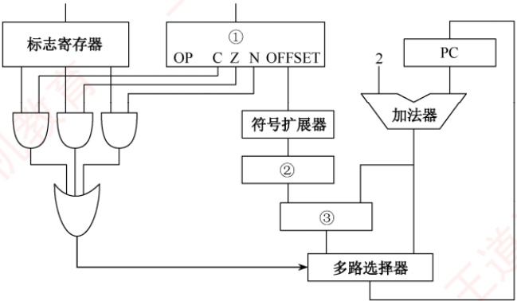
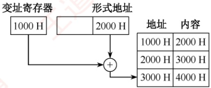
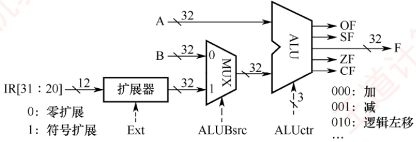
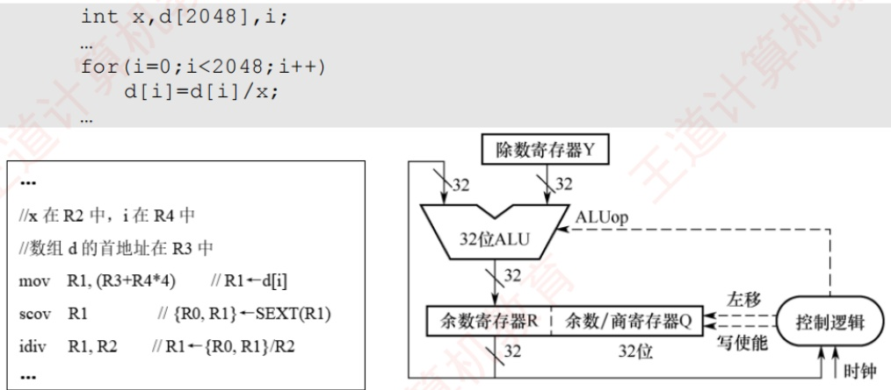

# 第4章 指令系统 · 习题与解析

> 由《第4章 指令系统》正文摘出；区块标题保留了原书的小节编号。

### 4.1.6 本节习题精选

**一、单项选择题**

01.下列关于指令集体系结构和指令系统的说法中，错误的是（）。
A. 指令集体系结构位于计算机软/硬件的交界面上
B. 指令集体系结构是指低级语言程序员所看到的概念结构和功能特性任何程序运行前都要先转换为机器语言程序D. 指令系统和机器语言是无关的

02.下列有关指令集体系结构（ISA）的叙述中，错误的是（）。
A. ISA规定了执行每条指令时所包含的控制信号
B. ISA规定了指令获取操作数的方式，即寻址方式
C. ISA规定了所有指令的集合，包括指令格式和操作类型
D. ISA规定了程序可访问的寄存器个数、存储空间大小、编址方式和大端/

03. 运算型指令的寻址与转移型指令的寻址的不同点在于（）。
A. 前者取操作数，后者决定程序转移地址
B. 后者取操作数，前者决定程序转移地址
C. 前者是短指令，后者是长指令
D. 前者是长指令，后者是短指令

04.程序控制类指令的功能是（）。
A. 进行算术运算和逻辑运算
B. 进行主存与 CPU之间的数据传送
C. 进行 CPU 和I/O 设备之间的数据传送
D. 改变程序执行的顺序

05. 下列指令中不属于程序控制类指令的是（）。
A. 无条件转移指令
B. 条件转移指令
C. 中断隐指令
D. 循环指令

06. 以下叙述错误的是（）。
A. 为了便于取指令，指令的长度通常为存储字长的整数倍
B. 单地址指令是固定长度的指令
C. 单字长指令可加快取指令的速度
D. 单地址指令可能有一个操作数，也可能有两个操作数

07. 某指令系统有200条指令，对操作码采用固定长度二进制编码，最少需要用（）位。
A. 4
B. 8
C. 16
D. 32

08. 在指令格式中，采用扩展操作码设计方案的目的是（）。
A. 减少指令字长度
B. 增加指令字长度
C. 保持指令字长度不变而增加指令的数量
D. 保持指令字长度不变而增加寻址空间

09. 一个计算机系统采用32位单字长指令，地址码为12位，若定义了250条二地址指令，则还可以有（）条单地址指令。
A. $2^{12}$
B. $2^{13}$
C. $2^{14}$
D. $3   \times   2^{13}$

10. 假设系统采用16位定长指令字格式，操作码使用扩展编码方式，地址码为4位，三地址、二地址、一地址指令各有15、8、127条，则零地址指令最多有（）条。
A. 15
B. 16
C. 31
D. 32 北

11. 某指令系统的指令字长为16位，地址码长度为6位。若已定义二地址指令15条、一地址指令48条，则零地址指令最多可定义（）条。
A. 255
B. 256
C. 1023
D. 1024

12.某机器的指令字长为12位，采用扩展操作码技术，支持零地址、一地址和二地址3种指令格式，地址码长度均为4位。若一地址和二地址指令均取最大可能条数，则该机器最多可定义的指令总数为（）。
A. 16
B. 46
C. 48
D. 4366

13.【2017统考真题】某计算机按字节编址，指令字长固定且只有两种指令格式，其中三地址指令29条、二地址指令107条，每个地址字段为6位，则指令字长至少应该是（）。
A. 24 位
B. 26 位
C. 28位
D. 32 位

14.【2022统考真题】下列选项中，属于指令集体系结构（ISA）规定的内容是（）。I. 指令字格式和指令类型 II. CPU 的时钟周期

Ⅲ. 通用寄存器个数和位数 IV. 加法器的进位方式
A. 仅I、Ⅱ
B. 仅I、ⅢII
C. 仅ⅡI、IV
D. 仅I、ⅢII、IV

15.【2022统考真题】设计某指令系统时，假设采用16位定长指令字格式，操作码使用扩展编码方式，地址码为6位，包含零地址、一地址和二地址3种格式的指令。若二地址指令有12条，一地址指令有254条，则零地址指令的条数最多为（）。
A. 0
B. 2
C. 64
D. 128

16.【2025统考真题】在下列选项中，由指令集体系结构（ISA）规定的是（）。
A. 是否采用阵列乘法器
B. 是否采用定长指令字格式
C. 是否采用微程序控制器
D. 是否采用单总线数据通路

**二、综合应用题**

01. 一个处理器中共有32个寄存器，使用16位立即数，其指令系统结构中共有142条指令。在某个给定的程序中，20%的指令带有一个输入寄存器和一个输出寄存器；30%的指令带有两个输入寄存器和一个输出寄存器；25%的指令带有一个输入寄存器、一个输出寄存器、一个立即数寄存器；其余25%的指令带有一个立即数输入寄存器和一个输出寄存器。

1）对于以上4种指令类型中的任意一种指令类型来说，共需要多少位？假定指令系统结构要求所有指令长度必须是8的整数倍。

2）与使用定长指令集编码相比，当采用变长指令集编码时，该程序能够少占用多少存储器空间？

02. 假设指令字长为16位，操作数的地址码为6位，指令有零地址、一地址、二地址3种格式1）设操作码固定，若零地址指令有M种，一地址指令有N种，则二地址指令最多有几种？2）采用扩展操作码技术，二地址指令最多有几种？3）采用扩展操作码技术，若二地址指令有P条，零地址指令有Q条，则一地址指令最多有几种？

03. 在一个36位长的指令系统中，设计一个扩展操作码，使之能表示下列指令:

1）7条具有两个15位地址和一个3位地址的指令。

2）500条具有一个15位地址和一个3位地址的指令。

3）50条无地址指令。

### 4.1.7 答案与解析

**一、单项选择题**

01. D

指令集体系结构（ISA）完整定义了软件和硬件之间的接口，是机器语言或汇编语言程序员所应熟悉的。指令系统是计算机硬件的语言系统，这显然和机器语言有关。

02. A

指令集体系结构（ISA）是软件和硬件之间接口的一个完整定义，包含了基本数据类型、指令集、寄存器、寻址模式、存储体系、中断和异常处理及外部I/O。ISA规定了执行每条指令时所需要的操作码、操作数、寻址方式等信息，以及指令的功能和效果。控制信号是由控制单元根据ISA生成的，它属于微架构层面的实现细节，而不是ISA层面的抽象定义。

03. A

运算型指令寻址的是操作数，而转移型指令寻址的是下次欲执行的指令的地址。

04. D

程序控制类指令用于改变程序执行的顺序，并使程序具有测试、分析、判断和循环执行的能力。

05. C

程序控制类指令主要包括无条件转移、条件转移、子程序调用和返回指令、循环指令等。中断隐指令是由硬件实现的，并不是指令系统中存在的指令，更不可能属于程序控制类指令。

06. B

指令的地址个数与指令的长度是否固定没有必然联系，即使是单地址指令，也可能由于单地址的寻址方式不同而导致指令长度不同。

07. B

因 $128 = 2^{7} < 200 < 2^{8} = 256$ ，因此采用定长操作码时，至少需要8位。

08. C

扩展操作码并未改变指令的长度，而是使操作码长度随地址码的减少而增加。

09. D

地址码为12位，二地址指令的操作码长度为 $32 - 12 - 12 = 8$ 位，已定义了250条二地址指令， $2^{8}-250=6$ ，即可以设计出单地址指令 $6 \times 2^{12} = 3 \times 2^{13}$ 条。

10. B

指令长16位，地址码各4位。三地址指令:操作码4位，最多16种，用15种，剩1种（1111）用于扩展，所有非三地址指令的操作码的高4位均为1111，共 $2^{12}   =   4096$ 个编码。二地址指令:8条，每条占 $2^{8}   =   256$ 个编码（因有8位地址），共占 $8 \times 256 = 2048$ 个，剩余编码为4096-2048=2048个。一地址指令:127条，每条占 $2^{4}   =   16$ 个编码，共占 $127 \times 16 = 2032$ 个，剩余编码为 $2048 - 2032 =$ 16个。这些编码无地址字段，每条对应一条零地址指令，故最多16条。

11. D

操作码按从短到长进行扩展编码。指令字长16位，地址码占6位。二地址指令含两个地址码（共12位），操作码为高4位，可编码 $2^{4} = 16$ 种；15条指令可使用编码 $0000 \sim 1110$ ，剩余1111用作扩展。一地址指令的高4位固定为1111，中间6位用作扩展操作码，共 $2^{6} = 64$ 种组合；实际使用48条，剩余 $64 - 48 = 16$ 个编码可用作零地址扩展。零地址指令无地址字段，其高10位由1111拼接上述16个空闲扩展码构成，低6位自由取值，故最多可定义 $16 \times 2^{6} = 16 \times 64 = 1024$ 条

12. B

二地址指令的操作码占4位，共 $2^{4}   = 16$ 种编码，保留1个用于扩展，最多定义15条。一地址指令利用该保留编码，将第二个4位地址字段作为扩展操作码，得到 $2^{4}   = 16$ 种组合，再保留其中1个用于零地址扩展，最多可定义15条。零地址指令则使用这一保留编码，将剩余的4位全部作为操作码，可定义24=16条。因此，指令总数最多为 $15+15+16=46$ 条

13. A

三地址指令有29条，所以其操作码至少为5位。以5位进行计算，它剩余 $32   -   29 = 3$ 种操作码给二地址。而二地址额外多了6位给操作码，因此其数量最大达 $3 \times 64 = 192$ 。所以指令字长最少为23位，因为计算机按字节编址，需要是8的倍数，所以指令字长至少应该是24位。

14. B

指令集体系结构处于软/硬件的交界面上。指令字和指令格式、通用寄存器个数和位数都与机器指令有关，由ISA规定。两个CPU可以有不同的时钟周期，但指令集可以相同；加法器的进位方式涉及电路设计，这两项都属于计算机的硬件部分，不由ISA规定。

15. D

地址码为6位，一条二地址指令会占用 $2^{6}$ 条一地址指令的空间，一条一地址指令会占用 $2^{6}$条零地址指令的空间。若全都是零地址指令，则最多有 $2^{16}$ 条，减去一地址指令和二地址指令所占用的零地址指令空间，即 $2^{16}-254\times 2^{6}-12\times 2^{6}\times 2^{6}=(2^{10}-254-12\times 2^{6})\times 2^{6}=2\times 2^{6}=128$ 0

【另解】二地址指令有12条，则剩余 $16 - 12 = 4$ 种操作码给一地址指令，一地址指令有254条，剩余 $4 \times 64 - 254 = 2$ 种操作码给0地址指令，所以0地址一共有 $2 \times 2^{6} = 128$ 条。

16. B

指令集体系结构（ISA）是软件和硬件之间的抽象接口，定义了机器语言程序员可见的处理器行为，包括指令集、数据类型、寄存器、寻址方式及指令编码格式等。指令字是否定长属于编码格式的一部分，直接影响机器代码解析与程序设计，由ISA明确规定。而阵列乘法器、微程序控制器和单总线数据通路均属于微架构实现细节，对程序员不可见，不在ISA范畴内。

**二、综合应用题**

01. 【解答】

1）因为有142条指令，所以至少需要8位才能确定各条指令的操作码 $( 2^{8} = 256 )$ 。因为该处理器有32个寄存器，也就是说要用5位对寄存器ID编码，而每个立即数需要16位，所以有:20%的一个输入寄存器和一个输出寄存器指令需要 $8+5+5=18$ 位，长度对齐到8的倍数，便是24位。

30%的两个输入寄存器和一个输出寄存器指令需要 $8+5+5+5=23$ 位，对齐到24位。25%的一个输入寄存器、一个输出寄存器、一个立即数寄存器指令需要 $8+5+5+16=34$位，对齐到40位。 x

25%的一个立即数输入寄存器和一个输出寄存器指令需要 $8+16+5=29$ 位，对齐到32位。

2）因为变长指令最长的长度为40位，所以定长指令编码每条指令的长度均为40位。而采用变长编码，将各个指令长度和其概率相乘，得出平均长度为30位。所以该程序中，变长编码比定长编码少占用25%的存储空间。

02.【解答】

1）根据操作数地址码为6位，得到二地址指令中操作码的位数为 $16 - 6 - 6 = 4$ ，这4位操作码可有16种操作。操作码固定，因此除了零地址指令有M种，一地址指令有N种，剩下的二地址指令最多有 $16 - M - N$ 种。

2）采用扩展操作码技术，操作码位数可随地址数的减少而增加。对于二地址指令，指令字长16位，减去两个地址码共12位，剩下4位操作码，共16种编码，去掉一种编码（如1111）用于一地址指令扩展，二地址指令最多可有15种操作。

3）采用扩展操作码技术，操作码位数可变，二地址、一地址和零地址的操作码长度分别为4位、10位和16位。这样，二地址指令操作码每减少一个，就可以多构成 $2^{6}$ 条一地址指令操作码；一地址指令操作码每减少一个，就可以多构成 $2^{6}$ 条零地址指令操作码。设一地址指令有R条，则一地址指令最多有 $(2^{4} - P) \times 2^{6}$ 条，零地址指令最多有 $[ ( 2^{4} - P ) \times 2^{6} - R ] \times 2^{6}$ 条。题中给出零地址指令为Q条，即 $Q = [ ( 2^{4} - P ) \times 2^{6} - R ] \times 2^{6}$ ，得 $R = (2^4 - P) \times 2^6 - \left[ Q \times 2^{-6} \right]$ o

03.【解答】

1)

| 3 | 15 | 15 | 3 |  |
| --- | --- | --- | --- | --- |
| OP | addr1 | addr2 | addr3 |  |
| 000 |  |  |  |  |
|  |  |  |  |  |
| 110 |  |  |  |  |

2)

3)

000000111110011

| 3 | 15 | 15 | 3 |
| --- | --- | --- | --- |

| OP1 | OP2 KID | addr1 | addr2 |
|  | 000000000000000 |  |  |
| 111 |  |  |  |

| 3 | 15 | 18 |
| --- | --- | --- |
| OP1 | OP2 |  |
|  | 000000111110100 | 0000...00000（18个0） |
|  | 000001000100101 | （18个0） 0000...00000 |

### 4.2.3 本节习题精选

**一、单项选择题**

01.指令系统中采用不同寻址方式的目的是（）。
A. 提供扩展操作码的可能并降低指令译码难度
B. 可缩短指令字长，扩大寻址空间，提高编程的灵活性
C. 实现程序控制
D. 三者都正确 机

02. 采用直接转移的无条件转移指令的功能是将指令中的地址码送入（）
C. 程指器（
D. 指寄码存器（）

03. 为了缩短指令中某个地址段的位数，有效的方法是采取（）。
A. 立即寻址
B. 变址寻址
C. 间接寻址
D. 寄存器寻址

04. 简化地址结构的基本方法是尽量采用（）。
A. 寄存器寻址
B. 隐含寻址
C. 直接寻址
D. 间接寻址

05. 在指令寻址的各种方式中，获取操作数最快的方式是（）。
A. 直接寻址
B. 立即寻址
C. 寄存器寻址
D. 间接寻址

06. 假定指令中地址码所给出的是操作数的有效地址，则该指令采用（）。
A. 直接寻址
B. 立即寻址
C. 寄存器寻址
D. 间接寻址

07. 设指令中的地址码为A，变址寄存器为X，程序计数器为PC，则变址间址寻址方式的操作数的有效地址 EA 是（）。
A. ((PC) +A)
B. ((X) + A)
C. (X) + (A)

08.（）便于处理数组问题。 与
A. 间接寻址
B. 变址寻址
C. 相对寻址
D. 基址寻址

09. 相对寻址方式中，指令所提供的相对地址实质上是一种（
A. 立即数
B. 内存地址
C. 以本条指令在内存中首地址为基准位置的偏移量
D. 以下条指令在内存中首地址为基准位置的偏移量

10. 指令寻址方式有顺序和跳跃两种，采用跳跃寻址方式可以实现（）。
A. 程序浮动
B. 程序的无条件浮动和条件浮动
C. 程序的无条件转移和条件转移
D. 程序的调用

11. 寄存器 R1、R2 均为 16 位，指令 MOV R1,[R2]的功能是把内存数据传送至寄存器 R1，寻址方式为寄存器间接寻址。R2 的值为 1234H，内存单元 1234H存放数据56H，内存单元 1235H存放数据 78H，采用小端方式存储。则执行指令后 R1的值为（）。
A. 5678H
B. 7856H
C. 8765H
D. 6587H

12. 某计算机的字长为16位，主存按字编址。转移指令由两个字节组成，采用相对寻址，第一个字节为操作码字段，第二个字节为相对偏移量字段。若某转移指令所在的主存地址为4000H，相对偏移量字段的内容为06H，则该转移指令执行后的PC值为（）。
A. 4002H
B. 4004H
C. 4007H
D. 4008H

13. 某计算机的指令字长为16位，由低到高第0\~7位是形式地址D，第8\~9位为寻址特征位X，第10\~15位为操作码。当X=00时为直接寻址；当X=01时使用X1进行变址寻址；当 X=10时使用 X2进行变址寻址；当 X= 11时为相对寻址。设(PC)= 1234H，(X1)=0005H，(X2)=1188H，则指令2222H的有效地址是（）。
A. 1256H
B. 0027H
C. 2222H
D. 11AAH

14. 某机器指令字长为16位，主存按字节编址，取指令时，每取一字节，PC自动加1。当前指令地址为2000H，指令内容为相对寻址的无条件转移指令，指令中的形式地址为40H。则取指令后及指令执行后PC的内容为（）。
A. 2000H, 2042H
B. 2002H，2040H
C. 2002H, 2042H
D. 2000H, 2040H

15. 某计算机的主存容量为4M×16位，且存储字长等于指令字长，若该机能完成97种操作，操作码位数固定，且有直接、间接、基址、变址、相对、立即六种寻址方式，则相对寻址的偏移量范围为（）。
A. (−32, +31)
B. (−64, +63)
C. (−128, +127)
D. (−256, +255)

16. 假设寄存器R中的数值为200，主存地址为200和300的地址单元中存放的内容分别是300和400，则（）方式下访问到的操作数为200。
A. 直接寻址 200
B. 寄存器间接寻址（R）D. 寄存器寻址 R

17. 假设某条指令的第一个操作数采用寄存器间接寻址方式，指令中给出的寄存器编号为8，8号寄存器的内容为1200H，地址为1200H 的单元中的内容为12FCH，地址为 12FCH的单元中的内容为38D8H，而地址为38D8H的单元中的内容为88F9H，则该操作数的有效地址为（）。
A. 1200H
B. 12FCH
C. 38D8H

18. 设相对寻址的转移指令占3B，第1字节为操作码，第2、3字节为相对位移量（补码表示），数据在存储器中采用以低字节为字地址的存放方式。每当CPU从存储器取出一字节时，即自动完成(PC)+1→PC。若PC的当前值为240（十进制），要求转移到290（十进制），则转移指令的第2、3字节的机器代码是（）；若PC的当前值为240（十进制），要求转移到200（十进制），则转移指令的第2、3字节的机器代码是（）。
A. 2FH、FFH
B. D5H、00H
C. D5H、FFH
D. 2FH、00H

19. 某计算机按字节编址，采用大端方式，某指令的一个操作数的机器数为ABCD 00FFH，该操作数采用基址寻址方式，指令中形式地址（用补码表示）为FF00H，当前基址寄存器的内容为C000 0000H，则该操作数的LSB（FFH）存放的地址是（）。
A. C000 FF00H
B. C000 FF03H
C. BFFF FF00H
D. BFFF FF03H

20.下列关于指令的功能及分类的叙述中，正确的是（）。
A. 算术与逻辑运算指令，通常完成算术运算或逻辑运算，都需要两个数据
B. 移位操作指令，通常用于把指定的两个操作数左移或右移一位
C. 转移指令、子程序调用与返回指令，用于解决数据调用次序的需求
D. 特权指令，通常仅用于实现系统软件，这类指令一般不提供给用户

21. 某计算机字长为16位，标志寄存器中存在ZF、SF、OF和CF标志位，采用双字节字长指令字。假定bgt（大于零转移）指令的第一个字节指明操作码和寻址方式，第二个字节为立即数Imm8，用补码表示。指令功能是:若转移条件成立，则PC=PC+2+Imm8×2;否则，PC=PC+2。则下列叙述中错误的是（）。
A. 该计算机按字节编址
B. 若bgt指令是无符号整数的比较，则转移条件可以是ZF+ CF= 0
C. 若bgt指令是有符号整数的比较，则转移条件可以是SF⊕OF= 0
D. 转移目标地址的范围是相对于bgt指令的前127条指令到后128 条指令之间

22. 下列关于指令寻址与数据寻址的描述中，错误的是（）。
A. 中断响应时，中断隐指令的执行不属于指令寻址的范畴
B. 指令格式中，每个操作数字段均需通过显式编码或隐含约定确定其寻址方式
C. 在含Cache的系统中，指令访存遵循“Cache优先”原则，未命中时再访问主存
D. 数据寻址方式不属于指令集体系结构（ISA）规定的内容

23.【2009统考真题】某机器字长为16位，主存按字节编址，转移指令采用相对寻址，由2字节组成，第一字节为操作码字段，第二字节为相对位移量字段。假定取指令时，每取一字节，PC自动加1。若某转移指令所在主存地址为2000H，相对位移量字段的内容为06H，则该转移指令成功转移后的目标地址是（）。
A. 2006H
B. 2007H
C. 2008H
D. 2009H

24. 【2011统考真题】偏移寻址通过将某个寄存器的内容与一个形式地址相加来生成有效地址。下列寻址方式中，不属于偏移寻址方式的是（）。
A. 间接寻址
B. 基址寻址
C. 相对寻址
D. 变址寻址

25.【2011 统考真题】某机器有一个标志寄存器，其中有进位/借位标志CF、零标志ZF、符号标志SF和溢出标志OF，条件转移指令bgt（无符号整数比较大于时转移）的转移条件是（） 城
A. CF + OF =1
B. $\overline {{\mathrm {S F}}} + \mathrm {Z F} = 1$
C. CF+ZF=1
D. $\overline{CF+SF}=1$

26.【2013统考真题】假设变址寄存器R的内容为1000H，指令中的形式地址为2000H;地址 1000H 中的内容为 2000H，地址 2000H 中的内容为 3000H，地址 3000H 中的内容为4000H，则变址寻址方式下访问到的操作数是（）。
A. 1000H
B. 2000H
C. 3000H
D. 4000H

27.【2014统考真题】某计算机有16个通用寄存器，采用32位定长指令字，操作码字段（含寻址方式位）为8位，STORE指令的源操作数和目的操作数分别采用寄存器直接寻址和基址寻址方式。若基址寄存器可使用任意一个通用寄存器，且偏移量用补码表示，则STORE指令中偏移量的取值范围是（）。
A. -32768\~+32767
B. -32767～+32768
C. -65536\~+65535 K
D. -65535\~+65536

28. 【2016统考真题】某指令格式如下所示。

| OP | M | I | D |
| --- | --- | --- | --- |
|  |  |  |  |

其中M为寻址方式，Ⅰ为变址寄存器编号，D为形式地址。若采用先变址后间址的寻址方式，则操作数的有效地址是（）。
A. I + D
B. (I) + D
C. ((I) + D)
D. ((I)) + D

29.【2017统考真题】下列寻址方式中，最适合按下标顺序访问一维数组元素的是（）。
A. 相对寻址
B. 寄存器寻址
C. 直接寻址
D. 变址寻址妆

30. 【2018统考真题】按字节编址的计算机中，某double型数组A的首地址为2000H，使用变址寻址和循环结构访问数组A，保存数组下标的变址寄存器的初值为0，每次循环取一个数组元素，其偏移地址为变址值乘以 sizeof(double)，取完后变址寄存器的内容自动加1。若某次循环所取元素的地址为2100H，则进入该次循环时变址寄存器的内容是（）。X
A. 25
B. 32
C. 64
D. 100

31.【2019统考真题】某计算机采用大端方式，按字节编址。某指令中操作数的机器数为1234 FF00H，该操作数采用基址寻址方式，形式地址（用补码表示）为FF12H，基址寄存器的内容为F000 0000H，则该操作数的LSB（最低有效字节）所在的地址是（）。
A. F000 FF12H
B. F000 FF15H
C. EFFF FF12H
D. EFFF FF15H

32. 【2020统考真题】某计算机采用16位定长指令字格式，操作码位数和寻址方式位数固定，指令系统有48条指令，支持直接、间接、立即、相对4种寻址方式。在单地址指令中，直接寻址方式的可寻址范围是（）。
A. 0\~255
B. 0\~1023
C. -128\~127
D. -512\~511

33. 【2023统考真题】某运算类指令中有一个地址码为通用寄存器编号，对应通用寄存器中存放的是操作数或操作数的地址，CPU区分两者的依据是（）。
A. 操作数的寻址方式
B. 操作数的编码方式
C. 通用寄存器的编号
D. 通用寄存器的内容

**二、综合应用题**

01. 某机的机器字长为16位，主存按字编址，指令格式如下:

| 15 | 8 9 7 |
| --- | --- |
| 操作码 | X D |

其中，D为位移量；X为寻址特征位。

设(PC)=1234H，(X1)=0037H，(X2)=1122H（H代表十六位进制数），请确定下列指令的有效地址:① 4420H ② 2244H ③ 1322H ④ 3521H ⑤ 6723H

02. 某计算机字长16 位，标志寄存器FLAGS 中的 ZF、SF和 OF分别是零标志、符号标志和溢出标志，采用双字节字长指令字。假定bgt（大于零转移）指令的第一个字节指明操作码和寻址方式，第二个字节为偏移地址Imm8，用补码表示。指令功能是:若（ZF + (SF ⊕ OF) = 0），则 $PC  =  PC  + 2 +  Imm 8 \times 2$ ；否则，PC= PC + 2。请回答下列问题:1）该计算机的编址单位是多少？2）bgt指令执行的是有符号整数比较，还是无符号整数比较？3）偏移地址Imm8的含义是什么？转移目标地址的范围是什么？

03.【2010统考真题】某计算机字长为16位，主存地址空间大小为128KB，按字编址，采用单字长指令格式，指令各字段定义如下: XT

<table><tr><td>15</td><td>12 11</td><td></td><td>5 6</td><td>0</td></tr><tr><td>OP</td><td>Ms</td><td>Rs</td><td>Md</td><td>Rd</td></tr><tr><td></td><td colspan="4">源操作数 目的操作数</td></tr></table>

转移指令采用相对寻址方式，相对偏移量用补码表示，寻址方式定义见下表

| Ms/Md | 寻址方式 | 助记符 | 含 义 |
| --- | --- | --- | --- |
| 000B | 寄存器直接 | Rn | 操作数 = (Rn) |
| 001B | 寄存器间接 | (Rn) | 操作数 =((Rn)) |
| 010B | 寄存器间接、自增 | (Rn) + | 操作数 = ((Rn))，(Rn) + 1→Rn |
| 011B | 相对 | D(Rn) | 转移目标地址 = (PC) + (Rn) |

注:(X)表示存储器地址X或寄存器X的内容。

回答下列问题:

1）该指令系统最多可有多少条指令？该计算机最多有多少个通用寄存器？存储器地址寄存器（MAR）和存储器数据寄存器（MDR）至少各需要多少位？

2）转移指令的目标地址范围是多少？

3)若操作码 0010B 表示加法操作(助记符为 add)，寄存器 R4和 R5 的编号分别为 100B和101B，R4 的内容为 1234H，R5的内容为 5678H，地址 1234H中的内容为 5678H，5678H中的内容为 1234H，则汇编语句“add (R4)，(R5)+”（逗号前为源操作数，逗号后为目的操作数）对应的机器码是什么（用十六进制表示）？该指令执行后，哪些寄存器和存储单元的内容会改变？改变后的内容是什么？

04.【2013统考真题】某计算机采用16位定长指令字格式，其CPU中有一个标志寄存器，其中包含进位/借位标志CF、零标志ZF和符号标志NF。假定为该机设计了条件转移指令，其格式如下: XTA

| 15 | 11 109 |  | 87 | 0 |
| --- | --- | --- | --- | --- |
| 00000 | C | Z | N | OFFSET |

其中，00000为操作码 OP；C、Z和N分别为CF、ZF和NF的对应检测位，某检测位为1时表示需检测对应标志，需检测的标志位中只要有一个为1就转移，否则不转移。例如，若C= 1，Z= 0，N= 1，则需检测CF和NF的值，当CF =1或NF = 1时发生转移；OFFSET是相对偏移量，用补码表示。转移执行时，转移目标地址为(PC)+2+ 2×OFFSET；顺序执行时，下一条指令地址为(PC)+2。请回答下列问题:

1）该计算机存储器是按字节编址还是按字编址？该条件转移指令向后（反向）最多可转移多少条指令？

2）某条件转移指令的地址为200CH，指令内容如下图所示，若该指令执行时CF=0，ZF= 0，NF = 1，则该指令执行后 PC 的值是多少？若该指令执行时CF = 1，ZF = 0，NF=0，则该指令执行后PC的值又是多少？请给出计算过程。

<table><tr><td colspan=5>15     1110987            0</td></tr><tr><td>00000</td><td>0</td><td>1</td><td>1</td><td>11100011</td></tr></table>

3）实现“无符号数比较小于或等于时转移”功能的指令中，C、Z和N应各是什么？4）以下是该指令对应的数据通路示意图，要求给出图中部件①\~③的名称或功能说明。



05. 【2021统考真题】假定计算机M字长为16位，按字节编址，连接CPU和主存的系统总线中地址线为20位、数据线为8位，采用16位定长指令字，指令格式及说明如下:

格式 6位 2位 2位 2位 4位 指令功能或指令类型说明

<table><tr><td rowspan=3>R型I型J型</td><td>000000</td><td>rs</td><td>rt</td><td>rd</td><td>opl</td></tr><tr><td>op2</td><td>rs</td><td>rt</td><td colspan=2>imm</td></tr><tr><td>op3</td><td colspan=4>target</td></tr></table>

R[rd] ← R[rs] op1 R[rt]

含ALU运算、条件转移和访存操作3类指令

PC 的低 10位← target

其中，op1\~ op3 为操作码，rs, rt 和 rd 为通用寄存器编号，R[r]表示寄存器 r的内容，imm为立即数，target为转移目标的形式地址。请回答下列问题。

1）ALU的宽度是多少位？可寻址主存空间大小为多少字节？指令寄存器、主存地址寄存器（MAR）和主存数据寄存器（MDR）分别应有多少位？

2）R型格式最多可定义多少种操作？I型和J型格式总共最多可定义多少种操作？通用寄存器最多有多少个？

3）假定op1为0010和0011时，分别表示有符号整数减法和有符号整数乘法指令，则指令01B2H的功能是什么（参考上述指令功能说明的格式进行描述）？若1,2,3号通用寄存器当前内容分别为 B052H，0008H，0020H，则分别执行指令 01B2H和01B3H后，3号通用寄存器内容各是什么？各自结果是否溢出？ rX

4）若采用Ι型格式的访存指令中imm（偏移量）为有符号整数，则地址计算时应对imm进行零扩展还是符号扩展？

5）无条件转移指令可以采用上述哪种指令格式？

### 4.2.4 答案与解析

**一、单项选择题**

01. B

采用不同寻址方式的目的是为了缩短指令字长，扩大寻址空间，提高编程的灵活性，但这也提高了指令译码的复杂度。程序控制是靠转移指令而非寻址方式实现的。

02. A

转移指令有条件/无条件、直接/间接、相对/绝对三种属性。条件转移是指需要先判断条件是否成立，才决定是否转移:无条件转移是指不用判断条件就可以转移，典型的是函数调用和返回。直接转移是指转移目标地址直接放在指令中，执行时直接将地址码送入PC；间接转移是指转移目标地址存放在寄存器或内存单元中。相对转移是指转移目标地址为当前PC值加上偏移量，偏移量一般在指令中；绝对转移是指转移目标地址直接由指令或寄存器给出。

03. D

CPU中寄存器的数量都不会太多，用很短的编码就可以指定寄存器，寄存器寻址需要的地址段位数为1og2(通用寄存器个数)]，因此能有效地缩短地址段的位数。立即寻址，操作数直接保存在指令中，若地址段位数太小，则操作数表示的范围会很小；变址寻址，EA=变址寄存器IX的内容+形式地址A，A与主存寻址空间有关；间接寻址中存放的仍然是主存地址。

04.B

隐含寻址不明显给出操作数地址，而在指令中隐含操作数的地址，因此可以简化地址结构。05. B

立即寻址最快，指令直接给出操作数；寄存器寻址次之，只需访问一次寄存器；直接寻址再次之，访问一次内存；间接寻址最慢，要访问内存两次或以上。

06. A

指令字中的形式地址为操作数的有效地址，这种方式为直接寻址。

07. B

变址寻址的有效地址是(X)+ A，再进行变址间址寻址，即把(X)+A 中取出的内容作为真实地址 EA，即 EA = ((X) + A)。

寄存器中的内容和指令地址码相加得到的是操作数的地址码。

08. B

变址寻址便于处理数组问题。基址寻址与变址寻址的区别见下表。

|  | 基址寻址 | 变址寻址 |
| --- | --- | --- |
| 有效地址 | $\mathrm{EA} = (\mathrm{BR}) + \mathrm{A}$ | $\mathrm{EA} = (\mathrm{IX}) + \mathrm{A}$ |
| 访存次数 | 1 | 1 |
| 寄存器内容 | 由操作系统或管理程序确定 | 由用户设定 |
| 程序执行过程中值可变否 | 不可变 | 可变 |
| 特点 | 有利于多道程序设计和编制浮动程序 | 有利于处理数组问题和编制循环程序 |

09. D

相对寻址中，有效地址 $\mathrm{EA} = (\mathrm{PC}) + \mathrm{A}$ （A为形式地址），执行本条指令时，PC已完成加1操作，PC中保存的是下一条指令的地址，因此以下一条指令的地址为基准位置的偏移量。

10. C

跳跃寻址通过转移类指令（如相对寻址）来实现，可用来实现程序的条件或无条件转移。

11. B

寄存器R2中的值是1234H，内存单元1234H中的值是56H，1235H中的值是78H，因为采用小端方式，所以实际存储的数据为7856H，取出后存放到R1，因此R1的值为7856H。

12. C

主存按字编址，指令字长为1个字（2字节），因此取出该指令后，PC自动加1，相对偏移量为06H，所以该转移指令执行后的PC值为 $4000\mathrm{H}+06\mathrm{H}+1\mathrm{H}=4007\mathrm{H}$ U

13. D

将指令2222H展开成二进制为001000100010 0010B，因此寻址特征位X=10，即使用X2进行变址寻址，其有效地址为 $1188\mathrm{H}+22\mathrm{H}=11\mathrm{AAH}$ 9

14. C

指令字长为16位，2字节，因此取指令后PC的内容为(PC)+2=2002H；无条件转移指令将下一条指令的地址送至PC，形式地址为40H，指令执行后 $\mathrm{PC}=2002\mathrm{H}+0040\mathrm{H}=2042\mathrm{H}$

15. A

操作码位数固定，且能完成97种操作，则操作码位数是 $\left[ \log_{2}97 \right] = 7$ 位；具有六种寻址方式，则寻址特征位数是 $\left[ \log_{2}6 \right] = 3$ 位；指令字长为16位，因此地址码位数是 $16 - 3 - 7 = 6$ 位，6位补码的表示范围为-32～+31，即为相对寻址的偏移量范围。

16. D

直接寻址200访问的操作数是300，选项A错误。寄存器间接寻址（R）的访问结果与Ⅰ一样，选项B错误。存储器间接寻址（200）表示主存地址200中的内容为有效地址，有效地址为300，访问的操作数是400，选项C错误。寄存器寻址R表示寄存器R的内容为操作数，只有选项D正确。

17. A

寄存器间接寻址中操作数的有效地址 $\mathrm {E A}   =   ( \mathrm {R}_{i} )$ ，8号寄存器内容为1200H，因此 $\mathrm{EA} = 1200\mathrm{H}$

**18. D、C**

首先需要讲解一下补码扩充的问题。补码的扩充只需使用符号位补足即可，也就是说正数补码的扩充只要补0，负数补码的扩充只需补1（这是由补码的性质决定的）。理解了该性质，这道题就变成了十进制数转换为十六进制数的简单问题。

1）PC的当前值为240，该指令取出后PC的值为243，要求转移到290，即相对位移量为290-243=47，转换成补码为2FH。因为数据在存储器中采用以低字节地址为字地址的存放方式，所以该转移指令的第二字节为2FH，而由于47是正数，只需在高位补0，所以第三字节为00H。 -XA

2）PC的当前值为240，该指令取出后PC的值为243，要求转移到200，即相对位移量为200-243=-43，转换成补码为D5H。数据在存储器中采用以低字节地址为字地址的存放方式，因此该转移指令的第二字节为D5H，因为-43是负数，所以只需在高位补1，所以第三字节为FFH。

19. D

基址寻址的操作数的有效地址为基址寄存器内容加上形式地址，即 $\mathrm{C000~0000H}+\mathrm{FF00H}=\mathrm{C000}$ 0000H+FFFF FF00H=BFFFFF00H。因为是大端方式，所以LSB的存放地址为 BFFF FF03H。

20. D

算术与逻辑运算指令用于完成对一个（如自增、取反等）或两个数据的算术运算或逻辑运算，选项A错误。移位操作用于把一个操作数左移或右移一位或多位，选项B错误。转移指令、子程序调用与返回指令用于解决变动程序中指令执行次序的需求，而不是数据调用次序的需求，选项C错误。

21. C

PC的增量是2，每条指令占2字节，可知编址单位为字节。若bgt指令是无符号整数的比较，则大于零时，ZF一定为0，且CF也一定为0。若bgt指令是有符号整数的比较，则转移条件成立时，要么未发生溢出， $\mathrm {S F} = \mathrm {O F} = 0$ ，要么发生溢出， $\mathrm{SF} = \mathrm{OF} = 1$ ，但前提是ZF一定为0，故正确的转移条件是 $( \mathrm {Z F} + ( \mathrm {S F} \oplus \mathrm {O F} ) = 0 )$ 。Imm8的范围为-128～127，因此转移目标地址的范围是PC+ $2+(-128\times2)\sim PC+2+127\times2$ ，即相对于 bgt指令的前127条指令到后128条指令之间。

22. D

中断隐指令由硬件自动完成（如保存PC、转移至中断向量），不涉及程序控制流中的指令地址生成，故不属于指令寻址。操作数要通过显式字段或隐含规则（如堆栈使用SP）确定来源，是寻址机制的基本要求。在现代存储体系中，指令与数据访存优先经Cache，缺失时才访问主存以提升性能。数据寻址方式是ISA的核心内容，必须明确定义，选项D错误。

23. C

相对寻址EA=(PC)+A，首先计算取指令后的PC值。转移指令由2字节组成，每取一字节PC加1，取指令后的PC值为2002H，因此 $\mathrm{EA}=(\mathrm{PC})+\mathrm{A}=2002\mathrm{H}+06\mathrm{H}=2008\mathrm{H}$ 。本题易误选选项A或B，选项A未考虑PC值的自动更新，选项B虽然考虑了PC值的自动更新，但未注意到该转移指令是一条2字节指令，PC值应是“+2”而不是“+1”。

24. A

间接寻址不需要寄存器，EA=(A)。基址寻址EA= A+基址寄存器BR的内容；相对寻址EA=A+程序计数器（PC）的内容；变址寻址EA=A+变址寄存器IX的内容。后三者都是将某个寄存器的内容与一个形式地址相加而形成有效地址，所以统称偏移寻址。

25. C

假设两个无符号整数A和B，bgt指令会将A和B进行比较，也就是将A和B相减。若 $A \geq B ,$则A-B肯定无进位/借位，也不为0（为0时表示两数相等），因此CF和ZF均为0，选C。其余选项中用到了符号标志SF和溢出标志OF，SF表示结果的符号，OF是有符号整数的溢出标志位，对于无符号数运算，SF和OF没有意义，显然应当排除。

26. D

根据变址寻址的方法，变址寄存器的内容（1000H）与形式地址的内容（2000H）相加，得到操作数的实际地址（3000H），根据实际地址访问内存，获取操作数4000H，如下图所示。



27. A

采用32位定长指令字，其中操作码为8位，两个地址码共占用32 -8 =24位，而STORE指令的源操作数和目的操作数分别采用寄存器直接寻址和基址寻址，机器中共有16个通用寄存器，因此寻址一个寄存器需要 $\log_{2} 16 = 4$ 位，源操作数中的寄存器直接寻址用掉4位，而目的操作数采用基址寻址也要指定一个寄存器，同样用掉4位，则留给偏移量的位数为24-4-4=16位，而偏移量用补码表示，因此16位补码的表示范围为-32768～+32767。

28. C

在变址寻址中，有效地址（EA）等于指令字中的形式地址D与变址寄存器Ⅰ的内容之和，即EA=(1)+D。间接寻址是相对于直接寻址而言的，指令的地址字段给出的形式地址不是操作数的真正地址，而是操作数地址的地址，即 $\mathrm {E A}   =   ( \mathrm {D} )$ 。从而该操作数的有效地址是((I)+D)。

29. D

变址操作时，将计算机指令中的地址与变址寄存器中的地址相加，得到有效地址，指令提供数组首地址，由变址寄存器来定位数据中的各元素。所以它最适合按下标顺序访问一维数组元素，选择选项D。相对寻址以PC为基地址，以指令中的地址为偏移量确定有效地址。寄存器寻址则在指令中指出需要使用的寄存器。直接寻址在指令的地址字段直接指出操作数的有效地址。

30. B

根据变址寻址的公式 EA = (IX) + A，有 $(IX)=2100H-2000H=100H=256$ , sizeof(double) = 8（双精度浮点数用8位字节表示），因此数组的下标为256/8=32。

31. D

注意，内存地址是无符号数。

操作数采用基址寻址方式，EA=(BR)+A，基址寄存器BR的内容为F000 0000H，形式地址用补码表示为FF12H即11111111 0001 0010B，因此有效地址为 $\mathrm{F000~0000H}+(-00\mathrm{EEH})=\mathrm{EFFF}$ FF12H。计算机采用大端方式编址，所以低位字节存放在字的高地址处，机器数一共占4字节，该操作数的 LSB 所在的地址是 EFFF FF12H + 3 = EFFF FF15H。

32. A

48条指令需要6位操作码字段 $( 2^{5} < 48 < 2^{6} )$ ，4种寻址方式需要2位寻址特征位 $( 4   =   2^{2} )$还剩 $16 - 6 - 2 = 8$ 位作为地址码，所以直接寻址范围为0～255。注意，主存地址不能为负。

33. A

指令字由操作码、寻址特征和地址码三个字段组成，寻址特征字段用来指明指令属于哪种寻址方式。若寻址方式是寄存器直接寻址，则地址码所指的通用寄存器中存放的是操作数，若寻址方式是寄存器间接寻址，则对应通用寄存器中存放的是操作数的地址。

**二、综合应用题**

01. 【解答】

取指令后，PC=1235H（注意，不是1236H，因主存按字编址）。

① $\mathrm{X}=00,\ \mathrm{D}=20\mathrm{H}$ ，有效地址 $\mathrm{EA} = 20\mathrm{H} 。$

② X = 10，D = 44H，有效地址 $EA =1122 H +44 H =1166 H  。$

3 $\mathrm{X}=11,\ \mathrm{D}=22\mathrm{H}$ ，有效地址 $\mathrm{EA}=1235\mathrm{H}+22\mathrm{H}=1257\mathrm{H}$

4 $\mathrm{X}=01,\ \mathrm{D}=21\mathrm{H}$ ，有效地址 $\mathrm{EA}=0037\mathrm{H}+21\mathrm{H}=0058\mathrm{H}$

5 $\mathrm{X}=11,\ \mathrm{D}=23\mathrm{H}$ ，有效地址 $\mathrm{EA} = 1235\mathrm{H} + 23\mathrm{H} = 1258\mathrm{H}$

02.【解答】

1）因为PC的增量是2，且每条指令占2字节，所以编址单位是字节。

2）根据“大于”条件判断表达式，可以看出该bgt指令实现的是有符号整数比较。因为无符号数比较时，其判断表达式中没有溢出标志 $\mathrm {O F_{\circ}}$ 继续分析该逻辑表达式，bgt指令的含义是当两数相减的结果大于0时，执行转移操作。因此，要满足bgt指令的条件，必须保证如下两个条件:一是结果不为0，即零标志位ZF为 $0 ;$ 二是结果的符号位与溢出标志位OF相同，即 SF⊕OF为0（两数相减结果大于0，有两种情况:第一种情况是结果没有溢出，此时OF位和 SF位都为0；第二种情况是结果发生了溢出，此时OF和 SF位都为1）。综上所述，逻辑表达式可表示为 $\mathrm{ZF} + (\mathrm{SF} \oplus \mathrm{OF}) = 0$

3）偏移地址Imm8为补码表示，说明转移目标地址可能在bgt指令之后。计算转移目标地址时，偏移量为Imm8×2，说明Imm8不是相对地址，而是相对指令数。Imm8的范围为-128～ 127，所以转移目标地址的范围是 $PC+2+(-128\times2)\sim PC+2+127\times2$ ，也即转移目标地址的范围是相对于bgt指令的前127条指令到后128条指令之间。

03. 【解答】

1）操作码占4位，则该指令系统最多可有 $2^{4}   = 16$ 条指令。操作数占6位，其中寻址方式占3位、寄存器编号占3位，因此该机最多有 $2^{3} \: = \: 8$ 个通用寄存器。主存地址空间大小为128KB，按字编址，字长为16位，共有 $128 \mathrm {K B} / 2 \mathrm {B} = 2^{16}$ 个存储单元，因此MAR至少为16位；本题已说明了存储字长为16位，因此MDR至少为16位。

2）寄存器字长为16位，PC可以表示的地址范围为 $0 {\sim} 2^{16} {-} 1$ ，Rn可表示的相对偏移量 $-2^{15}$ $2^{15}   -   1$ ，而主存地址空间为216，因此转移指令的目标地址范围为0000H～FFFFH $( 0 \sim 2^{16} - 1 )$

3）汇编语句“add (R4),(R5)+”对应的机器码为

| 字段 | OP | Ms | $\mathrm {R s}$ | Md | Rd |
| --- | --- | --- | --- | --- | --- |
| 内容 | 0010 | 001 | 100 | 010 | 101 |
| 说明 | add | 寄存器间接 | R4 | 寄存器间接、自增 | R5 |

将对应的机器码写成十六进制数形式为 $0010\;0011\;0001\;0101\;\mathrm{B}=2315\mathrm{H}$

该指令的功能是将R4 的内容所指的存储单元的数据与 R5的内容所指的存储单元的数据相加，并将结果送入R5的内容所指的存储单元中。(R4)=1234H，(1234H)=5678H；(R5)=5678H，$(5678\mathrm{H}) = 1234\mathrm{H};$ ；执行加法操作 $5678\mathrm{H}+1234\mathrm{H}=68\mathrm{ACH}$ 之后 R5 自增。

该指令执行后，R5和存储单元5678H的内容会改变，R5的内容从 5678H变为5679H，存储单元 5678H 中的内容变为该指令的计算结果 68ACH。

04.【解答】

1）因为指令长度为16位，且下一条指令地址为(PC)+2，因此编址单位是字节。

相对偏移量OFFSET为8位补码，表示范围为-128～127，根据转移目标地址为 $(PC) + 2 +$ $2 \times  OFFSET$ ，若要向后转移，则要求OFFSET必须为负数，OFFSET的最小值为-128，但在执行转移指令之前，PC进行了自增+2的操作，所以向后最多可转移127条指令。

2）指令中 $C = 0, \; Z = 1, \; N = 1$ ，因此应根据ZF和NF的值来判断是否转移。 $\mathrm{CF}=0,\ \mathrm{ZF}=0$ $\mathrm {N F} = 1$ 时，需转移。已知指令中的偏移量为 $1110\;0011\mathrm{B}=\mathrm{E}3\mathrm{H}$ ，符号扩展后为FFE3H，左移一位（乘以2）后为FFC6H，因此PC的值（转移目标地址）为 $200CH+2+FFC6H=$ 1FD4H。CF = 1，ZF = 0，NF = 0时不转移。PC的值为 $200CH+2=200EH$

3）指令中的C、Z和N应分别设置为 $C = Z = 1,\ N = 0$ 。两个数之间的大小比较通常是对两个数做减法运算，即两个数相减当结果为0或为负时转移，若为0，则ZF标志应当是1，若为负，则借位标志应该是1，而无符号数并不涉及符号标志 $\mathrm {N F}_{\circ}$

4）部件①用于存放当前指令，不难得出为指令寄存器；多路选择器根据符号标志C/亿/N来决定下一条指令的地址是PC +2 还是 $\mathrm{PC}+2+2\times \mathrm{OFFSET}$ ，因此多路选择器左边线上的结果应是 $PC  + 2 + 2 \times  OFFSET$ 。根据运算的先后顺序及与 $\mathrm{PC} + 2$ 的连接，部件②用于左移一位实现乘以2，为移位寄存器。部件③用于PC+2和 $2 \times  OFFSET$ 相加，为加法器。

部件②:移位寄存器（用于左移一位）；部件③:加法器（地址相加）。

05.【解答】

1）ALU的宽度为16位，ALU的宽度即ALU运算对象的宽度，通常与字长相同。地址线为20位，按字节编址，可寻址主存空间大小为 $2^{20}$ 字节（或1MB）。指令寄存器有16位，和单条指令长度相同。MAR有20位，和地址线位数相同。MDR有8位，和数据线宽度相同。

2）R型格式的操作码有4位，最多有 $2^{4}$ （或16）种操作。Ⅰ型和J型格式的操作码有6位，因为它们的操作码部分重叠，所以共享这6位的操作码空间，且前6位全为0的编码已被R型格式占用，因此I和J型格式最多有 $2^{6}   -   1   =   63$ 种操作。从R型和I型格式的寄存器编号部分可知，只用2位对寄存器编码，因此通用寄存器最多有4个。

3）指令 $01 B 2 H =000000\ 01\ 10\ 11\ 0010 B$ 为一条R型指令，操作码0010表示有符号整数减法指令，其功能为R[3]←R[1]-R[2]。执行指令01B2H后， $\mathrm{R}[3]=\mathrm{B}052\mathrm{H}-0008\mathrm{H}=\mathrm{B}04\mathrm{AH}$ ，结果未溢出。指令 $01 B 3 H =00000001\ 10\ 11\ 0011 B ,$ 操作码0011表示有符号整数乘法指令，执行指令01B3H后， $\mathrm{R}[3]=\mathrm{R}[1] \times \mathrm{R}[2]=\mathrm{B}052\mathrm{H} \times 0008\mathrm{H}=8290\mathrm{H}, \mathrm{B}052\mathrm{H}$ 乘以8相当于将B052H算术左移3位，B052H是一个负数，符号位为1，在算术左移的过程中移出了101，不全为1，由此可以判断结果溢出。

4）在进行指令的转移时，既可能向前转移，又可能向后转移，偏移量是一个有符号整数，因此在地址计算时，应对imm进行符号扩展。

5）无条件转移指令可以采用J型格式，将target部分写入PC的低10位，完成转移。

### 4.3.5 本节习题精选

**一、单项选择题**

01. 假设 R[ax]=FFE8H，R[bx]= 7FE6H，执行指令“add ax, bx”后，寄存器的内容和各标志的变化为（）。
A. R[ax] = 7FCEH, OF = 1, SF = 0, CF = 0, ZF = 0
B. R[bx] = 7FCEH, OF = 1, SF = 0, CF = 0, ZF = 0
C. R[ax] = 7FCEH, OF = 0, SF = 0, CF = 1, ZF = 0 机教育
D. R[bx] = 7FCEH, OF = 0, SF = 0, CF = 1, ZF = 0

02. 假设 R[ax]= 7FE6H，R[bx]= FFE8H，执行指令“sub bx, ax”后，寄存器的内存和各标志的变化为（）。
A. R[ax] = 8002H, OF = 0, SF = 1, CF = 1, ZF = 0 王道计
B. R[bx] = 8002H, OF = 0, SF = 1, CF = 0, ZF = 0
C. R[ax] = 8002H, OF = 1, SF = 1, CF = 0, ZF = 0
D. R[bx] = 8002H, OF = 1, SF = 1, CF = 0, ZF = 0

03. 某计算机的数据采用小端方式存储，减法指令“sub ax, imm”的功能为(ax)-imm→ax，imm 表示立即数，该指令对应的十六进制机器码为2dxxxx（从左到右以字节为单位由低地址到高地址），其中xxxx对应 imm的机器码，若imm=-3，(ax)=7，则该指令对应的机器码和执行后OF标志位的值分别为（）。
A. 2DFFFDH, 0
B. 2DFFFDH, 1
C. 2DFDFFH, 0
D. 2DFDFFH, 1

04. 某C语言程序中对数组变量 b 的声明为“int b[10][5];”，有一条 for 语句如下:

for(i=0;i<10;i++) for(j=0;j<5;j++) sum+=b[i][j];

假设执行到“sum+=b[i][i];”时，sum的值在 eax中，b[i][0]所在的地址在 edx中，j在esi中，则“sum+=b[i][i];”所对应的指令（Intel格式）可以是（）
A. add dword ptr eax, [edx+esi\*4]
B. add dword ptr eax, [esi+edx\*4]
C. add dword ptr eax, [edx+esi\*2]
D. add dword ptr eax, [esi+edx\*2]

05. 假设 R[eax] = 080480B4H，R[ebx]= 00000011H，M[080480F8H] = 000000B0H，执行指令“imul eax, [eax+ebx\*4]，-16”后，寄存器或存储单元的内容变为（）。
A. R[eax] = 00000B00H
B. M[080480F8H] = 00000B00H 教育
C. R[eax]= FFFFF500H
D. M[080480F8H] = FFFFF500H

06. 程序 P 中有两个变量 i 和 j，被分别分配在寄存器 eax 和 edx 中，P 中语句“if(i<j) {...}对应的指令序列如下（左边为指令地址，中间为机器代码，右边为汇编指令），其中jle指令的偏移量为 0d: 804846a 39 c2 cmp dword ptr edx,eax 804846c 7e 0d jle xxxxxxxx

若执行到 804846aH 处的 cmp 指令时，i = 105，j = 100，则 jle 指令执行后将转到（）处的指令执行。
A. 8048461H
B. 804846eH
C. 8048479H
D. 804847bH

07. 假定全局数组 a 的声明为 double a[8]，a的首地址为 80498c0H，变量i被分配在寄存器ecx中，现要将a[i]取到eax相应宽度的寄存器中，则所用的汇编指令是（）。
A. mov eax, [ecx\*4+80498c0H]
B. mov eax, ecx\*4+80498c0H
C. mov eax, [ecx\*8+80498c0H]
D. mov eax, ecx\*8+80498c0H

08.子程序调用指令执行时，必须完成的操作是（）。
A. 仅将子程序入口地址送入程序计数器（PC）
B. 将返回地址存入主存，并将子程序入口地址送入程序计数器（PC）
C. 将程序计数器（PC）当前值存入通用寄存器
D. 修改数据通路中的控制信号以实现转移

09. 下列关于选择结构语句“if(comp\_A) then statement\_B; else statement\_C”对应的机器级代码表示的叙述中，错误的是（）。
A. 一定包含一条无条件转移指令
B. 一定包含一条条件转移指令(分支指令) 计算机教
C. 计算 comp\_A 的代码段一定在条件转移指令之前
D. 对应 statement\_B 的代码一定在对应 statement\_C 的代码之前

10.下列关于循环结构语句的机器级代码表示的叙述中，错误的是（）
A. 一定至少包含一条条件转移指令
B. 不一定包含无条件转移指令
C. 循环结束条件可以用一条比较指令CMP来实现
D. 循环体内执行的指令不包含条件转移指令

11.下列有关调用指令（转子指令）的叙述中，错误的是（）
A. 与高级语言源程序中的过程调用相对应，一次过程调用对应一条调用指令
B. 指令执行时必须保留返回地址，调用指令随后一条指令的地址是返回地址
C. 嵌套调用时返回地址通常保存在栈中，非嵌套调用时可保存在特定寄存器中
D. 指令执行时将无条件转移到目标地址处，转移目标地址无须在指令中明显给出

12. 假设P为调用过程，Q为被调用过程，程序在32位x86处理器上执行，以下是C语言程序中过程调用所涉及的操作:①过程Q保存P的现场，并为非静态局部变量分配空间②过程P将实参存放到Q能访问到的地方③过程P将返回地址存放到特定处，并转移到Q执行④过程Q取出返回地址，并转移回到过程P执行⑤过程Q恢复P的现场，并释放局部变量所占空间⑥ 执行过程Q的函数体过程调用的正确执行步骤是（）。
A. ②→③→④→①→⑤→⑥
B. ② ③ ⑥→⑤ 机教育
C. ②→③→①→⑥→⑤→④
D. ②→③→①→⑤→⑥→④

**二、综合应用题**

01.【2017统考真题】在按字节编址的计算机M上，f1的部分源程序（阴影部分）如下。将f1 中的 int都改成 float，可得到计算 f(n)的另一个函数f2。

```lisp
int f1(unsigned n){
int sum=1, power=1;
for(unsignedi=0;i<=n-1;i++){
power *=2;
sum += power;
return sum;
1
```

对应的机器级代码（包括指令的虚拟地址）如下:

```txt
int f1( unsigned n)
1 00401020 push ebp
… …
for(unsigned i= 0; i<= n -1; i++)
… … …
20 0040105E 39 4D F4 cmp dword ptr [ebp-0Ch],ecx
… …
教育 { power * = 2;
... … …
23 00401066 D1 E2 shl edx,1
… … …
return sum ;
… … …
35 0040107F C3 ret
```

其中，机器级代码行包括行号、虚拟地址、机器指令和汇编指令。

1）计算机M是RISC还是CISC？为什么？

2）f1的机器指令代码共占多少字节？要求给出计算过程。

3）第 20 条指令 cmp 通过 i 减 n-1 实现对 i 和 n-1 的比较。执行 f1(0)的过程中，当 i = 0时，cmp指令执行后，进位/借位标志CF的内容是什么？要求给出计算过程。

4）第 23 条指令 shl 通过左移操作实现了 power \*2 运算，在 f2 中能否用 shl 指令实现power\*2？为什么？

02.【2019统考真题】已知 $f(n)=n!=n\times(n-1)\times(n-2)\times\cdots\times2\times1$ ，计算 f(n)的C 语言函数f1的源程序（阴影部分）及其在32位计算机M上的部分机器级代码如下:

```asm

int f1(int n){
1 00401000 55 push ebp
算机
if(n>1)
11 00401018 83 7D 08 01 cmp dword ptr [ebp+8],1
12 0040101C 7E 17 jle f1+35h (00401035)
return n*f1(n-1); 直
13 0040101E 8B 45 08 mov eax, dword ptr [ebp+8]
14 00401021 83 E8 01 sub eax, 1
15 00401024 50 push eax
16 00401025 E8 D6 FF FF FF call f1 ( 00401000)
19 00401030 OF AF C1 imul eax, ecx
20 00401033 EB 05 jmp f1+3Ah (0040103a)
21 else 00401035 return 1; B8 01 00 00 00 mov eax,1 算机考
算
30 26 00401040 0040104A C3 3B EC ret cmp ebp, esp 道
```

其中，机器级代码行包括行号、虚拟地址、机器指令和汇编指令，计算机M按字节编址，int型数据占32位。请回答下列问题:

1）计算f(10)需要调用函数f1多少次？执行哪条指令会递归调用f1？

2）上述代码中，哪条指令是条件转移指令？哪几条指令一定会使程序转移执行？

3）根据第16 行的 call指令，第17 行指令的虚拟地址应是多少？已知第16 行的 call 指令采用相对寻址方式，该指令中的偏移量应是多少（给出计算过程）？已知第16行的call指令的后4字节为偏移量，M是采用大端方式还是采用小端方式？

4）f(13)= 6227020800，但f1(13)的返回值为1932053504，为什么两者不相等？要使f1(13)能返回正确的结果，应如何修改f1的源程序？

5）第19行的 imul 指令（有符号整数乘）的功能是R[eax]←R[eax]×R[ecx]，当乘法器输出的高、低32位乘积之间满足什么条件时，溢出标志OF=1？要使CPU在发生溢出时转异常处理，编译器应在imul指令后加一条什么指令？

03.【2019统考真题】对于题02，若计算机M的主存地址为32位，采用分页存储管理方式，页大小为4KB，则第1行的 push指令和第 30 行的 ret指令是否在同一页中（说明理由）？若指令Cache有64行，采用4路组相联映射方式，主存块大小为64B，则32位主存地址中，哪几位表示块内地址？哪几位表示Cache组号？哪几位表示标记（tag）信息？读取第16 行的 call 指令时，只可能在指令Cache 的哪一组中命中（说明理由）？

04.【2023统考真题】已知计算机M的字长为32位，按字节编址，采用请求调页策略的虚拟存储管理方式，虚拟地址为32位，页大小为4KB。某C语言程序段在计算机M上的部分机器级代码如下，数组a的定义为“int a[24][64];”，每个机器级代码行中依次包含指令序号、虚拟地址、机器指令和汇编指令。

```txt
for ( i = 0; i < 24; i++ )
1 00401072 C7 45 F8 00 00 00 00 mov [ebp-8], 0
2 00401079 EB 09 jmp 00401084h
3 0040107B 8B 55 F8 算机 mov eax, [ebp-8]
7 00401088 7D 32Xm jge 004010bch
```

```txt

for ( j = 0; j < 64; j++ )
8 0040108A C7 45 FC 00 00 00 00 mov [ebp-4], 0
a[i][i] = 10;
自
19 004010AE C7 84 82 00 20 42 00 0A 00 00 00 mov [ecx+edx*4+00422000h], 0Ah
20 ……
```

请回答下列问题。

1）第20条指令的虚拟地址是多少？

2）已知第 2条jmp 和第 7条jge都是转移指令，其操作码分别是EBH和7DH，转移目标地址分别为00401084H、004010BCH，这两条指令都采用什么寻址方式？给出第2 条指令jmp的转移目标地址计算过程。

3）已知第19条mov指令的功能为“a[i][i]←10”，其中 ecx和 edx为寄存器名，0042 2000H是数组a的首地址，指令中源操作数采用什么寻址方式？已知edx中存放的是变量j ecx中存放的是什么？根据该指令的机器码判断M采用的是大端还是小端方式。

4）第一次执行第19条指令时，取指令过程中是否会发生缺页异常？为什么？

05.【2024统考真题】假定计算机M字长为32位，按字节编址，采用32位定长指令字，指令 add、slli 和lw的格式、编码和功能说明如图(a)所示。

<table><tr><td>指令31 25 24 add</td><td>0000000</td><td>rs2</td><td>2019 rs1</td><td>15 14 000</td><td>12 11 rd</td><td>76 0 0110011</td><td rowspan="3">指令功能说明 R[rd]←R[rs1] + R[rs2] R[rd]←R[rs1] &lt;&lt;shamt</td></tr><tr><td>slli</td><td>0000000</td><td>shamt</td><td>rs1</td><td>010</td><td>rd</td><td>0010011</td></tr><tr><td>lw</td><td colspan="2">imm</td><td>rs1</td><td>010</td><td>rd</td><td>0000011 R[rd]←M[R[rs1] + imm]</td></tr></table>

图(a)

其中，R[x]表示通用寄存器x的内容，M[x]表示地址为x的存储单元内容，shamt为移位位数，imm为补码表示的偏移量。图(b)给出了计算机M的部分数据通路及其控制信号（用带箭头虚线表示），其中A 和B 分别表示从通用寄存器rs1 和 rs2 中读出的内容；IR[31:20]表示指令寄存器中的高12位；控制信号Ext为0、1时扩展器分别实现零扩展、符号扩展，ALUctr为000、001、010时ALU分别实现加、减、逻辑左移运算。请回答下列问题。



图(b)

1）计算机 M最多有多少个通用寄存器？为什么 shamt字段占 5位？

2）执行 add 指令时，控制信号 ALUBsrc 的取值应是什么？若 rsl 和 rs2 寄存器内容分别是 8765 4321H 和 9876 5432H，则 add 指令执行后，ALU 输出端 F、OF 和 CF 的结果分别是什么？若该add指令处理的是无符号整数，则应根据哪个标志判断是否溢出？

3）执行slli指令时，控制信号Ext的取值可以是0也可以是1，为什么？

4）执行lw指令时，控制信号Ext、ALUctr的取值分别是什么？



5）若一条指令的机器码是A040A103H，则该指令一定是lw指令，为什么？若执行该指令时，R[01H]=FFFFA2D0H，则所读取数据的存储地址是什么？

06. 【2024 统考真题】对于题05中的计算机 M，C语言程序P包含的语句“sum+=a[i];”在M中对应的指令序列S如下。

```txt
slli r4, r2, 2 //R[r4]←R[r2]<<2
add r4, r3, r4 //R[r4]←R[r3]+R[r4]
lw r5, 0(r4) //R[r5]←M[R[r4]+0]
add rl, rl, r5 //R[r1]←R[r1]+R[r5]
```

已知变量 i、sum 和数组 a 都为 int 型，通用寄存器 rl \~ r5 的编号为 01H\~ 05H。请回答下列问题。

1）根据指令序列S中每条指令的功能，写出存放数组a的首地址、变量i和sum的通用寄存器编号。

2）已知M为小端方式计算机，采用页式存储管理方式，页大小为4KB。若执行到指令序列 S 中第 1 条指令时，i=5 且 rl 和 r3 的内容分别为 0000 1332H 和 0013 DFF0H，从地址 0013 DFF0H开始的存储单元内容如下图所示，则执行“sum+=a[i];”语句后a[i]的地址、a[i]和sum的机器数分别是什么（用十六进制表示）？a[i]所在页的页号是多少？此次执行中，数组a至少存放在几页中？

| 地址 | 0 | 1 | 2 | 3 | 4 | 5 | 6 | 7 |
| --- | --- | --- | --- | --- | --- | --- | --- | --- |
| 0013 DFF0 | FF | FF | FF | 7C | 70 | FE | FF | FF |
| 0013 DFF8 | 00 | 00 | 00 | 0C | 3C | 02 | 01 | FF |
| 0013 E000 | FO | F1 | 00 | 00 | DC | EC | FF | FF |
| 0013 E008 | FF | FF | 01 | 02 | 00 | 00 | 01 | 02 |

3）指令“slli r4,r2,2”的机器码是什么（用十六进制表示）？若数组a改为 short类型，则指令序列 S中slli指令的汇编形式应是什么？

09.【2025统考真题】现有C语言程序P的部分代码如下所示。假定运行程序P的计算机M字长为32位，按字节编址。假定P的部分机器级代码如图(a)所示，其中，R0\~R4为通用寄存器，SEXT表示按符号扩展；M中补码除法器逻辑结构如图(b)所示。

```txt
int x,d[2048],i;
…..
for(i=0;i<2048;i++)
d[i]=d[i]/x;
```

```txt
.
//x 在 R2 中，i 在 R4 中
//数组 d 的首地址在 R3 中
mov R1, (R3+R4*4) ∥R1←d[i]
SCOV R1 ∥/{R0, R1}←SEXT(R1)
idiv R1, R2 ∥R1←{R0, R1}/R2
…
```

(b)

请回答下列问题。

1）若执行图(a)中idiv指令的除运算时， $\mathrm{d}[\mathrm{i}] = 0 \mathrm{x}87654321, \mathrm{x} = 0 \mathrm{x} \mathrm{ff},$ 则补码除法器中寄存器R、Q和Y的初始内容分别是什么(用十六进制表示)？图(b)中哪个部件包含计数器？在补码除法器执行过程中，由ALUop所控制的 ALU运算有哪几种？

2）假设idiv指令执行过程中会检测并触发除法异常，则执行idiv指令时，哪些情况下会发生除法异常(要求给出此时di]和x的十六进制表示机器数)？发生除法异常时，在异常响应过程中CPU需要完成哪些操作？

### 4.3.6 答案与解析

**一、单项选择题**

01. C

该指令是 Intel 格式，add 指令的目的寄存器为 ax。add 指令的补码加法过程为 1111 1111 1110 $1000+0111\ 1111\ 1110\ 0110=(1)0111\ 1111\ 1100\ 1110\ (7FCH)$ ，两个操作数的符号不同，必然不会溢出， $\mathrm{OF} \equiv 0;$ 结果的符号位为0，SF=0；有进位 $\mathrm{CF}=\mathrm{C} \oplus \mathrm{Sub}=1 \oplus 0=1$ 非 $0,\  ZF = 0$ 0

**注意**

无论是无符号数还是有符号数，都以二进制代码形式无差别地存放在计算机内。即便两个有符号数相加，也会导致CF的变动，只是CF值对有符号数运算是没有意义的。同理，两个无符号数相加，也会导致OF 和 SF的变动，只是OF 值和 SF值仅对有符号数运算有意义。

02. B

该指令是Intel格式，sub指令的目的寄存器为bx。sub 减法运算用补码加法实现，被减数+减数逐位取反 $+ 1 = 11111111111101000 + 1000000000011001 + 1 = ( 1 ) 10000000000010$（8002H），两个操作数的符号位都是1，结果的符号位也是1，无溢出，OF=0；结果为负数， $\mathrm {S F} = 1$ ;进位输出 $C_{\mathrm {out}}   = 1$ ，低位进位 $\mathrm{Sub}=1,\ \mathrm{CF}=C_{\mathrm{out}} \oplus \mathrm{Sub}=1 \oplus 1=0;$ ；非0，ZF=0。

03. C

imm的值为-3，转换成二进制为1111111111111101B，即FFFDH，因为该计算机采用小端存储，先存储低位字节，所以该指令对应的机器码为2DFDFFH，OF是有符号数运算的溢出标志位，7-(-3)显然没有溢出，因此OF标志位为0。

04. A

b[i][0]所在的地址在 edx 中， j在 esi 中，一个数组元素占4字节，所以 b[i][i]的地址为R[edx]+ R[esi]\*4，指令格式为Intel格式，第一个为目的操作数，第二个为源操作数，于是选项A正确。

05. C

指令的一个源操作数在内存单元中，地址为 $\mathrm{R}[\mathrm{exx}]+\mathrm{R}[\mathrm{ebx}]^{*}4=080480\mathrm{B}4\mathrm{H}+00000011\mathrm{H}^{*}4=$ 080480F8H。指令的功能是 $\mathrm{R}[\mathrm{exx}]\leftarrow\mathrm{M}[080480\mathrm{F}8\mathrm{H}]*(-16)=(-000000\mathrm{B}0\mathrm{H})<<4=\mathrm{FFFFFF}50\mathrm{H}<<4=$ FFFFF500H。目的操作数保存在eax中，所以主存单元080480F8H中的内容不会改变。

06. D

$\mathrm{i}=105,\ \mathrm{j}=100$ ，即 edx的内容为100，eax的内容为105，cmp指令就是对这两个数做减法，显然 $100 \leq 105$ ，满足jle指令小于或等于的条件，jle指令长度为2字节，所以jle指令执行后将转移到当前PC值 +偏移量 $804846\mathrm{cH}+2+0\mathrm{dH}=804847\mathrm{bH}$ 处执行。

07. C

每个 double 型的数组元素占 8 字节，数组 a的首地址为 80498c0H， i 存储在 ecx 中，所以 a[i]在主存中的地址可表示为 $\mathrm{[ecx^{*}8+80498c0H]}$ ，因此汇编指令可以是 $\mathrm{mo v} \; \mathrm{ex}, \; \left[ \mathrm{ecx}^*8 + 80498\mathrm{c0H} \right]$

08. B

子程序调用指令属于控制转移类指令，其执行时必须完成两个关键操作:一是保存返回地址（调用指令的下一条指令地址），通常压入主存中的栈；二是将子程序的入口地址送入PC，以实现转移。选项A仅完成转移，缺失返回地址保存，无法正确返回。选项C和D的描述不准确或不完整。因此，选项B正确且完整地描述了子程序调用的本质功能。

09. D

在if语句的机器级代码中，comp\_A 后面紧接着有一个条件转移指令，条件成立则转移到statement\_B，statement\_B 中有一个无条件转移指令，会转移到 if-else的下一条语句，选项A、B和C正确。statement\_B不一定在 statement\_C之前，这取决于条件转移指令的类型和方向，选项D错误。

10. D

循环结构循环体内最后会有一条条件转移指令，判断是否跳出循环，可以用比较指令（CMP)来实现，选项A和C正确，选项D错误。循环结构不一定包含无条件转移指令，选项B正确。

11. D

为了能保证从被调用过程返回到调用过程继续执行，必须确定并保存返回地址，这个地址是调用指令随后的指令的地址，返回地址只能由调用指令来计算并保存，因为执行调用指令后就转移到了被调用过程，因此无法获取返回地址。为了保证嵌套调用时能够返回到调用过程，必须将返回地址压栈，若不压栈而保存在特定寄存器中，则后面执行的调用指令会将前面调用指令保存的返回地址覆盖掉。调用指令执行时将无条件转移到目标地址处，这个目标地址就是被调用过程第一条指令的地址，它一定在调用指令中明显给出，因此选项D错误。

12. C

过程调用的具体过程已在4.3.4节中介绍。

**二、综合应用题**

01.【解答】

1）M为CISC。M的指令长短不一，不符合RISC指令系统的特点。

2）fl的机器代码占 96B。因为 f1的第一条指令“push ebp”所在的虚拟地址为 00401020H，最后一条指令“ret”所在的虚拟地址为 0040 107FH，所以 f1的机器指令代码长度为0040 $107\mathrm{FH}-0040\ 1020\mathrm{H}+1=60\mathrm{H}=96\mathrm{B}$

3）CF=1。cmp指令实现i与n−1的比较功能，进行的是减法运算。在执行f1(0)的过程中，n=0，当i =0时， $\mathrm{i}=0000\ 0000\mathrm{H}$ ，并且n -1=FFFFFFFFH。因此，执行第20条指令时，在补码加/减运算器中执行“0减FFFFFFFFH”操作，即 $0000\;0000\mathrm{H}+0000000\mathrm{H}+1=0000$ 0001H，此时进位输出 $C_{\mathrm {out}}   =   0$ ，低位进位 $\mathrm{Sub}=1,\quad \mathrm{CF}=C_{\mathrm{out}} \oplus \mathrm{Sub}=0 \oplus 1=1$

4）f2中不能用 shl 指令实现 power\*2。因为 shl指令把一个整数的所有有效数位整体左移，而f2中的变量power是float型，其机器数中不包含最高有效数位，但包含了阶码部分，将其作为一个整体左移时并不能实现“乘以2”的功能，因此f2中不能用shl指令实现power\*2。浮点数运算比整型运算要复杂，耗时也较长。

02.【解答】

1）计算f(10)需要调用函数f1共10次，执行第16行的call指令会递归调用f1。

2）第12行的jle指令是条件转移指令，其含义为小于或等于时转移，本行代码的意义为:当 n≤1时，转移至地址00401035H。第16 行的 call指令为函数调用指令，第20行的 jmp指令为无条件转移指令，第30行的ret指令为子程序的返回指令，这三条指令一定会使程序转移执行。

3）在计算机M上按字节编址，第16行的call指令的虚拟地址为0040 1025H，长度为5字节，因此第17行的指令的虚拟地址为 $0040\ 1025\mathrm{H}+5=0040\ 102\mathrm{AH}$ 。第 16 行的 call 指令采用相对寻址方式，即目标地址=(PC)+偏移量，call指令的目标地址为00401000H，所以偏移量=目标地址 $- (PC) = 0040\ 1000\  H  - 0040\ 102\  AH  =  FFFF\  FFD6\  H .$ 。根据第16行的 call指令的偏移量字段为 D6 FF FF FF，可以确定M采用小端方式。

4）因为 f(13)= 6227020800，其结果超出了32位 int型数据可表示的最大范围，因此 f(13)的返回值是一个发生了溢出的错误结果。为使f1(13)能返回正确结果，可将函数f1的返回值类型改为 double（或 long long，或 long double，或 float）类型。

5）若乘积的高33位不全为0或不全为1，则 $\mathrm {O F}   =   1$ 。编译器应在 imul指令后加一条“溢出自陷指令”，使得CPU自动查询溢出标志OF，当OF =1时调出“溢出异常处理程序”。

03. 【解答】

因为页大小为4KB，所以虚拟地址的高20位为虚拟页号。第1行的 push指令和第30行的

指令 Cache 有 64 块，采用 4 路组相联映射方式，因此指令 Cache 共有 64/4 =16 组，Cache组号共4位。主存块大小为64B，因此块内地址为低6位。综上所述，在32位主存地址中，低6位为块内地址，中间4位为组号，高22位为标记。

因为页大小为4KB，所以虚拟地址和物理地址的最低12 位完全相同，因此call指令虚拟地址00401025H中的025H=000000100101B为物理地址的低12位，对应的7\~10位为组号，因此对应的 Cache组号为0。

04. 【解答】

1）第19条指令的虚拟地址为004010AEH，且第19条指令占11字节，因此第20条指令的虚拟地址为004010AEH+11（十进制）= 004010B9H。

2）第2条指令的虚拟地址为00401079H，占2字节，取该指令后，PC+2，变为0040107BH，转移指令的目标地址为00401084H，因此偏移量为00401084H-0040107BH=09H，根据第2条指令的机器码可知，09H恰好是第2条指令给出的偏移量。第7条指令的分析同理。因此，第2条jmp和第7条jge指令都采用相对寻址方式。第2条指令jmp的转移目标地址= 00401079H +2（十进制）+ 09H= 00401084H。

3）第19条指令的源操作数为0AH，直接在机器指令中（0A000000）给出，因此采用立即（数）寻址方式。数组a的一行有64个元素，每个元素占4字节，因此a[i][i]的地址应为$00422000\mathrm{h}+\mathrm{i}\times64\times4+\mathrm{j}\times4=00422000\mathrm{h}+\mathrm{i}\times256$ +j×4，根据汇编指令中给出的计算公式 ecx+ $\mathrm{e}\mathrm{d}x^{*}4+00422000\mathrm{h}$ 可知，ecx中存放的是i×256。M采用小端方式。

4）第一次执行第19条指令时，取指令过程中不会发生缺页异常。因为第19条指令所在的该程序段都在页号为00401H的同一个页面中，执行第19条指令时，该页已在主存，因此取指令过程中不会发生缺页异常。

05. 【解答】

1）最多有 $2^{5}   =   32$ 个通用寄存器。M字长为32位，因此通用寄存器宽度为32位，于是shamt字段占 $\log_{2} 32 = 5$ 位。 临村

2）add指令的两个源操作数均来自通用寄存器，因此控制信号 $\mathrm{ALUBsc} = 0 。 \mathrm{rs1} = 8765$ 4321H, $\mathrm{rs}2 = 9876\ 5432\mathrm{H}$ ，则 $rs1+rs2=8765\;4321\mathrm{H}+9876\;5432\mathrm{H}=1\mathrm{FDB}\;9753\mathrm{H}$ ，在计算过程中，次高位向最高位的进位为0，最高位产生的进位为1，因此 $\mathrm{OF} = 0 \oplus 1 = 1$ 。add做的是加法操作， $\mathrm {sub   =   0}$ ，因此 $\mathrm{CF} = 0 \oplus 1 = 1$ 。无符号数根据CF 判断是否溢出。

3）因为 slli 指令的移位位数只使用 IR[31:20]中的低5位，与高位IR[31:25]及扩展出来的位无关，所以Ext取值可以是0，也可以是1。

4）lw指令的功能是将主存地址为 $\mathrm{R[rs1]+imm}$ 的数据加载到目标寄存器中，需要首先通过ALU 计算访存有效地址，imm 是补码表示的 12 位有符号数，在和 R[rs1]中的 32 位数相加时，需要进行符号扩展，R[rs1]中的数和imm符号扩展后的数做的是加法。因此， $\operatorname {Ext} =$ 1; $\mathrm{ALUcr} = 000$ 0

5）因为A040A103H=101000000100 00001010 000100000011B，根据指令格式中 $\mathrm{IR}[6:0]=$ 0000011B，IR[14:12]=010B，可以判定该指令是1w指令。1w指令的高12位 =A04H，经过符号扩展后，得到 32 位机器码为 FFFF FA04H，所读取数据的存储地址为 FFFF A2D0H + FFFF FA04H = FFFF 9CD4H。

06. 【解答】

1）变量i 存放在 r2 中。R[r4]←R[r2]<<2 的功能是将 i 左移两位，即将 i×4 的值送到 r4。数组a的首地址(a[0]的地址)存放在r3中 $\mathrm{R}[\mathrm{r}4] \leftarrow \mathrm{R}[\mathrm{r}3] + \mathrm{R}[\mathrm{r}4]$ 的功能是计算 $\mathrm{addr}(\mathrm{a}[0]) + \mathrm{i} \times 4$即将 a[i]的地址送到 r4。R[r5]←M[R[r4]+0]的功能是将 a[i]送到 r5。变量 sum 存放在 r1中。 $\mathrm{R[rl]} \leftarrow \mathrm{R[rl]} + \mathrm{R[rl]}$ 的功能是将 $\mathrm {sum} + \mathrm {a [ i ]}$ 的结果送回 r1。

2）数组a的首地址为0013DFF0H，从表中可以看出，a[5]的地址为0013E004H。M为小端方式计算机，根据表格可知，a[5]的机器数为FFFFECDCH。页大小为4KB，因此页内偏移量为低12位，页号为地址高20位，即 0013EH。sum的初值为00001332H，执行 sum+=a[i]后，sum 的机器数更新为00001332H+FFFF ECDCH= 0000 000EH。表格中的数据包含了页号为0013DH和0013EH两个不同页面的数据，所以数组a至少存放在2页中。

3）指令机器码 = 0000000 00010 00010 010 00100 0010011= 0021 2213H。若数组 a改为 short型，则每个元素占 2 字节，a[i]的地址为 addr(a[0]) + i×2，因此汇编形式是 slli r4, r2, 1。

07.【解答】

1）scov R1指令对 d[i]做符号扩展（符号位为1），得到64 位的被除数，高32位FFFF FFFFH存入R0，低32位87654321H存入R1。在除法器中，被除数加载到{R,Q}中，因此R的初始内容是FFFFFFFFH，Q的初始内容是87654321H；除数x加载到Y中，因此Y的初始内容是000000FFH。补码除法需要执行固定次数的迭代，因此控制逻辑部件中包含计数器。在补码除法过程中，每一步根据当前余数与除数的符号关系，决定是执行加法还是执行减法，因此由ALUop控制的ALU运算有加法运算和减法运算。

2）idiv指令可能发生以下两种异常:当x为00000000H时，发生除数为零异常；当d[i]为8000 0000H且x为FFFF FFFFH时（用最小负数除以-1），发生除运算溢出异常。CPU检测到除法异常后，需将断点和程序状态保存到内核栈或特定寄存器中，关中断，最后转移到内核中的除法异常处理程序执行。

### 4.4.4 本节习题精选

**单项选择题**

01.下列关于RISC的叙述中，正确的是（）。
A. RISC 机一定采用流水技术
B. 采用流水技术的机器一定是 RISC 机
C. RISC 机的兼容性优于 CISC 机
D. CPU配备很少的通用寄存器

02.下列描述中，不符合RISC指令系统特点的是（）。
A. 指令长度固定，指令种类少
B. 寻址方式种类尽量减少，指令功能尽可能强
C. 增加寄存器的数目，以尽量减少访存次数
D. 选取使用频率最高的一些简单指令，以及很有用但不复杂的指令

03. 以下有关RISC的描述中，正确的是（）。
A. 为了实现兼容，新设计的RISC是从原来CISC系统的指令系统中挑选一部分实现的
B. 采用 RISC技术后，计算机的体系结构又恢复到了早期的情况
C. RISC的主要目标是减少指令数，因此允许以增加每条指令的功能的方法来减少指令系统所包含的指令数
D. 以上说法都不对

04.下列关于RISC和CISC的说法中，不正确的是（）。
A. RISC指令格式种类少，寻址方式少，指令长度固定，更容易用硬布线电路实现
B. CISC指令功能强大，寻址方式多，便于汇编程序员编程
C. CISC指令格式种类多，所以更有利于编译优化
D. RISC多数指令能够在一个时钟周期内完成，特别适合流水线工作

05.【2009统考真题】下列关于RISC的说法中，错误的是（）。

A. RISC 普遍采用微程序控制器 MXT
B. RISC大多数指令在一个时钟周期内完成
C. RISC 的内部通用寄存器数量相对CISC多
D. RISC 的指令数、寻址方式和指令格式种类相对 CISC少

06.【2025统考真题】下列关于RISC的叙述中，错误的是（）。
A. 多采用硬连线方式实现控制器
B. 通常采用 LOAD/STORE 指令设计风格
C. 难以采用流水线数据通路实现微架构
D. 多采用寄存器传递过程调用时的参数

### 4.4.5 答案与解析

**单项选择题**

01. A

RISC必然采用流水线技术，这也是由其指令的特点决定的。而CISC则无此强制要求，但为了提高指令执行速度，CISC也往往采用流水线技术，因此流水线技术并非RISC的专利。CISC机可以兼容很多不同的高级语言和软件，而RISC机的指令系统简单精简，只包含一些基本的指令，这些指令需要通过组合来实现复杂的功能，从而增加了编译器的设计难度和程序员的编程难度，因此CISC机的兼容性更好。CPU配备很多通用寄存器是RISC机的主要特点。

02. B

A、C和D都是RISC的特点。对于B，寻址方式种类尽量减少是RISC的特点，而增强指令的功能则是CISC的特点。RISC指令功能简单，复杂指令的功能由简单指令的组合来实现。

03. D

RISC选择一些常用的寄存器型指令，并不是为了兼容CISC，RISC也不可能兼容CISC，选项A错误。RISC只是CPU的结构发生变化，基本不影响整个计算机的结构，并且即使是采用RISC技术的 CPU，其架构也不可能像早期一样简单，选项B错误。RISC的指令功能简单，通过简单指令的组合来实现复杂指令的功能，选项C错误，但RISC的主要目标是减少指令数是正确的。

04. C

CISC指令格式种类多，增大了编译优化的复杂性，因此不利于编译优化。

05. A

相对于CISC，RISC的特点是:指令条数少；指令长度固定，指令格式和寻址种类少；只有取数/存数指令访问存储器，其余指令的操作均在寄存器之间进行；CPU中通用寄存器多；大部分指令在一个时钟周期内完成；以硬布线逻辑为主，不用或少用微程序控制。B、C和D都是RISC的特点。RISC的速度快，因此普遍采用硬布线控制器，选项A错误。

06. C

RISC指令集具有格式规整、数量少、寻址简单、采用LOAD/STOR访存、通用寄存器数量多及硬连线控制器等特点，指令执行周期均匀，非常适合流水线实现。相反，CISC因指令复杂、长度可变而难以采用流水线。因此，选项C错误，其余选项均符合RISC特征。
