# 第4章 指令系统

> 来源：27王道《计算机组成原理》高清带书签.pdf（已清理水印、广告与 OCR 噪声）

**【考纲内容】**

（一）指令格式的基本概念

（二）指令格式

（三）寻址方式

（四）数据的对齐和大/小端存放方式①


（五）CISC 和 RISC的基本概念

（六）高级语言程序与机器级代码之间的对应编译器、汇编器与链接器的基本概念®；选择结构语句的机器级表示循环结构语句的机器级表示；过程（函数）调用对应的机器级表示

**【复习提示】**

指令系统是表征一台计算机性能的重要因素。应掌握各种寻址方式的特点及有效地址的计算，三种偏移寻址（相对寻址、基址寻址和变址寻址）的地址计算方法，以及CISC与RISC的特点与区别。2022年大纲新增机器级表示相关内容，而机器级代码题型在历年统考中多次出现，需具备读懂汇编代码的能力。本章知识点既可能出选择题，也可能结合其他章节出有关指令的综合题。指令格式、机器指令、寻址方式与CPU指令执行过程密切相关，需重点掌握。

在学习本章时，建议读者思考以下问题:

1）什么是指令？什么是指令系统？为什么要引入指令系统？

2）一般来说，指令由哪些部分组成？各部分的作用是什么？

3）对一个指令系统而言，寻址方式多或少会带来什么影响？

建议读者在学习过程中尝试回答这些问题，本章末尾将提供参考答案。

## 4.1 指令系统

### 4.1.1 指令集体系结构

考点追踪指令集体系结构（ISA）的内容（2022、2025）

机器指令（简称指令）是指示计算机执行某种操作的命令。一台计算机的所有指令的集合构成该机的指令系统，也称指令集。指令系统是指令集体系结构（ISA）中最核心的部分。ISA完整定义了软件与硬件之间的接口，是机器语言或汇编语言程序员必须掌握的基础。

> ①本考点在第2章的2.3节中介绍。

> ②本考点在第1章的1.2节中介绍。

ISA规定的内容主要包括:

1）指令格式、寻址方式、操作类型，以及各操作所需操作数的个数、类型和寻址约束。

2）操作数的数据类型，以及是按大端还是小端方式存放。

3）程序可访问的寄存器编号、数量和位数，存储空间的大小及编址方式。

4）程序员可见的控制状态，如程序计数器、条件码的定义与行为等。

ISA规定了机器级程序的格式，因此机器语言或汇编语言程序员必须熟悉所用机器的ISA。然而，大多数程序员使用高级语言（如C/C++/Java）编程，因其开发效率高且不易出错。但高级语言的抽象层较高，隐藏了许多机器级细节，导致程序员难以利用与硬件结构相关的优化手段提升性能。若能充分理解ISA及底层硬件特性，则能开发出性能更优的程序。

### 4.1.2 指令的基本格式

一条指令是机器语言的一个语句，由一组有意义的二进制代码组成。其基本格式如下:

|  |  |
| --- | --- |

其中，操作码指明指令应执行的操作及功能，是识别指令、理解其作用以及确定地址码含义的关键，例如指示算术加法或减法、程序转移或返回等。地址码给出被操作信息（指令或数据）的地址，包括源操作数地址、目的操作数地址、转移目标地址或子程序入口地址等。

指令字长是指一条指令所包含的二进制位数，取决于操作码长度、地址码长度及地址码个数。在一个指令系统中，若所有指令字长相等，则称为定长指令字结构。定长指令取指和译码简单，有利于流水线实现。若指令字长随功能而异，则称为变长指令字结构。由于主存通常按字节编址，指令字长通常为字节的整数倍。

根据指令中操作数地址码数目的不同，可将指令分为以下几种格式。

考点追踪根据指令格式及相关编码条件组合成机器代码（2015）

**1. 零地址指令**

零地址:

仅包含操作码，无显式地址。此类指令有两种情况:

1）无须操作数的指令，如空操作、停机、关中断等。

2）用于堆栈计算机的运算指令，其操作数隐含从栈顶和次栈顶弹出，运算结果压回栈顶。

**2. 一地址指令**

|  | OF |  |
| --- | --- | --- |
|  |  |  |

其具体形式由操作码决定，常见有两种:

1）单操作数指令:按 $\mathrm {A_{1}}$ 地址读取操作数，进执行OP操作后结果存回 $\mathrm {A_{1}}$

指令含义: $\mathrm{OP}(\mathrm{A}_{1}) \rightarrow \mathrm{A}_{1}$

如加1、减1、求反、求补、移位等。

2）累加器型双操作数指令: $\mathrm {A_{1}}$ 为源操作数地址，另一操作数隐含在ACC，结果存入ACC。指令含义: $(ACC)OP(A_{1}) \rightarrow ACC$

若地址码为主存地址，完成一条一地址指令需3次访存（取指1次，取数1次，存结果1次）。

**3. 二地址指令**

|  |  | $\mathrm {A_{1}}$ | $\mathrm {A}_{2}$ |
| --- | --- | --- | --- |
|  |  |  |  |

指令含义: $(A_{1})\mathrm{OP}(A_{2})\rightarrow A_{1}$

二地址指令中， $\mathrm {A}_{1}$ 为目的操作数地址（兼结果地址）， $\mathrm {A}_{2}$ 为源操作数地址。若地址码均为主存地址，完成一条二地址指令需4次访存（取指1次，取两个操作数2次，存结果1次）。

**4. 三地址指令**

|  |  | $\mathrm {A_{l}}$ | $\mathrm {A}_{2}$ | $\mathrm {A}_{3}$ |
| --- | --- | --- | --- | --- |

指令含义: $(A_{1})\mathrm{OP}(A_{2}) \rightarrow A_{3}$

在三地址指令中， $\mathrm {A_{1}}$ 和 $\mathrm {A}_{2}$ 为两个源操作数地址， $\mathrm {A}_{3}$ 为结果地址。若地址码均为主存地址，完成一条三地址指令需4次访存（取指1次，取两个操作数2次，存结果1次）。

### 4.1.3 定长操作码指令格式

**考点追踪定长操作码的指令条数（2015）**

定长操作码指令在指令字的最高位部分分配固定位数表示操作码。一个n位操作码字段的指令系统最多可表示 $2^{n}$ 条指令。定长操作码有利于简化硬件设计并提高译码速度。在字长为32位或更长的系统中，这种格式是常规用法。

### 4.1.4 扩展操作码指令格式

**考点追踪扩展操作码的设计与分析（2017、2021、2022）**

为在有限的指令字长内支持丰富的指令种类，常采用可变长度操作码，即指令的操作码字段位数不固定，且分散在指令的不同位置。这增加了指令译码和分析的难度，使控制器设计更加复杂。最常见的变长操作码方法是扩展操作码（见图4.1），它使操作码长度随地址码减少而增

<table><tr><td></td><td> $\mathrm {O P}$ </td><td> $\mathrm {A}_{1}$ </td><td> $\mathrm {A}_{3}$   $\mathrm {A}_{2}$ </td><td>王道</td></tr><tr><td rowspan="6">4位操作码</td><td>0000 0001</td><td>A1 A1</td><td> $\mathrm {A}_{2}$   $\begin{aligned} A_{2} \\\vdots\end{aligned}$ </td><td>A3 A3</td></tr><tr><td></td><td></td><td></td><td>15条三地址指令</td></tr><tr><td>1110</td><td>… A1</td><td></td><td></td></tr><tr><td></td><td></td><td> $\mathrm{A}_{2}$ </td><td> $\mathrm {A}_{3}$ </td></tr><tr><td>1111</td><td>0000</td><td> $\mathrm {A}_{2}$ </td><td> $\mathrm {A}_{3}$ </td></tr><tr><td>1111</td><td>0001</td><td> $A_{2}$ </td><td>A3</td></tr><tr><td rowspan="5">8位操作码</td><td></td><td></td><td></td><td>…</td></tr><tr><td>1111</td><td>1110</td><td> $\mathrm {A}_{2}$ </td><td> $\mathrm {A}_{3}$ </td></tr><tr><td></td><td></td><td></td><td></td></tr><tr><td>1111</td><td>1111 1111</td><td>0000 0001</td><td>A3</td></tr><tr><td>1111</td><td></td><td></td><td>A3</td></tr><tr><td rowspan="5">自</td><td>1111</td><td></td><td>1110</td><td> $\mathrm {A}_{3}$ </td></tr><tr><td></td><td>1111</td><td></td><td></td></tr><tr><td>1111</td><td>1111</td><td>1111</td><td>0000</td></tr><tr><td>1111</td><td>1111</td><td>1111</td><td>0001</td></tr><tr><td>1111</td><td>1111</td><td>1111</td><td>1111</td></tr></table>

图4.1 一种扩展操作码的安排方式

加，不同地址数的指令有不同长度的操作码，从而有效缩短指令字长。

指令字长为16位，其中4位为基本操作码字段OP，另有3个4位长的地址字段 $A_{1} 、  A_{2}$和 $\mathrm {A}_{3} \mathrm {_{\circ}}$ 若4位基本操作码全部用于三地址指令，则最多支持16条指令。实际使用了15条三地址指令，保留1111作为扩展操作码；对于二地址指令，保留1111 1111 作为扩展操作码，共15条；对于一地址指令，保留111111111111作为扩展操作码，共15条；零地址指令共16条。

除这种安排外，还有其他多种扩展方法，例如形成15条三地址指令、12条二地址指令、63条一地址指令和16条零地址指令，共106条指令，请读者自行分析。

在设计扩展操作码指令格式时，必须注意以下两点:

1）不允许短操作码成为长操作码的前缀，即短操作码不能与长操作码的前面部分相同。

2）各指令的操作码一定不能重复。

通常情况下，对使用频率较高的指令分配较短的操作码，对使用频率较低的指令分配较长的操作码，从而尽可能减少指令译码和分析的时间。

### 4.1.5 指令的类型

设计指令系统时必须考虑应提供哪些操作类型，指令按功能可分为以下几种。

**1. 数据传送指令**

传送指令主要有寄存器之间的传送（MOV）、从内存单元读取数据到CPU寄存器（LOAD）、从CPU寄存器写数据到内存单元（STORE）、进栈操作（PUSH）、出栈操作（POP）等。

**2. 算术和逻辑运算指令**

算术和逻辑运算指令主要有加（ADD）、减（SUB）、乘（MUL）、除（DIV）、加1（INC）、减1（DEC）、与（AND）、或（OR）、取反（NOT）、异或（XOR）等。

**3. 移位操作指令**

移位指令主要有算术移位、逻辑移位、循环移位等。

**4. 顺序控制指令**

考点追踪转移指令、调用和返回指令、条件转移指令的区分（2019）

顺序控制指令主要有无条件转移（JMP）、条件转移（BRANCH）、调用（CALL）、返回（RET）、陷阱（TRAP）等。无条件转移指令在任何情况下都执行转移操作，而条件转移指令仅在特定条件满足时执行转移操作，转移条件通常是某个标志位的值或多个标志位的组合。

调用指令与转移指令的区别在于:调用指令会保存下一条指令的地址（返回地址），以便子程序执行结束后能返回到主程序继续执行；而转移指令则不返回。

**5. 输入输出指令**

输入输出指令用于完成CPU与外部设备交换数据或传送控制命令及状态信息。

**6. CPU 控制指令**

CPU控制指令主要有停机、开中断、关中断、系统模式切换以及进入特殊处理程序等。这类指令只能在操作系统内核代码中使用，以防止用户误用，对系统运行造成危害。

## 4.2 寻址方式

寻址方式是指确定指令或操作数有效地址的方法，包括确定下一条待执行指令的地址以及本条指令所需操作数的地址。寻址方式分为指令寻址和数据寻址两大类。

### 4.2.1 指令寻址和数据寻址

确定下一条将要执行的指令地址称为指令寻址；确定本条指令操作数地址称为数据寻址。

**1. 指令寻址**

指令寻址有两种方式:顺序寻址和跳跃寻址。

**（1）顺序寻址**

通过程序计数器（PC）加上当前指令的字节长度，自动形成下一条指令地址

考点追踪PC自增大小与编址方式、指令字长的关系（2013、2014、2019、2023）

**注意**

PC自增的大小与编址方式和指令字长有关。现代计算机通常按字节编址，若指令字长为16位（2字节），则PC自增为(PC)+2；若指令字长为32位（4字节），则PC自增为(PC)+4。 妆

**(2)跳跃寻址**

通过转移类指令实现。是否发生转移通常由状态寄存器中的条件码决定，转移目标地址由指令给出。转移方式分为:①绝对转移，地址码直接给出目标地址；②相对转移，地址码给出相对于当前PC值的偏移量。无论何种方式，转移指令的执行结果都是修改PC的值，CPU随后根据新的PC从主存取出下一条指令。

**2. 数据寻址**

考点追踪指令格式字段位数的分析（2020）

数据寻址指如何在指令中表示或计算操作数的地址。为区分不同寻址方式，指令字中通常设有寻址特征字段，其位数决定了可支持的寻址方式种类。典型指令格式如下:

考点追踪指令格式中寻址特征字段的作用（2023）

|  |  |  |
| --- | --- | --- |
|  |  |  |

指令中的地址码字段所包含的地址称为形式地址（A），它不代表操作数的真实地址；真实地址需通过寻址方式由形式地址计算得出，称为有效地址（EA）。

● 若为立即寻址，则形式地址的位数决定了操作数的取值范围。

● 若为直接寻址，则形式地址的位数决定了可寻址的存储空间大小。

● 若为寄存器寻址，则形式地址的位数决定了通用寄存器的最大数量。

● 若为寄存器间接寻址，则寄存器的位数决定了可寻址空间大小。

**注意**

(A)表示地址A处所存放的内容，A可以是寄存器编号或内存地址。

### 4.2.2 常见的数据寻址方式

**1. 隐含寻址**

隐含寻址是指指令中不显式给出操作数地址，而将操作数地址隐含在特定寄存器中。例如，在累加器型结构中，单地址指令仅显式指定一个操作数地址，另一个操作数默认来自累加器（ACC），运算结果也通常存回ACC，如图4.2所示。

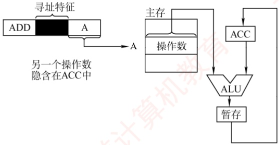

图 4.2 隐含寻址

优点是可有效缩短指令字长；缺点是依赖存储隐含操作数的硬件（如ACC）。

**2. 立即（数）寻址**

**考点追踪立即寻址的概念（2023）**

在立即寻址中，指令的形式地址字段并不表示操作数的地址，而是直接存放操作数本身，称为立即数，通常以补码形式表示。如图4.3所示，#表示立即寻址特征，A即为立即数。

优点是操作数已包含在指令中，执行阶段无须访问存储器，指令执行速度最快；缺点是立即数的大小受限于形式地址字段的位数，寻址范围非常有限。

**3. 直接寻址**

**考点追踪地址位数与直接寻址范围的关系（2010、2021）**

直接寻址是指指令中的形式地址A就是操作数的真实地址EA，即EA=A，如图4.4所示。

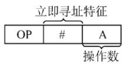

图4.3 立即寻址示意图

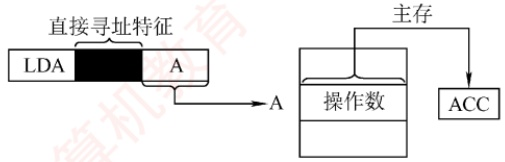

图4.4 直接寻址示意图

优点是实现简单，无须额外计算操作数地址，执行阶段只需访存一次；缺点是形式地址A的

位数限制了寻址范围，且地址固定，难以动态修改。

例如，若形式地址字段占24位，则直接寻址范围为 $2^{24} = 16 \mathbf {M} ,$

**4. 间接寻址**

考点追踪间接寻址EA的分析（2016）

间接寻址是相对于直接寻址而言的，指令中的形式地址A并不直接给出操作数的有效地址，

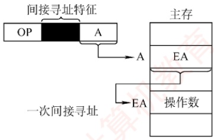

图4.5 间接寻址示意图

而是指向一个主存单元，该单元中存放操作数的有效地址，即$\mathrm {E A}   =   ( \mathrm {A} )$ ，如图4.5所示。

优点是可扩大寻址范围（有效地址EA的位数通常大于形式地址A的位数，由存储字长决定），并支持地址动态生成（如实现指针和转移表）；缺点是指令执行阶段需多次访存（一次间址需2次访存）。由于访存开销较大，若需兼顾寻址范围与执行效率，通常采用寄存器间接寻址。

**5. 寄存器寻址**

考点追踪寄存器编号位数与寄存器数量的关系（2022、2024）

与直接寻址类似，寄存器寻址将操作数存放在寄存器中，指令的地址字段给出的是操作数所在寄存器的编号，即 $\mathrm {E A} = \mathrm {R}_{i}$ ，操作数位于由 $\mathrm {R}_{i}$ 指定的寄存器内，如图4.6所示。例如，若CPU有32个通用寄存器，则寄存器编号需5位，形式地址字段仅需5位即可寻址全部寄存器。

优点是执行阶段无须访存，仅访问寄存器，执行速度快；且因寄存器数量远少于内存单元地址码位数较少，有助于缩短指令字长；缺点是寄存器成本高，CPU中可用寄存器数量有限。

**6. 寄存器间接寻址**

考点追踪寄存器间接寻址的取数操作（2010）

寄存器间接寻址结合了间接寻址和寄存器寻址的特点，指令中的 $\mathtt {R}_{i}$ 所指寄存器中存放的不是一个操作数，而是操作数所在主存单元的地址，即 $\mathrm {E A} = ( \mathrm {R}_{i} )$ ，如图4.7所示。

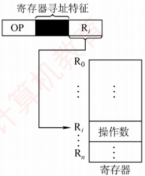

图4.6 寄存器寻址示意图

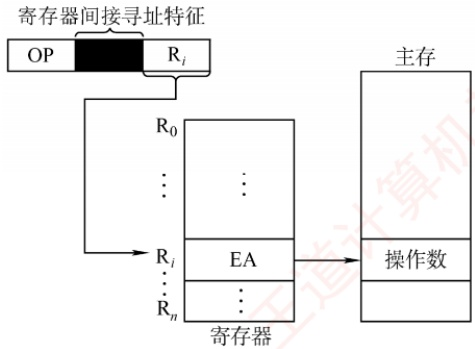

图4.7 寄存器间接寻址示意图

相比间接寻址，寄存器间接寻址在执行阶段只需一次访存，减少了访存开销；同时，由于该方式使用寄存器来存储有效地址，其寻址范围不受形式地址字段位数限制，从而扩大了寻址范围。相比寄存器寻址，这种方式在执行阶段需要从主存获取操作数，增加了访存需求。

**7. 相对寻址**

考点追踪相对寻址的相关分析与计算（2009、2010、2013、2014、2019、2023）

相对寻址是指将程序计数器（PC）的内容与指令中的形式地址A相加，形成转移目标地址，即 $\mathrm{EA} = (\mathrm{PC}) + \mathrm{A}$ ，如图4.8所示。其中，PC为取指完成后自动更新的值，指向下一条指令的地址；A是相对于该PC值的偏移量，可正可负，通常以补码表示。

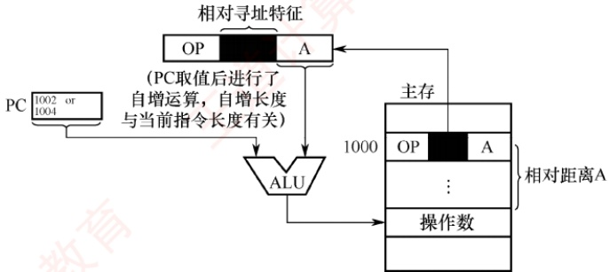

图4.8 相对寻址示意图

相对寻址主要用于转移类指令，形式地址A的位数决定了转移范围。例如，假设某机器按字节编址，指令长度为2B。一条相对转移指令（JMP A）位于地址1000H，其形式地址 $\mathrm{A} = 0005\mathrm{H}$（补码表示），则取指完成后 $\mathrm{PC} = 1002\mathrm{H}$ ，实际转移目标地址为 $1002\mathrm{H}+0005\mathrm{H}=1007\mathrm{H}$

优点是目标地址不固定，而是相对于当前指令位置偏移，因此程序可在内存中任意浮动而不影响转移正确性，便于实现重定位和共享代码。

**8. 基址寻址**

考点追踪基址寻址的EA的计算（2019）

基址寻址是指将基址寄存器（BR）的内容与指令中的形式地址A相加，形成操作数的有效地址，即 $\mathrm{EA} = (\mathrm{BR}) + \mathrm{A}$ ，如图4.9所示。BR可以是专用基址寄存器或指定的通用寄存器。

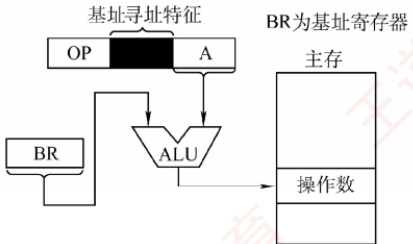

(a)采用专用寄存器BR作为基址寄存器

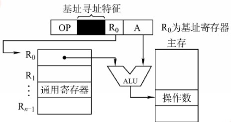

(b)采用通用寄存器 $\mathtt {R_{0}}^{\prime}$ 作为基址寄存器

图4.9 基址寻址

在多道程序环境下，基址寄存器的内容由操作系统设定，在程序执行期间保持不变（作为基地址），而形式地址A作为偏移量，由用户程序指定并可根据需要变化。当使用通用寄存器作为基址寄存器时，尽管用户可选择哪个寄存器扮演此角色，但其内容仍由操作系统控制。

优点是:可扩大寻址范围（因基址寄存器位数通常大于形式地址A），能访问更大的地址空

间；简化编程，用户无须关注程序在主存的具体位置，有利于多道程序设计和浮动程序的实现。缺点是:形式地址A的位数较短，限制了偏移量的范围。

**9. 变址寻址**

**考点追踪变址寻址EA的相关计算（2013、2016、2024）**

变址寻址是指将变址寄存器（IX）的内容与指令中的形式地址A相加，形成操作数的有效地址，即 $\mathrm{EA} = (\mathrm{IX}) + \mathrm{A}$如图4.10所示。IX可以是专用变址寄存器或指定的通用寄存器。

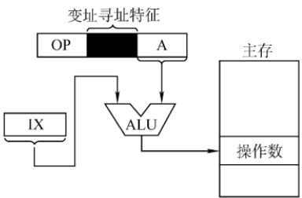

图4.10 变址寻址

考点追踪变址寻址的特点与应用（2017、2018、2024）

变址寄存器面向用户，其内容（作为偏移量）可以在程序执行中由用户动态修改，而形式地址A（作为基地址）保持不变。该方式不仅扩大了寻址范围，还特别适用于数组等数据结构的处理一通过调整IX的值，可高效访问数组中任意元素，非常适合编写循环程序。例如，假设数组B首地址为1000H，存储在形式地址A中；变址寄存器IX初始为0。要访问B[3]元素（每个元素占4B），可将IX置为0CH（3×4=12），则该元素 $\mathrm{EA}=(\mathrm{IX})+\mathrm{A}=0\mathrm{CH}+1000\mathrm{H}=100\mathrm{CH}。$

尽管变址寻址与基址寻址均通过“寄存器内容+形式地址”生成有效地址，但二者本质不同:基址寻址面向系统，基址寄存器（BR）的内容由操作系统设定且运行时不可变，用于支持多道程序和存储分配；而变址寻址面向用户，I的值可由程序动态调整，用于灵活的数据访问。

**考点追踪偏移寻址的范畴（2011）**

相对寻址、基址寻址和变址寻址均属于偏移寻址，其共同特点是通过某个寄存器的值与形式地址相加来确定操作数的有效地址，便于统一理解和应用。

**10. 堆栈寻址**

堆栈是存储器（或寄存器组）中一块按后进先出原则管理的特定存储区，其读/写单元的地址由一个称为堆栈指针（SP）的特定寄存器给出。堆栈可分为两类:硬堆栈由高速寄存器构成，成本较高，容量较小；软堆栈则是从主存中划分一段区域实现，更为经济实用。

在采用堆栈结构的计算机中，多数指令表面上表现为无操作数形式，因为其操作数地址由SP隐含指定。在访问堆栈时，SP会自动更新以指向新的栈顶位置。

上述各寻址方式的有效地址计算方法及访存次数（不含取本条指令）的总结见表4.1。

表4.1 寻址方式、有效地址及访存次数

| 寻址方式 | 有效地址 | 访存次数 |
| --- | --- | --- |
| 立即寻址 | A即是操作数 | 0 |
| 直接寻址 | EA = A | 1 |
| 一次间接寻址 | EA = (A) | 2 |
| 寄存器寻址 | EA = R | 0 |
| 寄存器间接一次寻址 | EA = (Ri) | 1 |
| 相对寻址 | EA =(PC) + A | 1 |
| 基址寻址 | EA=(BR) + A |  |
| 变址寻址 | EA = (IX) + A | 1 |

## 4.3 程序的机器级代码表示

**考点追踪涉及汇编代码的年份（2012、2014、2015、2017、2019、2023、2024）**

本节是2022年新增考点，但相关知识早已多次以综合题形式出现在历年真题中，难度较大，不少跨考生感到无从下手。通过本节学习后，考生应能从容应对此类问题。统考大纲未指定具体指令集，但历年真题主要考查x86和MIPS汇编指令。其中，MIPS指令通常会在试题中附带功能说明，而x86指令则更常作为默认考查对象。因此，本节重点介绍x86汇编指令。

### 4.3.1 常用汇编指令介绍

**1. 相关寄存器**

x86处理器中有8个32位通用寄存器，主要寄存器及说明如图4.11所示。为向后兼容早期的16位和8位架构，EAX、EBX、ECX和EDX的低16位可作为独立寄存器使用（分别记为AX、BX、CX、DX），而每个16位寄存器又可进一步拆分为两个8位寄存器（如AX分为AH和AL）。其中，E表示Extended，用于标识32位寄存器。

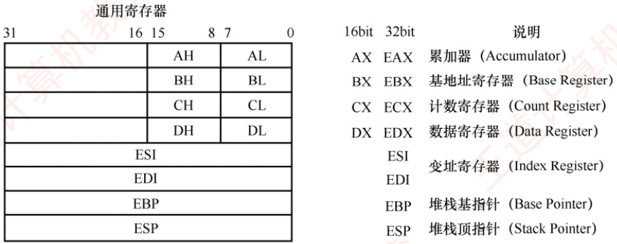

图4.11 x86处理器中的主要寄存器及说明

除EBP（基址指针）和ESP（栈指针）外，其余通用寄存器的用途是比较灵活的。

**2. 常用指令**

汇编指令通常可分为数据传送指令、算术与逻辑运算指令和控制流指令，下面以Intel格式为例，介绍一些常用指令。以下用于操作数的标记分别表示寄存器、内存和常数。

● &lt;reg&gt;: 表示任意寄存器，若其后带有数字，则指定其位数，如&lt;reg32&gt;表示 32 位寄存器(eax, ebx, ecx, edx, esi, edi, esp 或 ebp）；&lt;reg16&gt;表示 16 位寄存器（ax, bx, cx 或 dx）；&lt;reg8&gt;表示 8 位寄存器（ah, al, bh, bl, ch, cl, dh, dl）。

• &lt;mem&gt;:表示内存地址（如[eax]、[var + 4]或 dword ptr [eax + ebx]）。

● &lt;con&gt;:表示8位、16 位或 32 位常数。&lt;con8&gt;表示 8 位常数；&lt;con16&gt;表示 16 位常数；&lt;con32&gt;表示 32 位常数。

**考点追踪分析汇编指令对应的二进制代码（2010）**

x86指令采用变长编码，其操作码通常为1字节，但整条指令长度可变。同一指令（如mov）因操作数类型或寄存器不同，可能对应多种机器码编码，例如， 道

```txt
mov ax, <con16> #机器码为B8H
mov al, <con8> #机器码为BOH
mov <reg16>, <reg16>/<mem16> #机器码为 89H
mov <reg8>/<mem8>, <reg8> #机器码为 8AH
mov <reg16>/<mem16>, <reg16> #机器码为 8BH
```

**考点追踪模仿写出简单语句的机器级指令（2012）**

**（1）数据传送指令**

1）mov指令。将第二个操作数（寄存器内容、内存内容或常数值）复制到第一个操作数（寄存器或内存）。其语法如下:

mov &lt;reg&gt;,&lt;reg&gt;

```txt

mov eax, ebx #将 ebx 寄存器的值复制到 eax
mov byte ptr [var], 5 #将常数 5 存入地址 var 处的 1 字节内存单元
```

```twig
mov <reg>,<mem>
mov <mem>,<reg>
mov <reg>,<con>
mov <mem>,<con>
```

举例:

双操作数指令的两个操作数不能同时为内存，即mov指令不能用于直接从内存复制到内存。若需在内存之间复制，可先将源内存内容加载到寄存器，再从该寄存器写入目标内存。

2）push指令。将操作数压入栈中，常用于函数调用和现场保护。ESP是栈顶，入栈前先将ESP减4（栈向低地址方向增长），再将操作数压入ESP所指地址。其语法如下:

```txt
push <reg32>
push <mem>
push <con32>
```

举例（注意，栈中元素固定为32位）:

```txt
push eax #将 eax的值压入栈
push [var] #将地址 var 处的 4 字节内容压入栈
```

3）pop指令。与push指令相反，从栈中弹出数据。出栈前先将ESP所指地址的内容读出再将ESP加4。其语法如下:

```txt
pop eax #弹出栈顶元素并存入 eax
pop [ebx] #弹出栈顶元素并存入 eb×所指的4字节内存地址
```

（2）算术和逻辑运算指令

1）add/sub指令。add指令将两个操作数相加，sub指令将第一个操作数减去第二个操作数，结果均保存在第一个操作数中。其语法如下:

```csv
add <reg>,<reg> / sub <reg>,<reg>
add <reg>,<mem> / sub <reg>,<mem>
add <mem>,<reg> / sub <mem>,<reg>
add <reg>,<con> / sub <reg>,<con>
add <mem>,<con> / sub <mem>,<con>
```

举例:

```txt
sub eax, 10 #eax ← eax-10
add byte ptr [var], 10 #将地址 var 处的 1 字节内容与 10 相加，结果存回该地址
```

2）inc/dec指令。分别对操作数执行自增1或自减1操作。其语法如下:

```txt
inc <reg> / dec <reg>
inc <mem> / dec <mem>
```

举例:

```txt
dec eax #eax 值自减1
inc dword ptr [var] #将地址 var 处的 4 字节内容自增 1
```

3）imul指令。有符号整数乘法指令，支持两种格式:①双操作数，将第二、第三操作数相乘，结果存入第一个操作数（必须为寄存器）；②三操作数，将第二、第三操作数相乘，结果存入第一个操作数（必须为寄存器）。其语法如下:

```txt
imul <reg32>,<reg32>
imul <reg32>,<mem>
imul <reg32>,<reg32>,<con>
imul <reg32>,<mem>,<con>
```

举例:

```asm
imul eax, [var] #eax eax * [var]
imul esi, edi, 25 #esi edi * 25
```

无符号整数乘法由mul指令实现，仅支持单操作数格式，被乘数隐含在 eax中，乘积结果存放在 edx:eax 中。当 edx ≠ 0时，表示结果无法用 32位无符号数表示，CPU置CF = 1和 OF = 1。imul在结果溢出时，同样置CF =1和OF =1。无符号乘法以 CF判断溢出，有符号乘法则以OF为准。

4）idiv指令。有符号整数除法指令，仅指定除数。被除数为 edx:eax组成的64位有符号数

（edx为高32位，eax为低32位）。执行后，商存入 eax，余数存入 edx。其语法如下:

```twig
idiv <reg32>
idiv <mem>
```

举例:

```txt
idiv ebx
idiv dword ptr [var]
```

无符号整数除法指令div的格式与idiv的完全一致，仅对操作数的解释不同。

5）and/or/xor指令。分别执行按位与、或、异或操作，结果存入第一个操作数。其语法如下:

```csv
and <reg>,<reg> / or <reg>,<reg> / xor <reg>,<reg>
and <reg>,<mem> / or <reg>,<mem> / xor <reg>,<mem>
and <mem>,<reg> / or <mem>,<reg> / xor <mem>,<reg>
and <reg>,<con> / or <reg>,<con> / xor <reg>,<con>
and <mem>,<con> / or <mem>,<con> / xor <mem>,<con>
```

举例:

```txt
and eax, 0fH #将 ea×的高28位置0，低4 位保持不变
xor edx, edx #将 edx 清零
```

6）not指令。按位取反指令，将操作数的每一位0变1、1变0。其语法如下:

```txt
not <reg>
not <mem>
```

举例:

```txt
not byte ptr [var] #将地址 var 处的1 字节内容按位取反
```

7）neg指令。取负指令，计算操作数的二进制补码（-x）。其语法如下:

```txt
neg <reg>
neg <mem>
```

举例:

```txt
neg eax
```

```markdown
#eax ← -eax
```

8）shl/shr指令。逻辑移位指令:shl为逻辑左移，shr为逻辑右移，第一个操作数为被移位数，第二个操作数为移位位数。其语法如下:

```rust
shl <reg>,<con8> / shr <reg>,<con8>
shl <mem>,<con8> / shr <mem>,<con8>
shl <reg>,<cl>/ shr <reg>,<cl>
shl <mem>,<cl> / shr <mem>,<cl>
```

举例:

```txt
shl eax, 1 #eax逻辑左移1位
shr ebx, cl #ebx 逻辑右移 n 位（n 为 cl 中的值）
```

**（3）控制流指令**

x86处理器通过指令指针寄存器EIP（相当于程序计数器即PC）指示当前执行指令的地址。每条指令执行后，EIP自动指向下一条指令。EIP不能直接访问，但可通过控制流指令修改。程序中常用标签（1abel）标记指令地址，例如:

```txt
指令①
begin: 指令②
指令③
```

此处标签 begin指向第二条指令，控制流指令通过标签实现转移。

```txt
考点追踪无条件转移指令的指令格式（2021）
```

1）jmp指令。无条件转移到label标签所指示的地址继续执行。其语法如下:jmp &lt;label&gt;

```txt

jmp begin #转移到 begin 标记处执行
```

举例:

考点追踪条件转移指令与标志位的结合（2013）

2）jcondition指令。条件转移指令，根据程序状态字寄存器中的状态标志（如零标志ZF、符号标志SF等）决定是否转移。常见指令包括:

```txt
je <label> #相等时转移（jump when equal）
jz <label> #结果为零时转移(jump when last result was zero)
jne <label> #不相等时转移（jump when not equal)
jg <label> #大于时转移(jump when greater than)
jge <label> #大于等于时转移(jump when greater than or equal to)
jl <label> #小于时转移(jump when less than)
jle <label> #小于等于时转移(jump when less than or equal to)
```

举例:

```txt
cmp eax, ebx
jle done #若 eax≤ebx，则转移到 done；否则顺序执行下一条指令
```

3）cmp/test指令。cmp指令执行减法运算但不保存结果，仅根据结果设置标志位；test 指令执行按位与运算但不保存结果，仅更新标志位（特别是ZF）。其语法如下:

```twig
cmp <reg>,<reg> / test <reg>,<reg>
cmp <reg>,<mem> / test <reg>,<mem>
cmp <mem>,<reg> / test <mem>,<reg>
cmp <reg>,<con> / test <reg>,<con>
```

cmp 和 test 指令通常与 jcondition 指令配合使用。cmp指令举例:

```txt
cmp dword ptr [var], 10 #将 var 处的 4 字节内容，与10 比较
jne loop #若相等则顺序执行；否则转移到100p
```

```txt
test 指令举例：
```

```txt
test eax, eax #测试 eax 是否为零
jz xxxx #若 eax为零（zF=1），则转移到 xxxx
```

```txt
考点追踪 call指令的功能（2019）
```

4）call/ret指令。分别用于实现子程序调用与返回。其语法如下:

```txt
call <label>
ret
```

call指令将下一条指令的地址（返回地址）压入栈，然后转移到label 处执行；ret指令从栈顶弹出返回地址，并转移到该地址继续执行。call和 ret是函数调用机制的核心指令。

掌握上述指令的语法与功能，有助于解答相关考题。建议读者在学习C语言程序时，结合调试工具（如GDB）查看其对应的汇编代码，以加深对机器级指令的理解。

**3. 汇编指令格式**

使用不同的编程工具开发程序时，所用的汇编器也不同，主要有 AT&T 格式和 Intel 格式两种（统考常涉及的是Intel格式）。它们的主要区别如下:

① AT&T 格式的指令名必须使用小写字母，Intel格式对大小写不敏感。

②操作数顺序不同:AT&T格式为“源，目的”，Intel格式为“目的，源”。

③AT&T格式中，寄存器前加“%”，立即数前加“\$”；Intel格式中，两者均无前缀。

④内存寻址符号不同:AT&T使用圆括号“()”，Intel使用方括号“[]”。

⑤复杂寻址方式表示不同:AT&T 格式的内存操作数“disp(base, index, scale)”分别表示偏移量、基址寄存器、变址寄存器和比例因子，如“8(%edx,%eax,2)”表示操作数地址为R[edx] + R[eax]\*2 + 8；对应的 Intel 格式为“[edx + eax\*2 + 8]”。

⑥操作数长度指定方式不同:AT&T格式在指令助记符后加后缀，表明操作数大小，“b”表示byte（字节）、“w”表示 word（字）或“1”表示long（双字）；Intel格式则在内存操作数前使用“byte ptr”、“word ptr”或“dword ptr”显式指定长度。

```txt
注意 首
在x86体系结构中，32或64位都是由16位扩展来的，因此word（字）始终表示16位。
```

表4.2所示为 AT&T 格式与 Intel 格式的指令对比。其中，mov指令用于在寄存器与内存之间或寄存器之间传送数据；1ea指令用于将有效地址（而非内存内容）加载到寄存器。

表 4.2 AT&T 格式指令和 Intel 格式指令的对比

| AT&amp;T 格式 | Intel 格式 | 含义入 |
| --- | --- | --- |
| mov $100, %eax | mov eax, 100 | 100→R[eax] |
| mov %eax,%ebx | mov ebx, eax | R[eax]→R[ebx] |
| mov%eax, (%ebx) | mov [ebx], eax | R[eax]→M[R[ebx]] |
| mov%eax, -8(%ebp) | mov [ebp-8], eax | R[eax]→M[R[ebp]-8] |
| lea 8(%edx,%eax,2), %eax | lea eax, [edx+eax*2+8] | R[edx]+R[eax]*2+8→R[eax] |
| movl %eax, %ebx | mov dword ptr [ebx], eax | 32 位 R[eax]→M[R[ebx]] |

注:R[r]表示寄存器r的内容，M[addr]表示主存单元addr的内容，→或←表示信息传送方向。

两种汇编格式的相互转换并不复杂，历年统考真题通常采用Intel格式。

### 4.3.2 选择语句的机器级表示

常见的选择结构语句有if-then、if-then-else等。编译器通过条件码（标志位）设置指令和各类条件转移指令来实现程序中的选择结构。条件码描述了最近算术或逻辑运算操作的结果属性，程序通过检测这些标志位来决定是否执行条件分支。常用的条件码有CF、ZF、SF和OF。

常见的算术逻辑运算指令（add, sub, imul, or, and, shl, inc, dec, not, sal 等）在执行时会自动设置条件码。此外，cmp和test指令专门用于设置条件码，它们执行相应的运算（cmp相当于sub，test相当于and），但不保存结果，仅根据运算结果更新标志位。

之前介绍的jcondition条件转移指令，就是根据条件码ZF、OF或 SF来实现转移的。

if-else 语句的通用形式如下:

```txt
if(test expr) //test expr 为条件测试表达式
then statement //当 test expr 为真时，执行 then statement 语句
else
KNelse_statement //当 test_expr 为假时，执行 else_statement 语句
```

在C语言中，test\_expr是一个整数表达式，其值为0时表示“假”，非0（包括负数）时表示“真”。两个分支语句（then\_statement或 else\_statement）中只会执行其中一个。

这种通用形式可以被翻译成如下等价的goto语句形式:

```javascript
t=test_expr; //暂存测试表达式的结果
if(!t) //若条件为假（t=0）
goto false; //转移至 false标签，进入假分支
then statement //真分支：仅当t≠0时执行
goto done; //执行完真分支后，跳过假分支，转移至结束点
false: //假分支入口标签
else statement //假分支：仅当 t=0时执行
done: ∥/整个 if-else 结构的结束点
```

下面以一个具体的C语言函数为例:

```c
int get_cont(int *p1,int *p2) {
if(p1>p2)
return *p2;
else
return *p1; 道
1
```

已知p1和p2对应的实参已被压入调用函数的栈帧，它们对应的存储地址分别为R[ebp]+8、R[ebp]+12（EBP指向当前栈帧底部），函数返回值需存放在eax中。对应的汇编代码为

```asm
mov eax,dword ptr [ebp+8] #R[eax]←M[R[ebp]+8]，即加载参数 p1 到 eax
mov edx,dword ptr [ebp+12] #R[edx]←M[R[ebp]+12]，即加载参数p2到edx
cmp eax,edx #比较 p1 和 p2，根据结果设置条件码
jbe .L1 #若p1<=p2，则转移到L1
mov eax,dword ptr [edx] #R[eax]←M[R[edx]]，即取*p2 作为返回值
jmp .L2 #无条件转移到 L2，跳过 else 分支
.L1:
mov eax,dword ptr [eax] #R[eax]←M[R[eax]]，即取*p1 作为返回值
.L2:
```

p1 和 p2 是指针型参数，在 32位机器中占4字节（一个 dword），比较指令 cmp的两个操作数都应来自寄存器，因此需先将p1和p2对应的实参从栈中加载到寄存器。指针比较在C语言中按无符号整数处理，故使用jbe（无符号“小于等于”）进行条件转移。

### 4.3.3 循环语句的机器级表示

**考点追踪循环语句的机器级代码分析（2014、2017、2019、2023）**

常见的循环结构语句有 while、for 和 do-while。x86 指令集中没有直接对应这些高级循环结构的指令，编译器通过条件测试（如 cmp、test）和条件转移（如 je、jne、jg、jle等）指令的组合来实现循环逻辑。实际上，大多数编译器会将这三种循环统一转换为类似于do-while形式。

**（1）do-while 循环**

do-while语句是一种“后测试”型循环，其通用形式如下:

```txt
do //先执行循环体，再判断循环条件
body statement //body statement 为循环体执行语句
while(test expr); //test expr 为循环继续的条件表达式
```

这种结构可以直接翻译成如下所示的条件和goto语句组合:

```javascript
loop: //循环入口标签
body_statement //执行循环体语句（首次进入时必然执行）
t=test_expr; //计算循环条件
if(t) //若条件为真（t≠0）
goto loop; //跳回loop标签，继续下一轮迭代
```

由于循环体在条件判断之前执行，因此无论 test\_expr的初始值是什么，body\_statement 至少会被执行一次。每次执行结束时，程序会重新计算test\_expr的值；如果结果为真（非零），就跳回循环开头继续执行；否则，顺序执行后续代码，退出循环。

**(2) while 循环**

while语句是一种“前测试”型循环，其通用形式如下:

```txt
while(test expr) //test expr为循环判断的条件表达式
body_statement //当 test expr 为真时重复执行 body statement 语句
```

与 do-while 不同，while 循环在第一次执行 body\_statement 之前就会测试 test\_expr 的值。如果初始条件为假（test\_expr=0），那么循环体一次都不会执行。

为了用转移指令实现这一语义，编译器通常采用“先判断、再进入循环体”的策略。具体来

说，可以将while循环转换为一个带前置判断的 do-while式结构，如下所示

```txt
t=test_expr; //计算初始循环条件
if (!t) 若初始条件为假（t=0）
goto done; //跳过循环体，直接转至结束点
do
body_statement 道 //执行循环体
while(test_expr); //重新测试条件
done : //循环结构的结束点
```

进一步展开为纯 goto 语句的形式:

```txt
t=test_expr; //计算初始循环条件
if (!t) 育 //若为假
goto done; //跳过循环
loop:
body_statement //执行循环体
t=test expr; //重新计算条件
if (t) //若仍为真
goto loop; //继续下一轮
done : //循环结束
```

这种转换确保了while循环“先判断、后执行”的语义，同时复用了do-while的结构。

**(3） for 循环**

for循环是一种语法更紧凑的循环形式，其通用形式如下:

```txt
for(init expr; test expr; update expr)
body statement //body statement 为循环体执行语句
```

init\_expr为初始化表达式，用于初始化循环计数器（如i= 0）；test\_expr为条件判断表达式，每次执行循环体前测试（如i <10)；update\_expr为更新表达式，每次循环体执行完后执行（如 i++）。

从执行逻辑上看，for循环完全等价于下面这段while循环代码:

```javascript
init_expr; 道 //初始化（只执行一次）
while(test_expr) { //每次循环前判断条件
body statement //执行循环体
update_expr; //更新循环变量
```

因此，可以先将 for 循环转换为 while 形式，再按照前述方法转换为 goto 语句:

```txt
init_expr; //执行初始化
t=test_expr; //测试初始条件
if(!t) //若初始条件为假
goto done; //跳过循环
loop:
body_statement //执行循环体
update_expr; //执行更新操作
t=test_expr; //重新测试条件
if (t) //若条件仍为真
goto loop; //跳回循环体
done:
```

下面以一个具体的C语言函数为例，展示for循环如何被转换为汇编代码:

```c
int nsum for(int n){
int i;
int result = 0;
for(i=1;i<=n;i++)
result +=i;
return result;
}
```

在这段代码中，for循环的各个组成部分如下:

```txt
init_expr i=1
test_expr i<=n
update_expr i++
body_statement result +=i
```

通过替换前面给出的模板中的相应位置，很容易将 for 循环转换为 while 或 do-while 循环。将这个函数翻译为goto语句代码后，不难得出其过程体的汇编代码:

```asm
mov ecx,dword ptr [ebp+8] #R[ecx]←M[R[ebp]+8]，即加载参数n到 ecx
mov eax,0 #R[eax]←0，即初始化result=0
mov edx,1 #R[edx]←1，即初始化i=1
jg .L2 cmp edx,ecx 教育 #比较i与 n（R[edx]与 R[ecx]）并设置标志位 #If greater，则转移到L2
.L1: #循环体入口
add eax,edx #R[eax]←R[eax]+R[edx],即 result +=i
add edx,1 #R[edx]←R[edx]+1，即 i++
cmp edx,ecx #再次比较i:n
jle.L1 #If less or equal，则转移到L1
.L2: #循环结束点
```

已知实参n已被压入调用函数的栈帧，其对应的存储地址为R[ebp]+8。编译器将频繁使用的局部变量优化到寄存器中:此处，result被分配到 eax（同时也是返回值寄存器），i被分配到 edx。由于i和 n均为int型，判断条件i≤n属于有符号比较，因此使用 jle和jg等有符号转移指令。

### 4.3.4 过程调用的机器级表示

在程序执行过程中，当一个过程（函数）调用另一个过程时，需要完成参数传递、控制转移、现场保护与返回等一系列操作。x86架构通过 call和 ret指令支持这一机制，它们都属于无条件转移指令，但配合栈的使用，实现了完整的“调用-返回”语义。

假定过程P（调用者）调用过程Q（被调用者），整个调用过程的执行步骤如下:

1）P将入口参数（实参）放到Q能访问的位置。

2）P执行call指令，将返回地址（call的下一条指令地址）压入栈中，并转移到Q。

3）Q建立自己的栈帧，为局部变量分配空间，并在必要时保存某些寄存器。

4）Q执行其主体代码。

5）Q将返回结果放到约定位置，释放局部变量空间，并恢复之前保存的寄存器。

6）Q执行 ret指令，从栈顶弹出返回地址，并转移回P继续执行。

上述过程中，入口参数、返回地址、局部变量、返回结果以及需保护的寄存器内容，都需要在内存中找到合适的存放位置。由于寄存器数量有限，且调用双方共享寄存器资源，若不加保护直接覆盖，将导致程序出错。因此，调用约定和栈的配合至关重要。规定:寄存器EAX、ECX和EDX是调用者保存寄存器:若P希望在调用后仍使用这些寄存器的值，则P必须在调用前自行保存（如压栈），并在返回后恢复。寄存器EBX、ESI、EDI是被调用者保存寄存器:若Q需要使用这些寄存器，则Q必须在使用前将其保存到栈中，并在返回前恢复。

每个过程在执行时，都会在运行时栈中分配一块专属区域，称为栈帧。整个运行时栈由多个连续的栈帧组成。EBP（基址指针）指向当前栈帧的基址（保存旧EBP的位置），ESP（栈指针）始终指向当前栈顶。栈从高地址向低地址增长；过程执行时，ESP会随数据入栈/出栈动态变化，而EBP在当前过程执行期间保持不变，便于通过固定偏移访问参数和局部变量。

下面用一个简单的C语言程序来说明过程调用的机器级实现。

```txt

int caller() {
int temp1=125;
int temp2=80;
int sum=add(temp1,temp2)
return sum;
```

经 GCC编译后，caller 对应的汇编代码如下:

```csv
caller:
push ebp #保存调用者P的 EBP
mov ebp,esp #建立新栈帧：EBP←当前栈顶
sub esp,24 #为局部变量和参数区分配24字节空间
mov [ebp-12],125 #M[R[ebp]-12]←125，即 temp1=125 机教育
mov [ebp-8],80 #M[R[ebp]-8]←80，即 temp2=80
mov eax,dword ptr [ebp-8] #R[eax]←M[R[ebp]-8]，加载 temp2
mov [esp+4],eax #M[R[esp]+4]←R[eax]，将 temp2 放入参数区高地址
mov eax,dword ptr [ebp-12] #R[eax]←M[R[ebp]-12]，加载 temp1
mov [esp],eax #M[R[esp]]←R[eax]，将 temp1 放入参数区高地址
call add #调用 add，返回值保存于 eax
mov [ebp-4],eax #M[R[ebp]-4]←R[eax]，将返回值存入 sum
mov eax,dword ptr [ebp-4] #R[eax]←M[R[ebp]-4]，将 sum 作为返回值
leave #等价于 mov esp,ebp 和 pop ebp
ret #弹出返回地址并跳回
```

假设 caller被过程P调用。在执行完“sub esp, 24”后，caller的栈帧已建立（见图4.12），ESP指向新栈顶。GCC为 caller 分配了24 字节的空间。从代码可见:

● caller仅使用了EAX（属于调用者保存寄存器），没有使用任何被调用者保存寄存器。因此其栈帧中除了通过“push ebp”保存调用者P的旧EBP外，无须保存其他寄存器。

• caller 的三个局部变量 temp1、temp2 和 sum 皆被分配在栈帧中，占 12 字节。

●在 call 指令调用 add之前，caller 依次将入口参数 temp2和 temp1的值（80 和 125）保存到栈中（左参数位于较低地址，右参数位于较高地址），占8字节。

● 执行 call 指令时再把返回地址压入栈中，占4 字节。

包括最初压入栈中的旧EBP值（4字节）在内，caller栈帧实际使用的空间是4+12+8+4=28字节。然而，由于GCC为了保证数据的严格对齐，规定每个函数的栈帧大小必须是16字节的倍数，最终分配的栈帧大小为32字节，这意味着有4字节（未使用）作为对齐填充。

call指令执行后，add函数的返回值存放在EAX中。因此，call指令后面的两条指令分别完成:指令“mov [ebp-4], eax”将 add 的结果存入变量 sum 的存储位置，该变量位于地址 R[ebp]-4；指令“mov eax，dword ptr [ebp-4]”再将 sum 的值加载到EAX，作为 caller的返回值。

在执行 ret指令之前，必须释放当前栈帧并恢复调用者（P）的基址指针。上述第14行leave指令正是用于完成这一任务，其功能等价于以下两条指令: 7

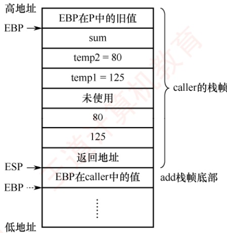

图 4.12 caller 和 add 的栈帧

```txt
mov esp, ebp #将栈指针 ESP 设置为当前 EBP的值，即指向保存旧 EBP的位置
pop ebp #从栈中弹出旧 EBP值，恢复过程P的基址指针
```

执行完这两条指令后，EBP已恢复为过程P中的原始值，而ESP则指向栈顶的返回地址。此时，ret指令便可从ESP所指位置取出该返回地址，并转移回过程P继续执行。当然，编译器也可以不使用leave指令，而是通过显式的pop操作配合对ESP的调整来实现栈帧的回收。

add过程经GCC编译并链接后，对应的机器代码如下:

```csv
8048469:55 push ebp
804846a:89 e5 mov ebp,esp
804846c:8b 45 0c mov eax,dword ptr [ebp+12]
804846f:8b 55 08 mov edx,dword ptr [ebp+8]
8048472:8d 04 02 lea eax,[edx+eax]
8048475:5d pop ebp
8048476:c3 ret
```

通常，一个过程的机器级代码可分为三个部分:准备阶段、过程体和结束阶段。

准备阶段（第 1、2行）:“push ebp”将 caller的 EBP值保存到栈中，随后“mov ebp, esp’使 EBP 指向当前栈帧的基址。如图 4.12 所示，EBP 指向 add 栈帧底部。这里 add的入口参数 x和y对应的值（125和80）分别在地址为R[ebp]+8、R[ebp]+12的存储单元中。

过程体（第3、4、5行）:第3行将y（[ebp+12]）加载到EAX，第4行将x（[ebp+8]）加载到EDX。第5 行使用lea指令计算 edx + eax，并将结果存回 EAX，作为函数的返回值。这里好像没有加法指令，实际上lea指令执行的是加法运算 $\mathrm{R}[\mathrm{edx}]+\mathrm{R}[\mathrm{eax}]=\mathrm{x}+\mathrm{y}$ m

结束阶段（第6、7行）:“pop ebp”恢复 caller的EBP值，使栈帧指针回到调用前的状态；随后 ret 指令从栈顶弹出返回地址，并转移回调用点。此时栈顶正是 call 指令执行时压入的返回地址，对应 caller中紧接在“call add”之后的那条指令（mov [ebp-4], eax）。

由于add过程不包含局部变量、未使用任何被调用者保存的寄存器，且不再调用其他过程(没有入口参数和返回地址要保存）。因此，其栈帧结构极为简洁:仅需保存EBP以维持调用链的完整性，无须额外空间用于寄存器保存、局部变量或嵌套调用。

## 4.4 CISC和RISC的基本概念

指令系统朝着两个截然不同的方向发展:一是通过增强原有指令功能、引入更复杂的指令，将部分软件功能固化到硬件中，这类机器称为复杂指令系统计算机（CISC），典型代表包括采用x86架构的处理器；二是通过精简指令集、简化指令功能，以提升指令执行效率，这类机器称为精简指令系统计算机（RISC），典型代表包括ARM、MIPS等架构的处理器。

### 4.4.1 复杂指令系统计算机(CISC)

随着集成电路技术的发展，软件开发成本不断上升，促使设计者在指令系统中加入更多、更复杂的指令，以适应多样化的应用需求，从而形成了CISC架构。

考点追踪CISC的特点（2017）

CISC的主要特点如下:

1）指令系统庞大复杂，指令数量通常超过200条。

2）指令长度不固定，指令格式和寻址方式种类繁多。

3）多数指令均可直接访问内存。

4）各类指令的使用频率差异显著。

5）指令执行时间相差较大，大多数指令需多个时钟周期才能完成。

6）控制器多采用微程序控制，部分复杂指令难以用硬连线逻辑实现。

7）难以通过优化编译生成高效的目标代码。

如此庞大的指令系统，对设计提出了极高要求，导致研制周期变得很长。后续研究发现，一味追求指令系统的复杂和完备程度并非提升性能的有效途径。对传统CISC指令系统的统计分析表明:各种指令的使用频率相差悬殊，约80%的程序执行仅依赖于20%的简单指令，而其余80%的复杂指令使用频率极低。基于这一观察，设计者开始尝试仅保留高频使用的简单指令，并通过它们组合实现不常用的复杂指令功能，由此催生了RISC架构。

### 4.4.2 精简指令系统计算机(RISC)

RISC的核心思想是简化指令系统，强调“寄存器-寄存器”操作，并力求指令格式统一。

考点追踪RISC的特点（2009、2025）

RISC的主要特点如下:

1）仅选取使用频率最高的简单指令，复杂功能由多条简单指令组合实现。

2）指令长度固定，指令格式和寻址方式种类较少。

3）仅LOAD/STORE（取数/存数）指令可访问内存，其余运算均在寄存器之间进行。

4）CPU中配备大量通用寄存器。

5）普遍采用指令流水线技术，绝大多数指令在一个时钟周期内完成。

6）以硬布线控制为主，极少或完全不使用微程序控制。

7）高度依赖编译器优化，以缩短程序执行时间。

此外，在指令系统兼容性方面，CISC架构通常支持向后兼容，即新机型包含旧机型的全部指令并加以扩展。而RISC由于大幅简化指令集、改变指令格式，通常无法与老机型兼容。

历史上，RISC因其高效性和简洁性曾被视为未来处理器的发展方向。然而在现实中，x86架构凭借庞大的软件生态占据主流地位，早期大量软件均基于CISC设计，纯RISC系统难以满足兼容性需求。此外，现代CISC处理器已在内部融合了大量RISC思想，使得两者在性能上的差距日益缩小。与此同时，CISC能提供更丰富的指令功能，这是很多程序设计所需要的。

### 4.4.3 CISC和RISC的比较

与 CISC 相比，RISC 的优势主要体现在以下几个方面:

1）更高效利用芯片面积。CISC采用微程序控制，其控制存储器占CPU芯片面积的50%以上，而RISC采用硬布线控制，逻辑电路仅占约10%，节省了宝贵的硅片资源。

2）更高的运算速度。RISC指令数量少、格式统一、寻址方式简单，配合大量通用寄存器和流水线技术，使大多数指令可在单周期内完成，显著提升执行效率。

3）更易设计与维护。RISC指令系统结构简单，设计周期短；其逻辑清晰，出错概率低，且便于调试和验证，从而提高了系统可靠性。

4）更利于编译优化。由于指令类型和寻址方式有限，编译器更容易选择最优指令序列、调整指令调度，生成高效的目标代码。

CISC 与 RISC 的对比如表4.3 所示。

表 4.3 CISC 与 RISC 的对比

<table><tr><td rowspan=2>对比项目</td><td colspan=2>类别</td></tr><tr><td>CISC</td><td>RISC</td></tr><tr><td>指令系统</td><td>复杂，庞大</td><td>简单，精简</td></tr><tr><td>指令数目</td><td>一般大于200条</td><td>一般小于100条</td></tr><tr><td>指令字长</td><td>不固定</td><td>定长</td></tr><tr><td>可访存指令</td><td>不加限制</td><td>只有LOAD/STORE指令</td></tr><tr><td>各种指令执行时间</td><td>相差较大</td><td>绝大多数在一个周期内完成</td></tr><tr><td>各种指令使用频度</td><td>相差很大</td><td>都比较常用</td></tr><tr><td>通用寄存器数量</td><td>较少</td><td>多</td></tr><tr><td>目标代码</td><td>难以用优化编译生成高效的目标代码程序</td><td>采用优化的编译程序，生成代码较为高效</td></tr><tr><td>控制方式</td><td>绝大多数为微程序控制</td><td>绝大多数为组合逻辑控制</td></tr><tr><td>指令流水线</td><td>可以通过一定方式实现</td><td>必须实现</td></tr></table>

## 4.5 本章小结

本章开头提出的问题的参考答案如下。

1）什么是指令？什么是指令系统？为什么要引入指令系统？

指令是控制计算机完成某种基本操作的命令。一台计算机所能执行的全部机器指令的集合，称为该机的指令系统。引入指令系统具有双重意义:对软件层面，它为程序员提供了统一的硬件抽象接口，无须直接操作物理电路或二进制编码，显著提升了编程效率；对硬件层面，指令系统的格式、功能和寻址能力直接决定了处理器的微架构设计、性能潜力和适用领域。

**2）一般来说，指令由哪些部分组成？各部分的作用是什么？**

一条典型指令由操作码和地址码两部分构成:操作码指明指令的功能类型（如加法、转移、加载等），是CPU识别和执行指令的核心依据；地址码提供操作所需的地址信息，包括操作数的存储位置、运算结果的保存地址、程序转移的目标地址或子程序的入口地址等。通过操作码与地址码的组合，指令能够精确描述一次完整的计算或控制操作。

**3）对一个指令系统而言，寻址方式多或少会带来什么影响？**

寻址方式的设计需权衡编程灵活性与硬件效率。寻址方式丰富（如立即数、寄存器、直接、间接、变址、相对等）可使程序更简洁高效，便于表达复杂的数据访问模式；但会增加指令译码逻辑的复杂度，不利于流水线调度，并可能增大控制单元面积。寻址方式过少虽能简化硬件、提升执行速度，却会限制程序表达能力，迫使程序员用多条指令模拟复杂访问，降低代码效率。

## 4.6 常见问题和易混淆知识点

1. 简述各常见指令寻址方式的特点和适用情况。

● 立即寻址:操作数直接嵌入指令，无须访存，常用于赋初值或常量。

• 直接寻址:指令中给出操作数的内存地址，访存一次，适用于固定地址访问。

●间接寻址:指令给出地址的地址，需两次访存，扩大了寻址范围，易于完成子程序返回。

● 寄存器寻址:操作数在寄存器中，指令短、速度快，适合高频运算。

· 寄存器间接寻址:寄存器存放操作数地址，兼具灵活性与较大寻址范围。

● 基址寻址:EA=基址寄存器+偏移量，基址由系统设定，适用于多道程序的地址重定位。

● 变址寻址:EA=变址寄存器+偏移量，变址寄存器由用户控制，适合数组遍历和循环。

● 相对寻址:EA= PC + 偏移量，主要用于转移指令。

基址寻址和变址寻址的区别:形成相同，都是EA=寄存器内容+偏移量。但基址寄存器由操作系统管理，偏移量可变；变址寄存器由程序员控制，偏移量固定。

**2. 一个操作数在内存可能占多个单元，怎样在指令中给出操作数的地址？**

现代计算机普遍采用字节编址，即每个内存单元存储1字节（8位）。当操作数为多字节数据（如int占4字节，double占8字节）时，指令中仅给出该操作数的起始地址（第一个字节的地址），CPU根据操作数类型自动读取连续的多个字节。

3. 装入/存储（LOAD/STORE）型指令有什么特点？

LOAD/STORE是RISC指令系统的核心设计原则之一，其主要特点包括:

●访存与计算分离:只有LOAD（从内存读入寄存器）和 STORE（从寄存器写入内存）指令能访问主存；所有运算指令（如加、减、移位）仅操作寄存器中的数据。

● 指令格式规整:由于寄存器编号位数远少于内存地址，通过固定字段分配，可实现定长指KX V令，极大简化译码逻辑。

● 利于流水线执行:统一的指令长度和访存边界，使取指、译码、执行等阶段易于并行化。

● 潜在缺点:频繁的数据搬移可能导致程序中LOAD/STORE指令比例较高，增加指令条数；但现代编译器优化和高速缓存机制可有效缓解此问题。
