# 第5章 中央处理器 · 习题与解析

> 由《第5章 中央处理器》正文摘出；区块标题保留了原书的小节编号。

### 5.1.4 本节习题精选

**单项选择题**

01. CPU的核心功能是执行程序，下列不属于CPU的基本功能的是（）。
A. 时序控制
B. 异常与中断处理
C. 执行算术和逻辑运算
D. 数据存储

02. 通用寄存器是（）。
A. 可存放指令的寄存器
B. 可存放程序状态字的寄存器
C. 本身具有计数逻辑与移位逻辑的寄存器
D. 可编程指定多种功能的寄存器

03. CPU中保存当前正在执行指令的寄存器是（）。
A. 指令寄存器
B. 指令译码器
C. 数据寄存器
D. 地址寄存器

04. 在CPU中，跟踪后继指令地址的寄存器是（）。
A. 指令寄存器
B. 程序计数器
C. 地址寄存器
D. 状态寄存器

05. 条件转移指令执行时所依据的条件来自（）。
A. 指令寄存器
B. 标志寄存器
C. 程序计数器
D. 地址寄存器

06. 在CPU的寄存器中，（）对汇编语言程序员是完全透明的。
A. 程序计数器
B. 状态寄存器
C. 指令寄存器
D. 通用寄存器

07.指令（）从主存储器中读出。A. 总是根据程序计数器

B. 有时根据程序计数器，有时根据转移指令
C. 根据地址寄存器
D. 有时根据程序计数器，有时根据地址寄存器

08.程序计数器（PC）属于（）的部件。
A. 运算器
B. 控制器
C. 存储器
D. ALU

09.下面有关程序计数器（PC）的叙述中，错误的是（）。
A. PC 中总是存放指令地址
B. PC 的值由 CPU 在执行指令过程中进行修改
C. 执行转移指令时，PC的值总是修改为转移指令的目标地址
D. PC的位数一般和存储器地址寄存器（MAR）的位数一样

10. 若指令按字边界对齐存放，程序计数器（PC）可以使用字地址，其位数取决于（）。I. 存储器的容量 I. 机器字长 I. 指令字长
A. I
B. I和ⅢI
C. II和II
D. I、ⅡI和ⅢII

11.下列关于程序计数器（PC）的叙述中，错误的是（）。
A. 机器指令中不能显式地使用PC
B. 指令顺序执行时，PC值总是自动加1
C. 调用指令执行后，PC值一定是被调用过程的入口地址
D. 无条件转移指令执行后，PC值一定是转移目标地址

12. 指令寄存器（IR）的位数取决于（）。
A. 存储器的容量
B. 机器字长
C. 指令字长
D. 存储字长

13. CPU中通用寄存器的位数取决于（）
A. 存储器的容量
B. 指令的长度
C. 机器字长
D. 都不对

14. CPU中的通用寄存器，（）。
A. 只能存放数据，不能存放地址
B. 可以存放数据和地址
C. 既不能存放数据，又不能存放地址
D. 可以存放数据和地址，还可以替代指令寄存器

15. 在计算机系统中表示程序和机器运行状态的部件是（）
A. 程序计数器
B. 指令寄存器
C. 中断寄存器
D. 程序状态字寄存器

16. 状态寄存器用来存放（）。 算机
A. 算术运算结果
B. 逻辑运算结果
C. 运算类型
D. 算术、逻辑运算及测试指令的结果状态

17.下列关于标志寄存器（EFLAGS寄存器或PSW寄存器）的叙述中，错误的是（）。
A. 不需要像通用寄存器那样，对标志寄存器进行编号
B. 条件转移指令根据其中的一些的标志位来确定PC的值
C. 可以通过指令直接访问标志寄存器并修改它的值
D. 可以用它来存放执行指令得到的各种标志信息

18. 下列表述中，对CPU中控制器功能描述最完整的是（）。
A. 产生 CPU 工作所需的时序信号
B. 控制从主存取出一条指令 算机
C. 完成指令操作码的译码
D. 完成指令操作码译码，并产生相应的操作控制信号

19. CPU中不包括（）。

A. 存储器地址寄存器
B. 指令寄存器
C. 地址译码器
D. 程序计数器

20. 以下关于计算机系统的概念中，正确的是（）。I. CPU 不包括地址译码器I. CPU的程序计数器中存放的是操作数地址Ⅲ. CPU 中决定指令执行顺序的是程序计数器IV. CPU 的状态寄存器对用户是完全透明的
A. I、III
B. III、IV
C. II、III、IV
D. I、III、IV

21. 间址周期结束后，CPU 内寄存器MDR中的内容为（）。
A. 指令
B. 操作数地址
C. 操作数
D. 无法确定

22.【2010统考真题】下列寄存器中，汇编语言程序员可见的是（）。
A. 存储器地址寄存器（MAR）
B. 程序计数器（PC）
C. 存储器数据寄存器（MDR）
D. 指令寄存器（IR）

23. 【2016统考真题】某计算机的主存储器空间为4GB，字长为32位，按字节编址，采用32位字长指令字格式。若指令按字边界对齐存放，则程序计数器（PC）和指令寄存器（IR）的位数至少分别是（）。
A. 30, 30
B. 30, 32
C. 32, 30
D. 32, 32

24.【2020统考真题】下列给出的部件中，其位数（宽度）一定与机器字长相同的是（）。I. ALU I. 指令寄存器 I. 通用寄存器 IV. 浮点寄存器
A. 仅I、ⅡI
B. 仅I、ⅢII
C. 仅Ⅱ、ⅢII
D. 仅ⅡI、ⅢII、IV

### 5.1.5 答案与解析

**单项选择题**

01. D

CPU的基本功能包括:通过时序控制协调指令执行节奏，响应并处理异常与中断事件，以及利用ALU执行算术与逻辑运算。数据存储由主存、Cache等存储器承担；CPU仅包含少量寄存器用于临时暂存，不负责持久性或主体数据存储，因此不属于其基本功能，选项D错误。

02. D

存放指令的寄存器是指令寄存器，选项A错误。存放程序状态字的寄存器是程序状态字寄存器，选项B错误。通用寄存器本身并不一定具有计数逻辑和移位逻辑功能，选项C错误。

03. A

指令寄存器用于存放当前正在执行的指令。

04. B

程序计数器用于存放下一条指令在主存储器中的地址，具有地址自增功能。

05. B

指令寄存器用于存放当前正在执行的指令；程序计数器用于存放下一条指令的地址；地址寄存器用于暂存指令或数据的地址；程序状态字寄存器用于保存系统的运行状态。条件转移指令执行时，需要对标志寄存器的内容进行测试，判断是否满足转移条件。

06. C

对汇编语言程序员透明是指无法通过汇编指令直接访问或修改。指令寄存器由硬件自动加载，程序员不可读/写，故完全透明，选项C正确。程序计数器可通过转移/调用间接控制，通用寄存器可直接使用，二者均不透明。状态寄存器部分标志位可被条件指令使用或读取，是半透明的。

07. A

CPU根据程序计数器（PC）中的内容从主存储器中取指令。读者可能想到无条件转移指令或中断返回指令，认为不一定总是根据PC读出。实际上，当前指令正在执行时，PC已经是下一条指令的地址。若遇到无条件转移指令，则只需简单地用转移地址覆盖原PC的内容即可，最终的结果还是根据PC从主存储器中读出。地址寄存器用来指出所取数据在主存储器中的地址。

08. B

控制器是计算机中处理指令的部件，包含程序计数器。

09. C

PC中存放下一条要执行的指令的地址，选项A正确。PC的值会根据CPU在执行指令的过程中修改（确切地说是在取指周期），或自增，或转移到程序的某处，选项B正确。转移指令时，需要判别转移是否成功，若成功则PC修改为转移指令的目标地址，否则下一条指令的地址仍然为PC自增后的地址，选项C错误。PC的位数通常和MAR的位数一样，选项D正确。

10. B

当指令按字边界对齐且PC采用字地址时，PC的值表示下一条指令所在“字”的地址。设主存容量为M字节，指令字长为W字节，则主存最多容纳M/W个指令字，PC至少需要log2(M/W)位。因此，PC的位数取决于存储器容量和指令字长，而与机器字长无直接关系。

11. B

机器指令中不能显式地使用PC，PC的值是自增的，或者是由转移类指令设置的。指令顺序执行时，PC自动加1，这里的“1”是指一条指令的长度，PC的值不一定总是自动加1，而是根据指令长度来确定的，具体取决于指令长度占几个编址单位。其余说法均正确。

12. C

指令寄存器中保存当前正在执行的指令，所以其位数取决于指令字长。

13. C

通用寄存器用于存放操作数和各种地址信息等，其位数与机器字长相等，因此便于操作控制。

14. B

通用寄存器供用户自由编程，可以存放数据和地址。而指令寄存器是专门用于存放指令的专用寄存器，不能由通用寄存器代替。

15. D

程序状态字寄存器用于存放程序状态字，而程序状态字的各位表征程序和机器的运行状态，如含有进位标志（CF）、结果为零标志（ZF）等。

16. D

程序状态字寄存器用于保留算术、逻辑运算及测试指令的结果状态。

17. C

标志寄存器是专用寄存器，不需要编号，也不能在指令中直接指定编号来访问；标志寄存器中的内容是执行指令的过程中，CPU根据指令执行的结果生成的各种标志信息，用户不能直接修改它的值。标志寄存器中的标志位主要用于条件转移或条件设置类指令的条件判断。

18. D

控制器的核心功能是在时序驱动下完成取指、译码，并根据操作码生成相应的控制信号，协调各部件工作。选项A仅描述其子功能（时序生成），选项B和C均只涉及单一环节；而选项D抓住了控制器“分析指令并发出控制命令”的本质，因此是对其功能最完整的描述。

19. C

地址译码器是主存等存储器的组成部分，其作用是根据输入的地址码唯一选定一个存储单元，它不是CPU的组成部分。而MAR、IR、PC都是CPU的组成部分。

20. A

地址译码器位于存储器，说法Ⅰ正确；程序计数器中存放的是欲执行指令的地址，它决定程序的执行顺序，说法Ⅱ错误、说法Ⅲ正确；程序状态字寄存器对用户不完全透明，说法IV错误。

21. B

间址周期的作用是取操作数的有效地址，因此，间址周期结束后，MDR中的内容为操作数地址。

22. B

汇编语言程序员可见的是程序计数器（PC），即汇编语言程序员通过汇编程序可以对某个寄存器进行访问。汇编语言程序员可以通过指定待执行指令的地址来设置PC的值，如转移指令、子程序调用指令等。而IR、MAR、MDR是CPU的内部工作寄存器，对程序员不可见。

23. B

PC用于指出下一条指令的主存地址，虽然可以用32位的地址来表示指令地址，但实际上内存中最多只能存放4GB/32位=230条指令，所以可以用30位的字地址来表示指令地址，这种情况下指令必须采用按边界对齐的方式存放，所以PC的位数至少是30位，即PC给出的地址是字地址。题于已说明指令按字边界对齐的方式存放，也就是说，指令地址都是4字节的整数倍，因此为了让PC的位数最少，可以采用字地址，取指令时将PC值左移2位到主存中取指令。指令寄存器（IR）用于存放从内存中取出的指令，它取决于指令字长，所以IR的位数至少是32位。

24. B

机器字长是指CPU内部用于整数运算的数据通路的宽度。数据通路是指数据在指令执行过程中所经过的路径及路径上的部件，主要是CPU内部进行数据运算、存储和传送的部件，这些部件的宽度基本上要一致才能相互匹配。因此，机器字长等于ALU位数和通用寄存器宽度。

### 5.2.5 本节习题精选

**单项选择题**

01. 计算机工作的最小时间周期是（）。
A. 时钟周期
B. 指令周期
C. 存取周期
D. 总线周期

02. 指令周期是指（）。
A. CPU从主存取出一条指令的时间
B. CPU 执行一条指令的时间
C. CPU从主存取出一条指令加上执行这条指令的时间
D. 时钟周期时间

03.在一条无条件转移指令的指令周期内（不含中断），程序计数器的值被修改了（）次。
A. 1
B. 2
C. 3
D. 不能确定

04.取指操作后，程序计数器中存放的是（）。
A. 当前指令的地址
B. 程序中指令的数量
C. 已执行的指令数量
D. 下一条指令的地址

05.下列关于指令执行的叙述中，错误的是（）
A. 指令周期的第一个操作是取指令
B. 为了进行取指操作，控制器需要得到相应的指令
C. 取指操作是控制器自动进行的 K
D. 指令执行时有些操作是相同或相似的

06.下列关于指令执行过程的叙述中，错误的是（）。
A. 取指操作是控制器固有的功能，不需要在操作码控制下完成
B. 所有指令的取指操作是相同的
C. 在指令长度相同的情况下，所有指令的取指操作是相同的
D. 中断周期是在指令执行完成后出现的

07.下列关于指令周期的叙述中，错误的是（）。
A. 指令周期的第一个阶段一定是取指令阶段
B. 乘法指令和加法指令的指令周期总是一样长
C. 一个指令周期可由若干时钟周期组成
D. 单周期CPU中的指令周期就是一个时钟周期

08.下列关于多周期CPU的说法中，合理的是（）。
A. 执行各条指令的时钟周期数相同，各时钟周期的长度均匀
B. 执行各条指令的时钟周期数相同，各时钟周期的长度可变
C. 执行各条指令的时钟周期数可变，各时钟周期的长度均匀
D. 执行各条指令的时钟周期数可变，各时钟周期的长度可变

09. 关于指令执行过程，下列叙述中正确的是（）。
A. 取指令和取操作数阶段都一定需要通过总线访问主存
B. 指令译码阶段需要计算操作数在内存中的地址
C. 所有指令在执行阶段必然包含访问主存或I/O 端口的操作
D. 取指令和译码是每条指令必须执行的操作，但取数或写结果不一定要访问主存

10.【2009统考真题】冯·诺依曼机中指令和数据均以二进制形式存放在存储器中，CPU区分它们的依据是（）。
A. 指令操作码的译码结果
B. 指令和数据的寻址方式
C. 指令周期的不同阶段
D. 指令和数据所在的存储单元

11.【2011统考真题】假定不采用Cache和指令预取技术，且机器处于“开中断”状态，则在下列有关指令执行的叙述中，错误的是（）。
A. 每个指令周期中 CPU 都至少访存一次
B. 每个指令周期一定大于或等于一个CPU时钟周期D. 当前程序在每条指令执行结束时都可能被外部中断打断
C. 空操作指令的指令周期中任何寄存器的内容都不会被改变 教育

### 5.2.6 答案与解析

**单项选择题**

01. A

时钟周期是计算机内部最基本、最小的时间单位。指令周期是指完成一条指令所需的时间，可以包含多个时钟周期。存取周期是指访问一次存储器（读或写）的时间，通常也需要多个时钟周期。总线周期是指总线进行数据传输所需的时间，也可包含多个时钟周期。

02. C

指令周期是指CPU从主存取出一条指令加上执行这条指令的时间，间址周期不是必需的。03. B

首先在取指周期结束后，PC值自动加1；在执行周期中，PC值修改为要转移到的地址。综上，在一条无条件转移指令的指令周期内，程序计数器（PC）的值被修改了2次。

04. D

在取指操作后，程序计数器中的内容将被修改为下一条指令的地址，而不是当前指令的地址。05. B

取指操作是自动进行的，控制器不需要得到相应的指令。

06. B

不同长度的指令，其取指操作可能是不同的。例如，双字指令、三字指令与单字指令的取指操作是不同的。

07. B

无论哪种指令，指令周期的第一个阶段都是取指令（从主存中获得指令）。乘法指令通常比加法指令复杂，若是多周期CPU，则乘法指令通常需要更多的时钟周期，选项B错误。多周期CPU的指令周期由若于时钟周期组成。在单周期CPU中，指令执行的所有阶段（取指令、译码、执行等）都在一个时钟周期内完成，因此其指令周期就是一个时钟周期。

08. C

多周期CPU把指令的执行分为多个阶段来实现，每个阶段在一个时钟周期内完成，时钟周期以最复杂的阶段所花的时间为准，阶段的划分原则是:将一条指令的执行过程尽量分成大致相等的若干阶段。不同的指令（根据指令的复杂程度）所含的时钟周期数可以不同。

09. D

指令执行的基本步骤通常包括取指令、译码、地址计算、取操作数、执行和写回结果，其中取指令和译码是所有指令执行的必经阶段，而后续操作因指令而异:操作数和结果可能仅涉及寄存器，无须访问主存或I/O。因此选项D正确。选项A错在取操作数不一定访存；选项B错在地址计算属于执行阶段，而非译码阶段；选项C错在并非所有指令都需要访问主存或I/O。

10. C

虽然指令和数据都以二进制形式存放在存储器中，但CPU可以根据指令周期的不同阶段来区分是指令还是数据，通常在取指阶段取出的是指令，在执行阶段取出的是数据。本题容易误选选项A，需要清楚的是，CPU只有在确定取出的是指令后，才会将其操作码送去译码，因此不可能依据译码的结果来区分指令和数据。

11. C

因为不采用指令预取技术，每个指令周期都需要取指令，而不采用Cache技术，所以每次取指令都至少要访存一次（当指令字长与存储字长相等且按边界对齐时），选项A正确。时钟周期是CPU的最小时间单位，每个指令周期一定大于或等于一个CPU时钟周期，选项B正确。即使是空操作指令，在取指操作结束后，PC也会自动加1，选项C错误。因为机器处于“开中断”状态，所以在每条指令执行结束时都可能被外部中断打断。

### 5.3.6 本节习题精选

● STORE 指令需要将寄存器 Rt 的内容写入存储器，因此将寄存器堆的第二读端口 busB（对应寄存器Rt）连接到数据存储器的输入端DataIn。

● 数据存储器的输出端接入 busW 处的多路选择器，用于LOAD指令的结果写回。

●控制信号MemWr作为数据存储器的写使能信号（控制数据存储器的读/写操作）。

● LOAD/STORE指令计算访存地址时，需要对 16 位立即数 imm16 进行符号扩展，并通过ALU执行不判溢出的加法（addu），此时控制信号ALUctr被配置为对应的操作码。

**5. 完整的单周期数据通路结构图**

综合前述各功能模块，可构建如图5.11所示的完整单周期数据通路。图中所有加下划线的信号均为控制信号，以虚线表示。

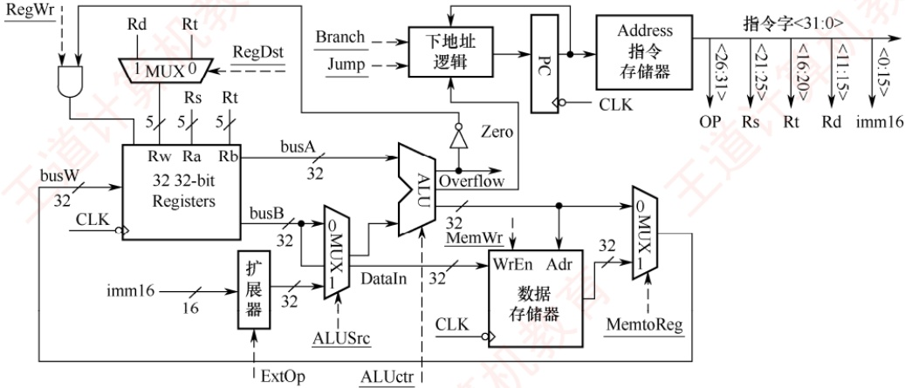

图 5.11 完整的单周期数据通路

其中，取指令部件在图5.7的基础上，还需接收三类关键外部控制信号:

● 控制信号 Branch 在执行分支指令时置 1。

● 控制信号 Jump 在执行无条件转移指令时置1。

● 标志位 Zero用于判断分支条件是否成立，该信号由 ALU输出。例如，执行 beq指令（相等转移）时，ALU执行减法操作，若结果为0，则Zero置1，表示满足转移条件。

基于以上分析，单周期处理器具有以下重要特点:

1）存储器分离设计:指令存储器与数据存储器相互独立，使得取指令与数据访存操作可并行进行，避免冲突，确保在一个时钟周期内同时完成指令读取与数据读/写。

2）无指令寄存器（IR）:指令从存储器取出后，其各字段（如rs、rt、rd、imm）直接用于生成控制信号或地址输入，指令解析与执行在同一个时钟周期内同步完成。

3）时钟周期由最慢指令决定:时钟周期必须满足执行时间最长的指令（如访存指令），导致简单指令（如R型加法）的执行效率受限。

4）数据通路资源专用:由于所有操作需要在一个周期内并发完成，关键功能单元（如用于PC更新和地址计算的加法器）需要配置多个独立的实例，硬件无法复用，开销较大。

5）控制信号单周期有效:所有控制信号（如RegWr、MemWr等）在一个时钟周期内保持有效，指令“取指、执行、写回”的完整流程在单个时钟脉冲内完成，无流水线分段。

**5.3.5 本节习题精选**

**一、单项选择题**

01. 下列不属于CPU数据通路结构的是（）。
A. 单总线结构
B. 多总线结构
C. 部件内总线结构
D. 专用数据通路结构

02.下列有关数据通路的叙述中，错误的是（）。
A. 数据通路由若干组合逻辑元件和时序逻辑元件连接而成
B. 数据通路的功能由控制部件送出的控制信号决定
C. ALU属于操作元件，包含在数据通路中
D. 通用寄存器属于状态元件，但不包含在数据通路中

03. 数据通路是由操作元件和状态元件通过总线或分散方式连接而成的进行数据存储、处理和传送的路径，下列部件中属于状态元件的是（）。I. 算术逻辑部件 Ⅱ. 译码器. 移位寄存器 IV. 存储器数据寄存器
A. I、III妆
B. II、III、V
C. III、IV
D. I、IV

04.下列关于采用单总线方式的CPU的说法中，正确的是（）。 算机
A. ALU的两个输入端及输出端都可与总线相连
B. ALU的两个输入端可以与总线相连，但输出端需通过暂存器与总线相连
C. ALU的一个输入端可以与总线相连，其输出端也可与总线相连
D. ALU只能有一个输入端可以与总线相连，另一输入端需通过暂存器与总线相连

05. CPU内部若多个部件共享一条总线，则每个部件与总线之间需设置一个常用的器件，CPU控制该器件的状态，实现某个部件与总线的连接或断开。该器件是（）。
A. 触发器
B. 多路选择器
C. 三态门
D. 与非门

06. CPU内部电路通常采用总线连接方式，总线上信号流动的原则是（）。I. 每个时刻只有一个器件发出信息 Ⅱ.每个时刻有一个或多个器件发出信息Ⅲ. 每个时刻只有一个器件接收信息 IV. 每个时刻有一个或多个器件接收信息
A. I、III
B. I、IV
C. II、III
D. II、IV

07.下列关于CPU时钟信号的叙述中，错误的是（）
A. 处理器总是每来一个时钟信号就开始执行一条新的指令
B. 边沿触发指状态单元总在时钟上升沿或下降沿开始改变状态
C. 时钟周期以相邻状态单元之间最长组合逻辑延迟为基准确定
D. 每个时钟周期称为一个节拍，机器的主频就是时钟周期的倒数

Ⅰ. 单总线数据通路中完成一次主存读操作I. 单周期 CPU 中执行一条完整指令 算机Ⅲ.单总线数据通路中，寄存器R1经内部总线传至寄存器R2 IV. 流水线数据通路中，数据从一个流水段寄存器传入下一个流水段寄存器V. 单周期 CPU 中完成一次 ALU 运算
A. I, V
B. I , III, V
C. II, III, IV
D. IV, V

09. 下列关于单周期CPU和多周期CPU的描述中，错误的是（）。
A. 单周期CPU更容易支持复杂指令（如乘法、除法）
B. 单周期CPU部件冗余大、利用率低，多周期CPU则刚好相反
C. 单周期CPU 在1 个时钟周期内执行一条指令，CPI=1
D. 多周期CPU 至少需要2 个时钟周期才能执行一条指令，CPI>1

10.下列关于单周期数据通路和多周期数据通路的说法中，正确的是（）。
A. 单周期 CPU 的 CPI 总比多周期 CPU 的 CPI 大
B. 单周期 CPU 的时钟周期通常比多周期 CPU 的时钟周期短
C. 在一条指令执行过程中，单周期CPU中的每个控制信号取值一直不变，而多周期CPU中的控制信号可能发生改变 X
D. 在一条指令执行过程中，单周期数据通路和多周期数据通路中的每个部件都可使用多次

11.下列关于单周期CPU与采用单总线结构的多周期CPU的说法中，正确的是（）
A. 单周期 CPU 可基于单总线结构实现
B. 运行相同程序时，单周期CPU的总执行时间一定更短
C. 多周期CPU可将指令和数据存放在同一单端口存储器中，而单周期CPU不行
D. 单周期 CPU 的硬件实现成本通常低于多周期 CPU

12. 与专用通路结构的数据通路相比，单总线结构的数据通路（）。
A. 性能更高
B. 数据冲突更严重
C. 硬件规模更大、实现更复杂
D. 控制逻辑更复杂

13. CPU的读/写控制信号的作用是（）。
A. 决定数据总线上的数据流方向
B. 控制存储器操作的读/写类型
C. 控制流入、流出存储器信息的方向
D. 以上都是

14.下列有关取指令操作部件的叙述中，错误的是（）。
A. 取指令操作的时延主要由存储器的访问时间决定
B. 取指令操作可与下条指令地址的计算并行进行
C. 在单周期数据通路中，需设置指令寄存器（IR）暂存取出的指令
D. 在单周期数据通路中，程序计数器（PC）无须“写使能”控制信号

15.【2016统考真题】单周期处理器中所有指令的指令周期为一个时钟周期。下列关于单周期处理器的叙述中，错误的是（）。
A. 可以采用单总线结构数据通路
B. 处理器时钟频率较低
C. 在指令执行过程中控制信号不变
D. 每条指令的 CPI 为 1

16.【2019统考真题】下列有关处理器时钟信号的叙述中，错误的是（）
A. 时钟信号由机器脉冲源发出的脉冲信号经整形和分频后形成
B. 时钟信号的宽度称为时钟周期，时钟周期的倒数为机器主频
C. 时钟周期以相邻状态单元间组合逻辑电路的最大延迟为基准确定
D. 处理器总是在每来一个时钟信号时就开始执行一条新的指令

17.【2021统考真题】下列关于数据通路的叙述中，错误的是（）。
A. 数据通路包含ALU等组合逻辑（操作）元件
B. 数据通路包含寄存器等时序逻辑（状态）元件
C. 数据通路不包含用于异常事件检测及响应的电路 王道
D. 数据通路中的数据流动路径由控制信号进行控制

18.【2023统考真题】数据通路由组合逻辑元件（操作元件）和时序逻辑元件（状态元件）组成。下列给出的元件中，属于操作元件的是（）。I. 算术逻辑单元（ALU） II. 程序计数器（PC）III. 通用寄存器组（GPRs） IV.多路选择器（MUX）
A. 仅I、Ⅱ
B. 仅I、IV
C. 仅Ⅱ、ⅢII
D. 仅I、ⅡI、IV

**二、综合应用题**

01. 某计算机的数据通路结构如下图所示，写出实现 ADD R1,(R2)的微操作序列（取指令及指令执行的过程，包括PC自增的过程）。

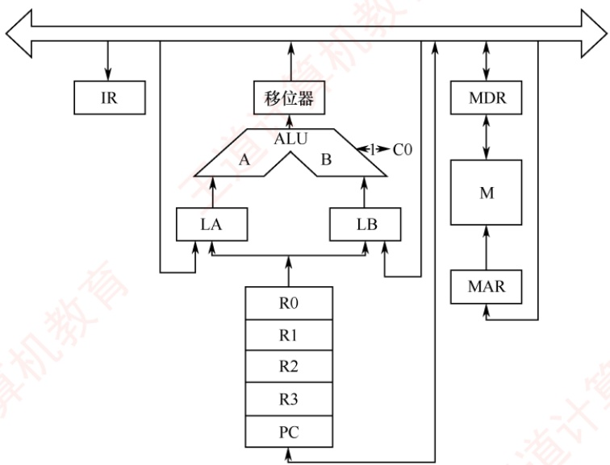

02.设CPU内部结构如下图所示，此外还设有B、C、D、E、H、L六个寄存器（图中未画出），它们各自的输入端和输出端都与内部总线相通，并分别受控制信号控制（如Bin受寄存器B的输入控制；Bout受寄存器B的输出控制），假设ALU的结果直接送入寄存器Z。要求从取指令开始，写出完成下列指令的微操作序列及所需的控制信号。

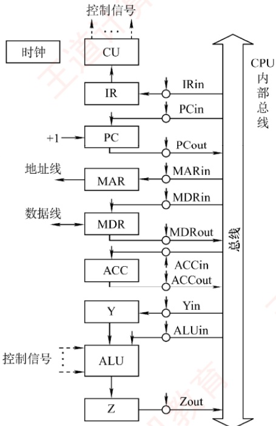

03. 设有如下图所示的单总线结构，分析指令 ADD (R0), R1 [即实现((R0))+(R1)→(R0)] 的指令流程和控制信号。

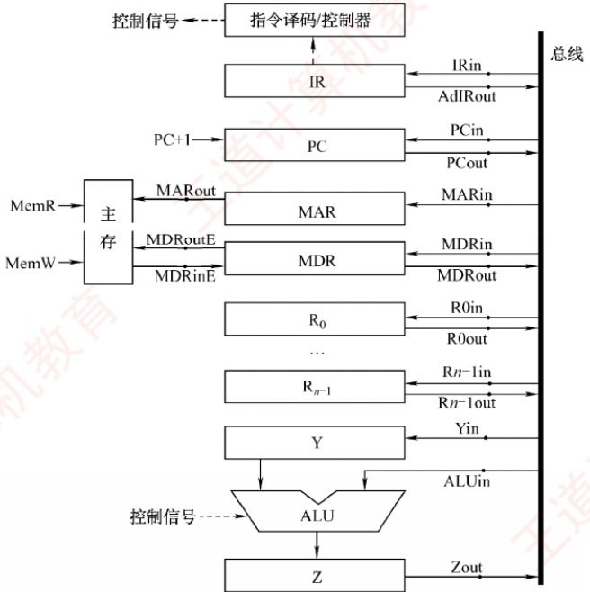

04. 右图是一个简化的CPU与主存连接结构示意图（图中省略了所有的多路选择器）。其中有一个累加寄存器（ACC）、一个状态寄存器和其他4个寄存器:存储器地址寄存器（MAR）、存储器数据寄存器（MDR）程序计数器（PC）和指令寄存器（IR），各部件及其之间的连线表示数据通路，箭头表示信息传递方向。

要求:

1)请写出图中a、b、c、d四个寄存器的名称。

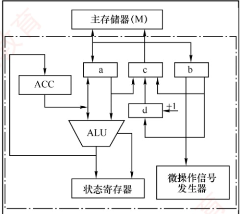

2）简述图中取指令的数据通路。

3）简述数据在运算器和主存之间进行存/取访问的数据通路（假设地址已在MAR中）。

4）简述完成指令LDA X的数据通路（X为主存地址，LDA 的功能为(X)→ACC）

5）简述完成指令ADD Y的数据通路（Y 为主存地址，ADD的功能为(ACC)+ (Y)→ACC)。

6）简述完成指令STAZ 的数据通路（Z 为主存地址，STA 的功能为(ACC)→Z）。

05. 某机主要功能部件如下图所示，其中M 为主存，MDR 为存储器数据寄存器，MAR 为存储器地址寄存器，IR为指令寄存器，PC为程序计数器（并假设当前指令地址在 PC中），R0\~R3为通用寄存器，C、D为暂存器。

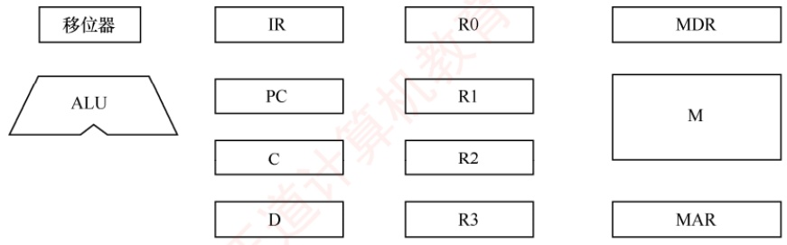

1）请补充各部件之间的主要连接线（总线自己画），并注明数据流动方向。

2）画出“ADD(R1),(R2)+”指令周期流程图，该指令的含义是进行求和运算，源操作数地址在R1中，目的操作数寻址方式为自增型寄存器间接寻址方式（先取地址后加1），并将相加结果写回R2寄存器。

06. 已知单总线计算机结构如下图所示，其中 M为主存，XR为变址寄存器，EAR为有效地址寄存器，LATCH 为暂存器。假设指令地址已存在于 PC 中，请给出 ADD X,D指令周期信息流程和相应的控制信号。说明:

1）ADDX,D指令字中，X为变址寄存器XR，D为形式地址，指令的功能是将变址寻址得到的操作数和ACC中的操作数相加，结果送回ACC。

2）寄存器的输入/输出均采用控制信号控制，如 $\mathrm {P C_{i}}$ 表示PC 的输入控制信号， $\mathrm {M D R_{o}}$表示MDR的输出控制信号。

3）凡需要经过总线的传送，都需要注明，如(PC)→MAR，相应的控制信号为 $\mathrm {P C_{o}}$ 和 $\mathrm {M A R_{i}}$ 0

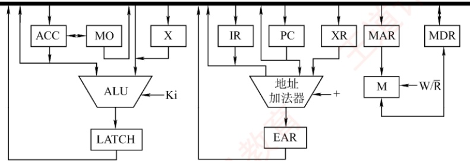

07.【2009统考真题】某计算机字长16位，采用16位定长指令字结构，部分数据通路结构如下图所示。图中所有控制信号为1时表示有效，为0时表示无效。例如，控制信号MDRinE 为 1 表示允许数据从 DB 打入 MDR， MDRin 为1 表示允许数据从总线打入 MDR。假设 MAR 的输出一直处于使能状态。加法指令“ADD (R1)， $\mathrm {R 0^{\circ}}$ 的功能为(R0)+((R1))→ (R1)，即将R0 中的数据与 R1 的内容所指主存单元的数据相加，并将结果送入 R1 的内容所指主存单元中保存。

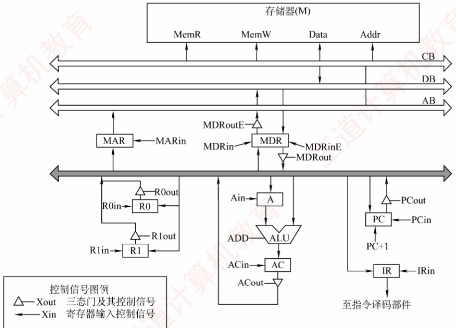

下表给出了上述指令取指和译码阶段每个节拍（时钟周期）的功能和有效控制信号，请按表中描述方式用表格列出指令执行阶段每个节拍的功能和有效控制信号。

| 时 钟 | 功 能 | 有效控制信号 |
| --- | --- | --- |
| Cl | MAR←(PC) | PCout, MARin |
| C2 | MDR←M(MAR)PC←(PC) + 1 | MemR, MDRinEPC + 1 |
| C3 | IR←(MDR) | MDRout, IRin |
| C4 | 指令译码 | 无 |

08.【2015统考真题】某16位计算机的主存按字节编码，存取单位为16位；采用16位定长指令字格式；CPU采用单总线结构，主要部分如下图所示。图中R0\~R3为通用寄存器；T为暂存器；SR为移位寄存器，可实现直送（mov）、左移一位（left）和右移一位（right）三种操作，控制信号为SRop，SR的输出由信号SRout控制；ALU可实现直送A（mova）、A加B（add）、A减B（sub）、A与B（and）、A或B（or）、非A（not）、A加1（inc）七种操作，控制信号为ALUop。

回答下列问题:

1）图中哪些寄存器是程序员可见的？为何要设置暂存器T？2）控制信号 ALUop 和 SRop 的位数至少各是多少？3）控制信号SRout所控制部件的名称或作用是什么？4）端点①～⑨中，哪些端点须连接到控制部件的输出端？

5）为完善单总线数据通路，需要在端点①\~⑨中相应的端点之间添加必要的连线。写出连线的起点和终点，以正确表示数据的流动方向。

6）为什么二路选择器MUX的一个输入端是2？

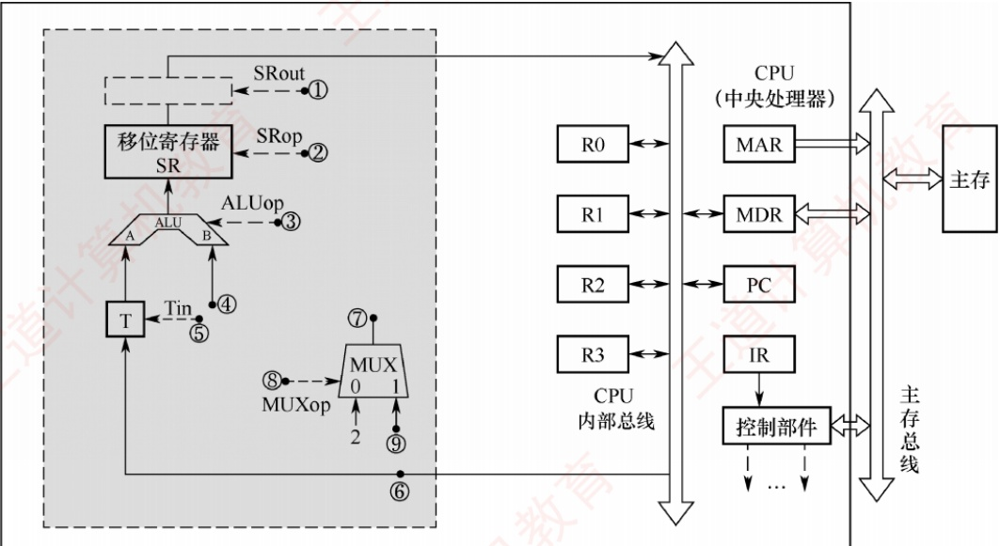

09.【2015统考真题】上题中描述的计算机，某部分指令执行过程的控制信号如下所示。

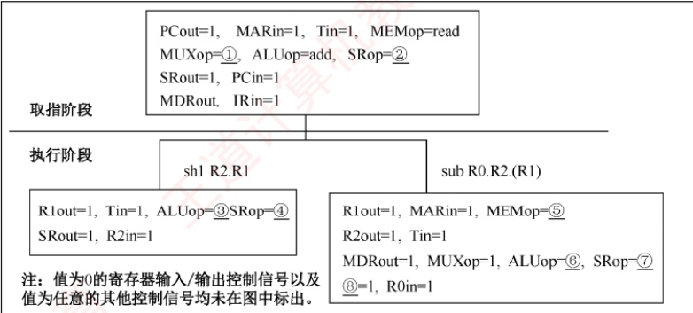

该机指令格式如下图所示，支持寄存器直接和寄存器间接两种寻址方式，寻址方式位分别为0和1，通用寄存器R0\~R3的编号分别为0,1,2和3。

<table><tr><td>指令操作码</td><td colspan="2">目的操作数</td><td colspan="2">源操作数1</td><td colspan="2">源操作数2</td></tr><tr><td>OP</td><td>Md</td><td>Rd</td><td>Ms1</td><td>Rs1</td><td>Ms2</td><td>Rs2</td></tr><tr><td colspan="7">其中:Md、Ms1、Ms2为寻址方式位，Rd、Rs1、Rs2为寄存器编号。 三地址指令: OP 源操作数2 → 目的操作数地址 源操作数1</td></tr><tr><td colspan="7"></td></tr><tr><td colspan="2">二地址指令（末3位均为0）:</td><td></td><td colspan="2"></td><td colspan="2">OP 源操作数1 →目的操作数地址</td></tr><tr><td colspan="2">单地址指令（末6位均为0）:</td><td></td><td></td><td>OP 目的操作数→目的操作数地址</td><td></td></tr><tr><td colspan="2"></td><td colspan="2"></td><td colspan="2"></td></tr></table>

回答下列问题:

1）该机的指令系统最多可定义多少条指令？

2）假定inc、shl 和 sub 指令的操作码分别为01H、02H和 03H，则以下指令对应的机器代码各是什么？① inc R1 (R1)+1→R1 ② shl R2, R1 (R1) << 1→R2 ③ sub R3, (R1), R2 ((R1))−(R2)→R3

3）假设寄存器X的输入和输出控制信号分别为 Xin和Xout，其值为1表示有效，为0表示无效（如PCout=1表示 PC 内容送总线）；存储器控制信号为 MEMop，用于控制存储器的读（read）和写（write）操作。写出本题第一幅图中标号①～⑧处的控制信号或控制信号的取值。

4）指令“sub R1,R3,(R2)”和“inc R1”的执行阶段至少各需要多少个时钟周期？

10.【2022统考真题】某CPU中部分数据通路如下图所示，其中，GPRs为通用寄存器组；FR为标志寄存器，用于存放ALU产生的标志信息；带箭头虚线表示控制信号，如控制信号Read、Write分别表示主存读、主存写，MDRin表示内部总线上的数据写入MDR，MDRout表示MDR的内容送给内部总线。

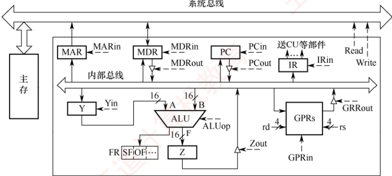

### 5.3.7 答案与解析

请回答下列问题。

1）设ALU 的输入端A、B 及输出端F的最高位分别为 $\mathrm {A}_{15}$ 、 $\mathbf {B}_{15}$ 及 $\mathrm {F}_{15}$ ，FR中的符号标志和溢出标志分别为 SF 和 OF，则 SF 的逻辑表达式是什么？A 加 B、A 减 B 时 OF 的逻辑表达式分别是什么？要求逻辑表达式的输入变量为 $\mathrm {A}_{15}$ $\mathbf {B}_{15}$ 及 $\mathrm {F}_{15}$

2）为什么要设置暂存器Y和Z?

3）若GPRs 的输入端 rs、rd 分别为所读、写的通用寄存器的编号，则 GPRs 中最多有多少个通用寄存器？rs 和 rd 来自图中的哪个寄存器？已知 GPRs 内部有一个地址译码器和一个多路选择器，rd应连接地址译码器还是多路选择器？

4）取指令阶段（不考虑PC增量操作）的控制信号序列是什么？若从发出主存读指令到主存读出数据并传送到MDR共需5个时钟周期，则取指令阶段至少需要几个时钟周期？

5）图中控制信号由什么部件产生？图中哪些寄存器的输出信号会连到该部件的输入端？

**5.3.6 答案与解析**

**一、单项选择题**

01. C

对CPU而言，数据通路的基本结构分为总线结构和专用数据通路结构，其中总线结构又分为单总线结构、双总线结构、多总线结构。

02. D

数据通路中的部件包括组合逻辑元件和时序逻辑元件。数据通路的功能由控制部件送出的控制信号决定。数据通路中一个重要的组合逻辑元件为ALU，用于执行各类算术和逻辑运算；另一个重要的元件为通用寄存器，属于时序逻辑元件。

03. C

操作元件的输出仅取决于当前的输入，不受时钟信号的控制，也没有存储数据的功能。状态元件的最大特点是具有存储数据的功能。算术逻辑部件和译码器都不具有存储功能，属于操作元件；移位寄存器和存储器数据寄存器属于不同功能的寄存器，具有存储功能，属于状态元件。

04. D

因为ALU是一个组合逻辑元件，所以其运算过程中必须保持两个输入端的内容不变。又因为CPU内部采用单总线结构，所以为了得到两个不同的操作数，ALU的一个输入端与总线相连，另一个输入端需通过一个寄存器与总线相连。此外，ALU的输出端也不能直接与内部总线相连，否则其输出又会通过总线反馈到输入端，影响运算结果，因此输出端需通过一个暂存器（用来暂存结果的寄存器）与总线相连。 道

05. C

三态门可视为一种控制开关，由控制端决定信号线的通断，能输出到内部总线的部件均通过一个三态门与内部总线相连，用于控制该部件与内部总线之间数据通路的连接与断开。

06. B

当CPU内部电路采用总线连接方式时，总线上信号流动的原则如下:每个时刻只有一个器件发出信息（否则会导致总线冲突），每个时刻可以有一个或多个器件接收信息。

07. A

CPU通过时钟信号定时执行指令，但并非每个时钟周期都会执行一条新指令。在多周期CPU中，指令的执行被划分为多个阶段，每个时钟周期开始执行一个阶段，选项A错误。每个阶段的操作通常由时钟信号的上升沿或下降沿触发，称为边沿触发，并且决定了状态元件（如寄存器）的状态改变。为确保每个阶段都在一个时钟周期内完成，时钟周期必须足够长，以便数据能在最慢的组合逻辑电路中传输，因此时钟周期通常根据相邻状态单元之间最长的组合逻辑延迟来确定。

08. A

说法Ⅰ不一定:主存访问受存储器速度限制，通常需要多个时钟周期。说法Ⅱ一定:单周期CPU的每条指令在一个时钟周期内完成。说法Ⅲ一定:在CPU内部数据通路中，数据从一个状态元件传送到另一个状态元件的操作由时钟同步，耗时等于一个时钟周期。说法IV一定:流水段寄存器之间的数据传递由时钟边沿触发，严格对应一个时钟周期。说法V不一定:ALU运算由组合逻辑实现，其延迟由电路决定，在单周期CPU中必须小于一个时钟周期，以满足单周期设计约束。

09. A

单周期CPU要求所有指令在一个时钟周期内完成，其时钟周期由最慢指令决定；加入复杂指令会显著延长时钟周期，拖累整体性能。而多周期CPU可将复杂指令分解为多个节拍，每节拍使用标准周期，不影响主频，更易支持复杂操作。单周期CPU需大量专用通路实现并行，硬件冗余高、利用率低；多周期CPU通过部件复用，资源利用更高效。

10. C

多周期CPU中的指令通常需要多个时钟周期才能完成，CPI>1；单周期CPU的每条指令在一个时钟周期内完成，CPI=1。单周期CPU的时钟周期取决于最复杂指令的耗时，通常比多周期CPU的时钟周期长。在一条指令的执行过程中，单周期CPU的每个控制信号保持不变，每个部件只能使用一次；多周期CPU的控制信号可能发生改变，同一个部件可使用多次。

11. C

单周期CPU需要在一个时钟周期内并行完成取指、运算和访存，而单总线结构无法同时传输多路数据；其时钟周期由最慢指令决定，通常远大于多周期CPU，总执行时间未必更短。多周期CPU通过分时复用，在不同节拍访问同一存储器，实现指令与数据共存；而单周期CPU需要在同一时钟周期内取指和访存，必须采用分离的指令/数据存储器，选项C正确。由于需要专用通路和冗余硬件以支持并行操作，单周期CPU的芯片面积与成本通常高于采用部件复用的多周期CPU。

12. B

单总线结构通过一条共享总线分时串行传输数据，硬件简单、状态少、控制逻辑简洁；但因同一时刻仅能传输一次数据，性能较低，且容易引发总线冲突。相比之下，专用通路结构采用独立连线支持并行操作，性能更高、冲突更少，也相应带来了更大的硬件规模。

13. D

读/写控制信号线决定了是从存储器读还是向存储器写，显然选项A、B、C都正确。

14. C

单周期CPU在一个时钟周期内完成整条指令的执行:指令从存储器读出后，其各字段（如opcode、rs、rt、imm）通过组合逻辑直接驱动控制单元、寄存器堆和ALU等部件，解析与执行同步进行，无须经由IR暂存；若设置IR，则取指到IR至少需要一个时钟周期，违背单周期设计原则。此外，PC每周期无条件更新为下一条指令地址，始终写入，无须“写使能”信号。

15. A

单周期处理器中所有指令的指令周期为一个时钟周期，选项D正确。因为每条指令的CPI为1，要考虑比较慢的指令，所以处理器的时钟频率较低，选项B正确。单总线数据通路将所有寄存器的输入/输出端都连接在一条公共通路上，一个时钟内只允许一次操作，无法完成指令的所有操作，选项A错误。控制信号是CU根据指令操作码发出的信号，对于单周期处理器来说，每条指令的执行只有一个时钟周期，而在一个时钟周期内控制信号并不会变化；若是多周期处理器，则指令的执行需要多个时钟周期，在每个时钟周期控制器会发出不同信号，选项C正确。

16. D

时钟信号的宽度称为时钟周期，时钟周期的倒数为机器主频。时钟信号由机器脉冲源发出的脉冲信号经整形和分频后形成，时钟周期以相邻状态单元间组合逻辑电路的最大延迟为基准确定。对于单周期CPU，一个指令周期就是一个时钟周期，每个时钟周期执行一条新指令；对于多周期CPU，每个指令周期（包含若干时钟周期）执行一条新指令；对于流水线CPU，只有在理想情况下才能实现每个时钟周期执行一条新指令，选项D的描述有误。

17. C

指令执行过程中数据所经过的路径，包括路径上的部件，称为数据通路。ALU、通用寄存器、状态寄存器、Cache、MMU、浮点运算逻辑、异常和中断处理逻辑等，都是指令执行过程中数据流经的部件，都属于数据通路的一部分。数据通路中的数据流动路径由控制部件控制，控制部件根据每条指令功能的不同，生成对数据通路的控制信号。选项C错误。

18. B

组合逻辑元件（操作元件）不含存储信号的记忆单元，任何时刻产生的输出仅取决于当前的输入，加法器、算术逻辑单元（ALU）、译码器、多路选择器、三态门等都属于操作元件。时序逻辑元件（状态元件）包含存储信号的记忆单元，各类寄存器和存储器，如通用寄存器组、程序计数器、状态/移位/暂存/锁存寄存器等，都属于状态元件。

**二、综合应用题**

01.【解答】

实现 ADD R1,(R2)的微操作序列如下:

```csv
微操作
(PC)→MAR
M→MDR
(PC)+1→PC
(MDR) →IR
(R1)→LA
(R2)→MAR
M→MDR
(MDR) →LB
(LA) +(LB)→R1
```

02. 【解答】

两条指令的微操作序列和控制信号如下。

(1）ADD B, C 指令。

```csv
微操作 控制信号
(PC)→MAR PCout, MARin
(PC) +1→PC +1
M (MAR) →MDR MDRin

MDR→IR MDRout, IRin
(B) →Y Bout, Yin
(Y) + (C) →Z Cout, ALUin,
(Z)→B Zout, Bin
```

(2) SUB ACC, H 指令。

| 微操作 | 控制信号 |
| --- | --- |
| (PC) →MAR | PCout， MARin |
| (PC) +1→PC | +1X |
| M (MAR) →MDR | MDRin |

| MDR→IR | MDRout, IRin |
| --- | --- |
| (ACC) →Y | ACCout，Yin |
| (Y) - (H) →Z | “_” |
| (Z) →ACC | Hout, ALUin, Zout, ACCin |

注:Y是与ALU的一个输入端相连接的暂存器。

03. 【解答】

指令 ADD (R0),R1 的功能是把 R0 的内容作为地址送到主存中取得一个操作数，再与 R1 中的内容相加，最后将结果送回主存，即实现((R0))+(R1)→(R0)。其流程和控制信号如下。

**1）取指周期:公共操作。**

| 时序 | 微操作 | 有效控制信号 | 具体功能 |
| --- | --- | --- | --- |
| 1 | (PC)→MAR | PCout, MARin | 将PC经内部总线送至MAR |
| 2 | M(MAR)→MDR, Read | MemR, MARout, MDRinE | 主存通过数据总线将MAR所指单元的内容送至MDR |
| 3 | (MDR)→IR | MDRout, IRin | 将 MDR 的内容送至 IR |
| 4 | 指令译码 |  | 操作字开始控制CU |
| 5 | (PC) + 1→PC |  | 当PC加1有效时，使PC内容加1 |

2）取数周期:完成取数操作，被加数在主存中，加数已经放在寄存器R1中。

| 时序 | 微操作 | 有效控制信号 | 具体功能 |
| --- | --- | --- | --- |
| 1 | (R0)→MAR | R0out, MARin | 将R0中的地址（形式地址）送至存储器地址寄存器 |
| 2 | M(MAR)→MDR | MemR, MARout, MDRinE | 主存通过数据总线将MAR所指单元的内容（有效地址）送至 MDR 中 |
| 3 | (MDR)→Y | MDRout, Yin | 将MDR中数据通过数据总线送至Y |

3）执行周期:完成加法运算，并将结果返回主存。

| 时序 | 微操作 | 有效控制信号 | 具体功能 |
| --- | --- | --- | --- |
| 1 | (R1) + (Y)→Z | R1out, ALUin,，CU 向 ALU发ADD控制信号 | R1的内容和Y的内容相加，结果送至寄存器Z |
| 2 | (Z)→MDR | Zout, MDRin | 将运算结果送至MDR |
| 3 | (MDR)→M(MAR) | MemW, MDRoutE,MARout | 向主存写入数据 |

04. 【解答】

1）b单向连接微控制器，由微控制器的作用可以推出b是IR；a和c直接连接主存，只可能是MDR和MAR，c到主存是单向连接，a和主存双向连接，根据指令执行的特点，MAR只单向给主存传送地址，而MDR既存放从主存中取出的数据，又存放将要写入主存的数据，因此c为MAR，a为MDR。d具有自动加1的功能，且单向连接MAR，为PC。因此，a为MDR，b为IR，c为MAR，d 为 PC。

2）将指令地址从 PC 送入 MAR，在相关的控制下从主存中取出指令送至 MDR，然后将MDR中的指令送至IR，最后流向微控制器。取指令的数据通路为

$$
PC  \rightarrow  MAR  \rightarrow  主存  \rightarrow  MDR  \rightarrow  IR
$$

3）根据MAR中的地址从主存取数据，将取出的数据送至MDR，然后将MDR中的数据送至ALU进行运算，运算的结果送至 ACC。存储器读的数据通路为MAR（先置数据地址），主存→MDR→ALU→ACC将ACC中的结果送至MDR，再将MDR 中的数据写入主存。存储器写的数据通路为MAR（先置数据地址），ACC→MDR→主存

**4）指令LDAX的数据通路为**

$$

\mathrm{X} \rightarrow \mathrm{MAR} \rightarrow  主存  \rightarrow \mathrm{MDR} \rightarrow \mathrm{ALU} \rightarrow \mathrm{ACC}
$$

5）指令ADDY的数据通路为

$$
\begin{aligned} Y  \rightarrow  MAR  \rightarrow  主存  \rightarrow  MDR  \quad & \quad \rightarrow \quad  ALU  \rightarrow  ACC  \\ ACC  \quad & \longrightarrow \quad  ALU  \rightarrow  ACC \end{aligned}
$$

6）指令STAZ的数据通路为（ACC中的数据需放在主存中）

$$
Z \to  MAR ,  ACC  \to  MDR  \to  主存
$$

05.【解答】

1）各功能部件的连接关系及数据通路如下图所示。

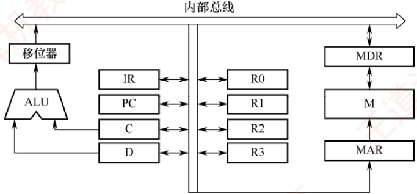

2）分析过程如下:

● 取指令地址送到IR并译码。

● 取源操作数和目的操作数。

● 将源操作数和目的操作数相加送到MAR，随之送到以前目的操作数所在内存的地址。

● 将寄存器 R2 的内容加 1。

取指周期流程如下图所示。

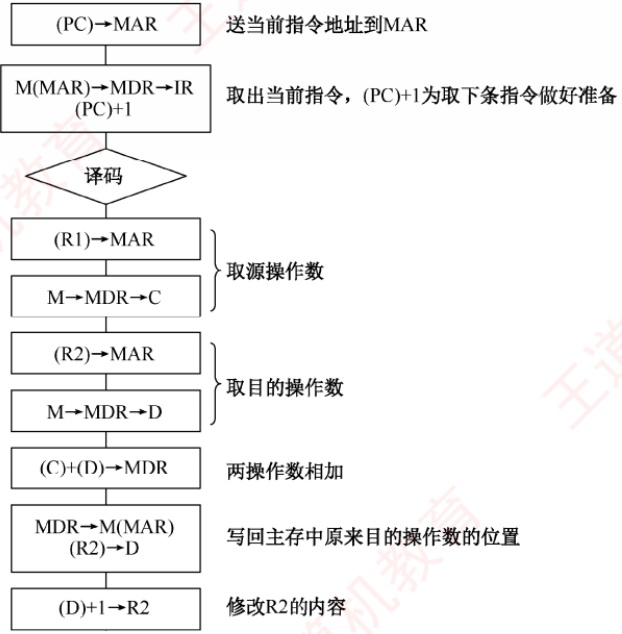

06. 【解答】

ADDX,D指令周期信息流程和相应的控制信号见下表。

<table><tr><td>周期</td><td>微操作</td><td>有效控制信号</td></tr><tr><td rowspan=3>取指周期</td><td>(PC)→MAR</td><td>PCo, MAR</td></tr><tr><td>M(MAR)→MDR(PC) + 1→PC</td><td>MAR0, R/W, MDR+1</td></tr><tr><td>(MDR)→IR</td><td>MDR0, IR</td></tr><tr><td rowspan=6>执行周期</td><td>(XR) + Ad(IR)→EAR</td><td>XR0, IR0, +, EAR</td></tr><tr><td>(EAR)→MAR</td><td>EAR0, MAR</td></tr><tr><td>M(MAR)→MDR</td><td>MAR0, R/W, MDR</td></tr><tr><td>(MDR)→X</td><td>MDR0, X</td></tr><tr><td>(ACC) + (X)→LATCH</td><td>ACC0, X0, K = +, LATCH         V</td></tr><tr><td>(LATCH)→ACC</td><td>LATCHo, ACCi</td></tr></table>

注:题目中的D即为Ad(IR)。

07.【解答】

题于已给出取值和译码阶段每个节拍的功能和有效控制信号，我们应以了解取指阶段中数据通路的信息流动为突破口，读懂每个节拍的功能和有效控制信号，然后应用到解题思路中，包括划分执行步骤、确定完成的功能、需要的控制信号。

先分析题干中提供的示例（本部分解题时不做要求）:

取指令的功能是根据PC的内容所指的主存地址，取出指令代码，经过MDR，最终送至IR。这部分和后面的指令执行阶段的取操作数、存运算结果的方法是相通的。

**C1:(PC)→MAR**

在读/写存储器前，必须先将地址（这里为(PC)）送至MAR。

C2: M(MAR)→MDR, (PC) + 1→PC

读/写的数据必须经过MDR，指令取出后PC自增1。

C3:(MDR)→IR

然后将读到的MDR中的指令代码送至IR进行后续操作。

指令“ADD(R1),R0”的操作数一个在主存中，一个在寄存器中，运算结果在主存中。根据指令功能，要读出 R1的内容所指的主存单元，必须先将R1的内容送至MAR，即(R1)→MAR。而读出的数据必须经过MDR，即M(MAR)→MDR。

因此，将R1的内容所指的主存单元的数据读出到MDR的节拍安排如下:

C5:(R1)→MAR

C6: M(MAR)→MDR

ALU一端是寄存器A，MDR或RO 中必须有一个先写入A 中，如MDR。

**C7: (MDR)→A**

然后执行加法操作，并将结果送入寄存器AC。

C8:(A) +(R0)→AC

之后将加法结果写回到R1的内容所指的主存单元，注意MAR中的内容没有改变。

C9:(AC)→MDR

C10:(MDR)→M(MAR)

有效控制信号的安排并不难，只需看数据是流入还是流出，如流入寄存器X就是Xin，流出寄存器X就是Xout。还需注意其他特殊控制信号，如PC+1、Add等。

于是得到参考答案如下表所示。

| 时钟 | 功能 | 有效控制信号 |
| --- | --- | --- |
| C5 | MAR←(R1) | R1out, MARin |
| C6 | MDR←M(MAR) | MemR, MDRinE |
| C7 | A←(MDR) | MDRout, Ain |
| C8 | AC←(A) + (R0) | R0out, ADD, ACin |
| C9 | MDR←(AC) | ACout, MDRin |
| C10 | M(MAR)←(MDR) | MDRoutE, MemW |

本题答案不唯一，若在 C6 执行M(MAR)→MDR的同时，完成(R0)→A[选择将(R0)写入 A]，并不会发生总线冲突，这种方案可节省1个节拍，见下表。

| 时钟 | 功能 | 有效控制信号 |
| --- | --- | --- |
| C5 | MAR←(R1) | R1out, MARin |
| KCC6 | MDR←M(MAR), A←(R0) | MemR, MDRinE, R0out, Ain |
| C7 | AC←(MDR) + (A) | MDRout, ADD, ACin |
| C8 | MDR←(AC) | ACout, MDRin |
| C9 | M(MAR)←(MDR) | MDRoutE, MemW |

08.【解答】

1）程序员可见寄存器为通用寄存器（R0～R3）和PC。因为采用了单总线结构，因此若无暂存器T，则ALU的A、B端口会同时获得两个相同的数据，使数据通路不能正常工作。

2）ALU共有7种操作，其操作控制信号 ALUop至少需要3位；移位寄存器有3种操作，其操作控制信号 SRop 至少需要2 位。

3）信号 SRout所控制的部件是一个三态门，用于控制移位器与总线之间数据通路的连接与断开。

4）端口①、②、③、⑤、⑧须连接到控制部件输出端。

5）连线1，⑥→⑨；连线2，⑦→④。

6）因为每条指令的长度为16位，按字节编址，所以每条指令占用2个内存单元，顺序执行时，下条指令地址为(PC)+2。MUX的一个输入端为2，可便于执行(PC)+2操作。

09. 【解答】

1）指令操作码有7位，因此最多可定义 $2^{7}   =   128$ 条指令。

2）各条指令的机器代码如下:

①“inc R1”的机器码为 0000001 0 01 0 00 0 00，即 0240H。

②“shl R2,R1”的机器码为 0000010 0 10 0 01 0 00，即 0488H。

③“sub R3, (R1), R2”的机器码为 0000011 0 11 1 01 0 10，即 06EAH。

3）各标号处的控制信号或控制信号取值如下:

①0; ②mov； ③mova; ④left;⑤read; ⑥sub; ⑦mov； ⑧SRout。

4）指令“sub R1,R3,(R2)”的执行阶段至少包含4个时钟周期；指令“inc R1”的执行阶段至少包含2个时钟周期。

**10.【解析】**

1）符号标志SF表示运算结果的正负性，因此 $\mathrm{SF} = \mathrm{F}_{15}$

对于加法运算A+B→F，若A、B为负，且F为正，则说明发生溢出；或者，若A、B为正，且F为负，也说明发生溢出。因此，加运算时，溢出标志 $\mathrm{OF} = \overline{\mathrm{A}_{15}} \cdot \overline{\mathrm{B}_{15}} \cdot \mathrm{F}_{15} + \mathrm{A}_{15} \cdot \mathrm{B}_{15} \cdot \overline{\mathrm{F}_{15}}$ 0对于减法运算A-B→F，若A为负、B为正，且F为正，则说明发生溢出；或者，若A为正、B为负，且F为负，也说明发生溢出。因此，减运算时，溢出标志 $\mathrm{OF} = \overline{\mathrm{A}_{15}} \cdot \mathrm{B}_{15} \cdot \mathrm{F}_{15} +$

$$
\mathrm {A}_{15} \cdot \overline {{\mathrm {B}_{15}}} \cdot \overline {{\mathrm {F}_{15}}} \mathrm {~  。  ~}
$$

2）因为在单总线结构中，每一时刻总线上只有一个数据有效，而ALU有两个输入端和一个输出端。因此，当ALU运算时，需要先用暂存器Y缓存其中一个输入端的数据，再通过总线传送另一个输入端的数据。与此同时，ALU的输出端产生运算结果，但总线正被占用，因此需要暂存器Z，以缓存ALU的输出端数据。

3）由图可知，rs和 rd都是4bit，因此 GPRs 中最多有 $2^{4}   =   16$ 个通用寄存器；rs和 rd来自指令寄存器（IR）；rd表示寄存器编号，应连接地址译码器。

4）取指阶段需要根据程序计数器（PC）取出主存中的指令，并将指令写入指令寄存器（IR）中。控制信号序列如下: XK

$$
\begin{aligned}&\textcircled{i}  \texttt{PCout}, \texttt{MRkin} \quad & // 将指令的地址写入  \texttt{MR} \\&\textcircled{2}  \texttt{Read} \quad & // 读主存 , \texttt{并将读出的数据写入} \texttt{MDR} \\&\textcircled{3}  \texttt{MDRout}, \texttt{TRin} \quad & // 将  \texttt{MDR}  的内容写入指令寄存器  (\texttt{LR})\end{aligned}
$$

步骤①需要1个时钟周期，步骤②需要5个时钟周期，步骤③需要1个时钟周期，因此取指令阶段至少需要7个时钟周期。

5) 图中控制信号由控制部件（CU）产生。指令寄存器（IR）和标志寄存器（FR）的输出信号会连到控制部件的输入端。

### 5.4.4 本节习题精选

**一、单项选择题**

01. 取指令操作（）。
A. 受到上一条指令的操作码控制 算机
B. 受到当前指令的操作码控制
C. 受到下一条指令的操作码控制
D. 是控制器固有的功能，不需要在操作码控制下进行

02.在组合逻辑控制器中，微操作控制信号的形成主要与（）信号有关。
A. 指令操作码和地址码
B. 指令译码信号和时钟
C. 操作码和条件码
D. 状态信息和条件

03. 在微程序控制器中，形成微程序入口地址的是（）。
A. 机器指令的地址码字段
B. 微指令的微地址码字段
C. 机器指令的操作码字段
D. 微指令的微操作码字段

04.下列不属于微指令结构设计所追求目标的是（）。
A. 提高微程序的执行速度
B. 提高微程序设计的灵活性
C. 缩短微指令的长度
D. 增大控制存储器的容量

05. 微程序控制器的执行速度比硬布线控制器慢，主要是因为（）。
A. 增加了从磁盘存储器读取微指令的时间
B. 增加了从主存读取微指令的时间 育
C. 增加了从指令寄存器读取微指令的时间
D. 增加了从控制存储器读取微指令的时间

06.下列关于微指令的说法中，错误的是（）。I. 字段直接编码方式可用较少的二进制位数表示较多的微操作命令。若有两组互斥的微命令，每组微命令的个数分别为4和9，则分别只需要2位和4位即可

Ⅱ. 直接编码方式不用进行译码操作，微指令字段中的每一位都代表一个微命令Ⅲ. 垂直型微指令用较长的微程序结构换取较短的微指令结构，所以在执行效率和灵活性两方面都高于水平型微指令

IV. 在字段间接编码方式中，某个字段的译码输出需要依靠另外某个字段的输出
A. II
B. I、ⅡI
C. I、II
D. II、III、IV

07. 微程序控制存储器属于（）的一部分。
A. 主存
B. 外存
C. CPU
D. 缓存

08. 下列说法中，正确的是（）。
A. 采用微程序控制器是为了提高速度
B. 控制存储器由高速 RAM 电路组成
C. 微指令计数器决定指令执行顺序
D. 一条微指令存放在控制器的一个控制存储器单元中

09. 假设计算机A要求应用在实时性要求较高的场合，计算机B要求有较好的灵活性和可修改性，则两台计算机的控制器应采用的设计方式分别是（
A. 计算机 A和B都应采用硬布线控制器
B. 计算机 A 和B 都应采用微程序控制器
C. 计算机A应采用硬布线控制器，计算机B应采用微程序控制器
D. 计算机A应采用微程序控制器，计算机B应采用硬布线控制器

10. 在微程序控制器中，控制部件向执行部件发出的某个控制信号称为（）。
A. 微程序
B. 微指令
C. 微操作
D. 微命令

11.在微程序控制器中，机器指令与微指令的关系是（）。
A. 每条机器指令由一条微指令来执行
B. 每条机器指令由若干微指令组成的微程序来执行
C. 若干机器指令组成的程序可由一个微程序来执行
D. 每条机器指令由若干微程序来执行

12. 水平型微指令与垂直型微指令相比，（）。
A. 前者一次只能完成一个基本操作
B. 后者一次只能完成一个基本操作
C. 两者都是一次只能完成一个基本操作
D. 两者都能一次完成多个基本操作

13. 垂直型微指令的特点是（）。
A. 控制信号经过编码产生
B. 强调并行控制功能
C. 采用微操作码
D. 微指令格式垂直表示

14.下列关于微命令的描述中，正确的是（）。
A. 同一个时钟周期中，可以同时出现的微命令叫相容性微命令
B. 同一个时钟周期中，可以同时出现的微命令叫互斥性微命令
C. 在执行过程中可能引起总线冲突的微命令叫互斥性微命令
D. 同一个时钟周期中，不允许同时出现的微命令叫相容性微命令

15. 在微程序控制方式中，以下说法正确的是（）。I. 采用微程序控制器的处理器称为微处理器Ⅱ. 每条机器指令由一段微程序来执行

Ⅲ. 在微指令的编码中，效率最低的是直接编码方式IV. 水平型微指令能充分利用数据通路的并行结构
A. I、 ⅡI
B. II、IV
C. I、III
D. III、IV

16. 下列说法中，正确的是（）。I. 微程序控制方式和硬布线控制方式相比较，前者可以使指令的执行速度更快Ⅱ. 若采用微程序控制方式，则可用 $\mu \mathrm {P C}$ 取代 PC I. 控制存储器可以用 ROM元件实现IV. 指令周期也称 CPU 时钟周期
A. I、ⅢII
B. Ⅱ、III
C. 只有ⅢI
D. I、III、IV

17. 通常一条指令对应一个微程序，一个微程序的周期对应一个（）。
A. 指令周期
B. 主频周期
C. 时钟周期
D. 工作周期

18. 下列部件中属于控制部件的是（）。 YX I. 指令寄存器 Ⅱ. 操作控制器 I. 程序计数器 IV. 状态条件寄存器
A. I、III、IV
B. I、II、III
C. I、II、IV
D. I、II、III、IV

19.为了确定下一条微指令的地址，通常采用断定方式，其基本思想是（）。
A. 用程序计数器（PC）来产生后继微指令地址
B. 用微程序计数器（μPC）来产生后继微指令地址
C. 通过后继微指令地址字段由设计者指定或转移控制字段控制产生后继微指令地址
D. 通过指令中指定一个专门字段来控制产生后继微指令地址

20. 下图是某微程序控制器的基本结构，μPC是一个8位寄存器，μR是一个32位寄存器，一条机器指令平均由4条不同的微指令组成（不含取指部分），则下列描述中错误的是（）。

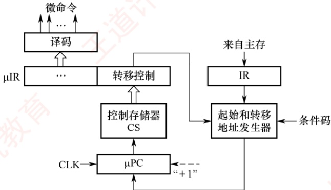

A. 微指令的地址形成方式是增量法
B. 条件码来自标志寄存器
C. 最多有 64 条不同的机器指令
D. 控制存储器的容量为 1KB

21.【2009统考真题】相对于微程序控制器，硬布线控制器的特点是（）。
A. 指令执行速度慢，指令功能的修改和扩展容易
B. 指令执行速度慢，指令功能的修改和扩展难
C. 指令执行速度快，指令功能的修改和扩展容易
D. 指令执行速度快，指令功能的修改和扩展难

22. 【2012统考真题】某计算机的控制器采用微程序控制方式，微指令中的操作控制字段采用字段直接编码法，共有33个微命令，构成5个互斥类，分别包含7、3、12、5和6个微命令，则操作控制字段至少有（）。
A. 5位
B. 6位 道
C. 15位
D. 33 位

23.【2014统考真题】某计算机采用微程序控制器，共有32条指令，公共的取指令微程序包含2条微指令，各指令对应的微程序平均由4条微指令组成，采用断定法（后继地址字段法）确定下条微指令地址，则微指令中后继地址字段的位数至少是（）。
A. 5
B. 6 x～
C. 8
D. 9

24.【2017统考真题】下列关于主存储器（MM）和控制存储器（CS）的叙述，错误的是（）。
A. MM 在 CPU 外，CS 在 CPU 内
B. MM 按地址访问，CS 按内容访问
C. MM存储指令和数据，CS 存储微指令
D. MM 用 RAM 和 ROM 实现，CS 用 ROM 实现 收育

25. 【2019统考真题】某指令的功能为 R[r2]←R[r1]+ M[R[r0]]，其两个源操作数分别采用寄存器、寄存器间接寻址方式。对于下列给定部件，该指令在取数及执行过程中需要用到的是（）。I. 通用寄存器组（GPRs） II. 算术逻辑单元（ALU）III.存储器（Memory） IV. 指令译码器（ID）
A. 仅I、ⅡI
B. 仅I、Ⅱ、ⅢII
C. 仅ⅡI、ⅢII、IV
D. 仅I、II、IV

26.【2021统考真题】下列寄存器中，汇编语言程序员可见的是（）。I. 指令寄存器 I. 微指令寄存器III. 基址寄存器 IV. 标志/状态寄存器
A. 仅I、ⅡI
B. 仅I、IV
C. 仅ⅡI、IV
D. 仅ⅢII、IV

27. 【2021统考真题】通常情况下，将汇编语言程序中实现特定功能的指令序列定义成一条伪指令（pseudoinstruction）。在下列选项中，CPU能理解并直接执行的是（）。I. 伪指令 Ⅱ. 微指令 . 机器指令 IV. 汇编指令
A. 仅I、IV
B. 仅ⅡI、ⅢⅢ
C. 仅ⅢII、IV
D. 仅I、ⅢII、IV

**二、综合应用题**

01. 若某机主频为 200MHz，每个指令周期平均为 2.5 个 CPU 周期，每个 CPU 周期平均包括2个主频周期，问:1）该机平均指令执行速度为多少MIPS？2）若主频不变，但每条指令平均包括5个CPU周期，每个CPU周期又包含4个主频周期，平均指令执行速度又为多少MIPS？ FLIR 3）由此可得出什么结论？

02. 某机有80条指令，平均每条指令由4条微指令组成（包含取指微指令），其中有一条取指微指令是所有指令公用的。已知微指令长度为32位，请估算控制存储器CM容量。

03.某微程序控制器中，采用水平型直接控制（编码）方式的微指令格式，后续微指令地址由微指令的后继地址字段给出。已知机器共有28个微命令，6个互斥的可判定的外部条件，控制存储器的容量为512×40位。试设计其微指令的格式，并说明理由。

04. 某机共有52个微操作控制信号，构成5个相斥类的微命令组，各组分别包含5、8、2、15、22个微命令。已知可判定的外部条件有两个，微指令字长28位。

1）按水平型微指令格式设计微指令，要求微指令的后继地址字段直接给出后继微指令地址。

2）指出控制存储器的容量。

05. 设CPU中各部件及其相互连接关系如下图所示，其中W 是写控制标志；R是读控制标志；R1、R2 是暂存器。 临村

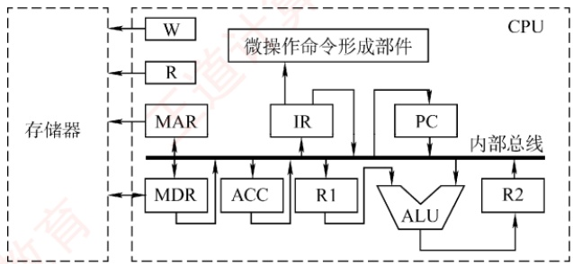

1）写出指令ADD#a（#为立即寻址特征，隐含的操作数在ACC寄存器中）在执行阶段所完成的微操作命令及节拍安排。

2）假设要求在取指周期实现(PC)+1→PC，且由ALU完成此操作（ALU能对它的一个源操作数完成加1运算）。以最少的节拍写出取指周期全部微操作命令及节拍安排。

### 5.4.5 答案与解析

**一、单项选择题**

01. D

取指令阶段完成的任务是将现行指令从主存中取出并送至指令寄存器，这个操作是公共的操作，是每条指令都要进行的，与具体的指令无关，所以不需要操作码的控制。

02. B

CU的输入信号来源如下:①经指令译码器译码产生的指令信息；②时序系统产生的节拍信号；③来自执行单元的反馈信息即标志。前两者是主要因素。

03. C

执行公用的取指微程序从主存中取出机器指令后，由机器指令的操作码字段指出各个微程序的入口地址（初始微地址）。

04. D

微指令的设计目标和指令结构的设计目标类似，都是基于执行速度、灵活性和指令长度这三个主要方面考虑的。而控制存储器容量的大小与微指令的设计目标无关。

05. D

在微程序控制中，控制存储器中存放有微指令，在执行时需要从中读出相应的微指令，从而增加了时间消耗。

06. C

字段直接编码方式为了缩短微指令字长而牺牲了速度，当微命令个数为4时需要3位，2位会导致每个编码都输出一个微命令，而不能表示不输出，说法Ⅰ错误。说法Ⅱ正确。垂直型微指令的缺点是微程序长、执行速度慢、工作效率低，说法Ⅲ错误。在字段间接编码方式中，一个字段的某些微命令要由另一个字段的某些微命令来解释，即依赖另一个字段的译码输出，说法IV正确。

07. C

微程序控制存储器用来存放微程序，是微程序控制器的核心部件，属于CPU的一部分，而不属于主存。

08. D

硬布线控制器采用硬件电路，速度较快，但设计难度大、成本高。微程序控制器的速度较慢，

但灵活性高。通常控制存储器采用ROM元件实现。微指令计数器决定了微指令执行的顺序。

09. C

实时性要求较高的场合通常需要能快速地响应和执行，硬布线控制器由硬件直接实现控制逻辑，速度较快，非常适用于实时性要求较高的场合。灵活性和可修改性要求高时，适合采用微程序控制器，因为微程序控制器可很方便地通过修改微程序来灵活调整控制逻辑。

10. D

在微程序控制器中，控制部件向执行部件发出的控制信号称为微命令，微命令执行的操作称为微操作。微指令则是若干微命令的集合，若干微指令的有序集合称为微程序。

11. B

在一个CPU周期中，一组实现一定功能的微命令的组合构成一条微指令，有序的微指令序列构成一段微程序，微程序的作用是实现一条对应的机器指令。

12. B

一条水平型微指令能定义并执行几种并行的基本操作；一条垂直型微指令只能定义并执行一种基本操作。

13. C

垂直型微指令是一种微指令格式，相比于水平型微指令而言的，并不是指令格式垂直表示，在微指令中设置了微操作码字段，结构类似于机器指令格式。控制信号经过编码产生是一种控制字段的编码方式，属于水平型微指令，强调并行控制功能是一种控制字段的设计目标，适合水平型微指令而不适合垂直型微指令。

14. A

在同一个CPU周期中，可以同时出现的微命令叫相容性微命令，不允许同时出现的微命令叫互斥性微命令。不允许同时出现的原因有可能是会引起总线冲突，也有可能是其他原因。

15. B

微处理器是相对于一些大型处理器而言的，与微程序控制器没有必然联系。不管是采用微程序控制器，还是采用硬布线控制器，微机的CPU都是微处理器，说法Ⅰ错误。微程序的设计思想就是将每条机器指令编写成一个微程序，每个微程序包含若于微指令，每条微指令对应一个或几个微操作命令，说法Ⅱ正确。直接编码方式中每位代表一个微命令，不需要译码，因此执行效率最高，只是这种方式会使得微指令的位数大大增加，说法Ⅲ错误。一条水平型微指令能定义并执行几种并行的基本操作，因此能够更充分利用数据通路的并行结构，说法IV正确。

16. C

微程序控制方式采用编程方式来执行指令，而硬布线控制方式则采用硬件方式来执行指令，因此硬布线控制方式速度较快，说法Ⅰ错误。 $\mu \mathrm {P C}$ 无法取代PC，因为它只在微程序中指向下一条微指令地址的寄存器。因此它也必然不可能知道这段微程序执行完毕后下一条是什么指令，说法Ⅱ错误。每条微指令执行时所发出的控制信号是事先设计好的，不需要改变，因此存放所有控制信号的存储器应为ROM，说法Ⅲ正确。指令周期是从一条指令启动到下一条指令启动的间隔时间，而时钟周期是计算机内部最基本、最小的时间单位，说法IV错误。

17. A

一条指令对应一个微程序，所以一个微程序的周期对应一个指令周期。

18. B

CPU控制器主要由三个部件组成:指令寄存器、程序计数器和操作控制器。状态条件寄存器通常属于运算器的部件，保存由算术指令和逻辑指令运行或测试的结果建立的各种条件码内容，如运算结果进位标志（CF）、运算结果溢出标志（OF）等。

19. C

断定法是指在微指令（后继地址字段）中直接明确指出下一条微指令的地址，这样相当于每条都是转移微指令，此外，还有一些其他方法如条件测试和转移控制字段，也用于控制微指令的寻址。因此，后继微指令地址可由微程序设计者指定，或者根据微指令所规定的转移控制字段控制产生。

20. C

图中 $\mu \mathrm {P C}$ 根据时钟信号进行自增“+1”操作，因此微指令的地址形成方式是增量（计数器）法。转移微指令根据标志寄存器中的标志位来决定下一条微指令的地址。 $\mu \mathrm {P C}$ 的位数是8位，能够指向256条微指令，其中包括若干取指微指令，因此机器指令的条数小于 $256/4 = 64$ ，选项C错误。控制存储器的容量为微指令所占用的存储空间，即 $256 \times 32b = 1  KB$ 临村

21. D

微程序控制器采用了“存储程序”的原理，每条机器指令对应一个微程序，因此修改和扩充容易，灵活性好，但每条指令的执行都要访问控制存储器，所以速度慢。硬布线控制器采用专门的逻辑电路实现，其速度主要取决于逻辑电路的延迟，因此速度快，但修改和扩展困难，灵活性差。

22. C

字段直接编码法将微命令字段分成若干小字段，互斥性微命令组合在同一字段中，相容性微命令分在不同字段中，每个字段还要留出一个状态，表示本字段不发出任何微命令。5个互斥类，分别包含7、3、12、5和6个微命令，需要3、2、4、3和3位，共15位。

23. C

计算机共有32条指令，各个指令对应的微程序平均为4条，则指令对应的微指令为 $32 \times 4 = 128$条，而公共微指令还有2条，整个系统中微指令的条数共为128+2=130条，所以需要 $\left[ \log_{2}130 \right] =$ 8位才能寻址到130条微指令。

24. B

主存储器（MM）在CPU外，用于存储指令和数据，由RAM和ROM实现（主要是RAM）。控制存储器（CS）用来存放构成指令系统的所有微指令，是一种只读型存储器，机器运行时只读不写，在CPU的控制器内。控制存储器按照微指令的地址访问。

25. B

该指令的两个源操作数分别采用寄存器、寄存器间接寻址方式，因此在取数阶段需要用到通用寄存器组（GPRs）和存储器（Memory）；在执行阶段，两个源操作数相加需要用到算术逻辑单元（ALU）。而指令译码器（ID）用于对操作码字段进行译码，向控制器提供特定的操作信号，在取数及执行阶段用不到。

26. D

汇编语言程序员可见的寄存器有基址寄存器（用于实现多道程序设计或者编制浮动程序）和状态/标志寄存器、程序计数器（PC）及通用寄存器组；而MAR、MDR、IR是CPU的内部工作寄存器，对汇编语言程序员不可见。微指令寄存器属于微程序控制器的组成部分，它是硬件设计者的任务，对汇编语言程序员是透明的（不可见的）。

27. B

高级语言程序、汇编语言程序都需要通过翻译程序来处理，生成机器语言程序后才能被CPU执行。机器指令能被CPU理解并直接执行。微指令是CPU控制单元用于实现机器指令的更低层次的指令。在微程序控制的CPU中，一条机器指令对应一个微程序，微程序是微指令的有序序列，用来控制CPU实现机器指令的过程，因此微指令也能被CPU理解并直接执行

**二、综合应用题**

01.【解答】

1）主频为200MHz，所以主频周期 $1/200 MHz  = 0.005\mu s$

每个指令周期平均为2.5个CPU周期，每个CPU周期平均包括2个主频周期，所以一条指令的执行时间 $2 \times 2.5 \times 0.005\mu  s  = 0.025\mu  s$该机平均指令执行速度 $1/0.025 = 40  MIPS$

2）每条指令平均包括5个CPU周期，每个CPU周期又包含4个主频周期，所以一条指令的执行时间 $4 \times 5 \times 0.005 \mu  s  = 0.1 \mu  s$

该机平均指令执行速度 $1/0.1 = 10  MIPS$

3）由此可见，指令的复杂程度会影响平均指令执行速度。

02. 【解答】

总的微指令条数 $(4 - 1) \times 80 + 1 = 241$ 条，每条微指令占一个控制存储器单元，控制存储器CM的容量为 2的 n 次幂，而241刚好小于 256，所以 CM的容量 = 256×32 位 = 1KB。

03.【解答】

水平型微指令由操作控制字段、判别测试字段和后继地址字段三部分构成。因为微指令采用直接控制（编码）方式，所以其操作控制字段的位数等于微命令数，为28位。又因为后继微指令地址由后继地址字段给出，所以其后继地址字段的位数可根据控制存储器的容量（512×40位）确定为9位 $(512 = 2^{9})$ 。当微程序出现分支时，后续微指令地址的形成取决于状态条件一—6个互斥的可判定外部条件，因此状态位应编码成3位。非分支时的后续微指令地址由微指令的后继地址字段直接给出。微指令的格式如下图所示。

| 操作控制字段 | 判别测试字段 | 后继地址字段 |
| --- | --- | --- |
| 28 位 | 3位 | 9位 |

04. 【解答】

1）根据5个互斥类的微命令组，各组分别包含5、8、2、15、22个微命令，考虑到每组必须增加一种不发送命令的情况，条件测试字段应包含一种不转移的情况，则5个控制字段分别需给出6、9、3、16、23种状态，对应3、4、2、4、5位（共18位），条件测试字段取2位。根据微指令字长为28位，后继地址字段取 $28-18-2=8$ 位，则其微指令格式如下图所示。

| 微命令 | 8个 微命令 | 2个 微命令 | 15个 微命令 | 22个 微命令 | 2个 判断条件 |  |
| --- | --- | --- | --- | --- | --- | --- |
|  |  |  |  |  | 条件测试 | 后继地址 |
| 3位 | 4位 | 2位 | 4位 | 5位 | 2位 | 8位 |

2）根据后继地址字段为8位，微指令字长为28位，得出控制存储器的容量为 $2^{8} {\times} 28$ 位。

05.【解答】

1）含有ACC的立即寻址，一个操作数隐藏在ACC中，立即寻址的加法指令执行周期的微操作命令及节拍安排如下:

| $T_{0} \mathrm {\quad} \mathrm {A d} \left( \mathbb {T R} \right) \rightarrow \mathbb {R} \mathbb {1}$ | 立即数→R1 |
| --- | --- |
| $T_{1} \quad (\mathbb{R}1) \quad + \quad (\mathbb{A}\mathbb{C}\mathbb{C}) \xrightarrow{} \mathbb{R}2$ | ACC 通过总线送 ALU |
| $T_{2} \quad (\mathbb{R}2) \rightarrow \mathbb{A}\mathbb{C}$ | 结果→ACC |

2） 因为(PC)+1→PC 需要由 ALU 完成，所以 PC 的值可作为 ALU的一个源操作数，在 ALU做加1运算得到(PC)+1后，结果送至与 ALU输出端相连的R2，然后送至PC。此题的关键是要考虑总线冲突的问题，因此，取指周期的微操作命令及节拍安排如下:

| (PC)→MAR, 1→R $T_{0}$ M(MAR)→MDR, (PC) + 1→R2 $T_{1}$ (MDR)→IR，OP(IR)→微操作命令形成部件 $T_{2}$ | PC 通过总线送 MAR PC 通过总线送 ALU 完成加 1 |
| --- | --- |

### 5.5.4 本节习题精选

**单项选择题**

01.以下关于“自陷”（Trap）异常的叙述中，错误的是（）。
A. “自陷”是人为预先设定的一种特定处理事件
B. 可由访管指令或自陷指令的执行进入“自陷
C. 一定是出现某种异常情况才会发生“自陷”
D. “自陷”发生后CPU将进入操作系统内核程序并执行

02. 指令执行结果出现异常而引起的中断是（）。
A. I/O 中断
B. 机器校验中断
C. 故障
D. 外部中断

03.访问主存时发生的校验错误属于（）。 自
A. 故障
B. 自陷
C. 终止 X
D. 外中断

04.下列关于异常和中断响应的叙述中，错误的是（）。
A. 异常事件检测由 CPU在执行每一条指令的过程中进行
B. 中断请求检测由CPU在每条指令执行结束、取下条指令之前进行
C. CPU检测到异常事件后所做的处理和检测到中断请求后所做的处理完全相同
D. CPU在中断响应时会关中断、保存断点和程序状态并转到相应的中断服务程序

05. 下列给出的事件中，无须异常处理程序进行处理的是（）。
A. 缺页故障
B. Cache 缺失
C. 地址越界
D. 除数为0

06. CPU 响应中断的时间是（ 道
A. 一条指令执行结束
B. I/O 设备提出中断
C. 取指周期结束
D. 指令周期结束

07.下列选项中，不属于外部中断事件的是（）。
A. 采样定时时间到
B. 无效操作码
C. 打印机缺纸
D. 键盘缓冲满

08.下列关于异常/中断机制与进程上下文切换机制的叙述中，错误的是（）
A. 进程上下文切换和异常/中断响应两者都会产生异常控制流
B. 进程上下文切换后，CPU执行的是另一个进程的代码
C. 响应异常/中断请求后，CPU执行的是内核程序的代码
D. 进程上下文切换和异常/中断响应处理都通过执行内核程序实现

09. 异常或中断处理结束后，返回到被中断原程序继续执行的指令地址称为“断点”，下列关于“断点”的说法中，错误的是（）。
B. “故障”类异常的断点为当前发生异常的指令的地址 A.“陷阱”类异常的断点为陷阱指令下一条指令的地址 道计算机
C. 外部中断的断点总是当前刚执行完的指令的地址
D. “终止”类异常的断点可以是当前指令或下一条指令的地址

10.【2015统考真题】内部异常（内中断）可分为故障（fault）、陷阱（trap）和终止（abort）三类。下列有关内部异常的叙述中，错误的是（
B. 内部异常的检测由 CPU 内部逻辑实现 A. 内部异常的产生与当前执行指令相关 几教育
C. 内部异常的响应发生在指令执行过程中
D. 内部异常处理后返回到发生异常的指令继续执行

11.【2016统考真题】异常是指令执行过程中在处理器内部发生的特殊事件，中断是来自处理器外部的请求事件。下列关于中断或异常情况的叙述中，错误的是（）。
A. “访存时缺页”属于中断
B. “整数除以0”属于异常
C. “DMA传送结束”属于中断
D. “存储保护错”属于异常

12.【2020统考真题】下列关于“自陷”（Trap，也称陷阱）的叙述中，错误的是（）
A. 自陷是通过陷阱指令预先设定的一类外部中断事件
B. 自陷可用于实现程序调试时的断点设置和单步跟踪 算机教育
C. 自陷发生后CPU将转去执行操作系统内核相应程序
D. 自陷处理完成后返回到陷阱指令的下一条指令执行

13. 【2021统考真题】异常事件在当前指令执行过程中进行检测，中断请求则在当前指令执行后进行检测。下列事件中，相应处理程序执行后，必须回到当前指令重新执行的是()。
A. 系统调用
B. 页缺失
C. DMA 传送结束
D. 打印机缺纸

### 5.5.5 答案与解析

**单项选择题**

01. C

自陷是人为设定的特殊中断机制，不是出现某些异常情况而产生的，选项C错误。

02. C

异常是CPU执行指令过程中发生的与当前指令执行有关的意外事件，而中断请求则是CPU外部的I/O部件或时钟等向CPU发出的与当前指令执行无关的意外事件。指令执行结果出现异常与当前指令执行有关，如运算溢出等，属于内中断中的故障。

03. C

若在执行指令的过程中发生严重错误，如控制器出错、存储器校验错等，则程序将无法继续执行，只能终止。严重情况下，甚至要调出中断服务程序来重启系统。

04. C

CPU对于异常和中断的响应处理大体是一致的，都需要保存断点和程序状态字并转到相应的处理程序去执行，但有些细节并不一样。例如，检测到中断请求后，CPU必须通过“中断回答”信号启动中断控制器进行中断查询，以确定当前发出的优先级最高的中断请求，并通过数据线获取相应的中断类型号；而对于异常，CPU无须进行中断回答。

05. B

缺页、地址越界和除数为0都是执行某条指令时可能发生的故障，需要调出操作系统内核中相应的异常处理程序来处理，而Cache缺失则由CPU硬件实现，无须调出异常处理程序进行处理。

06. A

中断周期用于响应中断，若有中断，则在指令的执行周期后进入中断周期。

07. B

无效操作码是由CPU在对某条指令译码时发现的，因此是内部异常。采样定时时间到、打印机缺纸、键盘缓冲满都与当前指令的执行无关，是由CPU外部的中断源发出的中断请求。

08. D

在硬件层，CPU中有检测异常和中断事件并将控制转移到操作系统内核执行的机制；在操作系统层，内核能通过进程的上下文切换将一个进程的执行转移到另一个进程的执行，它们都会产生异常控制流。响应异常/中断请求后，CPU执行的是异常/中断服务程序，是操作系统的内核程序。进程上下文切换由操作系统的内核程序实现，而异常/中断的响应则由硬件实现。

**补充知识**

CPU所执行指令的地址序列称为CPU的控制流。在程序正常执行时，通过顺序执行指令或转移指令得到的控制流称为正常控制流。在正常执行过程中，因遇到异常或中断事件而引起用户程序的正常执行被打断所形成的意外控制流，称为异常控制流。

09. C

外部中断请求信号的检测总是在一条指令执行完之后，取下一条指令之前。因此，若检测到有外部中断请求，则响应中断请求并转到中断服务程序执行后，应返回到原来被中断的程序中已经执行完成的指令的下一条指令执行，而不返回到刚执行完的指令执行。

10. D

内部异常是指来自CPU内部产生的中断，如非法指令、地址非法、校验错、页面失效、运算溢出和除数为零等，以上都是在指令的执行过程中产生的，选项A正确。内部异常的检测是由CPU自身完成的，不必通过外部的某个信号通知CPU，选项B正确。内部异常不能被屏蔽，旦出现应立即处理，选项C正确。对于非法指令、除数为零等异常，无法通过异常处理程序恢复故障，因此不能回到原断点执行，必须终止进程的执行，选项D错误。

11. A

中断是指来自CPU执行指令以外的事件，如设备发出的I/O结束中断，表示设备输入/输出已完成，希望处理机能向设备发出下一个输入/输出请求，同时让完成输入/输出后的程序继续运行。异常也称内中断，指源自CPU执行指令内部的事件。

12. A

自陷是一种内部异常，选项A错误。在x86计算机中，用于程序调试的“断点设置”功能是通过自陷机制实现的，选项B正确。执行到自陷指令时，无条件或有条件地自动调出操作系统内核程序进行执行，选项C正确。CPU执行陷阱指令后，会自动地根据不同陷阱类型进行相应的处理，然后返回到陷阱指令的下一条指令执行，选项D正确。

13. B

系统调用属于自陷，“断点”为自陷指令的下一条指令地址。DMA传送结束后，DMA控制器需要向CPU发送中断请求，属于外中断，外中断的“断点”为下一条指令地址。打印机缺纸同样属于外中断。页缺失属于内部异常中的故障，“断点”为发生故障的指令地址，执行完缺页异常处理程序之后必须返回发生故障的指令重新执行。 教

### 5.6.6 本节习题精选

**一、单项选择题**

01. 下列关于流水线CPU的叙述中，正确的是（）。
A. 流水线技术通过复制多个功能部件实现空间并行处理
B. 只有精简指令集（RISC）处理器才能采用流水线技术
C. 流水线CPU必须采用多核结构才能工作
D. 流水线是一种通过时间并行性提高指令执行效率的技术

02. 流水段CPU是由一系列称为“段”的处理电路组成的。一个m段流水线稳定时的CPU的吞吐能力，与m个并行部件的CPU的吞吐能力相比，（）。
A. 具有同等水平的吞吐能力
B. 不具备同等水平的吞吐能力
C. 吞吐能力大于前者的吞吐能力
D. 吞吐能力小于前者的吞吐能力

03. 设指令由取指、分析、执行3个子部件完成，并且每个子部件的时间均为Δt，若采用常规标量单流水线处理机（处理机的度为1），连续执行12条指令，共需（）。
A. 12 ∆t
B. 14∆t Y
C. 16∆t
D. 18∆t

04. 设指令由取指、分析、执行3个子部件完成，并且每个子部件的时间均为Δt，若采用度为4的超标量流水线处理机，连续执行20条指令，只需（）。
A. 3 ∆t
B. 5 ∆t
C. 7∆t
D. 9 Δt

05. 设指令流水线把一条指令分为取指、分析、执行3部分，3部分执行时间不等长，且3部分的时间分别是 $t_{取指} = 2  ns$ $t_{分析} = 2  ns$ $t_{执行} = 1 ms$
A. 163ns K
B. 183ns
C. 193ns
D. 203ns XK

06.下列关于指令流水线设计的叙述中，错误的是（）。
A. 指令执行过程中的各个子功能都需要包含在某个流水段中 算机
B. 所有子功能都必须按一定的顺序经过流水段
C. 虽然各个子功能所用实际时间可能不同，但经过每个流水段的时间都一样
D. 任何时候各个流水段的功能部件都不可能执行空操作

07.下列关于流水段寄存器的叙述中，正确的是（）。
A. 指令译码得到的控制信号需通过流水段寄存器传递到下一个流水段
B. 每个流水段之间的流水段寄存器位数一定相同
C. 每个流水段之间的流水段寄存器存放的信息一定相同
D. 用户程序可以通过指令指定访问哪个流水段寄存器

08. 下列关于流水线数据通路的描述中，错误的是（）。
A. 每个流水段由执行指令子功能的功能部件和流水段寄存器组成
B. 控制信号仅作用在功能部件上，时钟信号仅作用在流水段寄存器上
C. 在没有阻塞的情况下，PC的值在每个时钟周期都会改变
D. 取指令阶段和指令译码阶段不需要控制信号的控制

09.下列关于结构冒险的叙述中，正确的是（）。I. 结构冒险是指多条指令在同一时钟周期争用同一个硬件资源Ⅱ. 规定每条指令只能在指定流水段访问特定功能部件，可减少结构冒险Ⅲ.通过重复设置功能部件（如多个ALU）可以避免结构冒险IV. 将数据 Cache 与指令Cache分离，可解决取指和取数同时访存引起的结构冒险
A. I、ⅡI、IV
B. I、II、III
C. I、III、IV
D. I、ⅡI、ⅢII和IV

10. 指令流水线中出现数据相关时流水线将受阻，（）可部分解决数据相关问题。
A. 增加硬件资源
B. 采用旁路技术
C. 采用分支预测技术
D. 以上都可以 城

11.下列关于数据冒险和转发技术的叙述中，正确的是（）。I. 并非所有数据冒险都能通过转发技术解决 算机II. 五段流水线中load-use数据冒险会引起至少一个时钟周期的阻塞Ⅲ.前面的分支指令和后面的ALU运算指令之间肯定不会发生数据冒险
A. I、Ⅱ
B. I、ⅢII
C. II、ⅢII
D. I、II、ⅢII

12.下列关于数据冒险的叙述中，正确的是（）。I. 数据冒险是指后面指令用到的数据还未来得及由前面的指令产生Ⅱ. 在发生数据冒险的指令之间插入空操作指令能避免数据冒险Ⅲ.采用转发（旁路）技术可以解决一部分数据冒险现象IV. 通过编译器调整指令顺序可解决部分数据冒险
A. I、ⅡI、IV
B. I、II、III
C. I、III、IV
D. I、ⅡI、ⅢII和IV

13. 下列指令序列中，指令I1和I3、I2和I3之间发生数据相关。假定采用“取指、译码/取数、执行、访存、写回”五段流水线方式，那么在采用转发技术时，需要在指令I3之前加入（）条空操作指令才能使这段程序不发生数据冒险。I1: add r1,r0,1 # (r1)← (r0) + 1 I2: load r3, 12(r2) # (r3) ← M[(r2) + 12] I3: add r5, r3, r1 # (r5) ← (r3) + (r1)
A. 3 I
B. 2
C. 0
D. 1 育

14. 下面关于控制冒险的描述中，错误的是（）。I. 无条件转移指令不会发生控制冒险Ⅱ. 在分支指令加入若干空操作指令可以避免控制冒险Ⅲ.采用转发（旁路）技术，可以解决部分控制冒险 王道计算机IV. 中断或异常也会引起控制冒险V. 流水段的数量与控制冒险引发的开销无关
A. I、IV、V
B. III、V
C. I、III、IV
D. I、III、V

15.下列关于分支预测的叙述中，正确的是（）。I. 分支预测技术可用于处理控制冒险和数据冒险Ⅱ. 使用静态预测技术时，每次的预测结果是一样的Ⅲ. 动态预测技术通常比静态预测技术的预测成功率高IV. 若预测错误，已被错误放入流水线执行的指令必须被舍弃
A. I、II、II
B. I、II、IV
C. II、ⅢII、IV
D. I、II、ⅢII、IV

16.下列关于指令流水线和指令执行效率的叙述中，错误的是（）。A. 加倍增加流水段个数不能成倍提高指令执行效率

B. 为了提高指令吞吐率，流水段个数应无限制地增加
C. 增加流水段个数，可以提高处理器的时钟频率
D. 随着流水段个数的增加，流水段之间缓存开销的比例增大

17.下列关于超标量流水线的描述中，不正确的是（）。
A. 在一个时钟周期内一条流水线可执行一条以上的指令
B. 一条指令分为多段指令由不同电路单元完成
C. 超标量通过内置多条流水线来同时执行多个处理器，其实质是以空间换取时间
D. 超标量流水线仅仅是指运算操作并行

18. 关于流水线技术的说法中，错误的是（）。
A. 超标量技术需要配置多个功能部件和指令译码电路等 教育
B. 与超标量技术和超流水线技术相比，超长指令字技术对优化编译器要求更高，而无其他硬件要求
C. 在按序流动的流水线中，只可能出现RAW相关
D. 超流水线技术相当于将流水线再分段，从而提高每个周期内功能部件的使用次数

19.【2009统考真题】某计算机的指令流水线由4个功能段组成，指令流经各功能段的时间（忽略各功能段之间的缓存时间）分别为90ns、80ns、70ns和60ns，则该计算机的CPU周期至少是（）。
A. 90ns
B. 80ns
C. 70ns
D. 60ns

20.【2010统考真题】下列不会引起指令流水线阻塞的是（）。
A. 数据旁路
B. 数据相关
C. 条件转移
D. 资源冲突

21.【2011统考真题】下列指令系统的特点中，有利于实现指令流水线的是（）。I. 指令格式规整且长度一致 Ⅱ. 指令和数据按边界对齐存放II. 只有LOAD/STORE指令才能对操作数进行存储访问
A. 仅I、Ⅱ
B. 仅ⅡI、ⅢII
C. 仅I、ⅢII
D. I、ⅡI、ⅢII

22. 【2013 统考真题】某CPU主频为1.03GHz，采用4 级指令流水线，每个流水段的执行需要1个时钟周期。假定CPU执行了100条指令，在其执行过程中，没有发生任何流水线阻塞，此时流水线的吞吐率为（）
A. $0 . 25   \times   10^{9}$ 条指令/秒
B. 0. $97   \times   10^{9}$ 条指令/秒 教育
C. $1 . 0   \times   10^{9}$ 条指令/秒
D. $1 . 03   \times   10^{9}$ 条指令/秒

23.【2014统考真题】采用指令Cache与数据Cache分离的主要目的是（）。A. 降低 Cache 的缺失损失
C. 降低CPU 平均访存时间
D. 减少指令流水线资源冲突

24.2016统考真题】在无转发机制的五段基本流水线（取指、译码/读寄存器、运算、访存、写回寄存器）中，下列指令序列存在数据冒险的指令对是（）。I1: add R1, R2, R3; (R2) + (R3)→R1 I2: add R5, R2, R4; (R2) + (R4)→R5 I3: add R4, R5, R3; (R5) + (R3)→R4 育I4: add R5, R2, R6; (R2) + (R6)→R5
A. I1 和 I2
B. I2 和 I3
C. I2 和I4
D. I3 和 I4

25.【2017统考真题】下列关于超标量流水线特性的叙述中，正确的是（）。I. 能缩短流水线功能段的处理时间Ⅱ. 能在一个时钟周期内同时发射多条指令Ⅲ. 能结合动态调度技术提高指令执行并行性

A. 仅Ⅱ
B. 仅I、ⅢI
C. 仅Ⅱ、ⅢII
D. I、Ⅱ和ⅢII

26.【2017统考真题】下列关于指令流水线数据通路的叙述中，错误的是（）。
A. 包含生成控制信号的控制部件
B. 包含算术逻辑运算部件（ALU）
C. 包含通用寄存器组和取指部件
D. 由组合逻辑电路和时序逻辑电路组合而成

27.【2018统考真题】若某计算机最复杂指令的执行需要完成5个子功能，分别由功能部件A\~E实现，各功能部件所需时间分别为 80ps、50ps、50ps、70ps和 50ps，采用流水线方式执行指令，流水段寄存器延时为20ps，则CPU时钟周期至少为（）
A. 60ps
B. 70ps
C. 80ps
D. 100ps

28.【2019统考真题】在采用“取指、译码/取数、执行、访存、写回”5段流水线的处理器中，执行如下指令序列，其中s0、s1、s2、s3和t2表示寄存器编号。I1:add s2, s1, s0 //R[s2] ← R[s1] + R[s0] I2: load s3, 0(t2) //R[s3] ← M[R[t2] + 0] 王道计I3: add s2, s2, s3 //R[s2] ← R[s2] + R[s3] I4: store s2, 0(t2) //M[R[t2] + 0] ← R[s2]

下列指令对中，不存在数据冒险的是（）。
A. I1 和 I3
B. I2 和 I3
C. I2 和I4
D. I3 和 I4

29.【2020统考真题】下列给出的处理器类型中，理想情况下，CPI为1的是（）。I. 单周期 CPU ⅡI. 多周期 CPU III. 基本流水线 CPU IV. 超标量流水线 CPU
A. 仅I、Ⅱ
B. 仅I、
C. 仅Ⅱ、IV
D. 仅ⅢII、IV

30.【2023统考真题】在采用“取指、译码/取数、执行、访存、写回”5段流水线的RISC处理器中，执行如下指令序列（第一列为指令序号），其中s0、s1、s2、s3和t2表示寄存器编号。 山I1 add s2, s1, s0 // R[s2]←R[s1] + R[s0] I2 load s3, 0(s2) //R[s3]←M[R[s2] + 0] I3 beq t2, s3, L1 // if R[t2] = R[s3] jump to L1 I4 addi t2, t2, 20 // R[t2]←R[t2] + 20 教育I5 L1:

若采用转发(旁路)技术处理数据冒险，采用硬件阻塞方式处理控制冒险，则在指令I1\~ I4的执行过程中，发生流水线阻塞的指令有（）。
A. 仅I3
B. 仅I2、I4
C. 仅I3、I4
D. 仅I2、I3、I4

31.【2024统考真题】对于采用“取指、译码/取数、执行、访存、写回”5段流水线的RISC数据通路，下列关于指令流水线数据冒险处理的叙述中，错误的是（）。
A. 相邻两条指令中的操作数相关可能引起数据冒险
B. 在数据相关的指令间插入“气泡”能避免数据冒险
C. 所有数据冒险都可以通过加入转发（旁路）电路解决
D. 所有数据冒险都能通过调整指令顺序和插入nop指令解决

32.【2025统考真题】下列关于CPI和CPU时钟周期的叙述中，错误的是（）。
A. 不同类型指令的 CPI可能不一样
B. 程序的 CPI 与 Cache 缺失率无关
C. 单周期CPU的时钟周期以最耗时指令所用时间为准
D. 流水线 CPU 的时钟周期以最长流水段所用时间为准

33.【2025统考真题】下列关于CPU中的数据通路和控制器的叙述中，错误的是（）。
A. 通用寄存器组中应该包含程序计数器
B. 控制器中一定包含指令操作码的译码电路
C. 单周期CPU 中的控制器比多周期CPU 中的更简单
D. 流水线 CPU 需解决数据相关和控制相关等冒险问题

**二、综合应用题**

01.【2012 统考真题】某16 位计算机中，有符号整数用补码表示，数据Cache和指令Cache分离。下表给出了指令系统中的部分指令格式，其中 Rs和 Rd表示寄存器，mem表示存储单元地址，(x)表示寄存器x或存储单元x的内容。 xK

表指令系统中部分指令格式

| 名称 | 指令的汇编格式 | 指令功能KD |
| --- | --- | --- |
| 加法指令 | ADD Rs, Rd | (Rs) + (Rd)→Rd |
| 算术/逻辑左移 | SHL Rd | 2*(Rd)→Rd |
| 算术右移 | SHR Rd | (Rd)/2→Rd |
| 取数指令 | Load Rd, mem | (mem)→Rd |
| 存数指令 | StoreRs, mem | (Rs)→mem |

该计算机采用5段流水方式执行指令，各流水段分别是取指(IF)、译码/读寄存器(ID)、执行/计算有效地址（EX）、访问存储器（M）和结果写回寄存器（WB），流水线采用“按序发射，按序完成”方式，未采用转发技术处理数据相关，且同一寄存器的读和写操作不能在同一个时钟周期内进行。请回答下列问题:

1）若 int 型变量x 的值为-513，存放在寄存器 R1 中，则执行“SHR R1”后，R1 中的内容是多少（用十六进制表示）？

2）若在某个时间段中，有连续的4条指令进入流水线，在其执行过程中未发生任何阻塞，则执行这4条指令所需的时钟周期数为多少？

3）若高级语言程序中某赋值语句为x=a+b，x、a和b均为int型变量，它们的存储单元地址分别表示为[x]、[a]和[b]。该语句对应的指令序列及其在指令流中的执行过程如下所示。北

I1 LOAD R1, [a]

I2LOAD R2， [b]

I3ADD R1, R2

I4 STORE R2, [x]

<table><tr><td rowspan=2>指 令</td><td colspan=14>时 钟</td></tr><tr><td>1</td><td>2</td><td>3</td><td>4</td><td>5</td><td>6</td><td>7</td><td>8</td><td>9</td><td>10</td><td>11</td><td>12</td><td>13</td><td>14</td></tr><tr><td> $\mathrm {I_{1}}$ </td><td>IF</td><td>ID</td><td>EX</td><td>M</td><td>WB</td><td></td><td></td><td></td><td></td><td></td><td></td><td></td><td></td><td></td></tr><tr><td> $\mathrm {I}_{2}$ </td><td></td><td>IF</td><td>ID</td><td>EX</td><td>M</td><td>WB</td><td></td><td></td><td></td><td></td><td></td><td></td><td></td><td></td></tr><tr><td> $\mathrm {I}_{3}$ </td><td></td><td></td><td>IF</td><td></td><td></td><td></td><td>ID</td><td>EX</td><td>M</td><td>WB</td><td></td><td></td><td></td><td></td></tr><tr><td>I4</td><td></td><td></td><td></td><td></td><td></td><td></td><td>IF</td><td></td><td></td><td></td><td>ID</td><td>EX</td><td>M</td><td>WB</td></tr></table>

则这 4 条指令执行过程中 I3 的ID 段和I4 的 IF段被阻塞的原因各是什么？

4）若高级语言程序中某赋值语句为 $\mathrm{X} = \mathrm{X}^* 2 + a$ ，x和 a 均为 unsigned int 类型的变量，它们的存储单元地址分别表示为[x]、[a]，则执行这条语句至少需要多少个时钟周期？要求模仿上图画出这条语句对应的指令序列及其在流水线中的执行过程示意图。

02.【2014统考真题】某程序中有循环代码段P: $\mathrm{for}(\mathrm{int} \mathrm{i}=0; \mathrm{i}<\mathrm{N}; \mathrm{i}++) \mathrm{sum} = \mathrm{A[i]};$假设编译时变量 sum和i分别分配在寄存器R1 和 R2 中。常量N 在寄存器 R6 中，数组A 的首地址在寄存器R3 中。程序段P的起始地址为 0804 8100H，对应的汇编代码和机器代码如下表所示。

| 编号 | 地址 | 机器代码 | 汇编代码 | 注释 |
| --- | --- | --- | --- | --- |
| 1 | 08048100H | 00022080H | loop: sll R4, R2, 2 | (R2) &lt;&lt;2→R4 |
| 2 | 08048104H | 00083020H | add R4, R4, R3 | (R4) + (R3)→R4 |
| 3 | 08048108H | 8C850000H | load R5, 0(R4) | ((R4) + 0)→R5 |
| 4 | 0804810CH | 00250820H | add R1, R1, R5 | (R1) + (R5)→R1 |
| 5 | 08048110H | 20420001H | add R2, R2, 1 | (R2) + 1→R2 |
| 6 | 08048114H | 1446FFFAH | bne R2, R6, loop | if(R2)! = (R6) goto loop |

执行上述代码的计算机 M采用32位定长指令字，其中分支指令bne采用如下格式:

<table><tr><td>31 26</td><td colspan="3">25 21</td><td>0</td></tr><tr><td>OP</td><td>Rs</td><td>Rd</td><td></td><td>OFFSET</td></tr></table>

OP为操作码；Rs和Rd 为寄存器编号；OFFSET为偏移量，用补码表示。请回答下列问题，并说明理由。

1）M的存储器编址单位是什么？

2）已知sl指令实现左移功能，数组A中每个元素占多少位？

3）表中 bne指令的 OFFSET字段的值是多少？已知 bne指令采用相对寻址方式，当前PC 内容为 bne指令地址，通过分析表中指令地址和 bne指令内容，推断 bne 指令的转移目标地址计算公式。

4）若M采用如下“按序发射、按序完成”的5级指令流水线:IF（取值）、ID（译码及取数）、EXE（执行）、MEM（访存）、WB（写回寄存器），且硬件不采取任何转发措施，分支指令的执行均引起3个时钟周期的阻塞，则P中哪些指令的执行会由于数据相关而发生流水线阻塞？哪条指令的执行会发生控制冒险？为什么指令1的执行不会因为与指令5的数据相关而发生阻塞？

03.【2014统考真题】假设对于上题中的计算机M和程序P的机器代码，M采用页式虚拟存储管理；P开始执行时，(R1)=(R2)=0，(R6)=1000，其机器代码已调入主存但不在Cache中；数组A未调入主存，且所有数组元素在同一页，并存储在磁盘的同一个扇区。请回答下列问题并说明理由。

1）P执行结束时，R2的内容是多少？

2）M 的指令 Cache 和数据 Cache 分离。若指令 Cache 共有 16 行，Cache 和主存交换的块大小为32B，则其数据区的容量是多少？若仅考虑程序段P的执行，则指令Cache的命中率为多少？

3)P在执行过程中，哪条指令的执行可能发生溢出异常？哪条指令的执行可能产生缺页异常？对于数组A的访问，需要读磁盘和TLB至少各多少次？

### 5.6.7 答案与解析

**一、单项选择题**

01. D

流水线通过将指令执行划分为多个阶段并重叠处理，实现时间并行性，其核心是分时复用同一套功能部件；而复制多个功能部件以支持同时执行多条指令，属于多发射或超标量技术，体现的是空间并行性。选项A将空间并行的特征错误归因于流水线。不仅RISC处理器，CISC处理器（如x86计算机）也广泛采用流水线技术。流水线完全可在单核CPU中实现，无须多核支持。

02. A

吞吐能力是指单位时间内完成的指令数。m段流水线在第m个时钟周期后，每个时钟周期都可以完成一条指令；而m个并行部件在m个时钟周期后能完成全部的m条指令，等价于平均每个时钟周期完成一条指令。因此两者的吞吐能力等同。

03. B

单流水线处理机执行 12 条指令的时间为(3 + (12 − 1))∆t = 14∆t。

04. C

这个超标量流水线处理机可以发送4条指令，所以执行指令的时间为 $(3 + (20 - 4)/4) \Delta t = 7 \Delta t$

05. D

每个功能段的时间设定为取指、分析和执行部分的最长时间2ns，第一条指令在第5ns时执行完毕，其余的99条指令每隔2ns执行完一条，所以100条指令全部执行完毕所需的时间为$(5 + 99 \times 2) \mathrm{ns} = 203 \mathrm{ns}$ 0

06. D

指令执行过程中的各个子功能都需要包含在某个流水段中，每条指令都会依次进入所有流水段进行处理。不同指令的复杂度不同，所需的功能段不同，但为了保证指令流水线正常运行，流水段个数以最复杂指令所用的功能段个数为准，流水段长度以最复杂的操作所花的时间为准。因此，其他指令可以通过加入“空操作”功能段向最复杂的指令靠齐。

07. A

在某个时钟周期内，不同的流水段受不同指令的控制信号控制，执行不同指令的不同功能段，在指令译码阶段由控制器产生指令各流水段的所有控制信号，分别在随后的各个时钟周期内被使用，因此随后各流水段寄存器都要保存相应的控制信号，并通过流水段寄存器传递到下一个流水段，选项A正确。不同流水段寄存器存放的信息不同，因此流水段寄存器位数不一定相同，流水段寄存器对用户程序是透明的，用户程序不能通过指令指定访问哪个流水段寄存器。

08. B

在流水线数据通路中，时钟信号不仅作用在流水段寄存器上，还要作用在PC、各类寄存器、存储器等状态元件上。每条指令的取指令阶段和指令译码阶段的功能都相同，是公共流水段，且控制信号是指令译码之后才产生的，因此这两个阶段不需要控制信号。

09. D

结构冒险是指多条指令在同一时钟周期争用同一硬件资源。规定每条指令仅在指定流水段访问特定功能部件，可使资源使用有序化，从而减少结构冒险；通过重复设置功能部件（如多个ALU）能支持多指令并行访问，直接避免资源冲突；将指令Cache与数据Cache分离，可解决取指（IF阶段）与访存（MEM阶段）同时访问存储器引起的结构冒险。因此，四个说法均正确。

10. B

处理数据相关问题有两种方法:一种是暂停相关指令的执行，即暂停流水线，直到能够正确读出寄存器操作数为止；另一种是采用专门的数据通路，直接把结果送到ALU的输入端，这种方法称为旁路技术。

11. A

部分数据冒险可以通过转发技术解决，但有些数据冒险不行，例如load-use类型的数据冒险（当下一条指令需要用到本条指令的访存结果时）。1oad-use类型的数据冒险会引起一个或多个时钟周期的阻塞，需要添加空操作指令解决。若ALU运算指令的某个操作数是分支指令转移后的执行结果，就会发生数据冒险。例如，分支指令“slt r1,r2,r3”，其含义是若(r2) < (r3)，则 r1 = 1；否则 r1 = 0。若紧挨着一条 ALU 运算指令要用到 r1 的值，则会发生数据冒险。

12. D

插入空操作指令，使相关指令延迟执行，可以避免数据冒险。采用转发技术，将数据通路中生成的中间数据直接转发到ALU的输入端，可以解决部分数据冒险，但不能解决load-use类型的数据冒险。通过编译器调整相关指令的顺序，也可以解决部分数据冒险。

13. D

转发技术可以解决部分数据冒险，但不能解决load-use类型的数据冒险。分析上述指令序列，指令I1在EX段结束时已得到r1的新值，采用转发技术后，指令I3在ALU中用到的r1值可以直接从EX/MEM流水段寄存器中取，可以解决指令I1和I3的数据冒险。指令I2和I3是load-use类型的数据冒险，load指令只在MEM段结束时才能取到主存中的数据，然后送MEM/WB流水段寄存器，在 WB 段的前半个时钟周期才能将新值写入 r3，但随后的 add指令在 EX段就要取r3的值，因此会发生数据冒险。需要在add指令之前插入一条空操作指令，这样在add指令的EX段就可从MEM/WB流水段寄存器中取出load指令的最新结果。

14. D

直接转移指令的转移目标地址在执行阶段才确定，会发生控制冒险，说法Ⅰ错误。插入空操作指令可使条件转移指令的结果在取下一条有效指令之前确定，从而避免控制冒险，说法Ⅱ正确。采用转发技术，可以解决的是数据冒险，说法Ⅲ错误。中断或异常会改变程序的执行流程，也会引起控制冒险，说法IV正确。流水段的数量越多，意味着在转移结果确定之前，可能取出更多的错误指令，从而需要更多的时间和资源来处理这些错误指令，说法Ⅴ错误。

15. C

分支预测技术用于处理控制冒险。静态预测技术假定分支总是不发生或者总是发生，每次预测结果是一样的。动态预测技术根据之前条件转移的比较结果来预测，根据局部性原理，其预测成功率通常比静态预测技术高。预测错误时，已被错误放入流水线执行的指令必须被舍弃。

16. B

适当增加流水段的个数，会使得每个流水段内的操作更简单，流水段的延迟更小，缩短了时钟周期，从而可以提高时钟频率。但是，流水段之间的流水段寄存器也随之增多，增加了流水段之间的额外缓存开销，因此加倍增加流水段个数不能成倍提高指令执行效率，且流水段个数也不能无限制地增加。此外，随着流水段个数的增加，也将导致流水段的控制逻辑更复杂。

17. D

超标量流水线不仅指运算操作并行，还包括取指、译码、访存、写回等其他操作，超标量技术使CPU在同一时间内执行多条指令，从而发挥更大的效率，选项D错误。

18. B

要实现超标量技术，要求CPU中配置多个功能部件和指令译码电路，以及多个寄存器和总线，以便实现同时执行多个操作，选项A正确。超长指令字技术不仅对优化编译器要求更高，还需要更多的硬件资源，如寄存器、功能部件、指令译码电路等，选项B错误。流水线按序流动，肯定不会出现读后写（WAR）相关和写后写（WAW）相关；只可能出现没等到上一条指令写入而当前指令就读寄存器的错误，选项C正确。由超流水线技术的定义可知选项D正确。

19. A

时钟周期应以各功能段的最长执行时间为准，否则用时长的流水段将不能正确完成。

20. A

采用流水线方式，相邻或相近的两条指令可能因为存在某种关联，后一条指令不能按照原指定的时钟周期运行，从而使流水线断流。有三种相关可能引起指令流水线阻塞:①结构相关，也称资源相关；②数据相关；③控制相关，主要由转移指令引起。

数据旁路技术的主要思想是，不必等某条指令的执行结果送回到寄存器，再从寄存器中取出该结果，而是直接将执行结果送到其他指令所需的地方，这样可以使流水线不发生停顿。

21. D

指令长度一致、按边界对齐存放、仅Load/Store指令访存，这些都是RISC的特征，它们使取指令、取操作数的操作简化且时间长度固定，能够有效地简化流水线的复杂度。

22. C

采用4级流水执行100条指令，在执行过程中共使用4+(100-1)=103个时钟周期，如下图所示。CPU的主频是1.03GHz，即每秒有1.03G个时钟周期。流水线的吞吐率为1.03G×100/103 = $1 . 0   \times   10^{9}$ 条指令/秒。

<table><tr><td rowspan=7>S时钟4时钟3时钟2时钟1</td><td></td><td></td><td></td><td></td><td></td><td></td><td></td><td></td><td></td><td></td><td></td></tr><tr><td></td><td></td><td></td><td></td><td></td><td></td><td></td><td></td><td>A</td><td></td><td></td></tr><tr><td colspan=3></td><td>1</td><td>2</td><td>3</td><td></td><td>.</td><td>99</td><td>100</td><td></td></tr><tr><td colspan=2></td><td>1</td><td>2</td><td>3</td><td></td><td></td><td>99</td><td>100</td><td rowspan=3></td><td></td></tr><tr><td></td><td>1</td><td>2</td><td>3</td><td></td><td></td><td>99</td><td>100</td><td rowspan=2>一一一</td><td></td></tr><tr><td>1</td><td>2</td><td>3</td><td></td><td>.</td><td>99</td><td>100</td><td></td><td></td></tr><tr><td colspan=7>100</td><td colspan=3>3</td><td>t</td></tr></table>

23. D

把指令Cache 与数据Cache 分离后，取指和取数分别到不同的 Cache中寻找，则指令流水线中取指部分和取数部分就可以很好地避免冲突，即减少了指令流水线的冲突。

24. B

数据冒险即数据相关，指在一个程序中存在必须等前一条指令执行完才能执行后一条指令的情况，此时这两条指令即为数据相关。当多条指令重叠处理时就会发生冲突。首先这两条指令发生写后读相关，且两条指令在流水线中的执行情况（发生数据冒险）如下表所示。

<table><tr><td rowspan=2>指 令</td><td colspan=7>时钟</td></tr><tr><td>1</td><td>72</td><td>3</td><td>4</td><td>5</td><td>6</td><td>7</td></tr><tr><td>I2</td><td>取指</td><td>译码/读寄存器</td><td>运算</td><td>访存</td><td>写回</td><td></td><td></td></tr><tr><td>I3</td><td></td><td>取指</td><td>译码/读寄存器</td><td>运算</td><td>访存</td><td>写回</td><td></td></tr></table>

指令I2 在时钟 5 时将结果写入寄存器 R5，但指令I3 在时钟 3 时读 R5。本来指令I2 应先写入 R5，指令I3后读R5，结果变成指令I3 先读R5，指令I2后写入 R5，因此发生数据冲突。

25. C

超标量是指在CPU中有一条以上的流水线，并且每个时钟周期内可以完成一条以上的指令，其实质是以空间换时间。说法Ⅰ错误，它不影响流水线功能段的处理时间；说法Ⅱ、Ⅲ正确。

26. A

数据在功能部件之间传送的路径称为数据通路，包括数据通路上流经的部件，如程序计数器、ALU、通用寄存器、状态寄存器、异常和中断处理逻辑等。数据通路由控制部件控制，控制部件根据每条指令功能的不同生成对数据通路的控制信号。因此，不包括控制部件。

27. D

指令流水线中每个流水段的时间单位为一个时钟周期，题中指令流水线的指令需要用到A～ E五个部件，所以每个流水段时间应取最大部件时间80ps，此外还有流水段寄存器延时20ps，因此 CPU 时钟周期至少是 100ps。

28. C

画出这四条指令在流水线中执行的过程如下图所示。

| 指令 | 1 | 2 | 3 | 4 | 5 | 6 | 171 | 8 | 9 | 10 | 11 | 12 | 13 | 14 |
| --- | --- | --- | --- | --- | --- | --- | --- | --- | --- | --- | --- | --- | --- | --- |
| add s2, s1, s0 | 取指 | 译码/取数 | 执行 | 访存 | 写回 |  |  |  |  |  |  |  |  |  |
| load s3, 0(t2) |  | 取指 | 译码/取数 | 执行 | 访存 | 写回 |  |  |  |  |  |  |  |  |
| add s2, s2, s3 |  |  | 取指 |  |  |  | 译码/取数 | 执行 | 访存 | 写回 |  |  |  |  |
| store s2, 0(t2) |  |  |  |  |  |  | 取指 |  |  |  | 译码/取数 | 执行 | 访存 | 写回 |

数据冒险即数据相关，指在程序中存在必须等前一条指令执行完才能执行后一条指令的情况，此时这两条指令即为数据相关。其中I1和I3、I2和I3、I3和I4均发生了写后读相关，因此必须等相关的前一条指令执行完才能执行后一条指令。只有I2和I4不存在数据冒险。

29. B

CPI表示执行指令所需的时钟周期数。对于一个程序或一台机器来说，其CPI是指执行该程序或机器指令集中的所有指令所需的平均时钟周期数。对于单周期CPU，令指令周期 =时钟周期，CPI=1，说法I正确。对于多周期CPU，CPU的执行过程分成几个阶段，每个阶段用一个时钟完成，每种指令所用的时钟数可以不同，CPI>1，说法Ⅱ错误。对于基本流水线CPU，让每个时钟周期流出一条指令，CPI=1，说法Ⅲ正确。超标量流水线CPU在每个时钟周期内并发执行多条独立的指令，每个时钟周期流出多条指令，CPI<1，说法IV错误。

30. C

I2和 I1 之间存在数据冒险，I1 在 WB 段才将新值写回寄存器 R[s2]，但I2的 EX段就要读R[s2]以计算访存的有效地址，I1 在 EX段结束时就已生成R[s2]的新值，被存放在 EX/MEM流水段寄存器中，采用转发技术后，可直接从该寄存器中取出数据送到ALU的输入端，这样I2执行时 ALU 用的是R[s2]的新值，解决了I2 和I1 之间的数据冒险。I3 和I2之间存在数据冒险，属于load-use数据冒险，用转发技术无法解决I3和I2的数据相关问题，原因在于I2的功能是从内存中取数，只有在MEM段结束时才能从主存中得到R[s3]的新值，但I3的EX段就要用到R[s3]，因此无法用转发技术解决，I3仍需阻塞一个时钟周期，等到I2的MEM段结束后，从I2 的 MEM/WB 流水段寄存器中取到 R[s3]的新值。I4 和I3之间存在控制冒险，beq指令在EX段设置条件码，在MEM段控制是否将转移地址送到PC，这之后才能开始根据PC内容取指令，因此I4需要进行硬件阻塞。综上所述，I3和I4的执行需要被阻塞，指令执行过程如下。

| I1 | IF | ID | EX | MEM | WB |  |  |  |  |  |  |  |
| --- | --- | --- | --- | --- | --- | --- | --- | --- | --- | --- | --- | --- |
| I2 |  | IF | ID | EX | MEM | WB |  |  |  |  |  |  |
| I3 |  |  | IF | ID | 阻塞 | EX | MEM | WB |  |  |  |  |
| I4/15 |  |  |  | 阻塞 | 阻塞 | 阻塞 | 阻塞 | IF | ID | EX | MEM | WB |

31. C

对于load-use数据冒险，即后一条指令y需要使用前一条访存指令x从主存中取出的数据，由于指令y中所需的数据在指令x的访存阶段（MEM）结束时才可使用，即使有转发电路，指令y在执行阶段也无法获得所需的数据，只能通过插入nop指令或调整指令顺序解决。

32. B

CPI（每条指令平均时钟周期数）受多种因素影响。发生Cache缺失时，CPU可能需要等待从主存读取数据，这会插入多个空闲周期，从而显著提高程序的平均CPI。因此CPI与Cache缺失率密切相关。选项A、C和D均正确。，

33. A

程序计数器（PC）是专用寄存器，用于存放下一条指令的地址，不属于通用寄存器组，后者由程序员或编译器用于临时数据存储，选项A错误。选项C具有一定的迷惑性:单周期CPU在一个时钟周期内完成整条指令，控制器只需根据操作码一次性生成全部控制信号，逻辑相对简单:而多周期CPU需分多个周期执行指令，控制器要在不同阶段动态产生控制信号，设计更复杂尽管单周期性能较差（受限于最慢指令），但其控制器确实更简单。

**二、综合应用题**

01.【解答】

1）x的机器码为 $[x]_{补} = 1111\ 1101\ 1111\ 1111\  B$ ，即指令执行前(R1)= FDFFH，右移1位后为1111 1110 1111 1111B，即指令执行后(R1)= FEFFH。

2）每个时钟周期只能有一条指令进入流水线，从第5个时钟周期开始，每个时钟周期都会有一条指令执行完毕，因此至少需要 $4 + ( 5 - 1 ) = 8$ 个时钟周期。

3) $\mathrm {I}_{3}$ 的ID段被阻塞的原因:因为 $\mathrm {I}_{3}$ 与 $\mathrm {I_{1}}$ 和 $\mathrm {I}_{2}$ 都存在数据相关，需等到 $\mathrm {I_{1}}$ 和 $\mathrm{I}_{2}$ 将结果写回寄存器后， $\mathrm{I}_{\mathrm{j}}$ 才能读寄存器内容，所以 $\mathrm {I}_{3}$ 的ID段被阻塞。 $\mathrm {I}_{4}$ 的IF段被阻塞的原因:因为 $\mathrm {I}_{4}$的前一条指令 $\mathrm {I}_{3}$ 在ID段被阻塞，所以 $\mathrm {I}_{4}$ 的IF段被阻塞。若 $\mathrm {I}_{4}$ 的IF段不被阻塞，则会覆盖指令寄存器的内容，导致 $\mathrm {I}_{3}$ 的译码结果出错。

注意:要求“按序发射，按序完成”，因此，第二问中下一条指令的F段可以和上一条指令的ID段并行，以免因上一条指令发生冲突而导致下一条指令先执行完。

4）因 $2^{*} \mathrm {{x}}$ 操作有左移和加法两种实现方法，因此 $\mathrm{x}=\mathrm{x}^{*}2+\mathrm{a}$ 对应的指令序列为

| I1 | LOAD | R1, [x] |  |
| --- | --- | --- | --- |
| I2 | LOAD | R2， [a] | //或者 |
| I3 | SHL | R1 | ADD R1,R1 |
| I4 I5 | ADD STORE | R1， R2 R2, [x] |  |

这5条指令在流水线中执行过程如下图所示。

<table><tr><td></td><td colspan=17>时间单元</td></tr><tr><td>指 令</td><td>1</td><td>2</td><td>3</td><td>4</td><td>5</td><td>6</td><td>7</td><td>8</td><td>9</td><td>10</td><td>11</td><td>12</td><td>13</td><td>14</td><td>15</td><td>16</td><td>17</td></tr><tr><td>I1</td><td>IF</td><td>ID</td><td>EX</td><td>M</td><td>WB</td><td></td><td></td><td></td><td></td><td></td><td></td><td></td><td></td><td></td><td></td><td></td><td></td></tr><tr><td>I2</td><td></td><td>IF</td><td>ID</td><td>EX</td><td>M</td><td>WB</td><td></td><td></td><td></td><td></td><td></td><td></td><td></td><td></td><td></td><td></td><td></td></tr><tr><td>I3</td><td></td><td></td><td>IF</td><td></td><td></td><td>ID</td><td>EX</td><td>M</td><td>WB</td><td></td><td></td><td></td><td></td><td></td><td></td><td></td><td>N</td></tr><tr><td>I4</td><td></td><td></td><td>X</td><td></td><td></td><td>IF</td><td></td><td></td><td></td><td>ID</td><td>EX</td><td>M</td><td>WB</td><td></td><td></td><td></td><td></td></tr><tr><td>I5</td><td></td><td></td><td></td><td></td><td></td><td></td><td></td><td></td><td></td><td>IF</td><td></td><td></td><td></td><td>ID</td><td>EX</td><td>M</td><td>WB</td></tr></table>

因此执行 $\mathrm{X}=\mathrm{X}^{*}2+\mathrm{a}$ 语句最少需要17个时钟周期。

02. 【解答】

该题为计算机组成原理的综合题型，涉及指令系统、存储管理和CPU三部分内容，特别是五段式流水线应引起考生的高度重视。整个指令执行过程中各流水段的时间是相同的，由统一的时钟控制。各流水段在5.6.1节中介绍过，这里讨论流水段发生阻塞的情况:

①若本条指令的源寄存器是上一条指令的目的寄存器，若不采取任何措施，则本条指令取到的将是寄存器的旧值，这就是RAW数据冒险。这时有3个时钟周期的阻塞，使本指令ID应在上一条指令WB段后。本题中，I1在WB段结束才将结果写回R4，而I2在ID段就需要取R4的值，如下图所示。

| 指 令 | 1 | 2 | 3 | 4 | 5 | 6 | 7 | 8 | 9 |
| --- | --- | --- | --- | --- | --- | --- | --- | --- | --- |
| $\mathrm {I_{1}}$ | IF | ID | EX | M | WB |  |  |  |  |
| $\mathrm {I}_{2}$ |  | IF |  |  |  | ID | EX | M | WB |

第三条指令阻塞了3个时钟周期。

②转移指令（JMP）（bra）:流水线默认直接取下一条指令，若指令为JMP或JC（条件转移），在没有分支预测的情况下，默认有3个时钟周期的阻塞使下一条指令F在分支指令M后（分支指令在M段才会确定是否更新PC）。本题中，I6是分支指令，其后一条指令被阻塞3个时钟周期，若转移条件成立，则转到I1执行，反之顺序执行I7。本题最后一问是分析为什么Ⅱ1的执行不会因为与I5的数据相关而阻塞，可以从两个角度来分析:第一，I6与I5存在数据冒险，从而I6的ID段被阻塞3个时钟周期，不论I6是不是分支指令，I1的F段都会被阻塞，从而ID段也会相应地推迟。第二，因为I6是分支指令，后续指令会阻塞3个时钟周期，从而也能消除I1和I5的数据冒险。

| 指令 | 1 | 2 | 3 | 4 | 5 | 6 | 7 | 8 | 9 | 10 | 11 | 12 | 13 |
| --- | --- | --- | --- | --- | --- | --- | --- | --- | --- | --- | --- | --- | --- |
| $\mathrm {I}_{5}$ | IF | ID | EX | M | WB |  |  |  |  |  |  |  |  |
| $\mathrm {I_{6}}$ |  | IF |  |  |  | ID | EX | M | WB |  |  |  |  |
| $\mathrm {I}_{1} / \mathrm {I}_{7}$ |  |  |  |  |  | 阻塞 | 阻塞 | 阻塞 | IF | ID | EX | M | WB |

在了解上面的基础知识后，我们再看这道大题。

1）已知计算机M采用32位定长指令字，即一条指令占4B，观察表中各指令的地址可知，每条指令的地址差为4个地址单位，即4个地址单位代表4B，一个地址单位就代表了1B，所以该计算机是按字节编址的。

2）在二进制中某数左移两位相当于乘以4，由该条件可知，数组间的数据间隔为4个地址单位，而计算机按字节编址，所以数组A中的每个元素占4B。

3）由表可知，bne指令的机器代码为1446FFFAH，根据题目给出的指令格式，后2B的内容为OFFSET字段，所以该指令的OFFSET字段为FFFAH，用补码表示，值为-6。系统执行到bne指令时，PC自动加4，PC的内容为08048118H，而转移的目标是08048100H，两者相差了18H，即 24个单位的地址间隔，所以偏移地址的一位即是真实转移地址的-24/-6=4 位。可知 bne指令的转移目标地址计算公式为(PC)+4+OFFSET×4。

4）由数据相关导致阻塞的指令为第2、3、4、6条，因为第2、3、4、6条指令都与各自前一条指令发生数据相关。第6条指令会发生控制冒险。

当前循环的第5条指令与下次循环的第1条指令虽然有数据相关，但由于第6条指令后有3个时钟周期的阻塞，消除了该数据相关（或者解释如下:第6条指令因为与第5条指令存在数据冒险，导致后续I1的执行也相应地推迟，因此消除了该数据冒险）。

03. 【解答】

该题继承了上题中的相关信息，统考中首次引入此种设置，具体考查程序的运行结果、Cache的大小和命中率的计算，以及磁盘和TLB的相关计算，是一道比较综合的题型。2015年同样出现了23分大题的设定，希望读者对其足够重视。

1）R2中装的是i的值，循环条件是i <N(1000)，即当i自增到不满足这个条件时跳出循环，程序结束，所以此时R2的值为1000。

2）Cache共有16行，每块 32 字节，所以 Cache数据区的容量为16×32B= 512B。

P共有6条指令，占24B，小于主存块大小 32B，其起始地址为0804 8100H，对应一块的开始位置，由此可知所有指令都在一个主存块内。读取第一条指令时会发生Cache缺失，因此将P所在的主存块调入Cache的某一行，以后每次读取指令时，都能在指令Cache中命中。因此在1000次循环中，只会发生1次指令访问缺失，所以指令Cache的命中率为(1000×6-1)÷(1000×6)= 99.98%。

3）指令4为加法指令，即对应sum+=A[i]，当数组A中元素的值过大时，会导致这条加法指令发生溢出异常；而指令2、5虽然都是加法指令，但它们分别为数组地址的计算指令和存储变量i的寄存器进行自增的指令，而i最大到达1000，所以它们都不会产生溢出异常。

只有访存指令可能产生缺页异常，即指令3可能产生缺页异常。因为数组A在磁盘的一页上，而一开始数组并不在主存中，第一次访问数组时会导致访盘，把A调入内存，而以后数组A的元素都在内存中，不会导致访盘，所以该程序共访盘一次。

每访问一次内存数据，就查一次TLB，共访问数组1000次，所以此时又访问1000次TLB，还要考虑到第一次访问数组A，即访问A[0]时，会多访问一次TLB（第一次访问A[0]时会先查一次TLB，然后产生缺页，处理完缺页中断后，会重新访问A[0]，此时又查TLB），所以访问TLB的次数一共是1001次。

### 5.7.5 本节习题精选

**单项选择题**

01.当前设计高性能计算机的重要技术途径是（）。
A. 提高 CPU 主频
B. 扩大主存容量
C. 采用非冯·诺依曼结构
D. 采用并行处理技术

02. 按照 Flynn 提出的计算机系统分类方法，多处理机属于（）。
A. SISD
B. SIMD
C. MISD
D. MIMD

03. 从体系结构的角度来看，阵列处理机属于（）结构。
A. SISD
B. SIMD
C. MIMD
D. MISD

04. 以下机器中，不属于 SIMD 结构的是（）。
A. 并行处理机
B. 阵列处理机
C. 向量处理机
D. 标量流水线处理机

05. 具有一个控制部件和多个处理单元的计算机系统属于（）结构。
A. SISD
B. SIMD
C. MISD
D. MIMD

06.下列关于超线程（HT）技术的描述中，正确的是（）。
A. 超线程技术可以让四核的 Intel Core i7 处理器变成八核
B. 超线程技术是一项硬件技术，能使系统性能大幅提升，与操作系统和应用软件无关
C. 含有超线程技术的CPU需要芯片组的支持才能发挥技术优势
D. 超线程技术模拟出的每个CPU核都具有独立的资源，各自工作互不干扰

07. 双核 CPU 和超线程 CPU 的共同点是（）。A. 都有两个内核
C. 都包含两个 CPU
D. 都不会出现争抢资源的现象

08.下列关于双核技术的叙述中，正确的是（）。
A. 双核是指主板上有两个 CPU
B. 双核是利用超线程技术实现的
C. 双核是指在 CPU上集成两个运算核心
D. 双核 CPU 是时间并行的并行计算

09. 下列有关多核CPU和单核CPU 的描述中，错误的是（）。
A. 双核的频率为2.4GHZ，那么其中每个核心的频率也是2.4GHZ
B. 同等性能下，采用双核CPU可以降低计算机系统的功耗和体积
C. 多核CPU共用一组内存，数据共享
D. 所有程序在多核CPU上运行速度都快

10.下列关于多核CPU的描述中，正确的是（）
A. 各核心完全对称，拥有各自的 Cache
B. 任何程序都可以同时在多个核心上运行
C. 一颗CPU中集成了多个完整的执行内核，可同时进行多个运算
D. 只有使用了多核CPU的计算机，才支持多任务操作系统

11.下列关于多核处理器的说法中，不正确的是（）。
A. 多核处理器并不能使单线程程序的执行速度加快
B. 多核处理器在Flynn分类法中属于MIMD系统
C. 多核处理器实际上就是在一个CPU上集成了多个控制核心
D. 多核处理器通常比单核处理器的能耗更高

12.【2022统考真题】下列关于并行处理技术的叙述中，不正确的是（）
A. 多核处理器属于MIMD 结构
B. 向量处理器属于 SIMD 结构
C. 硬件多线程技术只可用于多核处理器
D. SMP中所有处理器共享单一物理地址空间

### 5.7.6 答案与解析

**单项选择题**

01. D

单纯提高CPU主频已难以为继，受限于功耗和散热；扩大主存容量虽能支持更大的程序，却无法直接加快计算速度；非冯·诺依曼结构目前仍处于探索阶段。相比之下，并行处理技术通过同时执行多个任务或操作，有效突破了性能瓶颈，已成为现代高性能计算机的核心设计途径。

02. D

Flynn 分类法将计算机体系结构分为 SISD、SIMD、MISD 和 MIMD 四类。常规的单处理器属于 SISD，常规的多处理机属于MIMD。

03. B

阵列处理机包含一个计算阵列，此阵列由多个处理单元组成。它使用单一的控制部件控制多个处理单元，使每个处理单元对各自的数据进行同样的操作，属于SIMD结构。

A、B和C 通常可理解为同一种概念，是 SIMD结构。标量流水线处理机是 SISD结构。

05. B

单指令流多数据流（SIMD）结构的计算机通常由一个指令控制部件、多个处理单元组成，不同处理单元执行的同一条指令所处理的数据可以不同。

06. C

超线程技术是在一个CPU中，提供两套线程处理单元，让单个处理器实现线程级并行。虽然采用超线程技术能够同时执行两个线程，但是当两个线程同时需要某个资源时，其中一个线程必须暂时挂起，直到这些资源空闲后才能继续运行。因此，超线程的性能并不等于两个CPU的性能。而且，超线程技术的CPU需要芯片组、操作系统（如Windows98不支持超线程技术）和应用软件的支持，才能发挥该项技术的优势。双核技术是指将两个一样的CPU集成到一个封装内(或者直接将两个CPU做成一个芯片），而超线程技术在CPU内部仅复制必要的线程资源来让两个线程同时运行，能并行执行两个线程，模拟实体双核。仅选项C正确。

07. B

超线程技术在CPU内部仅复制必要的线程资源，共享CPU的高速缓存和功能部件，让两个线程可以并行执行，模拟双核CPU。当两个线程同时需要某个共享资源时，其中一个线程必须暂时挂起，直到这些资源空闲后才能继续运行。仅选项B正确。

08. C

双核是指将两个CPU核心集成到一个封装中，核心也称内核，是CPU最重要的组成部分，选项C正确。主板上有两个CPU属于多处理器。超线程技术是模拟实体双核，不能算作真正意义上的双核。时间并行是指流水线技术，空间并行则是指硬件资源的重复，空间并行导致了两类并行机的产生，按 Flynn 分类法分为 SIMD和 MIMD。

09. D

多核CPU的核心通常都是对称的，因此2.4GHz 双核 CPU 中两个核的主频也是2.4GHz。早期CPU性能提升主要靠提高主频，导致功耗增大，发热量大，而且当主频提高到一定程度后，CPU性能的提升不再明显，后来转到增加CPU核心的方向，将2个核心集成到一个芯片内，提供等同双 CPU的性能，这显然也降低了CPU的体积。选项C 显然正确。在多核CPU上运行一个不支持多线程的程序，显然不能发挥多核CPU的优势，选项D错误。

10. C

多核CPU的各核心既可以有独自的Cache，又可以共享同一个Cache。只有支持多线程的并行处理程序才能同时在多个核心上运行，发挥多核的优势。选项C正确。多任务系统也称多道程序系统，可以运行在单核CPU上，宏观上并行，微观上串行。

11. C

单线程程序只有一个执行流，因此多核处理器并不能使其执行速度加快。多核处理器属于Flynn分类法的MIMD系统。多核处理器是在一个CPU上集成了多个执行内核而非控制核心的处理器，选项C错误。多核处理器可在一个时钟周期内处理多个并行任务，因此能耗通常更高。

12. C

MIMD结构分为多计算机系统和多处理器系统。向量处理器是 SIMD 的变体，属于 SIMD结构。硬件多线程技术在一个核中处理多个线程，可用于单核处理器，选项C错误。共享内存多处理器（SMP）具有共享的单一物理地址空间，所有核都可通过存取指令来访问同一片主存地址空间。
