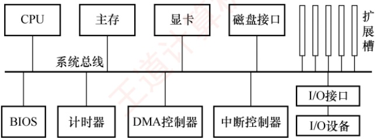
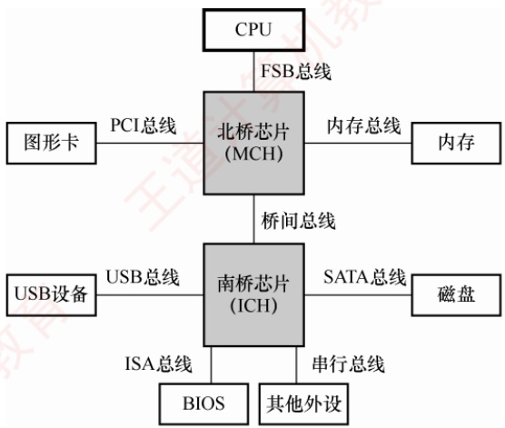
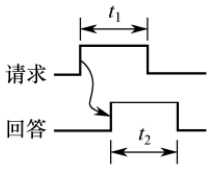
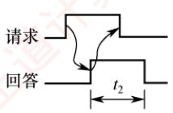
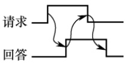

# 第6章 总线

> 来源：27王道《计算机组成原理》高清带书签.pdf（已清理水印、广告与 OCR 噪声）

**【考纲内容】**

总线的基本概念总线的组成及性能指标总线事务和定时

**【复习提示】**

本章的知识点较少，通常以选择题的形式出现，特别是总线的特点、猝发传输方式、性能指标、定时方式及常见的总线标准等。总线带宽的计算也可能结合其他章节出综合题。

在学习本章时，建议读者思考以下问题:

1）引入总线结构有什么好处？

2）引入总线结构会导致什么问题？如何解决？

建议读者在学习过程中尝试回答这些问题，本章末尾将提供参考答案。

## 6.1 总线概述

早期计算机中，各部件通过专用连线直接互连，称为分散连接。随着I/O设备种类和数量不断增加，这种连接方式在扩展性和灵活性方面面临挑战。为提升系统的可扩展性与连接灵活性，计算机体系结构逐步演进为采用总线连接方式，并进一步催生了各类标准化总线规范。

总线是一组可供多个部件分时共享的公共信息传输线路。其核心特征是:

• 分时性:任一时刻仅允许一个部件向总线发送信息，多个发送方需要分时使用总线。

· 共享性:多个部件可同时挂接在总线上，并能同时接收总线上传输的信息。

### 6.1.1 总线的分类

**考点追踪总线相关的概念与特点（2016、2017）**

1）内部总线。内部总线指芯片内部的总线，也称片内总线，用于CPU芯片内部各寄存器之间以及寄存器与ALU之间的连接。

2）系统总线。指计算机系统内各功能部件（如CPU、主存、I/O接口）之间相互连接的总线。根据所传输信息的内容不同，系统总线可分为以下三类:

**考点追踪数据总线上传输的内容（2011）**

①数据总线用于在各部件之间双向传输数据信息，包括指令、操作数、状态字、中断类型号等。其位数反映了CPU一次能并行传送的数据位数。

②地址总线用于指定要访问的主存单元或I/O端口的地址。它是单向总线，其位数决定了系统最大可寻址空间。为减少芯片引脚数量并降低成本，部分硬件架构采用地址线与数据线复用设计，此时地址与数据信息分时在同一组物理线路上传输。

③控制总线用于传输各种协调与控制信号，以确保各部件同步、有序地工作。典型信号包括:时钟、复位、总线请求/允许、中断请求/响应、存储器读/写、I/O读/写、传输确认等。控制总线由若干单向或双向信号线组成，其具体构成取决于系统设计需求。

3）I/O总线。用于连接主机与其内部的各类I/O控制器（如显卡、网卡等），通常采用标准化内部总线协议，如 PCI、AGP、PCI Express等。

4）通信总线。用于主机与外部I/O设备之间或不同计算机系统之间的通信。这类总线需要适应不同的传输距离、速率和电气规范，典型代表包括RS-232、USB等。 uiK

### * 6.1.2 常见的总线标准

总线标准是国际上制定的、用于互连计算机各功能模块的规范，是构建计算机系统时必须遵循的接口协议。典型的总线标准包括 ISA、EISA、VESA、PCI、AGP、PCI-Express、USB等。它们的主要区别是总线宽度、带宽、时钟频率、寻址能力、是否支持突发传送等。

**考点追踪总线标准的英文缩写（2010）**

1）ISA，Industry Standard Architecture，工业标准体系结构。最早的系统总线标准，传输速率低、CPU占用率高、占用较多中断资源。属于系统总线、并行总线。

2）EISA，Extended Industry Standard Architecture，扩展的 ISA。在 ISA 基础上扩展，支持多主控器和突发传送，且完全兼容ISA。属于系统总线、并行总线。

**考点追踪区分设备总线和局部总线（2013）**

3）VESA，Video Electronics Standards Association，视频电子标准协会。一种 32 位局部总线标准，为满足多媒体PC对高速图像数据传输的需求而设计。属于局部总线、并行总线。局部总线是一种位于CPU与ISA总线之间的高速扩展总线，旨在将高速外部设备（如显卡、磁盘控制器）从低速ISA总线迁移至更接近CPU的数据通路，以提升I/O性能。

4）PCI，Peripheral Component Interconnect，外部设备互连。高性能的 32 位或 64 位总线，广泛用于显卡、声卡、网卡等扩展卡。PCI总线是一个与处理器时钟频率无关的高速外围总线，支持即插即用。属于局部总线、并行总线。

5）AGP，AcceleratedGraphics Port，加速图形接口。专为图形卡设计的高速接口，允许显卡直接高效访问系统主存，用于加速3D图形和视频处理。属于局部总线、并行总线。

**考点追踪PCI-E总线的特点（2017）**

6）PCI-E，PCI-Express。采用高速串行点对点连接，由多条通道组成（如×1、×16），支持全双工通信，传输速率远超PCI和AGP。属于局部总线、串行总线。

7）RS-232C。一种用于数据终端设备（DTE）与数据通信设备（DCE）之间进行串行二进制通信的标准接口。属于设备总线、串行总线。

**考点追踪USB总线的特点（2012）**

8）USB，Universal Serial Bus，通用串行总线。用于连接外部I/O 设备，支持即插即用、热插拔和多设备级联，广泛应用于键盘、鼠标、移动存储等。属于设备总线、串行总线。

9）PCMCIA，Personal Computer Memory Card International Association。主要用于笔记本电脑

> ①本节内容已于2021年从统考大纲中删除，仅供学习参考。

的扩展卡标准，支持即插即用。属于设备总线、并行总线。

10）IDE，Integrated Drive Electronics，集成设备电路。更准确称为 ATA，是连接主板与硬盘/光驱的传统并行接口。属于设备总线、并行总线。

11）SCSI，Small Computer System Interface，小型计算机系统接口。一种高性能的系统级设备接口，常用于服务器硬盘等。属于设备总线、并行总线。

12）SATA，Serial Advanced Technology Attachment，串行高级技术附件。IDE/ATA 的串行替代标准，采用高速串行传输。属于设备总线、串行总线。

### 6.1.3 总线的性能指标

1）总线传输周期。指完成一次完整总线事务（如一次读或写操作）的总时间，通常由若干总线时钟周期组成，简称总线周期。

2）总线时钟频率。即总线基础时钟信号的频率，是总线时钟周期的倒数。早期总线的时钟与CPU时钟同频，随着CPU的快速发展，现代总线的时钟通常独立于CPU时钟。

3）总线工作频率。总线工作频率指总线每秒能进行的有效数据传输次数。早期总线每个时钟周期仅传输一次数据，此时总线工作频率等于时钟频率。现代总线一个时钟周期内可以传送2次、4次甚至更多次数据。因此，总线工作频率可达时钟频率的2倍、4倍等。

4）总线宽度。即总线中数据线的条数，决定了每次能并行传输的数据位数。

考点追踪总线带宽的分析与计算（2009、2013、2014、2018—2020、2024、2025）

5）总线带宽。总线带宽指总线在单位时间内所能传输的最大数据量。计算公式为

$$
总线带宽  =  总线宽度  \times  总线工作频率
$$

例如，若某总线的时钟频率为11MHz，每个时钟周期可传送2次数据（工作频率为 $11   \times   2 =$ $22 \mathrm {MHz} )$ ，总线宽度为16位（2字节），则总线带宽 $2 \times 22 \times 10^{6} = 44  MB/s$ 0

**注意**

计算带宽（最大数据传输率）时，应依据总线的物理参数（宽度、时钟频率、每周期传输的次数），反映其理论峰值传输能力，无须考虑具体总线事务中的地址/命令开销或突发传输细节。仅在求平均数据传输率时，才需要分析事务时序。切勿将“两个设备间一次通信的有效速率”误当作“总线带宽”。

总线最主要的性能指标为总线宽度、总线工作频率和总线带宽。

6）总线复用。指同一组信号线在不同时间段传输不同类型的信息。例如，地址/数据线复用中，数据线在初期传输地址，后期传输数据。因此可减少引脚数量，节省硬件成本。

7）总线寻址能力。由地址线的位数决定，表示CPU能访问的最大地址空间。例如，16位地址线可寻址 $2^{16} = 65536$ 个存储单元；若每个单元为1B，则最大寻址空间为64KB。

### 6.1.4 总线的结构

总线是计算机系统中各功能部件之间传递信息的公共通道，其结构设计直接影响系统的整体性能和扩展能力。随着处理器速度的不断提升，总线结构经历了从简单共享到分层并行，再到高度集成的演进过程，核心目标始终是提升带宽、降低延迟、打破通信瓶颈。

**1. 早期共享总线结构**

在计算机发展的早期阶段，普遍采用单总线结构:CPU、主存储器和各类I/O设备均挂接在同一条系统总线上，如图6.1所示。这种结构实现简单、成本低廉，但所有设备必须分时竞争总线使用权，导致频繁的传输冲突，效率低下，难以满足高速外设的数据吞吐需求。

图 6.1 单总线结构示意图

为缓解CPU与主存之间的通信压力，后续引入了双总线结构，增设一条专用的存储总线，使CPU与主存的数据交换独立于I/O通路。尽管主存访问效率有所提升，但I/O设备若需要与主存交换数据，仍要通过CPU中转，形成了新的性能瓶颈。

进一步改进的三总线结构增加了DMA（直接内存访问）总线，允许高速I/O设备通过DMA控制器直接与主存通信，无须CPU干预。这一设计显著提升了I/O的吞吐能力。然而，传统总线固有的共享式、广播式特性，仍然限制了系统的并发性和可扩展性。

**2. 传统分层总线:南北桥结构**

为突破早期共享总线的性能瓶颈，主流PC系统逐步转向分层次的多总线结构，典型代表是Intel 在 Pentium 4 及早期 Core 系列处理器平台上广泛采用的南北桥结构，如图 6.2 所示。

图6.2 南北桥结构示意图

该结构将系统划分为两个功能区域:

1）北桥芯片（Memory Controller Hub，MCH）作为高速枢纽，连接CPU、主存和显卡，负责高带宽数据传输。

2）南桥芯片（I/O Controller Hub，ICH）是一个I/O控制器集线器，负责管理USB、SATA、以太网等低速I/O接口，并提供扩展槽支持。

在这一结构中，CPU与北桥之间的互连通道称为前端总线（Front Side Bus，FSB），也称系统总线。CPU通过FSB连接至北桥，再经由北桥分别与主存（通过存储器总线）和显卡通信。而各类I/O设备（如USB设备、网卡、磁盘等）则通过各自的设备控制器接入南桥，北桥与南桥之间通过专用的桥间总线互连，最终形成从I/O到CPU和主存的完整数据通路。

尽管该结构实现了存储通路与I/O通路的物理分离，但所有数据（包括内存访问、显卡通信以及I/O传输）最终仍需要通过前端总线汇聚至CPU。因此，FSB成为整个系统的唯一高性能通道，其共享式特性反而演变为新的性能瓶颈，严重制约了系统整体吞吐能力的进一步提升。

**3. 现代集成化总线结构**

自 Intel Core i7 处理器起，总线结构迎来新的转变:北桥芯片的核心功能（如内存控制器）被集成到CPU内部，传统北桥随之消失，系统互连方式转向片上集成与点对点互连。

这一转变带来三大重要优势:

1）内存访问路径缩短。CPU可通过片上存储器控制器直接访问主存，无须经过北桥中转。同时，普遍支持多通道DDR内存（如双通道、三通道），各通道并行工作，理论带宽近似为单通道的整数倍。例如，三通道DDR3-1333的峰值带宽可达单通道的3倍。

2）处理器间高速互连。多核 CPU 内核之间、多 CPU 芯片之间通过 QPI（QuickPath Interconnect）等点对点高速串行链路实现数据交换。QPI不仅用于CPU间通信，还用于连接CPU与IOH（输入/输出集线器，类似于早期的南桥），大幅提升了互连效率。

3）I/O通路直连。高速外设（如显卡、SSD）通过PCIe通道直接接入CPU，绕过南桥；低C 速设备则由集成度更高的 PCH（Platform Controller Hub，新一代南桥）统一管理。

## 6.2 总线事务和定时

### 6.2.1 总线事务

在总线上，主设备（如CPU、DMA控制器）与从设备（如主存、I/O设备）之间完成一次完整的信息交换过程，称为一个总线事务。总线事务的类型由操作性质决定，典型的包括存储器读（从主存取数据至处理器）、存储器写（向主存写入数据）、I/O读/写、中断响应等。

每个总线事务通常包含三个基本阶段（依据历年真题）:

1）地址传送阶段:主设备将目标地址和操作类型（读/写）通过总线传送给从设备。

2）从设备响应阶段（也称数据准备阶段）:从设备根据地址准备数据（该阶段的耗时由设备特性决定，若题中未明确提及，则通常可忽略）。

3）数据传送阶段:完成实际数据在总线上的传输。

(1)非突发传输与突发传输

总线上连续数据的传输可采用非突发或突发两种方式

**考点追踪非突发传输的时间分析（2023）**

非突发传输方式:每次仅传输一个数据单元（通常为一个总线宽度的数据）。每次传输都必须独立经历完整的三阶段流程一一先发送地址，等待从设备准备数据，再传输数据。因此，即使连续读取多个相邻数据，也需要重复发送地址，导致地址开销大、效率较低。

**考点追踪突发传输的特点与时间分析（2012—2014）**

突发传输方式:用于高效传输连续成块的数据。事务开始时，主设备仅发送数据块的首地址；随后，在不释放总线的前提下，连续传送多个数据单元。后续地址由硬件自动递增生成（如首地址+1、首地址+2……），无须重复使用地址线。

因此，在相同总线宽度和时钟频率下，突发传输省去了多次地址传送开销，显著提升了有效带宽，广泛应用于高速存储器访问（如 SDRAM行读取、Cache块填充）等场景。简言之，非突发方式是“一次地址，一次数据”，突发方式是“一次地址，多次数据”。

**(2)串行传输与并行传输**

数据在总线上的物理传输可采用串行或并行两种方式。

串行传输方式:数据按比特位依次顺序传输，通常仅使用一条双向线路或两条单向线路(发送/接收各一）。优点是引脚少、布线简单、抗干扰能力强，适合长距离通信（如USB、PCIe、SATA）。在串行传输中，根据收发双方的时序协调方式，又可分为同步串行通信和异步串行通信。

1）同步串行通信:由发送方时钟直接控制接收方时钟，实现位同步。收发双方的时钟严格一致，仅在数据块首尾添加开始和结束标记，传输效率高，但硬件实现复杂，成本较高。

**考点追踪异步串行通信方式的特点（2016）**

2）异步串行通信:收发双方使用独立时钟，无须严格同步。每个字符独立传输，并通过起始位（逻辑0）标识开始，停止位（逻辑1）标识结束。当通信线路空闲时，保持逻辑1状态；发送方要传送字符时，先发送一个逻辑0作为起始位。接收方检测到该逻辑低电平后，便开始接收数据。数据位从最低位开始逐位发送；发送完数据位后，可选择

性地发送一位奇偶校验位，用于简单的差错检测；随后发送停止位，表示该字符的结束。

并行传输方式:利用多条数据线同时传输多个比特位（如32位、64位总线），理论上单周期即可完成一个字的传输，短距离内延迟低、吞吐高。但随着频率的提高，信号串扰和时序偏移问题加剧，限制了工作频率的提升。因此，并行传输更适合板级或芯片级的短距离通信（如早期PCI、内存总线）。

**注意**

并行传输并不总是比串行传输更快。受限于电气特性，并行总线的工作频率难以持续提高；而串行传输可通过提升频率等方式实现更高的总带宽。因此，现代高速接口多采用串行化设计。

### 6.2.2 总线定时

总线定时是指总线上主设备与从设备在交换数据时，用于协调双方操作时序的控制协议。其实质是一种时序规则，主要有同步、异步、半同步和分离式四种方式。

**考点追踪各种总线定时方式的特点（2015、2021）**

**1. 同步定时方式**

同步定时方式采用系统统一的时钟信号来协调发送方和接收方的传送定时关系。时钟产生相等的时间间隔，每个间隔构成一个总线周期，每次数据传送在一个总线周期内完成。由于采用统一时钟，所有操作必须严格在固定周期内进行，总线周期连续进行。

优点:传送速度快，具有较高的传输速率；总线控制逻辑简单。

缺点:主从设备之间属于强制性同步，所有操作严格受时钟节拍约束；缺乏应答或握手机制，无法根据从设备的实际状态动态调整时序，可靠性较差。

适用场景:适用于总线长度较短，且所连接各部件的存取时间比较接近的系统。

**2. 异步定时方式**

异步定时方式不依赖统一的时钟信号，而是通过主从设备之间的握手信号实现定时控制:主设备发出“请求”信号；从设备准备就绪后，发出“回答”信号。

优点:总线周期长度可变，能可靠连接工作速度差异较大的设备，自适应性强。

缺点:控制逻辑复杂，因多次信号交互，整体传输速率较低。

根据“请求”与“回答”信号的撤销是否互锁，异步定时可分为三类:

1）不互锁方式。主设备发出“请求”后，在预设时延 $t_{1}$ 后自行撤销；从设备收到请求后立即发出“回答”，并在时延 $t_{2}$ 后自动撤销。双方无互锁关系，如图6.3(a)所示。

2）半互锁方式。主设备必须收到“回答”后才撤销“请求”（存在互锁）；但从设备发出“回答”后，无须确认“请求”是否撤销，在时延 $t_{2}$ 后自动撤销（无互锁），如图6.3(b)所示。

3）全互锁方式。主设备需收到“回答”才撤销“请求”；从设备需确认“请求”已撤销后才撤销“回答”。双方完全互锁，可靠性最高，如图6.3(c)所示。

(a) 不互锁

(b) 半互锁

(c) 全互锁

图6.3 请求和回答信号的互锁

适用场景:适用于连接速度差异大、对可靠性要求较高而对速率要求不苛刻的系统。

**3. 半同步定时方式**

半同步定时方式结合了同步与异步的优点:地址、命令、数据的发送严格参照系统时钟前沿（如上升沿）；接收方通常在时钟后沿（如下降沿）进行识别；同时增设一条Wait信号线，允许慢速从设备反馈准备状态。主设备在时钟上升沿检测Wait信号状态。若Wait无效（高电平），表示数据未就绪，主设备将插入等待周期；直到Wait有效（低电平），才从数据线读取数据。

优点:在统一时钟下工作，控制比异步方式简单，可靠性较高。

缺点:系统时钟频率受限于最慢设备，整体速度不高。

适用场景:适用于包含多种速度差异较大设备、但性能要求不高的简单系统

上述三种定时方式均采用“独占式事务模型”:从主设备发起请求到传送结束，总线全程被该事务占用。然而，在从设备准备数据阶段，总线虽被占用却处于空闲状态，造成资源浪费。

**4. 分离式定时方式**

分离式定时方式将一个总线事务拆分为两个独立子阶段:请求阶段与应答阶段，两阶段之间释放总线。请求阶段:主设备A获得总线使用权，发送地址和命令后立即释放总线，供其他设备使用。应答阶段:从设备B准备好数据后，主动申请总线，并以主设备身份将数据发回给A。两个子阶段均为单向信息流，且总线在准备期间可被其他事务使用。

优点:显著减少总线空闲等待时间，提高总线利用率。

缺点:控制逻辑复杂，协议开销大，对总线仲裁和事务管理机制要求高。

适用场景:适用于多主设备竞争激烈且从设备响应延迟较大的高性能系统。

## 6.3 本章小结

本章开头提出的问题的参考答案如下。

1）引入总线结构有什么好处？

引入总线结构具有以下主要优点:

①简化系统结构，便于设计与制造。

②大幅减少连线数量，利于布线、缩小体积，并提高可靠性。

③统一接口标准，所有设备采用相似的总线接口，简化硬件设计。

④支持模块化与灵活扩展，便于系统升级、配置和功能扩充。

⑤简化软件编程，设备通过不同接口地址进行访问，驱动逻辑统一。

⑥便于故障诊断、维护与成本控制。

2）引入总线结构会导致什么问题？如何解决？

引入总线后，多个设备需分时共享同一组信号线，当多个主设备同时请求使用总线时，将引发总线竞争，导致通信冲突。为解决这一问题，系统需配置总线仲裁部件，以某种方式选择一个主设备获得总线控制权，只有获得总线控制权的设备才能开始数据传送。

## 6.4 常见问题和易混淆知识点

1. 一个总线在某一时刻可以有多对主从设备进行通信吗？

不可以。在任一总线周期内，总线上只能有一个主设备控制总线，并选择一个从设备进行一对一通信，或向所有从设备广播（一对多）。由于总线是共享通路，若多对主从设备同时通信，则会导致数据冲突，破坏传输正确性。因此，同一时刻不能存在多对并发的主从通信。
