# 第7章 输入/输出系统

> 来源：27王道《计算机组成原理》高清带书签.pdf（已清理水印、广告与 OCR 噪声）

**【考纲内容】**
（一）I/O接口（I/O控制器）
I/O接口的功能和基本结构；I/O端口及其编址
（二）I/O方式

## *7.1 I/O系统基本概念

程序查询方式

程序中断方式:中断的基本概念；中断响应过程；中断处理过程；

多重中断和中断屏蔽的概念

DMA方式:DMA控制器的组成；DMA传送过程

**【复习提示】**

I/O方式是本章的重点和难点，每年不但会以选择题的形式考查基本概念和原理，而且可能以综合题的形式考查，特别是各种I/O方式效率的相关计算，中断方式的各种原理、特点、处理过程、中断屏蔽，DMA方式的特点、传输过程、与中断方式的区别等。

在学习本章时，建议读者思考以下问题:

1）I/O设备有哪些编址方式？各有何特点？

2）CPU响应中断应具备哪些条件？

建议读者在学习过程中尝试回答这些问题，本章末尾将提供参考答案。

**\*7.1 I/0 系统基本概念①**

### * 7.1.1 输入/输出系统

从主机的视角来看，输入是指将信息从外部设备传送到主机，输出则是将信息从主机传送到外部设备。输入/输出系统的核心任务，是对各类信息的输入与输出过程进行有效控制。

I/O系统涉及以下几个基本概念:

1）外部设备。包括输入设备、输出设备，以及需通过I/O接口访问的外部存储设备。

2）接口。位于外设与主机之间的逻辑部件，负责协调数据传输过程中的速度匹配、电平转换和格式适配等工作。

3）输入设备。用于向计算机输入命令、文本或数据的装置，如键盘、鼠标等。

4）输出设备。用于将计算机处理结果输出到外部介质的装置，如显示器、打印机等。

5）外存设备。指除内存和CPU缓存以外的存储器，如硬磁盘、光盘、固态硬盘等。

通常，I/O系统由I/O硬件和I/O软件两部分构成:

> ①本节内容2021年已从统考大纲中删除，仅供学习参考。

1）I/O软件。主要包括设备驱动程序、I/O管理程序以及用户应用程序等，负责实现CPU与I/O设备之间的信息交换。

2）I/O硬件。包括外部设备、设备控制器、I/O接口以及I/O总线等。其中，设备控制器负责控制外设的具体操作，I/O接口则实现与主机总线的连接。

### * 7.1.2 外部设备

常见的外部设备主要包括键盘、鼠标、显示器、打印机、磁盘存储器和光盘存储器等。

**1. 输入设备**

**（1）键盘**

键盘是最常用的输入设备，用于输入字符、数字及各种控制命令。

**(2）鼠标**

鼠标是一种定位输入设备，能够将用户的操作映射为屏幕上的光标位置，实现人机交互。

**2. 输出设备**

**（1）显示器**

按显示器类型，显示器可分为阴极射线管（CRT）、液晶显示器（LCD）和发光二极管（LED）等。显示器以点阵方式工作，其主要性能参数包括:

1）屏幕尺寸:以对角线长度表示，单位为英寸，常见规格为12～32英寸。

2）分辨率:分辨率指屏幕上可显示的像素总数，常表示为“宽度×高度”，如1920×1080等。

3）色彩深度:表示每个像素所能呈现的颜色数量。在黑白显示器中体现为灰度级（如8位对应256级）；在彩色显示器中，通常采用24位真彩色（约1677万种颜色）或更高。

4）刷新机制:由于像素发光持续时间极短，必须周期性重绘整屏图像，以维持画面稳定。

5）刷新频率:刷新频率指每秒刷新屏幕的次数。人眼通常在刷新频率高于30Hz时才不会感知闪烁，现代显示器一般支持60～120Hz。

**考点追踪显存刷新带宽的计算（2010）**

6）显示存储器（VRAM，即刷新存储器）:用于存储一帧完整的图像数据。其容量与带宽可按以下公式计算:

$$
VRAM   容量  =  分辨率  \times  色彩深度
$$

$$
VRAM   带宽  =  分辨率  \times  色彩深度 ( 位数 ) \times  帧频
$$

**(2) 打印机**

打印机用于将计算机的输出结果打印到纸张等介质上。按工作原理可分为以下几类:

1）针式打印机。属于点阵式击打打印机，通过打印针撞击色带在纸张上形成字符。其优点是支持多层复写（如发票打印）、耗材便宜；缺点是噪声大、分辨率低、速度慢。

2）喷墨式打印机。通过精确喷射微小墨滴形成图像，基于青、品红、黄三基色的混合原理实现高质量彩色打印，广泛应用于家庭和办公场景。

3）激光打印机。结合激光扫描与静电成像技术。计算机输出的数字信号经调制后控制激光束，在感光鼓上形成静电潜像，再经过显影、转印和定影等步骤，将图像牢固地呈现在纸张上。其特点是打印速度快、质量高、处理能力强，广泛应用于办公环境。

**3. 外部存储器（辅存）**

**（1）磁表面存储器**

利用磁性材料涂覆在金属或塑料基片上存储信息，典型代表包括硬盘、软盘、磁带和磁鼓等。

**（2）固态硬盘（SSD）**

采用Flash存储器作为存储介质，无机械运动部件，具有读/写速度快、抗震性强、功耗低等优势，广泛应用于轻薄型笔记本电脑及高性能计算设备中。

**（3）光盘存储器**

利用聚焦激光束以非接触方式在盘片上读/写信息。一个完整的光盘系统由光盘片、光盘驱动器和光盘控制器组成，常见类型包括CD、DVD等。

## 7.2 I/O接口

I/O接口（也称I/O控制器）是主机与外部设备之间的交接界面，用于实现二者之间的信息交换。由于外设种类繁多，在工作方式、数据格式和工作速度等方面存在显著差异，接口正是为弥合这些异构性而设置的。

### 7.2.1 I/O接口的功能

**考点追踪I/O接口的定义与特性（2021）**

I/O接口的主要功能如下:

1）地址译码与设备选择。当CPU发出I/O操作请求时，会同时提供目标外设的地址码。接口对地址进行译码，产生设备选择信号，确保主机仅与指定外设通信。

2）通信联络与时序协调。主机与外设的工作速度通常不匹配。接口通过握手信号或状态轮询机制，动态协调双方操作节奏，确保数据传输可靠有序。

3）数据缓冲。接口设有数据缓冲寄存器，用于暂存传输数据，避免因速度不匹配导致的数据丢失。

4）信号格式转换。主机与外设在电平标准、数据格式或信号类型上可能存在差异。接口需完成电平转换、并/串或串/并转换、模/数或数/模转换等，以实现物理兼容。

5）控制命令与状态信息传递。CPU通过向接口的控制寄存器写入命令字（如“启动”）控制外设；外设通过状态寄存器反馈状态（如“就绪”）。当外设需要主动通知CPU（如数据到达）时，接口可向CPU发出中断请求，由CPU适时响应处理。

### 7.2.2 I/O接口的基本结构

**考点追踪I/O端口与CPU交换的内容（2015）**

图7.1所示为I/O接口的通用结构。I/O接口在主机侧通过I/O总线与CPU和内存相连，其内部主要包括三类寄存器:数据缓冲寄存器用于暂存CPU与外设之间传送的数据；状态寄存器用于记录接口及外设的当前状态；控制寄存器用于保存CPU发给外设的控制命令。由于状态寄存器仅被CPU读取，控制寄存器仅被CPU写入，二者的访问方向相反且访问时间错开，因此在某些设计中可复用同一端口地址:读操作访问状态，写操作访问控制。

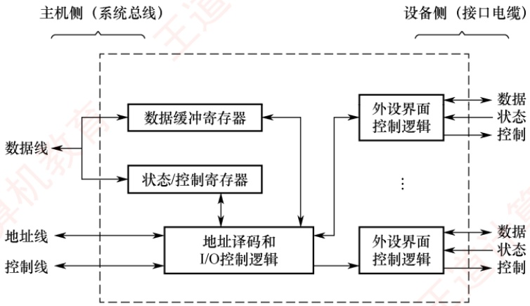

图7.1 一个I/O接口的通用结构

**考点追踪I/O接口的数据线上传输的内容（2012）**

I/O接口中的数据线传送的是读/写数据、状态信息、控制信息以及中断类型号（在向量中断中）；地址线指定要访问的I/O接口内部寄存器的端口地址；控制线传送的是读/写控制信号（用于区分寄存器访问方向），以及中断请求与响应信号、总线仲裁信号和设备握手信号。

I/O接口中的I/O控制逻辑的功能:①对控制寄存器中的命令字进行译码，并将生成的控制信号经外设界面控制逻辑送至外设。②输出时，将数据缓冲寄存器的内容发送给外设；输入时，将外设数据写入数据缓冲寄存器。③实时采集外设状态，并更新至状态寄存器。

对上述寄存器的访问通过专用指令完成，这类指令称为I/O指令。在采用独立I/O地址空间的体系结构（如x86），I/O指令通常为特权指令，仅限操作系统内核使用。

### 7.2.3 I/O接口的类型

从不同角度，I/O接口可分为以下类型。

1）按数据传送方式（外设与接口一侧），可分为并行接口（一字节或一个字的所有位同时传送）和串行接口（一位一位有序传送），接口需完成相应的并/串或串/并格式转换。

2）按主机访问I/O设备的控制方式，可分为程序查询接口、中断接口和DMA接口等。

3）按功能灵活性，可分为可编程接口（通过编程改变接口功能）和不可编程接口。

### 7.2.4 I/O端口及其编址

**考点追踪/O端口的定义及相关特性（2014）**

I/O端口是指I/O接口电路中可被CPU直接访问的寄存器，主要包括:数据端口（支持CPU进行读/写操作）、状态端口（仅支持读操作）和控制端口（仅支持写操作）。

**注意**

端口与接口是两个不同概念:端口是接口内部可寻址的寄存器。

为使CPU能够访问各个I/O端口，必须对端口进行编址，每个端口对应一个唯一的端口地址。常见的编址方式有两种:独立编址与统一编址。

**（1）独立编址（I/O映射方式）**

**考点追踪I/O指令的作用（2017）**

独立编址为I/O端口建立一个独立于主存的地址空间。I/O端口地址与内存地址在逻辑上完全分离，地址值可以相同，但由于属于不同地址空间，不会发生冲突。CPU通过专用的I/O指令（如x86中的IN和OUT）访问I/O端口，指令中的地址字段指定端口号。

优点:I/O端口数量远少于内存单元，所需地址线较少，译码电路简单，寻址速度快；使用专用I/O指令，使程序中I/O操作清晰可辨，便于阅读与调试。

缺点:I/O指令功能有限，通常仅支持简单的数据传输，程序设计灵活性较差；CPU需同时提供存储器读/写和I/O读/写两组控制信号，增加了控制逻辑的复杂性。

**（2）统一编址（存储器映射方式）**

统一编址将部分主存地址空间分配给I/O端口，使I/O端口与内存单元共享同一地址空间。通过地址范围即可区分访问目标（如高地址段映射到I/O设备），因此无须专用I/O指令，CPU使用普通的访存指令（如加载和存储指令）即可访问I/O端口。

优点:无须专用I/O指令，使得编程更加灵活；I/O端口可获得较大的编址空间；I/O访问的保护机制可由虚拟存储管理系统统一实现，无须额外硬件支持。

缺点:I/O端口占用主存地址空间，减少了系统可用内存容量；由于需根据完整地址判断是否为I/O区域，译码电路相对复杂，可能降低译码速度。

## 7.3 I/O方式

输入/输出系统实现主机与I/O设备之间的数据传送，可采用不同的控制方式。各种方式在硬件代价、系统性能及适用场景等方面各有侧重。常用的I/O方式包括程序查询、程序中断和DMA等，其中前两种方式高度依赖CPU执行程序指令来完成控制。

### 7.3.1 程序查询方式

在程序查询方式中，数据交换的控制完全由CPU通过执行程序实现。接口电路通常包含一个数据缓冲寄存器（数据端口）和一个设备状态寄存器（状态端口）。主机进行I/O操作时，首先读取设备状态，并据此决定是立即传送数据还是继续等待。

**考点追踪程序查询方式的特点（2023）**

程序查询方式的工作流程如下（见图7.2）:

①CPU执行初始化程序，预置传送参数（如起始地址、数据量等）。

②向I/O接口发送命令字，启动外设。

③循环读取外设状态寄存器。

④若设备未就绪，则继续查询；若就绪，则执行一次数据传送。

⑤修改地址和计数器参数。

⑥判断传送是否完成，若未完成则返回步骤③，直至计数器归零。

根据查询策略的不同，程序查询方式可分为两类:

1）独占查询。一旦启动外设，CPU便连续不断地查询其状态，直至操作完成。在此期间，CPU无法执行其他任务处于忙等待状态，导致CPU与外设完全串行工作。

2）定时查询。CPU以固定时间间隔周期性地查询外设状态。每次查询时，若设备已就绪，则传送一个数据单元，随后返回用户程序继续执行。查询间隔需根据外设的数据传输速率合理设置，以避免数据丢失。

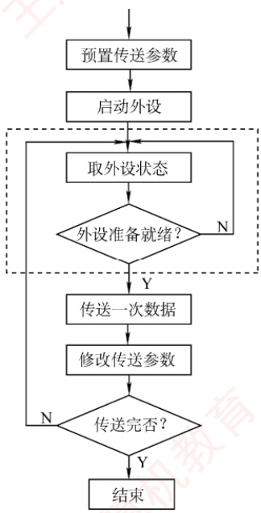

图7.2 程序查询方式的工作流程

**考点追踪定时查询的特点、效率分析及计算（2011、2018）**

【例7.1】假设计算机主频为500MHz，CPI为4，某外设的数据传输速率为2MB/s，其I/O接口配备一个32位数据缓冲寄存器。采用定时查询方式，每次查询操作执行10条指令。问:CPU最多间隔多长时间查询一次，才能避免数据丢失？此时CPU用于该外设I/O的时间占总时间的百分比至少为多少?

解:

由于端口缓冲区容量有限，必须在外设填满该缓冲区前完成读取，否则新数据将覆盖未读取的旧数据，造成丢失。外设填满（4字节）缓冲区所需时间为 $4\mathrm{B} \div 2\mathrm{MB} / \mathrm{s} = 2\mu\mathrm{s}$ 。因此，CPU最多每隔2μs就需查询一次，即每秒至少查询 $1s \div 2\mu s = 5 \times 10^{5}$ 次。每次查询执行10条指令，每条指令平均消耗4个时钟周期，故每秒用于I/O的时钟周期数为 $5 \times 10^{5} \times 10 \times 4 = 2 \times 10^{7}$ ; CPU 主频为 500MHz（每秒5×10□个时钟周期），因此I/O时间占比为 $(2 \times 10^{7}) \div (5 \times 10 \square) = 4\%$

程序查询方式的优点是设计简单、硬件开销小。缺点是CPU需耗费大量时间进行查询与等待，且在同一时间段内只能与一台外设通信，导致CPU与外设串行工作，效率很低。

### 7.3.2 程序中断方式

**1. 程序中断的基本概念**

程序中断是指在计算机执行程序的过程中，当出现某些急需处理的外部事件或内部异常时，CPU暂停当前程序的执行，转去处理该事件或异常；处理完毕后，再返回到原程序的断点处继续执行。中断技术最初被用于实现主机与I/O设备之间的异步通信。

**考点追踪中断方式的特点（2022、2023）**

随着计算机系统的发展，中断技术被赋予了多种重要功能，主要包括:

① 实现 CPU 与I/O 设备的并行工作。

②处理硬件故障和软件异常。

③支持人机交互（如键盘输入、鼠标点击）。

④支撑多道程序与分时操作系统的任务切换。

⑤满足实时系统对快速响应的需求。

⑥实现用户程序向操作系统的切换（如通过软中断或系统调用指令）。

⑦ 在多处理器系统中协调各处理器间的通信与任务迁移。

中断的基本工作思想:当前进程发起I/O操作时，会启动相应外设，并主动进入阻塞状态:CPU随即转而执行就绪队列中的另一进程，实现外设与CPU的并行工作。外设完成数据准备后，主动向CPU发出中断请求。CPU响应后，暂停当前指令流，保存现场，并转入中断服务程序，完成主机与外设之间的数据传送。数据传送结束后，CPU恢复被中断进程的现场，并返回断点处继续执行。此后，外设与CPU再次并行工作，如图7.3所示。

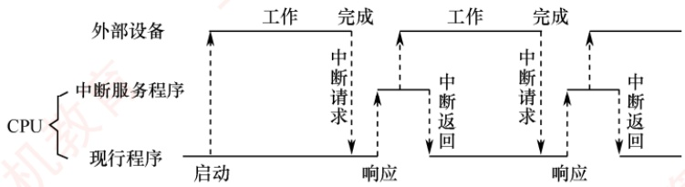

图7.3 程序中断方式示意图

考点追踪程序中断的效率分析及相关计算（2009、2014、2016、2018、2019）

【例7.2】假设计算机主频为500MHz，CPI为4，某外设的数据传输速率为40MB/s，其I/O接口配备一个32位数据缓冲寄存器。在中断I/O方式下，若每次中断响应与中断处理共需至少400个时钟周期，则该外设能否采用中断I/O方式？为什么？

解:

中断响应与中断处理所需时间为 $400 \times 1 / 500  M  = 0.8 \mu  S$ 。外设填满（4B）缓冲区所需时间为4B $40 \mathrm{MB/s} = 0.1 \mu \mathrm{s}$ 由于外设准备数据的时间（0.1μs）远小于中断处理时间（0.8μs），若采用每32位触发一次中断的方式，则新数据将在CPU处理完前次中断前就已到达，导致缓冲区被覆盖而丢失数据。因此，该高速外设不适合直接使用单字中断方式。

**2. 程序中断的工作流程**

考点追踪中断工作流程中的相关细节（2017、2018、2021、2024）

**（1)中断请求**

中断源是指能够向CPU发出中断请求的设备或事件。一台计算机允许多个中断源同时存在，且各中断源发出请求的时间具有随机性。为记录并区分不同的中断请求，中断系统为每个中断源设置一个中断请求标记触发器:当其状态为“1”时，表示该中断源有中断请求。这些触发器可组成中断请求标记寄存器，该寄存器可集中置于CPU内部，也可分散在各个中断源中。

**考点追踪可屏蔽中断和不可屏蔽中断的特点（2020）**

通过INTR信号线发出的是可屏蔽中断，通过NMI信号线发出的是不可屏蔽中断。可屏蔽中断的优先级较低，在关中断状态下不被响应；不可屏蔽中断用于处理紧急且关键的硬件事件（如电源掉电、总线错误等），其优先级最高，且不受中断允许标志的影响。

**(2)中断响应判优**

中断响应优先级是指CPU响应多个同时发生的中断请求的先后顺序。由于中断请求具有随机性，当多个中断源同时提出请求时，需通过中断判优逻辑确定优先响应哪个中断源的请求。中断响应的判优通常由硬件排队器（或中断查询程序）实现。

一般来说，①不可屏蔽中断>可屏蔽中断；②在I/O传送类中断请求中，高速设备>低速设备；输入设备>输出设备；实时设备>普通设备。

**注意**

中断优先级包括响应优先级和处理优先级。响应优先级由硬件线路或查询顺序固定决定，不可动态更改；处理优先级可通过中断屏蔽技术动态调整，以支持多重中断（中断嵌套）。二者的关系可概括为:只有未被屏蔽的中断请求，才会被送入中断判优电路参与响应优先级的判定。

**（3）CPU响应中断的条件**

**考点追踪CPU响应中断的条件（2023）**

CPU仅在满足特定条件时才会响应中断请求，并经过一些特定的操作，转去执行中断服务程序。CPU响应中断必须满足以下三个条件: WI

① 存在有效的中断请求。

②CPU处于开中断状态（中断允许标志为1；异常和不可屏蔽中断不受此限制）。

③当前指令已执行完毕（异常不受此限制），且无更高优先级任务待处理。

**注意**

I/O设备的就绪时间是随机的，而CPU仅在每条指令执行结束时统一采样中断请求信号（前提是开中断）。因此，CPU响应I/O中断的时机总是发生在某条指令执行完成之后。此处所述中断特指I/O中断，不包括异常。

**（4)中断响应过程**

CPU响应中断后，由硬件自动完成一系列操作（称为中断隐指令），随后转入中断服务程序。中断隐指令并非指令系统中的真实指令，而是对硬件自动操作的统称，主要包括以下步骤:

1）关中断。CPU响应中断后，首先关闭中断允许标志，禁止响应任何可屏蔽中断（包括更高优先级者），以防止在保存断点和现场时被新中断打断；否则，现场信息可能不完整，导致中断返回后无法正确恢复原程序的执行。

2）保存断点。为保证中断返回后能正确恢复原程序执行，需将程序计数器（PC）和程序状态字（PSW）等关键现场信息保存至栈或专用寄存器中①。

中断与异常的差异:中断发生于指令执行完成后，断点为下一条指令地址；故障类异常（如缺页、除零）因指令未完成，处理后需重新执行当前指令，断点为当前指令地址；陷阱类异常（如系统调用）在指令成功执行后触发，断点为下一条指令地址。

3）引出中断服务程序。通过识别中断源，将对应中断服务程序的入口地址送入程序计数器PC。识别方法主要有硬件向量法和软件查询法，本节主要讨论更常用的硬件向量中断法。

(5)中断向量

中断识别分为向量中断和非向量中断两类。非向量中断采用软件查询法，已在第5章介绍。

**考点追踪中断向量表的数据结构（2023）**

在向量中断中，每个中断源被分配一个唯一的中断类型号，该类型号对应一个中断服务程序的入口地址，此地址称为中断向量。系统将所有中断向量集中存放在内存的特定区域，该区域称为中断向量表。

CPU响应中断后，首先在中断响应阶段从数据总线获取该中断源的中断类型号，然后据此计算出对应中断向量在中断向量表中的地址；接着从中断向量表中读取该中断向量，并送入程序计数器PC，从而转入对应的中断服务程序。这种基于中断向量表实现转移的方法称为中断向量法，采用该方法的中断即为向量中断。

**注意**

中断请求和响应信号通过I/O总线的控制线传输，而中断类型号则在中断响应阶段由中断控制器经数据总线提供给CPU，用于定位中断向量表中的相应表项。

**(6)中断处理过程**

不同计算机的中断处理过程各具特色，图7.4所示为一个支持中断嵌套的典型处理流程。

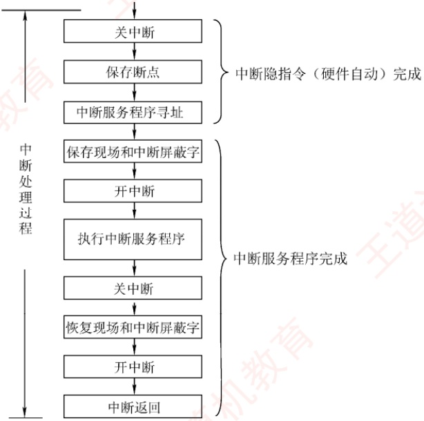

图7.4 一个支持中断嵌套的典型处理流程

> ① x86机器保存 PC和 PSW到内存栈中；MIPS 机器没有 PSW，只保存PC到特定寄存器中。

中断处理流程如下:

①关中断。防止在保存关键信息过程中被新中断打断。

②保存断点。由硬件自动将断点信息保存至栈或专用寄存器。

③中断服务程序寻址。通过中断类型号获取服务程序入口地址，并送入PC。

④保存现场和中断屏蔽字。通过软件指令将现场信息和中断屏蔽字压入栈中，以便后续恢复。现场信息是指CPU中可能被中断服务程序修改且需恢复的寄存器内容。

**注意**

断点与现场信息均不可被中断服务程序破坏。由于现场信息用指令可直接访问，因此由软件在进入中断服务程序时显式保存。而断点信息由硬件在中断响应阶段自动保存。

⑤开中断。由开中断指令实现，允许更高优先级的中断请求被响应，从而实现中断嵌套。

⑥执行中断服务程序。

⑦关中断。由关中断指令实现，确保在恢复现场和中断屏蔽字的过程中不被中断。

⑧恢复现场和中断屏蔽字。从栈中恢复寄存器内容及中断屏蔽状态。

⑨开中断、中断返回。中断服务程序的最后一条指令通常为中断返回指令，用于恢复断点现场并返回原程序继续执行。

考点追踪中断隐指令的功能（2012）

其中，①～③由中断隐指令（硬件自动）完成；④～⑨由中断服务程序（软件）完成。

考点追踪单重中断的处理流程（2010）

**注意**

对于单重中断（不支持嵌套），上述流程中省略⑤（开中断）和⑦（关中断）即可。

**3. 多重中断和中断屏蔽技术**

在CPU执行中断服务程序的过程中，若出现新的更高优先级中断请求，而CPU不予响应，则称为单重中断，如图7.5(a)所示；若CPU暂停当前中断服务程序，转去处理新中断，则称为多重中断（也称中断嵌套），如图7.5(b)所示。

(a) 单重中断

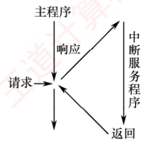

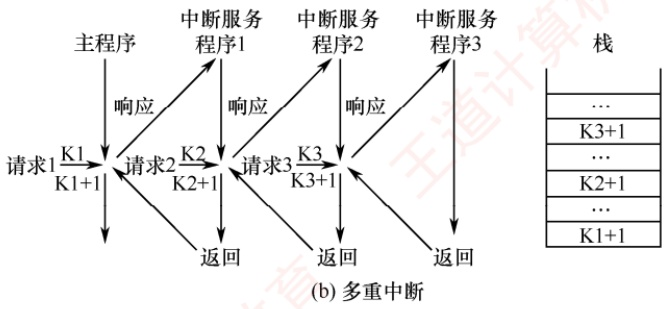

图 7.5 单重中断和多重中断示意图

在图7.5(b)中，CPU执行主程序时收到中断请求1。由于主程序未屏蔽任何中断，CPU响应中断该请求，将主程序断点保存至栈中，并转入中断服务程序1。在执行中断服务程序1期间，若发生优先级更高的中断请求2，CPU会暂停中断服务程序1，将其断点保存至栈中，并转入中断服务程序2。类似地，更高优先级的中断请求3可打断中断服务程序2。当中断请求3处理完毕后，CPU从栈顶恢复断点，返回至中断服务程序2的断点（K3+1）处继续执行。以此类推，直至所有中断处理完毕，最终返回主程序的断点（K1+1）处继续执行。

**考点追踪多重中断的中断屏蔽字相关的性质（2017、2020、2021、2024）**

中断处理优先级是指多重中断的实际处理顺序，可通过中断屏蔽技术动态调整。若不使用屏蔽技术，则处理优先级与响应优先级（中断请求被CPU识别的先后顺序）一致。现代计算机普遍采用中断屏蔽技术，通过设置中断屏蔽字寄存器实现灵活的优先级控制。

图7.6所示为一个简单的可编程中断控制器。来自I/O总线的外设中断请求信号（IRi）首先被记录在中断请求寄存器中。中断屏蔽字寄存器的每一位对应一个中断源:置1时屏蔽对应的中断请求，置0时允许其通过。在送入中断判优电路前，每个中断请求信号会与其对应屏蔽位的取反值进行逻辑“与”操作——仅当屏蔽位为0时，该中断请求才被允许参与仲裁。因此，被屏蔽的中断无法进入判优电路，而未被屏蔽的中断则按固定的响应优先级次序处理。

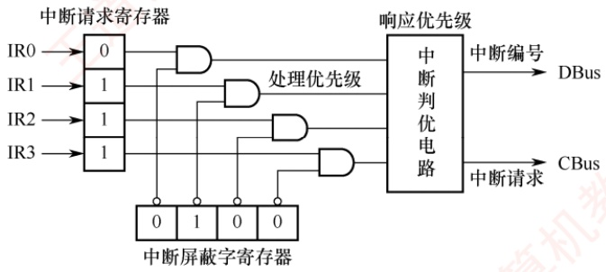

图 7.6 一个简单的可编程中断控制器

需要注意的是:中断屏蔽字通常在进入中断服务程序时由软件加载，用于控制后续中断的嵌套行为。因此，中断屏蔽仅在CPU执行中断服务程序期间生效；而在主程序运行阶段，中断响应仍由主程序所设置的屏蔽状态决定（通常为全开放）。此外，即使在中断服务程序执行期间，若有多个未屏蔽中断同时到达，其处理顺序仍由中断判优电路的

响应优先级决定。

关于中断屏蔽字的设置及多重中断程序执行的轨迹，下面通过实例说明。

【例7.3】假设某机有4个中断源A、B、C、D，其硬件响应优先级为 $\mathrm{A} > \mathrm{B} > \mathrm{C} > \mathrm{D}$ 。现要求通过中断屏蔽技术，将实际中断处理优先级调整为 $\mathrm{A} > \mathrm{D} > \mathrm{C} > \mathrm{B}$ 0 YTA

1）写出每个中断源对应的中断屏蔽字。

2）若CPU在执行用户程序时，A、C、D同时发出中断请求；随后在执行C的中断服务程序期间，B又发出中断请求。试分析CPU的程序执行轨迹。 顺村

解:

1）中断处理优先级调整为 $\mathrm{A} > \mathrm{D} > \mathrm{C} > \mathrm{B}$ 后，A的处理优先级最高，需要屏蔽所有中断（包括自身），屏蔽字设为1111；D的次高，只允许被A中断，屏蔽B、C和自身，屏蔽字是0111；C的第三，允许被A和D中断，屏蔽B和自身，屏蔽字为0110；B的最低，允许被A、D、C中断，仅屏蔽自身，屏蔽字为0100；结果如表7.1所示。

表 7.1 中断源对应的中断屏蔽字

<table><tr><td rowspan=2>中断源</td><td colspan=4>屏蔽字</td></tr><tr><td>A</td><td>B</td><td>C</td><td>D</td></tr><tr><td>A</td><td>1</td><td>1</td><td>1</td><td>1</td></tr><tr><td>B</td><td>0</td><td>1</td><td>0</td><td>0</td></tr><tr><td>C</td><td>0</td><td>1</td><td>1</td><td>0</td></tr><tr><td>D</td><td>0</td><td>1</td><td>1</td><td>1</td></tr></table>

2）CPU执行用户程序时，A、C和D同时发出中断请求。根据响应优先级，先响应A。进入A的服务程序前，系统保存现场，加载A的屏蔽字1111，并开中断。由于所有中断均被屏蔽，A的服务程序独占CPU直至完成，随后返回用户程序。重回用户程序后，C和D尚未处理，根据响应优先级，先响应C。但在执行C的服务程序前，系统加载其屏蔽字0110，即允许D打断C，于是CPU响应D。D的处理过程中未出现更高处理优先级的中断请求，D顺利完成后返回被中断的C继续执行。在C的处理过程中，B发出中断请求，但由于C的屏蔽字为0110，B被屏蔽，该请求不予响应。C处理完后返回用户程序。最后，CPU响应B，B处理完后，再次返回用户程序。整个执行轨迹如图7.7所示。

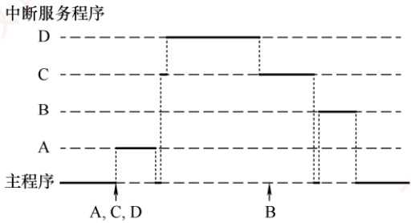

图 7.7 CPU 执行程序的轨迹

从宏观上看，程序中断方式克服了程序查询方式中CPU的忙等待现象，显著提高了CPU利用率。但从微观操作分析，CPU在处理中断时仍需暂停原程序的运行。尤其当高速设备频繁、成批地与主存交换数据时，会不断打断CPU现行程序以执行中断服务程序，造成较大开销。

### 7.3.3 DMA方式

DMA方式是一种完全由硬件控制的数据传输方法，它具有程序中断方式的优点，即在数据准备阶段，CPU与外设可并行工作。DMA在外设与内存之间建立了一条直接的数据通路，使得信息传送无须经过CPU，从而显著降低CPU在数据传输过程中的负担。正因如此，该方式被称为直接存储器存取，并避免了保存与恢复CPU现场等复杂操作。

**考点追踪DMA方式的使用场景（2025）**

DMA特别适用于磁盘、显卡、声卡、网卡等高速设备的大批量数据传输，但其硬件实现开销较高。在DMA方式中，中断的作用仅限于处理故障和正常传输完成的通知。

**考点追踪DMA方式中的数据传输通路（2024）**

**1. DMA 方式的特点**

DMA机制在主存与 DMA控制器之间建立了一条直接的数据通路。由于数据传输不经过CPU，因此无须中断现行程序，从而实现I/O操作与CPU计算的并行执行。

**DMA方式的主要特性包括:**

1）打破主存与CPU的固定关联，主存既可被CPU访问，又可被外设直接访问。

2）在块数据传输过程中，主存地址的生成与传送字数的计数均由硬件电路自动完成。

3）主存中需设置专用缓冲区，以支持高效的数据交换。

4）支持高速数据传输，且CPU与外设可并行工作，显著提升系统效率。

5）传输开始前需由软件进行预处理，结束后则通过中断机制完成后处理。

**2. DMA 控制器的组成**

在DMA方式中，对数据传送过程进行控制的硬件称为DMA控制器（DMA接口）。当I/O设备需要进行数据传送时，通过DMA控制器向CPU提出 DMA请求，CPU响应后即让出系统总线，由DMA控制器接管总线并执行数据传送。其主要功能如下:

1）接收外设发出的DMA请求，并向CPU发出总线请求信号。

2）在CPU发出总线响应信号后，DMA控制器接管总线控制权，进入DMA操作周期。

3）确定数据传送的主存起始地址及长度，并自动更新主存地址计数器和传送长度计数器。

4）指定数据在主存与外设间的传送方向，发出读/写等控制信号，完成数据传送。

5）在DMA操作结束后，向CPU报告传送完成。

图 7.8 给出了一个简单的 DMA 控制器。

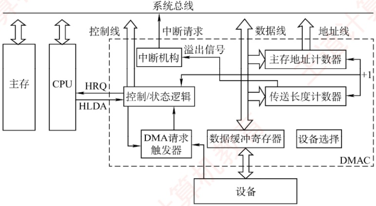

图 7.8 一个简单的 DMA 控制器

● 主存地址计数器:存放待传送数据的主存地址。传送前，保存整批数据的起始地址；每传送一个字，其内容自动加1，直至该批数据传送完毕。

● 传送长度计数器:记录待传送数据的总长度。传送前，存入整批数据的总字数；每传送一个字，计数值减1，当计数器为0时，表示传送结束。

● 数据缓冲寄存器:暂存每次传送的数据。通常，DMA控制器与主存之间以字为单位传送，而与外设之间可能以字节或字为单位。

● DMA 请求触发器:当I/O 设备准备好数据时，发出 DMA 请求信号，使其置位。

● 控制/状态逻辑:用于设定传送方向、更新传送参数，并协调 DMA 请求与CPU响应信号。

● 中断机构:当一批数据传送完毕后，触发中断并向CPU发出中断请求。

在DMA 传送过程中，DMA控制器接管系统总线；传送结束后，将总线控制权交还给CPU，由CPU继续执行后续操作。因此，DMA控制器必须具备控制系统总线的能力。

**3. DMA 的传送方式**

主存与I/O设备之间交换信息时不经过CPU。然而，当I/O设备和CPU同时访问主存时，可能发生冲突。为高效利用主存，DMA与CPU通常采用以下三种方式共享主存。

**（1）停止CPU访存**

当I/O 设备发出 DMA 请求时，DMA 控制器向 CPU 发送停止信号，使 CPU放弃总线控制权并暂停访存，直至DMA完成整块数据的传送（见图7.9）。数据传送结束后，DMA控制器通知CPU恢复主存访问，并交还总线控制权。

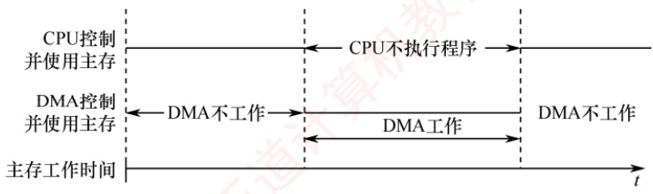

图 7.9 停止 CPU 访存

优点:控制逻辑简单，适用于数据传输速率很高的I/O设备进行成组数据传送。

缺点:DMA访存期间，CPU基本处于空闲状态，资源利用率较低。

**（2）周期挪用**

**考点追踪周期挪用的特点及挪用次数分析（2012、2020、2022）**

对于高速I/O设备，若不及时访存可能导致数据丢失，因此其访存请求具有较高优先级。周期挪用允许I/O设备挪用一个主存存储周期，传送完一个数据字后立即释放总线（见图7.10），属于单字传送方式。当I/O设备发起DMA请求时，可能出现以下三种情况:①CPU当前不在访存，I/O请求无冲突，可直接使用总线；②CPU正在访存，则需等待当前存储周期结束，再释放总线控制权；③I/O与CPU同时请求访存，发生冲突，此时CPU暂时放弃总线控制权。

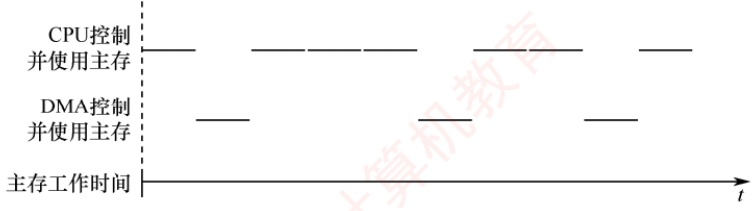

图 7.10 周期挪用

优点:既满足了I/O数据传送需求，又较好地发挥了CPU与主存的效率。

缺点:每次挪用均需申请并释放总线控制权，带来一定开销。

**(3) DMA 与 CPU 交替访存**

将CPU工作周期划分为两个子周期:一个供CPU访存，另一个供DMA访存。这样，在每个CPU周期内，两者可以轮流访问主存（见图7.11）。该方式适用于CPU工作周期长于主存存储周期的场景。例如，若CPU工作周期为1.2μs，主存存储周期小于0.6μs，则可将其分为 $\mathrm {C_{1}}$ 和$\mathrm {C}_{2}$ 两个子周期，其中 $\mathrm {C_{1}}$ 专供 DMA 访存， $\mathrm {C}_{2}$ 专供 CPU访存。总线控制权通过 $C_{1}$ 和 $\mathrm {C}_{2}$ 分时固定分配，无须动态申请或释放。

优点:无须总线控制权的申请与释放过程，数据传送速率高。

缺点:硬件控制逻辑较为复杂。

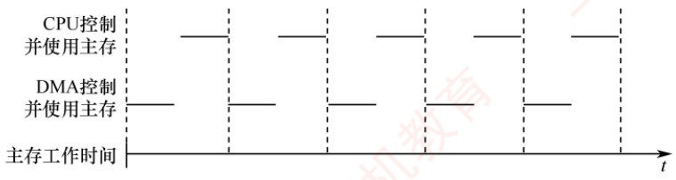

图 7.11 DMA 与 CPU 交替访存

考点追踪DMA方式的效率分析及相关计算（2011、2018）

【例7.4】假定计算机的主频为 500MHz，CPI为4，某外设的数据率为40MB/s，I/O接口中的数据端口为32位，采用DMA 方式，每次 DMA 传送块大小为1000B，且 DMA预处理和后处理的总时钟周期数为500，则CPU用于该外设I/O的时间占 CPU 总时间的百分比是多少？

**解:**

DMA 每秒次数为 $40MB/s \div 1000B = 40000$ ，在DMA方式中，只有预处理和后处理需要CPU处理，数据传送全程由DMA 控制。CPU 用于外设I/O的总时间为 $40000 \times 500 = 2 \times 10^{7}$ 个时钟周期，占CPU总时间的百分比为 $2 \times 10^{7} \div 500M = 4\%$ o

**4. DMA 的传送过程**

考点追踪DMA方式的传送过程（2019）

图7.12所示为DMA的数据传送流程，分为预处理、数据传送和后处理三个阶段。

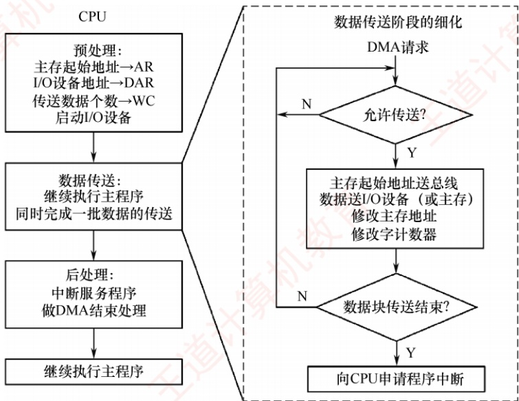

图 7.12 DMA 的数据传送流程

**（1）预处理**

由CPU完成必要的初始化工作，包括设置DMA控制器中的主存起始地址、传送方向、传送数据个数，并启动I/O设备。随后，CPU继续执行原程序。当I/O设备准备好待发送（输入）或接收（输出）的数据时，会向 DMA控制器发出 DMA请求；DMA控制器随即向CPU 发出总线请求，申请总线控制权。

**（2）数据传送**

DMA以数据块为单位进行传送。一旦获得总线控制权，DMA控制器便通过硬件循环自动完成数据的输入或输出操作，整个过程无须CPU干预。

**(3）后处理**

**考点追踪DMA传送结束时的处理（2025）**

数据块传送完成后，DMA控制器向CPU发出中断请求。CPU响应后执行中断服务程序，进行后处理工作，如校验数据完整性，若出错则转入诊断程序等。

在DMA方式下，整个数据块的传送过程均由硬件完成，CPU仅在预处理阶段进行初始化，在后处理阶段响应中断，因此用于I/O的开销极小。

**5. DMA 方式和中断方式的区别**

考点追踪DMA与中断方式的对比（2013、2023）

DMA方式和中断方式的主要区别如下:

①中断方式涉及程序切换，需保存和恢复CPU现场；而DMA方式不中断现行程序，无须保存现场，除预处理和后处理外，完全不占用CPU资源。

②中断请求只能在每条指令执行结束后被响应；而DMA请求可在当前总线周期结束后立即获得响应，无须等待指令完成。

③中断方式的数据传送依赖CPU执行指令完成；DMA方式则由专用硬件直接在主存与外设间传送数据，传输速率高，适用于高速外设的成组数据传输。

④ 当CPU 和 DMA 控制器同时访问主存时，DMA 请求的优先级通常更高。

⑤中断方式具备处理异常事件的能力，而DMA方式仅用于大批量数据的高效传输。

⑥从数据传送来看，中断方式由软件控制传送，DMA方式由硬件直接完成。

## 7.4 本章小结

本章开头提出的问题的参考答案如下。

**1）I/O设备有哪些编址方式？各有何特点？**

I/O设备的编址方式主要有统一编址和独立编址。统一编址是指将主存地址空间的一部分分配给I/O端口，CPU可使用普通访存指令直接访问I/O设备，编程简便；但会占用主存地址空间，减少可用主存容量。独立编址是指I/O地址空间与主存地址空间相互独立，I/O端口不占用主存资源；但访问I/O设备需使用专用I/O指令（如IN、OUT），增加了指令集的复杂性。

2）CPU响应中断应具备哪些条件？

① CPU 内部的中断屏蔽触发器处于开放状态。

②外设发出中断请求，且其接口中的中断请求触发器置为“1”，以维持中断请求信号。

③外设接口的中断允许触发器为“1”，才能将中断请求送达CPU。

当上述三个条件同时满足时，CPU在当前指令执行结束后响应中断。

## 7.5 常见问题和易混淆知识点

**1. 在开中断情况下，CPU检测到中断就一定会立即响应吗？**

是的。在开中断状态下，CPU总在每条指令执行结束时采样中断请求。一旦检测到中断请求，即表明该请求未被屏蔽且有效，CPU必定会立即响应。

需要说明的是:在单重中断系统中，进入中断服务程序后通常会自动关中断，此后即使有新的中断请求也无法被检测，但这不属于“开中断”情形，违背题设前提。而在多重中断系统中，高优先级中断可在低优先级的中断服务程序执行期间被检测并响应，因其未被屏蔽。

**2. 向量中断、中断向量、向量地址三个概念是什么关系？**

中断向量:中断向量指中断服务程序的入口地址。每个中断源对应一个唯一的中断服务程序其入口地址即为该中断源的中断向量。系统通常将所有中断向量集中组织成一张中断向量表；也有系统在表中存放转移指令，构成中断向量转移表。

向量地址:向量地址指中断向量表（或转移表）中某一项的内存起始地址。它通常由中断类型号（也称中断号）乘以表项长度计算得出。例如，若表项占4字节，中断类型号为5，则向量地址为5×4=20（假设表从0开始）。因此，向量地址是CPU用于定位中断向量的“索引位置”。

向量中断:是一种能够自动识别中断源并快速转移至对应服务程序的中断处理方式。当中断发生时，中断源（或中断控制器）向CPU提供中断类型号，CPU据此生成向量地址，并从向量表中取出对应的中断向量（入口地址），直接转移执行相应的中断服务程序。

**3. 程序中断和调用子程序有何区别？**

虽然程序中断和子程序调用都会引起程序执行流程的转移，但二者在本质上存在显著差异，主要体现在以下几个方面:I

1）触发时机:子程序调用由程序员通过CALL指令主动发起，发生时刻和位置是确定的:而中断由外部设备或内部事件随机触发，CPU只在每条指令执行结束时采样中断请求，一旦条件满足便转入中断处理，具有明显的异步性和不可预测性。

2）服务关系:子程序完全为主程序服务，二者构成主从关系:主程序在需要时调用子程序，执行完毕后返回主程序继续运行。中断服务程序通常与主程序无直接关联，是为响应外部事件（如数据到达、定时器溢出等）而执行的独立任务，二者属于平行关系。

3）实现机制:子程序调用是纯软件行为，只需利用堆栈保存返回地址，无须额外硬件支持；而中断处理依赖软硬件协同，需借助中断请求线、中断控制器和优先级判优电路等硬件，才能完成中断请求的接收、判优、响应和断点保护等操作。

4）嵌套级别:子程序可多层嵌套，嵌套深度主要受限于系统堆栈空间；中断嵌套则受优先级机制约束一一只有更高优先级的中断才能打断当前正在执行的中断服务程序。出于硬件复杂性和实时性考虑，实际系统中中断优先级通常较少，嵌套层次有限。

**购买王道书，就上直机王道官方考研书店**

