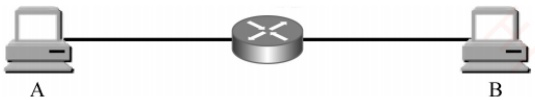
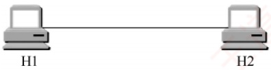
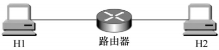
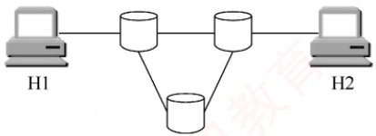
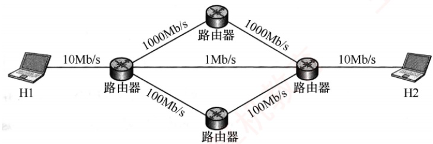
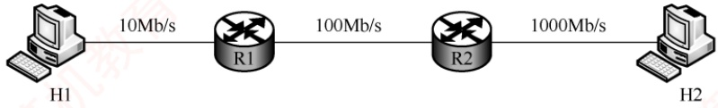
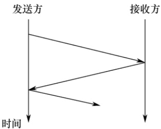

# 第1章 计算机网络体系结构 · 习题与解析

> 由《第1章 计算机网络体系结构》正文摘出；区块标题保留了原书的小节编号。

### 1.1.7 本节习题精选

#### 一、单项选择题

01. 计算机网络可被理解为（）。
A. 执行计算机数据处理的软件模块
B. 由自治的计算机互连起来的集合体
C. 多个处理器通过共享内存实现的紧耦合系统
D. 用于共同完成一项任务的分布式系统

02. 下列不属于计算机网络功能的是（）。
A. 提高系统可靠性
B. 提高工作效率
C. 分散数据的综合处理
D. 使各计算机相对独立

03. 下列关于网络中的计算机的描述，正确的是（）。
A. 各自独立，没有联系
B. 拥有独立的操作系统
C. 互相干扰
D. 拥有共同的操作系统

04. 分组交换相比报文交换的主要改进是（）。
A. 差错控制更加完善
B. 路由算法更加简单
C. 传输单位更小且有固定的最大长度
D. 传输单位更大且有固定的最大长度

05.下列（）是分组交换网络的缺点。
A. 信道利用率低
B. 附加信息开销大
C. 传播时延大
D. 不同规格的终端很难相互通信

06. 不同的数据交换方式有不同的性能。为了使数据在传输期间的时延最小，首选的交换方式是（①）；为保证数据无差错地传送，不应选用的交换方式是（②）；分组交换对报文交换的主要改进是（③），这种改进产生的直接结果是（④）。①
A. 电路交换
B. 报文交换
C. 分组交换 算机教②A. 电路交换 B. 报文交换 C. 分组交换

③A. 传输单位更小且有固定的最大长度B. 传输单位更大且有固定的最大长度王道C. 差错控制更完善D. 路由算法更简单④A. 降低了误码率 B. 提高了数据传输速率C. 减少传输时延 D. 增加传输时延

07.下列说法中，（）是数据报方式的特点。
A. 同一报文的不同分组可以经过不同的传输路径通过通信子网
B. 同一报文的不同分组到达目的节点时顺序是确定的
C. 适合于短报文的通信
D. 同一报文的不同分组在路由选择时只需要进行一次

08. 计算机网络分为广域网、城域网和局域网，其划分的主要依据是（）。
A. 网络的作用范围
B. 网络的拓扑结构
C. 网络的通信方式
D. 网络的传输介质

09. 假设主机 A 和 B之间的链路带宽为100Mb/s，主机 A 的网卡速率为 1Gb/s，主机 B 的网卡速率为10Mb/s，主机 A给主机B发送数据的最高理论速率为（）。
A. 1Mb/s
B. 10Mb/s
C. 100Mb/s
D. 1Gb/s

10. 某点对点链路的长度为 100km，若数据在该链路上的传输速率为 10⁸m/s，链路带宽为20Mb/s，已知一个已发送的分组的发送时延和传播时延相等，则该分组的大小为（）。
A. 20Kb
B. 30Kb
C. 40Kb
D. 50Kb

11. 在下图所示的采用存储转发方式的分组交换网中，主机A向B发送两个长度为1000B的分组，路由器处理单个分组的时延为10ms（假设路由器同时最多只能处理一个分组，若在处理某个分组时有新的分组到达，则存入缓存区)，忽略链路的传播时延，所有链路的数据传输速率为1Mb/s，则分组从A发送开始到B接收完为止，需要的时间至少是（）。

A. 34ms
B. 36ms
C. 38ms
D. 52ms

12. 如下图所示，主机H1和H2之间有三种可选的交换方式一—电路交换、报文交换和分组交换，其中电路交换建立电路连接的时间为2s，报文交换和分组交换都要经过由一个路由器连接的链路，分组大小为5kb。三种交换方式的数据传输速率均为2.5kb/s，忽略所有的传播时延、分组开销和不可预料的线路延迟，下列说法中正确的是（）。

电路交换

报文交换和分组交换

A. 若H1 向H2 发送5kb的数据，则电路交换最节省时间
B. 若H1向H2 发送500kb的数据，则电路交换和分组交换的时间相同
C. 若H1向H2发送10kb的数据，则报文交换比分组交换更节省时间
D. 若H1 向 H2 发送15kb 的数据，则报文交换比电路交换更节省时间

13.【2010统考真题】在下图所示的采用“存储-转发”方式的分组交换网络中，所有链路的数据传输速率为100Mb/s，分组大小为1000B，其中分组头大小为 20B。若主机 H1向主机H2发送一个大小为980000B的文件，则在不考虑分组拆装时间和传播延迟的情况下，从H1发送开始到H2接收完为止，需要的时间至少是（）。

A. 80ms
B. 80.08ms
C. 80.16ms
D. 80.24ms

14.【2013统考真题】主机甲通过一个路由器（存储转发方式）与主机乙互连，两段链路的数据传输速率均为10Mb/s，主机甲分别采用报文交换和分组大小为10kb的分组交换向主机乙发送一个大小为 8Mb $( 1 M =10^{6} )$ 的报文。若忽略链路传播延迟、分组头开销和分组拆装时间，则两种交换方式完成该报文传输所需的总时间分别为（）。
A. 800ms、1600ms
B. 801ms、1600ms
C. 1600ms、800ms
D. 1600ms、801ms

15.【2023统考真题】在下图所示的分组交换网络中，主机H1和H2通过路由器互连，2段链路的带宽均为100Mb/s，时延带宽积（单向传播时延×带宽）均为1000b。若H1向H2发送一个大小为1MB的文件，分组长度为1000B，则从H1开始发送的时刻起到H2收到文件全部数据时刻止，所需的时间至少是（）。（注: $1 \mathrm {M} = 10^{6} .$ )

A. 80.02ms
B. 80.08ms
C. 80.09ms
D. 80.10ms

16. 【2024 统考真题】某分组交换网络及每段链路的带宽如下图所示，H1 到 H2 的最大吞吐量约为（）。
A. 1Mb/s
B. 10Mb/s
C. 100Mb/s
D. 1000Mb/s

17.【2025统考真题】某网络拓扑及各链路带宽如下图所示。网络按电路交换方式运行时，主机 H1 与 H2 建立一条带宽为10Mb/s 的电路，建立电路时间为 32μs；按分组交换方式运行时，分组长度为400B，忽略分组首部开销。现 H1向H2发送一个2MB（1M=10⁶）的文件，分别采用电路交换、报文交换、分组交换方式时，H2至少需要 $T_{\mathrm {C S}}$ $T_{\mathrm {M S}}$ 、TPS时间才能接收到全部文件内容，则Tcs、 $T_{\mathrm {M S}}$ 、Tps满足的关系是（）。

A. $T_{CS} > T_{MS} > T_{PS}$
B. $T_{\mathrm {M S}}   >   T_{\mathrm {P S}}   >   T_{\mathrm {C S}}$
C. $T_{\mathrm {M S}}   >   T_{\mathrm {C S}}   >   T_{\mathrm {P S}}$
D. $T_{\mathrm{PS}} > T_{\mathrm{MS}} > T_{\mathrm{CS}}$

#### 二、综合应用题

01.假定有一个通信协议，每个分组都引入100B的开销，用于首部和组帧。现在使用这个协议发送 $10^{6} \mathbf {B}$ 的数据，但在传送过程中有1B被破坏，因而包含该字节的那个分组被丢弃。对1000B和20000B的分组的有效数据大小，分别计算“开销+丢失”字节的总数量。为使“开销+丢失”字节的总数量最小，分组数据大小的最佳值是多少？

02. 考虑一个最大距离为2km的局域网，当带宽多大时，传播时延（传播速率为 $2 \times 10^{8}  m/s$ 等于100B分组的发送时延？对于512B分组，结果又如何？

03. 在两台计算机之间传输一个文件有两种可行的确认策略。第一种策略将文件截成分组，接收方逐个确认分组，但就整体而言，文件没有得到确认。第二种策略不确认单个分组，但当文件全部收到后，对整个文件予以确认。讨论这两种方式的优缺点。

### 1.1.8 答案与解析

#### 一、单项选择题

01. B

计算机网络是由自治计算机互连起来的集合体，其中包含三个关键点:自治计算机、互连、集合体。自治计算机由软件和硬件两部分组成，能完整地实现计算机的各种功能；互连是指计算机之间能实现相互通信；集合体是指所有使用通信线路及互联设备连接起来的自治计算机的集合。选项C和D分别指多机系统和分布式系统。

02. D

计算机网络的三大主要功能是数据通信、资源共享和分布式处理。计算机网络使各计算机之间的联系更加紧密而非相对独立。

03. B

计算机网络是一些互连的、自治的计算机系统的集合。各计算机拥有独立的操作系统和硬件资源，它们之间是有联系的，通过网络协议和通信介质进行数据交换和资源共享。

04. C

相对于报文交换而言，分组交换将报文划分为一个个具有固定最大长度的分组，以分组为单位进行传输。

05. B

分组交换要求将数据分成等长的小数据段，每段都要加上控制信息（如目的地址），因此传送数据的总开销较大。相比其他交换方式，分组交换信道利用率高。传播时延取决于传播介质及收发双方的距离。对各种交换方式，不同规格的终端都很难相互通信，因此不是分组交换的缺点。

**06.A、A、A、C**

本题综合考查几种数据交换方式的特点。电路交换虽然建立连接的时延较大，但在数据传输期间一直占据链路，优点是传输时延小、通信实时性强，适用于交互式会话类通信。缺点是建立连接时间长，系统效率低，不具备存储数据的能力，不具备差错控制的能力。

报文交换和分组交换都采用存储转发，传送的数据都要经过中间节点的若干存储、转发才能到达目的地，因此传输时延较大。报文交换传送数据的长度不固定且较长，分组交换要将传送的长报文分割为多个固定且长度有限的分组，因此传输时延较报文交换的小。

07. A

数据报方式是一种无连接的分组交换技术，它先将报文拆分成若干较小的数据段，加上地址等控制信息后构成分组，这样做虽然会增加一些控制开销，但并不意味着数据报方式只适合于短报文的通信。数据报方式尽最大努力交付，不保证可靠性，分组可能出错或丢失，网络为每个分组独立地选择路由，转发的路径可能不同，因此分组不一定按序到达目的节点。

08. A

按分布范围分类:广域网、城域网、局域网、个人区域网。

按拓扑结构分类:星形网络、总线形网络、环形网络、网状网络。

按传输技术分类:广播式网络、点对点网络。

按使用者分类:公用网、专用网。

按数据交换技术分类:电路交换网、报文交换网、分组交换网。

因此，根据网络的覆盖范围可将网络主要分为广域网、城域网和局域网。

09. B

主机 A给主机B发送数据的最高理论速率取决于链路带宽及主机 A、主机B的网卡速率中最小者，因为它是数据传输的瓶颈。因此，最高理论速率为10Mb/s。

10. A

链路的传播时延 $100km \div 10^{8}m/s = 1ms$ 发送时延等于传播时延，因此发送时延也为1ms，所以分组的大小应为 $20\mathrm{Mb/s} \times 1\mathrm{ms}=20\mathrm{Kb}$

11. B

分组长度为1000B，所有链路的数据传输速率为1Mb/s，因此，每段链路的发送时延为$1000\mathrm{B} \div 1\mathrm{M}\mathrm{b} / \mathrm{s}=8\mathrm{ms}$ ，第一个分组从A到达B的时间为 $8+10+8=26$ ，此后又经过10ms，第二个分组才到达B，所以总时间为 $26+10=36 ms$ ，下图是传送过程的时空图。

注意，此题还可扩展为发送更多分组的情况，请读者自行分析。

<table><tr><td rowspan="5">分组2 分组1</td><td colspan="5">在缓冲区排队等待处理的时间</td></tr><tr><td rowspan="2"></td><td rowspan="2">8ms</td><td rowspan="2"></td><td rowspan="2">10ms</td></tr><tr><td>8ms</td></tr><tr><td>8ms</td><td>10ms</td><td>8ms</td><td></td><td></td></tr></table>

12. B

若 H1 向 H2 发送 5kb 的数据，电路交换的时间为 $2+5\mathrm{kb} \div 2.5\mathrm{kb} / \mathrm{s}=4\mathrm{s}$ ，分组交换和报文交换的时间均为 $5\mathrm{kb} \div 2.5\mathrm{kb} / \mathrm{s} + 5\mathrm{kb} \div 2.5\mathrm{kb} / \mathrm{s} = 4\mathrm{s}$ ，选项A 错误。若H1向 H2发送500kb的数据，电路交换的时间为 $2+500\mathrm{kb} \div 2.5\mathrm{kb} / \mathrm{s}=202\mathrm{s}$ ，分组交换的时间为 $500kb \div 2.5kb/s + 5kb \div 2.5kb/s = 202s$选项B正确。若H1向H2发送10kb的数据，报文交换的时间为 $10kb{\div}2.5kb/s+10kb{\div}2.5kb/s=8s$分组交换的时间为 $10kb \div 2.5kb/s + 5kb \div 2.5kb/s = 6s$ ，选项 C 错误。若H1 向 H2发送15kb的数据，电路交换的时间为 $2+15\mathrm{kb} \div 2.5\mathrm{kb} / \mathrm{s}=8\mathrm{s}$ 报文交换的时间为 $15kb{\div}2.5kb/s+15kb{\div}2.5kb/s=12s$选项D错误。

13. C

分组大小为1000B，其中首部占20B，故每个分组携带的有效数据为980B。文件总长为980 000B，需划分为1000个分组；每个分组含首部共1000B，因此共需传输的数据量为 $10^{6} \mathbf {B} .$ 由于所有链路的传输速率相同，沿最短路径传输时延最小，而最短路径经过2个交换机（共3段链路）。H1 发送完所有分组的时间为 $10^{6} \times 8b \div 100 \mathrm{M} \mathrm{b} / \mathrm{s} = 80 \mathrm{ms}$ ，此时最后一个分组刚离开H1，该分组还需依次经过2个交换机（再通过2段链路）才能到达H2，每段链路的传输时延为 $r=1000\times8b\div100\mathrm{M}b/\mathrm{s}=$ 0.08ms。因此，H2接收完全部数据的时间为 $80 ms + 2r = 80.16 ms$

【另解】分组交换的传输过程类似于流水线。在连续传输过程中，各存储转发设备可同时处理不同的分组，就如同流水线中的各段并行工作。由于所有链路的速率相同，每段链路的传输时延 $r=1000\times8b\div100\mathrm{Mb/s}=0.08\mathrm{ms}$ ，最短路径有3段链路。H2接收完全部数据的时间为 $3r + (m - 1)r =$ $3 \times 0.08  ms  + (1000 - 1) \times 0.08  ms  = 80.16  ms$ 。也就是说，第一个分组从流水线中流出所需的时间为3r，此后每隔r时间就有一个分组流出。

14. D

传输路径为:甲—路由器一乙。

在题中未明确说明的情况下，不考虑排队时延和处理时延，只考虑发送时延和传播时延；本题已忽略传播时延，因此只需计算报文交换和分组交换的发送时延。

报文交换:采用整报文传输，报文大小为 $8\mathrm{Mb} (1\mathrm{M}=10^{6})$ 。每个节点（包括主机甲和路由器）

在转发该报文前需要完整接收，因此需经历两次发送过程:甲向路由器发送报文，发送时延 $T =$ $8Mb \div 10Mb/s = 0.8s;$ ；路由器向乙转发该报文，同样需0.8s。总时延为1.6s，即1600ms。

分组交换:分组大小为10kb $( 1 \mathrm {k} = 10^{3} )$ ，忽略分组头开销，每个分组携带10kb数据。报文总长为8Mb，分组数 $m=8Mb÷10kb=800$ 。参考2010年真题的流水线思路:甲与乙通过一个路由器相连，构成2段链路（2个流水段），每段链路的发送时延 $r = 10 \mathrm{kb} \div 10 \mathrm{Mb} / \mathrm{s} = 1 \mathrm{ms}$ 。第一个分组从甲发出后，需经过2段链路才能到达乙，耗时 $2 r ;$ 此后，流水线满载，每隔r时间就有一个分组到达乙。因此，传输 $m   =   800$ 个分组所需的总时间为 $t = 2r + (m - 1)r = 2 + (800 - 1) \times 1 = 801  ms$

15. D

文件大小为1MB，分组长度为1000B，分组数量为 $1MB{\div}1000B=1000$ 。一个分组从H1到H2 所需的时间 = H1 的发送时延 $t_{1} + \mathrm {H 1}$ 到路由器的传播时延 $t_{2} +$ 路由器的发送时延 $t_{3} +$ 路由器到 H2 的传播时延 $t_{4} ,$ 其中 $t_{1}=t_{3}=1000\mathrm{B} \div 100\mathrm{M} \mathrm{b} / \mathrm{s}=0.08\mathrm{ms}$ $t_{2}=t_{4}=1000b\div100Mb/s=0.01ms 。$因此，一个分组从H1到H2的端到端时延为 $(0.08 + 0.01) \times 2 = 0.18  ms$ H1 发送前 999个分组所需的时间为 $999t_{1} = 79.92\mathrm{ms}$ ，此时，第1000个分组刚刚开始发送，它还需0.18ms才能到达H2。因此，从H1开始发送到H2收到全部数据所需的最短时间为 $79.92 + 0.18 = 80.10  ms$ 0

读者可以思考:若H1和H2之间有2个路由器，则所需的时间至少是多少？

16. B

H1 到 H2 有三条路径。H1 和 H2各自连接路由器的链路带宽均为10Mb/s，这是所有路径共有的端侧链路。现在假设每个数据段为10Mb，分别分析各路径的吞吐量。

路径一:中间两段链路带宽均为1000Mb/s，受限于H1、H2直连路由器的链路带宽10Mb/s，无论中间链路有多快，数据从H1发出需1s（10Mb÷10Mb/s，受限于自身的10Mb/s出口），到达H2前最后一跳也需1s。吞吐量约为 10Mb/s。

路径二:中间一段链路带宽为1Mb/s，H1发送一个数据段需1s，但经过中间1Mb/s链路时，转发时延为 $10\mathrm{Mb} \div 1\mathrm{Mb} / \mathrm{s}=10\mathrm{s}$ 成为瓶颈)，因此H2每隔10s收到一个数据段，吞吐量约为1Mb/s。

路径三:中间两段链路带宽均为100Mb/s，与路径一的分析类似，吞吐量约为10Mb/s。由此可见，端到端的吞吐量由路径中带宽最小的链路（瓶颈）决定。

17. B

采用电路交换时， $T_{CS} =$ 电路建立时间 $32 \mu \mathrm {s} +$ 文件传输时间 $2MB{\div}10Mb/s=32\mu s+1.6s$ 。采用报文交换时，整个报文需要逐跳存储转发， $T_{MS}=2MB\div10Mb/s+2MB\div100Mb/s+2MB\div1000Mb/s=$ 1.776s。采用分组交换时，分组数为 $2MB/400B = 5000$ ，第一个分组从 H1 到 H2 的传输时延 = $400\mathrm{B} \div 10\mathrm{Mb/s}+400\mathrm{B} \div 100\mathrm{Mb/s}+400\mathrm{B} \div 1000\mathrm{Mb/s}=355.2\mu\mathrm{s};$ 之后，每 $\underline {{320}} \mu \mathrm {{s}}$ 到达一个分组，故$T_{\mathrm{PS}} = 355.2\mu \mathrm{s} + 320 \times 4999\mu \mathrm{s} = 1.6\mathrm{s} + 35.2\mu \mathrm{s}$ 。因此 $T_{\mathrm {M S}}   >   T_{\mathrm {P S}}   >   T_{\mathrm {C S}}$ U

#### 二、综合应用题

01.【解答】

设D是分组数据的大小，需要的分组数量 $= 10^{6} {\div} D$ ，开销=100N（被丢弃分组的首部也已计入开销），因此“开销+丢失 $100 \times 10^{6} \div D + D$ 0 V

当 $D   =   1000$ 时，“开销+丢失 $100 \times 10^{6} \div 1000 + 1000 = 101000B$

当 $D = 20000$ 时，“开销+丢失 $100 \times 10^{6} \div 20000 + 20000 = 25000B$

设“开销+丢失”字节总数量为y， $y = 10^{8} \div D + D$ ，求微分有 $\mathrm{d}y \div \mathrm{d}D = 1 - 10^{8} \div D^{2}$

02. 【解答】

$D   =   10^{4}$ 时， $\mathrm{d}y \div \mathrm{d}D = 0$ ，所以分组数据大小的最佳值是10000B。

传播时延 $2 \times 10^{3}  m  \div (2 \times 10^{8}  m/s ) = 10^{-5}  s  = 10 \mu  s$

**1）分组大小为100B:**

假设带宽大小为x，要使传播时延等于发送时延，带宽如下:

$$
x=100\mathrm{B} \div 10\mu\mathrm{s}=10\mathrm{MB} / \mathrm{s}=80\mathrm{Mb} / \mathrm{s}
$$

2）分组大小为512B:

假设带宽大小为y，要使传播时延等于发送时延，带宽如下:

$$
y=512\mathrm{B} \div 10\mu\mathrm{s}=51.2\mathrm{MB} / \mathrm{s}=409.6\mathrm{Mb} / \mathrm{s}
$$

因此，带宽应分别等于 80Mb/s 和409.6Mb/s。

03. 【解答】

若网络容易丢失分组，则对每个分组逐一进行确认较好，此时仅重传丢失的分组。另一方面，若网络高度可靠，则在不发生差错的情况下，仅在整个文件传送的结尾发送一次确认，以减少确认次数，进而节省带宽。不过，即使只有单个分组丢失，也要重传整个文件。

### 1.2.4 本节习题精选

#### 单项选择题

01. 下列选项中，不属于对网络模型进行分层的目标的是（）。
A. 提供标准语言
B. 定义功能执行的方法
C. 定义标准界面
D. 增加功能之间的独立性

02. 将用户数据分成一个个数据块传输的优点不包括（）。
A. 减少延迟时间
B. 提高错误控制效率
C. 使得多个应用更公平地使用共享通信介质
D. 有效数据在协议数据单元（PDU）中所占比例更大

03. 协议是指在（）之间进行通信的规则或约定。
A. 同一节点的上下层
B. 不同节点
C. 相邻实体
D. 不同节点对等实体

04. OSI参考模型中的实体指的是（）。
A. 实现各层功能的规则
B. 上下层之间进行交互时所要的信息
C. 各层中实现该层功能的软件或硬件
D. 同一节点中相邻两层相互作用的地方

05. 在OSI参考模型中，第 n层与它之上的第n+1层的关系是（)。
A. 第 n 层为第 n+1层提供服务
B. 第 n+1层为从第 n层接收的报文添加一个报头
C. 第 n 层使用第 n+1层提供的服务
D. 第 n 层和第 n+1层相互没有影响

06. 下列关于计算机网络及其结构模型的说法中，错误的是（）。
A. 世界上第一个计算机网络是 ARPAnet
B. Internet 最早起源于 ARPAnet
C. 国际标准化组织（ISO）设计出了OSI/RM参考模型，即实际执行的标准
D. TCP/IP 模型分为 4 个层次

07.（）是计算机网络中OSI参考模型的3个主要概念。
A. 服务、接口、协议
B. 结构、模型、交换
C. 子网、层次、端口
D. 广域网、城域网、局域网

08. 下列关于网络协议三要素的描述中，正确的是（）。
A. 数据格式、编码、信号电平
B. 数据格式、控制信息、速度匹配
C. 语法、语义、同步
D. 编码、控制信息、同步

09. 释放TCP连接的四次挥手报文的先后关系，属于网络协议三要素中的（）。
A. 语法
B. 时序
C. 语义
D. 服务

10. 下图是TCP报文段的首部格式，它描述的是网络协议三要素中的（）。

<table><tr><td colspan=10>-32位位0               8              16             24           31</td></tr><tr><td rowspan=6>TCP首部</td><td colspan=8>源端口</td><td>目的端口</td></tr><tr><td colspan=9>序号</td></tr><tr><td colspan=9>确认号</td></tr><tr><td>数据偏移</td><td>保留</td><td>URG</td><td>ACK</td><td>PSH</td><td>RST</td><td>SYZ</td><td>F</td><td>窗口</td></tr><tr><td colspan=8>检验和</td><td>紧急指针</td></tr><tr><td colspan=8>选项（长度可变）</td><td></td></tr></table>

I. 语法 II. 语义 III. 时序（同步）
A. 仅I
B. 仅Ⅱ
C. 仅ⅢI
D. I、II和ⅢII

11.下列关于OSI参考模型的描述中，错误的是（）。
A. OSI参考模型定义了开放系统的层次结构
B. OSI参考模型定义了各层所包括的可能的服务
C. OSI参考模型作为一个框架协调组织各层协议的制定
D. OSI参考模型定义了各层接口的实现方法

12. 负责将比特转换成电信号进行传输的层是（）。
A. 应用层
B. 网络层
C. 数据链路层
D. 物理层

13.下列关于OSI参考模型的物理层功能的描述中，错误的是（）。
A. 比特0和1使用何种电信号表示
B. 传输能否在两个方向上同时进行
C. 1个比特持续多长时间
D. 避免快速发送方“淹没”慢速接收方 育

14. OSI参考模型中的数据链路层不具有（）功能。
A. 物理寻址
B. 流量控制
C. 差错检验
D. 拥塞控制

15. 下列能够最好地描述OSI参考模型的数据链路层功能的是（）。
A. 提供用户和网络的接口
B. 处理信号通过介质的传输
C. 控制报文通过网络的路由选择
D. 保证数据正确的顺序和完整性

16. 当数据由端系统 A传送至端系统 B时，不参与数据封装工作的是（)。
A. 物理层
B. 数据链路层
C. 网络层
D. 表示层

17. 在OSI参考模型中，实现端到端的应答、分组排序和流量控制功能的协议层是（）。
A. 会话层
B. 网络层
C. 传输层
D. 数据链路层

18. 在ISO/OSI参考模型中，可同时提供无连接服务和面向连接服务的是（）。
A. 物理层
B. 数据链路层
C. 网络层
D. 传输层

19. 在OSI参考模型中，当两台计算机进行文件传输时，为防止中间出现网络故障而重传
A. 表示层
B. 会话层
C. 网络层
D. 应用层 XK

20. 数据的格式转换及压缩属于OSI参考模型中（）的功能。
A. 应用层
B. 表示层
C. 会话层
D. 传输层

21. OSI参考模型中（）通过设置检验点，使通信双方在通信失效时可从检验点恢复通信。
A. 传输层
B. 网络层
C. 表示层
D. 会话层

22.下列说法中正确描述了OSI参考模型中数据的封装过程的是（）。
A. 数据链路层在分组上仅增加了源物理地址和目的物理地址
B. 网络层将高层协议产生的数据封装成分组，并增加第三层的地址和控制信息
C. 传输层将数据流封装成数据帧，并增加可靠性和流控制信息
D. 表示层将高层协议产生的数据分割成数据段，并增加相应的源和目的端口信息

23. 在OSI参考模型中，提供流量控制功能的层是第（①）层；提供建立、维护和拆除端到端的连接的层是(②)；为数据分组提供在网络中路由功能的是（③)；传输层提供(④)的数据传送；为网络层实体提供数据发送和接收功能及过程的是（⑤）。①
A. 1、2、3
B. 2、3、4
C. 3、4、5
D. 4、5、6 ② A. 物理层 B. 数据链路层 C. 会话层 D. 传输层③ A. 物理层 B. 数据链路层 C. 网络层 D. 传输层④A. 主机进程之间 B. 网络之间⑤ A. 物理层 C. 数据链路之间 B. 数据链路层 C. 会话层 D. 物理线路之间 D. 传输层 育

24. 在OSI参考模型中，（）利用通信子网提供的服务实现两个进程之间的端到端通信。
A. 网络层
B. 传输层
C. 会话层
D. 表示层

25. 互联网采用的核心技术是（）。
A. TCP/IP
B. 局域网技术
C. 远程通信技术
D. 光纤技术

26.在TCP/IP模型中，（）处理关于可靠性、流量控制和错误校正等问题。
A. 网络接口层
B. 网际层
C. 传输层
D. 应用层

27. 上下相邻层实体之间的接口称为服务访问点，应用层的服务访问点也称（）。
A. 用户接口
B. 网卡接口
C. IP 地址
D. MAC 地址

28. 在OSI参考模型中，各层都有差错控制过程，指出以下每种差错发生在哪些层中:噪声使传输链路上的一个0变成1或一个1变成0（①)。收到一个序号错误的目的帧（②)。一台打印机正在打印，突然收到一个错误指令要打印头回到本行的开始位置（③）。①
A. 物理层
B. 网络层
C. 数据链路层
D. 会话层②A. 物理层 B. 网络层 C. 数据链路层 D. 会话层③ A. 物理层 B. 网络层 C. 应用层 D. 会话层

29.【2009统考真题】在OSI参考模型中，自下而上第一个提供端到端服务的层是（）。
A. 数据链路层
B. 传输层
C. 会话层
D. 应用层

30.【2010统考真题】下列选项中不属于网络体系结构所描述的内容是（）。
A. 网络的层次
B. 每层使用的协议
C. 协议的内部实现细节
D. 每层必须完成的功能

31.【2013统考真题】在OSI参考模型中，功能需由应用层的相邻层实现的是（）。
A. 对话管理
B. 数据格式转换
C. 路由选择
D. 可靠数据传输

32.【2014统考真题】在OSI参考模型中，直接为会话层提供服务的是（）。
A. 应用层 wK
B. 表示层
C. 传输层
D. 网络层

33.【2016统考真题】在OSI参考模型中，路由器、交换机（Switch）、集线器（Hub）实现的最高功能层分别是（）。
A. 2、2、1
B. 2、2、2
C. 3、2、1
D. 3、2、2

34. 【2017统考真题】假设OSI参考模型的应用层欲发送400B的数据（无拆分），除物理层和应用层外，其他各层在封装PDU时均引入20B 的额外开销，则应用层的数据传输效率约为（）。
A. 80%
B. 83%
C. 87%
D. 91%

35.【2019统考真题】OSI参考模型的第5层（自下而上）完成的主要功能是（）。
A. 差错控制
B. 路由选择
C. 会话管理
D. 数据表示转换

36.【2020统考真题】右图描述的协议要素是（）。I. 语法 II. 语义 III. 时序
A. 仅I
B. 仅ⅡI
C. 仅ⅢI
D. I、ⅡI和II

37.【2021统考真题】在TCP/IP模型中，由传输层相邻的下一层实现的主要功能是（）。时间
A. 对话管理
B. 路由选择
C. 端到端报文段传输
D. 节点到节点流量控制

38.【2022统考真题】在ISO/OSI参考模型中，实现两个相邻节点间流量控制功能的是（）。
A. 物理层
B. 数据链路层
C. 网络层
D. 传输层

### 1.2.5 答案与解析

#### 单项选择题

01. B

分层属于计算机网络体系结构的范畴，选项A、C和D均是网络模型分层的目的，而分层的目的不包括定义功能执行的具体方法。

02. D

将用户数据分成一个个数据块传输，因为每块均需加入控制信息，所以实际上会使有效数据在PDU中所占的比例更小。其他各项均为其优点。

03. D

协议是为对等层实体之间进行逻辑通信而定义的规则的集合。

04. C

实体是指每层中实现该层功能的软件或硬件，可以是程序、模块、子程序或设备。

05. A

服务是指下层为紧邻的上层提供的功能调用，每层只能调用紧邻下层提供的服务（通过服务访问点），而不能跨层调用。

06. C

ISO设计了开放系统互连参考模型（OSI/RM），但实际执行的通用标准是TCP/IP标准。

07. A

计算机网络要做到有条不紊地交换数据，就必须遵守一些事先约定的原则，这些原则就是协议。在协议的控制下，两个对等实体之间的通信使得本层能够向上一层提供服务。要实现本层协议，还要使用下一层提供的服务，而提供服务就是交换信息，交换信息就需要通过接口，所以说服务、接口、协议是OSI参考模型的3个主要概念。

08. C

描述网络协议的三要素是语法、语义和同步。

09. B

网络协议三要素中的时序（或称同步）定义了通信双方的时序关系，TCP通信双方通过“四次挥手”释放连接，它规定发送FIN、ACK、FIN和ACK报文的先后顺序。

10. A

网络协议三要素中的语法定义所交换信息的格式，因此TCP首部格式体现了语法的要素。

11. D

OSI参考模型不仅划分了层次结构，还定义了各层可能提供的服务，但并未规定协议的具体实现，而是描述了一些概念和原则，用来协调和组织各层所用的协议。OSI参考模型并未定义各层接口的实现方法，而把具体的实现细节留给了各个协议和标准，选项D错误。

12. D

物理层为数据链路层提供二进制流的传输服务，涉及信号的编码、解码和同步等，选项D正确。

13. D

避免快速发送方“淹没”慢速接收方，描述的是流量控制的作用，属于数据链路层或传输层的功能。物理层只负责透明地传送比特流，不涉及流量控制的功能，选项D错误。

14. D

数据链路层在不可靠的物理介质上提供可靠的传输，作用包括物理寻址、组帧、流量控制、差错检验、数据重发等。网络层和传输层才具有拥塞控制的功能。 x

15. D

OSI参考模型的数据链路层向上提供可靠的传输服务，在差错检测的基础上，增加了帧编号、确认和重传机制，因此保证了数据正确的顺序和完整性。选项A是应用层的功能，选项B是物理层的功能，选项C是网络层的功能。学习3.1节后，对本题的理解将更深刻。

16. A

物理层以0、1比特流的形式透明地传输数据链路层提交的帧。网络层和表示层都为上层提交的数据加上首部，数据链路层为上层提交的数据加上首部和尾部，然后提交给下一层。物理层不存在下一层，自然也就不用封装。

17. C

只有传输层及以上各层的通信才能称为端到端，选项B、D错。会话层管理不同主机间进程的对话，而传输层实现应答、分组排序和流量控制功能。

18. C

本题容易误选选项D。ISO/OSI参考模型在网络层支持无连接和面向连接的通信，但在传输层仅支持面向连接的通信；TCP/IP模型在网络层仅有无连接的通信，而在传输层支持无连接和面向连接的通信。两类协议栈的区别是联考的考点，而这个区别是常考点。

19. B

在OSI参考模型中，会话层的两个主要服务是会话管理和同步。会话层使用检验点使通信会话在通信失效时从检验点继续恢复通信，实现数据同步。

20. B

OSI参考模型表示层的功能有数据解密与加密、压缩、格式转换等。

21. D

会话层的主要功能是建立、管理和终止进程间的会话，以及使用检查点（或称检验点）使会话在通信失效时从检验点继续恢复通信，实现数据同步。

22. B

数据链路层在分组上除增加源和目的物理地址外，也增加控制信息；传输层的PDU不称为帧:表示层不负责将高层协议产生的数据分割成数据段，负责增加相应源和目的端口信息的应是传输层。选项B正确描述了OSI参考模型中数据的封装过程，数据经过网络层后，只是增加了第三层PCI。

**23.①B、②D、③C、④A、⑤B**

在计算机网络中，流量控制指的是通过限制发送方发出的数据流量，使得其发送速率不超过接收方接收速率的一种技术。流量控制功能可存在于数据链路层及其之上的各层中。目前提供流量控制功能的主要是数据链路层、网络层和传输层。不过，各层的流量控制对象不一样，各层的流量控制功能是在各层实体之间进行的。

在OSI参考模型中，物理层实现比特流在传输介质上的透明传输；数据链路层将有差错的物理线路变成无差错的数据链路，实现相邻节点之间即点到点的数据传输。网络层的主要功能是路由选择、拥塞控制和网际互联等，实现主机到主机的通信；传输层实现主机的进程之间即端到端的数据传输。

下一层为上一层提供服务，而网络层的下一层是数据链路层，所以为网络层实体提供数据发送和接收功能及过程的是数据链路层。

24. B

在OSI参考模型中，数据链路层提供链路上相邻节点之间的逻辑通信，网络层提供主机之间的逻辑通信，传输层在运行于不同主机上的进程之间（端到端）提供逻辑通信。

25. A

协议是网络上计算机之间进行信息交换和资源共享时共同遵守的约定，没有协议的存在，网络的作用也就无从谈起。在互联网中应用的网络协议是采用分组交换技术的TCP/IP，它是互联网的核心技术。

26. C

TCP/IP模型的传输层提供端到端的通信，并且负责差错控制和流量控制，可以提供可靠的面向连接服务或不可靠的无连接服务。

27. A

在同一系统中，相邻两层的实体交换信息的逻辑接口称为服务访问点（SAP），N层的 SAP是N+1层可以访问N层服务的地方。SAP用于区分不同的服务类型。在5层体系结构中，数据链路层的服务访问点为帧的“类型”字段，网络层的服务访问点为IP数据报的“协议”字段，传输层的服务访问点为“端口号”字段，应用层的服务访问点为“用户接口”

**28. A、C、C**

1）物理层。物理层负责正确、透明地传输比特流（0,1）。

2）数据链路层。数据链路层的PDU称为帧，帧的差错检测是数据链路层的功能。

3）应用层。打印机是向用户提供服务的，运行的是应用层的程序。

29. B

在OSI参考模型中，传输层是自下而上第一个提供端到端服务的层，通过端口号实现应用进程间的逻辑通信。数据链路层仅负责相邻节点（如交换机、路由器等中间设备）之间的通信，而网络层提供主机到主机的通信，不提供面向应用进程的服务。

30. C

网络体系结构是指各层及其协议的集合，涵盖网络的层次划分、每层的功能及所用的协议因此选项A、B、D均属于描述内容。而协议的内部实现细节属于实现问题，不由体系结构规定。

31. B

在OSI参考模型中，应用层的相邻下层是表示层（第6层），负责处理与数据表示相关的问题。其主要功能包括数据字符集转换、数据格式转换、文本压缩以及加密与解密等。

32. C

在OSI参考模型中，各层直接为其上一层提供服务，而会话层的下一层是传输层。

33. C

集线器（Hub）是多端口中继器，工作在物理层（第1层）；以太网交换机（Switch）是多端口网桥，工作在数据链路层（第2层）；路由器是网络层设备，最高工作在第3层。因此，三者实现的最高功能层分别为网络层、数据链路层和物理层。

34. A

OSI参考模型共7层，除了物理层和应用层，中间5层每层引入20B开销，共增加100B开销。原始数据为400B，总传输量为500B，故传输效率为400B÷500B=80%。

35. C

OSI参考模型自下而上的第5层为会话层，主要功能是管理和协调不同主机上各种进程之间的通信（对话），即负责建立、管理和终止应用程序间的会话。

36. C

协议由语法、语义和时序三要素组成:语法规定数据格式，语义定义控制信息含义，时序规定交互顺序。题图中发送方与接收方按特定顺序交互，体现了协议的时序要素。

37. B

在TCP/IP模型中，传输层的下一层是网际层，其主要功能是为分组选择路由并转发，即实现路由选择；它提供无连接、不可靠的尽力而为的服务，不保证有序交付。端到端报文段传输属于传输层功能，对话管理由应用层处理。TCP/IP网际层不提供节点到节点的流量控制功能。

38. B

在OSI参考模型中，流量控制功能在多个层次存在:数据链路层实现相邻节点之间的流量控制，网络层关注整个网络中的拥塞与流量调节，传输层则提供端到端的流量控制。本题明确要求“两个相邻节点间”的流量控制，因此由数据链路层实现。
