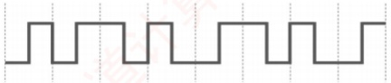
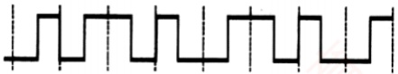
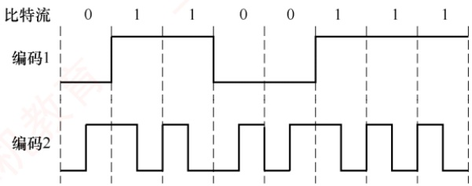
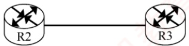
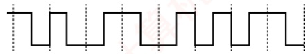
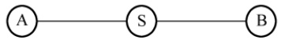

# 第2章 物理层 · 习题与解析

> 由《第2章 物理层》正文摘出；区块标题保留了原书的小节编号。

### 2.1.4 本节习题精选

#### 一、单项选择题

01.下列关于通信基础的基本概念的说法中，正确的是（）。
A. 信道与通信电路类似，一条可通信的电路往往包含一个信道
B. 调制是指把模拟数据转换为数字信号的过程
C. 信息传输速率是指通信信道上每秒传输的码元数
D. 在数值上，波特率等于比特率与每符号所含的比特数的比值

> ①各种参考资料中的常见写法为16-QAM，即数字在前，但统考真题中的写法是QAM-16。

02. 影响信道最大传输速率的因素主要有（)。
A. 信道带宽和信噪比
B. 码元传输速率和噪声功率
C. 频率特性和带宽
D. 发送功率和噪声功率

03.（）被用于计算机内部的数据传输。
A. 串行传输
B. 并行传输
C. 同步传输
D. 异步传输

04.下列有关曼彻斯特编码的叙述中，正确的是（）。
A. 每个信号起始边界作为时钟信号有利于同步
B. 将时钟与数据取值都包含在信号中
C. 这种编码机制特别适合传输模拟数据
D. 每位的中间不跳变表示信号的取值为0

05. 在数据通信中使用曼彻斯特编码的主要原因是（）。
A. 实现对通信过程中传输错误的恢复
B. 实现对通信过程中收发双方的数据同步
C. 提高对数据的有效传输速率
D. 提高传输信号的抗干扰能力

06. 不含同步信息的编码是（）。I. 非归零编码 I. 曼彻斯特编码 Ⅲ. 差分曼彻斯特编码
A. 仅I
B. 仅Ⅱ
C. 仅Ⅱ、ⅢII
D. I、II、ⅢII

07. 某信道的波特率为1000Baud，若令其数据传输速率达到4kb/s，则一个信号码元所取的有效离散值个数为（）。
A. 2
B. 4
C. 8
D. 16

08. 下图是某比特串的曼彻斯特编码信号波形，则该比特串为（）。

A. 0011 0110
B. 1010 1101
C. 0101 0010
D. 1100 0101

09. 已知某信道的信息传输速率为64kb/s，一个载波信号码元有4个有效离散值，则该信道的波特率为（）。
A. 16kBaud N
B. 32kBaud
C. 64kBaud
D. 128kBaud 食

10. 有一个无噪声的8kHz信道，每个信号包含8级，每秒采样24k次，那么可以获得的最大传输速率是（）。
A. 24kb/s
B. 32kb/s
C. 48kb/s
D. 72kb/s

11. 对于某带宽为4000Hz的低通信道，采用16种不同的物理状态来表示数据。按照奈奎斯特定理，信道的最大传输速率是（）。
A. 4kb/s
B. 8kb/s
C. 16kb/s
D. 32kb/s

12. 二进制信号在信噪比为127:1的4kHz信道上传输，最大数据传输速率可以达到（）。
A. 28000b/s
B. 8000b/s
C. 4000b/s
D. 无限大

13. 电话系统的典型参数是信道带宽为 3000Hz，信噪比为30dB，该系统的最大数据传输速率为（）。
A. 3kb/s
B. 6kb/s
C. 30kb/s
D. 64kb/s

14. 一个信道的信号功率是0.14W，噪声功率是0.02W，频率范围为3.5\~3.9MHz，则该信道的最高数据传输速率是（）。
A. 1.2Mb/s
B. 2.4Mb/s
C. 11.7Mb/s
D. 23.4Mb/s

15. 采用8种相位，每种相位各有两种幅度的OAM调制方法，在 1200Baud 的信息传输速率下能达到的数据传输速率为（）。
A. 2400b/s
B. 3600b/s
C. 9600b/s
D. 4800b/s

16. 一个信道每1/8s采样一次，传输信号共有16种变化状态，最大数据传输速率是（)。
A. 16b/s
B. 32b/s
C. 48b/s
D. 64b/s

17. 某信道的带宽为 10MHz，信噪比为 30dB，采用 QAM-32 调制方案。若将带宽提高到20MHz，信噪比提高到40dB，则信道的极限数据传输速率大约提高到原来的（）倍。
A. 2
B. 2.2
C. 2.4
D. 2.6 XTA

18.【2009统考真题】在无噪声的情况下，若某个通信链路的带宽为3kHz，采用4个相位，每个相位具有4种幅度的QAM调制技术，则该通信链路的最大数据传输速率是（）。
A. 12kb/s
B. 24kb/s
C. 48kb/s
D. 96kb/s

19. 【2011统考真题】若某个通信链路的数据传输速率为2400b/s，采用4个相位调制，则该链路的波特率是（）。
A. 600Baud
B. 1200Baud
C. 4800Baud
D. 9600Baud

20.【2013统考真题】下图为10Base-T网卡接收到的信号波形，则该网卡收到的比特串是（)。

A. 0011 0110
B. 1010 1101
C. 0101 0010
D. 1100 0101

21.【2014统考真题】在下列因素中，不影响信道数据传输速率的是（）。
A. 信噪比
B. 频率带宽
C. 调制速率
D. 信号传播速度

22. 【2015统考真题】使用两种编码方案对比特流01100111进行编码的结果如下图所示，编码1和编码2分别是（）。

A. NRZ 编码和曼彻斯特编码
B. NRZ 编码和差分曼彻斯特编码
C. NRZI 编码和曼彻斯特编码
D. NRZI编码和差分曼彻斯特编码

23.【2016统考真题】如下图所示，若连接R2和R3 链路的频带宽度为 8kHz，信噪比为30dB，该链路实际数据传输速率约为理论最大数据传输速率的50%，则该链路的实际数据传输速率约为（）。

A. 8kb/s
B. 20kb/s
C. 40kb/s
D. 80kb/s

24. 【2017统考真题】若信道在无噪声情况下的极限数据传输速率不小于信噪比为30dB条件下的极限数据传输速率，则信号状态数至少是（）。
A. 4
B. 8
C. 16
D. 32

25.【2021统考真题】下图为一段差分曼彻斯特编码信号波形，该编码的二进制串是（）。
A. 1011 1001
B. 1101 0001
C. 0010 1110
D. 1011 0110

26.【2022 统考真题】在一条带宽为200kHz 的无噪声信道上，若采用4 个幅值的ASK调制，则该信道的最大数据传输速率是（）。
A. 200kb/s
B. 400kb/s
C. 800kb/s
D. 1600kb/s

27.【2023统考真题】某个无噪声理想信道带宽为4MHz，采用QAM调制，若该信道的最大数据传输速率是48Mb/s，则该信道采用的 QAM 调制方案是（）。
A. QAM-16
B. QAM-32
C. QAM-64
D. QAM-128

28.【2024统考真题】在下列二进制数字调制方法中，需要2个不同频率载波的是（）。
A. ASK
B. PSK
C. FSK
D. DPSK

#### 二、综合应用题

01. 如下图所示，主机 A 和 B 都通过10Mb/s 的链路连接到交换机S。

每条链路上的传播时延都是20μs。S是一个存储转发设备，它在接收完一个分组 35μs后开始转发收到的分组。试计算将10000比特从A发送到B所需的总时间。

1）作为单个分组。

2）作为两个5000比特的分组一个紧接着另一个发送。

02. 一个分组交换网采用虚电路方式转发分组，分组的首部和数据部分分别为h位和p位。现有L（L≥ p且 L为p的倍数）位的报文通过该网络传送，源点和终点之间的线路数为k，每条线路上的传播时延为d秒，数据传输速率为bb/s，虚电路建立连接的时间为s秒，每个中间节点有m秒的平均处理时延。求源点开始发送数据直至终点收到全部数据所需的时间。

### 2.1.5 答案与解析

#### 一、单项选择题

01. D

信道不等于通信电路，一条可双向通信的电路往往包含两个信道:一个是发送信道，一个是接收信道。另外，多个通信用户共用通信电路时，每个用户在该通信电路都有一个信道，因此选项A错误。调制是将数据转换为模拟信号的过程，选项B错误。选项C明显错误。“比特率”在数值上和“波特率”的关系如下:波特率=比特率/每符号所含的比特数，选项D正确。

02. A

根据香农定理，影响信道最大传输速率的因素主要有信道带宽和信噪比，而信噪比与信道内所传输的平均信号功率和噪声功率有关，数值上等于二者之比。

03. B

并行传输的特点:距离短、速度快。串行传输的特点:距离长、速度慢。因此，在计算机内部（距离短）传输时应选择并行传输。同步、异步传输是通信方式，而不是传输方式。

04. B

曼彻斯特编码将时钟和数据包含在信号中，在传输数据的同时，也将时钟一起传输给对方，码元中间的跳变作为时钟信号，不同的跳变方式作为数据信号，选项A错误、选项B正确。每个码元的中间都发生电平跳变，选项D错误。曼彻斯特编码最适合传输二进制数字信号，选项C错误。

05. B

曼彻斯特编码用码元中间的电平跳变来表示每个比特，可方便收发双方根据跳变来同步时钟，而不需要额外的时钟信号，选项B正确。

06. A

非归零编码是最简单的一种编码方式，它用低电平表示0，用高电平表示1，或者采用相反的表示方式。因为各个码元之间并没有间隔标志，所以不包含同步信息。曼彻斯特编码和差分曼彻斯特编码都将每个码元分成两个相等的时间间隔，码元的中间跳变也作为收发双方的同步信息，因此不需要额外的同步信息，实际应用较多，但它们所占的频带宽度是原始基带宽度的2倍。

07. D

比特率=波特率×log2n，若一个码元含有k比特的信息量，则表示该码元所需的不同离散值为$n   =   2^{k}$ 个。波特率数值上等于比特率/每符号所含的比特数，因此每码元所含比特数 $4000/1000=4$有效离散值的个数为 $2^{4}   =   16$

08. A

在曼彻斯特编码中，可用向下跳变表示1，向上跳变表示0，或者采用相反的表示。因此该比特串可能是00110110或11001001，因此选择选项A。

09. B

一个码元若取 $2^{n}$ 个不同的离散值，则含有n比特的信息量。本题中，一个码元所含的信息量为2比特，因为数值上波特率=比特率/每符号所含的比特数，所以波特率为 $(64/2)\mathrm{k}=32\mathrm{k}\mathrm{B}\mathrm{a}\mathrm{u}$ 0

10. C

无噪声的信号应该满足奈奎斯特定理，即最大数据传输速率 $= 2 W \log_{2} V$ 比特/秒。将题中的数据代入，得到答案是48kb/s。注意题中给出的每秒采样24kHz是无意义的，因为超过了波特率的上限 $2W = 16  kBand$ ，所以选项D是错误答案。

11. D

根据奈奎斯特定理，题中 $W = 4000\mathrm{Hz}$ ，最大码元传输速率 $2W=8000\mathrm{Bud}$ ，16种不同的物理状态可以表示 $\log_{2}16 = 4$ 比特的数据，因此信道的最大传输速率 $8000 \times 4 = 32 \mathrm{k} \mathrm{b} / \mathrm{s}$ 。xX

12. B

根据香农定理，最大数据率 $W\log_{2}(1 + S/N) = 4000 \times \log_{2}(1 + 127) = 28000  b/s$ ，容易误选A。注意题中“二进制信号”的限制后，依据奈奎斯特定理，最大数据传输速率 $2H\log_{2}V = 2 \times 4000 \times \log_{2}2 =$ 8000b/s，两个上限中取小者，因此答案为B。

**注意**

若给出了码元与比特数之间的关系，则需受两个公式的共同限制。关于香农定理和奈奎斯特定理的比较，请参考本章中的疑难点。

13. C

信噪比S/N常用分贝（dB）表示，数值上等于 $10\log_{10}(S/N)\mathrm{dB}$ 。依题意有 $30 = 10 \log_{10} ( S / N )$解出 $S / N = 1000$ 。根据香农定理，最大数据传输速率 $3000\log_{2}(1 + S/N) \approx 30kb/s$

14. A

带宽受限且有噪声的信道应使用香农定理。最高数据传输速率= $W \mathrm {log}_{2} ( 1 + S / N )$ ，其中，信道带

宽 $W = 3.9 - 3.5 = 0.4  MHz$ ，信号功率 $S = 0.14 W$ ，噪声功率 $N = 0.02W$ ，代入得1.2Mb/s。

15. D

每个信号有 $8   \times   2   =   16$ 种变化，每个码元携带 $\log_{2}16 = 4$ 比特信息，则信息传输速率为1200× $4 = 4800\mathrm{b/s}$ 0 XA

16. B

由题意知采样率为8Hz。有16种变化状态的信号可携带4比特的数据，因此最大数据传输速率为 $8 \times 4 = 32b/s$ 0

17. A

本题给出了信道带宽、信噪比和编码方式，需要综合奈氏准则与香农定理的限制。在原始条件下:香农定理的极限速率为 $10 \times \log_{2}1001 \approx 100  Mb/s$ （注意，这里的信噪比应使用无单位记法），奈式准则的极限速率为 $2 \times 10 \times \log_{2}32 = 100  M   b/s$ 。带宽和信噪比提升后:香农定理的极限速率为$20 \times \log_{2}10001 \approx 260  Mb/s$ ，奈式准则的极限速率为 $2 \times 20 \times \log_{2}32 = 200 \mathrm{Mb/s}$ 。由于实际速率受限于二者中的较小值，故提升后的极限速率为200Mb/s，约为原来的2倍。

18. B

采用4个相位，每个相位有4种幅度的QAM调制，共有16种信号状态，每个码元可携带$\log_{2}16 = 4$ 比特信息。根据奈奎斯特定理，最大传输速率为 $2W \times \log_2 V = 2 \times 3 \mathrm{k} \times 4 = 24 \mathrm{k} \mathrm{b} / \mathrm{s}$

19. B

波特率（B）与数据传输速率（C）的关系为 $C = B \times \log_2 V$ ，其中V为码元可取的离散值个数。采用4种相位调制，即 $V = 4$ ，每个码元携带 $\log_{2}V = \log_{2}4 = 2$ 比特信息。因此，波特率 =数据传输速率/每个码元所含的比特数 $2400/2 = 1200$ 波特。

20. A

10Base-T以太网采用曼彻斯特编码:每个码元中间有一次跳变，从低到高表示0，从高到低表示1（或采用相反的约定，但需保持一致）。图示波形对应的比特串可为00110110或11001001。

21. D

由香农定理可知，信道极限数据传输速率受信噪比和频率带宽限制；调制速率（波特率）也直接影响数据速率。而信号传播速率仅决定传播时延，与传输速率无关，不影响信道数据传输速率。

22. A

编码1为典型的NRZ编码:高电平表示1，低电平表示0，无跳变。编码2在每个比特周期中间均有跳变，高-低表示1，低-高表示0，符合曼彻斯特编码特征。差分曼彻斯特编码在比特周期起始处有跳变表示0，无跳变表示1，与图不符。因此，编码1和编码2分别为NRZ编码和曼彻斯特编码。

23. C

采用分贝（dB）记法时，信噪比 $10 \log_{10} ( S / N ) = 30$ ，解得 $S/N = 1000$ 。由香农定理可知，理论极限速率 $W \times \log_{2}(1 + S/N) = 8k \times \log_{2}(1 + 1000)$ 。由于 $2^{10} = 1024 \approx 1001$ ，故 $\log_{2} ( 1001 ) \approx 10$理论速率 $8 \times 10 = 80 \mathrm{kb/s}$ 。实际速率为理论值的50%，即 $80 \times 50\% = 40 \mathrm{kb/s}$

24. D

设信号状态数为V。无噪声信道的极限速率（奈奎斯特定理）为 $2 {\mathsf {\bar {}}} {\mathsf {}} W {\mathsf {log}}_{2} V ;$ 有噪声信道的极限速率（香农定理）为 $W \mathrm {log}_{2} ( 1 + S / N )$ 。已知信噪比为30dB，可得 $S / N = 1000$ ，要求: $2 {\cal {W}} {\log_{2}} V^{2}$ A $W \log_{2}(1001) \approx W \times 10$ ，化简得 $\log_{2} V \geq 5$ ，求得 $V \geq 32$ 。因此，信号状态数至少为32。

25. A

差分曼彻斯特编码规则:每个比特周期起始处有电平跳变表示0，无电平跳变表示1。第1位无跳变（1），第2位有跳变（0），第3位无跳变（1），第4位无跳变（1），第5位有跳变（0），第6位有跳变（0），第7位有跳变（0），第8位无跳变（1），得到比特串为10111001。26. C

<table><tr><td rowspan=3>分组2分组1</td><td></td><td></td><td></td><td></td><td></td><td></td><td></td><td></td></tr><tr><td></td><td colspan=3>500</td><td>20</td><td>35</td><td colspan=2>500</td><td>20</td></tr><tr><td>500</td><td>20</td><td>35</td><td colspan=3>500</td><td>20</td><td></td></tr></table>

在ASK调制中，4个幅值表示4种信号状态（V=4），每个码元携带 $\log_{2} 4 = 2$ 比特。根据奈奎斯特定理，最大数据传输速率 $= 2 W \log_2 V$ ，已知带宽 $W = 200  kHz$ ，代入得800kb/s。

27. C

由奈奎斯特定理:最大数据传输速率 $= 2  {\mathsf {{Wlog}}}_{2} V ,$ V表示码元的信号状态数。已知带宽 $W   =$ 4MHz，最大速率为48Mb/s，代入得 $\log_{2} V = 6$ ，求得 $V = 2^{6} = 64$ ，即采用 QAM-64 调制。

28. C

FSK（Frequency Shift Keying，频移键控）使用两个不同频率的载波分别表示0和1，是唯一需要两个载波频率的二进制调制方式。ASK（Amplitude Shift Keying，幅移键控）改变幅度，PSK（Phase ShiftKeying，相移键控）和DPSK（差分相移键控）改变相位，均使用单一频率载波。

#### 二、综合应用题

01.【解答】

1）每条链路的发送时延是 $10000/(10\mathrm{Mb/s})=1000\mu\mathrm{s}。$

总传送时间等于 $2 \times 1000 + 2 \times 20 + 35 = 2075 \mu  s$

2）解法一:作为两个分组发送时，下面列出了各种事件发生的时间表。

T=0 开始

T=500 A完成分组1的发送，开始发送分组2

T=520 分组1完全到达S

T=555 分组1从 S 起程前往B

T=1000 A 结束分组2的发送

T= 1055 分组 2 从 S 起程前往 B

T=1075 分组 2 的第1 位开始到达 B

T= 1575 分组 2 的最后 1 位到达 B

解法二:此题属于分组交换各个过程中时间不等长的情况，类似于流水段不等长的情况，为避免出错，建议画出对应的时空图。

根据题意可分为5个流水段，各流水段的时间分别为500μs、20μs、35μs、500μs、20μs，共有2个分组，注意不同分组的相同流水段不能重叠，画出的时空图如下图所示。本题只有2个分组，不用流水线的方法也可求得结果，但当分组数量更多时，采用流水线的方法并画出时空图得出计算规律，才不容易出错。

02. 【解答】

整个传输过程的总时延=连接建立时延+源点发送时延+中间节点的发送时延+中间节点的处理时延+传播时延。

虚电路的建立时延已给出，为s秒。

源点要将L位报文分割成分组，分组数=L/p，每个分组的长度为(h+p)，源点要发送的数据

量 $(h + p)L / p$ ，因此源点的发送时延 $( h + p ) L / ( p b )$ 秒。

每个中间节点的发送时延 $=(h+p)/b$ 秒，源点和终点之间的线路数为k，有k-1个中间节点，因此中间节点的发送时延 $(h + p)(k - 1) / b$ 秒。

中间节点的处理时延=m(k-1)秒，传播时延=kd秒。因此，源节点开始发送数据直至终点收到全部数据所需的时间 $s+(h+p)L/(pb)+(h+p)(k-1)/b+m(k-1)+kd$ 秒。

### 2.2.3 本节习题精选

#### 单项选择题

01. 双绞线是用两根绝缘导线绞合而成的，绞合的目的是（）。
A. 减少干扰
B. 提高传输速度
C. 增大传输距离
D. 增大抗拉强度

02. 在电缆中采用屏蔽技术带来的好处主要是（）。
A. 减少信号衰减
B. 减少电磁干扰辐射直
C. 减少物理损坏
D. 减少电缆的阻抗

03. 利用一根同轴电缆互连主机构成以太网，则主机间的通信方式为（）。
A. 全双工
B. 半双工
C. 单工
D. 不确定

04. 同轴电缆比双绞线的传输速率更快，得益于（）。
A. 同轴电缆的铜芯比双绞线的粗，能通过更大的电流
B. 同轴电缆的阻抗比较标准，减少了信号的衰减
C. 同轴电缆具有更高的屏蔽性，同时有更好的抗噪声性
D. 以上都正确

05. 不受电磁干扰和噪声影响的传输介质是（）。
A. 屏蔽双绞线
B. 非屏蔽双绞线
C. 光纤
D. 同轴电缆

06. 多模光纤传输光信号的原理是（）。
A. 光的折射特性
B. 光的发射特性
C. 光的全反射特性
D. 光的绕射特性

07.以下关于单模光纤的说法中，正确的是（）
A. 光纤越粗，数据传输速率越高
B. 光纤的直径减小到只有光的一个波长大小时，光沿直线传播
C. 光源是发光二极管或激光
D. 光纤是中空的

08. 下列关于卫星通信的说法中，错误的是（）。

A. 卫星通信的距离长，覆盖的范围广
B. 使用卫星通信易于实现广播通信和多址通信
C. 卫星通信的好处在于不受气候的影响，误码率很低
D. 通信费用高、延时较大是卫星通信的不足之处

09. 某网络在物理层规定，信号的电平用+10V\~+15V表示二进制0，用-10V\~-15V表示二进制1，电线长度限于15m以内，这体现了物理层接口的（）。
A. 机械特性
B. 功能特性
C. 电气特性
D. 规程特性

10. 当描述一个物理层接口引脚处于高电平时的含义时，该描述属于（）。
A. 机械特性
B. 电气特性
C. 功能特性
D. 规程特性

11.【2012统考真题】在物理层接口特性中，用于描述完成每种功能的事件发生顺序的是（）。
A. 机械特性
B. 功能特性
C. 过程特性
D. 电气特性

12.【2018统考真题】下列选项中，不属于物理层接口规范定义范畴的是（）。
A. 接口形状
B. 引脚功能
C. 物理地址
D. 信号电平

### 2.2.4 答案与解析

#### 单项选择题

01. A

绞合可以减少两根导线相互的电磁干扰。

02. B

屏蔽层的主要作用是提高电缆的抗干扰能力。

03. B

传统以太网采用广播的方式发送信息，同一时间只允许一台主机发送信息，否则各主机之间就形成冲突，因此主机间的通信方式是半双工。全双工是指通信双方可同时发送和接收信息。单工是指只有一个方向的通信而没有反方向的交互。

04. C

同轴电缆以硬铜线为芯，外面包一层绝缘材料，绝缘材料的外面再包一层密织的网状导体，导体的外面又覆盖一层保护性的塑料外壳。这种结构使得它具有更高的屏蔽性，从而既有很高的带宽，又有很好的抗噪性。因此，同轴电缆的带宽更高，得益于它的高屏蔽性。

05. C

光纤的抗雷电和电磁干扰性能好，无串音干扰，保密性好。

06. C

多模光纤传输光信号的原理是光的全反射特性。

07. B

光纤的直径减小到与光线的一个波长相同时，光纤就如同一个波导，光在其中没有反射，而沿直线传播，这就是单模光纤。

卫星通信有成本高、传播时延长、受气候影响大、保密性差、误码率较高的特点。

09. C

本题易误选功能特性。规定各条线上的电压范围，以及电缆长度的限制，属于电气特性。而功能特性指明某条线上出现的某一电平的电压表示何种意义，以及每条线的功能（数据线、控制线、时钟线）。例如，数据线上的电压+11V表示二进制1，就属于功能特性。

10. C

物理层的功能特性指明某条线上出现的某一电平的电压表示何种意义，以及每条线的功能。

11. C

物理层的接口特性包括机械、电气、功能和过程四类。其中，过程特性用于描述完成各种功能时事件发生的先后顺序，即规定各操作（如建立连接、传输数据、释放线路等）的时序关系。

12. C

物理层接口规范涵盖四类特性:机械特性（如接口形状、尺寸）、电气特性（如信号电平、电压范围）、功能特性（如引脚功能、电平含义）和过程特性（事件发生顺序）。而物理地址（MAC地址）用于标识数据链路层的设备，属于数据链路层的范畴，不在物理层定义范围内。

### 2.3.3 本节习题精选

#### 单项选择题

01.下列关于物理层设备的叙述中，错误的是（）。
A. 中继器仅作用于信号的电气部分
B. 利用中继器来扩大网络传输距离的原理是将衰减的信号进行放大
C. 集线器实质上相当于一个多端口的中继器
D. 物理层设备连接的几个网段仍是一个局域网

02. 为了使数字信号传输得更远，可采用的设备是（）。
A. 中继器
B. 放大器
C. 网桥
D. 路由器

03. 以太网遵循 IEEE 802.3 标准，用粗缆组网时每段的长度不能大于 500m，超过 500m时就要分段，段间相连利用的是（）。
A. 网络适配器
B. 中继器
C. 调制解调器
D. 网关

04.由集线器连接多台设备构成的网络在物理上和逻辑上的结构分别是（）。
A. 总线形、环形
B. 网状、星形
C. 总线形、星形
D. 星形、总线形

05. 用集线器连接的工作站集合（）。
A. 同属一个冲突域，也同属一个广播域
B. 不同属一个冲突域，但同属一个广播域
C. 不同属一个冲突域，也不同属一个广播域
D. 同属一个冲突域，但不同属一个广播域

06. 中继器可以用来连接（）。
A. 不同类型的局域网
B. 广域网和局域网
C. 不同介质的局域网
D. 不同协议的局域网

07. 若有5 台计算机连接到10Mb/s的集线器上，则每台计算机分得的平均带宽至多为（）。
A. 2Mb/s
B. 5Mb/s
C. 10Mb/s
D. 50Mb/s

08.当集线器的一个端口收到数据后，将其（）。
A. 从所有端口广播出去
B. 从除输入端口外的所有端口广播出去
C. 根据目的地址从合适的端口转发出去
D. 随机选择一个端口转发出去

09. 下列关于中继器和集线器的说法中，不正确的是（）。
A. 二者都工作在 OSI参考模型的物理层
B. 二者都可以对信号进行放大和整形
C. 通过中继器或集线器互连的网段数量不受限制
D. 中继器通常只有2个端口，而集线器通常有4个或更多端口

> ①冲突域和广播域的介绍见本书4.7节。

### 2.3.4 答案与解析

#### 单项选择题

01. B

中继器的原理是将衰减的信号再生（再生=放大+整形），而不是简单地放大。

02. A

放大器通常用于远距离地传输模拟信号，但它同时会放大噪声，引发失真。中继器用于数字信号的传输，其工作原理是信号再生，因此会减少失真。网桥用来连接两个网段以扩展物理网络的覆盖范围。路由器是网络层的互连设备，可以实现不同网络的互联 T

03. B

中继器的主要功能是将信号复制、整形和放大再转发出去，以消除信号经过一长段电缆而造成的失真和衰减，使信号的波形和强度达到所需的要求，进而扩大网络传输的距离，原理是信号再生，因此选择选项B，其他三项显然有点大材小用。

04. D

集线器将多个设备连接在以它为中心的节点上，因此使用它的网络在物理拓扑上属于星形结构。当集线器工作时，一个端口接收到数据信号后，集线器将该信号整形放大，紧接着转发到其他所有处于工作状态的端口。因为集线器不具备交换机所具有的交换表，所以它发送数据时是没有针对性的，而采用广播方式发送。因此，使用集线器的星形以太网逻辑上仍然是总线网。

05. A

集线器的功能是将从一个端口收到的数据通过所有其他端口转发出去。集线器在物理层上扩大了网络的覆盖范围，但无法解决冲突域（第二层交换机可解决）与广播域（第三层交换机可解决）的问题，而且增大了冲突的范围。注意，冲突域和广播域的概念涉及后面章节的内容。

06. C

中继器工作在物理层，无法对帧进行解封与重新封装（无法实现协议转换），其功能仅限于对接收到的帧对应的二进制串进行无差别转发，因此无法连接不同链路层协议的网段。中继器可以连接不同介质的局域网，如光纤和双绞线，只要它们具有相同协议。

07. A

集线器以广播的方式将信号从除输入端口外的所有端口输出，因此任意时刻只能有一个端口的有效数据输入。理想情况（无冲突）下，每秒通过集线器的数据量都是10Mb，假设5台计算机占用相同大小的时间片来收发数据，则平均带宽的上限为10Mb/s÷5=2Mb/s。若有多台计算机同时发送数据，则会导致每台计算机实际获得的平均带宽低于2Mb/s。

08. B

集线器没有寻址功能，一个端口接收到数据信号后，从其他所有端口转发出去。

09. C

中继器和集线器均工作在物理层，集线器本质上是一个多端口中继器，它们都能对信号进行放大和整形（再生=放大+整形）。因为中继器不仅传送有用信号，还传送噪声和冲突信号，因此互相串联的个数只能在规定的范围内进行，否则网络将不可用。注意“5-4-3规则”。
