# 第3章 数据链路层 · 习题与解析

> 由《第3章 数据链路层》正文摘出；区块标题保留了原书的小节编号。

### 3.1.6 本节习题精选

#### 单项选择题

01.下列选项中，不属于数据链路层功能的是（）。

A. 帧定界
B. 电路管理
C. 差错控制
D. 流量控制

02. 下列选项中，不属于数据链路层功能的是（）。
A. 透明传输
B. 差错检测
C. 可靠传输
D. 拥塞控制

03.下列选项中，不属于数据链路层协议功能的是（）。
A. 定义数据格式
B. 提供节点之间的可靠传输
C. 控制对物理传输介质的访问
D. 为终端节点隐蔽物理传输的细节

04. 为了避免传输过程中帧的丢失，数据链路层采用的方法是（）。
A. 帧编号机制
B. 循环冗余检验码育
C. 海明码
D. 计时器超时重发

05. 对于信道比较可靠且对实时性要求高的网络，数据链路层采用（）比较合适。
A. 无确认的无连接服务
B. 有确认的无连接服务
C. 无确认的面向连接服务
D. 有确认的面向连接服务

06. 流量控制实际上是对（）的控制。
A. 发送方的数据流量
B. 接收方的数据流量
C. 发送、接收方的数据流量
D. 链路上任意两节点间的数据流量

### 3.1.7 答案与解析

#### 单项选择题

01. B

数据链路层的主要功能包括:如何将二进制比特流组织成数据链路层的帧；如何控制帧在物理信道上的传输，包括如何处理传输差错；在两个网络实体之间提供数据链路的建立、维护和释放；控制链路上帧的传输速率，以使接收方有足够的缓存来接收每个帧。这些功能对应为帧定界、差错检测、链路管理和流量控制。电路管理功能由物理层提供。

02. D

拥塞控制是网络层或传输层的功能，用于防止过多的分组注入网络而导致网络性能下降。03. D XTA

数据链路层的主要功能包括组帧，组帧即定义数据格式，选项A正确。数据链路层在物理层提供的不可靠的物理连接上实现节点到节点的可靠性传输，选项B正确。控制对物理传输介质的访问由数据链路层的介质访问控制（MAC）子层完成，选项C正确。为终端节点隐蔽物理传输的细节是物理层的功能，数据链路层不必考虑如何实现无差别的比特传输，选项D错误。

04. D

为防止在传输过程中丢失帧，在可靠的数据链路层协议中，发送方为发送的每个数据帧设计一个计时器，当计时器到期而该帧的确认帧仍未到达时，发送方将重发该帧。为保证接收方不会接收到重复帧，需要对每个发送的帧进行编号；海明码和循环冗余检验码都用于差错控制。

05. A

无确认的无连接服务是指源主机发送帧时不需要先建立逻辑连接，目的主机收到帧时不需要发回确认。若因线路上有噪声而造成某一帧丢失，则数据链路层并不检测这样的丢帧现象，也不回复。当错误率很低时，这类服务非常合适，此时恢复任务可由上面的高层来负责。这类服务对实时通信也非常合适，因为实时通信中数据迟到比数据损坏更不好。

06. A

流量控制是通过限制发送方的数据流量而使发送方的发送速率不超过接收方接收速率的一种技术。流量控制功能并不是数据链路层独有的，其他层上也有相应的控制策略，只是各层的流量控制对象是在相应层的实体之间进行的。

### 3.2.5 本节习题精选

#### 一、单项选择题

01.【2013统考真题】HDLC协议对0111110001111110组帧后，对应的比特串为（）(注:HDLC协议已从最新大纲中删除。）
A. 01111100 00111110 10
B. 01111100 01111101 01111110
C. 01111100 01111101 0
D. 01111100 01111110 01111101

#### 二、综合应用题

01. 在一个数据链路协议中使用下列字符编码: A01000111; B 11100011; ESC 11100000; FLAG 01111110在使用下列组帧方法的情况下，说明为传送4个字符A、B、ESC、FLAG所组织的帧而实际发送的二进制位序列（使用FLAG作为首尾标志，ESC作为转义字符）。1）使用字符计数法。2）使用字节填充法。 机教育3）使用零比特填充法。

### 3.2.6 答案与解析

#### 一、单项选择题

01. A

HDLC协议对比特串组帧时，HDLC数据帧以比特模式01111110标识每个帧的起始和结束，因此在帧数据中只要出现5个连续的位“1”，就在输出的位流中填充一个“0”。因此，组帧后的比特串为011111000011111010（下划线部分为新增的0）。

#### 二、综合应用题

01. 【解答】

1）第一字节为所传输的字符计数5，转换为二进制为00000101，后面依次为A、B、ESC、FLAG的二进制编码:

$$
00000101 \quad 01000111 \quad 11100011 \quad 11100000 \quad 01111110
$$

2）首尾标志位FLAG（01111110），在所传输的数据中，若出现控制字符，则在该字符前插入转义字符ESC（11100000）: A

$$
01111110 \; 01000111 \; 11100011 \; 11100000 \; 11100000 \; 11100000 \; 011111110 \; 01111110
$$

3）首尾标志位FLAG（01111110），在所传输的数据中，若连续出现5个“1”，则在其后插入“0”: 道

01111110 01000111 110100011 111000000 011111010 01111110

### 3.3.3 本节习题精选

#### 一、单项选择题

01.下列有关数据链路层差错控制的叙述中，错误的是（）。
A. 数据链路层只能提供差错检测，而不提供对差错的纠正
B. 奇偶检验码只能检测出错误而无法对其进行修正，也无法检测出双位错误
C. CRC检验码可以检测出所有的单比特错误
D. 海明码可以纠正一位差错 算机

02.下列关于奇偶检验码特征的描述中，正确的是（）。
A. 只能检查出奇数个比特的错误
B. 能检查出任意比特的错误
C. 比 CRC 检验更可靠
D. 只能检查出偶数个比特的错误

03. 字符S的 ASCI编码从低到高依次为1100101，采用奇检验，在下述收到的传输后字符中，错误（）不能检测。
A. 11000011
B. 11001010
C. 11001100
D. 11010011

04. 为纠正2比特错误，编码的码距至少应为（）
A. 2
B. 3
C. 4
D. 5

05. 对于10位要传输的数据，若采用海明码检验，则需要增加的冗余信息位数是（）。
A. 3
B. 4
C. 5
D. 6

06.下列关于循环冗余检验的说法中，错误的是（）。

A. 带r个检验位的多项式编码可以检测到所有长度小于或等于r的突发性错误
B. 通信双方可以无须商定就直接使用多项式编码
C. CRC 检验可以使用硬件来完成
D. 有一些特殊的多项式，因为有很好的特性，而成了国际标准

07. 要发送的数据是1101 011011，采用CRC检验，生成多项式是10011，那么最终发送的数据应是（）。
A. 1101 0110 1110 10
B. 1101 0110 1101 10
C. 1101 0110 1111 10
D. 1111 0011 0111 00

08. 【2023统考真题】若甲向乙发送数据时采用CRC检验，生成多项式为 $G(X) = X^4 + X +$ 1 $G = 10011$ 则乙方接收到比特串（）时，可以断定其在传输过程中未发生错误。
A. 10111 0000
B. 10111 0100
C. 10111 1000
D. 10111 1100

09.【2025统考真题】某差错编码的编码集为{10011010,01011100,11110000,00001111}，该差错编码的检错和纠错能力是（）。
A. 不超过2 位错的100%检错、不超过1 位错的纠错 王道
B. 不超过2 位错的 100%检错、不超过2 位错的纠错
C. 不超过3 位错的100%检错、不超过1位错的纠错
D. 不超过3 位错的100%检错、不超过 2 位错的纠错

#### 二、综合应用题

01. 在数据传输过程中，若接收方收到的比特序列为10110011010，收发双方采用的生成多项式为 $G(x)=x^{4}+x^{3}+1$ ，则该比特序列在传输中是否出错？若未出错，则发送数据的比特序列和CRC检验码的比特序列分别是什么？

### 3.3.4 答案与解析

#### 一、单项选择题

01. A

链路层的差错控制有两种基本策略:检错编码和纠错编码。常见的纠错编码有海明码，它可以纠正一位差错。CRC检验编码可以检测出所有的单比特错误（记住该结论即可）。

02. A

奇偶检验的原理是通过增加冗余位来使得码字中“1”的个数保持为奇数或偶数的编码方法，它只能检查出奇数个比特的错误。

03. D

既然采用奇检验，那么传输的数据中1的个数若是偶数则可检测出错误，若1的个数是奇数则检测不出错误。

04. D

要纠正d位错误，编码的码距需满足2d+1。当d=2时，所需码距为2×2+1=5。

05. B

在k比特信息位上附加r比特冗余信息，构成k+ r比特的码字，必须满足 $2^{r} \geqslant k + r + 1$ 。若k的取值小于或等于11且大于4，则r=4。

06. B

在使用多项式编码时，发送方和接收方必须预先商定一个生成多项式。发送方按照模2除法，得到检验码，在发送数据时将该检验码加到数据后面。接收方收到数据后，也需要根据该生成多项式来验证数据的正确性。选项A是正确结论，了解即可，无须掌握证明过程。

07. C

假设一个帧有m位，其对应的多项式为G(x)，则计算冗余码的步骤如下:

①加 $0_{\circ}$ 假设 G(x)的阶为 r，在帧的低位端加上 r 个 0。

②模2除。利用模2除法，用G(x)对应的数据串除①中计算出的数据串，得到的余数即为冗余码（共r位，前面的0不可省略）。

多项式以2为模运算。按照模2运算规则，加法不进位，减法不借位，它刚好是异或操作。乘除法类似于二进制运算，只是在做加减法时按模2规则进行。

08. D

观察选项:除后4位外，前5位都为10111，可知发送方发送的数据部分为10111，列式求得余数部分为1100，因此发送方发送的帧串为101111100。

$$
\begin{aligned}&\overbrace{1\ 0\ 0\ 1\ 1\ \ 1\ 0\ 0\ 0\ 0}^{1\ 0\ 1\ 0\ 0\ 0} \\= \underbrace{1\ 0\ 0\ 1\ 1}_{1\ 0\ 0\ 0\ 0} \\\ \ \ \underbrace{1\ 0\ 0\ 1\ 1}_{1\ 1\ 1\ 0\ 0} & --- --- 余数 \end{aligned}
$$

09. C

首先计算该编码集的码距:对四个码字两两比较，任意两个码字的码距至少为4，故该编码集的码距 $d_{\mathrm {min}}   =   4$ 。根据差错控制理论，若编码集的码距为d，则可检测不超过d-1位错误，能纠正不超过 $( d - 1 ) / 2 .$ 位错误。因此该编码集最多能检测3位错误、纠正1位错误。

#### 二、综合应用题

01. 【解答】

根据题意，生成多项式G(x)对应的比特序列为11001。进行如下的二进制模2除法，被除数为10110011010，除数为11001:

$$
\begin{aligned} {1 \quad 1 \quad 0 \quad 1 \quad 0 \quad 1 \quad 0 \quad 1 \quad 0 \quad 1 \quad 0 \quad 1 \quad 0 \quad 1 \quad 0 \quad 1 \quad 0 \quad 1 \quad 0 \quad 1 \quad 0 \quad 1 \quad 0 \quad 1 \quad 0 \quad 1 \quad 0 \quad 1 \quad 0 \quad 1 \quad 0 \quad 1 \quad 0 \quad 1 \quad 0 \quad 1 \quad 0 \quad 1 \quad 0 \quad 1 \quad 0 \quad 1 \quad 0 \quad 1 \quad 0 \quad 1 \quad 0 \quad 1 \quad 0 \quad 1 \quad 0 \quad 1 \quad 0 \quad 1 \quad 0 \quad 1 \quad 0 \quad 1 \quad 0 \quad 1 \quad 0 \quad 1 \quad 0 \quad 1 \quad 0 \quad 1 \quad 0 \quad 1 \quad 0 \quad 1 \quad 0 \quad 1 \quad 0 \quad 1 \quad 0 \quad 1 \quad 0 \quad 1 \quad 0 \quad 1 \quad 0 \quad 1 \quad 0 \quad 1 \quad 0 \quad 1 \quad 0 \quad 1 \quad 0 \quad 1 \quad 0 \quad 1 \quad 0 \quad 1 \quad 0 \quad 1 \quad 0 \quad 1 \quad 0 \quad 1 \quad 0 \quad 1 \quad 0 \quad 1 \quad 0 \quad 1 \quad 0 \quad 1 \quad 0 \quad 1 \quad 0 \quad 1 \quad 0 \quad 1 \quad 0 \quad 1 \quad 0 \quad 1 \quad 0 \quad 1 \quad 0 \quad 1 \quad 0 \quad 1 \quad 0 \quad 1 \quad 0 \quad 1 \quad 0 \quad 1 \quad 0 \quad 1 \quad 0 \quad 1 \quad 0 \quad 1 \quad 0 \quad 1 \quad 0 \quad 1 \quad 0 \quad 1 \quad 0 \quad 1 \quad 0 \quad 1 \quad 0 \quad 1 \quad 0 \quad 1 \quad 0 \quad 1 \quad 0 \quad 1 \quad 0 \quad 1 \quad 0 \quad 1 \quad 0 \quad 1 \quad 0 \quad 1 \quad 0 \quad 1 \quad 0 \quad 1 \quad 0 \quad 1 \quad 0 \quad 1 \quad 0 \quad 1 \quad 0 \quad 1 \quad 0 \quad 1 \quad 0 \quad 1 \quad 0 \quad 1 \quad 0 \quad 1 \quad 0 \quad 1 \quad 0 \quad 1 \quad 1 \quad 0 \quad 1 \quad 0 \quad 1 \quad 1 \quad 0 \quad 1 \quad 1 \quad 0 \quad 1 \quad 1 \quad 0 \quad 1 \quad 1 \quad 1 \quad 0 \quad 1 \quad 1 \quad 1 \quad 1 \quad \quad 1 \quad 1 \quad 1 \quad 1 \quad \quad 1 \quad 1 \quad 1 \quad \quad 1 \quad 1 \quad 1 \quad \quad 1 \quad 1 \quad 1 \quad \quad 1 \quad 1 \quad \quad 1 \quad 1 \quad \quad 1 \quad 1 \quad \quad 1 \quad 1 \quad \quad 1 \quad 1 \quad \quad 1 \quad 1 \quad \quad 1 \quad 1 \quad \quad 1 \quad 1 \quad \quad 1 \quad 1 \quad \quad 1 \quad \quad 1 \quad 1 \quad \quad 1 \quad \quad 1 \quad \quad 1 \quad 1 \quad \quad 1 \quad \quad 1 \quad \quad 1 \quad 1 \quad \quad 1 \quad \quad 1 \quad \quad 1 \quad \quad 1 \quad \quad 1 \quad \quad 1 \quad \quad 1 \quad \quad 1 \quad \quad 1 \quad \quad 1 \quad \quad 1 \quad \quad 1 \quad \quad 1 \quad \quad 1 \quad \quad 1 \quad \quad 1 \quad \quad 1 \quad \quad 1 \quad \quad 1 \quad \quad \quad 1 \quad \quad 1 \quad \quad 1 \quad \quad 1 \quad \quad 1 \quad \quad \quad 1 \quad \quad 1 \quad \quad \quad \end{aligned}
$$

所得余数为0，因此该比特序列在传输过程中未出现差错。发送数据的比特序列是1011001，CRC检验码的比特序列是1010。注，CRC检验码的位数等于生成多项式G(x)的最高次幂。

### 3.4.3 本节习题精选

#### 一、单项选择题

01.下列关于停止-等待协议的描述中，正确的是（）。
A. 发送窗口和接收窗口的尺寸都为1
B. 最大的信道利用率有可能达到100%
C. 适合于往返时间比较长的信道
D. 接收方可以不按序接收 VO

02.下列情况中，会使停止-等待协议的效率变得很低的是（）。
A. 当源主机和目的主机之间的距离很近而且数据传输速率很高时
B. 当源主机和目的主机之间的距离很远而且数据传输速率很高时
C. 当源主机和目的主机之间的距离很近而且数据传输速率很低时
D. 当源主机和目的主机之间的距离很远而且数据传输速率很低时

03. 在简单的停止-等待协议中，当帧出现丢失时，发送方会永远等待下去，解决这种死锁现象的办法是（）。
A. 差错检验
B. 帧序号
C. NAK 机制
D. 超时机制

04. 在停止-等待协议中，为了让接收方能判断所收到的数据帧是否重复，采用（）的方法。
A. 帧编号
B. 检错码
C. 重传计时器
D. NAK 帧

05. 一个信道的数据传输速率为 4kb/s，单向传播时延为 30ms，若使停止-等待协议的信道最大利用率达到80%，则要求的数据帧长至少为（）。
A. 160 比特
B. 320 比特
C. 560 比特
D. 960 比特

06. 主机甲采用停止-等待协议向主机乙发送数据，数据传输速率是6kb/s，单向传播时延是

100ms，忽略确认帧的发送时延。信道的利用率为40%时，数据帧的长度为（）。
A. 240 比特
B. 320 比特
C. 600比特
D. 800 比特

07.在停止-等待协议中，若发送方发送的数据帧中途丢失，则可能发生的情况是（）。
A. 接收方发送NAK帧，请求重发此帧
B. 发送方在经过超时时间后未收到ACK帧，自动重发此帧
C. 接收方在经过超时时间后，向发送方发送ACK帧，请求重发此帧
D. 发送方继续发送后续帧，直到经过超时时间后未收到ACK帧，重发此帧

08.下列关于连续ARQ的说法中，错误的是（）。
A. 发送方可以连续发送若干数据帧，而不是发完一个数据帧就停下来等待确认帧
B. 发送方收到了接收方发来的确认帧，还可以接着发送数据帧
C. 相比停止-等待协议，连续ARQ因为减少了等待时间，所以提高了信道利用率
D. 接收方可以不按序接收数据帧

09. 数据链路层采用后退N帧协议进行流量控制，发送方已发送编号为0\~6的帧，之后收到5号数据帧的确认，发送方的滑动窗口向后移动后，发送方可发送的数据帧数量为6个，假设整个过程未发生超时，则应采用（）位给数据帧编号。
A. 3
B. 4
C. 5
D. 6

10. 数据链路层采用后退N帧协议，发送方已经发送了编号从0到6的帧。当计时器超时的时候，只收到对1、2、4号帧的确认，发送方需要重传的帧的数量是（）。
A. 1
B. 2
C. 5
D. 6

11. 数据链路层采用了后退N帧协议（GBN），若发送窗口的大小是32，则至少需要（）位的序列号才能保证协议不出错。
A. 4
B. 5 X
C. 6
D. 7

12. 若采用后退N帧的ARQ协议进行流量控制，帧编号字段为7位，则发送窗口的最大长度为（）。
A. 7
B. 8
C. 127
D. 128

13. 一个使用选择重传协议的数据链路层，若采用5位的帧序列号，则可以选用的最大接收窗口是（） 教
A. 15
B. 16
C. 31
D. 32

14. 对于窗口总大小为n的滑动窗口，最多可以有（）帧已发送但没有确认。
A. 0
B. n-1
C. n
D. $n / 2$

15. 数据链路层采用选择重传协议（SR）传输数据，若帧序号采用4比特编号，接收窗口大小为7，则发送窗口最大是（）。
A. 17
B. 8
C. 9
D. 10

16. 对无序接收的滑动窗口协议，若序号位数为n，则接收窗口最大尺寸为（）。
A. $2^{n}   -   1$
B. 2n
C. $2n - 1$
D. $2^{n - 1}$

17. 采用滑动窗口机制对两个相邻节点A和B的通信过程进行流量控制。A和B之间的数据传输速率为20kb/s，数据帧和确认帧的长度都为 2000B，往返传播时延为1400ms，采用3比特给数据帧编号，测得在A和B的通信过程中信道利用率大于80%，则（）。(注:在SR协议中，默认发送窗口大小等于接收窗口大小。）
A. 节点A、B之间只能采用停止等待协议
B. 节点A、B之间只能采用 GBN协议
C. 节点A、B之间只能采用 SR协议
D. 节点 A、B之间可以采用 GBN 协议或 SR 协议

18. 流量控制是实现发送方和接收方速度一致的机制，实现这种机制所采取的措施是（）。
A. 增大接收方接收速度
B. 减小发送方发送速度王道
C. 接收方向发送方反馈信息
D. 增加双方的缓冲区

19. 假设两台主机之间采用后退N帧协议传输数据，数据传输速率为16kb/s，单向传播时延为250ms，数据帧的长度是128B，确认帧的长度也是128B，为使信道利用率达到最高，
A. 2 则帧序号的比特数至少为（）。
B. 3
C. 4
D. 5 几教

20. 在下列滑动窗口机制中，理论上可以达到100%信道利用率的是（）I. 停止-等待协议 Ⅱ. 后退 N帧协议 I. 选择重传协议
A. I
B. ⅡI
C. III
D. ⅡI和II

21. 数据链路层采用选择重传协议进行流量控制，发送方在收到0\~3号帧的确认后，又收到了5号帧的确认，发送窗口内还有其他帧未发送，且未发生超时，则发送方将（）。
A. 重传4号帧
B. 重传5号帧
C. 接收该确认帧并继续发送剩下的帧
D. 停止发送并等待超时

22.【2009统考真题】数据链路层采用了后退N帧（GBN）协议，发送方已经发送了编号为0\~7的帧。当计时器超时的时候，若发送方只收到0、2、3号帧的确认，则发送方需要重发的帧数是（）。
A. 2
B. 3
C. 4
D. 5

23.【2011统考真题】数据链路层采用选择重传协议（SR）传输数据，发送方已发送0\~3号数据帧，现已收到1号帧的确认，而0、2号帧依次超时，则此时需要重传的帧数是（）。
A. 1
B. 2
C. 3
D. 4

24.【2012统考真题】两台主机之间的数据链路层采用后退N帧协议（GBN）传输数据，数据传输速率为16kb/s，单向传播时延为270ms，数据帧长范围是128\~512B，接收方总是以与数据帧等长的帧进行确认。为使信道利用率达到最高，帧序号的比特数至少为（）。
A. 5
B. 4
C. 3
D. 2

25.【2014统考真题】主机甲与主机乙之间使用后退N帧协议（GBN）传输数据，主机甲的发送窗口尺寸为1000，数据帧长为1000B，信道带宽为100Mb/s，主机乙每收到一个数据帧，就立即利用一个短帧（忽略其传输延迟）进行确认，若主机甲和主机乙之间的单向传播时延是50ms，则主机甲可以达到的最大平均数据传输速率约为（）。
A. 10Mb/s
B. 20Mb/s
C. 80Mb/s
D. 100Mb/s

26.【2015统考真题】主机甲通过128kb/s卫星链路，采用滑动窗口协议向主机乙发送数据，链路单向传播时延为250ms，帧长为1000B。不考虑确认帧的开销，为使链路利用率不小于80%，帧序号的比特数至少是（）。
A. 3
B. 4 D. 8

27.【2018统考真题】主机甲采用停止-等待协议向主机乙发送数据，数据传输速率是3kb/s，单向传播时延是200ms，忽略确认帧的传输时延。当信道利用率等于40%时，数据帧的长度为（）。
A. 240 比特
B. 400 比特
C. 480 比特
D. 800 比特

28. 【2019统考真题】对于滑动窗口协议，若分组序号采用3比特编号，发送窗口大小为5，则接收窗口最大是（）。
A. 2
B. 3
C. 4
D. 5

29.【2020统考真题】假设主机甲采用停止-等待协议向主机乙发送数据帧，数据帧长与确认帧长均为 1000B，数据传输速率是10kb/s，单向传播时延是200ms。则主机甲的最大信道利用率为（）。
A. 80%
B. 66.7%
C. 44.4%
D. 40%

30.【2023统考真题】假设通过同一条信道，数据链路层分别采用停止-等待协议、GBN协议和SR协议（发送窗口和接收窗口相等）传输数据，三个协议的数据帧长相同，忽略确认帧长，帧序号位数为3比特。若对应三个协议的发送方最大信道利用率分别是 $U_{1}$ $U_{2}$ 和 $U_{3},$ 则 $U_{1} 、 U_{2}$ 和 $U_{3}$ 满足的关系是（）。
A. $U_{1} \leqslant U_{2} \leqslant U_{3}$
B. $U_{1} \leqslant U_{3} \leqslant U_{2}$
C. $U_{2} \leqslant U_{3} \leqslant U_{1}$
D. $U_{3} \leqslant U_{2} \leqslant U_{1}$

31.【2024统考真题】主机甲通过选择重传（SR）滑动窗口协议向主机乙发送帧的部分过程如下图所示，Fx为数据帧，ACKx为确认帧，x是位数为3比特的序号。主机乙只对正确接收的数据帧进行独立确认，发送窗口与接收窗口大小相同且均为最大值。主机甲在 $t_{1}$ 时刻和 $t_{2}$ 时刻发送的数据帧分别是（）。

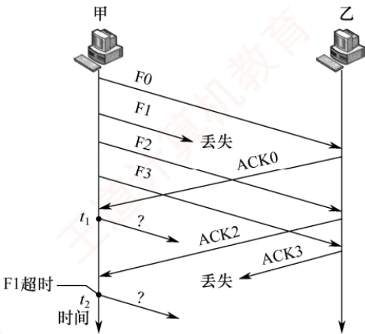

A. F1，F3xX
B. F1, F4
C. F3, F1
D. F4, F1

#### 二、综合应用题

01. 在选择重传协议中，设序号用3 比特编号，发送窗口 $W_{\mathrm {T}}   =   6$ ，接收窗口 $W_{\mathrm {R}}   =   3$ 。试找出一种情况，使得在此情况下协议不能正确工作。

02.假设一个信道的数据传输速率为5kb/s，单向传播时延为30ms，帧长在什么范围内时，才能使用于差错控制的停止-等待协议的效率至少为50%？（忽略确认帧的发送时延。）

03. 假定信道的数据传输速率为 100kb/s，单程传播时延为 250ms，每个数据帧的长度均为2000位，且不考虑确认帧长、首部和处理时间等开销，为了达到最大的传输效率，试问帧的序号应为多少位？此时的信道利用率是多少？

04. 在数据传输速率为 50kb/s的信道上传送长度为1kbit 的帧，总是采用捎带确认，帧序号长度为3bit，单向传播延迟为270ms。对于下面三种协议，信道的最大利用率是多少？1）停止-等待协议。

3）选择重传协议（假设发送窗口和接收窗口相等）。

05. 对于下列给定条件，不考虑差错重传，停止-等待协议的实际数据传输速率是多少？R=传输速率（16Mb/s）S=信号传播速率（200m/μs）D=接收主机和发送主机之间传播距离（200m）T=创建帧的时间（2μs）F=每帧的长度（500bit）N=每帧中的数据长度（450bit）A=确认帧 ACK 的帧长（80bit）

06. 在数据传输速率为64kb/s的卫星信道上，甲方发送长度为512B的数据帧，乙方返回一个很短的确认帧（忽略确认帧的发送时延）。信道的单向传播时延为270ms，对于发送窗口大小分别为1、7、17和117的情况，甲方的实际数据传输速率分别为多少？

07.【2017统考真题】甲乙双方均采用后退N帧协议（GBN）进行持续的双向数据传输，且双方始终采用捎带确认，帧长均为1000B。 $S_{x , y}$ 和 $R_{x , y}$ 分别表示甲方和乙方发送的数据帧，其中x是发送序号，y是确认序号（表示希望接收对方的下一帧序号），数据帧的发送序号和确认序号字段均为3 比特。信道传输速率为100Mb/s，RTT=0.96ms。下图给出了甲方发送数据帧和接收数据帧的两种场景，其中 $t_{0}$ 为初始时刻，此时甲方的发送和确认序号均为0， $t_{1}$ 时刻甲方有足够多的数据待发送。请回答下列问题。

1)对于图(a)， $t_{0}$ 时刻到 $t_{1}$ 时刻期间，甲方可以断定乙方已正确接收的数据帧数是多少？正确接收的是哪几个帧（请用 $S_{x , y}$ 形式给出）？

2）对于图(a)，从 $t_{1}$ 时刻起，甲方在不出现超时且未收到乙方新的数据帧之前，最多还可以发送多少数据帧？其中第一个帧和最后一个帧分别是哪个（请用 $S_{x , y}$ 形式给出）？

3）对于图(b)，从 $t_{1}$ 时刻起，甲方在不出现新的超时且未收到乙方新的数据帧之前，需要重发多少数据帧？重发的第一个帧是哪个帧（请用 $S_{x , y}$ 形式给出）？

4）甲方可以达到的最大信道利用率是多少？

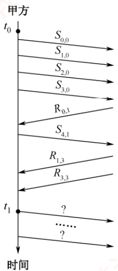

(a)

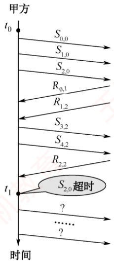

(b)

### 3.4.4 答案与解析

#### 一、单项选择题

01. A

停止-等待协议采用1比特给数据帧编号，发送窗口和接收窗口的尺寸都为1，选项A正确。仅在收到当前窗口内的数据帧后，接收窗口才能向后移动，因此一定是按序接收的。停止-等待协议的信道利用率 = 一个数据帧的发送时延÷(一个数据帧的发送时延 +RTT+ 一个确认帧的发送时延)，其中分子一定是小于分母的，所以信道利用率不可能达到100%，当RTT较大时，会降低信道利用率，因此停止-等待协议适合RTT较小的信道。

02. B

根据信道利用率的计算公式，当数据传输速率很高时，数据帧的发送时间很短；当源主机和目的主机的距离很远时，往返时延很大，此时的信道利用率很低。

03. D

在停止-等待协议中，发送方设置了计时器，在发送一个帧后，发送方等待确认，若在计时器计满时仍未收到确认，则再次发送相同的帧，以免陷入永久的等待。

04. A

在停止-等待协议中，使用1位来编号即可。若连续出现相同序号的数据帧，则表明发送方进行了超时重传；若连续出现相同序号的确认帧，则表明接收方收到了重复帧。

05. D

设C为数据传输速率，L为帧长，R为单程传播时延。停止-等待协议的信道最大利用率为(L/C)/ $(L/C+2R)=L/(L+2RC)=L/(L+2\times30 ms \times4 kb/s )=80\%$ ，得出L =960bit。

06. D

本题忽略确认帧的发送时延，所以信道利用率 =数据帧的发送时延/(数据帧的发送时延+往返时延)= 0.4，解得数据帧的发送时延为4/30s，所以数据帧的长度为6kb/s×4/30s= 800bit。

07. B

停止-等待协议使用确认和重传机制，发送方每发送一个帧，就要停下来等待接收方发回的确认帧，收到确认帧后才能发送下一帧，经过超时时间后未收到ACK帧则自动重传。

08. D

连续ARQ协议分为GBN协议和 SR协议。SR的接收窗口大于1，接收方可以先收下失序但序号仍落在接收窗口内的那些数据帧。GBN的接收窗口等于1，接收方必须按序接收数据帧。

09.A

发送方收到5号帧的确认后，表示5号帧及之前的所有帧都被接收方正确接收，因此滑动窗口右移后，新窗口内的第一个帧就是6号帧，又因为此时可发送的数据帧数为6，因此发送窗口的总大小为7。在GBN协议中，若采用n位给帧编号，则发送窗口大小为2ⁿ-1，因此n=3。

10. B

后退N帧协议采用累积确认，确认的最后一个帧是4号帧，表示4号帧及4号帧之前的数据帧都已被正确接收，所以只需重传5号帧和6号帧这两个数据帧。

11. C

对于滑动窗口协议，序列号个数要大于或等于窗口数（发送窗口大小+接收窗口大小），所以在后退N帧的协议中，序列号个数不小于“发送窗口大小+1”，题中发送窗口大小是32，那么序列号个数最少应该是33个。所以最少需要6位的序列号才能达到要求。

12. C

接收窗口整体向前移动时，新窗口中的序列号和旧窗口的序列号产生重叠，致使接收方无法区别发送方发送的帧是重发帧还是新帧，因此在后退N帧的ARQ协议中，发送窗口 $W_{\mathrm{T}} \leqslant 2^{n} - 1$本题中n=7，因此发送窗口的最大长度是127。

13. B

在选择重传协议中，若用n比特对帧编号，则发送窗口和接收窗口的大小关系为 $1 < W_{\mathrm{R}} \leqslant W_{\mathrm{T}}$还需满足 $W_{\mathrm{R}} + W_{\mathrm{T}} \leqslant 2^{n}$ ，所以接收窗口的最大尺寸不超过序号范围的一半，即 $W_{\mathrm {R}} \leqslant 2^{n - 1}$

14. B

在连续ARQ协议中，发送窗口大小≤窗口总数-1。例如，窗口总数为8，编号为0～7，假设这8个帧都已发出，下一轮又发出编号0～7的8个帧，接收方将无法判断第二轮发的8个帧到底是重传帧还是新帧，因为它们的序号完全相同。另一方面，对于后退N帧协议，发送窗口大小可以等于窗口总数-1，因为它的接收窗口大小为1，所有的帧保证按序接收。因此对于窗口大小为n的滑动窗口，其发送窗口大小最大为n-1，即最多可以有n-1帧已发送但没有确认。

15. C

在选择重传协议中，若用n比特对帧编号，则发送窗口和接收窗口的大小关系为 $1 < W_{\mathrm{R}} \leqslant W_{\mathrm{T}}$此外，还要满足 $W_{\mathrm{R}} + W_{\mathrm{T}} \leqslant 2^{n}$ ，因此发送窗口的最大尺寸为 $2^{4}-7=16-7=9$ 0

16. D

本题未直接告知使用的是选择重传协议，而是通过间接方式给出的。题目称无序接收的滑动窗口协议，表示接收窗口大于1，所以使用的是选择重传协议，接收窗口最大尺寸为 $2^{n - 1}$

17. D

无论采用哪种滑动窗口协议，信道利用率的计算方法都是:发送窗口内所有数据帧的发送时延/（一个数据帧的发送时延+RTT+一个确认帧的发送时延）。分母记为T=一个数据帧的发送时延+RTT +一个确认帧的发送时延，其中数据帧或确认帧的发送时延 $2000\mathrm{B} / (20\mathrm{kb} / \mathrm{s})$ 800ms，RTT= 1400ms，即 $T = 800 + 800 + 1400 = 3000   ms$ 。假设发送窗口大小为x，则 $800x/3000>$ 0.8，即发送窗口大小x要大于3，GBN协议的发送窗口为 $2^{3}   -   1 = 7$ ，满足要求；SR协议的发送窗口为 $2^{2}   =   4$ ，也满足要求。因此，A和B之间可以采用GBN协议或SR协议。

18. C

实现流量控制的常用方法是滑动窗口协议，它让接收方把自己的接收窗口大小反馈给发送方，以调节发送方的发送窗口大小，避免发送方因发送速度过快而导致接收方来不及接收。

19. C

为使信道利用率最高（100%），要让发送方在一个发送周期内持续发送帧，不能出现发送窗口内的帧发完但还未收到第一个帧的确认帧的情况。发送周期=发送一个数据帧的时间+往返时延+发送一个确认帧的时间，发送一个数据帧或确认帧的时间均为 $128\mathrm{B} \div 16\mathrm{kb/s} = 64\mathrm{ms}$ ，发送周期 $64ms+250ms\times 2+64ms=628ms$ 。为保证发送方持续发送帧，在一个发送周期内至少要发送的帧数为628ms/64ms≈10，即发送窗口大小至少为10，所以帧序号至少采用4比特。

20. D

信道利用率 =发送周期内用于发送数据帧的时间/发送周期，其中发送周期=发送一个数据帧的时间+往返时延+发送一个确认帧的时间。停止-等待协议的发送窗口为1，不可能达到100%的信道利用率；只要发送窗口够大，后退N帧协议和选择重传协议都有可能达到100%的信道利用率。

21. C

在选择重传协议中，接收方对正确收到的每个数据帧单独进行确认，不要求收到的数据帧是有序的。依题意，接收方已正确收到0～3号和5号数据帧，但不确定4号数据帧是否收到。因为没有发生超时，发送方不进行重传，所以接收该确认帧并继续发送剩下的数据帧。

22. C

在GBN协议中，当接收方检测到某帧出错时，会简单地丢弃该帧及所有的后续帧，发送方超时后需重传该数据帧及所有的后续帧。注意，在GBN协议中，接收方一般采用累积确认的方式，即接收方对按序到达的最后一个分组发送确认，因此本题中收到3号帧的确认就表示编号为0、1、2、3的帧已接收，而此时发送方未收到1号帧的确认只能代表确认帧在返回的过程中丢失，而不代表1号帧未到达接收方。因此需要重传的帧为编号是4、5、6、7的帧。

23. B

在选择重传协议中，接收方逐个确认正确接收的分组，不管接收到的分组是否有序，只要正确接收就发送选择ACK分组进行确认，因此ACK分组不再具有累积确认的作用。对于这一点，要特别注意与GBN协议的区别。此题中只收到1号帧的确认，0、2号帧超时，因为对1号帧的确认不具有累积确认的作用，所以发送方认为接收方未收到0、2号帧，于是重传这两帧。

24. B

连续ARQ的信道利用率:

$$
\frac{发送窗口大小  \times  数据帧长/数据传输速率}{数据帧长/数据传输速率} = \frac{发送窗口大小/数据传输速率}{2/ 数据传输速率  +  RTT/数据帧长}
$$

从上述公式可知，数据帧长越大，信道利用率就越高。数据帧长是不确定的，范围为128～ 512B，在计算最小窗口数时，为了保证无论数据帧长如何变化，信道利用率都能达到100%，应以128B的帧长计算。因此，当最短的帧长都能达到100%的信道利用率时，发送更长的数据帧也都能达到100%的信道利用率。若以512B的帧长计算，则求得的最小窗口数在128B的帧长下，达不到100%的信道利用率。首先计算出发送一个帧的时间: $128 \times 8 / (16 \times 10^3) = 64 \mathrm{ms}$ ；发送一个帧到收到确认帧为止的总时间: $64+270\times2+64=668  ms$ 这段时间总共可发送 $668/64 = 10.4$ 帧，即发送窗口≥11，而接收窗口=1，所以至少需要用4位比特进行编号。

25. C

考虑制约甲方的数据传输速率的因素。首先，信道带宽能直接制约数据的传输速率，传输速率一定是小于或等于信道带宽的。其次，因为甲方和乙方之间采用后退N帧协议传输数据，要考虑发送一个数据到接收到它的确认之前，最多能发送多少数据，甲方的最大传输速率受这两个条件的约束，所以甲方的最大传输速率是这两个值中的小者。甲方的发送窗口尺寸为1000，即收到第一个数据的确认前，最多能发送1000个数据帧，即 $1000 \times 1000 = 1MB$ 的内容，而从发送第一个帧到接收到它的确认的时间是一个帧的发送时间加上往返时间，即 $1000\mathrm{B} \div 100\mathrm{M}\mathrm{b} / \mathrm{s} \pm 50\mathrm{ms} + 50\mathrm{ms} = 0.10008\mathrm{s}$ ，此时的最大传输速率为 $1  MB /0.10008  s  \approx 10  MB / s  = 80  M  b / s$ 。信道带宽为100Mb/s，因此答案为min(80Mb/s, $100\mathrm{Mb/s}=80\mathrm{Mb/s}$

26. B

按发送周期思考，从开始发送帧到收到第一个确认帧为止，用时为T=第一个帧的发送时延+第一个帧的传播时延+确认帧的发送时延+确认帧的传播时延，这里忽略确认帧的发送时延。因此 $T=1000\mathrm{B} \div 128\mathrm{kb/s}+\mathrm{RTT}=0.5625\mathrm{s}$ ，接着计算在T内需要发送多少数据才能满足利用率不小于80%。设数据大小为L字节，则 $(L \div 128\mathrm{kb/s})/T \geqslant 0.8$ ，得到 $L \geq 7200\mathrm{B}$ ，即在一个发送周期内至少要发7.2个帧才能满足要求，设需要编号的比特数为n，则 $2^{n}-1\geqslant7.2,\ n$ 至少为4。

27. D

信道利用率=传输帧的有效时间/传输帧的周期。假设帧的长度为x比特。对于有效时间，应该用帧的大小除以数据传输速率，即x÷3kb/s。对于帧的传输周期，应包含4部分:帧在发送方的发送时延、帧从发送方到接收方的单程传播时延、确认帧在接收方的发送时延、确认帧从接收方到发送方的单程传播时延。这4个时延中，因为题目中说“忽略确认帧的传输时延”，所以不计算确认帧的传输时延（传输时延也称发送时延，注意与传播时延区分）。所以帧的传输周期由三部分组成:首先是帧在发送方的发送时延 $x{\div}3\mathrm{kb/s}$ ，其次是帧从发送方到接收方的单程传播时延200ms，最后是确认帧从接收方到发送方的单程传播时延200ms，三者相加得周期为 $x \div 3\mathrm{kb/s} + 400\mathrm{ms}$ 。代入信道利用率的公式得 $x = 800  bit$

28. B

从滑动窗口的概念来看，停止-等待协议:发送窗口大小=1，接收窗口大小=1；后退N帧协议:发送窗口大小>1，接收窗口大小=1；选择重传协议:发送窗口大小>1，接收窗口大小>1。在选择重传协议中，还需满足:接收窗口大小≤发送窗口大小；发送窗口大小+接收窗口大小≤2”。根据以上规则，采用3比特编号，发送窗口大小为5，接收窗口大小≤3。

29. D

发送数据帧和确认帧的时间均为 $t = 1000 \times 8b \div 10kb/s = 800 ms$

发送周期为 $T = 800 ms  + 200 ms  + 800 ms  + 200 ms  = 2000 ms$

信道利用率为 $t/T \times 100\% = 800/2000 = 40\%$

30. B

信道利用率 $U = n T_{\mathrm {D}} / T$ ，其中n是发送窗口的大小， $T_{\mathrm {D}}$ 是发送一个数据帧的时间，T是一个数据帧的发送周期。在 $T_{\mathrm {D}}$ 和T确定的情况下，n越大，信道利用率就越大。设帧序号的比特数为k，则停止-等待协议的发送窗口 $W_{\mathrm {T 1}}   = 1$ ；GBN协议的发送窗口 $W_{\mathrm {T} 2}   =   2^{k}   -   1$ ；SR协议的发送窗口$W_{\mathrm {T} 3} \leqslant 2^{k} - 1$ ，通常取 $2^{k - 1}$ $W_{\mathrm{T}1} \leqslant W_{\mathrm{T}3} \leqslant W_{\mathrm{T}2}$ ，因此 $U_{1} \leqslant U_{3} \leqslant U_{2}$

31. D

数据帧编号的范围是0～7，发送窗口与接收窗口大小相等且均为最大值，因此发送窗口大小=接收窗口大小 $2^{3 - 1} = 4$ 。甲发送FO、F1、F2和F3四个数据帧后，收到FO的确认，因此在 $t_{1}$ 时刻，发送窗口向右滑动，可以继续发送F4，之后收到F2的确认，但由于F1丢失，甲无法收到F1的确认，发送窗口无法继续向右滑动，直到 $t_{2}$ 时刻，F1超时，重传F1，选项D正确。

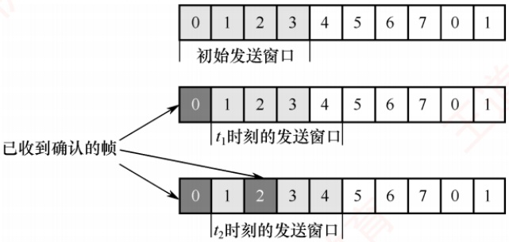

#### 二、综合应用题

01. 【解答】

对于选择重传协议，接收窗口和发送窗口的尺寸需满足:接收窗口尺寸 $W_{\mathrm {R}} +$ 发送窗口尺寸$W_{\mathrm {T}} \leqslant 2^{n}$ ，而题中给出的数据是 $W_{\mathrm{R}} + W_{\mathrm{T}} = 9 \geqslant 2^{3}$ ，所以是无法正常工作的。举例如下:

发送方:01234567012345670

接收方:01234567012345670

发送方发送0～5号共6个数据帧时，因发送窗口已满，发送暂停。接收方收到所有数据帧，对每个帧都发送确认帧，并期待后面的6、7、0号帧。若所有的确认帧都未到达发送方，经过发送方计时器控制的超时时间后，发送方再次发送之前的6个数据帧，而接收方收到0号帧后，无法判断是新的数据帧还是重传的旧的数据帧。

02. 【解答】

设数据帧长为L。在停止-等待协议中，发送数据帧的时间为L/B，发送完数据帧后等待确认的时间为2R。要使协议的效率至少为50%，要求信道利用率U至少为50%，则

$$
信道利用率U = \frac{数据发送时延}{数据发送时延 + 往返时延} = \frac{L/B}{L/B + 2R} \geqslant 50\%
$$

解得 $L \geqslant 2RB = 2 \times 5000 \times 0.03bit = 300bit$

因此，当帧长大于或等于300bit时，停止-等待协议的效率至少为50%。

03.【解答】

RTT=250×2 =500ms =0.5s。

一个帧的发送时间等于 $2000\mathrm{bit} \div 100\mathrm{kb/s} = 20 \times 10^{-3}\mathrm{s} = 0.02\mathrm{s}$

一个帧发送完后经过一个单程时延到达接收方，再经过一个单程时延发送方收到确认帧，从而可以继续发送，因此要使传输效率最大，就要让发送方继续地发送帧。设发送窗口等于x，则

$$
0.02\mathrm{s} \times x = 0.02\mathrm{s} + \mathrm{RTT} = 0.52\mathrm{s}
$$

解得 $x   =   26$ ，即发送窗口取26即可。因为 $16 \leq 26 \leq 32$ ，所以帧序号应为5位。在使用连续ARQ的情况下，发送窗口的最大值是31，大于26，可以不间断地发送帧，此时信道利用率是100%。

04.【解答】

最大信道利用率即每个传输周期内每个协议可发送的最大帧数。由题意，数据帧的长度为1kbit，信道的数据传输速率为50kb/s，因此信道的发送时延为 $1/50\mathrm{s}=0.02\mathrm{s}$ ，另外信道端到端的传播时延=0.27s。本题中的确认帧是捎带的（通过数据帧来传送），因此每个数据帧的传输周期为$(0.02 + 0.27 + 0.02 + 0.27) \mathrm{s} = 0.58 \mathrm{s}$

1）在停止-等待协议中，发送方每发送一帧，都要等待接收方的应答信号，之后才能发送下一帧；接收方每接收一帧，都要反馈一个应答信号，表示可接收下一帧。其中用于发送数据帧的时间为0.02s。因此，信道的最大利用率为 $0.02/0.58=3.4\%$

2）在后退N帧协议中，接收窗口尺寸为1，若采用n比特对帧编号，则其发送窗口的尺寸W满足 $1 < W \leqslant 2^{n} - 1$ 。发送方可以连续再发送若干数据帧，直到发送窗口内的数据帧都发送完毕。若收到接收方的确认帧，则可以继续发送。若某个帧出错，则接收方只是简单地丢弃该帧及所有的后续帧，发送方超时后，需要重传该数据帧及所有的后续数据帧。根据题目条件，在达到最大传输速率的情况下，发送窗口的大小应为 $2^{n}   -   1   =   7$ ，此时在第一帧的数据传输周期0.58s内，实际连续发送了7帧（考虑极限情况，0.58s后接收方只收到0号帧的确认，此时又可以发出一个新帧，这样依次下去，取极限即是每个传输周期0.58s内发送了7帧），因此此时的最大信道利用率为 $7 \times 0.02 / 0.58 = 24.1\%$

3）选择重传协议的接收窗口尺寸和发送窗口尺寸都大于1，可以一次发送或接收多个帧。若采用n比特对帧编号，则窗口尺寸应满足:接收窗口尺寸+发送窗口尺寸≤2ⁿ，当发送窗口与接收窗口尺寸相等时，应有接收窗口尺寸 $\mathopen {|} \leqslant 2^{n - 1}$ 且发送窗口尺寸 $\leqslant 2^{n - 1}$ 。发送方可以连续发送若干数据帧，直到发送窗口内的数据帧都发送完毕。若收到接收方的确认帧，则可以继续发送。若某帧出错，则接收方只是简单地丢弃该帧，发送方超时后需重传该数据帧。

和2）问中的情况类似，唯一不同的是为达到最大信道利用率，发送窗口大小应为 $2^{n - 1}   =   4$因此，此时的最大信道利用率为 $4 \times 0.02 / 0.58 = 13.8\%$ 0

05.【解答】

对于停止-等待协议，有

$$
\frac{N}{2 \times (T + D / S) + \frac{F + A}{R}} = \frac{450bit}{2 \times \left(2\mu s + \frac{200m}{200m / \mu s}\right) + \frac{500bit + 80bit}{16bit / \mu s}} = \frac{10.65bit}{10.65bit / \mu s}
$$

06. 【解答】

要注意题中的单位。数据帧的长度为512B，即512×8bit=4.096kbit，一个数据帧的发送时延为 $4.096/64=0.064s$ ，因此一个发送周期为 $0.064 + 2 \times 0.27 = 0.604$ 0

当发送窗口为1时，甲方的实际数据传输速率为 $1 \times 4.096 / 0.604 = 6.8 \mathrm{k} \mathrm{b} / \mathrm{s}$

当发送窗口为7时，甲方的实际数据传输速率为 $7 \times 4.096 / 0.604 = 47.5 \mathrm{k} \overline{\mathrm{b}} / \mathrm{s}$

当发送窗口大于0.604/0.064，即大于或等于10时，就能保证甲方在信道上持续发送数据。因此发送窗口为17和117时，信道的利用率达到100%，甲方的实际数据传输速率为64kb/s。

07.【解答】

1) $t_{0}$ 时刻到 $t_{1}$ 时刻期间，甲方可以断定乙方已正确接收3个数据帧，分别是 $S_{0,   0} 、 S_{1,   0} 、 S_{2,   0} 。$ $R_{3 ,   3}$ 说明乙方发送的数据帧序号是3，即希望甲方发送序号3的数据帧，说明乙方已经接收序号为0～2的数据帧（注意，这个确认序号是期望接收对方的下一帧的序号）。

2）从 $t_{1}$ 时刻起，甲方最多还可以发送5个数据帧，其中第一帧是 $S_{5 , 2}$ 2，最后一帧是 $S_{1 ,   2^{\circ}}$ 发送序号3位，有8个序号，在GBN协议中，发送窗 $\boxdot + 1 \leqslant$ 序号总数，所以这里发送窗口取最大值7。此时已发送 $S_{3 , 0}$ 和 $S_{4,}$ 1,所以最多还可以发送5帧(数据帧以序号01234567, $01234567 , \cdots$ 的规律发送，但初始时只有0123456落在发送窗口内，之后随着发送方不断收到确认，发送窗口也不断向前滑动）。

3）甲方需要重发3个数据帧，重发的第一个帧是 $S_{2 , 1}$ 3。在GBN协议中，发送方发送N帧后，检测出错，则需要发送出错帧及其之后的帧。 $S_{2 , 0}$ 超时，所以重发的第一帧是 $S_{2}$ 。已收到乙方的 $R_{2}$ 帧，所以帧号应为3。

4）甲方可以达到的最大信道利用率U是

$$
\frac{发送窗口大小  \times  数据传输速率}{RTT  + \frac{帧长}{数据传输速率} \times 2} = \frac{7 \times \frac{8 \times 1000}{100 \times 10^6}}{0.96 \times 10^{-3} + \frac{8 \times 1000}{100 \times 10^6} \times 2} \times 100\% = 50\%
$$

信道利用率 U=发送数据帧的时间/从开始发送第一个数据帧到收到第一个确认帧的时间= $N T_{\mathrm {d}} / ( T_{\mathrm {d}} + \mathrm {RTT} + T_{\mathrm {a}} )$ 。其中，N取发送窗口的最大值， $T_{\mathrm {d}}$ 是发送一个数据帧的时间，RTT是往返时间， $T_{\mathrm {a}}$ 是发送一个确认帧的时间。这里采用捎带确认， $T_{\mathrm{d}} = T_{\mathrm{a}}$

### 3.5.4 本节习题精选

#### 单项选择题

01.信道划分介质访问控制的核心思想是（）。
A. 通过分时、分频、分码等方法，将广播信道变为若干点对点信道
B. 胜利者通过争用获得信道，从而获得信息的发送权
C. 通过集中控制方式解决发送信息的次序问题
D. 通过轮询方式依次询问每个站点是否有数据要发送

02. 介质访问控制（MAC）子层的主要功能是（）。
A. 提供可靠的数据传输
B. 控制和协调所有站点对共享介质的访问
C. 实现数据链路层和物理层之间的接口
D. 为上层协议提供服务

03. 将物理信道的总频带宽分割成若干子信道，每个子信道传输一路信号，这种信道复用技术是（）。
A. 码分复用
B. 频分复用
C. 时分复用
D. 空分复用

04.TDM所用传输介质的性质是（）。（注，本题选项中的带宽是指信号的频率范围。）
A. 介质的带宽大于结合信号的位速率
B. 介质的带宽小于单个信号的带宽
C. 介质的位速率小于最小信号的带宽
D. 介质的位速率大于单个信号的位速率

05. 从表面上看，FDM 比 TDM 能更好地利用信道的传输能力，但现在计算机网络更多地使用 TDM 而非 FDM，其原因是（）。
A. FDM 实际能力更差
B. TDM 可用于数字传输而 FDM 不行
C. FDM技术不成熟
D. TDM 能更充分地利用带宽

06.在下列复用技术中，（）具有动态分配时隙的功能。
A. 同步时分复用
B. 统计时分复用
C. 频分复用
D. 码分复用

07.在下列协议中，不会发生冲突的是（）。
A. TDM
B. ALOHA
C. CSMA
D. CSMA/CD

08. 在纯 ALOHA 协议中，一个站点想要发送数据时（）。
A. 必须等待信道空闲
B. 必须等待下一个时间槽开始
C. 可以立即发送
D. 必须先发送 RTS 帧

09. 下列几种CSMA协议中，（）协议在监听到信道空闲时仍可能不发送。
A. 1-坚持 CSMA
B. 非坚持 CSMA
C. p-坚持 CSMA
D. 以上都不是

10. 在CSMA的非坚持协议中，当信号忙时，则（）直到介质空闲。
A. 延迟一个固定的时间单位再监听
B. 继续监听
C. 延迟一个随机的时间单位再监听
D. 放弃监听

11. 在 CSMA 的非坚持协议中，当站点监听到总线信道空闲时，它（）。
A. 以概率 p 传送
B. 马上传送
C. 以概率1-p传送
D. 以概率p延迟一个时间单位后传送

12. 与采用 CSMA/CD 协议的网络相比，令牌环网络更适合的环境是（）。
A. 负载轻
B. 负载重
C. 距离远
D. 距离近

13.下列关于令牌环网络的描述中，错误的是（）。
A. 令牌环网络存在冲突的可能
B. 同一时刻，环上只有一个节点的数据在传输
C. 网上所有节点共享网络带宽
D. 数据从一个节点到另一节点的时间可以计算

14. 下列关于令牌环网络的说法中，错误的是（）血I. 信道的利用率比较公平Ⅱ. 重负载下信道利用率高Ⅲ.节点可以一直持有令牌，直至所要发送的数据传输完毕IV. 节点只能持有令牌一段固定的时间，对于没有数据要发送的节点也是如此
A. I、Ⅱ和ⅢII
B. IⅢII
C. III 和 IV
D. IV

15. 在令牌环网络中，当网络空闲时，环路中（）。
A. 只有令牌帧在循环传递
B. 只有数据帧在循环传递
C. 令牌帧和数据帧都在循环传递
D. 令牌帧和数据帧都不在循环传递

16.在令牌环网络中，当一个站点收到自己发出去的数据帧后，它将（）。
A. 不再转发该帧，并重新产生一个令牌
B. 不再转发该帧，并等待下一个令牌
C. 继续转发该帧，并重新产生一个令牌
D. 继续转发该帧，并等待下一个令牌

17. 在令牌环网络中，当所有站点都有数据帧要发送时，一个站点在最坏情况下等待获得令牌和发送数据帧的时间等于（）。
A. 所有站点传送令牌的时间总和
B. 所有站点传送令牌和发送帧的时间总和
C. 所有站点传送令牌的时间总和的一半
D. 所有站点传送令牌和发送帧的时间总和的一半

18. 一条广播信道上连有4个站点a、b、c、d，采用码分复用技术，当a、b、c要向d发送数据时，设a的码片序列为（1,-1,1,-1），则b和c的码片序列可以为（）。
A. （−1,1,1,1）和（−1,−1,−1,1)
B. （-1,-1,1,1）和（-1,1,-1,1)
C. （-1,1,1,-1）和（1,1,−1,-1)
D. （−1,−1,−1,−1）和（1,1,1,1)

19. 站 A、B、C、D通过CDMA共享链路，A、B、C要向D发送数据，A、B、C的码片序列分别是（+1,-1,-1,+1）、（-1,+1,-1,+1）和（+1,+1,+1,+1）。若D从链路上收到的序列是（3,-1,1,1），则A、B、C发送的数据分别是（）。
A. 1, 0, 1
B. 0, 0, 1
C. 1,0,0
D. 0,1,0

20. 【2013统考真题】下列介质访问控制方法中，可能发生冲突的是（）。
A. CDMA
B. CSMA
C. TDMA
D. FDMA

21. 【2014 统考真题】站 A、B、C通过CDMA 共享链路，A、B、C的码片序列分别是(1,1 1, 1)、(1,−1,1,−1)和(1,1,−1,−1)。若 C 从链路上收到的序列是(2,0,2,0,0,-2, 0,−2,0,2, 0,2)，则C收到A发送的数据是（）。
A. 000
B. 101
C. 110
D. 111

### 3.5.5 答案与解析

#### 单项选择题

01. A

选项B是随机访问介质访问控制的特点，如CSMA/CD协议。选项C是集中式介质访问控制的特点，如主从式协议，它由一个主站控制所有从站的发送顺序，从站只能在主站允许时才能发送数据。选项D是轮询访问介质访问控制的特点，如令牌传递协议。

02. B

介质访问控制（MAC）子层的主要功能是控制和协调所有站点对共享介质的访问。能否实现带确认的可靠传输服务与介质访问控制子层无关。

03. B

在物理信道的可用带宽超过单个原始信号所需带宽的情况下，可将该物理信道的总带宽分割成若干与传输单个信号带宽相同（或略宽）的子信道，每个子信道传输一种信号，这就是频分复用。

04. D

本题的关键是理解TDM（时分复用）的原理和特点。TDM在发送端将不同用户的信号相互交织在不同的时间片内，沿同一个信道传输，在接收端再将各个时间片内的信号提取出来，还原成原始信号。为了实现TDM，必须满足如下条件:①介质的位速率（每秒传输的二进制位数）大于单个信号的位速率；②介质的带宽（所能传输信号的最高频率与最低频率之差）大于结合信号的带宽（所有信号经过调制后形成的复合信号的带宽）。

05. B

TDM与FDM相比，抗干扰能力强，可以逐级再生整形，能避免干扰的积累，而且数字信号比较容易实现自动转换，所以根据FDM和TDM的工作原理，FDM适合传输模拟信号，TDM适合传输数字信号。

06. B

时分复用（TDM）分为同步时分复用和异步时分复用（也称统计时分复用）。同步时分复用是一种静态时分复用技术，它预先分配时间片（时隙），而异步时分复用则是一种动态时分复用技术，它动态地分配时间片（时隙）。

07. A

TDM属于静态划分信道的方法，各节点分时使用信道，不发生冲突。而ALOHA协议、CSMA协议和CSMA/CD协议都属于动态分配信道的方法，都采用检测冲突的策略来应对冲突，因此都可能发生冲突。注意，随机访问介质访问控制和轮询访问介质访问控制，都属于动态分配信道的方法，但是随机访问介质访问控制可能发生冲突，而轮询访问介质访问控制不发生冲突。

08. C

在纯ALOHA协议中，一个站点想要发送数据时可以立即发送，而不需要等待信道空闲或下一个时间槽开始，也不需要先发送RTS帧。

09. C

p-坚持 CSMA 协议是 1-坚持 CSMA 协议和非坚持 CSMA 协议的折中。p-坚持 CSMA 协议检测到信道空闲后，以概率p发送数据，以概率1-p推迟到下一个时隙，目的是降低1-坚持CSMA协议中多个节点检测到信道空闲后同时发送数据的冲突概率；采用坚持“监听”的目的，是克服非坚持CSMA协议中因随机等待造成延迟时间较长的缺点。

10. C

非坚持CSMA协议:站点在发送数据前先监听信道，若信道忙则放弃监听，等待一个随机时间后再监听，若信道空闲，则发送数据。

11. B

解析同上。

12. B

CSMA/CD协议网络中各站随机发送数据，有冲突产生。当负载很多时，冲突加剧。而令牌环网络各站轮流使用令牌发送数据，无论网络负载如何，都无冲突产生，这是它的突出优点。

13. A

令牌环网络的拓扑结构为环状，有一个令牌不停地在环中流动，只有获得了令牌的节点才能发送数据，因此不存在冲突，选项A错误。令牌环网络是一种半双工通信方式，同一时刻只能有一个节点发送数据，其他节点只能接收或转发数据，选项B正确。令牌环网络中的所有节点都连接到同一个信道上，共享整个信道的带宽，选项C正确。在令牌环网络中，数据从一个节点到另一节点的时间可根据环上经过的节点数、传输速率和数据帧长来计算，选项D正确。

14. C

令牌环网络使用令牌在各个节点之间传递来分配信道的使用权，每个节点都可在一定的时间内（令牌持有时间）获得发送数据的权限，而并非无限制地持有令牌。在令牌传递过程中，没有数据要发送的节点收到令牌后将立刻传递下去而不能持有。选项Ⅰ和Ⅱ均为令牌环网络的特点。

15. A

在令牌环网络中，当网络空闲时，环路中只有令牌帧在循环传递。当某个站点要发送数据时，必须等待令牌到达，然后修改令牌中的标志位，并附加数据，将令牌变成一个数据帧。

16. A

在令牌环网络中，一个站点收到自己发出去的数据帧后，不再转发该帧，而重新产生一个令牌，然后将该令牌发送给下一个站点。这样可以回收数据帧，避免环路上的冗余，并释放传输权限。

17. B

令牌环网络在逻辑上采用环状控制结构。因为令牌总沿逻辑环单向逐站传送，所以节点总可在确定的时间内获得令牌并发送数据。在最坏情况下，即在所有节点都要发送数据的情况下，一个节点获得令牌的等待时间等于逻辑环上所有其他节点依次获得令牌，并在令牌持有时间内发送数据的时间之和。

18. C

要实现码分复用，a、b、c三个站点的码片序列必须满足正交性，即两两之间的规格化内积等于0，分别计算各选项与（1,-1,1,-1）两两之间的规格化内积，只有选项C满足要求。

19. A

将收到的序列和各站点的码片序列进行规格化内积，得到A站的规格化内积为1，B站的规格化内积为-1，C站的规格化内积为1，故A站、B站、C站发送的数据分别是1,0,1。

20. B

选项A、C和D都是信道划分协议，信道划分协议是静态划分信道的方法，肯定不会发生冲突。CSMA协议的全称是载波监听多路访问协议，其原理是站点在发送数据前先监听信道，发现信道空闲后再发送数据，但在发送过程中可能会发生冲突。

21. B

将收到的序列每4个数分成一组，即(2,0,2,0),(0,-2,0,-2),(0,2,0,2)，因为题目求的是A站发送的数据，因此将这三组数据与A站的码片序列(1,1,1,1)做内积运算，结果分别是(2,0, $2,0)\bullet (1,1,1,1)/4=1,\quad (0,-2,0,-2)\bullet (1,1,1,1)/4=-1,\quad (0,2,0,2)\bullet (1,1,1,1)/4=1$ ，所以C站接收到的A站发送的数据是101。

### 3.6.5 本节习题精选

#### 一、单项选择题

01. 下列以太网中，采用双绞线作为传输介质的是（）。
A. 10Base-2
B. 10Base-5
C. 10Base-T
D. 10Base-F

02. 10Base-T以太网采用的传输介质是（）。
A. 双绞线
B. 同轴电缆
C. 光纤
D. 微波

03. 就交换技术而言，以太网采用的是（）。
A. 分组交换技术
B. 电路交换技术
C. 报文交换技术
D. 混合交换技术

04.网卡实现的主要功能在（）。
A. 物理层和数据链路层
B. 数据链路层和网络层
C. 物理层和网络层
D. 数据链路层和应用层

05. 每个以太网卡都有自己的时钟，每个网卡在互相通信时为了知道什么时候一位结束、下一位开始，即具有同样的频率，它们采用了（）。
A. 量化机制
B. 曼彻斯特机制
C. 奇偶检验机制
D. 定时令牌机制

06.以下关于以太网地址的描述，错误的是（）。
A. 以太网地址就是通常所说的 MAC 地址
B. MAC 地址也称局域网硬件地址
C. MAC地址是通过域名解析查得的
D. 以太网地址通常存储在网卡中

07.下列关于用光纤连接的以太网和用双绞线连接的以太网的说法中，错误的是（）。
A. 用集线器连接的双绞线以太网一定工作在半双工状态
B. 用交换机连接的双绞线以太网可以工作在全双工状态
C. 光纤以太网主要用于支持点对点通信，目的是扩大以太网的覆盖范围
D. 光纤以太网也可以选用 CSMA/CD 协议

08. 一个长度为 40B 的 IP 数据报需要封装成 802.1Q 帧进行传输，则此 802.1Q 帧的数据载荷部分需要填充的字节数是（）。
A. 2
B. 4
C. 6
D. 8

09.在以太网中，若网卡发现某个帧的目的MAC地址不是自己的，则（）。
A. 它将该帧递交给网络层，由网络层决定如何处理
B. 它将丢弃该帧，并向网络层报告错误消息
C. 它将丢弃该帧，不向网络层报告错误消息
D. 它将向发送主机发回一个NAK帧

10. 在CSMA/CD以太网中，站点（）进行全双工通信，（）进行半双工通信。
A. 可以，不可以
B. 可以，可以
C. 不可以，可以
D. 不可以，不可以

11.在CSMA/CD协议的定义中，“争用期”指的是（）。
A. 信号在最远两个端点之间往返传输的时间
B. 信号从线路一端传输到另一端的时间
C. 从发送开始到收到应答的时间
D. 从发送完毕到收到应答的时间

12. 在CSMA/CD协议中，若不对帧的长度加以限制，当一个站在发送完毕之前没有检测到冲突，则该站所发送的帧（）和其他站发送的帧发生冲突。
A. 肯定不会
B. 可能会
C. 肯定会
D. 无法判断

13. 在以太网中，当数据传输速率提高时，帧的发送时间相应地缩短，这样可能会影响到冲突的检测。为了能有效地检测冲突，可以使用的解决方案有（）。
A. 减少电缆介质的长度或减少最短帧长
B. 减少电缆介质的长度或增加最短帧长
C. 增加电缆介质的长度或减少最短帧长
D. 增加电缆介质的长度或增加最短帧长

14. 长度为 10km、数据传输速率为 10Mb/s 的 CSMA/CD 以太网，信号传播速率为 200m/μs。那么该网络的最小帧长为（）
A. 20bit
B. 200bit
C. 100bit
D. 1000bit

15. 以太网中若发生信道访问冲突，则按照二进制指数退避算法决定下一次重发的时间。使
A. 进指避算法的理由是（）。
B. 这种算法执行速度快
C. 这种算法考虑了网络负载对冲突的影响
D. 这种算法与网络的规模大小无关

16. 以太网中采用二进制指数退避算法处理冲突问题。下列数据帧重传时再次发生冲突的概率最低的是（）。首
A. 首次重传的帧
B. 发生两次冲突的帧
C. 发生三次重传的帧
D. 发生四次重传的帧

17. 某 100Mb/s 以太网使用 CSMA/CD 协议，该以太网中的某个站在发送帧时检测到冲突，并准备进行第二次重传，则所需等待的最大退避时间是（）。
A. 5.12μs
B. 15.36μs
C. 25.6μs
D. 51.2μs

18. 在以太网的二进制指数退避算法中，在11次冲突之后，站点会在0\~（）之间选择一个随机数。
A. 255
B. 511
C. 1023
D. 2047

19. 根据CSMA/CD协议的工作原理，需要提高最短帧长的是（）。A. 网络传输速率不变，冲突域的最大距离变短

B. 冲突域的最大距离不变，网络传输速率提高
C. 上层协议使用 TCP 的概率增加
D. 在冲突域不变的情况下减少线路中的中继器数量

20. 在某 CSMA/CD 局域网中，使用一个 Hub 连接所有站点，且限定站点到 Hub 的最长距离为100m，信号的传播速率为200000km/s，则站点的最长冲突检测时间是（）。
A. 2μs
B. 2ms
C. 1μs
D. 1ms

21. IEEE 802.3标准规定，若采用同轴电缆作为传输介质，在无中继的情况下，传输介质的最大长度不能超过（）。
A. 500m
B. 200m
C. 100m
D. 50m

22. 下列几种以太网中，只能工作在全双工模式下的是（）。
A. 10Base-T 以太网
B. 100Base-T 以太网
C. 吉比特以太网
D. 10 吉比特以太网

23. IEEE 802 局域网标准对应 OSI参考模型的（）。
A. 数据链路层和网络层
B. 物理层和数据链路层
C. 物理层
D. 数据链路层

24. 高速以太网使用的MAC 帧格式与标准以太网的帧格式（）。
A. 完全相同
B. 完全不同
C. 部分相同
D. 不确定

25.下列关于吉比特以太网的说法中，错误的是（）
A. 支持流量控制机制
B. 采用曼彻斯特编码，利用光纤进行数据传输
C. 数据的传输时间主要受线路传输延迟的制约
D. 同时支持全双工模式和半双工模式

26. 无线局域网不使用 CSMA/CD协议而使用CSMA/CA协议的原因是，无线局域网（）
A. 不能同时收发，无法在发送时接收信号
B. 难以实现冲突检测，存在隐蔽站和暴露站问题
C. 由于广播特性，不会出现冲突
D. 覆盖范围很小，不进行冲突检测，不影响正确性 收育

27.下列关于CSMA/CA协议的叙述中，正确的是（）。
A. 接收方收到数据帧后，需要向发送方返回确认帧
B. CA表示Collision Avoidance，即冲突避免，因而此类网络中不会出现冲突
C. 按照载波监听的工作原理，发送站点在检测到信道空闲后立即启动发送
D. CSMA/CA 协议和 CSMA/CD 协议的区别之一是前者不需要使用退避算法

28. CSMA/CA 协议的主要特点是（）
A. 发送前先检测信道，信道空闲就立即发送，信道忙就随机推迟发送
B. 边发送边检测信道，一旦发现冲突就立即停止发送
C. 发送前先预约信道，获得信道授权后再发送
D. 发送后等待确认帧，在规定时间内未收到确认帧就重传

29. 在CSMA/CA协议中，有三种不同的时间参数:短帧间间隔SIFS、分布式协调帧间间隔DIFS和点协调帧间间隔PIFS。它们之间的长度关系是（）。
C. PIFS < SIFS < DIFS A. SIFS < PIFS < DIFS 道 B. SIFS < DIFS < PIFS
D. PIFS < DIFS < SIFS

30. 在802.11协议中，MAC帧首部中的地址字段的含义和作用取决于（）。
A. 帧的类型和子类型
B. 帧的源和目的站点
C. 帧的去往 AP和来自 AP位
D. 帧的 BSSID 和 SSID 位

31. 在下图所示的网络中，假定主机 A 给主机 B 发送数据，在 MAC 帧从接入点 AP2 转发到目的主机 B的这段链路上，MAC帧的地址1、地址2和地址3分别是（）。

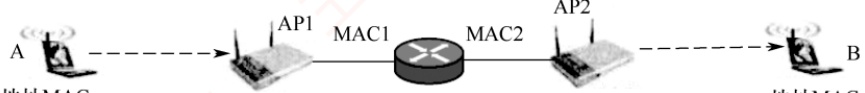

地址M $\mathrm {I A C_{A}}$ 地址BSSID1 地址BSSID2 地址MAC1
A. BSSID2, BSSID1, $\mathrm {M A C_{B}}$
B. $\mathrm {M A C_{B}}$ , BSSID2, BSSID1
C. BSSID2, $MAC_{B}$ $\mathrm {M A C_{A}}$
D. $\mathrm {M A C_{B}} ,$ BSSID2, $\mathrm {MAC}_{2}$

32.下列关于802.1Q帧的描述中，错误的是（）
A. 在原始的以太网帧中加入一个4B的标签字段，就构成802.1Q帧
B. 插入VLAN标签后，以太网的最大帧长也需要保持不变
C. VLAN 标签中有标识符字段，称为 VID，标志该帧属于哪个 VLAN
D. 设置 VLAN后，两台主机之间通信也不一定使用 802.1Q 帧

33.下列关于虚拟局域网的叙述中，错误的是（）。
A. VLAN 使用的 802.1Q 帧的最大长度为 1522B
B. 属于不同 VLAN的主机，若连在同一台交换机上，则可进行数据链路层的通信
C. VLAN是为局域网用户提供的一种服务，而不是一种新型的局域网
D. 同一个 VLAN 的主机可以处于不同的局域网中

34.下列关于虚拟局域网（VLAN）的说法中，错误的是（）
A. 虚拟局域网建立在交换技术的基础上
B. 虚拟局域网通过硬件方式实现逻辑分组与管理
C. 虚拟网的划分与计算机的实际物理位置无关
D. 不同虚拟局域网的主机之间无法直接进行数据链路层的通信

35.划分虚拟局域网（VLAN）有多种方式，（）不是正确的划分方式。
A. 基于交换机接口划分
B. 基于网卡地址划分
C. 基于用户名划分
D. 基于网络层地址划分

36.下列选项中，（）不是虚拟局域网（VLAN）的优点。
A. 有效共享网络资源
B. 简化网络管理
C. 链路聚合
D. 提高网络安全性

37.【2009统考真题】在一个采用CSMA/CD协议的网络中，传输介质是一根完整的电缆，传输速率为1Gb/s，电缆中的信号传播速率是200000km/s。若最小数据帧长减少800比特，则最远的两个站点之间的距离至少需要（）。
A. 增加 160m
B. 增加 80m
C. 减少 160m
D. 减少 80m

38.【2011统考真题】下列选项中，对正确接收到的数据帧进行确认的MAC协议是（）。
A. CSMA
B. CDMA
C. CSMA/CD
D. CSMA/CA

39.【2012统考真题】以太网的MAC 协议提供的是（）。
A. 无连接的不可靠服务
B. 无连接的可靠服务
C. 有连接的可靠服务
D. 有连接的不可靠服务

40.【2015统考真题】下列关于CSMA/CD协议的叙述中，错误的是（）
A. 边发送数据帧，边检测是否发生冲突
B. 适用于无线网络，以实现无线链路共享
C. 需要根据网络跨距和数据传输速率限定最小帧长
D. 当信号传播延迟趋近0时，信道利用率趋近100%

41.【2016统考真题】如下图所示，在Hub再生比特流的过程中会产生1.535μs的时延(Switch和Hub均为100Base-T设备），信号传播速率为200m/μs，不考虑以太网帧的前导码，A. 23和H4之间理论.可以相距的最远距离是（） D. 512m IT

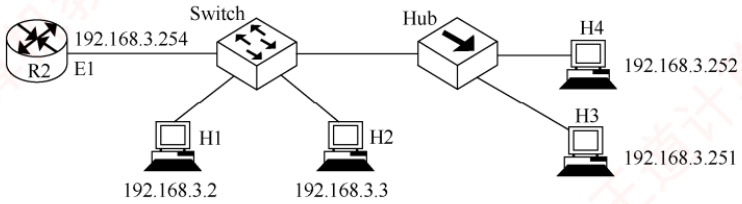

42.【2017 统考真题】在下图所示的网络中，若主机 H发送一个封装访问Internet的IP分组的IEEE 802.11帧F，则帧F的地址1、地址 2和地址 3分别是（）

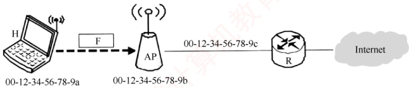

A. 00-12-34-56-78-9a, 00-12-34-56-78-9b, 00-12-34-56-78-9c
B. 00-12-34-56-78-9b, 00-12-34-56-78-9a, 00-12-34-56-78-9c
C. 00-12-34-56-78-9b，00-12-34-56-78-9c,00-12-34-56-78-9a
D. 00-12-34-56-78-9a, 00-12-34-56-78-9c, 00-12-34-56-78-9b

43. 【2018 统考真题】IEEE 802.11 无线局域网的 MAC 协议 CSMA/CA 进行信道预约的方法是（）。
A. 发送确认帧
B. 采用二进制指数退避 王道计算机
C. 使用多个 MAC 地址
D. 交换 RTS 与 CTS 帧

44. 【2019 统考真题】假设一个采用 CSMA/CD协议的100Mb/s局域网，最小帧长是128B，则在一个冲突域内，两个站点之间的单向传播时延最多是（）。
A. 2.56μs
B. 5.12μs
C. 10.24μs
D. 20.48μs

45.【2019统考真题】100Base-T快速以太网使用的导向传输介质是（）。
A. 双绞线
B. 单模光纤
C. 多模光纤
D. 同轴电缆

46. 【2020 统考真题】在某个 IEEE 802.11 无线局域网中，主机 H 与 AP之间发送或接收CSMA/CA帧的过程如下图所示。在H或AP发送帧前等待的帧间间隔时间（IFS）中，最长的是（）。

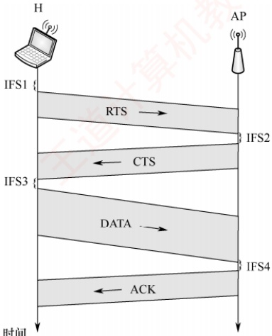

A. IFS1
B. IFS2
C. IFS3
D. IFS4

47.【2023 统考真题】已知10Base-T以太网的争用时间片为51.2μs。若网卡在发送某帧时发生了连续4次冲突，则基于二进制指数退避算法确定的再次尝试重发该帧前等待的最长时间是（）。
A. 51.2μs
B. 204.8μs
C. 768μs
D. 819.2μs

48.【2024 统考真题】在采用 CSMA/CA 协议的 802.11 无线局域网中，DIFS = 128μs，SIFS = 28μs，RTS 帧、CTS 帧和 ACK 帧的传输时延分别是 3μs、2μs 和 2μs，忽略信号传播时延。若主机 A 要向 AP 发送一个总长度为 1998B 的数据帧，无线链路带宽为 54Mb/s，则隐藏站B 收到 AP发送的CTS 帧时，设置的网络分配向量NAV的值是（）。
A. 326μs
B. 354μs
C. 385μs
D. 513μs

49.【2025统考真题】在某个10Base-T以太网的冲突域内，若主机甲向主机乙发送数据帧时发生了连续11次冲突，则甲再次尝试发送该数据帧的最大间隔时间是（）。
A. 0.512ms
B. 0.5632ms
C. 52.3776ms
D. 104.8064ms

#### 二、综合应用题

01. 以太网使用的CSMA/CD协议是以争用方式接入共享信道的，与传统的时分复用（TDM）相比，其优缺点如何？

02. 长度为 1km、数据传输速率为10Mb/s 的 CSMA/CD 协议以太网，信号在电缆中的传播速率为200000km/s。试求能够使该网络正常运行的最小帧长。

03. 考虑建立一个CSMA/CD协议网络，电缆长1km，运行速率为\_1Gb/s，电缆中的信号速率是200000km/s，最小帧长是多少？

04. 构造一个CSMA/CD 协议总线网，速率为 100Mb/s，信号在电缆中的传播速率为 $2 \times 10^{5}  km/s$数据帧的最小长度为125B。试求总线电缆的最大长度（假设总线电缆中无中继器）。

05.【2010统考真题】某局域网采用CSMA/CD协议实现介质访问控制，数据传输速率为10Mb/s，主机甲和主机乙之间的距离是2km，信号传播速率是200000km/s。请回答下列问题，要求说明理由或写出计算过程。

1）若主机甲和主机乙发送数据时发生冲突，则从开始发送数据的时刻起，到两台主机均检测到冲突为止，最短需要经过多长时间？最长需要经过多长时间（假设在主机甲和主机乙发送数据的过程中，其他主机不发送数据）？

2）若网络不存在任何冲突与差错，主机甲总以标准的最长以太网数据帧（1518B）向主机乙发送数据，主机乙成功收到一个数据帧后，就立即向主机甲发送一个64B的确认帧，主机甲收到确认帧后方可发送下一个数据帧。此时主机甲的有效数据传输速率是多少（不考虑以太网的前导码）？

### 3.6.6 答案与解析

#### 一、单项选择题

01. C

这里Base前面的数字代表数据率，单位为Mb/s；Base指介质上的信号为基带信号（基带传输，采用曼彻斯特编码）；后面的5或2表示每段电缆的最长长度为500m或200m（实际上为185m），T表示双绞线，F表示光纤。

02. A

局域网通常采用类似10Base-T 的方式来表示，其中第1 部分的数字表示数据传输速率，如 10表示10Mb/s、100表示100Mb/s；第2部分的Base表示基带传输。第3部分若是字母，则表示传输介质，如T表示双绞线、F表示光纤；若是数字，则表示所支持的最大传输距离。

03. A

在以太网中，数据以帧的形式传输。源端用户的较长报文需要分为若干数据块，这些数据块在各层中还要加上相应的控制信息，在网络层中是分组，在数据链路层中是以太网的帧。

04. A

通常情况下，网卡是用来实现以太网协议的。网卡不仅能实现与局域网传输介质之间的物理连接和电信号匹配，还涉及帧的发送与接收、帧的封装与拆封、介质访问控制、数据的编码与解码及数据缓存等功能，因此实现的功能主要在物理层和数据链路层。

05. B

10Base-T以太网使用曼彻斯特编码。曼彻斯特编码提取每个比特中间的电平跳变作为收发双方的同步信号，不需要额外的同步信号，是一种“自含时钟编码”的编码方式。

06. C

域名解析用于将主机名解析成对应的IP地址，它不涉及MAC地址。实际上，MAC地址通常是通过ARP查得的。 xK

07. D

用集线器连接的以太网一定工作在半双工状态，用交换机连接的以太网既可以工作在半双工状态，又可以工作在全双工状态，选项A、B正确。光纤主要是为了扩大以太网的覆盖范围，用于支持点对点通信（中继设备之间的传输），通常不会直接连接终端设备，选项C正确。一根光纤线内部至少包含两条光纤，用以实现全双工通信，因此用光纤连接的以太网不采用 CSMA/CD协议，选项D错误。

08. A

以太网 MAC帧的最小帧长为64B，数据字段的长度至少为46B，但802.1Q帧会额外插入4B的 VLAN标签，所以802.1Q帧的数据字段的长度至少为42B，因此需要额外填充2字节。

09. C

当网卡收到一个帧时，首先检查该帧的目的MAC地址是否与当前网卡的物理地址相同，若相同，则做下一步处理；若不同，则直接丢弃，并不需要向网络层报告错误消息。

10. C

CSMA/CD协议是一种用于解决共享介质上的冲突问题的方法，它在半双工通信中使用，而在全双工通信中无须用到CSMA/CD协议。因此站点可以进行半双工通信，不可以进行全双工通信。

11. A

CSMA/CD协议中定义的争用期是指信号在最远两个端点之间往返传输的时间。

12. B

即使一个站在发送完帧之前没有检测到冲突，也不能肯定该站所发送的帧不会和其他站发送的帧发生冲突。因为存在这样的可能:当一个站发送完后，另一个站刚好开始发送，而两个站之间的往返传播时延大于帧的发送时间，使得第一个站无法及时检测到冲突。

13. B

CSMA/CD协议要求:发送帧的时间≥争用期的时间（信号在最远两个端点之间往返传输的时间）。因此，当数据传输速率提高时，发送帧的时间就缩短，此时可通过增加最短帧长来增加发送帧的时间，或缩短电缆的长度来减少争用期的时间，以便仍然满足“发送帧的时间≥争用期的时间”这个要求。掌握CSMA/CD协议最短帧长的原理是解决这类问题的关键。

14. D

来回路程 $\mathrm{t}=10000\times2\mathrm{m},\quad \mathrm{RTT}=10000\times2\div(200\times10^{6})=10^{-4}\mathrm{s},\quad \mathrm{最小帧长}=\mathrm{WRTT}=1000\mathrm{bit}。$

15. C

以太网采用CSMA/CD协议技术，网络上的流量越大、负载越多时，发生冲突的概率也越大。当工作站发送的数据帧因冲突而传输失败时，将采用二进制指数退避算法后退一段时间再重新发送数据帧。二进制指数退避算法可以动态地适应发送站点的数量，后退时延的取值范围与重发次数n形成二进制指数关系。当网络负载小时，后退时延的取值范围也小:当网络负载大时，后退时延的取值范围也随着增大。二进制指数退避算法的优点是，它将后退时延的平均取值与负载的大小联系起来了。因此，二进制指数退避算法考虑了负载对冲突的影响。

16. D

根据IEEE802.3标准的规定，以太网采用二进制指数退避算法处理冲突问题。当检测到冲突而停止发送后，一个站必须等待一个随机时间段才能重新尝试发送。这一随机等待时间的目的是减少再次发生冲突的可能性。等待的时间长度按下列步骤计算:

1）取均匀分布在0至 $2^{\operatorname* {min} ( k , 10 )} - 1$ 之间的一个随机整数r，k是冲突发生的次数。

2）发送站等待r×2t长度的时间后才能尝试重新发送，其中t为以太网的端到端延迟。

从这个计算步骤可以看出，k越大，帧重传时再次发生冲突的概率越低。

17. B

与10Mb/s 以太网相同，100Mb/s 以太网的争用期仍是 512bit的发送时间，即 $512b \div 100 \mathrm{M}b/\mathrm{s}=$ 5.12μs。根据CSMA/CD协议的退避算法，第k次重传需要退避的时间为:从整数集合 $\{0 , 1 , \cdots , 2^{k}   -   1 \}$中随机取出一个数r，退避时间就是r倍的争用期。当重传次数大于10时，k不再增大，而是直等于10。本题中k=2，问的是最大退避时间，所以取r=3，最大退避时间为15.36μs。

18. C

一般来说，在第i（i<10）次冲突后，站点会在0到2-1之间随机选择一个数M，然后等待M倍的争用期再发送数据。达到10次冲突后，随机数的区间固定在最大值1023上，以后不再增加。若连续超过16次冲突，则丢弃相应的数据帧。

19. B

CSMA/CD协议要求:发送帧的时间≥争用期的时间，当等号成立时，即最短帧长=数据传输速率×争用期。对于选项A，最大距离变短会使争用期（最大距离的往返时间）变短，最短帧长变短。对于选项B，数据传输速率提高，最短帧长变长。选项C对最短帧长没有影响。对于选项D，在冲突域不变的情况下减少线路中的中继器数量会降低传播时延，争用期变短，最短帧长变短。

20. A

限定站点到集线器（Hub）的最长距离为100m，则两个站点之间的最长距离为200m，最长冲突检测时间等于信号在两个最远站点之间的往返传输时间，即 $2 \times 200m \div 200000  km/s  = 2 \mu s$

21. A

以太网常用的传输介质有4种:粗缆、细缆、双绞线和光纤。同轴电缆分为50Ω基带电缆和75Ω宽带电缆两类。基带电缆又分细同轴电缆和粗同轴电缆。

10Base-5:粗缆以太网，数据率为10Mb/s，每段电缆最大长度为 500m；使用特殊的收发器连接到电缆上，收发器完成载波监听和冲突检测的功能。

10Base-2:细缆以太网，数据率为10Mb/s，每段电缆最大长度为185m；使用BNC连接器形成T形连接，无源部件。

22. D

10Base-T以太网、100Base-T 以太网、吉比特以太网都使用 CSMA/CD 协议，因此可以工作在半双工模式。10吉比特以太网只工作在全双工方式，没有争用问题，也不使用CSMA/CD协议，使用光纤或双绞线作为传输介质。

23. B

IEEE802为局域网制定的标准相当于OSI参考模型的数据链路层和物理层，其中的数据链路层又被进一步分为逻辑链路控制（LLC）和介质访问控制（MAC）两个子层。

24. A

高速以太网的MAC帧格式与标准以太网的帧格式完全相同，以便升级和向后兼容。

25. B

吉比特以太网的物理层有两个标准:IEEE 802.3z和IEEE 802.3ab，前者采用光纤通道，后者采用4对UTP5类线。

26. B

无线局域网不能简单地使用CSMA/CD协议，特别是冲突检测部分，原因如下:第一，在无线局域网的适配器上，接收信号的强度往往远小于发送信号的强度，因此要实现冲突检测，硬件费用就会过大；第二，在无线局域网中，并非所有站点都能听见对方，即存在隐蔽站和暴露站问题（暴露站问题举例:在下图中，假设B站向A站发送数据，而C站又想和D站通信，但C站检测到信道忙，于是就不向D站发送数据，其实B站向A站发送数据并不影响C站向D站发送数据。在无线局域网中，在不发生干扰的情况下，允许同时有多个移动站进行通信，这一点与有线局域网有很大的差别）。而“所有站点都能听见对方”正是实现CSMA/CD协议的前提。选项 A 是 CSMA/CD 协议和 CSMA/CA 协议的特点，但不是无线局域网使用 CSMA/CA 协议的原因。

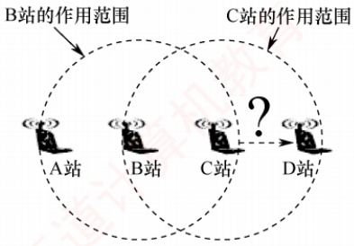

27. A

CSMA/CA协议只能尽量降低冲突发生的概率，在无线信道中冲突是无法完全避免的。检测到信道空闲后，CSMA/CA协议规定还必须等待DIFS的时间才能开始发送。无线信道中可能发生冲突，所以CSMA/CA协议也需要退避算法，但是和CSMA/CD协议的退避算法有一定的区别。

28. D

若检测到信道空闲，则CSMA/CA协议规定还必须等待DIFS 的时间才能开始发送。CSMA/CA协议不会进行冲突检测。预约信道并不是CSMA/CA协议的强制规定，在普通模式下不进行预约信道。

29. A

SIFS最短，网络中的控制帧和确认帧都采用SIFS作为发送之前的等待时延。DIFS最长，所有的数据帧都采用DIFS作为等待时延。PIFS中等，用于AP发送管理帧或探测帧的等待时延。当源站要发送数据时，先检测信道，在持续检测到信道空闲达到DIFS时间后就开始发送。目的站正确收到数据帧后，等待SIFS时间后发出对应的确认帧。若源站在规定时间内未收到确认帧，就必须重传此帧，直到收到确认帧为止，或经过若于重传失败后，放弃发送。

30. C

802.11帧首部中的地址字段的含义和作用取决于帧的去往DS位和来自DS位。

31. D

MAC帧是从 AP发送到主机 B的，即“去往 $\mathrm{AP}=0$ 而“来自 $\mathrm{AP}=1$ 。因此，地址1是 B的 MAC 地址，即 $MAC_{B};$ 地址 2 是 AP2的 BSSID，即 $\mathrm {BSSID}_{2}$ ；地址3是源地址，是路由器的接口2的MAC地址，即 $\mathrm {MAC}_{2}$

32. B

A 和 C是 VLAN的规定。插入 VLAN标签后，以太网的最大帧长变为1522 字节。802.1Q帧用于干线链路，若同一个交换机下的同一个VLAN的两台主机通信，则不使用802.1Q帧。

33. B

802.1Q帧在以太网帧的基础上增加了4B的 VLAN标签，因此最大长度也增加了4B。属于同一VLAN的主机无论是否连接到同一台交换机上，都能互相通信。而属于不同VLAN的主机即使连接到同一台交换机上，也不能直接在数据链路层进行通信。交换机会使用VLAN标签来区分不同的VLAN。同一个VLAN的主机不一定连接到相同的局域网，它们可以连接到相同的交换机，也可以连接到不同的交换机，只要这些交换机互连即可。

34. B

VLAN建立在交换技术的基础上，以软件方式实现逻辑分组与管理，VLAN中的计算机不受物理位置的限制。当计算机从一个VLAN转移到另一个VLAN时，只需简单地通过软件设定，而无须改变它在网络中的物理位置。要进行跨VLAN的通信，必须通过上层的路由器解决，不同VLAN的主机处于不同的广播域，因此不能直接在数据链路层进行通信。

35. C

一般有三种划分VLAN的方法:①基于接口；②基于MAC地址；③基于IP地址。

36. C

带“虚拟”两个字的基本上都有一个优点，即有效共享资源。通过虚拟局域网，可将一个较大的局域网分割成一些较小的与地理位置无关的逻辑上的虚拟局域网，而每个虚拟局域网都是一个较小的局域网，因此简化了网络管理，提高了信息的保密性和网络的安全性。链路聚合是解决交换机之间的宽带瓶颈问题的技术，而不是虚拟局域网的技术。

37. D

有关最短帧长的题要抓住两个公式来分析:①发送帧的时间≥争用期的时间；②最短帧长=数据传输速率×争用期的时间。题中，最短帧长减少800比特，则发送帧的时间减少0.8μs，要使①和②依然成立，就需要至少将争用期（信号的往返时间）的时间减少0.8μs，所以往返传播的总距离至少需要减少 $200000\mathrm{km/s} \times 0.8\mu\mathrm{s} = 160\mathrm{m}$ ，即单程距离至少需要减少80m。

38. D

CSMA/CA协议是无线局域网标准 802.11 中的协议，它在 CSMA协议的基础上增加了冲突避免的功能。ACK帧是CSMA/CA协议避免冲突的机制之一，也就是说，只有当发送方收到接收方发回的ACK帧时，才确认发出的数据帧已正确到达目的地。

39. A

考虑到局域网信道质量好，以太网采取了两项重要的措施来使通信更简单:①采用无连接的工作方式；②不对发送的数据帧进行编号，也不要求对方发回确认。因此，以太网提供的服务是不可靠的服务，即尽最大努力的交付。差错的纠正由高层完成。

40. B

CSMA/CD 协议适用于有线网络，CSMA/CA协议广泛应用于无线局域网。选项 A、C关于CSMA/CD协议专业词库的描述都是正确的。对于选项D，因为在 CSMA/CD协议中，信号传播时延会影响冲突检测的效率，若信号传播时延趋于零，则冲突检测就会非常及时，从而减少重传的时间和次数，提高信道利用率。当信号传播时延趋于零时，信道利用率也趋于100%。

41. B

有关最短帧长的题，要抓住两个公式来分析:①发送帧的时间≥争用期的时间；②最短帧长=数据传输速率×争用期时间。要使公式①恒成立，就要考虑在最短帧长的情况下公式①仍成立。对于本题，发送最短帧的时间为 $64B÷100M/s=5.12\mu s$ ，根据公式①可知，该时间即为争用期时间（往返时延）的最大值。本题的特点在于往返时延由两部分组成，即传播时延和Hub产生的转发时延。单程总时延为 $2.56\mu s , \mathrm{Hub}$ 产生的转发时延为 $1 . 535 \mu \mathrm {s}$ ，所以传播时延为 $2.56 - 1.535 = 1.025 \mu  s$从而H3与H4之间理论上可以相距的最大距离为 $200\mathrm{m/us} \times 1.025\mathrm{ps} = 205\mathrm{m}$

42. B

802.11帧首部的地址字段最常用的两种情况如下表所示。

| 去往AP | 来自 AP | 地址 1 | 地址2 | 地址 3 | 地址4 |
| --- | --- | --- | --- | --- | --- |
| 0 | 1 | 接收地址 = 目的地址 | 发送地址 = AP 地址 | 源地址 |  |
| 1 | 0 | 接收地址 = AP 地址 | 发送地址 = 源地址 | 目的地址 |  |

帧F是由H站发送到AP的，即“去往 $\mathrm{AP}=1$ 而“来自 $\mathrm{AP}=0$ 因此，地址1是AP的MAC 地址，地址 2 是 H 站的 MAC 地址，地址 3 是 R 站的 MAC 地址。

43. D

当 CSMA/CA协议进行信道预约时，主要使用的是请求发送 RTS 帧和清除发送CTS 帧。当一台主机想要发送信息时，先向无线站点发送一个RTS帧，说明要传输的数据及相应的时间。无线站点收到RTS帧后，将广播一个CTS帧作为对此的响应，既给发送方发送许可，又指示其他主机不要在这个时间内发送数据，从而预约信道，避免冲突。发送确认帧的目的主要是保证信息的可靠传输。二进制指数退避算法是CSMA/CD协议中的一种冲突处理方法。选项C与预约信道无关。

44. B

有关最短帧长的题，要抓住两个公式来分析:①发送帧的时间≥争用期的时间；②最短帧长=数据传输速率×争用期时间。对于本题，数据传输速率为100Mb/s，最短帧长为128B，根据公式②可得争用期时间（往返时延）为 $128\mathrm{B} \div 100\mathrm{Mb/s}=10.24 \times 10^{-6}\mathrm{s}$ ，所以单向传播时延为5.12μs。

45. A

100Base-T是一种以速率100Mb/s工作的快速以太网标准，且使用UTP（非屏蔽双绞线）铜质电缆。100Base-T:100标识传输速率为100Mb/s；Base标识采用基带传输；T表示传输介质为双绞线（包括5类UTP或1类STP），为F时表示光纤。

46. A

为了尽量避免冲突，IEEE802.11规定，所有站完成发送后，必须再等待一段很短的时间（继续监听）才能发送下一帧，该时间称为帧间间隔（IFS），有三种IFS:DIFS、PIFS和SIFS。帧间间隔的长短取决于该站要发送的帧的类型。网络中的控制帧以及对所接收数据的确认帧都采用SIFS作为发送之前的等待时延。当站点要发送数据时，若载波监听到信道空闲，则需等待DIFS后发送RTS预约信道，图中IFS1对应DIFS，时间最长，图中IFS2、IFS3、IFS4对应SIFS。

47. C

10Base-T 以太网采用 CSMA/CD 协议，CSMA/CD 协议采用截断二进制指数退避算法来确定冲突后重传的时机。从整数集合 $[ 0 , 1 , \cdots , 2^{k} - 1 ]$ 中随机取出一个数r，参数 k=min[重传次数,10]，站点重传所需等待的时间 =r×争用期，因此等待的最长时间为 $(2^{4}-1) \times 51.2 \mu  s  \approx 768 \mu  s$

48. B

数据帧的长度为1998B，链路带宽为54Mb/s，因此数据帧的发送时延为 $1998\mathrm{B} \div 54\mathrm{M}\mathrm{b} / \mathrm{s}=$ $296 \mu \mathrm {s}$ 。网络分配向量（NAV）指出了信道忙的持续时间，含义是“正在通信的两个站点以外的站点都不能在这段时间内发送数据”。CSMA/CA协议中的 RTS帧、CTS 帧和数据帧都携带占用信道的持续时间，当A站广播一个RTS帧时，将占用信道的持续时间 $( \mathrm {SIFS} + \mathrm {CTS} + \mathrm {SIFS} +$ $\mathrm {DATA + SIFS + ACK )}$ 写入RTS帧的首部；当AP收到RTS帧后，广播一个CTS帧，将占用信道的持续时间 $\left( \mathrm{SIFS} + \mathrm{DATA} + \mathrm{SIFS} + \mathrm{ACK} \right)$ 写入CTS帧的首部:之后传送的数据帧的首部也携带本次通信所需的持续时间。其他站收到这些帧后，根据帧中的持续时间设置自己的NAV值，因此隐蔽站B收到AP发送的 CTS帧时，设置自己的NAV值为 $\mathrm{SIFS}+\mathrm{DATA}+\mathrm{SIFS}+\mathrm{ACK}=$ $28\mu s + 296\mu s + 28\mu s + 2\mu s = 354\mu s$

49. C

以太网采用二进制指数退避算法:在前10次冲突（第1～10次重传）中，第i次冲突后在$[ 0 , 2^{i}   -   1 ]$ 个争用期（51.2μs）内随机退避；在第11次冲突后，退避窗口上限固定为1023。因此，第11 次冲突后可能的最大退避时间为 $1023 \times 51.2\mu s = 52.3776m$

#### 二、综合应用题

01.【解答】

CSMA/CD协议是一种动态的介质随机接入共享信道方式，而 TDM是一种静态的信道划分方式，从对信道的利用率来说，CSMA/CD协议用户共享信道，更灵活，信道利用率更高。

TDM不同，它为用户按时隙固定分配信道，当用户没有数据传送时，信道在用户时隙就浪费了；因为CSMA/CD协议让用户共享信道，所以当同时有多个用户需要使用信道时，就会发生冲突，从而降低信道的利用率；而在TDM中，用户在分配的时隙中不与其他用户发生冲突。对局域网来说，连入信道的是相距较近的用户，通常信道带宽较大。当使用TDM方式时，用户在自己的时隙中没有发送的情况更多，不利于信道的充分利用。

对于计算机通信来讲，突发式的数据更不利于使用TDM方式。

02. 【解答】

对于1km长的电缆，单程传播时间为 $1/200000=5\mu s$ ，来回路程传播时间为 $10 \mu \mathrm {s} = 10^{- 5} \mathrm {s}$

为了使该网络能按照CSMA/CD协议工作，最小的发送时间不能小于 $10 \mu \mathrm {s}$ 。当以 10Mb/s 速率工作时， $10^{- 5} \mathrm {s}$ 内可发送的比特数为 $(10 \times 10^{6} \mathrm{~b/s}) \times 10^{-5} \mathrm{s} = 100 \mathrm{b} \mathrm{i}$ ，因此最小帧长为100bit。

03. 【解答】

对于1km的电缆，单程传播时延是 $1/200000=5\times10^{-6} s$ ，即 $5 \mu \mathrm {s}$ ，往返传播时延是10μs。要能按照 CSMA/CD协议工作，最小帧的发送时间不能小于10μs。当以1Gb/s速率工作时，10μs 内可以发送的比特数为 $( 10 \times 10^{- 6} ) / ( 1 \times 10^{- 9} ) = 10000$ ，因此最小帧长为10000bit。

**注意**

假设现在传了一个帧，还未到往返时延就发送完毕，而且在中途出现冲突，这样就检测不出错误；若中途发生冲突，且这个帧还未发送完，则可检测出错误。因此，要保证CSMA/CD协议正常工作，就必须使发送时间大于或等于来回往返时延（争用期）。

04.【解答】

设总线电缆的长度为L，则

$$
\frac{125 \times 8}{100 \times 10^{6}} = 2 \times \frac{L}{2 \times 10^{8}}, \quad L = \frac{125 \times 8 \times 10^{8}}{100 \times 10^{6}}  m  = 1000  m
$$

05.【解答】

1）题目问的是当两台主机均检测到冲突时的最短时间和最长时间。首先要理解一个概念，即什么叫“主机检测到冲突”。假设主机甲和主机乙通信，双方发送的数据帧在中途相遇，此时发生了冲突，但甲方要检测到此次冲突，就必须收到乙方发送来的数据帧；同理，乙方要检测到此次冲突，就必须收到甲方发送来的数据帧。若仅考虑一方，则最短时间显然趋于0（一方在发送数据时，对方的数据即将到达），最长时间显然是往返时延（争用期）。若同时考虑两台主机，则不难发现，从开始发送数据的时刻起，假设甲方检测到冲突发生的时间为 $T_{1}$ ，乙方检测到冲突发生的时间为 $T_{2}$ ，则 $T_{1}   + T_{2}   =$ 往返时延。显然，当甲方和 $乙$ 方同时向对方发送数据时，信号在信道中间发生冲突后，冲突信号继续向两个方向传播。这种情况下两台主机均检测到冲突的时间最短:

$$
T_{(A)}=1  km /200000  km /s \times 2=0.01  ms = 单程传播时延  t_{0}
$$

设甲方（或乙方）先发送数据，当数据即将到达乙方（或甲方）时，乙方（或甲方）才开始发送数据。此时，乙方（或甲方）将立即检测到冲突，而甲方（或乙方）要检测到冲突，还需等待冲突信号从 $乙$ 方（或甲方）传播到甲方（或乙方）。两台主机均检测到冲突的时间最长:

$$
T_{(B)}=2km/200000km/s\times2=0.02ms=双程传播时延2t_{0}
$$

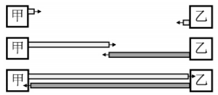

(a) 时间最短的情况

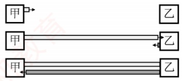

(b) 时间最长的情况

2）甲方发送一个数据帧的时间即发送时延 $t_{1}=1518 \times 8 \mathrm{bit} \div 10 \mathrm{Mb} / \mathrm{s}=1.2144 \mathrm{ms}$ ；乙方每成功收到一个数据帧，就向甲方发送一个确认帧，确认帧的发送时延 $t_{2}=64 \times 8 \mathrm{bit} \div 10 \mathrm{Mb/s}=$

0.0512ms；甲方收到确认帧后，即发送下一数据帧，因此甲方的发送周期T=数据帧发送时延+确认帧发送时延+双程传播时延 $t_{1} + t_{2} + 2t_{0} = 1.2856  ms$

有效数据传输速率=信道利用率×信道带宽（最大数据传输速率），或有效数据传输速率=发送周期内发送的数据量/发送周期。因此，甲方的有效数据传输速率为 $1500 \times 8 / T =$ $12000\mathrm{bit}/1.2856\mathrm{ms}\approx9.33\mathrm{Mb/s}$ （以太网帧的数据部分为1500B）。

### 3.7.3 本节习题精选

#### 单项选择题

01.局域网和广域网的差异不仅在于它们所覆盖的范围不同，还主要在于它们（）。
A. 所使用的介质不同
B. 所使用的协议不同
C. 所能支持的通信量不同
D. 所提供的服务不同

02. 广域网覆盖的地理范围从几十千米到几千千米，它的通信子网主要使用（）。
A. 报文交换技术
B. 分组交换技术
C. 文件交换技术
D. 电路交换技术

03. 广域网所使用的传输方式是（）。
A. 广播式
B. 存储转发式
C. 集中控制式
D. 分布控制式

04.广域网的拓扑结构通常采用（）。

A. 星形
B. 总线形
C. 网状
D. 环形

05. 现在大量的计算机是通过诸如以太网这样的局域网连入广域网的，而局域网与广域网的互联是通过（）实现的。
A. 路由器
B. 资源子网
C. 桥接器
D. 中继器

06. 下列协议中不属于TCP/IP族的是（）。
A. ICMP
B. TCP
C. FTP
D. HDLC

07. 为实现透明传输（默认为异步线路），PPP使用的填充方法是（）。
A. 位填充
B. 字符填充
C. 对字符数据使用字符填充，对非字符数据使用位填充
D. 对字符数据使用位填充，对非字符数据使用字符填充

08. 以下对PPP的描述中，错误的是（）。
A. 具有差错控制能力
B. 仅支持IP
C. 支持动态分配 IP 地址
D. 支持身份验证

09.PPP提供的功能有（）。
A. 一种组帧方法
B. 链路控制协议（LCP）
C. 网络控制协议（NCP）
D. A、B和C 都是

10. PPP中的LCP帧的作用是（）
A. 在建立状态阶段协商数据链路协议的选项
B. 配置网络层协议
C. 检查数据链路层的错误，并通知错误信息
D. 安全控制，保护通信双方的数据安全

11.下列关于PPP的叙述中，正确的是（）。
A. PPP 是网络层协议
B. PPP支持半双工或全双工通信
C. PPP两端的网络层必须运行相同的网络层协议
D. PPP是面向字节的协议

12. PPP提供的是（）。
A. 无连接的不可靠服务
B. 无连接的可靠服务
C. 有连接的不可靠服务
D. 有连接的可靠服务

### 3.7.4 答案与解析

#### 单项选择题

01. B

广域网和局域网之间的差异不仅在于它们所覆盖的范围不同，还在于它们所采用的协议和网络技术不同，广域网使用点对点等技术，局域网使用广播技术。

02. B

广域网的通信子网主要使用分组交换技术，将分布在不同地区的局域网或计算机系统互连起来，达到资源共享的目的。 自

03. B

广域网通常指覆盖范围很广的长距离网络，它由一些节点交换机及连接这些交换机的链路组成，其中节点交换机执行分组存储、转发功能。

04. C

广域网覆盖范围较广、节点较多，为了保证可靠性和可扩展性，通常需采用网状结构。

05. A

中继器和桥接器通常是指用于局域网的物理层和数据链路层的联网设备。目前局域网接入广域网主要是通过称为路由器的互联设备实现的。

06. D

TCP/IP族主要包括TCP、IP、ICMP、IGMP、ARP、RARP、UDP、DNS、FTP、HTTP等。HDLC 是ISO提出的一个面向比特型的数据链路层协议，它不属于TCP/IP族。

07. B

PPP是一种面向字节的协议，所有的帧长都是整数个字节。在异步线路中，PPP采用字节填充法实现透明传输；在同步线路中，PPP采用零比特填充法实现透明传输。

08. B

PPP提供差错检测功能，但不提供纠错功能。PPP两端的网络层可以运行不同的网络层协议，但仍能使用同一个PPP进行通信。PPP可用于拨号连接，因此支持动态分配IP地址。PPP双方建立LCP链路后，接着进入身份鉴别状态（可选）。

09. D

PPP协议主要由三部分组成:①链路控制协议（LCP）；②网络控制协议（NCP）；③个将IP数据报封装到串行链路的方法。因此，选项A、B、C都正确。

10. A

PPP帧在默认配置下，地址和控制域总是常量，所以LCP提供了必要的机制，允许双方协商一个选项。在建立状态阶段，LCP协商数据链路协议中的选项，它并不关心这些选项本身，只提供一个协商选择的机制。

11. D

PPP是数据链路层协议，A错误。根据PPP的特点可知B、C错误，D正确。

12. C

PPP是一种面向连接的点对点数据链路层协议，虽然它在连接建立的过程中使用了确认机制，但在数据帧的发送过程中只保证无差错接收（CRC检验），检验正确就接收这个帧，否则丢弃这个帧，其他什么也不做。因此PPP提供的是有连接的不可靠服务。

### 3.8.4 本节习题精选

#### 单项选择题

01. 下列网络连接设备都工作在数据链路层的是（）。
A. 中继器和集线器
B. 集线器和网桥
C. 网桥和局域网交换机 首
D. 集线器和局域网交换机

02.下列关于数据链路层设备的叙述中，错误的是（）。
A. 交换机将网络划分成多个网段，一个网段的故障不会影响到另一个网段的运行
B. 交换机可互连不同的物理层、不同的MAC子层及不同速率的以太网
C. 交换机的每个接口节点所占用的带宽不会因为接口节点数量的增加而减少，且整个交换机的总带宽会随着接口节点的增加而增加
D. 利用交换机可以实现虚拟局域网（VLAN），VLAN可以隔离冲突域，但不能隔离广播域

03.下列（）不是使用交换机分割网络所带来的好处。
A. 减少冲突域的范围
B. 在一定条件下增加了网络的带宽
C. 过滤网段之间的数据
D. 缩小了广播域的范围

04. 下列不能分割冲突域的设备是（）。
A. 集线器
B. 交换机
C. 路由器
D. 网桥

05. 局域网交换机实现的主要功能在（）。
A. 物理层和数据链路层
B. 数据链路层和网络层
C. 物理层和网络层
D. 数据链路层和应用层

06.交换机能比集线器提供更好的网络性能的原因是（）。
A. 交换机支持多对用户同时通信
B. 交换机使用差错控制减少出错率
C. 交换机使网络的覆盖范围更大
D. 交换机无须设置，使用更方便

07. 通过交换机连接的一组工作站（）。
A. 组成一个冲突域，但不是一个广播域
B. 组成一个广播域，但不是一个冲突域
C. 既是一个冲突域，又是一个广播域
D. 既不是冲突域，又不是广播域

08.一个16接口的集线器的冲突域和广播域的个数分别是（）。
A. 16, 1
B. 16, 16
C. 1,1
D. 1, 16

09. 一个16个接口的以太网交换机，冲突域和广播域的个数分别是（）。
A. 1, 1
B. 16, 16
C. 1, 16
D. 16, 1

10.下列关于用集线器连接的共享式以太网的说法中，正确的是（）。
A. 以太网的物理拓扑是总线形结构
B. 以太网提供有确认的无连接服务
C. 以太网参考模型一般只包括物理层和数据链路层
D. 以太网不一定使用 CSMA/CD 协议

11.下列关于广播式网络的说法中，错误的是（）。
A. 共享广播信道
B. 不存在路由选择问题
C. 可以不要网络层
D. 不需要服务接入点

12. 对于由交换机连接的10Mb/s以太网，若有10个用户，则每个用户能占有的带宽为（）。
A. 1Mb/s
B. 2Mb/s
C. 10Mb/s
D. 100Mb/s

13. 如下图所示，某学院的以太网交换机有3个接口分别和3个系的以太网相连，另外3个接口分别和万维网服务器、电子邮件服务器以及一个连接互联网的路由器相连，A、B和C都是100Mb/s以太网交换机。假设所有链路的速率都是100Mb/s，且图中9台主机中的任何一台都可以与任何一台服务器或主机通信。这9台主机和2台服务器产生的总吞吐量最大为（）。若把3个系的以太网交换机都换成100Mb/s集线器，则这9台主机和2台服务器产生的总吞吐量最大为（）。若把所有以太网交换机都换成100Mb/s集线器，则这9台主机和2台服务器产生的总吞吐量最大为（）。

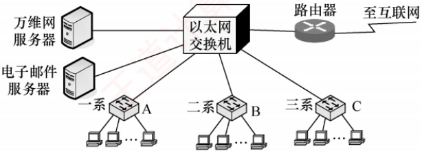

A. 1100Mb/s, 500Mb/s, 100Mb/s
B. 500Mb/s, 500Mb/s, 100Mb/s
C. 1100Mb/s, 1100Mb/s, 500Mb/s
D. 500Mb/s, 1100Mb/s, 500Mb/s

14. 假设以太网A中80%的通信量在本局域网内进行，其余20%在本局域网与因特网之间进行，而以太网B正好相反。在这两个局域网中，一个使用集线器，另一个使用交换机，则交换机应放置的局域网是（）。
A. 以太网 A
B. 以太网 B
C. 任意以太网
D. 都不合适

15.在使用以太网交换机的局域网中，以下（）是正确的。
A. 局域网中只包含一个冲突域
B. 交换机的多个接口可以并行传输
C. 交换机可以隔离广播域
D. 交换机根据 LLC 目的地址转发

16. 以太网交换机的自学习功能是指（）。
A. 记录帧的源MAC地址与该帧进入交换机的接口号
B. 记录帧的目的MAC地址与该帧进入交换机的接口号
C. 记录分组的源IP地址与该分组进入交换机的接口号
D. 记录分组的目的IP地址与该分组进入交换机的接口号

17. 当以太网交换机某接口收到帧时，若在交换表中未找到目的MAC地址，则（）。
A. 将帧发送到特定接口进行ARP 查询
B. 丢弃该帧
C. 将帧发送到除本接口外的所有接口
D. 将帧发送给 DHCP服务器

18. 某以太网如下图所示，假设交换机1和交换机2的交换表初始为空，各主机之间依次进行以下通信:A→B、H→A、E→X、X→E，则关于上述通信过程叙述错误的是（）。

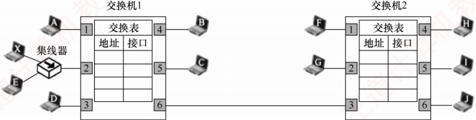

A. 当 A→B 时，除A 外的全部主机都能收到 A 发送的帧
B. 当 H→A 时，仅 A 能收到 H 发送的帧
C. 当E→X时，仅X能收到E发送的帧
D. 当 X→E时，交换机 2 收不到 X发送的帧

19.【2009统考真题】以太网交换机进行转发决策时使用的PDU地址是（）。
A. 目的物理地址
B. 目的IP地址
C. 源物理地址
D. 源 IP 地址

20.【2013统考真题】对于100Mb/s的以太网交换机，当输出端口无排队，以直通交换方式转发一个以太网帧（不包括前导码）时，引入的转发时延至少是（）。
A. 0μs
B. 0.48μs
C. 5.12μs
D. 121.44μs

21. 【2014统考真题】某以太网拓扑及交换机的当前转发表如下图所示，主机 00-e1-d5-00-23-a1向主机 00-e1-d5-00-23-c1 发送一个数据帧，主机 00-e1-d5-00-23-c1 收到该帧后，向主机00-e1-d5-00-23-a1发送一个确认帧，交换机对这两个帧的转发端口分别是（）。

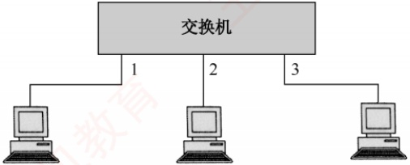

| 目的地址 | 端口 |
| --- | --- |
| 00-e1-d5-00-23-b1 | 2 |
|  |  |

A. {3}和{1}
B. {2, 3}和{1}
C. {2, 3}和{1,2}
D. {1, 2,3}和{1}

22.【2015统考真题】下列关于交换机的叙述中，正确的是（）
A. 以太网交换机本质上是一种多端口网桥
B. 通过交换机互连的一组工作站构成一个冲突域
C. 交换机每个接口所连的网络构成一个独立的广播域
D. 以太网交换机可实现采用不同网络层协议的网络互连

23. 【2016 统考真题】若主机 H2 向主机 H4 发送一个数据帧，主机 H4 向主机 H2 立即发送一个确认帧，则除H4外，从物理层上能够收到该确认帧的主机还有（）。

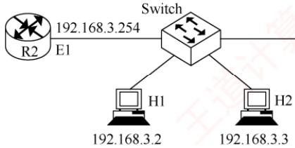

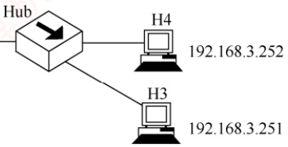

A. 仅H2
B. 仅H3
C. 仅H1、H2
D. 仅H2、H3

### 3.8.5 答案与解析

#### 单项选择题

01. C

中继器和集线器都属于物理层设备，网桥和局域网交换机属于数据链路层设备。02. D

交换机的优点是每个接口节点所占用的带宽不会因为接口节点数量的增加而减少，且整个交换机的总带宽会随着接口节点的增加而增加。另外，利用交换机可以实现虚拟局域网（VLAN），VLAN不仅可以隔离冲突域，还可以隔离广播域。因此选项C正确，选项D错误。

03. D

交换机可以隔离信息，将网络划分成多个网段，隔离出安全网段，防止其他网段内的用户非法访问。因为网络分段，各网段相对独立，所以一个网段的故障不影响另一个网段的运行。因此B、C正确。根据交换机的特点可知A正确，D错误。

04. A

冲突域是指共享同一信道的各个站点可能发生冲突的范围。物理层设备集线器不能分割冲突域，数据链路层设备交换机和网桥可以分割冲突域，但不能分割广播域，而网络层设备路由器既可分割冲突域，又可分割广播域。

05. A

局域网交换机是数据链路层设备，能实现数据链路层和物理层的功能。

06. A

交换机能隔离冲突域，在全双工方式下支持多对节点同时通信，从而提高了网络的效率。

07. B

交换机是数据链路层的设备，数据链路层的设备可以隔离冲突域，但不能隔离广播域，因此本题选B。另外，物理层设备（集线器等）既不能隔离冲突域，又不能隔离广播域；网络层设备（路由器）既可以隔离冲突域，又可以隔离广播域。

08. C

物理层设备（中继器和集线器）既不能分割冲突域，又不能分割广播域。

09. D

以太网交换机的各接口之间都是冲突域的终止点，但LAN交换机不隔离广播，所以冲突域的个数是16，广播域的个数是1。

10. C

用集线器连接的以太网逻辑上是总线形结构，物理上是星形结构，选项A错误。以太网设计的原则是简化通信，因此采用的是无确认、无连接的服务，选项B错误。以太网属于局域网的一种设计标准，只包括物理层和数据链路层，比如在物理层以太网规定采用曼彻斯特编码，在数据链路层规定采用CSMA/CD协议，选项C正确。用集线器连接的以太网一定工作在半双工方式下，因此一定要采用 CSMA/CD协议，选项D错误。

11. D

广播式网络使用共享的广播信道进行通信，通常是局域网的一种通信方式（局域网工作在数据链路层），因此可以不需要网络层，也就不存在路由选择问题。但数据链路层使用物理层的服务必须通过服务接入点，数据链路层向高层提供服务也必须通过服务接入点。

12. C

对于集线器连接的10Mb/s共享式以太网，若有N个用户，则每个用户的平均带宽仅为总带宽的1/N。当采用交换机连接时，虽然从每个接口到主机的带宽还是10Mb/s，但因为一个用户通信时是独占带宽的，而不是和其他用户共享带宽的，所以每个用户仍可得到10Mb/s的带宽。

13. A

9台主机和2台服务器都全速工作时的总吞吐量为900+200=1100Mb/s。若把3个系的以太网交换机都换成100Mb/s集线器，则每个系是一个碰撞域，最大吞吐量为100Mb/s，加上每台服务器100Mb/s的吞吐量，得出总吞吐量最大为500Mb/s。若把所有的以太网交换机都换成100Mb/s集线器，则整个网络是一个碰撞域，因此吞吐量最大为100Mb/s。

14. A

交换机能将网络分成较小的冲突域，而集线器连接的设备属于同一个冲突域。当一个局域网中80%的通信量在本局域网内进行时，若使用集线器，则会增加冲突和延迟，降低整个网络的效率，而若使用交换机将不同网段的通信隔开，则可以提高网络性能。

15. B

交换机可以隔离冲突域，因此它的每个接口所连接的网段都属于不同的冲突域，选项A错误。交换机可在同一时段内支持多个接口之间的并行通信，而不会相互干扰，这是因为交换机内部有一条高带宽的背部总线和一个内部交换矩阵，可以根据帧的目的MAC地址快速地将帧转发到相应的接口。交换机不能隔离广播域，选项C错误。LLC是逻辑链路控制，它在MAC层上，用于向网络提供一个接口，以隐藏各种802网络之间的差异，交换机是按MAC地址转发的，选项D错误。

16. A

以太网交换机的自学习功能是指记录帧的源MAC地址与该帧进入交换机的接口号，并将这些信息存储在交换机的交换表中，以便于后续的转发决策。

17. C

当以太网交换机的某个接口收到帧时，若在交换表中未找到目的MAC地址，则将该帧从除本接口外的所有接口发送出去，这种发送方法也称洪泛法。

18. C

当A→B时，交换表都为空，交换机1和交换机2都进行洪泛发送，因此除A外的全部主机都能收到A发送的帧。当H→A时，因为交换机2已登记A所在的接口为3，所以只向接口3转发，交换机1收到帧后，因为交换机1已登记A所在的接口为1，所以只向接口1转发，因此仅A能收到H发送的帧。当E→X时，集线器向除输入接口外的所有接口转发该帧，交换机1和交换机2也进行洪泛发送，因此除E外的全部主机都能收到A发送的帧。当X→E时，因为交换机1已登记E所在的接口为2，所以仅登记X所在的接口，并丢弃该帧。

19. A

交换机实质上是一个多接口网桥，工作在数据链路层，数据链路层使用物理地址进行转发，而转发到目的地需要使用目的地址。因此PDU地址是目的物理地址。

**20. B。**

直通交换方式的输入接口接收到一个帧时，只检查帧的目的MAC地址决定输出接口，引入的转发时延至少为读取目的MAC地址所需的时间。目的MAC地址共6B，引入的转发时延至少为6×8bit÷100Mb/s=0.48μs。存储转发方式引入的转发时延则至少为读取整个帧的时间。

21. B

当00-e1-d5-00-23-a1 向 00-e1-d5-00-23-c1 发送数据帧时，交换机转发表中没有 00-e1-d5-00-23-c1 这一项，所以向除接口1外的所有接口广播这个帧，即接口2、3会转发这个帧，同时交换机会把（目的地址00-e1-d5-00-23-a1，接口1）这一项加入转发表。而当00-e1-d5-00-23-c1向00-e1-d5-00-23-a1发送确认帧时，因为转发表中已有00-e1-d5-00-23-a1这一项，所以交换机只向接口1转发。

22. A

本质上说，交换机就是一个多接口的网桥（选项A正确），工作在数据链路层（因此不能实现不同网络层协议的网络互连，选项D错误），交换机能经济地将网络分成小的冲突域（选项B错误）。广播域属于网络层概念，只有网络层设备（如路由器）才能分割广播域（选项C错误）。

23. D

交换机（Switch）可以隔离冲突域。若H2向H4发送数据帧，则H2及其对应接口就写入交换表。当H4向H2发送确认帧时，交换机查找交换表后，将该确认帧从H2对应的接口转发出去。集线器（Hub）无法隔离冲突域，因此Hub会向所有接口（除输入接口外）广播该确认帧的数据信号。因此，从物理层上能够收到该确认帧的主机有H2和H3。
