# 第3章 数据链路层

> 来源：27王道《计算机网络》高清带书签.pdf（已清理水印、广告与 OCR 噪声）

## 【考纲内容】

（一）数据链路层的功能
（二）组帧
（三）差错控制

检错编码；纠错编码

（四）流量控制与可靠传输机制

流量控制、可靠传输与滑动窗口机制；停止-等待协议:

后退N帧协议（GBN）；选择重传协议（SR）

（五）介质访问控制

1. 信道划分:频分复用、时分复用、波分复用、码分复用

2. 随机访问:ALOHA 协议；CSMA 协议；CSMA/CD 协议；CSMA/CA协议

3. 轮询访问:令牌传递协议

（六）局域网

局域网的基本概念与体系结构；以太网与IEEE802.3;

IEEE 802.11无线局域网；VLAN的基本概念与基本原理

（七）广域网

广域网的基本概念；点对点协议（PPP）

（八）数据链路层设备

以太网交换机及其工作原理

## 【复习提示】

本章是历年考试中考查的重点。要求在了解数据链路层基本概念和功能的基础上，重点掌握滑动窗口机制、三种可靠传输协议、各种MAC协议，特别是CSMA/CD协议、CSMA/CA协议和以太网帧格式，以及局域网的争用期和最小帧长的概念、二进制指数退避算法。此外，中继器、网卡、集线器、网桥和局域网交换机的原理及区别也要重点掌握。

## 3.1 数据链路层的功能

数据链路层的主要任务是让帧在一段链路或一个网络中传输。尽管数据链路层协议种类繁多，但它们都需解决三个基本问题:封装成帧、透明传输和差错检测。

数据链路层使用的信道主要有两种:

1）点对点信道:一对一通信，通常通过一条专用物理链路连接两个节点。

2）广播信道:一对多通信，单个节点发送的数据可被连接在同信道上的所有节点接收。

### 3.1.1 数据链路层所处的地位

以两台主机通过互联网通信为例（见图3.1）:局域网1中的主机H1经路由器R1、广域网及路由器R2，连接到局域网2 中的主机H2。

主机H1和H2均具备完整的五层协议栈；路由器在转发分组时仅使用协议栈的下三层。当H1向H2发送数据时，数据在各节点的协议栈中多次上下流动（见图3.2）:进入路由器后，先从物理层上至网络层，在转发表中确定下一跳地址，再下至物理层转发出去。

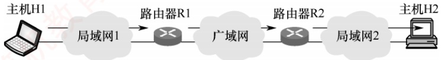

图 3.1 主机 H1 向 H2 发送数据

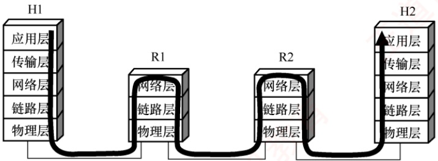

图3.2 从协议的层次上看数据的流动

然而，在学习数据链路层时，我们通常聚焦于水平方向的数据链路层交互。此时可将通信过程简化为:H1 的链路层→R1 的链路层→R2的链路层→H2的链路层（见图 3.3）。这三段链路可能采用不同的数据链路层协议，但每一段都独立完成帧的传输任务。

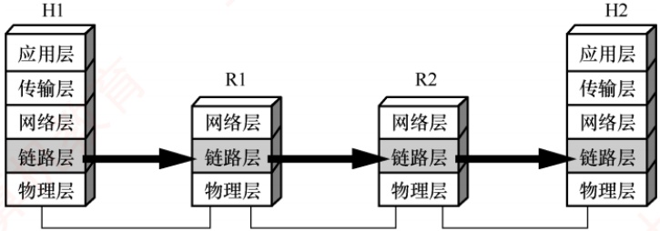

图3.3 只考虑数据在数据链路层的流动

下面介绍点对点信道的基本概念，其中部分也适用于广播信道。

1）链路。指从一个节点到相邻节点的一段物理线路，是通信路径的组成部分。

2）数据链路。在物理链路上添加实现通信协议的软硬件后所形成的逻辑通信通道。

3）帧。数据链路层对等实体间通信的协议数据单元。发送方将网络层交下的数据封装为帧发送；接收方从帧中提取数据并上交网络层。

### 3.1.2 链路管理

链路管理是指数据链路层连接的建立、维持和释放过程，主要用于面向连接的服务。

通信双方必须首先确认对方处于就绪状态，并交换必要信息（如初始化帧序号），才能建立

连接；传输过程中需维持连接状态；通信结束后则释放连接。

### 3.1.3 封装成帧与透明传输

封装成帧是指在数据前后分别添加首部和尾部，构成一个完整的帧。帧长等于帧的数据部分长度加上首部和尾部的长度。首部和尾部包含控制信息，其核心作用是帧定界一一帮助接收方从比特流中准确识别帧的起始与结束。例如，在HDLC协议中，使用标识字段F（01111110）标识帧的开始和结束。接收方将第一个F视为帧的开始，下一个F标志该帧的结束，如图3.4所示。为提高传输效率，应使数据部分尽可能长，但帧过长会增加差错概率和重传开销。因此，各类链路层协议均规定了最大传送单元（MTU），即帧数据部分的长度上限。

| 标志 | 地址 | 控制 | 数据 | 帧检验序列 | 标志 |
| --- | --- | --- | --- | --- | --- |
| F | A | C | I | FCS | F |
| 01111110 | 8位 | 8位 | N位(可变) | 16位 | 01111110 |

图 3.4 HDLC 帧格式

透明是计算机领域的一个重要概念，意指某事物虽存在，但对上层不可见。

透明传输是数据链路层的重要特性。“透明”在此意为:即使数据中恰好出现与帧定界符相同的比特组合，也不会被误判为帧边界。若不处理此问题，接收方可能提前结束帧解析，导致后续数据丢失。实现透明传输后，接收方能将帧完整恢复为原始SDU（服务数据单元），使网络层“感知不到”底层的帧封装过程即数据链路层对上层是透明的。

### 3.1.4 流量控制

由于链路两端节点的处理速率或缓存能力存在差异，若发送方速率过高，接收方可能因来不及处理而导致帧丢失。因此，流量控制旨在限制发送方的发送速率，使其不超过接收方的接收能力。该过程通常依赖反馈机制:发送方根据接收方的确认或窗口信息，决定是否继续发送。

在 OSI模型中，流量控制由数据链路层实现，用于调节相邻节点间的流量；而在TCP/IP模型中，该功能主要由传输层（如TCP）承担，负责端到端的流量控制。

### 3.1.5 差错检测与可靠传输

由于信道噪声等因素，帧在传输过程中可能出现两类错误。

1）位错:帧中某些比特发生翻转，通常通过循环冗余检验检测。

2）帧错:包括帧丢失、重复或失序等，属于更高层的传输差错。

早期OSI模型认为，数据链路层必须向上提供可靠传输服务。因此，在CRC检错基础上，引入了帧编号、确认与重传机制:接收方收到正确帧后需发送确认；发送方若在规定时间内未收到确认，则判定为出错并重传，直至收到确认为止。

如今，是否采用可靠传输机制取决于信道质量:在通信质量较差的无线链路中，数据链路层仍使用确认与重传机制，以提供可靠服务；而在高质量的有线链路中，数据链路层仅进行CRC检错，将出错帧直接丢弃，不再负责重传。此时，重传任务由高层协议（如传输层TCP）完成。核心原则是，数据链路层确保上交的帧无差错，但不保证所有帧都被成功交付。

## 3.2 组帧

发送方依据特定规则，将网络层递交的分组封装成帧（也称组帧）。数据链路层以帧为单位传输数据，主要目的是:一旦出错，只需重发出错的帧，而不必重传全部数据，从而提高传输效率。组帧需解决帧定界、帧同步和透明传输等问题。常见的组帧方法主要有以下四种。

注意

组帧时通常既要添加首部，也要添加尾部。原因在于，网络中信息以帧为最小传输单位，接收方必须能准确识别一帧在比特流中的起始与结束位置，否则无法正确解析帧内容。

### 3.2.1 字符计数法

字符计数法在帧首部设置一个计数字段，用于记录该帧包含的总字节数（包括计数字段自身占用的1B），如图3.5所示。接收方读取该计数值后，即可确定后续数据的长度，从而定位帧的结束位置；由于帧是连续传输的，下一帧的起始位置也随之确定。

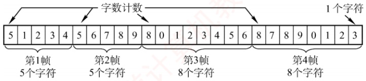

图3.5 字符计数的过程示例

字符计数法的主要缺陷是:当计数字段在传输过程中出错时，接收方将无法正确识别帧的边界，导致收发双方失去同步，可能引发灾难性后果。

### 3.2.2 字节填充法

字节填充法通过特定控制字符实现帧定界。在图3.6中，控制字符SOH表示帧的起始，EOT表示帧的结束。为避免数据中出现的SOH或EOT被误判为帧的定界符，发送方会在这些特殊字符前插入一个ESC字符（注意，ESC是ASCIⅡ码中的一个单字节控制字符），以实现透明传输。若数据中原本就包含ESC，则同样在其前再插入一个ESC。接收方收到ESC后，会将其丢弃，并将紧随其后的字符视为普通数据（而非控制字符），从而还原出原始数据。

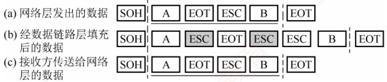

图3.6 字节填充的过程示例

当帧的数据部分中出现 ESC、EOT或 SOH时[见图3.6(a)]，发送方在每个ESC、EOT或SOH之前插入一个ESC字符[见图3.6(b)]，接收方处理后恢复原数据[见图3.6(c)]。

### 3.2.3 零比特填充法

考点追踪HDLC的比特填充规则（2013）

零比特填充法允许数据帧包含任意数量的比特，并用固定比特串01111110作为帧的起始和结束标志，如图3.7所示。为防止数据字段中出现与标志相同的比特序列，发送方在扫描数据时，每遇到5个连续的“1”，就在其后自动插入一个“0”，确保数据字段中不会出现6个连续的“1”，避免与帧标志混淆。接收方执行逆操作:每收到5个连续的“1”，就自动删除其后的“0”，以恢复原始数据。早期的HDLC协议正是采用这种方法来实现透明传输。

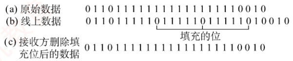

图3.7 比特填充过程示例

零比特填充法易于硬件实现，性能优于字节填充法。

### 3.2.4 违规编码法

违规编码法利用物理层编码的冗余特性实现帧定界。例如，在曼彻斯特编码中:比特“1”编码为“高-低”电平对，比特“0”编码为“低-高”电平对。而“高-高”或“低-低”电平对在数据比特中是违规的（未被采用），因此可借用这些违规编码序列来标识帧的起始或终止。局域网IEEE802标准采用了这种方法（更多介绍见3.6.2节）。违规编码法无须任何填充技术即可实现透明传输，但仅适用于采用冗余编码的特殊编码环境。

由于字符计数法对计数字段错误极为敏感，而字节填充法在实现上较为复杂且存在兼容性问题，因此目前更常用的组帧方法是零比特填充法和违规编码法。

## 3.3 差错控制

实际的通信链路并非理想，比特在传输过程中可能产生差错:1可能变为0，0也可能变成1，这种现象称为比特差错。比特差错是传输差错的一种，本节仅讨论此类差错。

通常采用编码技术进行差错控制，主要分为两类:检错编码和纠错编码。采用检错编码时，接收方若检测到差错，会设法通知发送方重传，直到收到正确的数据为止；采用纠错编码时，接收方不仅能发现差错，还能确定错误位置并加以纠正。在探讨具体的编码技术之前，需先引入码距（也称海明距离）的概念——它是衡量编码检错能力与纠错能力的重要参数。

考点追踪码距的计算与特性（2025）

码距是指两个码字在对应位上取值不同的比特数量。计算码距的一种方法是对两个位串进行异或（xor）运算，结果中1的个数即为码距。例如，0110⊕0011=0101，结果中有两个1，说明这两个码字有2位不同，因此其码距为2。在一个编码集中，任意两个有效码字之间码距的最小值称为该编码集的码距。例如，对于编码集{10011,01011,11110,00001}，虽然11110与00001的码距为5，但10011与01011的码距仅为2，取各码距中的最小值，求得该编码集的码距为2。

根据差错控制理论，编码方案的检错能力和纠错能力与码距l的关系如下:

$$
l = d + c + 1,\quad  且  \quad d \geq c
$$

即码距l越大，其检错的位数就越大，纠错的位数c也越大，且纠错能力恒不超过检错能力（能纠错必然能检错）。例如，当码距l=3时，该编码最多可检测2位错误，或纠正1位错误。此外，进一步考虑 $c   = 0$ 或 $d   =   c$ 的两种边界情况，还可得出以下两个重要结论:

1）为检测位错误，编码方案的码距至少应为d+1。任何发生d位错误的有效码字不可能变成另一个有效码字，以确保差错可被发现。例如，码距为1的编码无法检测任何错误。

2）为纠正c位错误，编码方案的码距至少应为2c +1。即使一个有效码字发生c位错误，其仍然离原始码字最近，接收方可据此唯一确定原始码字，实现纠错。

### 3.3.1 检错编码

检错编码均采用冗余编码技术，其核心思想是:在有效数据（信息位）发送前，按照特定规则附加若于冗余位（检验位），构成一个符合预设编码规则的码字后再发送。当信息位发生变化时，冗余位也会相应调整，以确保整个码字始终满足该编码规则。接收方通过校验收到的码字是否仍符合这一规则，来判断是否发生了差错。若某些比特在传输中出错，则可能违反原有的编码规则，进而使差错被有效检测出来。常见的检错编码包括奇偶检验码和循环冗余码。

#### 1．奇偶检验码

奇偶检验码是奇检验码和偶检验码的统称，是最基本的检错码。它由n位数据和1位检验位组成，检验位的取值（0或1）使得整个码字中“1”的个数为奇数（奇校验）或偶数（偶校验）。

1）奇检验码:附加检验位后，码字中“1”的总数为奇数。

2）偶检验码:附加检验位后，码字中“1”的总数为偶数。

例如，7位数据1001101中有4个“1”（偶数），因此:对应的奇检验码为10011011（加1使“1”的总数为奇数），对应的偶检验码为10011010（加0使“1”的总数保持为偶数）。

奇偶检验码只能检测奇数位错误，无法发现偶数位错误，也无法定位错误位置。由于任意两个合法码字之间至少有2位不同，其码距为2。根据码距理论，此类编码最多可检测1位错误。而实际上，只要发生奇数位错误，“1”的总数奇偶性必然改变，因此能检测所有奇数位错误。

#### 2．循环冗余码

循环冗余码（Cyclic Redundancy Code，CRC）是数据链路层广泛采用的一种高效检错技术，具有检错能力强、实现简单、硬件支持成熟等显著优势，其基本原理如下。

CRC的核心思想:将待发送的数据视为一个二进制多项式，通过与一个预定义的生成多项式G(x)进行特定运算，生成一段冗余校验信息（称为帧检验序列，FCS），并将其附加在原始数据之后。接收方则使用相同的G(x)对整个接收到的帧进行验证，从而判断传输过程中是否出现差错。

CRC校验过程的具体描述如下。

**约定生成多项式 G(x)**

收发双方事先约定一个 r+1阶的生成多项式G(x)，其对应的二进制系数串长度为r +1位，且最高位和最低位必须为1。例如，位串1101对应多项式 $x^{3} + x^{2} + 1$ ，其阶数r=3。

**发送方生成FCS**

假设待发送数据为m位，记作位串M；在M后面添加r个0，得到长度为m +r的扩展串（相当于将M左移r位，即乘以2”）；用G(x)对应的位串对该扩展串进行模2除法（不进位的二进制除法，其减法操作由异或实现）；所得余数（共r位，不足时补前导0）即为FCS；将原扩展串末尾的r个0替换为FCS，形成最终发送帧 $( 2^{r} M + \mathrm {FCS} )$ ，总长度为m+r位。

**接收方校验**

接收方收到整个帧（可能出错）后，用相同的G(x)对其进行模2除法:若余数为0，则认为传输无差错，接受该帧；若余数非0，则认为存在差错，丢弃该帧。

考点追踪CRC校验码的计算规则（2023）

以数据 $M = 101001 (m = 6)$ 生成多项式 $G(x) = 1101$ （对应r=3）为例。

CRC校验码的计算步骤如下:

1）左移补零:在M后加3个0，即101001000。

2）模2除法:用1101去除101001000，如图3.8所示。模2除法规则:减法不借位，等价

于按位异或；从最高位开始，每次对齐除数进行异或，直到处理完所有位。

3）取余数:最终余数为001（必须保留为3位）。

4）构造发送帧:将余数作为FCS附加到原始数据后，即101001001（共9位）。

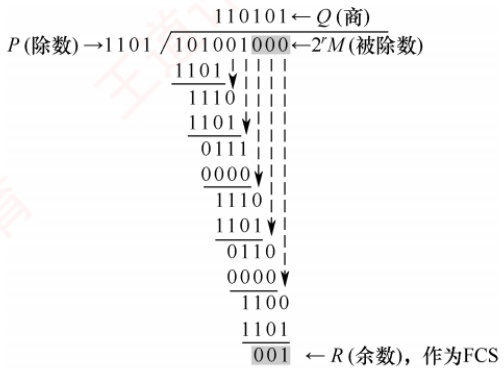

图3.8 循环冗余码的运算过程

CRC的生成与校验通常由专用硬件电路实现，速度极快，几乎不会引入额外的延迟。若传输过程中无差错，则CRC检验所得余数必定为 $0 ;$ 若出现误码，余数仍为0的概率极低。因此，在工程实践中通常认为“凡是被数据链路层接受的帧，几乎可以确定在传输过程中未发生差错”。而那些被丢弃的帧，尽管物理上曾被收到，却因CRC校验失败而未被上层接受。

### 3.3.2 纠错编码

最常见的纠错编码是海明码。其基本原理是在原始信息位中插入若于检验位，构成具有检错与纠错能力的海明码。每个检验位对应一个校验组（通常采用偶校验），用于校验海明码中的若干信息位。通过将每个信息位分配到多个检验组中，当某一位出错时，会引发其所属的多个检验组同时出现校验错误，从而不仅能检测出错误，还能确定错误位置，实现单比特纠错。

下面以信息位1010为例，详细介绍海明码的构造与纠错过程

**（1）确定海明码的总位数**

设信息位有n位，检验位有k位。k个检验位可表示 $2^{k}$ 种状态:信息位和检验位共有 $n \mathrm {~ + ~} k$种单比特出错的位置，此外还需1种表示无错状态。因此，n与k需满足

$$
2^{k} \geqslant n + k + 1
$$

本例中 $n = 4$ 尝试 $k = 3 : 2^{3} \geqslant 4 + 3 + 1$ 成立。故取 $k = 3$ ，海明码共 $n + k = 7$ 位。记信息位为 $D_{4}D_{3}D_{2}D_{1} = 1010$ ，检验位为 $P_{3} P_{2} P_{1}$ ，海明码位号从右至左依次为 $H_{7}H_{6}H_{5}H_{4}H_{3}H_{2}H_{1}$ o

**(2）确定检验位的分布**

规定:检验位 $P_{i}$ 放在海明位号为 $2^{i - 1}$ 的位置上，其余各位放置信息位，因此:

$P_{1}$ 的海明码位号为 $2^{i - 1} = 2^{0} = 1$ ，即 $H_{1}$ 为 $P_{1}$ 8

$P_{2}$ 的海明码位号为 $2^{i - 1} = 2^{1} = 2$ ，即 $H_{2}$ 为 $P_{2} ,$

$P_{3}$ 的海明码位号为 $2^{i - 1} = 2^2 = 4$ ，即 $H_{4}$ 为 $P_{3} ,$ m

将信息位按原顺序放在剩余位置，得到海明码的分布如下:

$$
\begin{aligned}H_{7} \quad & H_{6} \quad & H_{5} \quad & H_{4} \quad & H_{3} \quad & H_{2} \quad & H_{1} \\D_{4} \quad & D_{3} \quad & D_{2} \quad & P_{3} \quad & D_{1} \quad & P_{2} \quad & P_{1}\end{aligned}
$$

**（3）分组以形成检验关系**

每个信息位由多个检验位共同校验，需满足条件:信息位所在位号=其所参与的所有检验

位位号之和。另外，检验位不需要再被检验。分组形成的检验关系如下。

$$
\begin{aligned}D_{1}  位于  H_{3} 。由  H_{2} H_{1}(P_{2} P_{3})  检验:  \quad & \begin{array}{l} 因为  3(011) = \left[ \begin{array}{c} H_{d}(P_{3}) \\ \end{array} \right] = \\ 因为  6(110) = \left[ \begin{array}{c} 4 \\ \end{array} \right] \\ D_{1}  位于  H_{5} 。由  H_{4} H_{5} H_{6} (P_{3} P_{5} P_{6})  检验:  \end{array} \\D_{1}  位于  H_{6} 。由  H_{4} H_{6} H_{1}(P_{3} P_{5} P_{2})  检验:  \quad & \begin{array}{l} 因为  3(011) = \left[ \begin{array}{c} H_{d}(P_{3}) \\ \end{array} \right] \\ 因为  6(110) = \left[ \begin{array}{c} 4 \\ 4 \\ 4 \\ \end{array} \right] \\ 因为  7(111) = \left[ \begin{array}{c} 4 \\ \end{array} \right] \\ 第  3  组 \end{array}\end{aligned}\begin{aligned} 因为  3(011) = \left[ \begin{array}{c} H_{d}(P_{3}) \\ \end{array} \right] = \left[ \begin{array}{c} H_{d}(P_{3}) \\ \end{array} \right] \\ 因为  6(110) = \left[ \begin{array}{c} 4 \\ 4 \\ 4 \\ \end{array} \right] \\+ \left[ \begin{array}{c} 2 \\ 2 \\ 2 \\ 2 \\ 2 \\ \end{array} \right] \\+ \left[ \begin{array}{c} 2 \\ + \\ 1 \\ 1 \\ 1 \\ \end{array} \right] \\ 第  1  组 \end{aligned}
$$

**（4）检验位取值**

检验位 $P_{i}$ 的值为其对应校验组中所有位（含信息位）求异或（偶校验结果）。

根据（3）中的分组有

$$
P_{1}校验D_{1},D_{2},D_{4}\rightarrow P_{1}=D_{1}\oplus D_{2}\oplus D_{4}=0\oplus1\oplus1=0
$$

$$
P_{2}校验D_{1},D_{3},D_{4} \quad \rightarrow \quad P_{2}=D_{1} \oplus D_{3} \oplus D_{4}=0 \oplus 0 \oplus 1=1
$$

$$
P_{3}校验D_{2},D_{3},D_{4} \quad \rightarrow \quad P_{3}=D_{2} \oplus D_{3} \oplus D_{4}=1 \oplus 0 \oplus 1=0
$$

因此，1010对应的海明码为1010010（下划线为检验位，其余为信息位）。

**（5）海明码的检验原理**

每个检验组分别利用检验位和参与形成该检验位的信息位进行奇偶检验检查，构成k个检验方程:

$$
S_{1} = P_{1} \oplus D_{1} \oplus D_{2} \oplus D_{4}
$$

$$
S_{2}=P_{2}\oplus D_{1}\oplus D_{3}\oplus D_{4}
$$

$$
S_{3}=P_{3} \oplus D_{2} \oplus D_{3} \oplus D_{4}
$$

若 $S_{3} S_{2} S_{1}$ 的值为“000”，表示无错误；否则表示出错，且这个数就是错误位的位号，如 $S_{3}S_{2}S_{1}=001$表示第1位出错，即 $H_{1}$ 出错，直接将其取反即可达到纠错的目的。

海明码的优势在于:通过少量冗余检验位，可实现单比特错误的自动定位与纠正

## 3.4 流量控制与可靠传输机制

在数据链路层中，流量控制机制和可靠传输机制是紧密交织的。

### 3.4.1 流量控制与滑动窗口机制

流量控制是指由接收方控制发送方的发送速率，确保接收方有足够的缓存空间来接收每一个帧。常见的流量控制方法有两种:停止-等待协议和滑动窗口协议。数据链路层和传输层均具备流量控制的功能，且都采用了滑动窗口的思想，但二者存在明显区别，主要体现在以下两方面。

1）数据链路层控制的是相邻节点之间的流量，而传输层控制的是端到端的流量。

2）数据链路层的控制手段是:当接收方无法接收时，不返回确认帧；而传输层的控制手段是:接收方在确认报文段中携带窗口字段值，动态调整发送方的发送窗口大小。

#### 1．停止-等待流量控制基本原理

停止-等待流量控制是一种最简单的流量控制方法。发送方每次仅允许发送一个帧，接收方每成功接收一个帧后，需返回一个确认帧，表示可以接收下一帧；发送方只有收到确认帧后，才能发送后续帧。若未收到确认帧，发送方将一直等待。由于发送方在发送完一个帧后必须等待确认，因此信道利用率较低，传输效率不高

#### 2．滑动窗口流量控制基本原理

滑动窗口流量控制是一种更高效的流量控制方法。在任意时刻，发送方维持一组连续的、允许发送的帧序号，称为发送窗口；接收方也维持一组连续的、允许接收的帧序号，称为接收窗口。发送窗口的大小决定了在未收到对方确认的情况下，发送方最多还能发送多少帧以及哪些帧。接收窗口则用于控制接收方可以接收哪些帧，超出窗口范围的帧将被丢弃。

图3.9展示了发送窗口的工作原理，图3.10展示了接收窗口 $( W_{\mathrm {R}} = 1 )$ 的工作原理。

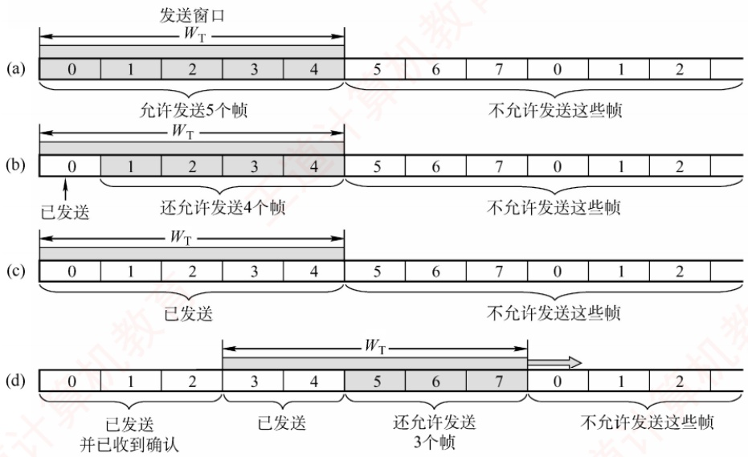

图3.9 发送窗口的工作原理:(a)允许发送0～4号共5个帧；(b)允许发送1～4号共

4个帧；(c)不允许发送任何帧；(d)允许发送5\~7号共3个帧

发送方每收到一个按序到达的确认帧，就将发送窗口向前滑动一个位置，从而允许发送一个新的帧。当窗口内所有帧均已发送但尚未收到确认时，发送方暂停发送。

接收方每收到一个序号落在接收窗口内的帧，便接收该帧，随后将接收窗口向前滑动一个位置，并返回确认。若收到的帧序号落在接收窗口之外，则一律丢弃。

滑动窗口具有以下重要特性:

1）发送窗口的滑动依赖于确认信息:仅当发送方收到对某帧的确认后，其发送窗口才能向前滑动。而接收方仅在成功接收期望帧后，才会发送确认并滑动其接收窗口。

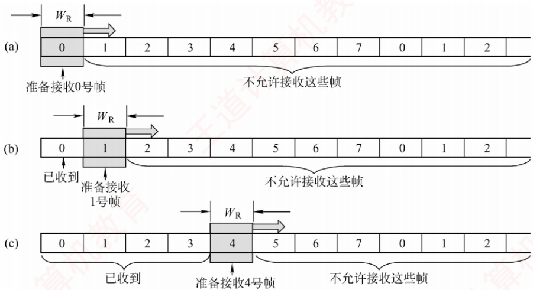

图3.10 接收窗口的工作原理

考点追踪滑动窗口协议的窗口机制（2019、2025）

2）从滑动窗口的角度看，停止-等待协议与后面将要介绍的后退N帧协议和选择重传协议的主要区别在于发送窗口和接收窗口的大小:

停止-等待协议:发送窗口 $W_{\mathrm {T}}   =   1$ ，接收窗口 $W_{\mathrm {R}}   =   1$

后退N帧协议:发送窗口 $W_{\mathrm {T}}   >   1$ ，接收窗口 $W_{\mathrm{R}} = 1$ 0

选择重传协议:发送窗口 $W_{\mathrm {T}}   >   1$ ，接收窗口 $W_{\mathrm{R}}>1$ 0

若采用 $n (n \geqslant 2)$ 比特对帧编号，则后两种滑动窗口协议还需满足 $W_{\mathrm {T}} + W_{\mathrm {R}} \leqslant 2^{n}$

3）当接收窗口大小为1时，只有收到该帧后才允许接收下一帧，因此可保证帧的有序接收。

4）在数据链路层的滑动窗口协议中，窗口大小在传输过程中是固定的（与传输层不同）。

### 3.4.2 可靠传输机制

可靠传输是指发送方发出的数据能够被接收方正确且完整地接收，为实现这一目标，通常采用确认（ACK）和超时重传两种机制。

1）确认:接收方每成功接收到一个数据帧，就向发送方返回一个确认帧，表明该数据帧已被正确接收。

2）超时重传:发送方在发送一个数据帧后启动一个计时器，若在规定时间内未收到对应的确认帧，则认为该帧可能丢失或出错，从而自动重传该帧，直至成功收到确认为止。

结合这两种机制的可靠传输协议称为自动重传请求（Automatic Repeat reQuest，ARQ），它意味着:重传由发送方自主触发，无须接收方显式请求重传。在ARQ协议中，数据帧和确认帧都必须编号，以便发送方和接收方能够准确识别确认帧对应的是哪个数据帧，以及判断哪些帧尚未被确认，从而决定是否需要重传。ARQ协议主要包括三种类型:停止-等待（Stop-and-Wait）协议、后退N帧（Go-Back-N）协议和选择重传（SelectiveRepeat）协议。这三种协议的基本原理不仅适用于数据链路层，也可应用于更高层的可靠传输设计。

在实际网络中，是否在数据链路层提供可靠传输服务取决于链路特性:有线网络的误码率较低，为降低开销，一般不要求数据链路层提供可靠传输服务；即使出现少量误码，也可由上层（如传输层）通过端到端机制处理。无线网络的链路易受干扰，误码率较高，因此要求数据链路层必须向上层提供可靠传输服务，以避免大量错误帧传递至上层，提升整体效率。

#### 1．单帧滑动窗口与停止-等待协议（S-W）

在停止-等待协议中，发送方每次只能发送一个数据帧，只有在收到接收方对该帧的确认帧后，才能发送下一个帧。从滑动窗口的角度看，该协议的发送窗口和接收窗口大小均为1。

在实际传输过程中，可能出现以下两类差错:

1）数据帧出错或丢失。接收方检测到数据帧存在差错时，直接丢弃该帧；数据帧在传输途中丢失时，接收方不会收到任何信息。为应对这两种情况，发送方需要配备一个计时器。每发送完一个数据帧，发送方即启动该计时器；计时器超时仍未收到对应的确认帧时，认为该帧可能已丢失或出错，于是自动重传该帧。该过程重复进行，直至该帧被正确接收并返回确认帧为止。

2）确认帧出错或丢失。即使接收方已成功收到正确的数据帧，若其返回的确认帧在传输中出错或丢失，则发送方仍将因未收到确认而触发超时重传。这时，接收方会再次收到一个重复的数据帧。为避免重复处理，接收方会丢弃该重复帧，并重新发送对应的确认帧。

停止-等待协议每次仅发送一帧并等待确认，因此只需确保相邻发送的帧具有不同的序号即可区分新帧与重传帧。因此，仅需1比特序号空间就已足够:数据帧交替使用序号0和1，对应的确认帧分别记为ACK0和ACK1。若接收方连续收到相同序号的数据帧，则说明发送方进行了超时重传；若发送方连续收到相同序号的确认帧，则说明接收方收到了重复帧且重发了确认帧。

此外，为支持超时重传和重复帧识别，发送方和接收方均需设置帧缓冲区。发送方发送数据帧后，必须在发送缓存中保留该帧的副本，以便需要时重传；仅在收到对应的确认帧后，方可清除该副本。接收方也需记录最近成功接收的帧序号，以判断新到的帧是否是重复的帧。

停止-等待协议的信道利用率很低。为提高传输效率，后续发展出了连续ARQ协议（后退N帧协议和选择重传协议），允许发送方连续发送多个数据帧，而无须逐帧等待确认。

#### 2．多帧滑动窗口与后退N帧协议（GBN）

**考点追踪GBN协议的工作原理（2009）**

在后退N帧协议中，发送方可在未收到确认帧的情况下，连续发送多个序号落在发送窗口内的数据帧。后退N帧的含义是:若某个已发送的数据帧因超时未收到确认而被判定为丢失或出错，则发送方不仅需要重传该帧，还需重传其后所有已发送但未被确认的帧。这一机制的前提是:接收方仅按序接收数据帧，任何失序到达的帧都将被丢弃。

**考点追踪GBN协议的累积确认机制（2017）**

如图3.11所示，发送方向接收方连续发送数据帧，发送完0号帧后，可继续发送1号、2号等后续帧。其通常仅为最早未确认的帧维护一个超时计时器，当该帧被确认后，计时器移至下一个未确认帧。由于连续发送了多个帧，确认帧必须明确指示所确认的帧序号。为降低开销，GBN协议采用累积确认机制:接收方无须对每个正确接收的帧立即返回确认，而可在连续收到多个正确帧后，仅对其中序号最大的帧发送一个确认。具体而言，ACKn表示接收方已正确收到n号帧及之前的所有帧，下一次期望接收的是n+1号帧（若序号回绕，则可能是0号帧）

由于接收方仅按序接收帧，当某帧出错或丢失时，其后所有正确到达的帧即使无误，也会被丢弃。例如，在图3.11中，尽管在出错的2号帧之后又收到了6个正确的数据帧，接收方仍必须将它们全部丢弃。此外，为了防止确认帧丢失，接收方可以重复发送最近一次的确认帧(如ACK1)，促使发送方尽快感知当前的接收状态。2号帧的计时器超时后，发送方将从该帧开始，重传窗口内所有未被确认的帧（2号及之后的帧）

**考点追踪GBN协议的超时重传机制（2017）**

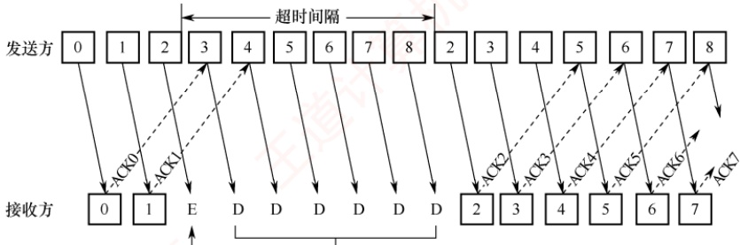

出错 被数据链路层丢弃的帧

图 3.11 GBN 协议的工作原理:对出错数据帧的处理

**考点追踪GBN协议的滑动窗口机制（2012、2015、2017）**

若采用n比特对帧编号，则发送窗口 $W_{\mathrm {T}}$ 应满足 $1 < W_{\mathrm{T}} \leqslant 2^{n} - 1$ 。若 $W_{\mathrm{T}} > 2^{n} - 1$ 而这可能导致接收方无法区分新发送的帧与因序号回绕而重复出现的旧帧（参见章末的疑难点1）。

GBN协议的接收窗口大小固定为 $W_{\mathrm {R}}   =   1$ ，这保证了帧的严格按序接收。

不难看出，GBN协议一方面通过连续发送多个帧显著提高了信道利用率；另一方面，在发生差错时却必须重传大量已正确到达的帧（仅因这些帧前面有一帧出错），从而造成带宽浪费。因此，当信道误码率较高时，GBN协议的性能可能反而不如停止-等待协议。

#### 3．多帧滑动窗口与选择重传协议（SR）

为了进一步提高信道的利用率，可以设法仅重传出错或超时的数据帧，而不影响其他已正确传输的帧。为此，接收方必须能够暂存失序但正确到达、且序号仍落在接收窗口内的数据帧，待缺失序号的帧收齐后，再按序交付给上层。这种机制即为选择重传协议。

**考点追踪SR协议的工作原理（2011、2024）**

为实现仅重传出错帧的目标，接收方不能再采用累积确认，而需对每个正确接收的数据帧逐一发送确认。显然，选择重传协议比后退N帧协议更为复杂:

●接收方需设置足够大的帧缓冲区（其数量等于接收窗口大小），用于暂存正确的失序帧；

●发送方为每个未确认的帧维护独立的计时器，当某帧的计时器超时时，仅重传该帧；

● 若接收方收到重复的数据帧（表示确认帧丢失），则丢弃该帧，并重传对应的确认帧。

此外，选择重传协议还引入了更高效的差错处理策略:一旦接收方检测到某个数据帧出错，可立即向发送方发送否定帧（NAK），请求重传NAK指定的帧，从而避免等待超时。

在图3.12中，2号帧丢失后，接收方仍可正常接收并缓存后续到达的数据帧（如3～9号帧）；发送方超时重传2号帧并被成功接收后，接收窗口即可向前滑动。在某个时刻，若接收方检测到10号帧出错，则会立即发送否定帧NAK10；在此期间，接收方仍可继续接收并缓存后续帧；发送方收到NAK10后，立即重传10号帧，无须等待超时。

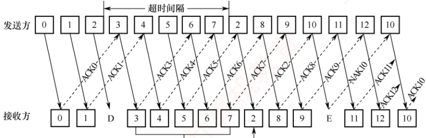

由数据链路层缓冲的帧 将分组2\~7传给网络层

图3.12 SR协议的工作原理:对超时和出错数据帧的处理

**考点追踪SR协议的滑动窗口机制（2023）**

选择重传协议的接收窗口 $W_{\mathbf {R}}$ 和发送窗口 $W_{\mathbf {T}}$ 均大于1，允许一次发送或接收多个数据帧。若采用n比特对帧编号，需满足两个条件:① $W_{\mathrm{R}} + W_{\mathrm{T}} \leqslant 2^{n}$ (不满足此条件时，接收窗口向前滑动后，部分确认帧丢失，发送方可能重传旧序号的帧；由于序号空间不足，这些重传帧的序号可能与新帧重叠，导致接收方无法区分新帧与旧帧）。② $W_{\mathrm{R}} \leqslant W_{\mathrm{T}}$ （若接收窗口大于发送窗口，则接收窗口中超出发送窗口范围的部分永远无法被填满，造成资源浪费）。由①和②不难推出$W_{\mathrm {R}} \leqslant 2^{n - 1}$ 。在实际应用中，常取 $W_{\mathrm {R}}   =   W_{\mathrm {T}}   =   2^{n - 1}$ ，以充分利用序号空间。

**注意**

为使内容精炼，本文未对三种ARQ协议的滑动窗口动态变化过程展开具体示例。此部分内容在配套视频中有丰富、形象的过程演示，强烈建议读者结合学习。

#### 4．信道利用率的分析

信道利用率用于衡量信道的使用效率。从时间角度看，信道效率是针对发送方而言的，是指发送方在一个发送周期（从发送方开始发送一个分组，到收到对该分组的确认所需的时间）内，有效发送数据的时间与整个发送周期之比。本节使用分组而非帧，是为增强表述的通用性。

**（1）停止-等待协议的信道利用率**

**考点追踪停止-等待协议的信道利用率分析（2018、2020）**

停止-等待协议的优点是实现简单，但缺点是信道利用率极低。图3.13显示了停止-等待协议中数据帧和确认帧的发送时间关系。假定在发送方和接收方之间有一个直通的信道来传送分组。

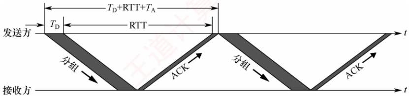

图3.13 停止-等待协议中数据帧和确认帧的发送时间关系

发送方发送一个分组的发送时延为 $T_{\mathrm {D}} \mathrm {{_\circ}}$ ，显然， $T_{\mathrm {D}}$ 等于分组长度除以数据传输速率。假定分组正确到达接收方后，其处理时间可忽略不计，接收方立即返回确认。接收方发送确认分组的发送时延为 $T_{\mathrm {A}}$ （通常可忽略不计）。再假设发送方处理确认分组的时间也可忽略不计，则发送方经过时间 $T_{\mathrm{D}} + \mathrm{RTT} + T_{\mathrm{A}}$ 后就可再发送下一个分组，其中RTT是往返时延。由于仅有 $T_{\mathbf {D}}$ 时间用于有效发送数据，因此停止-等待协议的信道利用率U为

$$
U = \frac{T_{\mathrm{D}}}{T_{\mathrm{D}} + \mathrm{RTT} + T_{\mathrm{A}}}
$$

假定某信道的RTT= 20ms。分组长度为1200 比特，数据传输速率为1Mb/s。若忽略处理时延和 $T_{\mathrm {A}}$ ，则可算出信道利用率 $U = 5.66\%$ 。若将数据传输速率提高至10Mb/s，则 $U = 0.596\%$ 。由此可见，当RTT远大于 $T_{\mathbf {D}}$ 时，停止-等待协议的信道利用率会非常低。

**(2）连续ARQ协议的信道利用率**

**考点追踪停止-等待、GBN与SR协议的信道利用率对比分析（2023）**

连续ARQ协议采用流水线传输（见图3.14），允许发送方连续发送多个分组，从而在信道上维持持续的数据流动。只要发送窗口足够大，即可显著提升信道利用率。

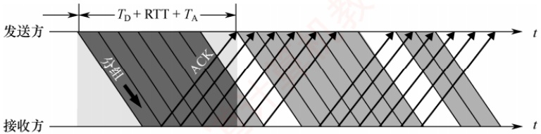

图3.14 连续ARQ协议的流水线传输可提高信道利用率

考点追踪GBN协议的信道利用率分析（2012、2015、2017）

设连续ARQ协议的发送窗口大小为N（最多可连续发送N个分组），分为两种情况:

1）若 $N T_{\mathrm {D}} < T_{\mathrm {D}} + \mathrm {RTT} + T_{\mathrm {A}}$ :即在一个发送周期内可发送完N个分组，此时，信道无法被完全占满，信道利用率为

$$
U = \frac{NT_{\mathrm{D}}}{T_{\mathrm{D}} + \mathrm{RTT} + T_{\mathrm{A}}}
$$

2）若 $\mathrm{NT_D} \geqslant \mathrm{T_D} + \mathrm{RTT} + \mathrm{T_A}$ 即在一个发送周期内发不完（或刚好发完）N个分组，只要无差错发生，发送方可持续不间断地发送，信道被完全利用，此时信道利用率U=1。

在相同帧序号比特数下，GBN的发送窗口大于停止-等待协议，因此理想条件下信道利用率更高。但是，当信道误码率较高时，其实际信道利用率甚至可能低于停止等待协议。

考点追踪滑动窗口协议的数据传输速率分析（2009、2010、2014）

此外，“信道平均（实际）数据传输速率=信道利用率×信道带宽（最大数据传输速率）”，或“信道平均（实际）数据传输速率=发送周期内发送的数据量/发送周期”。

本节习题包含大量关于信道利用率与传输速率的习题，建议读者结合练习深入掌握。

## 3.5 介质访问控制

介质访问控制的主要任务是协调共享同一信道的各节点的传输行为，以避免彼此之间的信号冲突。如图3.15所示，在广播信道中，节点A、B、C、D和E共享同一信道。若A与C、B与D同时通信且未加控制，则可能因信号干扰而通信失败。用于决定广播信道资源分配的协议属于数据链路层的介质访问控制（Medium Access Control，MAC）子层。

常见的介质访问控制方法包括:信道划分介质访问控制、随机访问介质访问控制和轮询访问介质访问控制。其中，前者采用静态划分信道的方式，后两者则属于动态分配信道的方法。

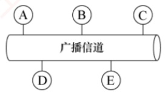

图3.15 广播信道的通信方式

### 3.5.1 信道划分介质访问控制

信道划分介质访问控制通过复用技术，将同一传输介质上的多个设备通信隔离开来，合理分配时域或频域资源。所谓复用，是指在发送端将多个发送方的信号组合到一条物理信道上传输，在接收端再将复用信号分离，并交付给对应的接收方，如图3.16所示。当传输介质的带宽超过单个信号所需带宽时，复用技术还能有效提高传输系统的利用率。

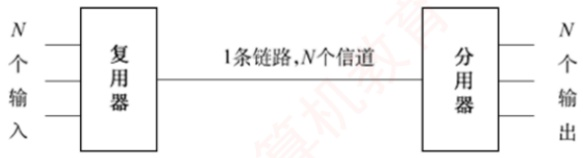

图 3.16 复用原理示意图

信道划分的实质是通过分时、分频、分码等方式，将一个广播信道在逻辑上划分为若干互不干扰的子信道，从而实现多个点对点通信。信道划分介质访问控制主要包括以下四种方式。

#### 1．时分复用（TDM）

**考点追踪时分复用的概念（2013）**

时分复用（TimeDivision Multiplexing，TDM）将信道的传输时间划分为等长的时间片，构成一个TDM帧。每个用户在每个TDM帧中占用固定序号的时隙，且该时隙周期性出现（周期即为TDM帧长度）。所有用户在不同时间共享相同的信道资源，如图3.17所示。需注意，TDM帧是一段固定长度的时间间隔，与数据链路层的“帧”概念不同。

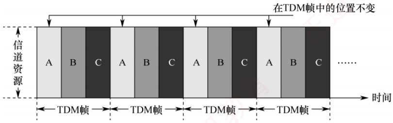

图3.17 时分复用的原理示意图

从某一时刻看，信道上传送的是某对用户之间的信号；从一段时间看，则是按时间分割的复用信号。由于TDM按固定次序分配时隙，当某用户暂无数据发送时，其分配的时隙仍被保留，无法被其他用户利用，因此信道利用率较低。统计时分复用（StatisticTDM，STDM）也称异步时分复用，是对TDM的改进。STDM不固定分配时隙，而是按需动态分配:仅当用户有数据要发送时，才为其分配STDM帧中的时隙，从而显著提高线路利用率。例如，假设线路数据速率为6000b/s，3个用户的平均速率均为2000b/s。采用 TDM时，每个用户固定分配 2000b/s的带宽；而在STDM下，各用户可动态共享全部带宽。当其他用户无数据发送时，某一用户可利用接近线路总速率（此处为6000b/s）的带宽进行突发传输，进而显著提高线路的平均利用率。

#### 2．频分复用（FDM）

**考点追踪 频分复用的概念（2013）**

频分复用（Frequency Division Multiplexing，FDM）将信道的总频带划分为多个子频带，每个子频带作为一个独立子信道，供一对用户通信使用，如图3.18所示。所有用户在同一时间占用不同的频带资源。各子信道分配的带宽可以不同，但总和不得超过信道的总带宽。为防止相邻子信道间相互干扰，实际应用中通常还需在它们之间设置“隔离频带”。

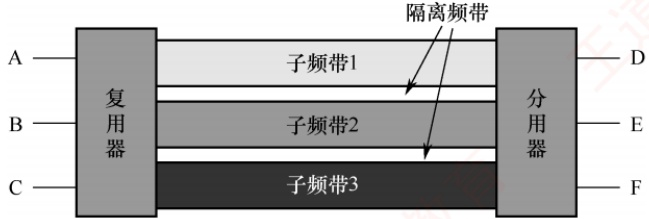

图3.18 频分复用的原理示意图

频分复用的优点在于能充分利用传输介质的带宽，系统效率较高，且实现相对简单。

#### 3．波分复用（WDM）

波分复用（Wavelength Division Multiplexing，WDM）即光的频分复用。它在一根光纤中同时传输多种不同波长的光信号。由于波长不同，各路光信号互不干扰，接收端通过光分用器将各波长分离出来。由于光波位于电磁频谱的高频段，具有极大的带宽，因此可支持多路的波分复用。

#### 4．码分复用（CDM）

**考点追踪 码分复用的概念（2013）**

码分复用（Code Division Multiplexing，CDM）是一种采用不同编码来区分各路原始信号的复用方式。与FDM和TDM不同，CDM既共享信道的频率，又共享时间。

实际上，更常用的名词是码分多址（Code Division Multiple Access，CDMA），其原理是将每个比特时间进一步划分为m个短的时间槽，称为码片（Chip），通常m的值为64或128，为了简化说明，下例中设m=8。每个站点指派一个唯一的m位码片序列。发送1时，站点发送其码片序列；发送0时，站点发送该码片序列的反码。当两个或多个站点同时发送时，各路数据在信道中线性相加。为了从信道中分离出各路信号，各个站点的码片序列应相互正交。

简单理解就是，A站向C站发出的信号用一个向量表示，B站向C站发出的信号用另一个向量表示，这两个向量要求相互正交。向量中的分量即所谓的码片。

**下面举例说明CDMA 的原理。**

令向量S表示 A 站的码片向量，T表示 B 站的码片向量。假设A站的码片序列被指派为00011011，则A站发送00011011表示发送比特1，发送11100100表示发送比特0。为便于计算，将码片中的0写为-1，1写为+1，因此A站的码片序列是（-1-1-1+1+1-1+1+1）。

不同站点的码片序列相互正交，即向量S和T的规格化内积为0:

$$

S \cdot T = \frac{1}{m} \sum_{i = 1}^{m} S_{i} T_{i} = 0
$$

任何站点的码片向量和该码片向量自身的规格化内积都是1:

$$
S \cdot S = \frac{1}{m} \sum_{i = 1}^{m} S_{i} S_{i} = \frac{1}{m} \sum_{i = 1}^{m} S_{i}^{2} = \frac{1}{m} \sum_{i = 1}^{m} (\pm 1)^{2} = 1
$$

任何站点的码片向量和该码片反码的向量的规格化内积都是-1:

$$
S \cdot \overline{S} = \frac{1}{m} \sum_{i = 1}^{m} S_{i} \overline{S_{i}} = - \frac{1}{m} \sum_{i = 1}^{m} S_{i}^{2} = - 1
$$

令向量T为 $(-1-1+1-1+1+1+1-1)$ 0

当A站向C站发送数据1时，就发送了向量（-1-1-1+1+1-1+1+1）。

当B站向C站发送数据0时，就发送了向量 $( + 1 + 1 - 1 + 1 - 1 - 1 - 1 + 1 )$

两个向量在公共信道上叠加，实际上是线性相加，得到

$$
\boldsymbol{S}+\overline{\boldsymbol{T}}=\begin{pmatrix}0&0&-2&2&0&-2&0&2\end{pmatrix}
$$

**考点追踪CDMA中的数据恢复计算（2014）**

到达C站后，进行数据分离。若要提取来自A站的数据，则C站需知道A站的码片向量S，并计算S与 $S + {\overline {{T}}}$ 的规格化内积。根据叠加原理，其他站点的信号都在内积结果中被过滤掉，内积的相关项都是0，而保留A站发送的信号，得到 VO

$$
S \bullet (S + \overline{T}) = 1
$$

因此，A站发出的数据是1。同理，若要提取来自B站的数据，则

$$
T \cdot (S + \overline{T}) = -1
$$

因此，从B站发送过来的信号向量是一个反码向量，代表0。

规格化内积是线性代数的内容，它在计算两个向量的内积后，再除以向量的分量个数。

下面举一个直观的例子来理解频分复用、时分复用和码分复用。

假设A站要向C站运送黄豆，B站要向C站运送绿豆，A站、B站与C站之间有一条公共道路，可类比为广播信道。在频分复用方式下，公共道路被划分为两个车道，分别供A站到C站、B站到C站的车通行，两类车可以同时通行，但都只使用了一半的道路，因此频分复用（波分复用也类似）共享时间而不共享空间。在时分复用方式下，先让A站到C站的车走一趟，再让B站到C站的车走一趟，两类车交替使用道路，因此时分复用共享空间，但不共享时间。码分复用与另外两种信道划分方式极为不同，在这种方式下，黄豆与绿豆放在同一辆车上运送，到达C站后，由C站负责把车上的黄豆和绿豆分开，因此码分复用既共享空间，又共享时间。

码分复用技术具有频谱利用率高、抗干扰能力强、保密性好、语音质量好等优点，还可以减少投资及降低运行成本，广泛应用于无线通信系统，特别是移动通信系统。

### 3.5.2 随机访问介质访问控制

**考点追踪信道划分与随机访问介质访问控制的特点（2014）**

在随机访问协议中，不采用集中控制方式来协调各站点的发送次序，而是允许所有用户根据自身意愿随机发送信息，并可占用信道的全部带宽。在总线形网络中，当两个或多个用户同时发送信息时，就会产生冲突（也称碰撞），导致所有冲突用户的发送均以失败告终。为解决此类冲突，每个用户需按照特定规则反复重传帧，直至该帧无冲突地成功传输。随机访问介质访问控制的核心思想是:通过争用获得信道使用权，胜者方可发送数据。

可见，若采用信道划分机制，节点之间的通信要么共享时间，要么共享空间，要么两者兼有:而若采用随机访问控制机制，则节点在发送时既不预留时间，也不独占频段。因此，随机介质访问控制实质上是将广播信道动态地转化为点到点信道的机制。

#### 1．ALOHA协议

ALOHA 协议分为纯 ALOHA 协议和时隙 ALOHA 协议两种。

**(1) 纯 ALOHA 协议**

纯ALOHA协议的基本思想:当总线形网络中的任一站点需要发送数据时，可立即发送，无须事先检测信道状态。若在一段时间内未收到确认，则认为传输过程中发生了冲突。此时，该站点需等待一段随机时间后重传，直至发送成功。

图3.19展示了纯ALOHA协议的工作原理。假设所有帧长度固定，帧长不用比特数表示，而用发送该帧所需的时间表示，图中以 $T_{0}$ 表示这一时间。

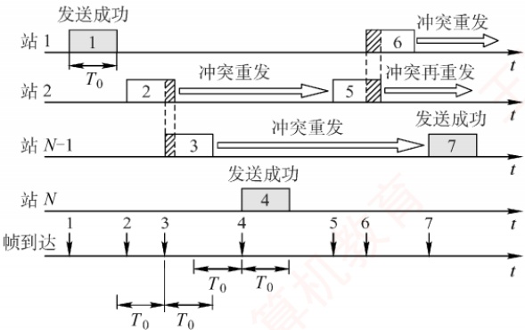

图 3.19 一个纯 ALOHA 协议的工作原理

在图3.19的示例中，站1发送帧1时，其他站点均未发送数据，因此帧1成功传输。但随后站2和站N-1发送的帧2与帧3在时间上部分重叠，发生冲突。发生冲突的各站必须重传，但不能立即重传（否则会再次冲突），而是等待一段随机时间后再尝试。若重传仍冲突，则重复此过程，直至成功。图中其他帧的发送情况为:帧4成功，帧5与帧6发生冲突。

由于冲突概率较高，该协议的吞吐量很低。为克服这一缺点，提出了时隙ALOHA协议。

**(2) 时隙 ALOHA 协议**

时隙ALOHA协议将时间划分为等长的时隙（Slot），并要求所有站点同步时钟。站点只能在每个时隙的起始时刻发送帧，且一帧的发送时间必须小于或等于一个时隙长度。这种约束减少了发送的随意性，从而降低了冲突概率，提高了信道利用率。

图3.20展示了两个站点的时隙ALOHA协议工作原理。每个帧到达后，通常需在缓存中等待不足一个时隙的时间，才能在下一个时隙开始时发送。若在一个时隙内有两个或更多帧待发，则它们将在下一可用时隙同时发送，导致冲突。冲突后的重传策略与纯ALOHA协议类似。

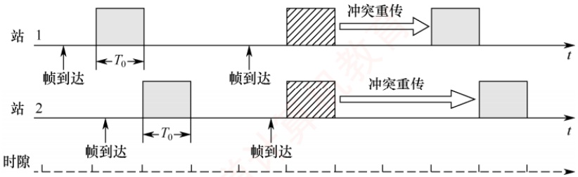

图 3.20 两个站的时隙ALOHA 协议的工作原理

#### 2．CSMA协议

**考点追踪基本CSMA协议的概念（2013）**

ALOHA协议网络的冲突概率较高。若每个站点在发送前先监听信道，仅在信道空闲时才发送，则可显著降低冲突概率，提高信道利用率。载波监听多路访问（Carrier Sense Multiple Access，CSMA）协议正是基于这一思想，在ALOHA协议基础上引入了载波监听机制。

根据监听策略及信道忙时的处理方式不同，CSMA协议可分为以下三种类型。

**（1）1-坚持 CSMA 协议**

1-坚持CSMA协议的基本思想:站点欲发送数据时，先监听信道；若信道空闲，则立即发送；若信道忙，则持续监听，直至信道变为空闲。“1-坚持”中的“1”表示信道空闲时，以概率1立即发送，“坚持”指信道忙时持续监听。

**(2) 非坚持 CSMA 协议**

非坚持CSMA协议的基本思想:站点欲发送数据时，先监听信道；若信道空闲，则立即发送；若信道忙，则不再监听，而是等待一段随机时间后重新尝试监听。该策略避免了多个站点在信道刚空闲时同时发送而导致的冲突，但因随机等待增加了平均传输时延。

**（3）p-坚持 CSMA 协议**

p-坚持CSMA协议适用于时隙化信道，基本思想:站点在时隙开始时监听信道；若信道忙，则等到下一时隙再监听；若信道空闲，则以概率p发送数据，以概率1-p推迟到下一时隙再尝试。

该机制通过概率延迟，降低了多个站点同时发送的冲突概率；通过持续监听(而非随机退避)，又避免了非坚持 CSMA 协议的过长延迟。因此，p-坚持CSMA 协议是1-坚持与非坚持 CSMA 协议的折中。

三种不同类型的CSMA协议比较如表3.1所示。

表 3.1 三种不同类型的 CSMA 协议比较

| 信道状态 | 1-坚持 | 非坚持 | p-坚持 |
| --- | --- | --- | --- |
| 空闲 | 立即发送 | 立即发送 | 以概率p发送，以概率1-p推迟到下一个时隙 |
| 忙 | 持续监听 | 放弃监听，等待随机时间后再监听 | 持续监听（等到下一时隙） |

介绍ALOHA协议和基本CSMA协议后，自然会引出两种重要的改进方案:CSMA/CD（载波监听多路访问/冲突检测）协议和CSMA/CA（载波监听多路访问/冲突避免）协议。二者均在CSMA协议的基础上引入了冲突处理机制，但针对不同物理介质的特点采用了差异化策略:CSMA/CD协议适用于有线总线形以太网，通过实时检测冲突并在发生后立即中止发送、执行退避重传，有效提升了通信效率；而CSMA/CA协议则专为无线局域网设计，由于无线环境难以有效检测冲突，因此转而采用主动避免机制来降低冲突概率。这两种协议将分别在3.6.2节和3.6.3节中展开介绍。

### 3.5.3 轮询访问：令牌传递协议

在轮询访问机制中，各站点不能随机发送信息，而是通过一个集中控制的监控站，以循环方式轮询每个节点，来决定信道的分配。典型的轮询访问控制协议是令牌传递协议。

在令牌传递协议中，一个令牌（Token）沿着环形网络在各站点之间依次传递。令牌是一个特殊的控制帧，本身并不包含数据，仅用于控制信道的使用，确保同一时刻只有一个站点独占信道。当环上的某个站点希望发送帧时，必须等待令牌。只有取得令牌后，该站点才能发送帧，因此令牌环网络不会发生冲突（因为令牌只有一个）。站点发送完一帧后，应释放令牌，以便其他站点使用。由于令牌按顺序依次传递，所有联网计算机对信道的访问权是公平的。

IEEE802.5令牌环网络中令牌和数据的传递过程如下:

1）当网络空闲时，环路中只有令牌帧在循环传递。

2）当令牌传递到有数据要发送的站点时，该站点修改令牌中的一个标志位，并在令牌中附加需要传输的数据，从而将令牌转换为一个数据帧，并将其发送出去。

3）数据帧沿着环路传输，各中间站点一边转发该帧，一边检查其目的地址。若目的地址与本站地址相同，则复制该数据帧用于本地处理，但仍继续转发。

4）数据帧沿环路继续传输，直至返回源站。源站识别出这是自己发出的帧后，便不再转发，并通过检验返回的帧判断传输过程中是否出错；若出错，则安排重传。 xK

5）源站完成数据发送后，重新生成一个令牌，并传递给下一站点，交出信道控制权。

令牌传递协议非常适合高负载的广播信道（多个节点在同一时刻发送数据的概率较大），若采用随机介质访问控制，则冲突概率显著升高。令牌传递协议既不依赖时间分割，也不依赖空间隔离；它通过严格限制同一时刻仅有一个站点拥有发送权限，从根本上避免了冲突。

即使是广播信道，也可通过介质访问控制机制，将其转换为逻辑上的点对点信道。

## 3.6 局域网

### 3.6.1 局域网的基本概念和体系结构

局域网（Local AreaNetwork，LAN）是指在一个较小的地理范围（如一所学校）内，将各种计算机、外部设备和数据库系统等通过双绞线、同轴电缆或光纤等传输介质互连起来，构成一个可实现资源与信息共享的计算机网络。其主要特点如下:

1）通常为一个单位所拥有，地理范围和站点数量均有限。

2）所有站点共享较高的总带宽（较高的数据传输速率）。

3）具有较低的传输时延和较低的误码率。

4）各站点地位平等，不存在主从关系。

5）支持广播和多播通信。

局域网的特性主要由三个要素决定:拓扑结构、传输介质和介质访问控制方式，其中介质访问控制方式最为关键，它直接决定局域网的技术特性。常见的局域网拓扑结构主要有四类:①星形结构；②环形结构；③总线形结构；④星形和总线形结合的复合型结构。局域网可采用铜缆、双绞线、同轴电缆和光纤等多种传输介质，其中双绞线是目前的主流选择。局域网的介质访问控制方法主要包括:CSMA/CD协议、令牌总线协议和令牌环协议。其中，CSMA/CD协议和令牌总线协议主要用于总线形局域网，而令牌环协议则主要用于环形局域网。

三种典型的局域网实现及其逻辑与物理拓扑如下:

以太网（目前使用范围最广）。逻辑拓扑为总线形结构，物理拓扑为星形结构。

●令牌环（TokenRing，IEEE 802.5）。逻辑拓扑为环形结构，物理拓扑为星形结构。

● 光纤分布数字接口（FDDI，IEEE802.8）。逻辑拓扑为环形结构，物理拓扑为双环结构。

IEEE802标准定义的局域网参考模型仅对应于OSI参考模型的数据链路层和物理层，并将数据链路层进一步拆分为两个子层:逻辑链路控制（LLC）子层和介质访问控制（MAC）子层。与接入传输介质有关的内容都放在MAC子层，它向上层屏蔽对物理层访问的各种差异，主要功能包括:组帧和拆卸帧、比特传输差错检测、透明传输。LLC子层与传输介质无关，它向网络层提供无确认无连接服务、面向连接服务、带确认无连接服务等多种服务类型。

由于以太网在局域网市场中的主导地位，它几乎成为局域网的代名词。与此同时，IEEE802委员会定义的LLC子层在实际应用中作用已显著弱化，因此现代许多网卡仅实现MAC协议，而不包含LLC协议。IEEE 802协议层与OSI参考模型的对比关系如图3.21所示。

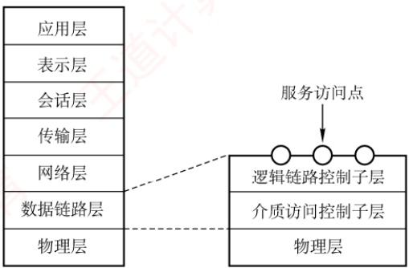

图 3.21 IEEE 802 协议层与 OSI参考模型的比较

### 3.6.2 以太网与IEEE 802.3

以太网是目前最流行的有线局域网技术。

以太网规约的第一个版本是DIX V1，由 DEC、Intel和 Xerox联合提出。随后，它被修订为第二版规约 DIX Ethernet V2，成为世界上首个局域网产品的规范。在此基础上，IEEE 802委员会的IEEE 802.3 工作组制定了第一个 IEEE 以太网标准——IEEE 802.3。

严格来说，以太网指符合 DIX Ethernet V2 标准的局域网。但由于 DIX Ethernet V2 与 IEEE 802.3标准差异极小，因此也常将IEEE802.3局域网简称为以太网。

**考点追踪以太网MAC协议的服务模型（2012）**

以太网采用两项措施来简化通信:①采用无连接的工作方式，既不对发送的数据帧编号，也不要求接收方返回确认。因此，以太网提供的是不可靠的尽最大努力交付服务，差错纠正由高层协议（如TCP）完成；②所有发送的数据均使用曼彻斯特编码，每个码元中间有一次电压跳变，接收方可利用该跳变方便地提取位同步信号。

#### 1．以太网的传输介质与网卡

以太网常用的传输介质有四种:粗缆、细缆、双绞线和光纤，其适用情况见表3.2。

表3.2 各种传输介质的适用情况

| 标准名称 | 10Base-5 | 10Base-2 | 10Base-T | 10Base-F |
| --- | --- | --- | --- | --- |
| 传输介质 | 同轴电缆（粗缆） | 同轴电缆（细缆） | 非屏蔽双绞线 | 光纤对（850nm） |
| 编码 | 曼彻斯特编码 | 曼彻斯特编码 | 曼彻斯特编码 | 曼彻斯特编码 |
| 拓扑结构 | 总线形 | 总线形 | 星形 | 点对点 |
| 最大段长 | 500m | 185m | 100m | 2000m |
| 最多节点数量 | 100 | 30 | 2 | 2 |

**注意**

在上述标准中，“10”表示速率为10Mb/s；“Base”表示基带以太网；早期标准中，“Base”后的“5”或“2”分别表示单段最大传输距离约为500m或185m，“T”代表双绞线，“F”代表光纤。

计算机与外界局域网的连接通过主板上嵌入的网络适配器（Adapter）实现，也称网络接口卡（NIC）。适配器内置处理器和存储器，工作在数据链路层。适配器与局域网之间通过电缆或双绞线以串行方式通信；适配器与计算机之间则通过I/O总线以并行方式通信。因此，适配器的重要功能之一是进行串行与并行数据的转换。此外，适配器还负责:物理连接与电信号匹配、帧的发送与接收、帧的封装与拆封、介质访问控制、数据的编码与解码，以及数据缓存等。当适配器收到正确的帧时，会通过中断通知主机，并将数据交付给协议栈的网络层；当主机要发送IP数据报时，协议栈将其向下传递给适配器，由适配器封装成帧后发送至局域网。

#### 2．以太网MAC地址

IEEE 802标准为局域网规定了一种48位的全球唯一地址，固化在网络适配器的ROM中，称为物理地址或MAC地址，用于控制主机在网络上的数据通信。全球所有局域网适配器的MAC地址均不重复；一台计算机只要未更换适配器，无论地理位置如何变化，其MAC地址保持不变。

**考点追踪MAC地址的特性（2013）**

MAC地址长6B（48位），通常用 12个十六进制数字表示，以连字符或冒号分隔，例如02-60-8c-e4-b1-21。高24位为厂商代码，低24位为厂商自行分配的适配器序列号。

当路由器通过适配器接入局域网时，该适配器的MAC地址用于标识路由器的对应接口。若路由器连接多个网络，则需配备多个适配器，每个接口拥有独立的MAC地址。

适配器从网络上每收到一个MAC帧，首先用硬件检查其目的地址。若为发往本站的帧，则接收；否则丢弃。这里“发往本站的帧”包括以下三种帧:

1）单播帧（一对一），目的地址与本站MAC地址相同。

2）广播帧（一对全体），目的地址为全1（FF-FF-FF-FF-FF-FF）。

3）多播帧（一对多），目的地址为某个多播组地址，发送给局域网中部分站点。

#### 3．CSMA/CD协议

由于总线在同一时间只允许一个站点发送数据，否则各站之间会互相干扰，导致所发送的数据被破坏。因此，如何协调总线上各站点的发送行为，是以太网必须解决的关键问题。

**考点追踪CSMA/CD协议的特性（2015）**

载波监听多路访问/冲突检测（CSMA/CD）协议是CSMA协议的重要改进，适用于总线形网络或半双工网络环境。对于全双工网络，由于其采用两条独立信道分别用于发送和接收，通信双方可同时收发数据，不会产生冲突，因此无须使用CSMA/CD协议。

载波监听是指每个站点在发送前和发送过程中都必须持续检测信道:发送前监听是为了确认信道空闲以获取发送权；发送中监听则是为了及时发现是否发生冲突。具体而言，站点在发送数据前先监听信道，只有当信道空闲时才开始发送。冲突检测（CollisionDetection）即边发送边检测，适配器在发送数据的同时监测信道上的电压变化；当检测到电压变化幅度超过特定门限值时，即判定发生冲突，立即停止发送，并等待一段随机时间后重试。

CSMA/CD协议的工作流程可简单概括为“先听后发，边听边发，冲突停发，随机重发”。

**考点追踪CSMA/CD协议中的冲突时间分析（2010）**

电磁波在总线上的传播速率是有限的。因此，某时刻发送站检测到信道空闲，并不意味着信道真正空闲。如图3.22所示，设τ为单程传播时延。在t=0时，A站开始发送数据。在 $t   =   \tau   -   \delta$ 时，A站的数据尚未到达B站，B站因检测到信道空闲也开始发送。经过δ/2时间 $( t = \tau - \delta / 2$ 时），A站和B站的数据在信道上发生冲突，但此时两个站点均未察觉。直到t=τ时，B站检测到冲突并停止发送。在 $t   =   2 \tau   -   \delta$ 时，A站也检测到冲突并停止发送。至此，两个站点的发送均失败，都需推迟一段时间后重传。

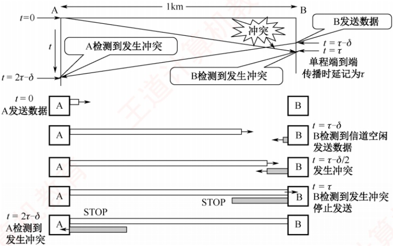

图3.22 传播时延对载波监听的影响

从图3.22可见，A站在开始发送后最多经过2τ（端到端往返传播时延）即可确认是否发生冲突（当δ→0时）。因此，将以太网的端到端往返传播时延2τ称为争用期（也称冲突窗口）。每个站点在发送数据后的一小段时间内，存在冲突的可能；只有在争用期结束仍未检测到冲突，才能确定本次发送成功。

考点追踪CSMA/CD协议中最短帧长的原理与计算（2009、2016、2019、2022）

现在考虑一种情况:某站发送一个很短的帧，在发送完成前未检测到冲突。但该帧在传播途中与其他帧发生冲突，导致目的站收到错误帧（并丢弃），而发送站却不知情，也不会重传。为避免此类问题，以太网规定了最短帧长，即争用期内可发送的数据量。若在争用期内检测到冲突，发送将中止，此时已发送的数据长度必小于最短帧长；因此，任何长度小于最短帧长的帧均为因冲突而异常中止的无效帧，应被丢弃。最短帧长的计算公式为

$$
最短帧长 =2 \times  最大单向传播时延  \times  数据传输速率
$$

例如，以太网规定争用期为51.2μs。对于10Mb/s的以太网，争用期内可发送512bit（64B）。这意味着:若某站点在发送前64B未发生冲突，则后续数据也不会冲突（表示已成功抢占信道）；反之，若发生冲突，必定发生在前64B内。由于检测到冲突后立即停止发送，实际发出的数据量必然小于64B。因此，以太网规定最短帧长为64B。若实际要发送的帧小于64B（如仅40B），则需在数据字段后添加若干整数字节的填充字段，确保整个MAC帧长度不小于64B。

$$
基盡面题  $\blacktriangleright \quad \mathsf {CSMA} \mathsf {C D}$  协议中的退避算法机制  $\mathtt {( 2023 )}$
$$

一旦发生冲突，若站点立即重传，极易再次冲突。CSMA/CD采用截断二进制指数退避算法来确定重传时机:冲突站点在停止发送后，推迟一个随机时间再重试。算法要点如下:

1）确定基本退避时间为一个争议期（端到端往返传播时延2τ）。

2）从整数集合 $[ 0 , 1 , \cdots , ( 2^{k}   -   1 ) ]$ 中随机选取一个数r，推迟时间为r倍争用期，即 $2 r \tau_{\circ}$ 其中k=min[重传次数，10]，即重传次数≤10时，k等于重传次数；超过10次后，k不再增大，恒为10。

3）若重传达16次仍失败，则判定网络过于拥塞，放弃该帧并向高层报告错误。

例如，首次冲突后（第1次重传），k=1，随机数r从集合{0，1}中选取，推迟时间为0或$2   \tau ;$ 若再次冲突（第2次重传），k=2，r从集合{0,1,2,3}中选取，推迟时间为0,2τ,4τ或6τ,以此类推。该机制使重传平均等待时间随冲突次数增加而动态增长（称为动态退避），有效降低

再次冲突概率，提升系统稳定性。

此外，以太网规定:一旦检测到冲突，站点除立即停止发送数据外，还需继续发送32比特或48比特的人为干扰信号，以确保所有站点都能感知到冲突，这被称为强化碰撞机制。

以太网还规定帧间最小间隔为9.6μs（相当于96比特的发送时间）。以便接收站有足够时间清空缓存，为接收下一帧做好准备。

CSMA/CD协议的归纳如下:

①准备发送:适配器从网络层获取分组，封装成帧，放入适配器的缓存。

②检测信道:若信道忙，则持续监听直至空闲；若信道在9.6μs时间内保持空闲（满足帧间最小间隔），则开始发送该帧。

③发送过程中持续检测信道，可能出现两种情况:

● 发送成功:争用期内未检测到冲突，帧发送成功。

发送失败:争用期内检测到冲突，立即停止发送，执行退避算法，等待随机时间后返回步骤②；若重传16次仍未成功，则放弃发送并向高层报告出错。

#### 4．以太网的MAC帧

以太网 MAC 帧格式有两种标准:DIX Ethernet V2 标准（以太网 V2）和 IEEE 802.3 标准。此处仅介绍最常用的以太网 V2标准的帧格式，如图3.23所示。

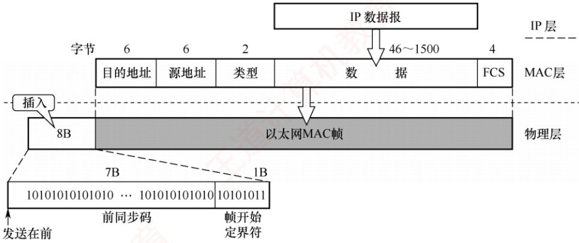

图 3.23 以太网 V2 标准的 MAC 帧格式

考点追踪以太网MAC帧的格式（2010、2011）

1）帧前插入的8B前导码分为两个字段:第一个字段是7B的前同步码，用于实现比特同步；第二个字段是1B的帧开始定界符，标志MAC帧的开始。

**注意**

以太网帧不需要帧结束定界符。因为当以太网传送帧时，各帧之间必须保持至少96比特时间的间隙，因此，接收方只要找到帧开始定界符，其后连续到达的比特流即属于同一帧。此外，以太网采用了违规编码法的思想，这种编码（曼彻斯特编码）的特点是在每个码元中间都有一次电压跳变。当发送方把一个帧发送完毕后，就不再发送其他码元，因此发送方网络接口上的电压也不再变化，这样接收方就能很容易地找到帧的结束位置，这个位置往前数4B就是FCS字段，从而确定数据字段的结束位置。

**考点追踪以太网帧中地址字段的功能（2018）**

2）目的地址:6B，帧在局域网中的目的适配器的MAC地址。

3）源地址:6B，发送该帧的源适配器的MAC地址。

4）类型:2B，标识上一层使用的是什么协议，以便将收到的MAC帧的数据交给相应的上层协议。例如，当类型字段的值是0x0800时，表示上层使用的是IP。

**考点追踪以太网帧填充与最小帧长的关系（2012）**

5）数据:46～1500B，承载上层的协议数据单元（如IP数据报）。以太网的最大传输单元为1500B，若IP数据报超过此长度，则需在网络层进行分片。此外，由于CSMA/CD协议算法限制，以太网帧必须满足最小长度为 64B，当IP数据报不足46B时，MAC子层会在数据字段后面添加整数字节的填充字段，以确保帧长达到64B。

**注意**

“46 是怎么来的？”——由 CSMA/CD协议可知，以太网帧的最短帧长为 64B，而 MAC帧的首部和尾部的长度为18B，因此数据字段最少为64-18=46B。

6）检验码（FCS）:4B，采用32位CRC码，检验范围从目的地址到数据字段（含目的地址、源地址、类型和数据），但不检验前导码。

IEEE 802.3 帧格式与以太网 V2帧格式的区别在于:用长度字段替代了 V2帧中的类型字段，指示数据字段的长度。在实践中，这两种机制可以并存，由于IEEE802.3数据字段的最大长度为1500B，故长度字段的值≤1500；从而1501到65535的值则被解释为类型标识符。

#### 5．高速以太网

速率达到或超过100Mb/s的以太网称为高速以太网，其主要类型如表3.3所示。

表3.3 几种高速以太网技术

<table><tr><td>标准名称</td><td>100Base-T以太网</td><td>吉比特以太网</td><td>10吉比特以太网</td></tr><tr><td>传输速率</td><td>100Mb/s</td><td>1Gb/s</td><td>10Gb/s</td></tr><tr><td>传输介质</td><td>双绞线</td><td>双绞线或光纤</td><td>双绞线或光纤</td></tr><tr><td>通信方式</td><td colspan=2>支持半双工和全双工</td><td>只支持全双工</td></tr><tr><td>介质访问控制协议</td><td colspan=2>半双工模式下使用 CSMA/CD 协议</td><td>无</td></tr></table>

**（1）100Base-T以太网（快速以太网）**

**考点追踪100Base-T的传输介质类型（2019）**

100Base-T以太网是在双绞线上以100Mb/s速率传输基带信号的星形以太网，支持全双工和半双工两种工作模式。当使用以太网交换机组网时，通常运行在全双工模式而无冲突发生，因此无须使用CSMA/CD协议。但在半双工模式下，仍需依赖CSMA/CD协议来处理冲突。

其帧格式仍遵循IEEE 802.3标准，保持最小帧长为64B不变，但将单个网段的最大长度缩短至100m。同时，帧间最小间隔从9.6μs减为0.96μs，以适应更高的传输速率。

**（2）吉比特以太网（千兆以太网）**

吉比特以太网支持1Gb/s的传输速率，兼容全双工和半双工模式。它使用EEE802.3标准的帧格式。使用双绞线或光纤作为传输介质。在半双工模式下使用CSMA/CD协议（很少部署）；而在全双工模式下不使用 CSMA/CD协议。与10Base-T和100Base-T技术向后兼容。

**（3）10吉比特以太网**

10吉比特以太网的帧格式与10Mb/s、100Mb/s 和1Gb/s以太网完全相同，并保留IEEE 802.3规定的最小和最大帧长。仅工作在全双工模式，无争用问题，因此无须使用CSMA/CD协议。

以太网从10Mb/s到10Gb/s的演进充分证明了其可扩展性（速率从10Mb/s到10Gb/s）、灵活性（多种介质、全/半双工模式、共享/交换构架）、易部署性和稳健性。

### 3.6.3 IEEE 802.11无线局域网

#### 1．无线局域网的组成

无线局域网可分为两大类:有固定基础设施的无线局域网和无固定基础设施的移动自组织网络。所谓“固定基础设施”，是指预先部署、能覆盖一定地理范围的固定基站。

**(1）有固定基础设施无线局域网**

对于有固定基础设施的无线局域网，IEEE 制定了 802.11系列协议标准，包括 802.11a/b/g/n等。802.11 协议采用星形拓扑，其中心节点称为接入点（Access Point，AP），在 MAC 层使用CSMA/CA 协议。采用 802.11 系列协议的局域网通常也称 Wi-Fi。

802.11协议规定，无线局域网的最小构件是基本服务集（Basic Service Set，BSS）。一个BSS包含一个AP和若干移动站。站内通信或与外部站点的通信都必须通过该BSS的AP。此处的AP即为BSS中的基站（base station）。配置AP时，需要为其分配一个不超过32B的服务集标识符（Service Set IDentifier，SSID）和一个工作信道。SSID即为该无线局域网的名称。BSS覆盖的地理范围称为基本服务区（Basic Service Area，BSA），其直径一般不超过100米。

一个BSS可以是孤立的，也可通过AP连接到分配系统（Distribution System，DS），再与其他BSS 互连，从而构成扩展的服务集（Extended Service Set，ESS）。分配系统的作用是使整个ESS对上层呈现为一个单一的BSS。ESS还可通过一种称为Portal（门户）的设备，为无线用户提供接入有线以太网的能力。Portal的功能相当于网桥。在图3.24中，若移动站A要与另一BSS中的移动站B通信，则数据流动路径为A→AP1→AP2→B，其中AP1与AP2的通信通过有线链路完成。

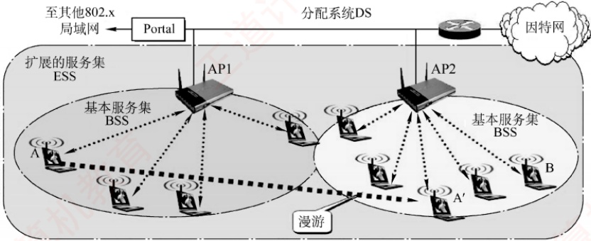

图3.24 基本服务集和扩展服务集

当移动站 A 从一个 BSS 漫游到另一个 BSS 时（图 3.24 中的 A'），仍可保持与 B 的通信。但所使用的AP会发生改变。

**（2）无固定基础设施的移动自组织网络**

另一种无线局域网是无固定基础设施的自组织网络，也称自组网络（ad hoc network）。此类网络不包含AP，而是由若干处于平等地位的移动站临时组成的对等网络（见图3.25）。各节点地位平等，中间节点需转发其他节点的数据，因此兼具终端与路由器的功能。

自组网络通常这样形成:若干可移动设备彼此邻近且存在通信需求时，会自发组建一个网络。在此类网络中，每个移动站都需主动参与路由的发现与维护。由于节点位置不断变化，网络拓扑可能频繁且快速地改变，因此传统在固定网络中有效的路由协议往往难以适用于自组网络，必须采用专门为其设计的路由机制。

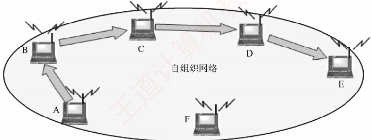

图3.25 由若干处于平等地位的移动站临时组成的对等网络

需要注意的是，自组网络与移动IP有本质区别:移动IP旨在支持主机在不同网络间漫游并接入互联网，其底层仍依赖固定网络的路由基础设施；而自组网络是一种分布式的无线自治系统，不仅拥有专用的路由协议，还能独立于互联网运行，无须依赖任何预设的固定基础设施。

#### 2．CSMA/CA协议

CSMA/CD协议已成功用于有线局域网，但无线局域网不能简单照搬CSMA/CD协议。无线局域网仍使用CSMA协议，但无法实现冲突检测，主要有两个原因:

1）适配器接收到的信号强度通常远小于其发送信号的强度，且无线信道中信号强度的动态范围极大，若要实现冲突检测，硬件上的成本将会过高。

2）在无线通信中，并非所有站点都能互相侦听到对方（却可能产生冲突），即存在隐蔽站问题，导致冲突检测机制无法发现所有冲突。

在图3.26中，A站和B站均在AP的覆盖范围内，但彼此距离较远，无法侦听到对方。当A站和B站同时检测到信道空闲时，都向AP发送数据，导致发生冲突，而双方均无法察觉，这就是隐蔽站问题。这里A站和B站互为隐蔽站，它们检测不到彼此的信号，却能产生冲突。

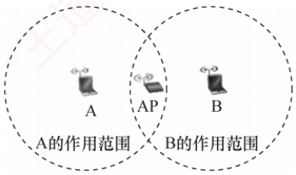

图 3.26 A站和 B 站同时向 AP 发送数据，发生冲突

为此，802.11协议定义了广泛应用于无线局域网的CSMA/CA协议。它对CSMA/CD协议进行改进，将“冲突检测”改为“冲突避免”（CollisionAvoidance，CA）。“冲突避免”并不是指协议可以完全避免冲突，而是要尽量降低冲突发生的概率。由于802.11协议不支持冲突检测，一旦站点开始发送帧，就必须完整发送该帧；若在冲突存在时，仍发送整个帧（尤其是长数据帧），将严重降低网络效率，因此必须采用冲突避免技术来降低冲突概率。

**考点追踪CSMA/CA协议的确认机制（2011）**

鉴于无线信道的通信质量远不如有线信道，802.11协议在数据链路层引入确认/重传（ARQ）机制:站点每发送完一帧后，必须收到接收方的确认帧（ACK），才能继续发送下一帧。因此，802.11无线局域网采用的是一种停止-等待式可靠传输协议。

802.11协议在MAC子层定义了两种介质访问控制方式。

1）分布式协调功能（DCF）。不采用任何中心控制，各站通过争用信道获得发送权。这是802.11协议必须实现的方式，也是目前广泛使用的方式。

2）点协调功能（PCF）。使用AP集中控制，用类似于探询的方法将发送权轮流分配给各站，从而避免冲突。它是802.11协议的可选方式，实际很少使用。

802.11协议规定，各站在发送数据前必须检测信道，若信道忙，则禁止发送。为进一步减少冲突，802.11协议还要求:即使检测到信道空闲，也需再等待一段短暂时间（确保信道持续空闲），方可发送帧。该时间称为帧间间隔（InterFrameSpace,IFS），其长度取决于帧的类型。

考点追踪CSMA/CA协议的帧间间隔类型与功能（2020）

1）DIFS（分布式协调IFS）:最长的IFS，在DCF方式下用来发送数据帧和管理帧。

2）PIFS（点协调IFS）:中等长度的IFS，在PCF方式中使用。

3）SIFS（短IFS）:最短的IFS，用于分隔同一对话中的连续帧，如ACK帧、CTS帧、分片后的数据帧，以及对AP探询的响应帧等。

当信道由忙变为空闲时，在有多个站点同时等待发送的情况下，若它们都在时间DIFS后立即发送数据，则必然导致冲突。因此，CSMA/CA协议规定:当检测到信道从忙变为空闲时，任何站点要发送数据，必须先等待时间DIFS，再进入争用期，并执行随机退避，即随机选择一个退避时隙数，并在每个空闲时隙将其减1，直至减为0后才发送。当且仅当检测到信道空闲且这个数据帧是要发送的第一个数据帧时，才不使用退避算法，其他所有情况都必须使用退避算法，具体为:①要发送第一个数据帧之前检测到信道忙；②未收到确认，要重传数据帧；③每次确认成功后要发送下一个数据帧。CSMA/CA 协议的退避算法与 CSMA/CD协议类似，第i次退避在[0,…，(24+k–1)]个时隙中随机选择一个，当时隙范围最大达到1023时（对应第6次重传），就不再增加。

CSMA/CA协议算法归纳如下:

1）若站点首次尝试发送数据（非因重传而发送），且检测到信道空闲，则在等待时间DIFS后（信道持续空闲），立即发送整个数据帧。否则执行步骤2）。

2）站点选取一个随机数，设置退避计时器。计时器运行的规则是:若信道忙，则冻结计时器（暂停递减），并继续等待，直至信道变为空闲（称为推迟接入）；若信道空闲，且在时间DIFS内持续空闲，则开始争用信道，进行倒计时。当计时器减至0时（仅可能发生在信道持续空闲期间），站点立即发送整个数据帧并等待确认。

3）发送站收到确认后，若仍有后续帧待发送，则转到步骤2）。若在规定时间（由重传计时器控制）内未收到确认，则按二进制指数退避规则增大竞争窗口，再转到步骤2）重新尝试。

**注意**

推迟接入和退避的区别。推迟接入发生在信道忙时，为的是等待争用期的到来，此时退避计时器处于冻结状态。而退避是争用期各站点执行的算法，此时信道是空闲的，退避总出现在DIFS之后。

802.11协议还规定各站采用虚拟载波监听机制:源站在发送数据前，通过帧首部的持续期字段，向所有能接收到该帧的站点通告其将占用信道的总时长（包括目的站回复ACK所需的时间）。其他站点收到后，将据此设置自身的网络分配向量（NetworkAllocationVector，NAV），并在NAV计时期间暂停发送，进而显著降低冲突概率。所谓虚拟载波监听，是指这些站点并未实际监听物理信道，而基于接收到的通知主动避让，效果等同于持续监听信道。

**考点追踪CSMA/CA协议的信道预约机制（2018）**

为了缓解隐蔽站的问题，802.11协议允许发送站对信道进行预约。在图3.26中，A站和B站互为隐蔽站，下面以A站和AP通信为例，介绍信道预约的方法（见图3.27）。

1）在A站向AP发送数据帧DATA前，先检测信道。若信道空闲，则等待时间DIFS后，广播一个请求发送 RTS（Request To Send）控制帧，目的是告诉所有能够收到 RTS 帧的站:“我要占用信道一段时间[SIFS+ CTS+ SIFS+ DATA + SIFS+ACK]”，即从成功收到 RTS帧起，到AP完成ACK发送为止的时间。这个时间被写入RTS帧首部。

2）若 AP 正确收到RTS 帧且信道空闲，则等待时间 SIFS 后，广播一个允许发送CTS（Clear ToSend）控制帧。目的不仅是告诉源站“可以发送数据了”，同时也是告诉所有能收到CTS 帧的站“我要占用信道一段时间[SIFS+DATA + SIFS+ACK]”，即从成功收到 CTS帧起，到AP完成ACK发送为止的时间。该时间同样被写入CTS帧首部。

3）A站收到CTS 帧后，再等待时间 SIFS，即可发送数据帧。其首部写入时间[DATA+ SIFS +ACK]，即从开始接收数据帧起①，到AP完成ACK发送为止的时间。

考点追踪NAV的工作原理（2024）

任何站点只要收到RTS帧、CTS帧或数据帧之一，就会根据其首部的持续期字段设置自己的 NAV，如图 3.27所示。虽然 B 站收不到 A 站发送给 AP的 RTS 帧，但能收到 AP广播的 CTS帧，B站根据CTS帧首部的内容设置自己的NAV，因此在这段时间内不会发送数据、干扰信道。因此，虚拟载波监听机制能够有效减少由隐蔽站引发的冲突问题。

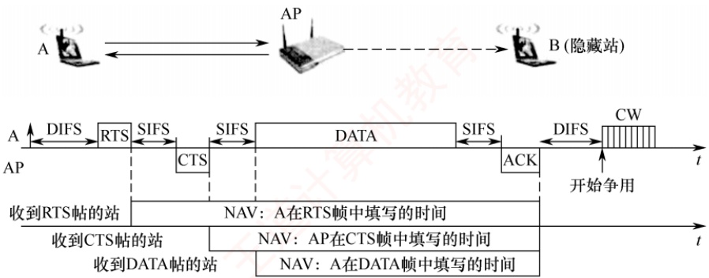

图 3.27 使用 RTS 和 CTS 帧的冲突避免

显然，使用RTS/CTS帧会使网络的通信效率有所下降，但这两种控制帧都很短，与数据帧相比开销不算大。相反，若不使用这种控制帧，则一旦发生冲突而导致数据帧重传，浪费的时间往往更多。信道预约并非强制要求，各站点可自行决定是否启用。或仅当待发送的数据帧长度超过某一阈值时才使用RTS/CTS帧，从而在可靠与效率之间取得平衡。

CSMA/CD 协议与 CSMA/CA 协议的主要区别如下:

1）冲突处理机制不同。CSMA/CD协议能在发送过程中检测冲突，但无法避免冲突；CSMA/CA协议无法在发送时检测冲突（尤其是发生在接收端的冲突），因此只能尽量避免冲突。

2）传输介质不同。CSMA/CD协议用于总线形有线以太网，CSMA/CA协议则用于无线局域网。

3）检测方式不同。CSMA/CD协议通过检测线路中的电压变化来判断是否冲突；而CSMA/CA协议只能在发送前通过能量检测、载波侦听或两者的混合方式，综合判断信道是否空闲。

总结:CSMA/CA协议的思想是“先打招呼，再发数据”，发送前先广播通知其他站点，在其指定的时段内暂时发送，以预防冲突；而CSMA/CD协议则是“边发边听，撞了就停”，发送前先监听信道，发送过程中持续检测信号，一旦发现冲突，就立即停发，并启动退避重传机制。

> ①帧的首部位于帧的起始位置，接收方在物理层逐比特接收数据时，一旦识别出帧定界符，就可提取并解析首部内容，并立即设置NAV，无须等待整帧接收完成。由于数据字段通常较长，其接收时延不可忽略，若等到整帧收完才设置NAV，则可能错过冲突避免的关键窗口。因此，持续期字段必须包含从当前帧开始接收起，到ACK发送完毕为止的全部时间。

#### 3．802.11局域网的MAC帧

802.11局域网的帧共有三种类型:数据帧、控制帧和管理帧。其中，数据帧以及三种常用的控制帧（RTS帧、CTS帧和ACK帧）的格式如图3.28所示。

802.11帧由以下三部分组成:

1）MAC首部，共30B。帧的复杂性主要体现在MAC首部。

2）帧主体，即数据部分，最大长度不超过2312B，远大于以太网帧的数据载荷。

3）帧检验序列（FCS），作为MAC尾部，共4B。

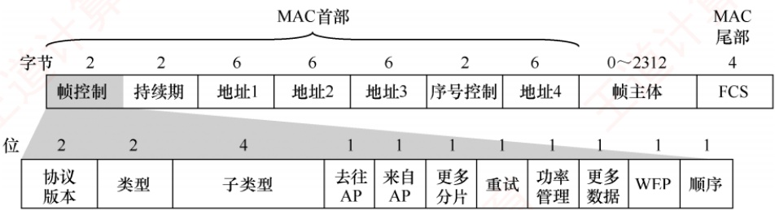

(a)数据帧格式(帧控制字段中的子类型为0000)

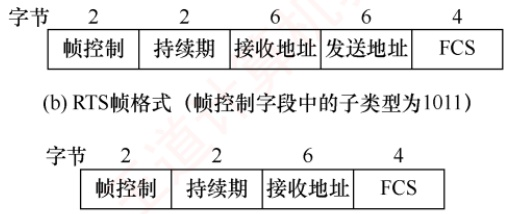

(c)CTS和ACK帧格式(帧控制字段中的子类型分别为1100和1101)

图3.28 数据帧以及三种常用的控制帧（RTS帧、CTS帧和ACK帧）的格式

考点追踪802.11帧前三地址字段的作用（2017、2022）

802.11帧首部中最关键的部分是四个地址字段（均为MAC地址），此处仅讨论前三个（地址4用于自组网络）。这三个地址的具体含义由帧控制字段中的两个标志位“去往AP”和“来自 $\mathrm{AP}_{2}^{\prime\prime}$ 共同决定。表3.4列出了802.11帧的地址字段最常用的两种情况。

表3.4 802.11 帧的地址字段最常用的两种情况

| 去往AP | 来自AP | 地址1 | 地址2 | 地址3 | 地址4 |
| --- | --- | --- | --- | --- | --- |
| 0 | 1 | 接收地址 = 目的地址 | 发送地址 = AP 地址 | 源地址 |  |
| 1 | 0 | 接收地址 = AP 地址 | 发送地址 = 源地址 | 目的地址 |  |

其中，地址1是直接接收该帧的节点地址，地址2是实际发送该帧的节点地址。

现假定在同一个BSS中，A站向B站发送数据，该过程分可为两个阶段。

第一阶段:A站→AP

A站构造一个802.11帧发送给AP。该帧首部字段设置如下:

“去往 $\mathrm{AP} = 1$ 而“来自 $\mathrm{AP}=0$

地址1为AP的 MAC 地址。地址2为 A 站的 MAC 地址。地址3为B 站的 MAC地址。

**第二阶段:AP→B站**

AP收到该帧后，将其转发给B站。此时构造的新802.11帧首部字段设置如下:

“去往 $\mathrm{AP}=0$ 而“来自 $\mathrm{AP}=1$

地址 1 为 B 站的 MAC 地址，地址 2 为 AP 的 MAC 地址，地址 3 为 A 站的 MAC 地址。

理解这三个地址的关键:地址1和地址2始终表示当前无线传输的两端，即直接接收方和直接发送方。当主机发往AP时，接收方是AP，但最终目的不是AP，因此用地址3存放实际目的地址；当AP发往主机时，发送方是AP，但原始源不是AP，因此用地址3存放实际源地址。

下面讨论一种更复杂的情况。如图3.29所示，两个AP通过有线链路连接到同一个路由器R，A站和B站分别位于两个不同的子网中。现分析A站向B站发送数据的完整过程。由于A站与B站不在同一个子网内，该通信需经由路由器R转发，整个过程也可分为两个阶段。

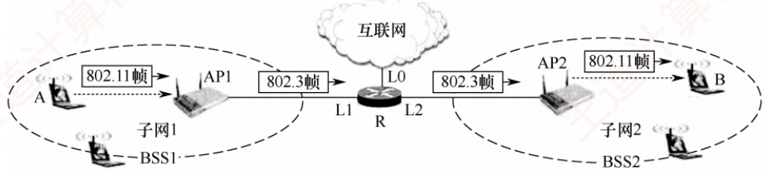

图 3.29 链路上的 802.11 帧和 802.3 帧

**第一阶段:A站→路由器R**

A站先判断B站的目的IP地址不在本地子网内，因此将数据发送给默认网关，即R的接口L1。为此，A 站通过ARP获取接口 L1的 MAC 地址，随后构造一个 802.11 帧发送给 AP1。

该802.11帧的首部字段设置如下:

“去往 $\mathrm{AP}=1$ 而“来自 $\mathrm{AP}=0$

地址 1 为 AP1 的 MAC 地址，地址 2 为 A 站的 MAC 地址，地址 3 为接口 L1 的 MAC 地址。AP1收到该帧后，将其转换为802.3帧（仅包含源和目的两个MAC地址），其中源地址为A 站的 MAC地址，目的地址为接口L1的 MAC地址，并通过有线链路传送给路由器R。

**第二阶段:路由器R→B站**

路由器R收到802.3帧后，解封装并提取出IP数据报。根据其中的目的IP地址，路由器R查询转发表，确定下一跳出口为连接B站所在子网的接口L2。接着，路由器R通过ARP获取B站的MAC地址，并将该IP数据报重新封装为一个新的 802.3帧，其中源地址为接口L2的MAC地址，目的地址为B站的MAC地址。AP2收到此802.3帧后，将其转换为802.11帧并发往B站。

该802.11帧的首部字段设置如下:

“去往 $\mathrm{AP}=0$ 而“来自 $\mathrm {A P}   =   1^{\prime \prime}$ OF

地址 1 为 B 站的 MAC 地址，地址 2 为 AP2的 MAC 地址，地址 3 为接口 L2 的 MAC 地址。

上述两个阶段共同构成A站向B站发送数据的完整路径。从网络层视角看，IP数据报从子网1经路由器R转发至子网2；而链路层则通过802.11帧中的地址3字段，在无线与有线介质转换过程中保留了原始源或目的MAC地址，确保了通信语义正确。这一机制涉及网络层的路由器转发功能，学完相关内容后，读者将能更深入理解本例所述的跨网通信过程。

下面介绍802.11帧中的持续期字段和帧控制字段。

1）持续期字段。在前面的CSMA/CA协议中提到，发送站点可对信道预约一段时间，并将该时间写入持续期字段，用于虚拟载波监听。

2）帧控制字段。其中较重要的是类型和子类型字段，用于区分帧的功能。802.11帧分为三大类型，每种类型又分为若干子类型，如控制帧包括RTS、CTS、ACK等子类型。

### 3.6.4 VLAN基本概念与基本原理

一个以太网构成一个广播域。当网络中包含的计算机数量过多时，往往会导致

网络中出现大量广播帧，尤其是频繁使用的ARP和DHCP报文（见第4章）。

● 同一单位的不同部门共享一个局域网，不利于信息保密与安全隔离。

通过虚拟局域网（VirtualLAN，VLAN），可将一个大型局域网划分为若干与地理位置无关的逻辑上的 VLAN，每个 VLAN 构成一个独立且较小的广播域。同一 VLAN 内的主机可以直接通信，而不同VLAN之间的主机则无法直接通信。

目前主要有以下三种VLAN划分方式:

1）基于端口（接口）。将交换机的若干物理接口划归同一个逻辑组。该方法最简单、最常用。若主机更换了接入端口，则可能被划分到新的VLAN（新子网）。

2）基于MAC地址。根据主机的MAC地址划分VLAN。当主机从一个交换机移动到另一个交换机时，它仍属于原VLAN。

3）基于IP地址。根据网络层地址或协议类型划分VLAN。此类VLAN可跨越路由器进行扩展，将多个物理局域网中的主机纳入同一逻辑VLAN。

IEEE 802.1Q标准定义了支持VLAN的以太网帧格式扩展。它在标准以太网帧的源地址字段与类型字段之间插入一个4B的 VLAN标签，用于标识该帧所属的 VLAN。插入标签后的帧称为 802.1Q帧，如图3.30所示。由于帧首部增加了4B，为保持最小帧长64B不变，数据字段的最小长度由46B减少为42B，最大长度仍为1500B，因此最大帧长从1518B增至1522B。

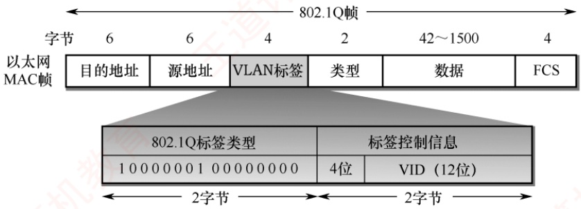

图 3.30 插入 VLAN 标签后变成了 802.1Q帧

VLAN标签的前两个字节固定为0x8100，表示这是一个802.1Q帧。后两个字节中，前4位保留未用，后12 位为 VLAN标识符（VID），用于唯一标识该帧所属的 VLAN。12 位 VID最多可支持4096个 VLAN。插入 VLAN标签后，帧尾的FCS 必须重新计算。

如图3.31所示，交换机 1 连接7台计算机，被划分为两个 VLAN:VLAN-10和 VLAN-20（10和20即VID值，由管理员配置）。各主机并不知道自身的VID（但交换机必须知道），主机与交换机之间交互的仍是标准以太网帧。VLAN的范围可跨越多个交换机，前提是这些交换机均支持 VLAN 功能。交换机 2 连接 5 台计算机，并与交换机 1 相连，其中 2 台属于VLAN-10，3台属于VLAN-20。尽管这两个VLAN跨越了两台交换机，但各自仍保持为独立的广播域。

连接两台交换机的链路称为汇聚链路（TrunkLink），也称干线链路。

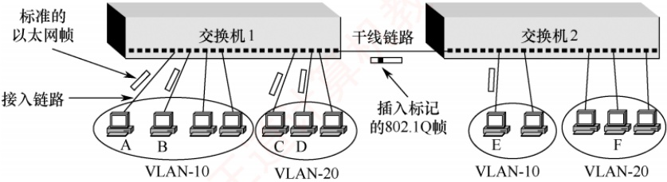

图3.31 利用以太网交换机构成虚拟局域网

**考点追踪虚拟局域网的特性（2024）**

假定A站向 B站发送帧，交换机1根据目的 MAC地址，识别出B 属于本交换机管理的VLAN-10，于是将该帧当作普通以太网帧直接转发。若A站向E站发送帧，交换机1必须将帧转发到交换机2，此时必须先插入VLAN标签，再通过干线链路传输。否则，交换机2无法判断该帧应归属哪个VLAN。因此，干线链路上传输的是802.1O帧。交换机2在向E站转发前，会剥离VLAN标签，确保E站收到的是标准以太网帧。若A站向C站发送帧（虽同属交换机1，但分属VLAN-10与VLAN-20），则因二者处于不同的广播域，无法直接通信。此时需借助上层路由器实现跨VLAN通信，或通过支持三层功能的交换机完成第3层转发。

虚拟局域网只是局域网为用户提供的一种逻辑服务，并不是一种新型局域网。

## 3.7 广域网

### 3.7.1 广域网的基本概念

广域网（Wide AreaNetwork，WAN）通常指覆盖范围很广（远超一个城市）的长距离网络，其主要任务是长距离运送主机所发送的数据。连接广域网中各节点交换机的链路均为高速链路，因此广域网首要考虑的问题是通信容量是否足够大，以支持日益增长的通信需求。

广域网不等于互联网。互联网可以连接不同类型的网络，通常通过路由器实现互联。如图3.32所示，多个相距较远的局域网可通过路由器接入广域网，从而构成一个覆盖范围广泛的互联网。因此，一个局域网可通过广域网与另一个远程局域网通信。

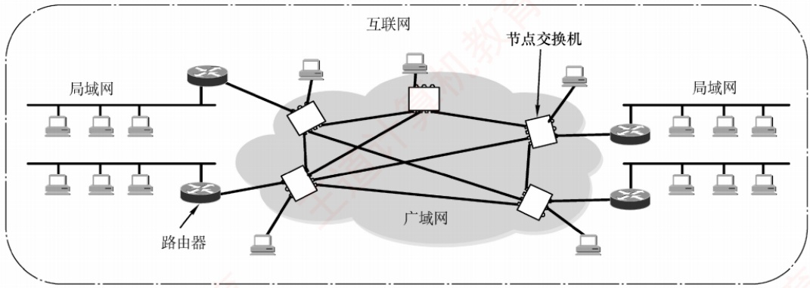

图3.32由相距较远的局域网通过路由器与广域网相连而成的互联网

广域网由若于节点交换机（注意不是路由器）及连接这些交换机的链路组成。节点交换机与路由器都用于转发分组，工作原理相似；但节点交换机工作在单个网络内部，而路由器用于连接多个网络构成的互联网。节点交换机的核心功能是存储并转发分组。广域网中节点之间采用点到点连接，但为提高网络可靠性，一个节点交换机通常与多个其他交换机相连。

广域网和局域网的区别与联系见表3.5。

表3.5 广域网和局域网的区别与联系

<table><tr><td>项目</td><td>广域网</td><td>局域网</td></tr><tr><td>覆盖范围</td><td>很广，通常跨区域</td><td>较小，通常在一个区域内</td></tr><tr><td>连接方式</td><td>通常采用点对点连接</td><td>普遍使用广播信道</td></tr><tr><td>OSI层次</td><td>三层:物理层，数据链路层，网络层</td><td>两层:物理层，数据链路层</td></tr><tr><td>联系与相似点</td><td colspan="2">1. 广域网和局域网都是互联网的重要构件，从互联网角度看，两者地位平等（不存在包含关系）2. 当主机在所属广域网或局域网的内部通信时，仅需使用该网络的物理地址</td></tr><tr><td>着重点</td><td>强调资源共享</td><td>强调数据传输</td></tr></table>

在通信线路质量较差的年代，高级数据链路控制（HDLC）因其可靠的传输机制而成为主流的数据链路层协议。如今，在误码率极低的点对点有线链路上，更简单的点对点协议（PPP）则成为使用最广泛的数据链路层协议。最新大纲已将HDLC删除，故本书不再介绍。

### 3.7.2 点对点协议

点对点协议（Point-to-PointProtocol，PPP）是目前最流行的点对点链路控制协议。主要有两种应用场景:用户接入互联网时与ISP之间的通信；两台网络设备之间通过直连专线通信。

在以太网中运行的 PPP 称为 PPPoE（PPP over Ethernet），它是对 PPP的扩展。PPPoE将 PPP帧封装在以太网帧中，用户通过ADSL宽带上网时使用的就是PPPoE。

**PPP由以下三个部分组成:**

1）一个链路控制协议（LCP）。用来建立、配置、测试数据链路连接，及协商一些选项。

2）一套网络控制协议（NCP）。PPP支持多种网络层协议（如IP、IPX等），每种网络层协议需通过对应的NCP进行配置，以建立和管理其逻辑连接。

3）一种将IP数据报封装到串行链路的方法。IP数据报作为PPP帧的信息部分被封装在PPP帧中传输，其长度受最大传送单元（MTU）限制。

PPP帧的格式如图3.33所示，首部包含4个字段，尾部包含2个字段。

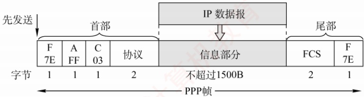

图 3.33 PPP 帧的格式

1）标志字段（F）。首部和尾部各有一个，占1B，规定为0x7E（01111110），用作帧的定界符，标识帧的开始与结束。为实现透明传输，当信息段中出现与标志字段相同的比特模式时，需要采取填充措施:当PPP使用异步传输时，采用字节填充法，使用的转义字符为0x7D（01111101）；当PPP使用同步传输时，采用零比特填充法。

2）地址字段（A）。占1B，规定为0xFF，其意义暂未定义。

3）控制字段（C）。占1B，规定为0x03，其意义也暂未定义。

4）协议字段。占2B，用于标识信息字段所承载的分组类型。若为0x0021，表示信息字段为IP数据报；若为0xC021，表示信息字段为LCP分组。

5）信息字段。长度可变，范围为0～1500B。

**注意**

由于PPP是点对点链路上（而非总线形网络），无须使用CSMA/CD协议，因此不存在最短帧长的限制，其信息字段最小可为0B（相比之下，以太网帧的数据部分至少需46B）。

6）帧检验序列（FCS）。占2B，采用CRC校验生成的冗余码，用于差错检测。

以用户拨号接入ISP的过程为例:用户拨号后，首先建立一条从用户到ISP的物理层连接；随后，用户向ISP发送一系列LCP分组（封装为PPP帧），协商链路参数并建立LCP连接；接着通过NCP配置网络层，ISP为用户分配一个临时IP地址；通信结束后，依次释放网络层、数据链路层和物理层连接。PPP的状态转换如图3.34所示。

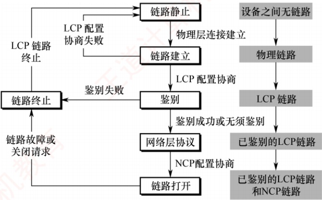

图 3.34 PPP 的状态图

具体解释如下:

1）PPP链路的起始和终止均为链路静止状态，此时用户与ISP之间无物理层连接

2）当检测到调制解调器的载波信号并成功建立物理层连接后，PPP进入链路建立状态。

3）在链路建立状态下，LCP开始协商配置选项（如最大帧长、鉴别协议等）。若协商成功，则LCP链路建立完成，PPP进入鉴别状态。若协商失败，则退回到链路静止状态。

4）在鉴别状态下，若通信双方无须鉴别或身份鉴别成功，则进入网络层协议状态。若鉴别失败，则直接进入链路终止状态。

5）在网络层协议状态下，双方通过NCP配置网络层参数（如分配IP地址），配置完成后，PPP进入链路打开状态，双方即可开始数据通信。

6）数据通信结束后，若一方发送终止请求并在收到确认后，或链路发生故障，PPP将进入链路终止状态；待调制解调器的载波信号停止后，最终返回链路静止状态。

PPP的主要特点如下:

1）PPP在链路建立阶段使用确认机制，但在数据传输阶段仅提供无差错接收（通过CRC检验），不使用序号与确认机制，因此提供的是不可靠服务。

2）PPP仅支持全双工的点对点链路，不支持多点线路。

3）PPP链路两端可运行不同的网络层协议，但仍能通过同一PPP链路进行通信。

4）PPP是面向字节的协议，所有PPP帧的长度均为整数个字节。

## 3.8 数据链路层设备

### *3.8.1 网桥的基本概念

使用集线器在物理层扩展以太网会形成更大的冲突域①。为避免这一问题，早期采用网桥在数据链路层扩展以太网，此时原来的每个以太网称为一个网段。使用网桥扩展时，不会将原本独立的两个冲突域合并成一个更大的冲突域。这是因为网桥具有识别帧和转发帧的能力:

> ①冲突域和广播域的介绍见本书4.7节。

它根据帧首部的目的地址及自身的帧转发表，决定是转发还是丢弃所收到的帧，从而有效过滤通信量。网桥是早期的数据链路层设备，现已被以太网交换机取代，最新大纲中已将其删除。

### 3.8.2 以太网交换机

#### 1．交换机的原理和特点

以太网交换机也称二层交换机，其中“二层”指其工作在数据链路层。从实质上讲，它是一个多端口的网桥，能够将网络划分为多个较小的冲突域，从而为每个用户提供更高的带宽。

在使用集线器构建的传统共享式以太网中，所有用户共享同一传输介质。例如，在10Mb/s网络中，若有N个用户，则每个用户的平均可用带宽仅为总带宽的1/N，且在通信过程中极易发生冲突。而使用以太网交换机构建的交换式以太网则完全不同:每个端口提供独立的信道，主机通信时独占端口带宽（如10Mb/s），无须与其他用户竞争介质。因此，一台有N个端口的交换机的总吞吐容量可达N×10Mb/s，这正是交换机的最大优势所在。

**考点追踪以太网交换机的特点（2015）**

以太网交换机的特点:

1）当交换机端口直接连接主机或其他交换机时，通常工作在全双工方式。

2）交换机具有并行性，可同时连通多对端口，使每对通信主机都能无冲突地传输数据，因此无须使用 CSMA/CD 协议。

3）当交换机端口连接集线器时，由于集线器连接的所有设备均处于同一冲突域中，必须使用CSMA/CD协议，且只能工作在半双工方式。

4）交换机是一种即插即用设备，其内部的帧转发表是通过自学习算法，基于网络中各主机间的实际通信自动建立和更新。

5）交换机采用专用交换结构芯片，因此交换速率较高。

**考点追踪直通交换的转发时延分析（2013）**

以太网交换机主要采用两种交换模式:

1）直通交换方式。接收到帧的目的MAC地址后，立即决定转发端口，无须等待整个帧接收完毕。该方式的转发时延非常小，缺点是不进行差错检测，因此可能将一些无效帧转发给其他站。因此，直通交换不适用于需要速率匹配、协议转换或差错检测的场景。

2）存储转发交换方式。先完整接收并缓存整个帧，然后检查帧是否正确（可能还需要进行速率匹配或协议转换），若帧正确，则根据目的MAC地址转发；若帧出错，则直接丢弃。其优点是可靠性高，且支持不同速率端口之间的通信；缺点是转发时延较大。

交换机通常配备多种速率的端口，如10Mb/s、100Mb/s端口，以及多速率自适应端口。

#### 2．交换机的自学习功能

**考点追踪以太网交换机基于MAC地址的转发机制（2009）**

以太网交换机的转发和过滤决策基于帧的MAC地址。其中，过滤是指决定是否丢弃一个帧，而转发则是指决定将帧从哪个端口送出。这两项功能依赖于交换机的交换表。每个表项至少包含两个字段:主机的MAC地址；该主机所连接的交换机端口号。例如，在图3.35中，一台4端口的交换机分别连接四台计算机，其MAC地址分别为A、B、C和D。交换表初始为空。

(a) 交换表一开始是空的

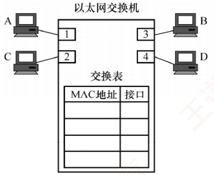

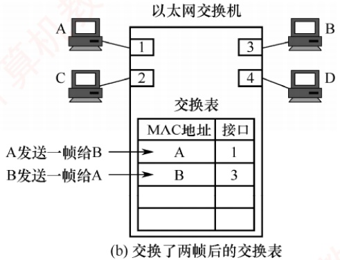

图3.35 以太网交换机中的交换表

考点追踪交换机的MAC地址学习过程（2014、2016、2021）

交换机通过自学习算法动态构建并维护转发表，收到数据帧后，执行以下步骤。

1）学习源MAC地址:交换机读取帧的源MAC地址，并将{MAC地址，入端口}写入或更新到交换表。这一过程称为自学习，可使交换机动态掌握各主机的连接位置。

2）查看目的MAC地址:交换机解析帧的目的MAC地址，并根据其类型（单播、广播或组播）采取相应的转发策略。

3）决策与转发:

●为单播帧（目的MAC地址为普通主机地址）时，交换机在交换表中查找该目的地址:若找到对应表项（已知目的地址），则仅从该表项所指端口转发，实现精准交付；若未找到对应表项（未知目的地址），则执行未知单播帧泛洪（或称洪泛），即将帧从除接收端口外的所有其他活动端口转发出去，确保目标主机能收到。

●为广播帧（目的MAC地址为FF:FF:FF:FF:FF:FF）时，交换机不查询转发表，直接将帧泛洪到除接收端口外的所有其他活动端口。

●为组播帧（目的地址为组播MAC地址）时，交换机通常也默认执行泛洪处理

假设主机A从端口1向主机B发送帧。交换机收到后，学习源地址:将{A，1}写入交换表，此后任何发往主机A的帧都将从端口1转发。执行未知目的地址泛洪:未找到主机B的对应表项，将帧发送至端口2、3、4（除端口1外）。主机C和D收到帧后，发现目的地址非自身，丢弃该帧；仅主机B接收。

随后，假设主机B从端口3向主机A回复帧。交换机收到后，学习源地址:将{B,3}写入交换表。执行已知目的地址精准交付:查表发现主机A对应端口1，于是直接从端口1单播转发该帧。

至此，交换机已通过“A→B”和“B→A”的通信，完整学习了主机A与B的位置信息。随着时间的推移，只要主机C和D也主动发送帧，交换机便会逐步学习其MAC地址与端口的映射关系。最终，交换表将包含所有活跃主机的信息，实现高效、精准的转发。

由于网络中的主机会动态变化，交换表必须具备自动更新的能力。为此，每个表项均设有老化时间，超时未更新的表项会被自动删除，以确保表项始终反映当前网络的实际连接状态。

为了提高可靠性，以太网交换机组网中常引入冗余链路，但可能形成环路，导致广播风暴和帧无限循环。为此，交换机采用生成树协议（STP），在不改变物理拓扑的前提下，通过逻辑阻塞部分冗余端口，构建一棵覆盖所有交换机的无环生成树，确保任意两台主机间仅有一条有效路径，进而消除环路。同时，当主链路出现故障时，STP可重新激活被阻塞端口，恢复连通性，实现自动容错。

### 3.8.3 共享式以太网

#### 1．共享式以太网的基本特点

考点追踪共享式与交换式以太网的区别（2016）

共享式以太网是指以集线器（Hub）为中心连接设备构建的局域网。所有主机通过双绞线接入集线器，共享同一物理传输介质和总带宽。从逻辑上看，整个网络构成单一的局域网段，所有通信均发生在同一个冲突域和广播域中。共享式以太网的主要特点如下。

1）工作在物理层:集线器仅对电信号进行放大和再生，不具备帧解析能力，无法识别MAC地址，也无任何智能转发或过滤功能。

2）采用半双工通信和CSMA/CD协议:由于介质共享，任意时刻只能有一对主机成功通信，其他发送尝试将引发冲突，必须依赖CSMA/CD协议进行冲突检测与退避。

3）单一冲突域与广播域:所有主机处于同一个冲突域和同一个广播域内。

4）带宽共享，效率低下:若网络中有N台主机，则每台主机的平均带宽仅为总带宽的1/N。

5）盲目广播所有帧:集线器将收到的帧无差别地转发至所有其他端口，各主机需自行判断是否接收，不仅浪费带宽，还存在通信隐私泄露的风险。

正由于上述缺陷，共享式以太网早已于20世纪末退出历史舞台，现代网络不再部署。

**2. 共享式与交换式以太网的转发行为对比**

假设交换机已建立完整的转发表，以下从三种典型场景分析两类网络的处理差异:

1）主机发送普通帧。对于共享式以太网，集线器将帧转发到除接收端口外的所有端口，各主机网卡根据帧的目的MAC地址决定是否接收。对于交换式以太网，交换机查询转发表后，仅将帧从目标主机所在的端口转发，其他主机完全无感知。

2）主机发送广播帧。对于共享式以太网，集线器将帧转发到除接收端口外的所有端口，各主机网卡识别目的MAC地址为广播地址后接收该帧。对于交换式以太网，交换机识别目的MAC地址为广播地址，执行泛洪处理，各主机收到该广播帧后予以接收。两种情况效果相同，但原理不同:前者是物理层盲目复制，后者是数据链路层有意识洪泛。

3）多对主机同时通信。对于共享式以太网，必然发生冲突，需执行CSMA/CD协议的退避重传机制。对于交换式以太网，支持多对端口并行交互，各对通信互不干扰。

**考点追踪各类网络设备对冲突域和广播域的影响（2020、2022）**

可见，集线器既不隔离广播域，也不隔离冲突域，而交换机不隔离广播域，但隔离冲突域。共享式以太网与交换式以太网的特性对比如表3.6所示。

表3.6 共享式以太网与交换式以太网的特性对比

| 网络类型 | 工作层次 | 通信模式 | 带宽分配 | 使用 CSMA/CD 协议？ | 安全性 |
| --- | --- | --- | --- | --- | --- |
| 共享式以太网 | 物理层 | 半双工 | 共享 | 是 | 低 |
| 交换式以太网 | 数据链路层 | 全双工（默认） | 独占 | 否（全双工下） | 较高 |

## 3.9 本章小结及疑难点

1. 为何连续ARQ在接收窗口为1、用n比特编号时，发送窗口最多只能是 $2^{n}   -   1 ?$

在连续ARQ协议中，若接收窗口大小为1，则发送窗口大小不得超过2ⁿ-1，否则将导致新帧与重传帧无法区分，造成数据错误。假设用3比特进行编号，可表示0～7共8个不同序号。

具体来看:设发送窗口为8，发送方一次性发出0～7号帧后暂停。

● 若所有确认都成功返回，发送方将接着发送下一轮序号为0～7的新帧；

若所有确认都丢失，发送方超时后会重传原来的0～7号旧帧。

由于接收窗口为1，接收方只根据序号判断是否接收，无法区分收到的0～7是新帧还是重传帧。若把重传帧误认为新数据，就会造成重复或错误。因此，发送窗口不能等于8。只要将其限制为7，就能保证已发送未确认的帧和未来新帧的序号不会完全重叠，从而避免歧义。

2. 为什么 PPP不采用帧编号和确认机制来实现可靠传输？

PPP不使用帧序号和确认机制主要有两方面原因:

首先，在因特网中，PPP承载的是IP数据报。即使链路层实现可靠传输，数据在路由器的网络层仍可能因拥塞被丢弃，因此链路层的可靠性无法保证端到端可靠交付。

其次，现代物理链路误码率很低，若引入重传和确认机制，只会增加开销和延迟，得不偿失。实际上，PPP通过FCS字段对每帧做CRC校验:发现差错立即丢弃，绝不向上层传递错误数据。而真正的差错恢复由高层协议（如TCP）在端到端基础上完成。

因此，PPP采用“有错即弃、可靠由上层负责”的设计，既轻量高效，又符合端到端原则。

3. 在以太网中，为什么说:若一个帧在冲突窗口内未发生冲突，则后续不会再发生冲突？

在CSMA/CD协议机制下，节点发送前先侦听信道，仅在空闲时开始发送。冲突窗口是检测冲突的最晚时限:若存在冲突，最迟会在该时间内被发送方感知。具体而言，假设节点A开始发送帧。若在帧的前2r（r为信号从A到最远节点的传播时延）内未检测到冲突，说明:

此时帧的首部已到达所有其他节点；

其他节点在侦听到信道忙后，不会启动新发送。

因此，只要在冲突窗口内未发生冲突，此后信道已被该帧“占据”，其他节点将持续侦听到载波而保持沉默，不可能再产生新冲突。

4. 将以太网速率从 10Mb/s提升到 100Mb/s 时，为满足 CSMA/CD协议的冲突检测要求，需做哪些调整？

由于CSMA/CD协议要求最短帧的发送时间不小于冲突窗口（2r），当速率提高10倍后，若网段长度不变，信号传播时延r不变，但发送同样长度帧的时间缩短为原来的1/10，则无法保证在冲突窗口内完成发送，导致冲突无法被检测。为此，100Base-T以太网做了两项关键调整:

将网段最大长度从 500m 减小到100m，以缩短传播时延r。

● 将帧间最小间隔从 9.6μs 缩减为 $0 . 96 \mu \mathrm {s}$ ，以匹配更高传输速率。

这两项调整使最短帧（64B）的发送时间不小于冲突窗口，以维持CSMA/CD协议正常工作。
