# 第4章 网络层

> 来源：27王道《计算机网络》高清带书签.pdf（已清理水印、广告与 OCR 噪声）

## 【考纲内容】

（一）网络层的功能异构网络互连；路由与转发；SDN的基本概念；拥塞控制

静态路由与动态路由；距离-向量算法；链路状态算法；层次路由

IPv4分组；IPv4 地址与NAT；划分子网与子网掩码、CIDR、路由聚合、ARP、DHCP与ICMP

（四）IPv6 IPv6的主要特点；IPv6地址

（五）路由协议自治系统；域内路由与域间路由；RIP路由协议；OSPF路由协议；BGP路由协议

（六）IP多播多播的概念；IP多播地址

移动IP的概念；移动IP通信过程

（八）网络层设备路由器的组成和功能；路由表与分组转发

## 【复习提示】

本章是历年考查的重中之重，尤其是结合第3章、第5章、第6章出综合题的概率很大。其中IPv4和路由的相关知识点是核心，历年真题都有涉及，因此必须牢固掌握其原理，还要多做题，以便灵活应用。本章的其他知识点，如IPv6、IP多播、移动IP也要有所了解。

## 4.1 网络层的功能

网络层提供主机到主机的通信服务，主要任务是将分组从源主机经过多个网络和多段链路传输到目的主机。该任务可划分为分组转发和路由选择两种重要功能。

OSI参考模型曾主张在网络层使用面向连接的虚电路服务，认为应由网络自身来保证通信的可靠性。而TCP/IP体系结构的网络层提供的是无连接的数据报服务，其核心思想是应由用户主机来保证通信的可靠性。虚电路和数据报服务将在4.1.3节中介绍。

在互联网采用的TCP/IP体系结构中，网络层向上只提供简单灵活的、无连接的、尽最大努力交付的数据报服务。也就是说，所传送的分组可能出错、丢失、重复或失序，这就使得网络中的路由器可以做得比较简单，且价格低廉。通信的可靠性可由更高层的传输层来负责。

### 4.1.1 异构网络互连

互联网是由全球范围内数以百万计的异构网络互连起来的。这些网络的拓扑结构、寻址方案、差错处理方法、路由选择机制等都不尽相同。网络层所要完成的任务之一就是实现这些异构网络的互连。网络互连是指将两个以上的计算机网络，通过一定的方法，用一些中继系统相互连接起来，以构成更大的网络系统。根据所在的层次，中继系统分为以下4种:

1）物理层中继系统:转发器，集线器。

2）数据链路层中继系统:网桥或交换机。

3）网络层中继系统:路由器。

4）网络层以上的中继系统:网关。

当使用物理层或数据链路层的中继系统时，只是把一个网络扩大了，而从网络层的角度看，它仍然是同一个网络，一般并不称为网络互连。因此，网络互连通常是指用路由器进行网络连接和路由选择。路由器是一台专用计算机，用于在互联网中进行路由选择。

**注意**

由于历史原因，许多有关TCP/IP的文献也将网络层的路由器称为网关。

TCP/IP在网络互连方面的做法是在网络层采用标准化协议，但相互连接的网络可以是异构的。图4.1(a)表示许多计算机网络通过一些路由器进行互连。因为参与互连的计算机网络都使用相同的网际协议IP，通过IP协议就可使这些性能各异的网络在网络层上看起来像是一个统一的网络，所以可以把互连后的网络视为如图4.1(b)所示的一个虚拟互连网络，简称IP网络。

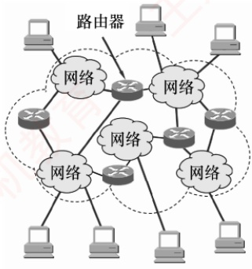

(a) 实际互连网络

(b) 虚拟互连网络

图 4.1 IP 网络的概念

使用IP网络的好处是:当IP网络上的主机进行通信时，就好像在单个网络上通信一样，而看不见互连的各个网络的具体异构细节（如具体的编址方案、路由选择协议等）。

### 4.1.2 路由与转发

路由器的核心功能包括路由选择与分组转发:

1）路由选择。路由器运行路由协议，通过定期与相邻路由器交换信息，获取网络拓扑变化，动态生成并维护路由表，从而计算到达目的网络的最优路径。

2）分组转发。路由器根据转发表将到达的分组从合适的输出端口转发出去。

路由表由路由选择算法生成，侧重于拓扑计算。转发表则由路由表导出，其结构应使查找最优化。在讨论路由选择的原理时，往往不区分转发表和路由表，而笼统地使用路由表一词。

### 4.1.3 网络层提供的两种服务

分组交换网根据其通信子网向端点系统提供的服务，还可进一步分为面向连接的虚电路服务和无连接的数据报服务。这两种服务方式都是由网络层提供的。

#### 1．虚电路

**考点追踪虚电路的特点（2020）**

在虚电路方式中，两台主机进行通信前，必须首先在网络层建立一条逻辑连接，即虚电路(Virtual Circuit，VC）。该连接一旦建立，其对应的端到端传输路径即被固定。与电路交换类似，整个通信过程可分为三个阶段:虚电路建立、数据传输与虚电路释放。

每次建立虚电路时，系统为其分配一个未使用过的虚电路号（VCID），以区别于同一节点上的其他虚电路。此后，双方就沿着已建立的虚电路传送分组。值得注意的是，仅在连接建立阶段使用完整的源和目的地址，后续分组的首部仅需携带虚电路号。每个中间节点都维护一个虚电路表，其中记录了每条虚电路的VCID及下一跳信息，这些内容在连接建立过程中确定。

下面以图4.2为例说明虚电路服务的工作原理，假设主机A向主机B发送分组。

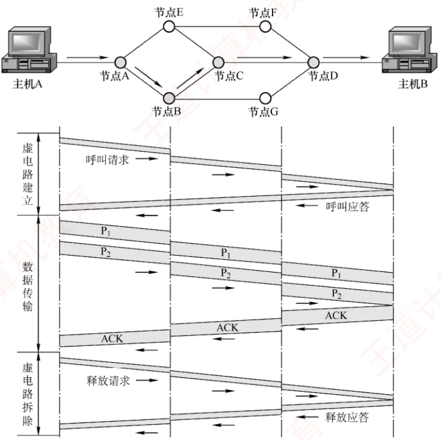

图4.2 虚电路方式的工作原理

1）数据传输前，主机A与主机B需先建立虚电路连接:A发送“呼叫请求”分组，经由中间节点转发至B；若B同意建立连接，则返回“呼叫应答”分组予以确认。

2）虚电路建立后，双方即可相互传输数据分组。

3）传输结束后，主机A发送“释放请求”分组，逐段拆除虚电路。

注意，图4.2所示的数据传输是有确认的，接收方收到分组后需返回确认。

通过上述例子，可总结出虚电路服务具有以下特点:

1）建立与释放连接开销大。不适合交互应用或少量数据交换，适合长时间或大量数据交换。

2）路由选择在连接建立阶段完成。建立完成后，就固定了传输路径。

3）提供可靠、有序的分组交付，并支持端到端的流量控制。

4）对节点或链路的故障敏感。任一故障都会导致所有经过该节点或链路的虚电路中断。

5）分组首部开销小。因为其无须携带完整的目的地址，而只需携带虚电路号。

虚电路之所以是虚的，是因为这条链路并非专用的，而是可被多条虚电路共享。

#### 2．数据报

在数据报方式中，发送分组前无须建立连接。源主机将应用层报文分割为若干数据段，并封装成携带完整源地址和目的地址的独立分组。中间节点对分组短暂缓存，独立选路后随即转发。网络层不提供服务质量保证，也不确保可靠传输，因此分组可能丢失、重复、失序或出错。这就使得网络中的路由器比较简单，且造价低廉（与电话网络相比）。

下面以图4.3为例说明数据报服务的工作原理，假设主机A向主机B发送分组。

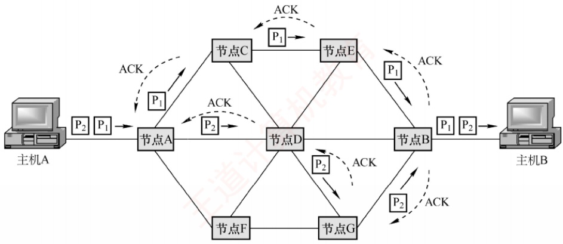

图4.3 数据报方式转发分组

1）主机A将分组逐个发送至与其直连的节点A，该节点对分组进行短暂缓存。

2）随后，节点A查询其转发表。网络状态动态变化，导致转发表随之更新，各分组独立进行路由选择，可能经由不同路径转发（例如部分发往节点C，部分发往节点D）。

3）后续节点以相同的方式转发分组，直至其最终抵达主机B。

在传输过程中，分组仅占用当前链路的资源。得益于存储转发机制和资源共享，多个主机可以同时通信—例如主机A在发送分组的同时，主机B也可向其他主机发送数据。

通过上述例子，可总结出数据报服务具有以下特点:

1）无须建立连接。发送方可随时发送分组，交换节点也可随时接收并处理。

2）尽最大努力交付。网络不保证可靠性，分组可能丢失、出错或失序；由于每个分组独立选路，转发路径可能不同，可能导致失序到达。

3）分组携带完整地址。每个分组均包含完整的源地址和目的地址，以支持独立路由。

4）存在排队时延与丢包风险。分组在交换节点中需排队处理；网络拥塞时，时延显著增加，还可能被主动丢弃。

5）故障适应能力强。当某节点或链路失效时，可通过更新转发表动态选择绕行路径。

6）资源利用率高。通信双方不独占链路，带宽等资源由多个会话共享。

采用这种设计思想的好处是:网络的造价大大降低、运行方式灵活、能够适应多种应用。互联网能够发展到今天的规模，充分证明了当初采用这种设计思想的正确性。

数据报服务和虚电路服务的比较见表4.1。

表4.1 数据报服务和虚电路服务的比较

|  | 数据报服务 | 虚电路服务 |
| --- | --- | --- |
| 连接的建立 | 不需要 | 必须有 |
| 目的地址 | 每个分组都有完整的目的地址 | 仅在建立连接阶段使用，之后每个分组使用长度较短的虚电路号 |
| 路由选择 | 每个分组独立地进行路由选择和转发 | 属于同一条虚电路的分组按照同一路由转发 |
| 分组顺序 | 不保证分组的有序到达 | 保证分组的有序到达 |
| 可靠性 | 不保证可靠通信，可靠性由用户来保证 | 可靠性由网络自身来保证 |
| 对网络故障的适应性 | 可寻找新的路径转发分组，对故障的适应能力强 | 所有经过故障节点的虚电路均不能正常工作 |
| 差错处理和流量控制 | 由用户主机进行流量控制，不保证数据报的可靠性 | 可由分组交换网负责，也可由用户主机负责 |

### 4.1.4 SDN的基本概念

网络层的核心任务是分组转发与路由选择。从功能架构上看，网络层可抽象地划分为两个逻辑平面:数据平面（也称转发平面）和控制平面，其中，数据平面负责执行分组转发，而控制平面负责实现路由选择，生成并维护路由信息。 七

软件定义网络（Software Defined Network，SDN）是一种近年来广泛采用的创新网络架构，其核心在于控制平面与数据平面的解耦:控制平面集中化，数据平面分布式部署。在传统网络中，每台路由器同时承担控制与转发功能，既运行路由协议，又维护转发表。而在SDN架构中（见图4.4），路由器仅保留数据平面功能，不再运行路由选择软件，因此彼此之间无须交换路由信息。网络的控制功能由一个逻辑集中式的远程控制器（通常由多个服务器协同实现）统一承担。该控制器掌握全网拓扑及主机状态，能为每个分组计算最优转发路径，并通过OpenFlow等协议将相应的流表（SDN中的转发表）下发至各路由器。路由器的工作因此变得极为简洁:接收分组、匹配流表、执行转发。

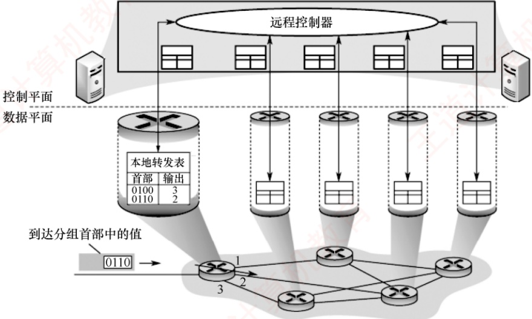

图 4.4 SDN 结构

如此一来，网络构架又变为集中控制模式，而互联网本质上是分布式的。SDN并非要把整个互联网改造为如图4.4所示的集中控制模式，这显然不具有可行性。然而，在某些特定条件下，例如像一些大型数据中心互联的广域网，采用SDN架构能够显著提升网络的运行效率。

$$
居盖菌病  \triangleright \triangleright \triangleright \triangleright \triangleright \triangleright \triangleright \triangleright \triangleright \triangleright
$$

SDN通过提供标准化的编程接口，赋予网络高度的可编程性，使开发者能够以软件方式灵活定义、动态调整并高效控制网络行为。SDN架构主要包含三类接口。

1）北向接口。面向上层应用提供标准化API，支持开发者高效构建定制化网络应用，而无须关注底层转发设备的具体实现细节。

2）南向接口。实现控制器与转发设备之间的双向通信，通过OpenFlow等协议，控制器可统一管理异构硬件，并将上层应用逻辑动态下发至数据平面。

3）东西向接口。用于控制器集群内部通信，提升控制平面的可靠性和可拓展性。

SDN的优势:①集中控制与分布转发，控制平面具备全局视图，便于统一优化；数据平面分布式高速转发，保障性能。②灵活可编程性，通过标准化接口，开发者能以软件方式动态定义网络行为。③降低成本，控制与转发分离使硬件设备简化（仅需基础转发能力），能有效降低成本。

SDN的挑战:①安全风险，集中化的控制器易受攻击，一旦崩溃，就会影响整个网络。②性能瓶颈，控制功能集中化后，随着网络规模的扩大，控制器可能成为网络性能的瓶颈。

### 4.1.5 拥塞控制

网络中出现过量分组，超过其处理能力时所引发的性能下降现象，称为拥塞。判断网络是否进入拥塞状态，通常依据的是吞吐量与网络负载之间的关系:

● 若负载增大但吞吐量增长甚微，则表明网络可能已处于轻度拥塞状态。

● 若负载增大但吞吐量反而下降，则表明网络很可能已进入拥塞状态。

拥塞控制的核心在于及时感知拥塞并采取措施，避免因缓冲区溢出导致分组丢失。拥塞控制的目标是确保网络能有效承载当前流量，这是一个全局性过程，涉及所有主机、路由器及影响网络传输能力的各类因素。仅靠增加资源无法根本解决拥塞。

需要特别区分拥塞控制与流量控制:流量控制用于管理发送方与接收方之间的点对点通信其核心是抑制发送方的发送速率，以确保接收方能够及时接收和处理数据。 xK

拥塞控制主要有两种方法:

1）开环控制。在系统设计时，预先考虑可能导致拥塞的因素，通过静态策略防止拥塞发生。一旦系统投入运行，控制机制就不再依赖实时反馈。典型手段包括:确定何时接收新流量、确定何时及丢弃哪些分组、确定何种调度策略等。其特点是不依赖当前网络状态。

2）闭环控制。通过监测网络运行状态，动态检测拥塞的发生位置与程度，然后反馈至控制节点，进而调整网络的运行以缓解拥塞。该方法基于反馈机制，是一种动态的方法。

## 4.2 IPv4

### 4.2.1 IPv4分组

IPv4（版本4）即现在普遍使用的网际协议（InternetProtocol，IP）。IP定义数据传送的基本单元——IP分组及其确切的数据格式。IP也包括一套规则，指明分组如何处理、错误怎样控制。特别是IP还包含非可靠投递的思想，以及与此关联的路由选择的思想。

#### 1．IPv4分组的格式

考点追踪IP首部格式及字段含义（2011、2012）

一个IP分组（或称IP数据报）由首部和数据部分组成。首部前一部分的长度固定，共20B，是所有IP分组必须具有的。在首部固定部分的后面是一些可选字段，用来提供错误检测及安全等机制，其长度可变，从1B到40B不等。IP数据报的格式如图4.5所示。

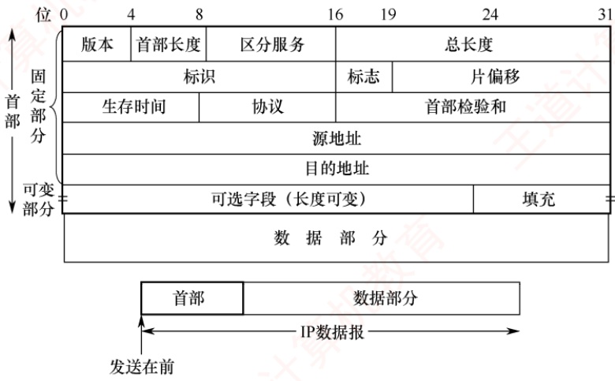

图4.5IP数据报的格式

IPv4首部的部分重要字段含义如下:

1）版本。占4位。表示IP协议的版本，IPv4中该字段的值为4。

2）首部长度。占4位。以4B为单位，可表示的最大首部长度为60B（15×4B）。最常用的首部长度是20B（5×4B)，该字段的值是5，表示不使用可选字段。IP首部长度必须是4B的整数倍，若可选字段导致长度不足，则通过填充字段加以填充。

**注意**

IP首部前两个字节往往以0x45开头，解题时可用于定位IP数据报的开始位置。

3）总长度。占16位，表示首部和数据之和的长度，以1B为单位，因此IP数据报的最大长度为 $2^{16} - 1 = 65535$ 。由于以太网MTU为1500B，因此当一个数据报封装成帧时，数据报的总长度（首部加数据）一定不能超过当前链路的MTU。

4）标识。占16位。源主机用一个递增计数器，为每个数据报设置标识字段。它并不是“序号”（因为IP是无连接服务）。分片时，所有分片复制原始数据报的标识字段值，以便目的主机据此正确重组为原数据报。

5）标志（Flag）。占3位，目前只有低2位有意义。MF（More Fragment，更多分片），MF=1表示后面还有分片，MF=0表示这是最后一个分片。DF（Don'tFragment，不能分片），仅当DF=0时允许分片，若DF =1，则禁止分片。

6）片偏移。占13位，以8B为单位，指出该分片数据部分起始位置相对于原始数据报数据部分开头的偏移量。除最后一个分片外，其他分片的数据长度必须是8B的整数倍。

**考点追踪TTL机制的分析（2014、2024）**

7）生存时间（TTL）。占8位，表示数据报在网络中允许经过的路由器数的最大值，防止其在网络中无限循环。每经过一个路由器，TTL减1。若TTL被减为0，则丢弃该数据报。若TTL的初值设为1，则该数据报仅限在本局域网内传输。

8）协议。占8位，指出此数据报携带的数据使用何种协议，即指示数据应交付给哪个上层协议（如 TCP、UDP）。其中值为6表示 TCP，值为17表示 UDP。

9）首部检验和。占16位，只检验首部（不含数据部分），不检验数据部分可减少计算的工作量。数据报每经过一个路由器，首部中的某些字段（如生存时间、总长度、标志、片偏移、源/目的地址）都可能发生变化，因此路由器都要重新计算检验和。首部检验和的计算方法与UDP和TCP检验和的计算方法类似，具体见5.2.2节。 r

10）源地址字段。占4B，标识发送方的IP地址。

11）目的地址字段。占4B，标识接收方的IP地址。

**注意**

①IP数据报首部包含3个与长度相关的字段:首部长度、总长度、片偏移，它们的基本单位分别为4B、1B、8B，计算时要注意换算。读者应理解IP首部各字段的意义和功能，但无须死记首部格式，若题目需要，通常会直接给出。这一原则同样适用于第5章对TCP和UDP首部的学习。

②在分析IP首部的十六进制原始数据时，IP地址以连续4B的十六进制形式呈现。将其转换为点分十进制形式时要格外小心，极易因字节顺序或进制转换错误而导致结果偏差。

#### 2．IP数据报分片

一个链路层数据帧能承载的最大数据量称为最大传送单元（MTU）。由于IP数据报被封装在链路层帧中，其长度受到MTU的严格限制。此外，从源主机到目的主机的路径上可能会经过多段链路，各段链路的 MTU可能不同——例如，以太网的 MTU通常为1500B，而很多广域网的MTU不超过576B。当IP数据报的总长度超过某段链路的MTU时，就必须将IP数据报中的数据分装在多个较小的IP数据报中，这些较小的数据报称为分片（或片）。

**考点追踪IP分片相关首部字段（2011）**

分片只能发生在源主机或中间路由器上，而重组仅在目的主机上进行。目的主机利用IP首部中的标识、标志和片偏移三个字段完成分片的重组。源主机在创建P数据报时，会为其分配唯一的标识号。当该数据报被分片时，所有分片均继承原始数据报的标识号。目的主机收到来自同一源主机的多个数据报后，通过比对标识号，即可判断哪些分片属于同一个原始数据报。分片行为受标志字段控制:仅当DF=0时，数据报才被允许分片；若DF=1，则禁止分片。此外，MF=1表示还有后续分片；MF=0表示这是最后一个分片。在重组过程中，依据片偏移字段确定每个分片在原始数据报中的起始位置，从而正确还原原始数据。

**考点追踪IP分片的原理及分析（2021）**

IP分片涉及一定的计算。例如，一个总长4000B的IP数据报（首部20B，数据部分3980B）到达路由器，需转发到MTU为1500B的链路上。每个分片都是一个独立的IP数据报，均包含20B的IP首部，每片最多携带1480B数据，因此需划分为3个分片，数据部分依次为1480B、1480B和1020B。假定原始数据报标识号为777，则各分片如图4.6所示。由于片偏移以8B为单位，为保证偏移值为整数，除最后一个分片外，其余分片的数据长度必须是8B的整数倍。

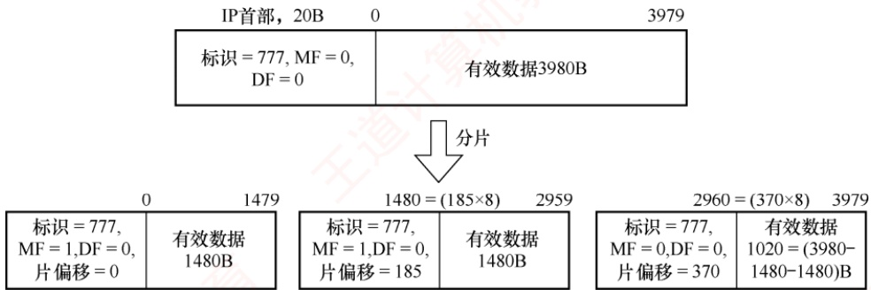

图4.6 IP分片的例子

### 4.2.2 IPv4地址

#### 1．IPv4地址

IP地址是为连接到互联网上的每台主机（或路由器）的每个接口，分配的一个全球唯一的32位标识符。IP地址的分配由互联网名字与数字分配机构（ICANN）统一管理。为方便书写和记忆，通常将32位IP地址分为4段，每段8位，转换为等效的十进制数，并用小数点分隔，即一个IP地址用4段十进制数表示，这种表示方法称为点分十进制记法。

#### 2．分类的IP地址

互联网早期采用的是分类的IP地址，如图4.7所示。

无论哪类IP地址，都由网络号和主机号两部分组成。即IP地址::={<网络号>,<主机号>}。其中网络号标志主机（或路由器）的接口所连接到的网络，一个网络号在整个互联网范围内必须唯一。主机号标志该主机（或路由器）的接口，一个主机号在其网络号所指的网络范围内必须唯一。由此可见，每个IP地址在整个互联网中是唯一的。

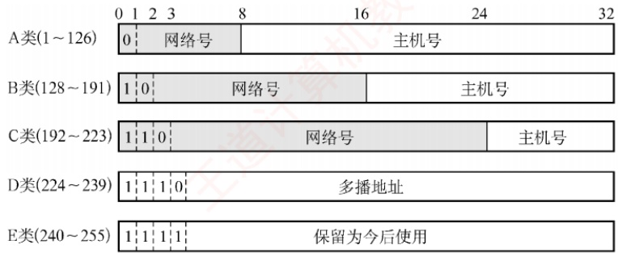

图 4.7 分类的 IP 地址

**考点追踪0.0.0.0地址的作用（2017）**

A类、B类和C类地址均为单播地址（用于一对一通信），可分配给主机或路由器的接口。但以下特殊IP地址不能用作普通主机的地址:

主机号全为0:表示本网络本身（网络地址），例如202.98.174.0。

● 主机号全为1:表示本网络的广播地址，也称直接广播地址，例如202.98.174.255。

127.×.×.×:保留用于本地环回测试（LoopbackTest），仅用于本机进程间的通信，目的地址为环回地址的IP数据报不会被发送到任何物理网络。

● 32 位全为0，即 0.0.0.0:表示本网络上的本主机（常用于DHCP，见4.2.6节）。

● 32位全为1，即255.255.255.255:表示受限广播地址，仅在本网络内广播。常用的三种类别IP地址的使用范围见表4.2。

表4.2 常用的三种类别IP地址的使用范围

| 网络类别 | 最大可用网络数 | 第一个可用的网络号 | 最后一个可用的网络号 | 每个网络中的最大主机数 |
| --- | --- | --- | --- | --- |
| A | $2^{7} - 2$ |  | 126 | $2^{24} - 2$ |
| B | $2^{14}$ | 128.0 | 191.255 | $2^{16} - 2$ |
| C | $2^{21}$ | 192.0.0 | 223.255.255 | 2⁸-2 |

在表4.2中，A类地址可用的网络数为 $2^{7}   -   2$ ，减2的原因如下:①网络号为0（0.×.×.×），保留用于特殊用途；②网络号为127（127.×.×.×），保留作为环回测试地址。每个网络中的最大主机数减2的原因是:①主机号全为0的地址用作网络地址（标识本网络）；②主机号全为1的地址用作直接广播地址（向本网络所有主机广播），这两个地址不能分配给主机使用。

IP地址具有以下重要特点:

1）IP地址由网络号和主机号两部分组成，是一种分等级的地址结构。这种设计带来了两大优势:①IP地址管理机构只分配网络号，主机号由获得该网络的单位自行分配，便于地址管理；②路由器转发分组时仅依据目的地址的网络号，从而显著减小路由表规模。

2）IP地址标识的是网络接口，而非主机本身。当一台主机同时连接到多个网络时，必须为每个接口配置一个IP地址，且各地址的网络号必须不同。因此，路由器至少拥有两个或更多的P地址，每个接口对应一个不同网络号的IP地址。

3）通过集线器或交换机连接的多个网段在逻辑上仍然属于同一个网络（同一个广播域），因此，其中所有主机的IP地址必须具有相同的网络号，但主机号必须唯一。

4）IP地址是逻辑地址，与底层物理硬件（如MAC地址）无关。这使得网络层能够屏蔽链

> ①B类网络号128.0和C类网络号192.0.0早期标准规定不能指派，但现在都能指派[RFC6890]。

路层的异构性，支持跨不同物理网络的统一通信。

近年来，随着无分类编址的广泛应用，这种传统分类的P地址已逐渐退出历史舞台。

#### 3．划分子网

**（1）划分子网**

传统的两级P地址结构（仅含网络号和主机号）存在以下主要缺点。

● 地址空间利用率低:为每个物理网络分配一个完整网络号，导致大量主机号未被使用。

● 路由表规模过大:网络数量增长使路由表膨胀，从而影响转发性能。

● 地址分配缺乏灵活性:无法根据实际需求，对网络进行更细粒度的划分。

为克服上述问题，从1985年起，在P地址中增加“子网号”字段，形成三级结构:

$$
IP   地址  ::= \{<  网络号  >,<  子网号  >,<  主机号  >\}
$$

这一机制称为划分子网，现已成为互联网的正式标准。

划分子网的基本思想如下。

1）对外透明:单位对外仍表现为单一网络，外部路由器无须感知其内部子网结构。

2）内部灵活划分:从原主机号中借用若干位作为子网号，主机号位数相应减少。

3）分层转发:外部路由器根据网络号转发数据报至该单位边界路由器；边界路由器再结合子网号，将数据报交付至具体子网，最终送到目的主机。

例如，将一个C类网络208.115.21.0划分为4个子网，需借用2位作为子网号（因为 $2^{2}   =   4   )$主机号剩余6位，每个子网中的最大主机数为 $2^{6} {-} 2 {=} 62$ （扣除网络地址和广播地址），各子网的网络地址为:208.115.21.0、208.115.21.64、208.115.21.128、208.115.21.192。

**注意**

①划分子网仅对IP地址的主机号部分再划分，不改变原网络号，因此无法从IP地址本身判断是否划分子网。②划分子网提升了地址分配的灵活性，但也使特定网络的可分配主机总数略有减少。

**(2)子网掩码**

**考点追踪网络地址的确定方法（2022）**

子网掩码是一个与IP地址对应的32位二进制串，由一串1后跟一串0组成。其中，1对应IP地址中的网络号和子网号，而0对应主机号。主机或路由器通过将IP地址与其子网掩码进行逐位“与”（AND)运算，即可得出该地址所在子网的子网地址。

现在的互联网标准规定:每个网络都需配置子网掩码。对于未划分子网的传统分类网络，应使用其默认子网掩码。A、B、C类地址的默认子网掩码分别为255.0.0.0、255.255.0.0、255.255.255.0。例如，某主机的IP地址为192.168.5.56，子网掩码为255.255.255.0，通过逐位“与”运算，可得出其所在子网的子网地址为192.168.5.0。

子网掩码是网络的关键属性。路由器交换路由信息时，必须同时通告目的网络地址和子网掩码。转发分组时，路由器将分组的目的IP地址与某条路由的子网掩码进行逐位“与”运算，若结果等于该路由的目的网络地址，则匹配成功，并将分组转发至对应的下一跳。

在使用子网掩码时，需遵循以下原则:

1）主机在配置P地址时，必须同时设置子网掩码。

2）同一子网内的所有主机及路由器接口，必须配置相同的子网掩码。

3）路由器的路由表中通常包含三项核心信息:目的网络地址、子网掩码、下一跳地址。

**(3)默认网关**

**考点追踪默认网关与子网掩码的配置（2015、2016、2019、2022）**

默认网关是指本子网所连路由器接口的IP地址，用于将数据转发至外部网络。主机发送数据时，会将目的IP地址与自身IP地址及子网掩码比较，以判断目的主机是否在同一子网。

● 若在同一子网内，则执行直接交付:通过ARP（见4.2.5节）获取目的主机的MAC地址，并将数据报封装成数据链路层帧（如以太网帧），直接发送至该MAC地址。

● 若不在同一子网内，则执行间接交付:将数据报发往默认网关，并通过ARP获取其MAC地址，再将数据报封装成帧并发送至该MAC地址，由路由器在网络层进行转发。

#### 4．无分类编址CIDR

无分类域间路由选择（Classless Inter-Domain Routing，CIDR）是一种基于可变长子网掩码的地址分配与路由聚合机制，旨在消除传统A、B、C类地址的限制，并提升IP地址空间的利用效率。其核心思想是:不再区分网络类别，而使用“网络前缀”来标识网络部分。网络前缀的长度（掩码中连续1的数量）可根据实际需求灵活指定，不再局限于8位、16位或24位。

例如，若某单位需要约2000个IP地址，则为其分配一个包含2048个地址的连续块（如/21），而非浪费一个完整的B类网络（65534个地址），进而大幅提高地址分配的灵活性和利用率。

CIDR采用如下结构表示IP地址:

$$
IP   地址 : = \{<  网络前缀  >, <  主机号  > \} 。
$$

$$
、基硫面跟》卜  $\mathsf {CIDR}$  地址块的分析  $( \mathtt {2011  、  2015  、  2016  、  2019  、  2023} )$
$$

CIDR还使用斜线记法（也称CIDR表示法），格式为“IP地址/前缀长度”，其中前缀长度表示网络前缀所占的位数，它等效于子网掩码中连续1的数量。例如，128.14.32.5/20表示其子网掩码由20个连续的1和12个连续的0组成（255.255.240.0）。将该IP地址与掩码进行逐位“与”运算，即可得到其网络前缀（子网地址），它等价于直接截取IP地址的前20位。

$$
逐位"与"  $\begin{array}{l} \{\begin{array}{l} \text {IP}  地址  \stackrel{\frown}{\underset{\text {I}}{leftharpoons}} \underline{\underline{\underline{100000000}}} . \underline{\underline{000001110}} . \underline{0010000} . \underline{000000101} \\  掩码  \quad \stackrel{\frown}{\underset{\text {II}}{leftharpoons}} \underline{\underline{\underline{111111111}}} . \underline{\underline{1111111111}} . \underline{11111} . \underline{0000} . \underline{00000000} \end{array}$ \end{array}
$$

$$
网络前缀  = \underline{10000000.00001110.00100000.00000000} \quad (128.14.32.0)
$$

斜线记法不仅标识了具体的IP地址，还明确了其所属地址块的网络前缀长度。在CIDR环境下，“/前缀长度”不可省略——若仅给出IP地址（如128.14.32.5），则无法确定其网络地址。

**考点追踪地址块的范围分析（2023）**

CIDR将网络前缀相同的连续P地址组成一个CIDR地址块。只要知道该地址块中的任意一个地址及其前缀长度，即可确定其最小地址、最大地址和地址总数。

以地址128.14.32.5/20为例，其所在地址块的地址范围为

最小地址:10000000.00001110.00100000.00000000（128.14.32.0）

$$
最大地址:  \underline{10000000} \underline{0000} \underline{1110.0010} \underline{1111.1111111} \underline{( 128.14.47.255 )}
$$

主机号全0或全1的地址一般不分配给主机使用，实际可用地址为两者之间的地址。

需要强调的是，“CIDR不使用子网”是指其不在全局地址结构中预设固定的子网字段。但这并不妨碍获得CIDR地址块的单位在其内部继续划分子网。例如，某单位获得一个/20的地址块后，可从主机号部分借用3位划分为8个子网，此时每个子网的网络前缀长度变为/23。

**考点追踪子网地址与子网广播地址的分析（2011、2012、2018、2019）**

CIDR地址块的地址总数一定是2的整数次幂。若主机号部分占N位，则该地址块包含2个地址，实际可分配给主机的地址数通常为 $2^{N}   - 2$ （扣除网络地址和广播地址）。网络前缀越短，主机号位数越大，地址块包含的总地址就越多；反之，前缀越长，地址块越小。

#### 5．路由聚合

一个大的CIDR地址块中包含多个较小的地址块，因此在路由表中可以用这个较大的CIDR地址块来代替多个较小的地址块。这种方法称为路由聚合，它使得路由表中的一个项目能够代表原来基于传统分类地址的多条路由，从而压缩路由表规模，提升网络性能。

考点追踪 路由聚合的原理（2009、2011、2013、2014、2018）

例如，在如图4.8所示的网络中，若不使用路由聚合，则R1的路由表中需要分别为网络1和网络2配置两条独立的路由项。观察可知，这两个网络的地址前缀在二进制表示下的前16位完全相同，第17位分别为0和1，且R1到这两个网络的下一跳均为R2。在此情况下，R1可将这两个网络聚合成一个更大的地址块206.1.0.0/16，从而用一条聚合路由替代原有的两条路由。

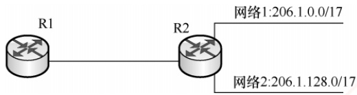

图4.8 路由聚合的例子

**考点追踪最长前缀匹配机制（2013、2015）**

最长前缀匹配（也称最佳匹配）:使用CIDR时，路由表项由“网络前缀”和“下一跳地址”组成。当查找路由表时，目的地址可能匹配多个路由项。此时，应选择网络前缀最长（前缀位数最多）的那条路由，因为前缀越长，对应的地址块越小，路由信息就越具体、越精确。

CIDR查找路由表的方法:为高效实现最长前缀匹配，路由器通常将CIDR路由表组织成层次式数据结构（如Trie树），通过自上而下的方式快速定位最优匹配项。

CIDR的主要优势在于网络前缀长度的灵活性:在网络外部，可通过较短前缀进行路由聚合，显著减少全局路由表项；在网络内部，可延长前缀以灵活划分子网，满足不同规模的需求。这种“外部聚合、内部细分”的机制，兼顾了路由可扩展性与地址分配的精细化控制。

#### 6．子网划分的应用举例

通常有两类划分子网的方法:采用定长子网掩码和变长子网掩码。

**（1）采用定长子网掩码划分子网**

当采用定长子网掩码时，所划分的每个子网使用相同的子网掩码，并且每个子网所分配的IP地址数量也相同，因此容易造成地址资源的浪费。

**考点追踪定长掩码子网划分的应用（2009、2010、2017、2018）**

假设某单位拥有一个CIDR地址块208.115.21.0/24，该单位有三个部门，各部门的主机数量分别为50、20、5台，采用定长子网掩码给各部门分配P地址。

各部门（含一个路由器接口）实际所需P地址数分别为51个、21个、6个。接下来，从/24地址块的主机号部分借用2位作为子网号，可划分为2²=4个子网，每个子网可用地址数为28-2 2=62，满足各部门需求。各子网划分如下（为书写方便，仅将IP地址的后8位用二进制展开）:

208.115.21.00000000\~208.115.21.00111111，地址块208.115.21.0/26，分配给部门1。

208.115.21.01000000\~208.115.21.01111111，地址块208.115.21.64/26，分配给部门2。

208.115.21.10000000\~208.115.21.10111111，地址块208.115.21.128/26，分配给部门3。

208.115.21.11000000\~208.115.21.11111111，地址块208.115.21.192/26，留作备用。

子网掩码:255.255.255.11000000，即255.255.255.192。

**（2）采用变长子网掩码划分子网**

考点追踪变长掩码子网划分的应用（2019、2021、2025）

采用变长子网掩码时，所划分的每个子网可使用不同的子网掩码，并且每个子网所分配的IP地址数量也可不同，从而更高效地利用地址资源，减少浪费。

假设条件与上一节相同，下面采用变长子网掩码给各部门分配IP地址。

部门1的主机号需6位，剩余26位（32-6=26）作为网络前缀；部门2的主机号需5位，剩余27位（32-5=27）作为网络前缀；部门3的主机号需3位，剩余29位（32-3=29）作为网络前缀。接下来，从地址块208.115.21.0/24中按需划分出3个子网（1个“/26”，1个“/27”，1个“/29”），分配给三个部门。每个子网的网络地址（最小地址）为主机号全0的地址。划分方案不唯一，建议从最大的子网开始划分（以避免地址碎片），例如:

$$
\left. \begin{array} {l} {\underbrace {208 . 115 . 21 . 00}_{} 000000} \\ {\cdots \cdots} \\ {\underbrace {208 . 115 . 21 . 00}_{} 111111} \\ {\underbrace {208 . 115 . 21 . 010}_{} 00000} \\ {\cdots \cdots} \\ {\underbrace {208 . 115 . 21 . 010}_{} 11111} \\ {\vdots} \\ \end{array} \right\}
$$

地址块208.115.21.0/26，子网掩码255.255.255.192

208.115.21.01100000 208.115.21.01100111 208.115.21.01101000 208.115.21.11111111可分配地址62个，分配给部门1。

地址块208.115.21.64/27，子网掩码255.255.255.224

可分配地址30个，分配给部门2。

地址块208.115.21.96/29，子网掩码255.255.255.248可分配地址6个，分配给部门3。

剩余256-64-32-8=152个地址，留作备用。

划分方案不唯一，还可借助二叉树模型（参考本节习题2021年统考真题解析图）辅助分配，但要确保各子网地址范围互不重叠，且起始地址对齐到其网络前缀对应的地址边界。

对于连接两个路由器接口的点对点链路，传统做法是分配一个“/30”地址块:主机号部分占2位，包含4个地址，可分配地址有2个，恰好可分配给链路两端的接口。

**注意**

根据最新标准①，为节省IP地址资源，这类链路的两端接口可不分配IP地址。若需分配，则该链路被视为仅含两个节点的特殊“网络”，此时应使用“/31”地址块:主机号部分仅1位，包含2个地址，无须保留网络地址和广播地址，2个地址均可直接分配给链路两端接口，实现IP地址的零浪费。

### 4.2.3 网络地址转换NAT

网络地址转换（Network Address Translation，NAT）是指将专用网络中的私有IP地址转换为公网IP地址，从而实现与互联网的通信，并对外隐藏内部网络的结构。它使得整个专用网通常只需一个全球IP地址即可与互联网连通；由于私有IP地址可在不同专用网络中重复使用，NAT有效地缓解了IP地址短缺的问题。此外，NAT还在一定程度上降低了内部网络受攻击的风险。

> ①参考谢希仁老师的《计算机网络（第8版）》教材，但近年的统考真题仍采用旧标准，请读者注意。

<table><tr><td colspan=2>NAT转换表</td></tr><tr><td>WAN端</td><td>LAN端</td></tr><tr><td>138.76.29.7, 5001…</td><td>10.0.0.1, 3345</td></tr></table>

考点追踪私有IP地址连网处理机制（2011）

IANA保留了三个私有IP地址块。这些地址仅用于LAN内部，不得直接用于WAN，若需访问互联网，则必须通过网关采用NAT技术，将私有地址映射为合法的公网IP地址。

这三个私有IP地址块如下:

1）10.0.0.0/8，即10.0.0.0～10.255.255.255，相当于1个A类网络。

2）172.16.0.0/12，即172.16.0.0～172.31.255.255，相当于16个连续的B类网络。

3）192.168.0.0/16，即192.168.0.0～192.168.255.255，相当于256个连续的C类网络。

互联网中的所有路由器对目的地址为私有地址的数据报一律不予转发。采用私有P地址组建的网络称为专用网络（或私有网络）。私有IP地址也称可重用地址。 xK

使用NAT时，需在专用网连接到互联网的路由器上安装NAT软件，该NAT路由器至少应拥有一个有效的全球IP地址。当使用私有IP地址的主机与外部通信时，NAT路由器通过NAT转换表实现私有IP地址与全球IP地址之间的映射。该表中保存{私有IP地址:端口}到{全球P地址:端口}的对应关系。借助该映射机制，多个私有P地址可共享同一个全球IP地址访问互联网。

考点追踪NAT的工作原理（2016、2019、2020、2023）

如图4.9所示，假设某家庭办理了一条10Mb/s的电信宽带，则会获得一个全球IP地址（如138.76.29.7）。家庭内部的3台主机使用私有地址（如10.0.0.0网段），此时家庭网关路由器需启用NAT功能。下面以主机访问外部Web服务器为例，介绍NAT路由器的工作原理。

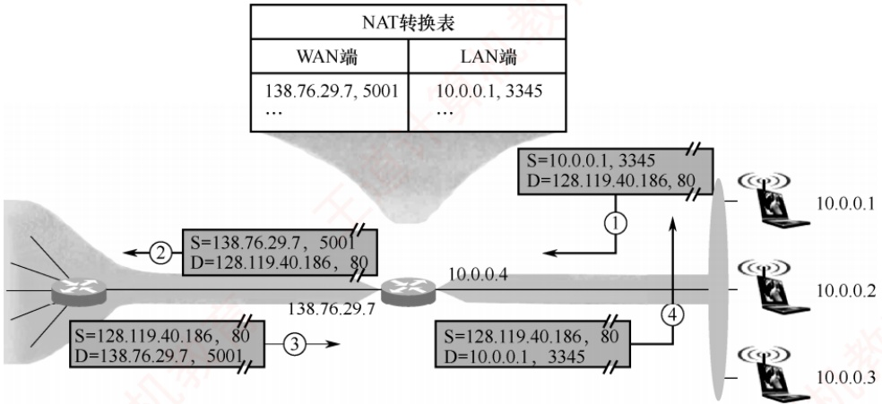

图 4.9 NAT 路由器的工作原理

1）假设主机10.0.0.1（源端口3345）向Web服务器128.119.40.186（端口80）发送请求。

2）NAT路由器收到IP分组后，将分组的源地址替换为自身的全球IP地址138.76.29.7，将源端口替换为新分配的端口5001，同时在NAT转换表中新增一条映射记录。

3）Web服务器并不知晓该分组的源地址已被路由器转换，也无法获知用户的私有地址，因此其响应分组的目的地址是路由器的全球IP地址138.76.29.7，目的端口是5001。

4）响应分组到达路由器后，路由器根据NAT转换表，将目的地址还原为10.0.0.1，目的端口还原为3345，再将分组转发给对应主机。

上述过程属于动态NAT，路由器在内网主机发起连接时自动创建映射关系，并在一段时间后自动清除。然而，在某些场景中，内网中的服务器需要向公网用户提供服务，例如部署在内网内的 Web服务器、FTP服务器等。此时，可由管理员在NAT转换表中手工配置{公网IP地址 +端口}到{内网IP地址+端口}的静态映射，使公网用户能够通过该映射访问内网服务器。

**注意**

普通路由器在转发IP分组时，不会改变其源IP地址和目的IP地址。而NAT路由器在转发IP分组时，会修改其源IP地址（出站）或目的IP地址（入站）。普通路由器仅工作在网络层，而NAT路由器在转发IP分组时，通常还需查看并转换传输层的端口号，因此其功能还涉及传输层。

### 4.2.4 网络层转发分组的过程

4.2.2节介绍过，主机发送数据时，会先将待发送分组的目的IP地址与本网络的子网掩码进行逐位与运算。若结果等于本网络的网络前缀，则执行直接交付，无须路由器参与。否则，必须将分组发送至默认网关，由路由器在网络层进行转发（间接交付）。由此可见，同一网络内的通信无须路由器参与，而跨网络通信必须依赖路由器转发。

分组的转发始终基于目的主机所在网络，这是因为互联网中的网络数量远小于主机数量，从而可以显著压缩转发表的规模。当分组到达路由器后，路由器根据目的IP地址的网络前缀查找转发表，确定下一跳应发往哪个路由器。因此，转发表中的每条路由至少包含以下两项信息:

（目的网络地址，下一跳地址)

借助这一机制，分组最终总能抵达目的主机所在网络的边缘路由器（可能需经过多次间接交付)，并在最后一跳由该路由器向目的主机执行直接交付。

采用CIDR编址时，若转发表中存在多个匹配的前缀，则应使用最长前缀匹配。为提高查找效率，可将转发表按前缀长度降序排列（前缀最长的条目排在最前）。这样，从第一行开始顺序查找，一旦找到匹配项，就可立即停止，无须继续查找。

此外，路由表中还可以包含两种特殊路由:

考点追踪特定主机路由的应用（2009）

1）特定主机路由:为某个特定目的主机的P地址单独设置一条路由，便于网络管理员进行控制和测试。若该主机的IP地址为a.b.c.d，则转发表中对应项的目的网络表示为a.b.c.d/32。尽管“/32”的子网掩码在子网划分中无实际意义，但在转发表中可作为标识单个主机的特殊前缀。

考点追踪默认路由的应用（2009、2014）

2）默认路由:用特殊前缀0.0.0.0/0表示，由于全0掩码与任何目的地址进行按位与运算的结果均为0.0.0.0，因此该前缀必然匹配所有未被其他路由项覆盖的目的地址。只要目的网络不在转发表中明确列出，就一律使用默认路由。默认路由常用于连接到互联网的路由，互联网包含海量网络，无法在转发表中一一列出，只能通过默认路由的方式。

匹配时，特定主机路由的优先级最高（因其前缀最长，为/32），默认路由的优先级最低（因其前缀最短，为/0）。

综上所述，路由器执行的分组转发算法如下:

1）从收到的IP分组的首部提取目的IP地址D（目的地址），从转发表第一项开始检查（按前缀长度降序排列）。 uKT

2）若存在特定主机路由（目的网络为D/32），则按其下一跳转发；否则从转发表中下一项开始检查，执行步骤3）。

3）将当前路由项的子网掩码与目的地址D进行逐位“与”运算。

若结果等于该路由项的网络前缀，则匹配成功，按“下一跳”处理（直接交付给本网络上的目的主机，或通过指定接口转发至下一跳路由器）。

否则，若转发表还有后续项，则继续检查下一项，重复步骤3)。

4）若遍历完所有路由项仍未匹配，但存在默认路由（0.0.0.0/0），则将分组发送至默认路由；否则，报告“目的不可达”错误。

需要说明的是，上述特定主机路由和默认路由的匹配过程，本质上已包含在步骤3）的匹配过程中；此处单独列出，是为了强调其优先级和典型应用场景。

此外，转发表（或路由表）不提供到目的网络的完整路径，仅指明“下一跳路由器”。分组每经过一个路由器，都会根据其转发表决定下一步去向，逐跳转发，直至抵达目的网络。

**注意**

从转发表得到下一跳路由器的IP地址后，并不会将该地址填入待转发分组的首部，而是通过ARP(见4.2.5节）解析出对应的MAC地址，填入链路层帧首部作为目的地址。随后，该帧通过数据链路层发送至下一跳路由器。路由器收到后，剥离帧首部，取出IP分组，再交给网络层处理。

### 4.2.5 地址解析协议（ARP）

#### 1．IP地址与硬件地址

IP地址是网络层及以上使用的分层式地址，而硬件地址（MAC地址）是数据链路层使用的平面式地址。IP地址置于IP数据报的首部，而MAC地址则置于MAC帧的首部。当IP数据报被封装为MAC帧后，数据链路层无法感知其中的IP地址。

由于路由器隔离了广播域，无法通过播MAC地址实现跨网络通信，因此网络层仅依赖IP地址进行寻址。每个路由器根据其路由表，选择通往目的网络的下一跳（通常为下一跳路由器的接口IP地址)。IP数据报经过多次路由转发抵达目的网络后，在局域网内通过ARP获取目的主机的MAC地址，将IP数据报封装为MAC帧并直接交付给目的主机。

以下几点体现了分层抽象的精髓，值得特别强调:

1）在IP层抽象的互联网上，只能看到IP数据报。

2）尽管IP数据报首部包含源IP地址，但路由器仅依据目的IP地址进行转发。

3）在局域网的链路层，只能看到MAC帧，IP数据报被封装其中；每当经过路由器转发时，都会被解封装并重新封装，MAC帧的源地址和目的地址都随之改变，这决定了MAC地址无法用于跨网络通信。

4）尽管底层网络的硬件地址体系各异，P层的抽象屏蔽了这些差异。只要在网络层讨论问题，就能使用统一的IP地址研究主机与主机、主机与路由器之间的通信。

**注意**

路由器因互连多个网络，每个接口都配置有一个IP地址和一个对应的MAC地址

#### 2．地址解析协议

考点追踪ARP的工作原理（2011、2012、2021）

无论网络层使用何种协议，在实际链路上传送数据帧时，最终都必须使用MAC地址。因此需要一种将 IP 地址映射到 MAC 地址的机制，这就是地址解析协议（Address Resolution Protocol，ARP）。每台主机和路由器都维护一个ARP高速缓存（ARP Cache），用于存放本局域网内各主机和路由器接口的IP地址与MAC地址的映射表，称为ARP表。ARP通过动态更新维护该表，并为每个表项设置生存时间（例如20分钟），超时的条目将被自动删除。

考点追踪ARP的解析过程（2011、2015）

ARP工作在网络层，其核心功能是解析同一个局域网内IP地址对应的MAC地址。以主机 A 向本局域网中的主机 B发送IP数据报为例:主机 A 首先在其ARP高速缓存中查找主机B的IP地址。若存在对应表项，则直接获取其MAC地址，填入MAC帧的目的地址字段，并发送该帧。若未找到，则自动发起ARP请求，按以下步骤获取主机B的MAC地址，如图4.10所示。

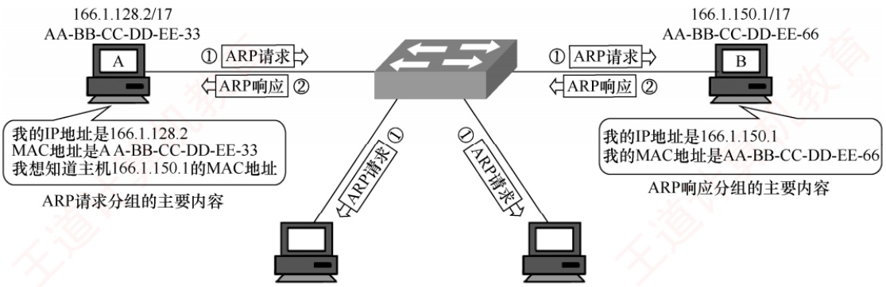

图 4.10 ARP 的工作原理

1）主机 A 构造 ARP请求分组，封装在目的 MAC 地址为 FF-FF-FF-FF-FF-FF的帧中并广播发送，本局域网内所有主机均会收到。请求内容为“我的IP地址是166.1.128.2，MAC 地址是 AA-BB-CC-DD-EE-33，我想知道 IP 地址为 166.1.150.1 的主机的 MAC地址”。

2）主机B收到广播帧后，发现请求解析的IP地址正是自己的地址，便向主机A单播发送ARP响应分组，其中包含自身的MAC地址。响应内容为“我的IP地址是166.1.150.1，MAC 地址是 AA-BB-CC-DD-EE-66”。同时，主机 B 将主机 A 的 IP 地址和 MAC 地址的映射写入自己的ARP缓存，以便后续通信。

3）主机 A 收到 ARP 响应分组后，将主机 B 的 IP地址和 MAC 地址的映射写入其ARP缓存，随后即可使用该MAC地址封装并发送数据帧。

之所以将ARP归为网络层协议，是因为它处理的是P地址。一般而言，可根据某协议是否使用或依赖某一层的地址或端口信息来判断其所属的协议层次。

注意

ARP仅作用于同一局域网（广播域），无法跨网络工作。

跨网通信时，ARP解析的是下一跳路由器接口的MAC地址，而非最终目的主机，

使用ARP的4种典型情况总结如下（见图4.11）。

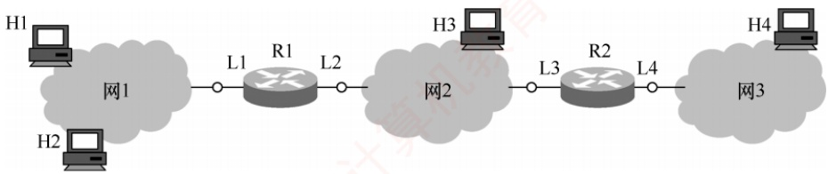

图 4.11 使用 ARP的 4 种典型情况

1）发送方是主机（如H1），要把IP分组发送到本网络上的另一台主机（如H2）。这时H1在网 1 上通过 ARP 解析出目的主机 H2 的 MAC 地址。

2）发送方是主机（如H1），要把IP分组发送到其他网络上的主机（如H4）。这时H1通过ARP找到本网络中默认网关（路由器R1的接口L1）的MAC地址，并将分组发给R1，后续工作由R1完成。

考点追踪跨局域网的ARP解析过程（2015）

**注意**

起初，H1 向 R1 发送数据时，MAC 帧首部的源/目的地址分别为 H1 和 L1 的 MAC 地址。R1 收到该帧后，在数据链路层将其解封装并重新封装，源/目的地址分别更新为L2和L3的MAC地址。随后，R2收到该帧，同样进行解封装与重新封装，源/目的地址再次更新为L4和H4的MAC地址。可见，IP分组每经过一个路由器，其外层MAC帧的源/目的地址都会更新为当前链路两端设备的接口MAC地址

3）发送方是路由器（如R1），要把IP分组转发到与其直连的网络（网2）上的主机（如H3）。这时 R1 在网 2 上通过 ARP 解析出 H3 的 MAC 地址。

4）发送方是路由器（如R1），要把IP分组转发到非直连网络（网3）上的主机（如H4）。这时R1在其出接口所在网络（网2）上，通过ARP找到下一跳路由器R2的接口L3的MAC 地址，并将分组发给 R2，后续工作由 R2完成。

整个ARP过程对用户完全透明。只要需要与本局域网内的设备通信，系统便会自动完成IP地址到MAC地址的解析，并封装成帧发送，用户无须也无法干预这一过程。

### 4.2.6 动态主机配置协议DHCP

动态主机配置协议（Dynamic Host Configuration Protocol，DHCP）常用于给主机动态地分配IP地址，它提供了即插即用的联网机制，这种机制允许一台计算机加入新的网络和自动获取IP地址，而不用手工参与。DHCP是应用层协议，它是基于UDP的。

**注意**

连接到互联网的计算机需要配置的项目包括:①IP地址，②子网掩码，③默认路由器的IP地址(默认网关)，④域名服务器的IP地址。

考点追踪DHCP发现报文的作用（2022）

DHCP使用客户/服务器模型。其工作原理是:需要IP地址的主机在启动时就向DHCP服务器广播发送发现报文，这时该主机就成为DHCP客户。本地网络上的所有主机都能收到这个广播报文，但只有DHCP服务器才能回答该广播报文。DHCP服务器先在其数据库中查找该计算机的配置信息。若找到，则返回找到的信息；若找不到，则从服务器的IP地址池中取一个地址分配给该主机。DHCP服务器的回答报文称为提供报文，包含提供的IP地址等配置信息。

**考点追踪DHCP报文的地址分析（2015、2022、2025）**

DHCP客户与DHCP服务器的交换过程如下:

1）DHCP客户广播“DHCPDiscover”发现报文，试图找到网络中的DHCP服务器，以便从DHCP服务器获得一个IP地址。此时，DHCP客户未分配IP地址，也不知道DHCP服务器的IP地址，因此源地址为0.0.0.0，目的地址为255.255.255.255。网络中的所有主机都能收到该广播报文，但只有DHCP服务器才对DHCP发现报文进行响应。

2）DHCP服务器收到“DHCP发现”报文后，广播“DHCP Offer”提供报文，其中包含提供给DHCP客户的IP地址等配置信息（还包括子网掩码、默认网关、DNS服务器、租用期等）。源地址为DHCP服务器地址，目的地址为255.255.255.255。网络中的DHCP服务器可能有多台，凡收到DHCP发现报文的DHCP服务器都要发出DHCP提供报文。

3）DHCP客户收到“DHCP提供”报文，若接受该IP地址，则广播“DHCPRequest”请求报文向DHCP服务器请求提供IP地址。源地址为0.0.0.0，目的地址为255.255.255.255。DHCP客户可能收到多个DHCP提供报文，只能从其中选择一个，因此仍用广播方式发送，以让未选中的DHCP服务器释放自己为该DHCP客户预留的IP地址等资源。

4）被选中的DHCP服务器广播“DHCPACK”确认报文，将IP地址分配给DHCP客户。源地址为DHCP服务器地址，目的地址为255.255.255.255。DHCP客户收到后配置生效。

DHCP服务器分配给DHCP客户的IP地址是临时的，DHCP客户只能在一段有限的时间内使用这个IP地址，这段时间被称为租用期，其数值应由DHCP服务器决定。

租用期过50%时，DHCP客户发送DHCP请求报文（源地址为客户当前的IP地址，目的地址是为其分配地址的DHCP服务器地址），请求更新租用期。若DHCP服务器同意，则发回DHCP确认报文（单播发送）；若DHCP服务器不同意，则发回DHCP否认报文（单播发送）。此时，DHCP客户必须停止使用当前的IP地址，然后重新申请。

租用期过 87.5%时，若 DHCP 服务器未响应上次的续租请求，则 DHCP 客户广播 DHCP请求报文（源地址为客户当前的IP地址，目的地址为255.255.255.255），以提高续租的成功率，若仍无响应，则在租用期到后，DHCP客户必须停止使用当前的IP地址，然后重新申请。

DHCP客户也可以随时提前终止租用期，只需向DHCP服务器发送DHCP释放报文（源地址为客户当前的IP地址，目的地址是为其分配地址的DHCP服务器地址）

DHCP之所以采用UDP而非TCP，是因为DHCP客户在初始阶段既无IP地址，又不知道DHCP服务器地址，无法建立TCP连接；而UDP无须连接，且支持广播，满足DHCP的通信需求。

### 4.2.7 网际控制报文协议ICMP

**考点追踪ICMP使用的下层协议（2012）**

为了更有效地转发IP数据报并提高交付成功率，网络层使用了网际控制报文协议（Internet Control Message Protocol，ICMP)，使主机或路由器能够向源点报告网络中的差错或异常情况。ICMP报文被封装在IP数据报中传送，但它不是高层协议，而是网络层协议。

ICMP报文分为两类:ICMP差错报告报文和ICMP询问报文。

**考点追踪ICMP差错报告报文的类型与语义（2022）**

ICMP差错报告报文用于目标主机或路径上的路由器向源主机报告差错。有5种常用类型:1）终点不可达。当路由器或主机无法交付数据报时，向源点发送终点不可达报文。

2）时间超过。路由器每转发一个数据报，就会将其首部的生存时间（TTL）减1；若TTL减为0，则丢弃该数据报，并向源点发送时间超过报文。此外，若目的主机在规定时间内未能收齐某个数据报的所有分片，则也会丢弃已收到的分片，并向源点发送时间超过报文。

3）参数问题。当路由器或目的主机发现数据报首部中某些字段的值不正确（注意并非任意字段）时，丢弃该数据报，并向源点发送参数问题报文。

4）改变路由（重定向）。路由器通过改变路由报文通知源点，下次应将数据报发送给另外的路由器（可通过更好的路由），使得路径更短。

5）源点抑制。当路由器或主机因拥塞而丢弃数据报时，通过此报文请求源点降低发送速率。为了避免无限循环或无意义反馈，以下几种情形不应发送ICMP差错报告报文:

1）对ICMP差错报告报文本身，不再发送ICMP差错报告报文。

2）对第一个数据报片之后的所有后续分片，不发送ICMP差错报告报文。

3）对目的地址为多播或广播地址的数据报，不发送ICMP差错报告报文。

4）对具有特殊地址（如127.0.0.0或0.0.0.0）的数据报，不发送ICMP差错报告报文。

常用的ICMP询问报文有两种类型:

1）回送请求和回答报文。用来测试目的主机是否可达，并获取其状态信息。

2）时间戳请求和回答报文。通过报文中记录的时间戳，发送方可估算当前的往返时延。

ICMP的两个典型应用是:分组网间探测PING，利用ICMP回送请求与回答报文，测试两台主机之间的连通性；路由跟踪Traceroute（UNIX）/Tracert（Windows），通过逐步增大TTL值，触发沿途路由器返回ICMP时间超过报文，从而追踪分组经过的路由路径。

## 4.3 IPv6

### 4.3.1 IPv6的特点

目前广泛使用的IPv4是在20世纪70年代设计的，互联网经过几十年的飞速发展，到2011年2月，IPv4地址已经耗尽，为解决“IP地址耗尽”问题，采取了以下三种措施。

1）无类别编址CIDR:使IP地址分配更加合理。

2）网络地址转换（NAT）:节省全球唯一的公网IP地址。

3) $\mathrm {IPv 6} \colon$ 采用更大地址空间的新版本IP协议。

前两种方法只是延缓了IPv4使用寿命，只有第三种方法能从根本上解决IP地址耗尽问题。考点追踪IPv6的特点（2023）

IPv6的主要特点如下:

1）更大的地址空间。这是最重要的。IPv6将地址长度从IPv4的32位增大到128位，地址空间是IPv4 的 $2^{128} / 2^{32} = 2^{96}$ 倍。从长远来看，这些地址是绝对够用的。

2）扩展的地址层次结构。由于IPv6地址空间很大，因此可以划分出更多的层次。

3）灵活的首部格式。IPv6定义了许多可选的扩展首部，不仅可提供比IPv4更多的功能，还能提高路由器的处理效率，这是因为路由器通常不对扩展首部进行处理。

4）改进的选项。IPv6首部长度是固定的，其选项放在有效载荷中，可根据需要灵活配置。而IPv4预先定义好了一套标准的选项，其选项放在首部的可变部分。

5）允许协议继续扩充。IPv6允许不断扩充功能，而IPv4的功能是固定不变的。

6）支持即插即用（自动配置IPv6地址）。因此通常不需要使用DHCP，简化了网络管理。

7）支持资源的预分配。IPv6支持实时音频/视频等要求保证一定带宽和时延的应用。

8）IPv6只有源主机才能分片，只支持端到端的分片，不允许中间路由器进行分片。

9）IPv6首部长度是固定的40B，而IPv4的首部长度是可变的（必须是4B的整数倍）。

10）增大了安全性。身份鉴别和保密功能由IPv6的扩展首部提供。

虽然IPv6与 IPv4 不兼容，但它与所有其他互联网协议（如 TCP、UDP、ICMP、IGMP和DNS等）总体上是兼容的，仅在少数地方做了必要的修改，主要是为了处理更长的地址。

### 4.3.2 IPv6数据报的基本首部

IPv6数据报由两部分组成:基本首部和有效载荷（也称净负荷）。有效载荷由零个或多个扩展首部（扩展首部不属于基本首部）及其后面的数据部分构成，如图4.12所示。

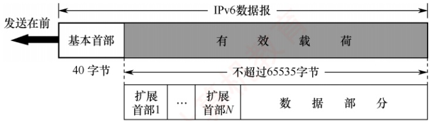

图4.12 具有多个可选扩展首部的IPv6数据报的一般形式

与IPv4相比，IPv6对首部中的某些字段进行了如下调整:

● 取消了首部长度字段，因为基本首部长度固定为40B。

取消了服务类型字段，其功能由优先级和流标号字段实现。

取消了总长度字段，改用有效载荷长度字段。

取消了标识、标志和片偏移字段，相关功能已移至分片扩展首部。

● 把TTL字段更名为跳数限制字段，作用不变，但名称更贴合实际含义。

● 取消了协议字段，改用下一个首部字段。

取消了首部检验和字段，因传输层已提供差错检测，此举可加快路由器处理速度。

● 取消了选项字段，其功能由灵活的扩展首部实现。

尽管取消了IPv4首部中多项冗余功能，使IPv6基本首部的字段数减少至仅8个，但由于地址长度从32位扩展到128位，其基本首部长度反而增至40B。

IPv6数据报的基本首部格式如图4.13所示。

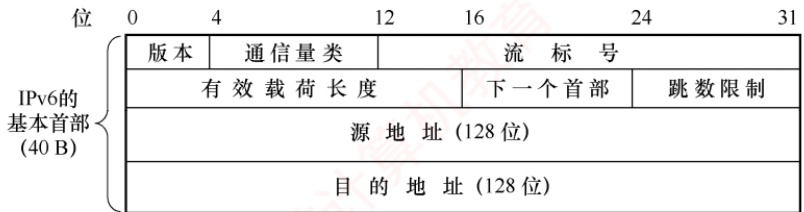

图4.13 IPv6数据报的基本首部的格式

**考点追踪IPv6首部格式及字段含义（2023）**

下面简要介绍IPv6基本首部中各字段的含义:

1）版本。占4位，指明IP协议的版本。对于IPv6，该字段的值为6。

2）通信量类。占8位，用于区分不同IPv6数据报的类别或优先级。

3）流标号。占20位，IPv6提出了流的抽象概念。流是指互联网上从特定源点到特定终点（单播或多播）的一系列数据报（如实时音频/视频传输），路径上的路由器可据此提供特定的服务质量保证。所有属于同一个流的数据报都具有相同的流标号。

4）有效载荷长度。占16位，表示IPv6数据报中基本首部之后的字节数，包括所有扩展首部和上层数据。最大值为65535（单位为字节）。 xK

5）下一个首部。占8位，功能类似于IPv4的协议字段。若无扩展首部，则标识上层协议类型；若存在扩展首部，则标识紧随其后的第一个扩展首部的类型。

6）跳数限制。占8位，作用等同于IPv4的TTL字段。源主机在发送数据报时设定初始值（最大为255），每经过一个路由器，其值减1，减至0时丢弃该数据报。

7）源地址和目的地址。占128位，分别表示数据报的发送方/接收方的IPv6地址。

### 4.3.3 IPv6地址

IPv6数据报的目的地址有以下三种基本类型:

1）单播。即传统的点对点通信，数据报发送给唯一指定的接收方。

2）多播。一点对多点的通信，数据报发送给所有加入该多播组的接口。

3）任播。是IPv6新增的一种地址类型，其特点可概括为“一址多用、就近交付”。任播地址标识一组接口，但网络会将数据报仅交付给其中路由距离最近的一个。

IPv4地址通常采用点分十进制表示法。若IPv6也沿用此方式，其128位地址将显得冗长。因此，IPv6标准采用冒号十六进制记法:将地址划分为8组，每组16位（4个十六进制数），各组之间用冒号分隔。例如，4BF5:AA12:0216:FEBC:BA5F:039A:BE9A:2170。

为了书写简便，还规定了如下两种缩写规则。

省略前导零。每组中前面连续的十六进制零可以省略，但至少要保留一个数字。例如，可以把地址4BF5:0000:0000:0000:BA5F:039A:000A:2176 缩写为4BF5:0:0:0:BA5F:39A:A:2176。

双冒号替换连续全零组。当地址中出现一个或多个连续的全零组时，可用双冒号（）替代。但“:”在一个地址中只能使用一次，否则无法确定省略了多少个全零组（因总组数需恢复为8）。因此，上述地址可被更紧凑地缩写为4BF5::BA5F:39A:A:2176。

IPv6地址的分类如表4.3所示。

表 4.3 IPv6 地址的分类

<table><tr><td>地址类型</td><td>二进制前缀</td><td>CIDR 记法</td></tr><tr><td>未指明地址</td><td>00...0(128 位)</td><td>::/128</td></tr><tr><td>环回地址</td><td>00...01 (128 位)</td><td>::1/128</td></tr><tr><td>多播地址</td><td>11111111(8位)</td><td>FF00::/8</td></tr><tr><td>本地链路单播地址</td><td>1111111010 (10 位)</td><td>FE80::/10</td></tr><tr><td>全球单播地址</td><td colspan=2>见图4.14</td></tr></table>

对表4.3给出的五类地址简单解释如下:

1）未指明地址:不能用作目的地址，仅用于尚未配置IPv6地址的主机作为源地址。

2）环回地址:作用与IPv4的环回地址相同，但IPv6中仅定义这一个环回地址。

3）多播地址:作用与IPv4多播类似。这类地址占IPv6地址空间的1/256。

4）本地链路单播地址:仅用于本地链路内的通信，不能被路由器转发。

5）全球单播地址:使用得最多的地址。IPv6单播地址的划分方法非常灵活，如图4.14所示。可以把整个128位都作为一个节点的地址。也可用n位作为子网前缀，剩下的(128-n)位作为接口标识符（相当于IPv4的主机号）。还可以划分为三级:用n位作为全球路由选择前缀，用m位作为子网前缀，而剩下的128-n-m位则作为接口标识符。

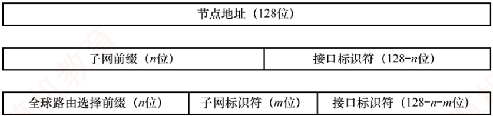

图4.14 IPv6 全球单播地址的几种划分方法

### 4.3.4 从IPv4向IPv6过渡

IPv4向 IPv6的过渡只能采用逐步演进的办法，并确保新部署的IPv6系统具备向后兼容的能力:能够接收、转发IPv4数据报，并为其选择路由。

考点追踪IPv4向IPv6过渡的策略（2023）

目前主要采用以下两种过渡策略:

1）双协议栈，是指在一台主机上同时安装IPv4和IPv6两个协议栈，分别配置一个IPv4地址和一个IPv6 地址，因此既能与IPv4 网络通信，也能与IPv6 网络通信。双协议栈主机通过应用层的域名系统（DNS）获知目的主机使用的地址类型:若DNS返回的是IPv4地址，则使用IPv4；若返回的是IPv6 地址，则使用IPv6。

2）隧道技术，是指当IPv6数据报需要进入IPv4网络时，将其整个封装为IPv4数据报的数据部分，使原IPv6数据报如同在IPv4网络的隧道中传输；当该IPv4数据报离开IPv4网络后，再将其数据部分交由主机的IPv6协议处理。

## 4.4 路由算法与路由协议

### 4.4.1 路由算法

路由选择协议的核心是路由算法，即用于生成路由表中各项条目的计算方法。其目的很明确:给定一组路由器及其互连链路，路由算法要找到一条从源路由器到目的路由器的最佳路径。通常，“最佳”路径是指费用最低的路径，该费用可根据跳数、带宽、延迟等因素定义。

#### 1．静态路由与动态路由

路由器转发分组是通过路由表进行的，而路由表是通过各种算法生成的。从能否随网络状态自适应调整的角度，路由算法可分为如下两大类。

1）静态路由算法。由网络管理员手工配置每一条路由。

2）动态路由算法。根据网络状态的变化（如链路故障或新增）来动态调整自身的路由表。

静态路由算法的特点是实现简单、开销小，但不能及时适应网络状态的变化，适用于简单的小型网络。动态路由算法能较好地适应网络状态的变化，但实现复杂、开销也大，适用于较复杂的大型网络。常用的动态路由算法可分为两类:距离-向量算法和链路状态算法。

#### 2．距离-向量算法

距离-向量（Distance-Vector，DV）算法基于Bellman-Ford算法，它不要求每个节点掌握完整的网络拓扑，而只需知道:与相邻节点之间的距离；各邻居节点到目的节点的最短距离。每个节点以自身为源点，独立运行Bellman-Ford算法，通过迭代交换信息，最终可收敛到全网一致的最短路径解。下面讨论Bellman-Ford算法的基本思想。

假设 $d_{x}(y)$ 表示从节点x到节点 $y$ 的最短路径费用，则有

$$
d_{x}(y) = \min \left\{c(x,y) + d_{v}(y) \right\}, \quad y  是  x  的所有邻居
$$

式中， $c(x,v)$ 是从x到其邻居ν的链路费用。已知x的所有邻居到y的最短路径费用后，x到y的最短路径费用即为所有 $c ( x , y ) + d_{y} ( y )$ 中的最小值，如图4.15所示。所有最短路径算法都依赖于一个基本性质:“两点之间的最短路径，必然包含路径上任意子路径的最短路径”。

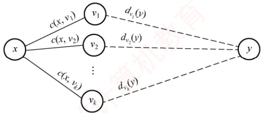

图 4.15 Bellman-Ford 算法的基本思想

在距离-向量算法中，每个节点x维护以下路由信息:

1）从 x到每个直接相连邻居ν的链路费用 c(x, v)。

2）节点x的距离向量，即x到网络中其他节点的费用。这是一组距离，因此称为距离向量。3）从每个邻居接收到的距离向量副本，即x的各邻居到所有其他节点的费用。

算法运行时，每个节点定期向所有邻居发送自己的距离向量。当节点x从邻居ν接收到新的距离向量后，会更新本地保存的ν的距离向量副本，并利用上述公式重新计算自身的距离向量。若计算结果导致自身的距离向量发生变化，则立即向所有邻居发送更新后的距离向量。

下面以图4.16顶部所示的三节点简单网络为例，说明距离-向量算法的实现过程。

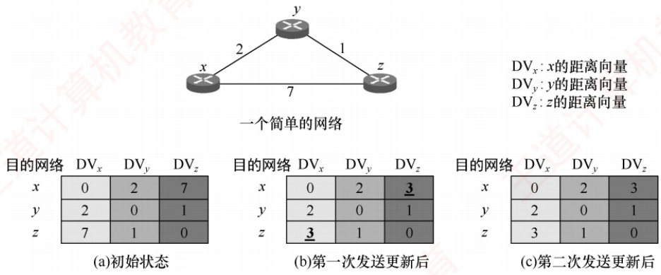

图4.16 距离-向量算法实现的举例

**考点追踪距离-向量算法的实现原理（2021）**

图4.16(a)中的各列依次是三个节点的初始化距离向量，此时各节点之间尚未交换过任何路由信息，因此每个节点的距离向量仅包含到每个直连邻居的链路费用。

初始化完成后，各节点首次向邻居发送自己的距离向量。收到更新后，每个节点重新计算自己的距离向量。例如，节点x计算的过程为: $d_{x}(x)=0;\;d_{x}(y)=\min\{c(x,y)+d_{y}(y),c(x,z)+d_{z}(y)\}=\min\{2+$ $0,7+1\}=2;d_{s}(z)=\min\{c(x,y)+d_{s}(z),c(x,z)+d_{s}(z)\}=\min\{2+1,7+0\}=3,$ ，可见，x到 z的最低费用由7变成了3，z到x的最低费用也由7变成了3，如图4.16(b)所示。由于距离向量发生变化，x和z要再次向邻居发送更新报文，而未变化的ν则无须发送。这一轮交换后，各节点又重新计算，发现距离向量不再变化，算法收敛并进入静止状态，如图4.16(c)所示。

显然，更新报文的大小与网络节点数成正比，大型网络中可能产生较大的通信开销。

最常见的距离-向量路由协议是RIP，它采用跳数作为路径费用的度量标准。

#### 3．链路状态算法

链路状态（Link State，LS）指的是:本路由器与哪些邻居相连，以及对应链路的代价。链路状态算法要求每个节点都掌握完整的全网拓扑结构图。为此，每个节点执行以下两项任务:

主动探测所有相邻节点的状态；

● 定期将自身的链路状态信息，通过洪泛法传播给全网所有节点。

因此，每个节点都知道全网拓扑、连接关系及各链路代价，并可基于此使用Dijkstra最短路径算法，独立计算到其他所有节点的最短路径；每当收到链路状态报文时，节点会更新本地的拓扑视图，并在链路状态发生变化时，立即重新运行Dijkstra算法以更新最短路径。

链路状态算法的主要优点是:①所有节点基于相同的链路状态数据库独立计算最优路径，不依赖邻居的路由决策，避免了距离-向量算法中的无穷计数等问题；②每个节点获得完整拓扑后，可本地计算全局最优路径，收敛过程通常较快且无环；③链路状态报文仅包含本节点的直连链路信息，单个报文大小与网络总规模无关，因此在大型网络中具有更好的可扩展性。

两种路由算法的比较:①在距离-向量算法中，每个节点仅与直接邻居交换信息，发送的是完整的距离向量（大小与节点数成正比），通信开销较大；②在链路状态算法中，每个节点通过洪泛方式向全网广播自身直连链路的状态，但每条报文仅包含局部信息，总体扩展性更好。

典型的链路状态算法是 OSPF 算法。

### 4.4.2 分层次的路由选择协议

互联网采用的是自适应的分布式路由选择协议。由于互联网规模非常庞大，且许多联网单位不愿对外暴露其内部网络细节，因此采用了分层次的路由选择协议。

为此，整个互联网被划分为多个较小的自治系统（Autonomous System，AS）。每个自治系统在对外通信时，表现为一个单一且一致的路由选择策略。自治系统的管理者有权自主决定在其内部使用何种路由选择协议（如RIP或OSPF）

基于此，互联网的路由选择协议被划分为两大类。

#### 1．内部网关协议（Interior Gateway Protocol，IGP）

内部网关协议用于自治系统内部的路由选择，与其他自治系统所采用的协议无关。目前这类路由选择协议使用得最多，如RIP和OSPF。

#### 2．外部网关协议（External Gateway Protocol，EGP）

当源主机和目的主机位于不同的自治系统中（这两个自治系统可能使用不同的IGP），数据报在到达某一自治系统边界时，就需要借助一种协议将路由信息传递到另一个自治系统。这类协议称为外部网关协议。当前广泛使用的外部网关协议是BGP-4。

自治系统之间的路由选择也称域间路由选择，自治系统内部的路由选择也称域内路由选择。

图4.17是两个自治系统互连的示意图。每个自治系统可以自行选择内部使用的网关协议（如RIP或OSPF）。但每个自治系统都至少有一个或多个边界路由器（图中的R1和R2），这些路由器除运行本系统的内部网关协议外，还需运行外部网关协议（如BGP-4）。

图4.17 两个自治系统互连的示意图

### 4.4.3 路由信息协议

路由信息协议（RoutingInformation Protocol，RIP）是内部网关协议（IGP）中最早得到广泛应用的协议之一。RIP是一种分布式的、基于距离向量的路由选择协议。

#### 1．RIP的规定

1）RIP使用跳数（HopCount，也称距离）来衡量到达目的网络的远近。规定从一个路由器到其直连网络的距离为1；每经过一个路由器，跳数加1。

2）RIP认为“好”的路由就是所经路由器数量最少的路径，即跳数最少。

**考点追踪RIP中跳数为16的含义（2010）**

3）RIP规定一条路径最多包含15个路由器，因此跳数为16表示目的网络不可达。由此可见，RIP仅适用于小型自治系统。

4）每个路由表项包含三个关键字段:<目的网络N，距离d，下一跳路由器地址X>，其含义是“我通过下一跳路由器X到达目的网络N的距离为 $d^{\pmb {\mathscr {P}}}$

5）网络中的每个路由器都需维护一个距离向量，即其到所有目的网络的距离记录。

#### 2．RIP的特点

RIP要求每个路由器持续与其他路由器交换信息，其工作特点主要体现在以下三个方面。

1）和谁交换信息:仅和直接相邻的路由器交换信息。

2）交换什么信息:交换的是本路由器当前的完整路由表，即全部路由信息。

3）何时交换信息:按固定的时间间隔（默认为30秒）交换路由信息，路由器据此更新自己的路由表。当网络拓扑发生变化时，路由器也及时向相邻路由器通告最新路由信息。

路由器刚开始工作时，它的路由器表是空的。然后，路由器得知到几个直连网络的距离为1。接着，它周期性地与邻居交换并更新路由信息。经过若干轮的交换和更新后，所有路由器最终都会获知到达本自治系统内任意网络的最少跳数和对应的下一跳地址，这一过程称为收敛。

**考点追踪RIP使用的下层协议（2017）**

RIP是应用层协议，它使用 UDP传送数据（端口 520）。需要注意的是，RIP选择的路径不定是时延最短，但一定是跳数最少的路径，因为它仅依据跳数进行路径选择。

#### 3．RIP的基本工作原理

对于每个相邻路由器发来的RIP报文，执行以下步骤:

1）对来自地址为X的相邻路由器的RIP报文，首先修改其中所有项目:将所有“下一跳”字段都置为X，并将所有“距离”字段的值加1。

2）对修改后的每个项目，按如下规则处理:

IF(若原路由表中没有目的网络 N)

则将该项目加入路由表（表示发现新网络）。

ELSEIF(若原路由表中已有目的网络N，且原下一跳地址是X)

用新收到的项目替换原表项（要以最新的消息为准）。

ELSEIF(若原路由表中已有目的网络N，但原下一跳地址不是X)

若新收到的项目中的距离d小于当前记录的距离，则替换原表项(表示找到更优路径)。ELSE什么也不做。

3）若连续180秒（RIP默认超时时间）未收到某相邻路由器的更新报文，则将其标记为不可达，即将对应路由项的距离置为16（表示不可达）。

4）处理完毕，返回。

考点追踪RIP路由收敛机制（2024）

下面举例说明RIP路由表项的更新过程。已知路由器R6和R4互为相邻路由器，表4.4(a)所示为R6的路由表。现在收到相邻路由器R4发来的路由表，如表4.4(b)所示。

表 4.4(a) R6 的路由表

| 目的网络 | 距离 | 下一跳路由器 |
| --- | --- | --- |
| Net2 | 3 | R4 |
| Net3 | 4 | R5 X |
| … | … | … |

表 4.4(b) R4 发来的路由表

| 目的网络 | 距离 | 下一跳路由器 |
| --- | --- | --- |
| Net1 | 3 | R1 |
| Net2 | 4 | R2 |
| Net3 | 1 | 直接交付 |

现对R6的路由表进行更新。先把R4发来的路由表[表4.4(b)]中各项的距离都加1，并把下一跳路由器都改为 R4，得到表 4.5(a)。这么做的意义是:R4 是 R6 的相邻路由器，R6 可通过R4到达这些网络，但距离比R4到达这些网络的距离大1。将该表与R6的原路由表逐项比较。

表 4.5(a) 修改 R4 发来的路由表

| 目的网络 | 距离 | 下一跳路由器 |
| --- | --- | --- |
| Net1 | 4 | R4 |
| Net2 | 5 | R4 |
| Net3 | 2 | R4 |

表 4.5(b) 更新后 R6 的路由表

| 目的网络 | 距离 | 下一跳路由器 |
| --- | --- | --- |
| Net1 | 4 | R4 |
| Net2 | 5 | R4 |
| Net3 | 2 | R4 |
| …… | … | … |

第一行的 Net1 在表4.4(a)中没有。这表明:R6 此前没有到达Net1的路由，现在知道可通过R4 到达Net1。因此，要把这条Net1 的路由表项添加到 R6 的路由表中。

第二行的Net2在表4.4(a)中已有，且下一跳路由器也是R4。这表明:R6到达Net2的最佳路由仍然是通过R4，但距离发生了变化（通常由网络拓扑变化引起）。因此，要更新目的网络Net2的路由表项（无论距离是变大还是变小，都需要更新）。

第三行的Net3在表4.4(a)中已有，但下一跳路由器不同。此时比较距离，新路由信息的距离为2，小于原表中的4。这表明:R6 通过R4 到达Net3的路径比原来经由 R5的更短，因此应更新Net3的路由表项（新路由的距离更大时，不更新）。

更新后的R6的路由表如表4.5(b)所示。

#### 4．RIP的优缺点

考点追踪RIP的优缺点（2024）

RIP的优点:

1）实现简单、开销小、收敛过程较快。

2）若一个路由器发现更短的路由，该更新信息会迅速传播，在较短时间内即可传至所有路由器，俗称“好消息传播得快”。

RIP的缺点:

1）RIP限制了网络的规模，其最大有效距离为15（距离16表示不可达）。

2）路由器之间交换的是完整的路由表，因此网络规模越大，通信开销也越大。

3）当网络出现故障时，路由器需反复多次交换信息才能完成收敛，故障信息传递缓慢，导致慢收敛现象，俗称“坏消息传播得慢”。

下面举例说明RIP“好消息传播得快，坏消息传播得慢”的特点。假设图4.18中的路由器均采用 RIP 交换路由信息，初始时 R1 到网络N的距离为4，且 R1和 R2 均已收敛。为简化讨论，此处仅考虑到达网络N的路由条目:R1 中为&lt;N,4, 直接&gt;，R2中为&lt;N,5,R1&gt;。

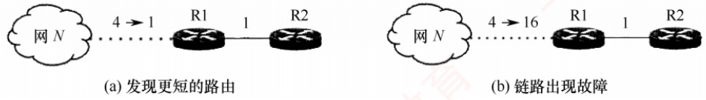

图 4.18 RIP 举例:链路开销改变

在图4.18(a)中，某时刻，R1检测到一条“到Ⅳ更短的链路”（距离由4变为1），于是将到N的距离更新为1，并通知R2（即便R1先收到R2发来的更新报文，也不会修改自身到N的路由）。R2收到后，将到N的距离更新为2，并通知R1；R1收到后，不再修改自己的路由，算法进入静止状态。可见，R2到N的距离减少的好消息通过RIP得到了迅速传播。

考点追踪RIP“坏消息传播得慢”的分析（2016）

在图4.18(b)中，某时刻，R1检测到“N不可达”（距离由4变为16)，于是将到N的距离置为16，但可能需等到下一次周期性更新（默认30s）才会通知R2。而在此期间，R2可能已先将自己的更新报文发给了R1，其中包含&lt;N,5,R1&gt;。R1收到后，误认为可通过R2到达N，于是将路由信息更新为&lt;N, 6, R2&gt;。随后 R1 通知 R2，R2 又据此将路由信息更新为&lt;N, 7, R1&gt;，误认为可通过R1到达N……如此往复，直到两者最终都将距离增至16，才知道原来N是不可达的。可见，RIP对链路故障或距离增加这类“坏消息”的传播非常缓慢。若无跳数上限（15）的限制，路由器将无限循环转发无效路由信息，因此“坏消息传播得慢”也称无穷计数问题。

### 4.4.4 开放最短路径优先协议

虽然名称中含有“最短路径优先”，但这并不意味着其他路由协议不采用最短路径原则。实际上，自治系统内使用的所有路由协议都旨在寻找一条最短路径，只是最短的度量标准不同。

#### 1．开放最短路径优先（OSPF）的基本特点

考点追踪OSPF与RIP特性对比（2024）

OSPF协议是分布式链路状态算法的典型代表，它采用了Dijkstra提出的最短路径算法。与RIP相比，OSPF具有以下四个主要特点:

1）OSPF使用洪泛法向本自治系统中所有路由器发送信息:路由器通过所有输出端口向相邻路由器发送信息，每个相邻路由器再将该信息转发给其所有邻居（但不再回传给刚刚发送信息的路由器)。最终，整个区域内的所有路由器都会收到该信息的一个副本。而RIP仅向直接相邻的几个路由器发送信息。

2）OSPF发送的信息是本路由器与其相邻路由器之间的链路状态（局部拓扑信息），而非全局路由表。而RIP发送的是本路由器所知的全部路由信息（完整的路由表）。

3）OSPF仅在链路状态发生变化时才触发洪泛更新，收敛速度快，不会出现RIP中“坏消息传得慢”的问题。而RIP不论网络拓扑是否变化，都需定期交换路由信息。

**考点追踪OSPF使用的下层协议（2017）**

4）OSPF是网络层协议，不使用UDP或TCP，而是直接封装在IP数据报中（IP首部的协议字段为89）。而RIP是应用层协议，使用UDP传输（端口520）。

**注意**

“用UDP传送”是指将协议数据作为UDP报文的数据部分；“直接使用IP数据报传送”则是指将协议数据直接作为IP数据报的数据部分。RIP报文属于前者。

除上述区别外，OSPF还具有以下优势:

1）OSPF支持对每条路由设置不同的代价，可针对不同业务类型计算差异化路径。

2）存在多条到同一目的网络且代价相同的路径时，可实现负载分担（或称负载均衡）。

3）OSPF分组具备鉴别功能，确保仅在可信路由器之间交换链路状态信息。

4）OSPF支持可变长子网掩码和无分类编址。

5）每条链路状态通告均携带一个32位序号，序号越大，表示状态越新。

由于各路由器频繁交换链路状态信息，最终所有路由器都能构建出一致的链路状态数据库（LSDB）。随后，每个路由器基于LSDB，利用 Dijkstra算法计算到达各目的网络的最优路径，并生成自己的路由表。当链路状态发生变化时，路由器会重新计算并更新路由表。

**注意**

尽管Dijkstra算法能计算完整的最优路径，但路由表中不会存储完整路径，而仅存储“下一跳”，只有到了下一跳后，才能确定再下一跳应当怎样走。

为支持大规模网络，OSPF将一个自治系统划分为若干更小的区域（Area）。划分区域的好处是:将洪泛法交换链路状态信息的范围限制在各区域内，而非整个AS，从而显著减少网络通信开销。每个区域由一个或多个区域边界路由器负责为进出该区域的分组提供路由。AS 内必须有一个区域配置成主干区域，它包含AS内的所有区域边界路由器（可能还包含部分非边界路由器），用于连通其他区域。当分组需在不同区域之间传送时，其转发路径为:源区域→本地区域边界路由器→主于区域→目的区域边界路由器→目的地。在图4.19中，R3、R4和R7均为区域边界路由器，每个区域至少包含一个区域边界路由器。此外，主于区域中还需指定一个自治系统边界路由器（如R6），专门负责与本AS外的其他AS交换路由信息。

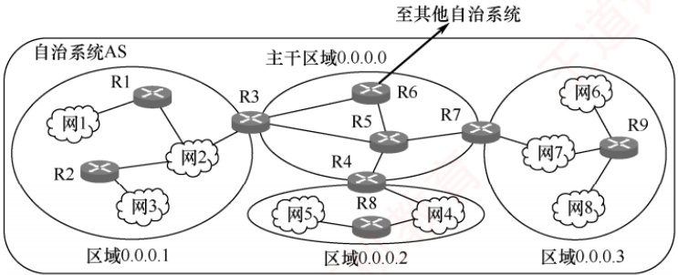

图 4.19 OSPF 划分区域举例

#### 2．OSPF的五种分组类型

OSPF定义了以下五种分组类型:

1）问候（Hello）分组，用来发现邻居并维持邻接关系，确认链路双向连通性。

2）数据库描述（Database Description，DD)分组，向邻居发送自己的链路状态数据库（LSDB）中的所有链路状态项目的摘要信息。 烟

3）链路状态请求（Link-State Request，LSR）分组，向邻居请求发送某些链路状态项目的详细信息。X

4）链路状态更新（Link-StateUpdate，LSU）分组，通过洪泛法向全网发送链路状态通告（LSA），它是OSPF最核心的部分。路由器使用这种分组将其链路状态通知给邻居。

5）链路状态确认（Link-State Acknowledgment，LSAck）分组，对链路更新分组的确认。这五种分组共同支撑了OSPF的邻居发现、数据库同步、拓扑更新、可靠确认的全过程。

#### 3．OSPF的基本工作原理

(1）邻居发现与可达性维护

OSPF规定，相邻路由器之间需每隔10s周期性地交换问候分组，以确认邻接关系并维持彼此的可达性。若某路由器在40s内未收到邻居的问候分组，则判定该邻居已不可达，并立即触发链路状态数据库（LSDB）的更新，随后重新运行Dijkstra算法以生成新的路由表。

通常，网络中传送的大多数OSPF分组都是问候分组。

**（2）链路状态数据库的初始同步**

路由器刚启动时，仅能通过问候分组发现其直连邻居，并获知本地链路的基本信息（如接口状态和链路开销)。然而，要构建完整的LSDB，若采用全网广播所有路由器的完整链路状态信息，则会带来巨大的通信开销。为此，OSPF采用了一种高效且可靠的同步机制。

首先，相邻路由器通过数据库描述分组交换各自LSDB中链路状态通告（LSA）的摘要信息；随后，路由器根据摘要对比，使用链路状态请求分组向邻居请求自身缺失或过期的LSA详细内容；对方则通过链路状态更新分组发送所请求的LSA，接收方成功接收后需返回链路状态确认分组以确保可靠传输。通过这一系列交互，相邻路由器最终实现LSDB的完全同步。

**（3）链路状态变更的实时传播**

在网络运行过程中，一旦路由器检测到自己的链路状态发生变化（如接口故障或邻居失效等），就会立即生成新的LSA，并通过链路状态更新分组以可靠的泛洪方式向整个区域传播。其他路由器收到后，同样必须返回确认，随后更新自己的LSDB，重新运行Dijkstra算法计算路由。

**(4）链路状态通告的定期更新**

每条LSA的最大生存时间为60分钟，为防止LSA丢失或异常，最初生成该LSA的路由器需定期（通常是每隔30分钟）刷新该LSA，从而确保LSDB与实际网络拓扑始终保持一致。

由于每个路由器的链路状态信息仅描述其与直连邻居的连接关系及链路代价，与全网规模无直接关联。因此，当网络规模很大时，OSPF要显著优于基于跳数且收敛缓慢的RIP。

### 4.4.5 边界网关协议

#### 1．BGP的基本特点

考点追踪BGP的功能（2013）

边界网关协议（Border Gateway Protocol，BGP）是不同自治系统的路由器之间交换路由信息的协议，是一种外部网关协议。BGP常用于互联网的AS之间。而RIP和OSPF都只能在一个AS内工作；若没有BGP，则全世界数以万计的AS都将是一个个彼此孤立的“孤岛”。

内部网关协议主要是设法使分组在一个AS内尽可能有效地从源站传送到目的站。在一个AS内部通常不需要考虑其他方面的策略。然而BGP使用的环境却不同，主要原因如下:

1）互联网的规模太大，使得AS之间的路由选择非常困难，每个主干网路由器表中的项目数都非常庞大。对于AS之间的路由选择，要寻找最佳路由是很不现实的。

2）AS之间的路由选择必须考虑政治、安全或经济等有关因素。

考点追踪BGP使用的下层协议（2013、2017）

因此，BGP只能力求寻找一条能够到达目的网络且比较好的路由（不能兜圈子），而并非要寻找一条最佳路由。BGP采用了路径向量路由选择协议，它与距离向量协议（如RIP）和链路状态协议（如OSPF）都有很大的区别。BGP是应用层协议，基于TCP实现。

#### 2．BGP路由

BGP路由的一般格式如下:

BGP 路由 = <前缀, BGP 属性> = <前缀, AS-PATH, NEXT-HOP>

BGP属性有多种类型。当一个路由器通过BGP会话向对等方通告一条BGP路由时，最重要的两个属性是AS-PATH（自治系统路径）和NEXT-HOP（下一跳）。

AS-PATH记录了该BGP路由所经过的自治系统序列。在BGP中，每个自治系统由一个全局唯一的自治系统号（ASN）标识。BGP路由每经过一个AS，就向其ASN加入AS-PATH。可见，BGP路由明确指出了所经过的AS路径，但不指明具体经过哪些路由器。

NEXT-HOP表示接收该BGP路由的路由器去往目的网络时应使用的下一跳地址。具体而言，从本 AS 出发时，需将分组发给NEXT-HOP，其通常是通告此路由的邻居 AS 的边界路由器上与本 AS 直连的接口 IP地址，即 AS-PATH 中第一个 AS（邻居AS）对应的入口点。

**考点追踪BGP会话类型（2024）**

在一个AS中有两类功能不同的路由器:边界路由器和内部路由器。在这些边界路由器之间，以及在AS内部的BGP路由器之间，均通过端口号为179的半永久TCP连接（交换信息后仍保持连接）来交换BGP路由信息。每对通过TCP连接交换BGP报文的路由器称为BGP对等方，该 TCP 连接称为 BGP 会话。其中，跨越两个 AS 的 BGP会话称为外部 BGP（eBGP，external）会话，而位于同一AS内的BGP会话称为内部BGP（iBGP，internal)会话。可见，BGP不仅用于AS之间的路由交换，还运行于AS内部，以确保外部路由信息在整个AS中正确传播。

为避免路由信息丢失，BGP要求在AS 内的任意两台路由器之间都要建立iBGP会话，但不要求物理直连（如图4.20 中 R2与 R4、R2 与R5之间的 iBGP会话）。

下面通过一个简单的例子来说明。

在图 4.20 中，位于 AS2 的 R4 收到一条 BGP 路由“X, AS-PATH = AS1, NEXT-HOP = R1”，表示“从R1出发，经过AS1，可到达网络X”，即“R1→X”。R4为了构造自己的路由表，需要解析该路由的NEXT-HOP。由于R1位于AS1，AS2的内部路由器无法直接将分组发往R1，因此R4 必须通过 AS2 中的某个边界路由器来抵达NEXT-HOP。具体地，R4 知道R1 是其 eBGP对等方 R2的邻居，因此通往 R1 的流量必须先发给R2，形成的路径为“R2→R1→X”。由于R2在AS2中，AS2内的所有路由器都能将分组转发到R2，再经过R1，最终到达X。

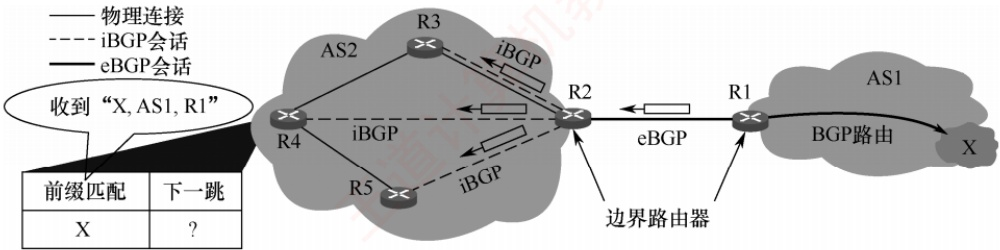

图 4.20 BGP 路由的举例

接着，R4利用内部网关协议（IGP），找到从自身到R2的最优路径，假设查得下一跳为R3。于是，R4 在路由表中添加表项&lt;X,R3&gt;。此后，R4 收到目的网络为X的分组时，将按路径R4→ R3→R2→R1→X转发。类似地，R3 也会在其路由表中添加表项&lt;X,R2&gt;。每个路由器在收到新的BGP路由通告后，都需要执行NEXT-HOP解析和IGP查找，才能将路由正确写入本地路由表。

#### 3．BGP路由选择

**考点追踪BGP路由选择的策略（2024）**

若从一个 AS 到另一个 AS 中的网络 X 只有一条 BGP路由，则无须进行 BGP 路由选择，该路由即为唯一路径。然而，如果存在两条或更多的BGP路由可供选择，则应根据以下原则，并按下面给定的优先顺序，选择一条较好的BGP路由。

**（1）首先选择本地偏好值最高的路由**

在BGP路由的属性中，有一个称为本地偏好（LOCAL-PREF)的选项，其值可由管理员根据政治或经济上的策略来设置。以图4.21为例，从AS1到AS4共有两条BGP路由，管理员设置LOCAL-PREF值后，根据该原则，所有发往AS4的流量都选择从R1 离开。然而，即使高速链路过载，BGP也无法自动将部分流量切换到较空闲的低速链路。

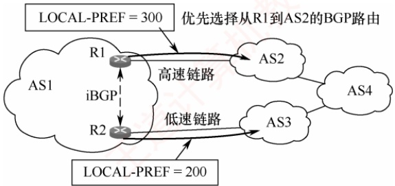

图4.21 本地偏好值较高的路由优先

若在几条BGP路由中找不出本地偏好值最高的路由，则采用下面的方法。

**（2）选择AS 跳数最少（AS-PATH最短）的路由**

假设到达目的AS的多条BGP路由的本地偏好值都相同，则BGP选择AS跳数最少的路由。以图4.22为例，从AS1到AS5共有两条BGP路由，根据该原则，应选择仅通过1个AS的BGP路由，即 AS1→AS4→AS5。然而，由于AS4 是个很大的 AS，分组在 AS4 中反而要经过更多次的转发，可能要花费更长的时间。可见，AS跳数最少的路由未必是最好的。

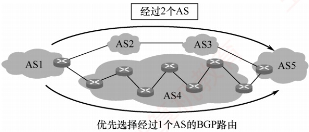

图 4.22 根据经过 AS 跳数的多少选择 BGP 路由

**(3）使用热土豆路由选择算法**

假设按前两种方法都无法确定最好的路由。以图4.23为例，从AS1到AS3共有两条BGP路由，假设这两条路由的本地偏好都相同，所经过的AS个数也相同。此时，AS1中的每个路由器执行热土豆路由选择算法（比喻成烫手的热土豆），使分组经过最少的转发次数离开本AS。这时要使用内部网关协议（如RIP或OSPF），对于不同的路由器，得出的选择结果是不同的。对于R1，要使分组尽快离开AS1，应选择R4作为下一跳，因此应选择BGP路由2，最终的转发路径为R1→R4→BGP路由2。同理，对于R2，要使分组尽快离开AS1，应选择R3作为其下一跳，因此应选择BGP路由1，最终的转发路径为R2→R3→BGP路由1。

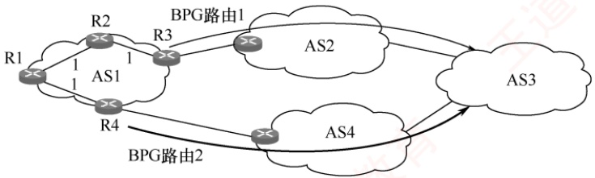

图4.23 热土豆路由选择算法的举例

**（4）选择BGP标识符数值最小的路由**

在 BGP报文的首部有一个称为 BGP标识符的字段，该字段是运行 BGP路由器的唯一标识符。当以上三种方法都无法找出最好的BGP路由时，可使用BGP标识符来选择路由。

#### 4．BGP的四种报文

当BGP刚启动时，BGP会话的两端需要交换完整的BGP路由表；此后，仅在路由发生变化时发送更新部分。这种方式有助于节省网络带宽并降低路由器的处理开销。

考点追踪BGP报文类型及作用（2024）

BGP-4定义了以下四种报文类型。

1）Open（打开）报文。用来与BGP会话的对等方建立关系，使通信初始化。

2）Update（更新）报文。用来通告某一路由的信息，以及列出要撤销的多条路由。

3）Keepalive（保活）报文。用来周期性地证实与对等方的连通性。

4）Notification（通知）报文。用来发送检测到的差错。

两个路由器在建立TCP连接后，必须首先交换Open报文，以相互识别对方，并协商一些协议参数。收到Open报文的路由器若接受BGP连接请求，则返回 Keepalive报文。BGP会话建立后，对等方需要周期性地交换Keepalive报文（默认间隔为60秒），以维持连接活跃状态。

Update报文是BGP的核心，用于撤销它之前通告过的路由，或者宣布增加一条新的路由。撤销路由可以一次撤销多条，但新增路由时，每个更新报文只能增加一条。

为检测对等方是否失效，每个BGP路由器都维护一个保持时间计时器。每当收到任意BGP报文，计时器就重置为0并开始计时，若在约定的保持时间内未收到任何BGP报文，则认为对等方已失效，BGP连接将被关闭。保持时间默认为180s，而Keepalive报文的发送间隔为其1/3。

RIP、OSPF 与BGP的比较如表4.6所示。

表 4.6 三种路由协议的比较

<table><tr><td>协议</td><td>RIP</td><td>OSPF</td><td colspan=2>BGP</td></tr><tr><td>类型</td><td>内部</td><td>内部</td><td colspan=2>外部</td></tr><tr><td>路由算法</td><td>距离向量</td><td>链路状态</td><td colspan=2>路径向量</td></tr><tr><td>传递协议</td><td>UDP</td><td>IP</td><td colspan=2>TCP</td></tr><tr><td>路径选择</td><td>跳数最少</td><td>代价最低</td><td colspan=2>较好，非最佳</td></tr><tr><td>交换节点</td><td>和本节点相邻的路由器</td><td>网络中的所有路由器</td><td colspan=2>和本节点相邻的路由器</td></tr><tr><td rowspan=2>交换内容</td><td rowspan=2>当前本路由器知道的全部信息，即自己的路由表</td><td rowspan=2>与本路由器相邻的所有路由器的链路状态</td><td>首次</td><td>整个路由表</td></tr><tr><td>非首次</td><td>有变化的部分</td></tr></table>

## 4.5 IP多播

### 4.5.1 多播的概念

多播（也称组播）是让源主机一次发送的单个分组可以抵达用一个组地址标识的若干目的主机，即一对多的通信。在互联网上进行的多播，称为IP多播。与单播相比，多播在一对多通信中能显著节省网络资源。例如，当视频服务器向90台主机发送相同的视频分组时（见图4.24），单播需要为每台主机单独发送一份分组，共90份；而多播仅发送一份分组。该分组在传输路径上仅当遇到分岔节点时才被复制并转发。到达目的局域网后，已加入该多播组的主机均可收到该分组。因此，多播大幅减轻了服务器的负担和网络负载。

多播的实现依赖于路由器的支持，支持多播路由协议的路由器称为多播路由器。

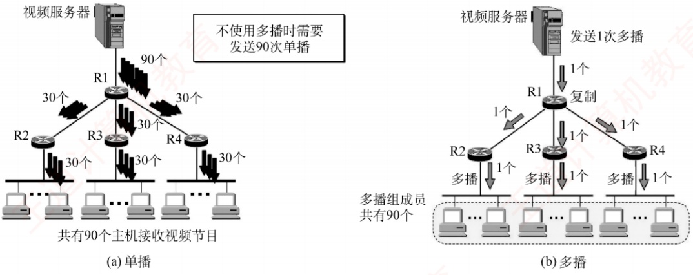

图 4.24 单播与多播的比较

### 4.5.2 IP多播地址

多播数据报的源地址是源主机的IP地址，目的地址是IP多播地址。IP多播地址就是IPv4中的D类地址。D类地址的前四位是1110，因此地址范围是224.0.0.0～239.255.255.255，每个地址标志一个多播组，可支持228个多播组，主机可随时加入或离开一个多播组。

多播数据报是指目的地址为D类IP地址的数据报，其协议字段值由其携带的上层协议决定（若携带的是UDP数据，则为17；若携带的是IGMP报文，则为2）。注意事项如下:

1）多播数据报也是“尽最大努力交付”，不提供可靠交付。

2）多播地址只能用于目的地址，而不能用于源地址。

3）对多播数据报不产生ICMP差错报文。

IP多播可分为两种:①只在本局域网上进行硬件多播；②在互联网的范围内进行多播。目前大部分主机都是通过局域网接入互联网的。因此，在互联网上进行多播的最后阶段，仍需要把多播数据报在局域网上用硬件多播交付给多播组的所有成员见图4.24(b)]。

多播机制仅适用于UDP，因为它能将同一报文同时发送给多个接收者；而TCP是面向连接的协议，建立的是一对一的端到端连接，无法支持一对多的多播通信。

### 4.5.3 在局域网上进行硬件多播

由于局域网支持硬件多播，只需将IP多播地址映射为对应的多播MAC地址，并将IP多播数据报封装在以太网帧中，其MAC帧首部的目的地址字段设为该映射所得的多播MAC 地址。这样，即可借助局域网的硬件多播能力，高效实现P多播在本地网络中的传输。

IANA（互联网地址指派机构）保留的以太网多播地址的范围是01-00-5E-00-00-00到01-00 -5E-7F-FF-FF，在这48位中，前25位保持不变，只有后23位可用作多播。而D类IP地址共有28位可用于标志多播组，这28位中的高5位无法映射，导致32（即2⁵）个不同的IP多播地址会映射到同一个多播MAC地址。因此两者是多对一的映射关系，如图4.25所示。

例如，IP多播地址224.128.64.32（E0-80-40-20）与224.0.64.32（E0-00-40-20）映射到以太网多播MAC地址时，均得到01-00-5E-00-40-20。因此，主机在收到多播数据帧后，还需在IP层利用数据报首部中的目的IP地址进行过滤，仅保留本机所属多播组的数据报，其余则予以丢弃。

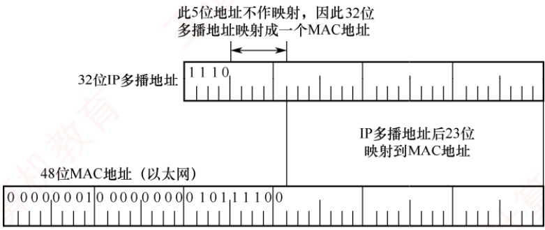

图4.25 D类IP地址与以太网多播地址的映射关系

### 4.5.4 IGMP与多播路由协议

路由器要获得多播组的成员信息，需要利用网际组管理协议（Internet Group Management Protocol，IGMP)。连接到局域网上的多播路由器还必须和互联网上的其他多播路由器协同工作，以便用最小代价将多播数据报分发至所有组成员，这就需要使用多播路由选择协议。

IGMP用于使连接到本地局域网上的多播路由器，能够获知本局域网上是否有主机加入或退出了某个多播组。IGMP仅作用于本地子网，并非用于在互联网范围内管理所有多播组成员，它既不知道某个多播组的总成员数量，也不了解这些成员分布在哪些网络。

IGMP报文封装在IP数据报（协议字段值为2）中传送。IGMP作为IP的配套协议，用于协助IP实现多播功能，因此不将其视为一个单独的协议，而是整个IP协议的一个组成部分。

IGMP的工作可分为两个阶段:

第一阶段:当主机加入一个新的多播组时，会向该多播组的多播IP地址发送一个IGMP报文，声明自己要成为该组的成员。本地多播路由器收到IGMP报文后，将利用多播路由选择协议，把这种组成员关系通告给互联网上的其他多播路由器。

第二阶段:组成员关系是动态的。本地多播路由器会周期性地查询本地局域网上的主机，以探测各多播组是否仍有活跃成员。只要某个组至少有一台主机响应，路由器即认为该组在本网络仍处于活跃状态。若某个组在经过连续多次查询后仍无任何主机响应，则路由器判定该组在本网络已无成员，并停止向其他多播路由器通告该组的成员关系。

多播路由选择实际上就是要构造一棵以源主机为根节点的多播转发树。在这棵树上，每个分组在每条链路上仅被传送一次，且参与转发的路由器不会收到重复的多播数据报。值得注意的是，不同的多播组对应不同的转发树；同一个多播组，若源主机不同，则对应的转发树也不同。

## 4.6 移动IP

### 4.6.1 移动IP的概念

移动IP是一种允许移动主机在切换网络接入点时，仍能保持其永久IP地址不变的网络协议机制。其目标是:无论移动主机当前位于哪个网络，都能确保发往该站的数据分组被自动、透明地正确投递。该机制对上层应用（如TCP连接）完全透明，从而保障了会话的连续性。

移动IP定义了三种功能实体:移动节点、归属代理和外地代理。

1）移动节点。拥有永久IP地址、可在不同网络间移动的主机。

2）归属代理（也称本地代理）。连接在归属网络（初始接入的网络）上的路由器，负责截获并转发发往移动节点的数据。

3）外地代理。连接在被访网络（当前接入的网络）上的路由器，协助移动节点接收数据。

值得注意的是，若用户将笔记本电脑关机后从家中移至办公室，并通过DHCP自动获取新的IP地址重新接入网络。尽管设备的物理位置和接入网络发生了变化，但由于其IP地址已改变，因此不属于移动IP的范畴。然而，若需在移动过程中维持TCP传输，则要确保该TCP连接在漫游期间持续有效；否则，TCP连接将因地址变化而中断。由此可见，实现移动中TCP连接不中断的关键，在于保持移动节点的IP地址不变一—这正是移动IP所要研究的问题。

### 4.6.2 移动IP通信过程

要类比移动IP通信的原理，可借助一个生活化的例子:过去大学毕业离校时，尚不确定未来的工作地点和通信地址，但仍希望与同学保持联系。解决方法很简单一—彼此交换家庭地址(永久地址）。日后，若想联系某位同学，只需将信件寄往其家庭地址，再由其家人代为转交即可。

在移动IP中，每个移动站都有一个初始IP地址称为永久地址（或归属地址），移动站初始所在的网络称为归属网络。永久地址和归属网络的关联是固定不变的。在图4.26中，移动站A的永久地址是131.8.6.7/16，其归属网络是131.8.0.0/16。归属网络中的归属代理通常是连接到该网络上的路由器，负责截获发往移动站的分组，并将其转发至移动站当前所在的位置。

移动站离开归属网络后，所接入的外地网络也称被访网络。在图4.26中，当移动站A漫游到被访网络15.0.0.0/8，被访网络中的代理称为外地代理，它通常是连接在被访网络上的路由器。外地代理有两个重要功能:①为移动站分配一个临时的转交地址(站A的转交地址为15.5.6.7/8），该地址属于被访网络，用于标识移动站的当前位置。②将此转交地址及时通知给其归属代理，以便后者建立从归属网络到当前位置的转发路径。

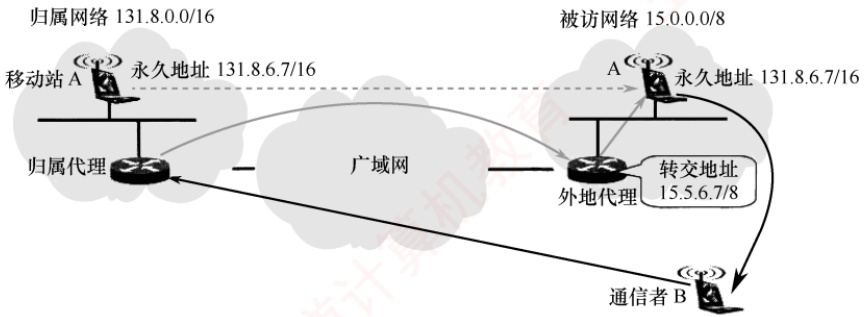

图4.26 移动IP的基本通信过程

注意两点:转交地址仅用于移动站、归属代理和外地代理之间的通信，应用程序不会使用该地址。外地代理向被访网络中的移动站发送IP分组时，直接通过其MAC地址进行链路层交付。

在图4.26中，当通信者B希望与移动站A通信时，B无须知晓A的当前位置，只需将A的永久地址作为发送的P分组的目的地址即可。移动IP的基本通信流程如下:

1）本地通信。移动站A位于其归属网络时，按传统的TCP/IP方式直接通信。

2）漫游与注册。当移动站A漫游到被访网络时，先向该网络中的外地代理登记，并获得一个临时的转交地址。随后外地代理将该转交地址注册至A的归属代理，完成位置更新。

3）移动站接收数据（B→A）。归属代理截获所有发往移动站A的IP\_分组后，构建一条通往转交地址的IP隧道，将原始分组封装在新的P包中，并通过该隧道转发至外地代理。外地代理收到后，解封装并还原出原始分组，并直接交付给A。

4）移动站发送数据（A→B）。移动站A在被访网络向外发送IP分组时，仍使用其永久地址作为源地址。此时，可直接通过被访网络的外地代理转发，而无须通过归属代理。

5）移动与返回。移动站A再次漫游至另一被访网络时，新外地代理会将其新的转交地址注册给A的归属代理。无论A如何移动，所有发往A的IP分组均由归属代理统一截获并转发。A返回归属网络后，向归属代理注销转交地址，恢复本地直连通信。

为支持移动IP机制，网络层需增加一些新功能:①移动站到外地代理的登记协议；②外地代理到归属代理的注册协议；③归属代理的隧道封装协议；④外地代理的隧道拆封协议。

## 4.7 网络层设备

### 4.7.1 冲突域和广播域

考点追踪网络设备对冲突域和广播域的影响（2010、2020）

这里的“域”表示冲突或广播在其中发生并传播的区域。

#### 1．冲突域

冲突域是指连接到同一物理介质上的所有节点的集合，这些节点之间存在介质争用的现象。在QSI参考模型中，冲突域属于第1层（物理层）的概念。第1层设备（如集线器、中继器）仅复制和转发信号，不能划分冲突域，其所有端口属于同一个冲突域。第2层设备（如网桥、交换机）和第3层设备（如路由器）均可划分冲突域。

#### 2．广播域

广播域是指能够接收同一广播帧的所有节点的集合。也就是说，该集合中任一节点发送广播帧，其他能收到该帧的节点均属于此广播域。在OSI参考模型中，广播域属于第2层（数据链路层）的概念。第1层设备（如集线器）和第2层设备（如交换机）所连接的节点通常处于同一个广播域。路由器作为第3层设备，可以划分广播域，即连接不同的广播域。

通常所说的局域网（LAN）在逻辑上等同于一个广播域。路由器用于连接不同的LAN，即分隔不同的广播域。

### 4.7.2 路由器的组成和功能

考点追踪路由器的功能（2010）

路由器是一种具有多个输入/输出端口的专用计算机，其任务是互连不同的网络（异构网络）并转发分组。在多个逻辑网络（多个广播域）互连时必须使用路由器，可用于连接不同的LAN，不同的 VLAN，不同的 WAN，或实现 LAN与 WAN的互连。

从结构上看，路由器由路由选择（控制平面）和分组转发（数据平面）两部分构成，如图4.27所示。而从模型角度看，路由器是工作在网络层的设备，其转发决策基于IP地址；为完成此功能，其端口还要具备物理层和数据链路层的处理能力。

路由选择部分的核心是路由选择处理机，其任务是根据所选路由选择协议（如RIP、OSPF）构建路由表，并周期性地与相邻路由器交换路由信息，以更新和维护路由表。

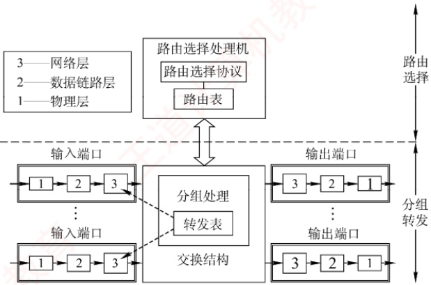

图 4.27 路由器体系结构

分组转发部分由三部分组成:交换结构、一组输入端口和一组输出端口。

交换结构是路由器内部连接输入与输出端口的高速通路，负责根据转发表将输入端口的分组快速转发至合适的输出端口。交换结构本身就是一个“在路由器中的网络”。

路由器的每个端口都包含物理层、数据链路层和网络层的处理模块。输入端口在物理层接收比特流，在数据链路层提取帧并剥离帧头和帧尾后，将分组送入网络层的处理模块。若收到的分组为普通数据分组，则根据目的IP地址查找转发表，经交换结构送至相应的输出端口。若为路由协议分组（如RIP、OSPF报文），则交由路由选择处理机处理。

路由器在端口处设有缓冲区，用于暂存待处理或待发送的分组，并可进行差错检测。若分组到达速率超过处理能力，则缓冲区可能溢出，导致后续分组被丢弃。需要说明的是，路由器的物理端口通常兼具输入和输出功能，图4.27中将输入/输出端口分开绘制，仅为方便理解。

### 4.7.3 路由表与分组转发

**考点追踪路由聚合与路由表构造（2009、2013）**

路由表是根据路由选择算法得出的，主要用于路由选择。根据历年统考真题可知，标准的路由表通常包含四个字段:目的网络IP地址、子网掩码、下一跳IP地址、接口。在图4.28所示的网络拓扑中，R1的路由表如表4.7所示，其中包含一条指向互联网的默认路由。

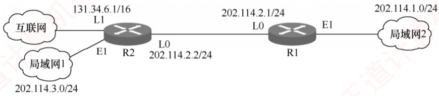

图 4.28 一个简单的网络拓扑

考点追踪路由表分组转发匹配过程（2014）

表 4.7 R1 的路由表

| 目的网络IP地址 | 子网掩码 | 下一跳IP地址 | 接口 |
| --- | --- | --- | --- |
| 202.114.1.0 | 255.255.255.0 | 直连 | El |
| 202.114.2.0 | 255.255.255.0 | 直连 | L0 |
| 202.114.3.0 | 255.255.255.0 | 202.114.2.2 | L0 |
| 0.0.0.0 | 0.0.0.0 | 202.114.2.2 | L0 |

转发表由路由表得出，其表项与路由表项有直接的对应关系。但两者的设计目标不同:路由表应使路由计算优化，便于动态更新和拓扑变化处理；转发表应使高速查找优化，用于实际的数据转发过程。转发表通常包含目的网络前缀和对应的下一跳信息。转发表中可配置一条默认路由，当目的地址无法匹配任何明确表项时，分组将按默认路由转发。在实现方式上，路由表通常由软件维护；而转发表既可用软件实现，又可通过专用硬件。

注意转发和路由选择的区别:“转发”是单个路由器根据转发表，将收到的IP数据报从合适端口送出的过程，属于数据平面操作；而“路由选择”是多个路由器协同工作，通过路由协议交换拓扑信息，运行路由算法动态生成路由表的过程，属于控制平面操作。

## 4.8 本章小结及疑难点

1. “尽最大努力交付”有哪些含义？

1）不保证IP数据报无差错地到达目的主机:

2）不保证在规定时间内交付；

3）不保证按发送顺序交付；

4）不保证不重复交付；

5）不主动丢弃数据报。仅在以下情况丢弃:首部检验和出错，或因缓存满而无法处理。

IP首部包含“首部检验和”字段。凡交付给目的主机的IP数据报，其首部均未检出差错（有错即被丢弃）。因此，IP层可确保首部完整性，但不保证数据部分正确性或传输可靠性。目前互联网绝大多数流量基于此模型。若应用需要可靠传输，则由高层协议（如TCP）实现。

2. 假定在一个局域网中，计算机A广播ARP请求以获取计算机B的硬件地址，此时由谁发送ARP响应？返回的是谁的硬件地址？

● 若 A 与 B 在同一局域网:计算机 B 收到 ARP 请求后，直接向 A 单播 ARP 响应，返回 B自身的硬件地址。

● 若B不在A所在局域网:A的ARP请求无法到达B。此时，连接该局域网的路由器（A的默认网关）会代理响应，向A返回路由器在该局域网接口的硬件地址。

3. 数据报首部只有源和目的IP地址，未指明下一跳路由器，如何确定转发路径？

路由器收到数据报后，根据路由表查出下一跳的IP地址，但不会修改IP数据报内容。该IP地址随后交由数据链路层处理:通过ARP将下一跳IP地址解析为对应的MAC地址，并填入MAC帧首部，从而在物理网络中正确送达下一跳。此过程对每个数据报重复执行。

那么，能否在路由表中直接使用硬件地址以避免ARP查询？

答案是不能。IP地址的抽象性屏蔽了底层网络差异，是互联网可扩展性的基础。若路由表直接使用平面化的硬件地址，将导致表项数量剧增、管理复杂，反而得不偿失。

4.“路由器实现了物理层、数据链路层、网络层”的含义是什么？

这句话是指:路由器具备处理物理层、数据链路层和网络层协议的能力。具体而言:

在物理层，路由器能接收和发送比特流；

● 在数据链路层，它能识别帧结构、解析MAC地址，并完成帧的解封装与重新封装；

●在网络层，它能读取IP数据报首部，根据目的IP地址查询路由表，做出转发决策。

因此，当路由器转发数据时，会先解封装输入帧，提取出IP数据报，再根据下一跳接口重新封装成适合输出链路的新帧。正是这种能力，使路由器可以互连底层技术不同的网络（例如以太网与PPP链路）。这与仅工作在物理层的中继器或仅在数据链路层的交换机有本质区别。
