# 第5章 传输层

> 来源：27王道《计算机网络》高清带书签.pdf（已清理水印、广告与 OCR 噪声）

## 【考纲内容】

（一）传输层提供的服务
传输层的功能；传输层的寻址与端口；无连接服务与面向连接服务
（二）UDP

UDP数据报；UDP检验

（三）TCP

TCP报文段；TCP连接管理；TCP可靠传输；TCP流量控制与拥塞控制

## 【复习提示】

传输层是整个网络体系结构中的关键层次。要求掌握传输层在计算机网络中的功能、工作方式及原理等，掌握UDP及TCP（如首部格式、可靠传输、流量控制、拥塞控制、连接管理等）。其中，TCP报文分析、连接管理、流量控制与拥塞控制机制，出选择题、综合题的概率均较大，因此要将其工作原理透彻掌握，以便能在具体的题目中灵活运用。

## 5.1 传输层提供的服务

### 5.1.1 传输层的功能

数据链路层提供链路上相邻节点之间的逻辑通信，网络层提供主机之间的逻辑通信。传输层位于网络层之上、应用层之下，为运行在不同主机上的进程之间提供逻辑通信①。传输层是面向通信部分的最高层，同时也是用户功能中的最低层。即使网络层协议不可靠（例如，导致分组丢失、失序或重复），传输层仍能为应用程序提供可靠的服务。

以图5.1为例说明传输层的作用。假设局域网LAN1 上的主机 A和局域网LAN2上的主机 B通过互连的广域网WAN进行通信。一台主机中常有多个应用进程同时与另一台主机中的多个应用进程通信，其中APx表示主机中参与通信的应用进程。传输层的主要功能如下。

#### 1．应用进程之间的逻辑通信

从网络层角度看，通信的两端是两台主机，IP数据报首部指明了这两台主机的IP地址。但“主机之间的通信”的实质是主机中应用进程之间的通信，也称为端到端的逻辑通信。IP虽能将分组送达目的主机，但该分组仅停留在主机的网络层，并未交付给具体的应用进程。而从传输层视角看，通信的真正端点并非主机，而是主机中的进程。

> ①逻辑通信是指对等层之间的通信看似沿水平方向传送，但实际上并不存在一条水平方向的物理连接。

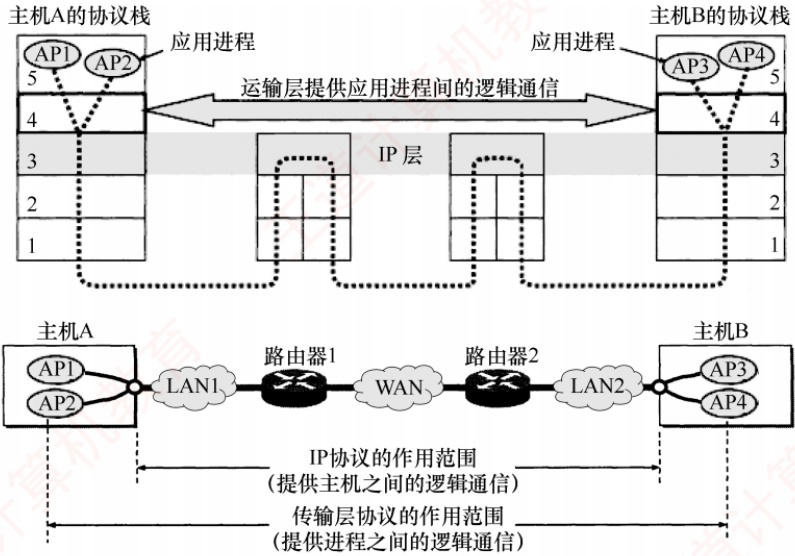

图5.1 传输层为相互通信的进程提供逻辑通信

#### 2．复用和分用

复用是指发送方的多个应用进程可使用同一个传输层协议传送数据。分用是指接收方的传输层在剥去报文首部后，能将数据正确交付给对应的目的应用进程。

注意

网络层也具备复用和分用的功能，但其复用是指将不同传输层协议的数据封装成IP数据报发送；分用则是指接收方网络层根据首部的协议字段，将数据交付给相应的传输层协议。

#### 3．差错检测

传输层对收到的整个报文（包括首部和数据部分）进行差错检测。对于TCP，若接收方发现报文段出错，则要求发送方重传。对于UDP，若发现数据报出错，则直接丢弃。相比之下，网络层的IP数据报仅对其首部进行校验，不检查数据部分

#### 4．提供面向连接和无连接的传输服务

传输层向上层屏蔽了底层网络的复杂性（如拓扑结构、路由协议等），使应用进程感知到的是一条端到端的逻辑通信信道。该信道的特性取决于所采用的传输层协议:使用TCP（面向连接)时，尽管底层网络仅提供“尽最大努力”的服务，逻辑信道仍表现为一条全双工的可靠信道；使用UDP（无连接）时，逻辑信道则仍为不可靠信道。

### 5.1.2 传输层的寻址与端口

#### 1．端口的作用

端口是传输层与应用层交互的接口:应用进程通过端口将数据向下交付给传输层；传输层则通过端口将收到的数据向上交付给正确的应用进程。发送时，应用进程将数据送至指定端口，传输层读取后封装并发送；接收时，传输层将数据送至对应端口，应用进程从中读取。TCP和UDF通过首部中的源端口和目的端口两个字段，实现传输层与应用层之间的服务访问。

**注意**

数据链路层的服务访问点是帧的“类型”字段，网络层的服务访问点是IP数据报的“协议”字段，传输层的服务访问点是“端口号”字段，应用层的服务访问点是“用户界面”。

#### 2．端口号

应用进程通过端口号标识，端口号长度为16比特，可表示65536（即216）个不同的端口号。端口号仅具有本地意义，即只用于标识本机应用层中的进程；不同主机的相同端口号是没有关联的，且UDP和TCP的端口号彼此也是独立的。

根据用途，可将端口分为两类。

1）服务器端使用的端口号。又分为两类:①熟知端口号（0～1023），由IANA分配给最重要的TCP/IP应用程序，供所有用户熟知；②登记端口号（1024～49151），供未获熟知端口号的应用程序使用，需在IANA登记以避免冲突。常见熟知端口号如下:

| 应用程序 | FTP | TELNET | SMTP | DNS | TFTP | HTTP | SNMP |
| --- | --- | --- | --- | --- | --- | --- | --- |
| 熟知端口号 | 21 | 23 | 25 | 53 | 69 | 80 | 161 |

2）客户端使用的端口号（49152～65535）。此类端口号在客户进程运行时动态分配，故又称短暂端口号。服务器从客户报文中提取源端口号，并将其作为回送数据的目的端口。通信结束后，该临时端口号被系统回收，可供其他客户进程复用。

#### 3．套接字

在网络中，通过P地址区分不同的主机，通过端口号区分同一主机中的不同应用进程，将端口号与IP地址拼接，即构成套接字（Socket）:

$$
套接字 ( Sckt ) = ( IP   地址:端口号 )
$$

套接字唯一标识网络中某台主机上的一个应用进程，是通信的端点。

在通信过程中，主机A发往主机B的报文包含目的端口和源端口。其中，源端口构成“返回地址”的一部分；当B回复A时，其报文的目的端口即为A原报文中的源端口。注意:同一IP地址可参与多个TCP连接，同一端口号也可出现在多个不同的TCP连接中。

### 5.1.3 无连接服务与面向连接服务

TCP/IP协议族在IP层之上定义了两个主要的传输协议:

● TCP（传输控制协议）:面向连接，提供可靠的全双工逻辑信道。

●UDP（用户数据报协议）:无连接，提供不可靠的逻辑信道。

TCP要求通信双方在数据传输前先建立连接，传输结束后释放连接。TCP不提供广播或多播服务。TCP通过确认、流量控制、计时器和连接管理等机制保障可靠传输，但代价是首部开销大、处理资源消耗高。因此，TCP适用于对可靠性要求高的场景，如FTP、HTTP、SMTP等。

UDP无须建立连接，接收方收到数据报后，也不发送确认。它在IP层之上仅提供两项服务:多路复用与分用、数据差错检测。由于结构简单、开销小，UDP执行效率高、实时性好，适用于对时延敏感、可容忍少量丢包的应用，如TFTP、DNS、DHCP和RIP等。

表5.1列出了一些典型互联网应用及其对应的传输层协议。

表5.1 一些典型互联网应用及其对应的传输层协议

| 互联网应用 | TCP/IP 应用层协议 | TCP/IP传输层协议 |
| --- | --- | --- |
| 域名解析 | 域名系统（DNS） | UDP |
| 文件传送 | 简单文件传送协议（TFTP） | UDP |
| 路由选择 | 路由信息协议（RIP） | UDP |
| IP地址分配 | 动态主机配置协议（DHCP） | UDP |
| 网络管理 | 简单网络管理协议（SNMP） | UDP |
| 电子邮件 | 简单邮件传送协议（SMTP） | TCP |
| 远程终端接入 | 远程终端协议（TELNET） | TCP |
| 万维网 | 超文本传送协议（HTTP） | TCP |
| 文件传送 | 文件传送协议（FTP） | TCP |

**注意**

IP数据报和UDP数据报的区别:IP数据报在网络层需经路由器存储转发；而 UDP数据报作为IP数据报的载荷，在网络层传输时，其内容对路由器不可见。

## 5.2 UDP

### 5.2.1 UDP数据报

#### 1．UDP概述

UDP仅在IP层的数据报服务之上增加了复用、分用和差错检测的功能。若应用开发者选择UDP而非TCP，则应用程序几乎直接与IP打交道。尽管TCP提供可靠服务，而UDP不提供，但TCP并非总是首选。许多应用更适合采用UDP，主要原因如下。

考点追踪UDP协议的优点（2014、2024）

1）UDP是无连接的，没有建立连接的时延。TCP需要在主机中维护连接状态（包括发送和接收缓存、拥塞控制参数、序号和确认序号等），而UDP无须维护这些状态。

2）UDP是面向报文的。发送方UDP对应用层交下的报文，在添加首部后即向下交付给IP层，一次发送一个完整的报文（不可分割），既不合并也不拆分，而是保留报文的边界。因此，应用程序必须选择合适大小的报文，若报文太长，则交付给IP层后，可能导致分片；若报文太短，则会使IP首部的开销占比过大。两者均会降低传输效率。相比之下，TCP是面向字节流的，每个字节都有编号，支持自动拆分与重组，对报文长度无限制。

3）UDP的首部开销小，仅有8B；而TCP首部至少20B。

4）UDP支持一对一、一对多和多对多的通信。TCP仅支持一对一的通信。

5）UDP没有拥塞控制，因此网络拥塞不会影响源主机的发送速率。某些实时应用要求以稳定的速率发送数据，可以容忍少量丢包，但无法接受较大的传输时延。

UDP常用于一次性传输少量数据的应用（如DNS、DHCP等），因为TCP的连接建立、维护和释放会带来显著开销。UDP也广泛用于多媒体应用（如视频会议、流媒体等），因为这些应用更关注低时延而非可靠性，而TCP的拥塞控制会引入不可接受的延迟。

UDP不保证可靠交付，但这并不意味着应用不要求可靠性—所有可靠性机制可由应用层自行实现，开发者可根据需求灵活设计。

#### 2．UDP的首部格式

UDP数据报包含两部分:首部字段和数据字段。UDP首部有8B，由4个字段组成，每个字段的长度都是2B，如图5.2所示。各个字段的意义如下:

考点追踪UDP的首部格式及字段含义（2018）

1）源端口号。发送进程的端口号。需要对方回复时选用，不需要回复时可置为全0。

2）目的端口号。接收进程的端口号。该字段在所有UDP报文中都必须有效。

考点追踪UDP首部的长度（2021）

3）长度。UDP数据报的长度（包括首部和数据），其最小值是8（仅有首部）。

4）检验和。由发送方的传输层计算并写入，接收方的传输层检测是否有差错，有错就丢弃。

在IPv4中，该字段可置为全0表示未使用（但不建议），在IPv6中则强制启用。

当传输层从IP层收到UDP数据报时，就根据首部中的目的端口，把UDP数据报通过相应的端口，上交给最后的终点—应用进程，如图5.3所示。

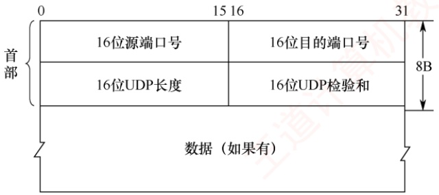

图 5.2 UDP 数据报格式

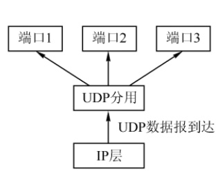

图 5.3 UDP 基于端口的分用

若接收方UDP发现收到的报文中的目的端口号不正确（不存在对应于端口号的应用进程），则丢弃该报文，并由ICMP发送“端口不可达”差错报文给发送方。

### 5.2.2 UDP检验

**考点追踪UDP检验的原理（2025）**

在计算检验和时，要在UDP数据报之前增加12B的伪首部，伪首部并不是UDP的真正首部。只是在计算检验和时，临时添加在UDP数据报的前面，得到一个临时的UDP数据报。检验和就是按照这个临时的UDP数据报来计算的。伪首部既不向下传递给网络层，也不向上递交给应用层，而只是为了计算检验和。图5.4给出了UDP数据报的首部和伪首部。

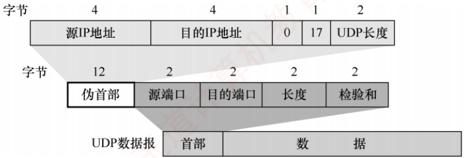

图 5.4 UDP 数据报的首部和伪首部

UDP检验和的计算方法与IP首部检验和基本类似。不同之处在于:IP检验和只检验IP数据报的首部，而UDP检验和把首部和数据部分一起检验。

UDP计算检验和的过程:在发送方，首先将检验和字段置为全0，然后将伪首部与UDP数据报视为一连串16位字。若UDP数据部分的长度为奇数个字节，则在计算时末尾补一个全0B（该填充字节仅在计算检验和时临时添加，不影响实际发送的数据内容）。随后，按二进制反码规则对所有16位字求和，并将结果的反码填入检验和字段后发送。在接收方，将收到的UDP数据报与伪首部重新组合（同样在必要时补全字节），再按二进制反码求和。若无差错，则结果应为全1（16位全为1）；否则说明有差错，接收方应丢弃该UDP数据报。

**考点追踪UDP检验和的计算（2024）**

二进制反码求和的运算规则:①从低位到高位逐列进行计算， $0+0=0,\quad 0+1=1,\quad 1+1=0$并产生进位1；②若最高位相加后产生进位，则需将该进位加到结果的最低位，该过程称为回卷。以下通过一个简单示例说明，假设有以下3个16位字:

先将前两个字相加，得

$$
\begin{aligned} {} & {{} 0110011001100000} \\ {} & {{} \frac {0101010101010101} {1011101110110101} .} \\ \end{aligned}
$$

再将结果与第三个字相加（最高位产生进位，需加至最低位），得

$$
\begin{aligned} {} & {{} 110111011 \; 10110101} \\ {} & {{} \frac {10001111 \; 00001100} {01001010 \; 11000001} .} \\ \end{aligned}
$$

$$
+ \frac{1}{\left. 01001010 \right. 11000010}
$$

←进位加至最低位

最后对上述相加结果取反码，就得到检验和:

$$
10110101 \; 00111101
$$

在接收方，将包括检验和在内的4个16位字相加，若结果为1111111111111111，则判定无差错；若结果中的某些位是0，则说明有差错。

注意

①若UDP检验和检验出数据报错误，通常应丢弃该报文；尽管RFC允许将其交付上层并附带错误指示，但实际实现中极少采用。

②通过伪首部，UDP不仅能校验源端口、目的端口和数据内容，还能检测IP首部中的源地址和目的地址是否在传输过程中因错误而改变。

这种差错检验机制虽然检错能力有限，但其优势在于计算简单、处理速度快。

## 5.3 TCP

### 5.3.1 TCP的特点

TCP是在不可靠的IP层之上实现的可靠数据传输协议，主要解决传输过程中可能出现的分组丢失、失序、重复和差错等问题。其主要特点如下:

1）TCP是面向连接的传输层协议，因此引入了建立连接和释放连接的开销。

2）每一条TCP连接只能有两个端点，且仅支持一对一通信。

3）TCP提供可靠交付服务，保证所传数据无差错、不丢失、不重复且按序到达。

4）TCP支持全双工通信，允许通信双方的应用进程在任何时候发送数据。为此，TCP连接的两端均设有发送缓存和接收缓存，用来临时存放双向通信的数据。

5）TCP是面向字节流的。尽管应用程序与TCP的交互是以一个个数据块（大小不等）进行的，但TCP将这些数据视为一连串无结构的字节流，并不保留应用层数据块的边界。

TCP与UDP在发送报文的方式上存在本质区别。TCP并不关心应用进程一次向其缓存发送多长的数据，而是根据对方通告的窗口大小和当前网络的拥塞程度，动态决定一个报文段应包含多少字节（而UDP报文的长度由应用进程直接指定）。若应用进程传送到TCP缓存的数据块过长，TCP会将其划分为较短的数据块再传送；若数据块过短，TCP也可暂存数据，待积累到合适长度后再封装成报文段发送。关于TCP报文段长度的控制机制，将在后续章节详细讨论。

### 5.3.2 TCP报文段

TCP传送的数据单元称为报文段。一个TCP报文段分为首部和数据两部分，整个TCP报文段作为IP数据报的数据部分进行封装，如图5.5所示。TCP的全部功能都体现在其首部的各个字段中，因此只有弄清各个字段的作用，才能掌握TCP的工作原理。TCP首部的前20个字节是固定的，后面有4N字节是根据需要而增加的选项。因此，TCP首部的最小长度为20B。

各个字段的意义如下:

考点追踪 $\triangleright \mathsf {TCP}$ 首部格式及字段含义（2012）

1）源端口和目的端口。各占2B。分别表示发送方和接收方所使用的端口号。

考点追踪TCP序号与确认序号机制（2009、2016）

2）序号。占4B，范围为 $0 {\sim} 2^{32}   - 1$ ，共 $2^{32}$ 个序号。当序号达到 $2^{32} - 1$ 后，下一个序号将回绕到0，即采用模 $2^{32}$ 运算。TCP连接中传送的字节流中的每个字节都按顺序编号，序号字段的值指明了本报文段所发送数据的第一个字节的序号。

例如，若某报文段的序号为301，携带的数据长度为100B，则该报文段的最后一个数据字节的序号为400，因此下一个报文段的数据应从序号401开始。

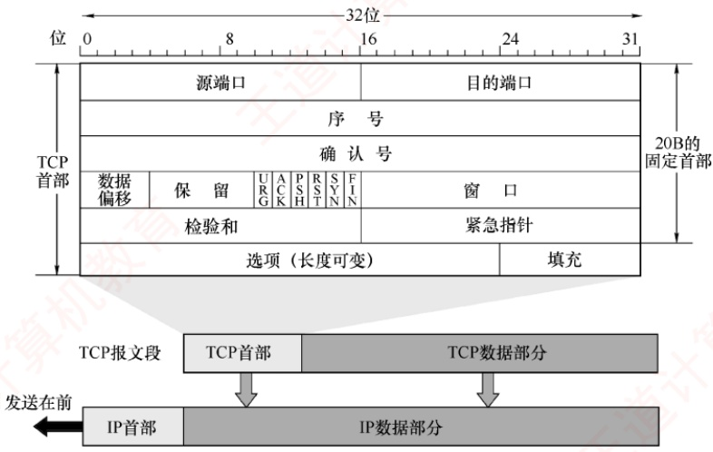

图 5.5 TCP 报文段

3）确认序号。占4B，表示期望收到对方下一个报文段中第一个数据字节的序号。若确认序号为N，则表明到序号N-1为止的所有数据均已正确接收。例如，B正确收到了A发送的一个报文段，其序号为501，数据长度为200B(对应序号501～ 700），说明B已完整接收到了到序号700为止的数据。因此，B期望接收的下一个数据字节的序号为701，于是在发给A的确认报文段中将确认序号置为701。

**考点追踪TCP首部的最小长度（2021）**

4）数据偏移（首部长度）。占4位，用于指出TCP首部的长度。由于首部可能包含长度可变的选项字段，该字段用于指示TCP报文段中数据部分的起始位置距离报文段起始处的偏移量。偏移单位为4B，因此该字段的值乘以4就等于首部长度。TCP首部最小长度为20B，对应数据偏移字段的最小值为5;4位二进制数最大可表示15，因此TCP首部的最大长度为60B（选项长度最多40B）。

5）保留。占6位，保留为今后使用，但目前须置为0。

下面有6个控制位，各占1位，用来说明本报文段的性质。

6）紧急位URG。当URG=1时，表明紧急指针字段有效，通知系统本报文段中包含紧急数据，应优先处理。紧急数据被放置在报文段数据的最前面，后续的仍为普通数据，因此需配合紧急指针字段使用。

7）确认位ACK。仅当ACK=1时，确认序号字段才有效；当ACK=0时，确认序号无效。TCP规定，在连接建立后，所有传送的报文段都必须将ACK置为1。

8）推送位PSH（Push）。在交互式通信中，应用进程希望输入命令后能立即收到响应。此时发送方将 PSH 置为1，接收方收到 PSH=1 的报文段后，会立即将数据交付给应用进程，而不必等到整个缓存填满后才向上交付。

9）复位位RST（Reset）。当RST=1时，表示TCP连接出现严重差错（如主机崩溃），必须释放连接并重新建立连接。此外，RST也可用于拒绝非法的报文段或连接请求。

10）同步位SYN。当SYN=1时，表示这是一个连接请求或连接接受报文

当SYN=1，ACK=0时，表明这是一个连接请求报文，若对方同意建立连接，则在响应报

文中设置 SYN=1 且 $\mathrm {ACK}   =   1$ 。关于连接的建立和释放，将在下一节详细讨论。

11）终止位FIN（Finish）。用于释放连接。当 $\mathrm {FIN}   {=}   1$ 时，表示此报文段的发送方已无更多数据要发送，并请求释放连接。

12）窗口。占2B，范围为 $0 {\sim} 2^{16}   -   1$ ，以字节为单位，该字段由本报文段的发送方填写，表示其作为接收方时当前还能接收的最大数据量。它告诉对方（作为发送方）“从本报文段的确认序号所指示的字节序号开始，你最多可以连续发送这么多字节的数据”例如，若确认序号为701，窗口字段值为1000，这表示发送方可以从序号701开始，连续发送最多1000B的数据（字节序号为701～1700）。

13）检验和。占2B。检验范围包括首部和数据部分。计算时需在TCP报文段前添加一个12B的伪首部（与UDP类似，只需将协议字段由17改成6，长度字段改成TCP长度）

14）紧急指针。占2B。仅在URG=1时有效，指出本报文段中紧急数据的字节数（紧急数据位于数据部分的开头）。即使接收窗口为零，仍可发送紧急数据。

15）选项。长度可变，最长可达40B。若不使用选项，TCP首部长度即为20B。TCP最初只定义了一种选项，即最大报文段长度（Maximum Segment Size，MSS），它表示TCP报文段中数据字段的最大长度。后续又增加了窗口扩大、时间戳等选项，具体内容请参见教材。注意，与MSS类似，数据链路层的MTU指的是帧中数据部分的最大长度。

16）填充。用于确保整个首部长度为4B的整数倍，这是由于选项字段的长度是可变的。

### 5.3.3 TCP连接管理

TCP是面向连接的协议，因此每条TCP连接都包含三个阶段:连接建立、数据传送和连接释放。TCP连接管理的目标是确保连接的建立与释放能够正常、可靠地进行。

在TCP连接建立过程中，需解决以下三个问题:

1）使通信双方确知对方的存在。

2）允许双方协商相关参数（如最大窗口值、是否使用窗口扩大选项、时间戳选项等）。

3）为传输实体分配必要的资源（如缓存空间、连接表项等）。

TCP将连接作为最基本的抽象。每条TCP连接有两个端点，这些端点既不是主机、IP地址，也不是应用进程或传输层端口，而是套接字（Socket）。一条TCP连接由通信双方的两个套接字唯一确定。需要注意的是:同一个IP地址可以参与多个不同的TCP连接，同一个端口号也可以出现在多个不同的TCP连接中。

TCP连接的建立采用客户/服务器模式。主动发起连接建立的应用进程称为客户（Client），被动等待连接请求的应用进程称为服务器（Server）。

#### 1．TCP连接的建立

连接建立需经历三个步骤，通常称为三次握手，如图5.6所示。假设主机A和B分别运行TCP客户和服务器程序，最初两端的TCP进程均处于CLOSED（关闭）状态。在连接建立前，服务器完成一些准备工作后进入LISTEN（收听）状态，等待客户的连接请求。

第一步:客户向服务器发送连接请求报文段。该报文段的 $\mathbf {SYN} \; = \; 1$ ，同时选择一个初始序号$\mathbf {seq} = \mathbf {x} \circ$ TCP规定，SYN报文段（SYN=1的报文段）不能携带数据，但仍消耗一个序号，因此客户下一次发送的报文段序号 $\mathrm{seq}=x+1$ 。此时，客户进入SYN-SENT（同步已发送）状态。

第二步:服务器收到连接请求后，若同意建立连接，则向客户返回确认报文段。该报文段的$\mathbf{SYN} = 1, \mathbf{ACK} = 1$ ，确认序号 $\mathbf{a}\mathbf{c}\mathbf{k} = \mathbf{x} + \mathbf{1}$ ，同时选择自己的初始序号 $\mathbf {seq} = \mathbf {y} \circ$ ，确认报文段同样不能携带数据，但也消耗一个序号。此时，服务器进入SYN-RCVD（同步已收到）状态。

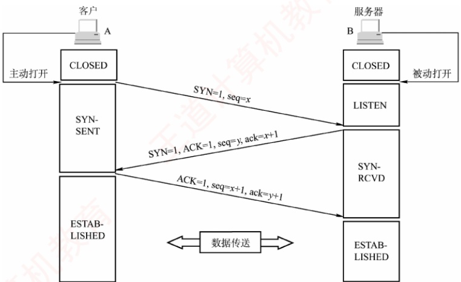

图5.6 用“三次握手”建立TCP连接

考点追踪TCP三次握手的字段解析（2011、2012、2016、2019、2023）

第三步:客户收到确认后，再向服务器发送最终确认。该确认报文段的ACK=1，确认序号$\mathbf{a}\mathbf{c}\mathbf{k} = \mathbf{y} + \mathbf{1}$ ，序号 $\mathbf{s}\mathbf{e}\mathbf{q} = \mathbf{x} + \mathbf{1}$ 。此报文段可以携带数据。若不携带数据，则不消耗序号，下一个数据报文段的序号仍为x+1。此时，客户进入ESTABLISHED（已建立连接）状态。

当服务器收到该最终确认后，也进入ESTABLISHED状态，连接正式建立。

**注意**

①仅在前两次握手的报文段中，SYN=1。TCP规定:SYN报文段不能携带数据，但仍消耗一个序号，因此下次发送的报文段序号为其SYN报文段序号加1。

②仅在第一次握手的报文段中，ACK=0，因为此时尚未收到任何报文段。

③第三次握手的报文段可携带数据；若不携带，则不消耗序号。

从客户发出 SYN报文段（第一次握手的连接请求报文段）时刻起算，客户最早可在1RTT后开始发送数据，而服务器最早在1.5RTT后才能发送数据。

#### 2．TCP连接的释放

“天下没有不散的筵席”，TCP连接亦如此。通信双方中的任意一方均可主动终止连接。TCP连接的释放过程通常称为四次挥手，如图5.7所示。

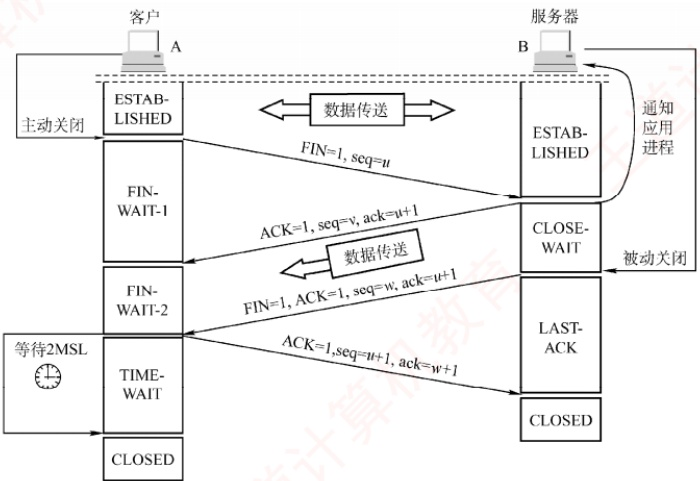

图 5.7 用“四次挥手”释放TCP连接

**考点追踪TCP四次挥手的字段解析（2020、2023）**

第一步:客户决定关闭连接时，向服务器发送连接释放报文段，并停止发送数据（主动关闭）。该报文段的FIN=1，序号 seq=u，其值等于此前已发送数据的最后一个字节序号加1。TCP规定，FIN报文段（FIN=1的报文段）即使不携带数据，也消耗一个序号。此时，客户进入FIN-WAIT-1（终止等待1）状态。由于TCP是全双工的，可视为连接包含两条独立的数据通路；发送FIN的一端关闭了其发送方向，但对方仍可继续发送数据。

第二步:服务器收到连接释放报文段后，立即发送确认报文段。该报文段的ACK=1，确认序号ack=u+1，序号seq=ν（ν为服务器此前已发送数据的最后一个字节序号加1）。随后，服务器进入CLOSE-WAIT（关闭等待）状态。此时，从客户到服务器方向的连接已释放，但从服务器到客户方向的连接并未释放，TCP连接处于半关闭状态。客户收到确认后，进入FIN-WAIT-2（终止等待2）状态，等待服务器发出的连接释放报文段

**考点追踪TCP四次挥手状态变化（2021）**

第三步:若服务器已经没有要向客户发送的数据，就向其发送连接释放报文段。该报文段的FIN = 1、ACK= 1，序号 seq=w（w 可能大于ν，因服务器在半关闭期间可能又发送了数据），还需重复此前已发送的确认序号ack=u+1。此时，服务器进入LAST-ACK（最后确认）状态。

考点追踪TCP连接释放的时间分析（2016、2022、2024）

第四步:客户收到连接释放报文段后，必须发送最终确认，并进入TIME-WAIT（时间等待）状态。该确认报文段的ACK=1，确认序号 $\mathbf{a}\mathbf{c}\mathbf{k} = \mathbf{w} + \mathbf{1}$ ，序号 seq=u +1。服务器收到此确认后，即进入CLOSED（连接关闭）状态。客户在TIME-WAIT状态下，还需等待时间等待计时器设置的时间 2MSL（Maximum Segment Lifetime，最长报文段寿命）后，才进入CLOSED状态。

设置2MSL的主要目的是:①确保客户发送的最后一个ACK报文段能够到达服务器；②使本连接中所有可能滞留的旧报文段从网络中自然消失，避免影响新连接。

若服务器在收到客户的连接释放请求后不再发送数据，则从客户发出FIN报文段时刻起算，客户释放连接的最短时间为 $\mathbf {IRTT + 2 MSL}$ ，服务器释放连接的最短时间为1.5RTT。

**注意**

①仅在第一次和第三次挥手的报文段中（请求主动关闭），FIN=1。

②后三次挥手的报文段中，ACK=1，因为每次都需要对之前收到的报文段进行确认。

③尽管协议并未禁止FIN段携带数据，但主流的操作系统一般不允许其携带数据

除时间等待计时器外，TCP还使用一个保活计时器，以防止客户突发故障导致服务器长期无效等待。服务器每收到一次数据，就会重置该计时器；若计时器超时仍未收到数据，则每隔75秒发送一个探测报文段。若连续10次探测均无响应，则判定客户已故障，并关闭该连接。

### 5.3.4 TCP可靠传输

TCP在不可靠的IP层之上提供可靠传输服务，确保接收方从缓存中读取的字节流与发送方发出的字节流完全一致。TCP通过检验、序号、确认和重传等机制实现这一目的。其中，TCP的检验机制与UDP类似，这里不再赘述。

考点追踪TCP序号与确认机制（2011、2012、2013、2025）

#### 1．序号

TCP首部的序号字段用于保证数据按序提交给应用层。TCP将数据视为一个无结构但有序的

字节流，其序号是对字节流中的每个字节依次编号，而非对报文段整体编号。

TCP将每个字节都编上一个序号，序号字段值指明本报文段所发送的第一个数据字节的序号。如图5.8所示，假设A和B之间建立了一条TCP连接，A的发送缓存区中有10B的数据，序号从0开始编号。第一个报文段包含0～2号数据字节，则该TCP报文段的序号是0；第二个报文段的序号是3；第三个报文段的序号是6；第四个报文段的序号是8。

<table><tr><td colspan="4">第一个报文段的数据</td><td colspan="3">第二个</td><td colspan="2">第三个</td><td colspan="2">第四个</td></tr><tr><td></td><td></td><td></td><td></td><td></td><td></td><td></td><td></td><td></td><td></td><td></td></tr><tr><td>0</td><td>1</td><td>2</td><td>3</td><td>4</td><td>5</td><td>6</td><td></td><td>7</td><td>8</td><td>9</td></tr></table>

图5.8 A的发送缓存区中的数据划分成 TCP段

#### 2．确认

TCP首部的确认序号字段表示期望收到对方下一个报文段的第一个数据字节的序号。在图5.8中，若接收方B已收到第一个和第二个报文段，此时B希望收到的下一个报文段的数据是从6号字节开始的，因此B向A发送的下一个报文段中的确认序号字段应置为6。

发送方缓存区会继续存储那些已发送但未收到确认的报文段，以便在需要时重传。TCP默认使用累积确认，即确认按序到达的连续字节，确认序号为第一个未收到字节的序号。接收方可以在合适时机发送确认，也可以在有数据要发送时将确认信息顺便捎带上（捎带确认）。例如，在图5.8中，接收方B收到了A发送的第一个和第三个报文段，尚未收到第二个报文段，此时B仍在等待从3号字节开始的连续数据，因此B向A发送的下一个报文段将确认序号字段置为3。

#### 3．重传

有两种事件会导致TCP对报文段进行重传:超时和冗余ACK。

**（1）超时**

TCP每发送一个报文段，就会对该报文段设置一个超时计时器。当计时器到期仍未收到确认时，TCP将重传该报文段。

由于TCP下层是互联网环境，IP数据报所选的路由变化很大，因此传输层的往返时延波动也较大。为了计算超时计时器的重传时间，TCP采用一种自适应算法。它记录报文段发出的时间及收到相应确认的时间，两者之差称为报文段的往返时间（Round-TripTime，RTT）。TCP维护了一个加权平均往返时间 RTTS，并根据新测量的RTT样本值动态调整RTTS。显然，超时计时器设置的超时重传时间（Retransmission Time-Out，RTO）应略大于RTTS，但也不能大太多，否则当报文段丢失时，TCP无法迅速重传，导致数据传输延迟增大。

**（2）冗余ACK（冗余确认）**

超时触发重传的一个问题是超时周期往往太长。幸运的是，发送方通常可以在超时发生之前，通过注意所谓的冗余ACK来较好地检测丢包情况。冗余ACK是再次确认某个报文段的ACK，而发送方先前已收到过该报文段的确认。例如，发送方A发送了编号为1、2、3、4、5的TCP报文段，其中2号报文段在链路中丢失，未能到达接收方B。因此，3、4、5号报文段对于B来说成为失序报文段。TCP规定，每当比期望序号大的失序报文段到达时，立即发送一个冗余ACK，指明下一个期待字节的序号。在本例中，3、4、5号报文段到达B，但它们不是B期望收到的下一个报文段，于是B立即发送3个对1号报文段的冗余ACK，表示自己期望接收2号报文段。

TCP规定，当发送方收到对同一个报文段的3个冗余ACK时，可以认为紧跟在这个被确认报文段之后的报文段已丢失。就前面的例子而言，当A收到对1号报文段的3个冗余ACK时，它可以判断2号报文段已经丢失，并立即对2号报文段执行重传，这种技术称为快速重传。当然，冗余ACK也被用于拥塞控制，相关内容将在后续章节讨论。

**注意**

在上述示例中，对1号报文段的正常确认不能称为冗余ACK，只有在收到失序的3、4、5号报文段后，发回的确认才被称为冗余ACK。也就是说，触发快重传时，发送方共收到4个对1号报文段的确认。

### 5.3.5 TCP流量控制

流量控制的功能是确保发送方的发送速率不会过快，以便让接收方能够及时处理。因此，可以说流量控制是一种速度匹配服务，它匹配发送方的发送速率与接收方的读取速率。

TCP利用滑动窗口机制来实现流量控制。滑动窗口的基本原理已在第3章介绍过，这里重点讨论TCP如何使用窗口机制进行流量控制。TCP要求接收方维持一个接收窗口（rwnd），该窗口大小根据当前接收缓存的大小动态调整，反映了接收方的容量。接收方将此窗口值写入TCP首部的“窗口”字段，以通知发送方。发送方的发送窗口不能超过接收方给出的接收窗口值，从而限制发送方向网络注入报文的速率。

**考点追踪基于滑动窗口的流量控制机制（2016、2021）**

图5.9说明了如何利用滑动窗口进行流量控制。假设数据仅从A发往B，而B仅向A发送确认报文段，则B 可通过设置确认报文段首部中的窗口字段来通知 A当前的 rwnd 值。rwnd表示接收方允许连续接收的最大字节数。发送方A总是根据最新收到的rwnd值来限制自己发送窗口的大小，从而将未确认的数据量控制在rwnd大小之内，确保A不会使B的接收缓存溢出。

假设在连接建立时，B告诉A:“我的接收窗口 $\mathrm{round}=400$ 。我们注意到，接收方B进行了三次流量控制，这三个报文段都设置了ACK=1，只有当ACK=1时，确认序号字段才有意义。第一次将窗口减至 rwnd=300，第二次减至 rwnd =100，最后减至 rwnd=0，即不允许发送方再发送数据。这使得发送方暂停发送的状态将持续到B重新发出一个新的窗口值为止。

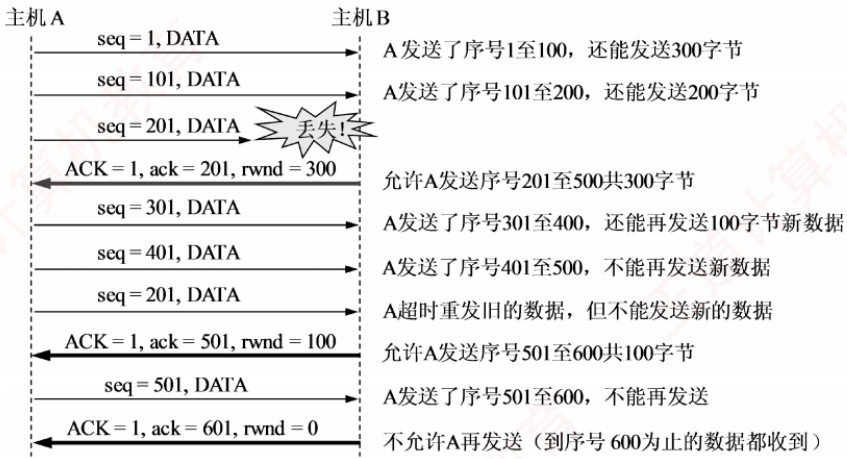

图5.9 利用滑动窗口进行流量控制

假设B向A发送了零窗口通知后不久，B的接收缓存又有了一些存储空间，于是B向A发送非零窗口通知，然而这个报文段在传输过程中丢失了。若不采取其他措施，则B和A会陷入相互等待的死锁状态。为此，TCP为每个连接设有一个持续计时器。只要发送方收到对方的零窗口通知，就启动持续计时器。若计时器超时，则发送方发送一个零窗口探测报文段，而对方会在确认该探测报文段时给出当前的窗口值。若窗口仍然是零，则发送方收到确认报文段后重新设置持续计时器；若窗口不是零，则死锁状态就可以打破了。

传输层和数据链路层的流量控制的区别是:传输层实现的是端到端，即两个进程之间的流量控制；数据链路层实现的是相邻节点之间的流量控制。此外，数据链路层的滑动窗口协议的窗口大小一般为固定值，而传输层的窗口大小可以根据接收方的缓存情况动态变化。

### 5.3.6 TCP拥塞控制

拥塞控制是指防止过多的数据注入网络，以保证网络中的路由器或链路不致过载。出现拥塞时，通信端点通常无法直接获知拥塞的具体细节，只能通过表现（如时延增加）间接感知。

拥塞控制与流量控制的区别:拥塞控制的目标是使网络能够承受当前的负载，是一个全局性过程，涉及所有主机、路由器及影响网络性能的各种因素。而流量控制则关注点对点通信中接收方的处理能力，是一个端到端的问题，由接收方通过窗口机制抑制发送方的发送速率，以确保自身能及时接收数据。尽管二者目标不同，但都是通过调节发送方的发送速率来实现控制效果的。

例如，某链路的传输速率为10Gb/s，当一台大型机以1Gb/s的速率向一台PC传送文件时，显然网络带宽充足，不存在拥塞问题；但由于PC的处理能力有限，可能来不及接收如此高速的数据流，因此必须进行流量控制。反之，若有100万台PC同时以1Mb/s的速率通过该链路传输文件，则问题就转变为网络总负载是否超出了其承载能力，这时需要依赖拥塞控制。

TCP采用四种算法进行拥塞控制:慢开始、拥塞避免、快重传和快恢复。

发送方在确定数据的发送速率时，既要考虑接收方的接收能力，也要从全局角度避免引发网络拥塞。因此，除了上节介绍的接收窗口，TCP还要求发送方维护一个拥塞窗口（cwnd），其大小取决于当前网络的拥塞状况，并动态调整。其控制原则是:

● 若网络未出现拥塞，则适当增大cwnd，以便把更多分组发送出去，提高网络利用率。

● 若检测到网络拥塞，则适当减少cwnd，以减少注入网络的分组数量，缓解网络拥塞。

通常，只要发送方未按时收到确认（发生了超时），即可认为网络出现了拥塞。

考点追踪TCP的滑动窗口机制（2010、2014-2016、2025）

发送窗口的上限值应取接收窗口（rwnd）和拥塞窗口（cwnd）中较小的一个，即

$$
发送窗口的上限值  = \min[ round ,  cwind ]
$$

接收窗口的大小可通过TCP首部中的“窗口”字段由接收方通知发送方。那么，发送方如何维护拥塞窗口呢？这正是下面要介绍的慢开始和拥塞避免算法所解决的问题。为便于分析，这里假设:数据仅单向传输，接收方只发送确认报文；接收方拥有足够大的缓存空间，因此发送窗口的大小仅受拥塞窗口的限制；并且以最大报文段长度MSS作为拥塞窗口大小的单位

#### 1．慢开始和拥塞避免

**（1）慢开始算法**

慢开始的基本思想:在连接刚建立时，发送方并不了解网络的负载情况，若立即向网络注入大量数据，可能会引发拥塞。因此，应先发送少量数据进行试探；若未发生拥塞，则逐步增大发送量，即从小到大逐渐增大拥塞窗口。

**考点追踪 慢开始算法的原理（2014、2015、2025）**

初始拥塞窗口 cwnd 通常设为1MSS（最新的RFC允许设置更多MSS），慢开始算法规定:每收到一个对新报文段的确认，就将cwnd加1。这样，每经过一个传输轮次（一个往返时延RTT)，cwnd就会加倍，从而随传输轮次呈指数增长。请注意:慢开始的“慢”并非指增长速度慢，而是指从较小的cwnd（如1）开始，谨慎试探网络状态，从而有效预防拥塞。例如，A向B发送数据，初始cwnd=1，A发送第1个报文段；收到确认后，cwnd增至2，接着发送2个报文段；收到这2个确认后，cwnd增至4，下一轮便可发送4个报文段，依此类推。

为防止 cwnd 无限制增长，还需设置一个慢开始门限 ssthresh（阈值）。当 cwnd 增长至 ssthresh时，停止慢开始算法，转而采用拥塞避免算法。

**(2)拥塞避免算法**

考点追踪 拥塞避免算法的原理（2009、2017、2020、2022、2023）

拥塞避免的目标是让cwnd缓慢增长，以降低拥塞风险。其策略是:每经过一个传输轮次（收到本轮所有报文段的确认），就将cwnd加1，而不是加倍，从而使cwnd按线性规律缓慢增长（加法增大），防止网络过早出现拥塞。这种增长速率比慢开始阶段要慢得多。

两种算法的切换规则如下:

当 cwnd < ssthresh 时，使用慢开始算法。

●当 cwnd > ssthresh 时，使用拥塞避免算法。

当cwnd = ssthresh时，既可使用慢开始算法，又可使用拥塞避免算法（常规做法）。

**（3）网络拥塞的处理**

无论处于慢开始阶段还是拥塞避免阶段，只要发送方判断网络出现拥塞（如发生超时），就执行以下操作:①将慢开始门限 ssthresh 调整为当前cwnd的一半（但不得小于2）；②将 cwnd重置为1；③重新执行慢开始算法。这样做的目的是迅速减少注入网络的分组数量，使得发生拥塞的路由器有足够时间把队列中积压的分组处理完。

**考点追踪TCP拥塞控制与传输效率分析（2016、2023）**

慢开始和拥塞避免算法的实现过程如图5.10所示。

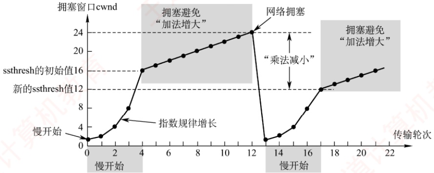

图 5.10 慢开始和拥塞避免算法的实现过程

● 初始时，拥塞窗口设为 1，即 cwnd = 1；慢开始门限设为 16，即 ssthresh= 16。

**考点追踪TCP拥塞窗口演化分析（2016、2023）**

● 在慢开始阶段，发送方每收到一个对新报文段的确认，就将 cwnd加 1。当 cwnd 增长到ssthresh（cwnd=16）时，停止慢开始算法，转而采用拥塞避免算法。

● 当 cwnd = 24 时，若网络出现拥塞，则将 ssthresh 调整为当前 cwnd 的一半（12），同时将 cwnd 重置为1，并重新执行慢开始算法；此后，当cwnd再次增长到12时，改为执行拥塞避免算法。

**注意**

在慢开始阶段，若 2cwnd > ssthresh，则下一个传输轮次后的 cwnd 应等于 ssthresh，而不是2cwnd。例如，第 16 个轮次时 cwnd= 8、ssthresh= 12，则第 17 个轮次后 cwnd = 12，而不是 16。

在慢开始和拥塞避免算法中采用了“乘法减小”策略:当网络发生超时（通常意味着很可能出现了拥塞），将慢开始门限 ssthresh 调整为当前 cwnd的一半，并重新进入慢开始阶段。如果网络频繁发生拥塞，ssthresh会下降得很快，从而大幅减少注入网络的分组数量。

拥塞避免并不能完全避免拥塞。事实上，依靠上述机制彻底避免拥塞是不可能的。所谓拥塞避免，是指在该阶段将拥塞窗口按线性规律增长，从而使网络较不容易发生拥塞。

#### 2．快重传和快恢复

有时，个别报文段因偶然原因丢失，但网络并未真正拥塞。若发送方等待超时才重传，则会误判为拥塞并启动慢开始算法，导致传输效率下降。为此，TCP引入了快重传和快恢复机制。

**（1）快重传**

**考点追踪快重传算法的原理（2019）**

快重传算法的核心是让发送方在超时前尽早重传丢失的报文段。为此，接收方不应等到有数据要发送时才捎带确认，而应在收到报文段后立即确认；特别是收到失序报文段时，要立即对最后一个按序到达的报文段发送重复确认（冗余ACK）。发送方连续收到3个相同的冗余ACK时，即可判定对应报文段已丢失，并立即重传，而无须等待超时计时器到期。

**(2) 快恢复**

快恢复算法的思路:当发送方连续收到3个冗余ACK时，表明后续多个报文段已成功抵达接收方，说明网络很可能并未发生严重拥塞。此时，发送方执行“乘法减小”策略，将ssthresh调整为当前 cwnd的一半，以预防潜在的拥塞。与慢开始算法的不同之处是:它不将 cwnd重置为1，而是将 cwnd 也调整为当前 cwnd 的一半（等于 ssthresh），然后直接进入拥塞避免阶段，使cwnd缓慢线性增长。由于跳过了从 cwnd=1开始的慢开始过程，因此称为快恢复。

TCP拥塞控制算法的实现过程如图5.11所示，其中前20个轮次与图5.10中的相同。在第21轮次（cwnd=16），发送方连续收到3个冗余ACK，此时不启动慢开始算法，而执行快恢复算法:设置 ssthresh = cwnd/2 = 8，cwnd = ssthresh = 8，并开始执行拥塞避免算法。

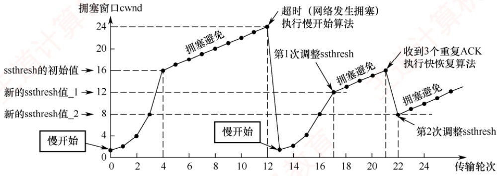

图 5.11 TCP 拥塞控制算法的实现过程

TCP拥塞控制可归纳为图5.12所示的流程图。四种算法的使用总结:当TCP连接建立或网络出现超时现象时，采用慢开始和拥塞避免算法（ssthresh=cwnd/2，cwnd=1）；当发送方收到3个冗余ACK时，采用快重传和快恢复算法（ssthresh= cwnd/2，cwnd=ssthresh）。

在流量控制中，发送方发送数据的量由接收方通过接收窗口（rwnd）决定；而在拥塞控制中发送方则根据网络反馈自主调整拥塞窗口（cwnd）。接收方的缓存空间总是有限的。因此，发送方实际的发送窗口大小由流量控制和拥塞控制共同决定。当题目中同时出现接收窗口（rwnd）和拥塞窗口（cwnd）时，发送窗口的上限值应取两者中的较小者，即 min[rwnd, cwnd]。

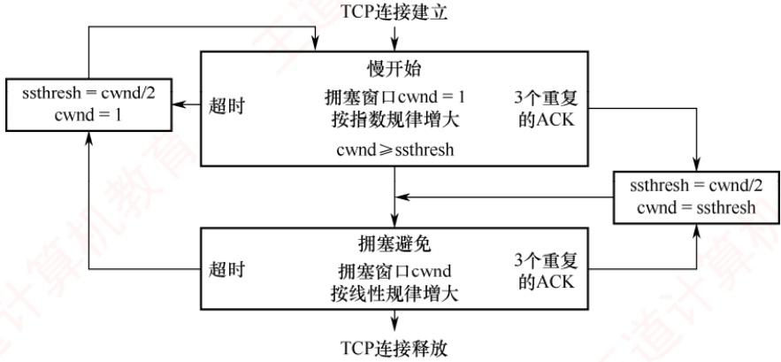

图 5.12 TCP 拥塞控制的流程图

## 5.4 本章小结及疑难点

**1. MSS（最大报文段长度）设置得过大或过小会有什么影响？**

MSS的设定与接收方的缓存大小或接收窗口无关，其主要目的是避免IP分片。若MSS设置得太小，网络利用率会显著降低。因为每个TCP报文段至少要加上40B的首部（TCP首部20B+IP首部20B）才能形成一个P数据报。极端情况下，若数据部分仅1B，则有效载荷占比仅为1/41；若再考虑数据链路层的帧头尾开销，实际利用率还会更低。若MSS设置得太大，在P层传输时可能因超过路径中某段链路的MTU而被分片。接收端需将所有分片重新组装成原始TCP报文段；一旦任一分片丢失，整个报文段都必须重传，反而增加传输开销和延迟。

因此，MSS应尽可能大，但以在IP层不发生分片为前提。然而，由于互联网路径是动态变化的，某条路径上无须分片的MSS，在另一条路径上可能仍需分片，故最佳MSS难以确定。为此，TCP规定默认MSS为536B，这意味着所有互联网主机都应能接收长度为536B（数据）+20B（TCP首部）=556B的TCP报文段。

**2.TCP使用的是后退N帧（GBN）还是选择重传（SR）？**

表面上看，TCP使用累积确认，类似于GBN。但区别在于:接收方不会丢弃正确到达但失序的报文段，而是将其缓存，并反复发送冗余ACK，指明期望收到的下一个按序报文段的序号。例如，假设发送方A连续发送N个报文段，其中第k（k < N）个丢失，其余均正确到达接收方B。在GBN中，接收方会丢弃所有失序的报文段（第k+1个至N个），发送方需重传从第k个开始的所有未确认报文段。而TCP仅重传丢失的第k个报文段，后续已缓存的报文段无须重传。此外，TCP还支持 SACK（Selective ACK）选项。启用 SACK后，接收方可明确告知发送方哪些非连续的数据块已成功接收，使重传行为更接近SR协议。

因此，TCP的重传机制可视为GBN与 SR的混合体:基础行为基于累积确认和冗余ACK

实现高效单点重传，SACK则进一步增强了选择性确认能力。

**3. 为什么超时事件发生时 cwnd 被置为 1，而收到 3 个冗余 ACK时 cwnd 减半？**

两种事件反映的网络拥塞严重程度不同。收到3个冗余ACK，表明后续部分报文段已成功到达接收方（否则无法触发重复确认），说明网络仍具备一定传输能力，拥塞相对较轻。此时TCP采用快速重传机制，将cwnd减半（乘法减小），适度降低发送速率。超时事件发生，意味着连ACK都未能及时返回，很可能网络已严重拥塞甚至局部瘫痪。为最大限度缓解拥塞，TCP将cwnd重置为1MSS，进入慢启动阶段，极其谨慎地重新探测网络容量。因此，超时代表更严重的拥塞，故采取更强的抑制措施；而冗余ACK表明网络尚可通信，只需适度退让。

**4. 为什么不采用“两次握手”建立连接呢？**

主要是为了防止已失效的连接请求报文段突然传送到服务器，导致错误建立连接。

考虑如下情况:客户A向服务器B发送TCP连接请求（SYN），该报文在网络中长时间滞留。A超时后重传SYN，B收到后正常建立连接，完成数据传输并断开。

此后，先前滞留的旧SYN报文（失效请求）才到达B。

若采用三次握手:B收到旧 SYN后，会向A发送SYN-ACK；但A发现该确认序号无效（非当前请求），直接丢弃，不回复ACK，连接无法建立。

若采用两次握手:B收到旧SYN后，立即认为连接已建立，并等待A发送数据；而A并无此连接意图，不会响应，导致B长期占用资源，造成浪费。

因此，三次握手能有效避免因网络延迟的旧请求引发的资源误分配，而两次握手无法做到。

**5. 为什么TCP在建立连接时不能每次都选择相同的、固定的初始序号？**

假设主机A与B频繁建立连接、传输数据后释放。若每次A都使用相同的初始序号（如1），具体场景:A发送的某些TCP报文段在网络中滞留较久，A超时后重传并完成后续通信。但这些旧报文段在连接早已释放后才到达B，而此时A与B已建立一条新的TCP连接。

由于新连接仍使用相同的初始序号，旧报文段的序号可能落在新连接的有效窗口内，导致B误将其当作新数据接收，造成数据混乱或协议错误。为防止此类问题，新连接的初始序号必须与之前连接使用过的序号不同，确保迟到的旧报文段序号不会被新连接接受。因此，TCP不能使用固定初始序号，而应采用随时间递增的随机化初始序号。

6. 假定在一个互联网中，所有链路的传输都不出现差错，所有节点也都不会发生故障。试问在这种情况下，TCP的“可靠交付”功能是否就是多余的？

不是多余的。即使底层无差错、无故障，IP层本身是无连接且不可靠的，仍可能导致数据丢失、失序或重复，因此TCP的可靠交付依然必不可少。典型情况包括:

1）IP数据报独立选路，可能到达时失序；

2）路由异常可能导致数据报在网中循环，TTL减至0后被丢弃:

3）路由器突发拥塞时，来不及处理的数据报会被丢弃。

以上问题均发生在网络层，与链路差错或节点故障无关。只有依靠TCP的可靠交付机制，才能确保目的进程收到完整、有序且无重复的数据。
