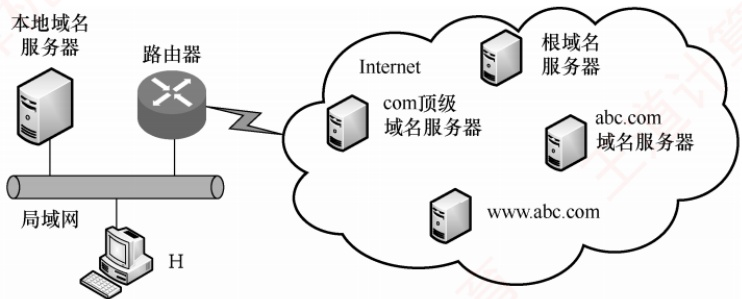
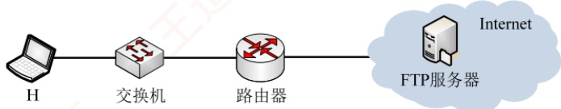
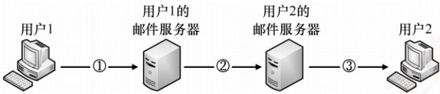
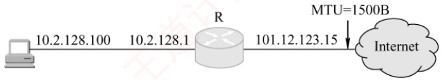
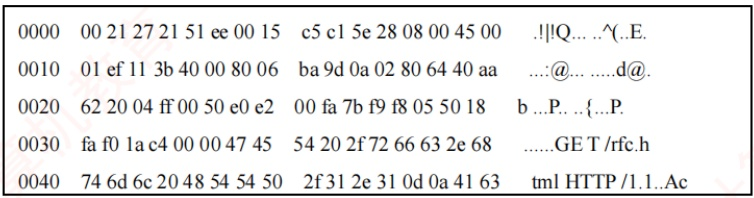
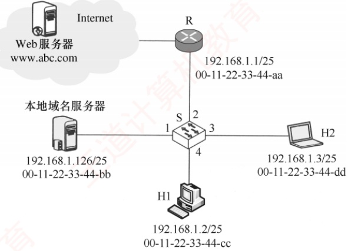
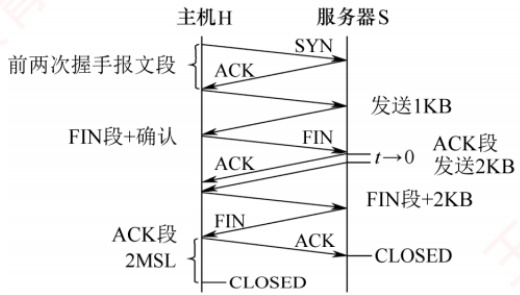
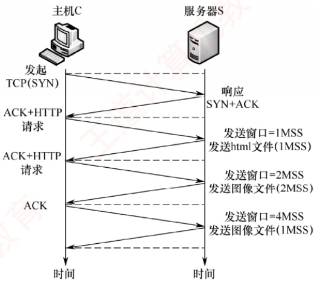

# 第6章 应用层 · 习题与解析

> 由《第6章 应用层》正文摘出；区块标题保留了原书的小节编号。

### 6.1.3 本节习题精选

#### 单项选择题

01. 在客户/服务器模型中，客户指的是（）。

A. 请求方
B. 响应方
C. 硬件
D. 软件

02. 用户提出服务请求，网络将用户请求传送到服务器；服务器执行用户请求，完成所要求的操作并将结果送回用户，这种工作模型称为（）。
C. C/SMA/CD 模型 道 B
D. P模型模型型

03.下面关于客户/服务器模型的描述，（）存在错误。I. 客户端必须提前知道服务器的地址，而服务器则不需要提前知道客户端的地址Ⅱ. 客户端主要实现如何显示信息与收集用户的输入，而服务器主要实现数据的处理IⅢ. 浏览器显示的内容来自服务器IV. 客户端是请求方，即使连接建立后，服务器也不能主动发送数据 机教
A. I、IV
B. III、IV
C. 仅IV
D. 仅ⅢII

04.下列关于客户/服务器模型的说法中，不正确的是（）。
A. 服务器专用于完成某些服务，而客户则作为这些服务的使用者
B. 客户通常位于前端，服务器通常位于后端
C. 客户和服务器通过网络实现协同计算任务
D. 客户是面向任务的，服务器是面向用户的

05. 以下关于P2P概念的描述中，错误的是（）。
A. P2P是网络节点之间采取对等方式直接交换信息的工作模型
B. P2P通信模式是指P2P 网络中对等节点之间的直接通信能力
C. P2P网络是指与互联网并行建设的、由对等节点组成的物理网络
D. P2P实现技术是指为实现对等节点之间直接通信的功能所需要设计的协议、软件等

06.【2019统考真题】下列关于网络应用模型的叙述中，错误的是（）。
A. 在P2P模型中，节点之间具有对等关系
B. 在客户/服务器（C/S）模型中，客户与客户之间可以直接通信
C. 在C/S模型中，主动发起通信的是客户，被动通信的是服务器
D. 在向多用户分发一个文件时，P2P模型通常比C/S模型所需的时间短

### 6.1.4 答案与解析

#### 单项选择题

01. A

客户既不是硬件，又不是软件，只是服务的请求方，服务器才是响应方。

02. A

用户提出服务请求，网络将用户请求传送到服务器；服务器执行用户请求，完成所要求的操作并将结果送回用户，这种工作模型称为客户/服务器模型，即C/S模型。

03. C

在连接未建立前，服务器在某一个端口上监听。客户端是连接的请求方，客户端必须事先知道服务器的地址才能发出连接请求，而服务器则从客户端发来的数据包中获取客户端的地址。 一旦连接建立，服务器就能响应客户端请求的内容，服务器也能主动发送数据给客户端，用于一些消息的通知，如一些错误的通知。所以只有说法IV错误。

04. D

客户的作用是根据用户需求向服务器发出服务请求，并将服务器返回的结果呈现给用户，因

此客户是面向用户的，服务器是面向任务的。

05. C

P2P可以理解为一种通信模型、一种逻辑网络模型。物理网络是指在网络中由各种设备（主机、交换机等）和介质（双绞线等）连接而形成的网络，它看得见摸得着。而这个网络中所使用的协议，或网络结构，都是靠逻辑网络来划分的。P2P网络是一个构建在IP网络上的覆盖网络，是一种动态的逻辑网络。对等节点之间具有直接通信的能力是P2P的显著特点。

06. B

在P2P模型中，每个节点的权利和义务对等，彼此可直接通信。而在C/S模型中，客户是服务发起方，服务器被动接受来自客户的请求，客户之间不能直接通信，例如Web应用中的两个浏览器之间不能直接通信。P2P模型通过将文件分发任务分散到多个节点，允许用户从多个对等方并行下载，从而减轻服务器负担，在向多用户分发文件时，通常比C/S模型所需的时间更短。

### 6.2.4 本节习题精选

#### 一、单项选择题

01. 域名与（）具有一一对应的关系。
A. IP地址
B. MAC 地址
C. 主机
D. 以上都不是

02.下列说法错误的是（）。
A. Internet上提供客户访问的主机一定要有域名
B. 同一域名在不同时间可能解析出不同的IP地址
C. 多个域名可以指向同一台主机的IP地址
D. IP子网中的主机可以由不同的域名服务器来维护其映射

03. DNS是基于（）模型的分布式系统。
A. C/S
B. B/S
C. P2P
D. 以上均不正确

04. 域名系统（DNS）的组成不包括（）。
A. 域名空间
B. 分布式数据库
C. 域名服务器
D. 从内部IP地址到外部IP地址的翻译程序

05. 互联网中域名解析依赖于由域名服务器组成的逻辑树。在域名解析过程中，主机上请求域名解析的软件不需要知道（）信息。I. 本地域名服务器的 IP ⅡI. 本地域名服务器父节点的IP 王道计I. 域名服务器树根节点的IP
A. I和Ⅱ
B. I和I
C. ⅡI和ⅢII
D. I、ⅡI和ⅢII

06.在DNS的递归查询中，由（）给客户端返回地址。
A. 最开始连接的服务器
B. 最后连接的服务器
C. 目的地址所在服务器
D. 不确定

07. 当本地域名服务器向根域名服务器查询一个域名时，根域名服务器返回一个负责该域名的顶级域名服务器的IP地址，让本地域名服务器再向该域名服务器查询，这种查询方式称为（）。
A. 递归查询
B. 迭代查询
C. 重定向查询
D. 广播查询

08. 一台主机要解析 www.cskaoyan.com 的 IP地址，若这台主机配置的域名服务器为202.120.66.68，互联网顶级域名服务器为 11.2.8.6，而存储 www.cskaoyan.com 的 IP地址对应关系的域名服务器为202.113.16.10，则这台主机解析该域名通常首先查询（）
A. 202.120.66.68 域名服务器
B. 11.2.8.6 域名服务器
C. 202.113.16.10 域名服务器 +算机教
D. 可以从这3个域名服务器中任选一个

09.（）可以将其管辖的主机名转换为主机的IP地址。
A. 本地域名服务器
B. 根域名服务器
C. 权限域名服务器
D. 代理域名服务器

10. 若本地域名服务器无缓存，用户主机采用递归查询向本地域名服务器查询另一网络某主机域名对应的IP地址，而本地域名服务器采用迭代查询向其他域名服务器进行查询，则用户主机和本地域名服务器发送的域名请求条数分别为（）。
A. 1条，1条
B. 1条，多条
C. 多条,1条
D. 多条，多条

11. 【2010统考真题】若本地域名服务器无缓存，则在采用递归方法解析另一网络某主机域名时，用户主机和本地域名服务器发送的域名请求条数分别为（）。
A. 1条，1条
B. 1条，多条
C. 多条，1条
D. 多条，多条

12.【2016统考真题】假设所有域名服务器均采用迭代查询方式进行域名解析。当主机访问规范域名为www.abc.xyz.com的网站时，本地域名服务器在完成该域名解析的过程中，可能发出DNS 查询的最少和最多次数分别是（）。
A. 0, 3
B. 1, 3
C. 0, 4
D. 1, 4

13. 【2018统考真题】下列TCP/IP应用层协议中，可以使用传输层无连接服务的是（）。
A. FTP
B. DNS
C. SMTP
D. HTTP

14.【2020统考真题】假设下图所示网络中的本地域名服务器只提供递归查询服务，其他域名服务器都只提供迭代查询服务；局域网内主机访问Internet 上各服务器的往返时间(RTT）均为 10ms，忽略其他各种时延。若主机 H通过超链接 http://www.abc.com/indexhtml请求浏览纯文本Web 页 index.html,则从单击超链接开始到浏览器接收到 index.html页面为止，所需的最短时间与最长时间分别是（）

A. 10ms, 40ms
B. 10ms, 50ms
C. 20ms, 40ms
D. 20ms, 50ms

#### 二、综合应用题

01. DNS 使用 UDP 而非 TCP，若一个 DNS 分组丢失，没有自动恢复，则这会引起问题吗？若会，则应如何解决？

02. 为何要引入域名的概念？举例说明域名转换过程。域名服务器中的高速缓存有何作用？

### 6.2.5 答案与解析

#### 一、单项选择题

01. D

若一台主机通过两块网卡连接到两个网络（如服务器双线接入），则就具有两个IP地址，每个网卡对应一个MAC地址，显然这两个IP地址可以映射到同一个域名上。此外，多台主机也可以映射到同一个域名上（如负载均衡），一台主机也可以映射到多个域名上（如虚拟主机）。因此，选项A、B和C和域名均不具有一一对应的关系。

02. A

Internet上提供访问的主机一定要有IP地址，而不一定要有域名，选项A错误。域名在不同的时间可以解析出不同的P地址，因此可以用多台服务器来分担负载，选项B正确。可以把多个域名指向同一台主机的IP地址，选项C正确。IP子网中主机也可以由不同的域名服务器来维护其映射，选项D正确。

03. A

DNS是一个基于C/S模型的分布式数据库系统，主要用于域名和P地址的映射。

04. D

DNS提供从域名到IP地址或从IP地址到域名的映射服务。它被设计成为一个联机分布式数据库系统，并采用客户/服务器模式。域名的解析是由若干域名服务器程序完成的。从内部IP地址到外部IP地址的映射是由NAT实现的，用于缓解IPv4地址紧缺的问题，与域名系统无关。

05. C

正常情况下，客户只需把域名解析请求发往本地域名服务器，其他事情都由本地域名服务器完成，并把最后结果返回给客户。所以主机只需要知道本地域名服务器的IP。

06. A

在递归查询中，每台不包含被请求信息的服务器都转到其他地方去查找，然后它再往回发送结果，所以客户端最开始连接的服务器最终将返回正确的信息。

07. B

迭代查询是指当一个域名服务器收到本地域名服务器发出的查询请求报文时，要么给出所要查询的IP地址，要么告诉本地服务器:“你下一步应当向哪个DNS服务器进行查询。”然后让本地域名服务器进行后续的查询（而不替本地域名服务器进行后续的查询）。

08. A

当这台主机发出对 www. cskaoyan.com的 DNS 查询报文时，这个查询报文首先被送往该主机的本地域名服务器202.120.66.68。本地域名服务器不能立即回答该查询时，就以 DNS客户的身份向某一根域名服务器查询。但不管采用何种查询方式，首先都要查询本地域名服务器。

09. C

每台主机都必须在权限域名服务器处注册登记，权限域名服务器一定能够将其管辖的主机名转换为该主机的IP地址。

10. B

用户主机向本地域名服务器采用递归查询，只需发送1条查询请求。本地域名服务器无缓存，因此还要进行后续的查询。本地域名服务器向其他域名服务器采用迭代查询，本地域名服务器分别向根域名服务器、顶级域名服务器、权限域名服务器发送多条查询请求。

11. A

用户主机向本地域名服务器采用递归查询，只需发送1条请求。本地域名服务器无缓存，但因其向其他域名服务器也采用递归查询方式，故只需向根域名服务器发送1条请求，后续查询由被询问的服务器代为完成。因此，用户主机和本地域名服务器各自发送的域名请求条数均为1。

12. C

最少情况:若本地域名服务器已缓存该域名的解析结果，则无须发出任何DNS查询，最少为0次。最多情况:因所有服务器均采用迭代查询，在最坏情况下，本地域名服务器需要依次向根域名服务器、顶级域名服务器（.com）、权限域名服务器（xyz.com）和次级权限域名服务器（abc.xyz.com）发起查询，共4次，因此最多为4次。

13. B

FTP用于文件传输，SMTP用于电子邮件发送，HTTP用于网页传输，三者均要求可靠传输，故在传输层使用有连接的TCP服务。DNS对可靠性的要求相对较低，且追求效率与低开销，因此在传输层通常使用无连接的UDP服务。

14. D

题中RTT指局域网内主机或本地域名服务器访问Internet上各服务器的往返时间，H与本地域名服务器间的通信时延忽略不计。最短时间:若H本地有域名缓存，则无须DNS查询，直接与 www.abc.com 建立 TCP 连接并请求资源。TCP 三次握手需 1.5RTT，第三次握手可捎带 HTTP请求，服务器返回页面需0.5RTT，共2RTT=20ms。最长时间:H向本地域名服务器发起递归查询（时延忽略），本地域名服务器依次迭代查询根域名服务器、顶级域名服务器（.com）、域名服务器（abc.com），共3RTT；随后H建立TCP连接并获取页面，需2RTT；总计 $5RTT = 50 ms$

#### 二、综合应用题

01.【解答】

DNS使用传输层的UDP而非TCP，因为它不需要使用TCP在发生传输错误时执行的自动重传功能。实际上，对于DNS服务器的访问，多次DNS请求都返回相同的结果，即做多次和做一次的效果一样。因此DNS操作可以重复执行。当一个进程做一次DNS请求时，它启动一个定时器。若定时器计满而未收到回复，则它就再请求一次，这样做不会有害处。

02. 【解答】

IP地址很难记忆，引入域名是为了便于人们记忆和识别。

域名解析可以把域名转换成IP地址。域名转换过程是向本地域名服务器申请解析，若本地域名服务器查不到，则向根域名服务器进行查询。若根域名服务器中也查不到，则向根域名服务器中保存的顶级域名服务器和相应权限域名服务器进行查询，一定可以查找到。

域名服务器中高速缓存的作用:将近期访问过的域名信息保存在高速缓存，再次访问时会从缓存中读取，不需要重新解析，这样就可以加快域名解析的响应速度。

### 6.3.3 本节习题精选

#### 一、单项选择题

01. 文件传输协议（FTP）的一个主要特征是（）。

A. 允许客户指明文件的类型但不允许指明文件的格式
B. 不允许客户指明文件的类型但允许指明文件的格式
C. 允许客户指明文件的类型与格式
D. 不允许客户指明文件的类型与格式

02. 以下关于FTP工作模型的描述中，错误的是（）。
A. FTP使用控制连接、数据连接来完成文件的传输
B. 用于控制连接的TCP连接在服务器端使用的熟知端口号为21
C. 用于控制连接的TCP连接在客户端使用的端口号为20
D. 服务器端由控制进程、数据进程两部分组成

03. 控制信息是带外传送的协议是（）。
A. HTTP
B. SMTP
C. FTP
D. POP

04. 下列关于FTP连接的叙述中，正确的是（）。
A. 控制连接先于数据连接被建立，并先于数据连接被释放
B. 数据连接先于控制连接被建立，并先于控制连接被释放
C. 控制连接先于数据连接被建立，并晚于数据连接被释放
D. 数据连接先于控制连接被建立，并晚于控制连接被释放

05. FTP客户发起对 FTP服务器连接的第一阶段是建立（）。
A. 传输连接
B. 数据连接
C. 会话连接
D. 控制连接

06. FTP中作为服务器一方的进程，通过监听（）端口得知有无服务请求。
A. 53
B. 80
C. 20
D. 21

07.下列关于FTP的叙述中，错误的是（）。
A. FTP可以实现异构网络中计算机之间的文件传送
B. 在进行文件传输时，FTP客户端和服务器之间需建立两个连接
C. FTP服务器主进程在20端口上监听客户端的连接请求
D. FTP 使用 TCP 进行可靠传输

08. 一个FTP用户发送了一个LIST命令来获取服务器的文件列表，这时服务器应通过（）
A. 21 端口来传输该列表。
B. 20
C. 22
D. 19 教

09.下列关于FTP的叙述中，错误的是（）。
A. FTP可以在不同类型的操作系统之间传送文件
B. FTP并不适合用在两个计算机之间共享读写文件
C. 控制连接在整个FTP会话期间一直保持
D. 客户端默认使用端口20与服务器建立数据传输连接

10. 当一台计算机从 FTP 服务器下载文件时，在该 FTP 服务器上对数据进行封装的 5 个转换步骤是（）。
A. 比特，数据帧，数据报，数据段，数据 教育
B. 数据，数据段，数据报，数据帧，比特
C. 数据报，数据段，数据，比特，数据帧
D. 数据段，数据报，数据帧，比特，数据

11. FTP支持两种方式的传输:ASCI方式和Binary（二进制）方式。通常文本文件的传输采用（）方式，而图像、声音等非文本文件采用（）方式传输。

A. ASCII, Binary
B. Binary, ASCII
C. ASCII, ASCII
D. Binary, Binary

12. 直接封装 FTP、DNS、DHCP报文的协议分别是（）。
A. TCP、UDP、UDP
B. UDP、TCP、TCP
C. TCP、UDP、IP
D. UDP、UDP、UDP

13.【2009统考真题】FTP客户和服务器间传递FTP命令时，使用的连接是（）。
A. 建立在 TCP之上的控制连接
B. 建立在 TCP之上的数据连接
C. 建立在UDP之上的控制连接
D. 建立在 UDP之上的数据连接

14.【2017统考真题】下列关于FTP的叙述中，错误的是（）。
A. 数据连接在每次数据传输完毕后就关闭
B. 控制连接在整个会话期间保持打开状态
C. 服务器与客户端的TCP20端口建立数据连接
D. 客户端与服务器的 TCP21 端口建立控制连接

#### 二、综合应用题

01.文件传输协议的主要工作过程是怎样的？主进程和从属进程各起什么作用？

02. 为什么FTP要使用两个独立的连接，即控制连接和数据连接？

03. 主机A想下载文件ftp://ftp.abc.edu.cn/file，大致描述下载过程中主机和服务器的交互过程。

04.【2023统考真题】某网络拓扑如下图所示，主机H登录FTP服务器后，向服务器上传一个大小为18000B的文件F。假设H为传输F建立数据连接时，选择的初始序号为100，MSS = 1000B，拥塞控制初始阈值为 4MSS，RTT = 10ms，忽略 TCP 段的传输时延；在F的传输过程中，H均以MSS段向服务器发送数据，且未发生差错、丢包和失序现象。

请回答下列问题。

1）FTP的控制连接是持久的还是非持久的？FTP的数据连接是持久的还是非持久的？当H登录FTP服务器时，建立的 TCP连接是控制连接还是数据连接？

2）当H通过数据连接发送F时，F的第一个字节的序号是多少？在断开数据连接过程中，FTP服务器发送的第二次挥手ACK段的确认序号是多少？

3）在H通过数据连接发送F的过程中，当H收到确认序号为2101的确认段时，H的拥塞窗口调整为多少？收到确认序号为7101的确认段时，H的拥塞窗口调整为多少？

4)H从请求建立数据连接开始，到确认F已被服务器全部接收为止，至少需要多长时间？期间应用层数据平均发送速率是多少？

### 6.3.4 答案与解析

#### 一、单项选择题

01. C

FTP提供交互式访问，允许客户指明文件的类型与格式，并允许文件具有存取权限。

02. C

在服务器端，控制连接使用TCP的21号端口，数据连接使用TCP的20号端口；而在客户端，控制连接和数据连接的TCP端口号都是由客户端系统自动分配的。需要注意的是，当我们说FTP使用20、21号端口，HTTP使用80号端口，SMTP使用25号端口时，都是指相应协议的服务器端所使用的端口号，而客户端使用系统自动分配的端口号向这些服务的熟知端口发起连接。

03. C

带外传送是指控制信息与数据信息通过不同的逻辑信道传送。例如，FTP使用一个单独的控制连接来传输控制信息，而数据连接用于传送文件。带内传送是指控制信息与数据信息通过同一个逻辑信道传送。例如，HTTP的请求和响应报文都是在同一个TCP连接上进行的。

04. C

FTP客户首先连接服务器的21号端口，建立控制连接（控制连接在整个会话期间一直保持打开），然后建立数据连接，在数据传送完毕后，数据连接最先释放，控制连接最后释放。

05. D

FTP工作时使用两个连接:控制连接和数据连接。FTP客户对FTP服务器发起连接时，首先建立控制连接，即向服务器的21号TCP端口发起连接；然后建立数据连接（20号TCP端口）。FTP并没有传输连接和会话连接的说法。

06. D

FTP服务器通过监听熟知端口21（控制端口）得知有无服务请求。

07. C

因为FTP屏蔽了各计算机系统的细节，所以FTP适用于异构网络中计算机之间的文件传送。当进行文件传输时，FTP客户端和服务器之间需建立两个并行的控制连接和数据连接。FTP服务器主进程在熟知端口21上监听客户端的服务请求。FTP在传输层使用TCP进行可靠传输。

08. B

FTP中数据连接的端口是20，而文件的列表是通过数据连接来传输的。

09. D

控制连接建立后，服务器进程用自己传送数据的熟知端口20与客户进程所提供的端口号建立数据传输连接（默认为PORT模式），即客户进程的端口号是客户进程自己提供的。

10. B

FTP服务器的数据要经过应用层、传输层、网络层、数据链路层及物理层。因此，对应的封装是数据、数据段、数据报、数据帧，最后是比特。

11. A

FTP 支持 ASCII 和 Binary 两种方式的传输，非加密文本文件通常采用 ASCI 方式传输，而图像、声音等非文本文件采用Binary方式传输。本题可能有所超纲，了解即可。

12. A

FTP需要保证数据传输的可靠性，因此采用TCP作为传输层协议。在DHCP的应用中，客户在分配到IP地址前无法使用TCP建立连接，因此只能利用UDP进行无连接的交互。UDP具有简化通信、更高效、低延迟的特性，能满足DNS查询对快速响应和高并发的需求。

13. A

对于FTP文件传输，为了保证可靠性，选择TCP，排除C和 D。FTP的控制信息是带外传送的，即FTP使用了一个分离的控制连接来传送命令，因此答案为选项A。

14. C

FTP使用控制连接和数据连接，控制连接存在于整个FTP会话过程中，数据连接在每次文件传输时才建立，传输结束就关闭，选项A和B正确。默认情况（PORT模式）下FTP服务器使用TCP20端口进行数据连接，使用TCP21端口进行控制连接，这里的端口号是指FTP服务器的端口号，因此选项C错误、选项D正确。此外还需要注意的是，FTP服务器是否使用TCP20端口建立数据连接与传输模式有关，PORT模式使用TCP20端口，PASV模式由服务器随机选定。

#### 二、综合应用题

01.【解答】

FTP的主要工作过程如下:在进行文件传输时，FTP客户所发出的传送请求通过控制连接发送给服务器端的控制进程，并在整个会话期间一直保持打开，但控制连接不用来传送文件。服务器端的控制进程在接收到FTP客户发送来的文件传输请求后，就创建数据传送进程和数据连接，数据连接用来连接客户端和服务器端的数据传送进程，数据传送进程实际完成对文件的传送，在传送完毕后关闭“数据传送连接”，并结束运行。

FTP的服务器进程由两大部分组成:一个主进程，负责接收新的请求；若干从属进程，负责处理单个请求。

02.【解答】

在FTP的实现中，客户与服务器之间采用了两条传输连接，其中控制连接用于传输各种FTP命令，而数据连接用于文件的传送。之所以这样设计，是因为使用两条独立的连接可使FTP变得更加简单、更容易实现、更有效率。同时在文件传输过程中，还可以利用控制连接控制传输过程，如客户可以请求终止、暂停传输等。

03.【解答】

大致过程如下:

①建立一个TCP连接到服务器 ftp.abc.edu.cn的 21号端口，然后发送登录账号和密码。

②服务器返回登录成功信息后，主机A打开一个随机端口，并将该端口号发送给服务器。

③ 主机 A发送读取文件命令，内容为 get file，服务器使用 20号端口建立一个 TCP 连接到主机A的随机打开的端口。

④服务器把文件内容通过第二个连接发送给主机A，传输完毕后连接关闭。

04. 【解答】

1）在FTP会话期间，控制连接一直处于保持状态，是持久的。当每次需要传输文件时，FTP客户和服务器之间会建立一个临时的数据连接，用于传输文件数据，是非持久的。控制连接用于传输命令和控制信息，登录操作涉及身份验证、发送命令等控制信息，因此H登录FTP服务器时建立的TCP连接是控制连接。

2）建立连接时，FTP客户发送的第一次握手SYN段要消耗一个序号，选择的初始序号为100，因此发送文件F时，第一个字节的序号为101。文件F共有18000个字节，需占用18000个序号，释放连接时，FTP客户发送的第一次挥手FIN段也要消耗一个序号，所以该FIN段的序号为18101，因此TCP服务器发送的第二次挥手ACK段的确认序号是18102。

3）拥塞窗口在每个传输轮次后的变化如下表所示。前两个传输轮次，拥塞窗口小于阈值，拥塞窗口按指数增长；第2个传输轮次结束后，拥塞窗口增长到4MSS，此后每经过一个传输轮次，拥塞窗口增加1MSS。当H收到确认序号为2101的确认段时，表示服务器已收到2000B数据，即2个报文段，此时还处在第2个传输轮次（慢开始阶段），拥塞窗口还未达到阈值，发送端每收到一个确认，拥塞窗口就加1，所以此时拥塞窗口为2+1= 3MSS。当H收到确认序号为7101的确认段时，表示服务器已收到7个报文段，第3轮传输结束后，发送端共发送了 $1 + 2 + 4 = 7 \mathrm {MSS}$ 数据，所以拥塞窗口大小为5MSS。

| N个传输轮次后 | 初始时 | N=1 | N=2 | N=3 |
| --- | --- | --- | --- | --- |
| 拥塞窗口大小 | 1MSS | 2MSS | 4MSS | 5MSS |

4）每个传输轮次传输的数据量如下表所示，文件F的大小 $18000\mathrm{B}=18\mathrm{MSS}$ ，则发送完F要经过5RTT，此外还要1个额外的RTT用来建立TCP连接。因此，H从请求建立数据连接开始，到确认F已被服务器全部接收为止，至少需要 $6RTT = 6 \times 10 ms  = 60 ms$ ；期间应用层的数据平均发送速率是 $18000\mathrm{B} \div 60\mathrm{ms}=300 \times 10^{3}\mathrm{B} / \mathrm{s}=0.3\mathrm{MB} / \mathrm{s}=2.4\mathrm{Mb} / \mathrm{s}$ 0

| k | k = 1 | k=2 | k= 3 | k=4 | k=5 |
| --- | --- | --- | --- | --- | --- |
| 第k轮最大数据传输量 | 1MSS | 2MSS | 4MSS | 5MSS | 6MSS |

### 6.4.4 本节习题精选

#### 一、单项选择题

01.互联网用户的电子邮件地址格式必须是（）。
A. 用户名@单位网络名
B. 单位网络名@用户名
C. 邮箱所在主机的域名@用户名
D. 用户名@邮箱所在主机的域名

02. SMTP基于传输层的（）协议，POP3基于传输层的（）协议。
A. TCP, TCP
B. TCP, UDP
C. UDP, UDP
D. UDP, UDP

03. SMTP服务器使用的端口号是（）。
A. 21
B. 25
C. 80
D. 110

04. 用Firefox（浏览器）在Gmail中向邮件服务器发送邮件时，使用的是（）协议。
A. HTTP
B. POP3
C. P2P
D. SMTP

05.用户代理只能发送而不能接收电子邮件时，可能是（）地址错误。

A. POP3
B. SMTP
C. HTTP
D. Mail

06. 不能用于用户从邮件服务器接收电子邮件的协议是（）。
A. HTTP
B. POP3
C. SMTP
D. IMAP

07.下列关于电子邮件格式的说法中，错误的是（）。
A. 电子邮件内容包括邮件头与邮件体两部分
B. 邮件头中发信人地址（From:）、发送时间、收信人地址（To:）及邮件主题（Subject:）是由系统自动生成的
C. 邮件体是实际要传送的信函内容
D. MIME允许电子邮件系统传输文字、图像、语音与视频等多种信息 育

08. 【2012统考真题】若用户1与用户2之间发送和接收电子邮件的过程如下图所示，则图中①、②、③阶段分别使用的应用层协议可以是（）。

A. SMTP、SMTP、SMTP
B. POP3、SMTP、POP3
C. POP3、SMTP、SMTP
D. SMTP、SMTP、POP3

09.【2013统考真题】下列关于SMTP的叙述中，正确的是（）。I. 只支持传输 7 比特 ASCII 码内容Ⅱ. 支持在邮件服务器之间发送邮件Ⅲ. 支持从用户代理向邮件服务器发送邮件IV. 支持从邮件服务器向用户代理发送邮件
A. 仅I、ⅡI和ⅢI
B. 仅I、Ⅱ和IV
C. 仅I、ⅢI和IV
D. 仅ⅡI、III和IV

10.【2015统考真题】通过POP3协议接收邮件时，使用的传输层服务类型是（）。
A. 无连接不可靠的数据传输服务
B. 无连接可靠的数据传输服务
C. 有连接不可靠的数据传输服务
D. 有连接可靠的数据传输服务

11.【2018统考真题】无须转换即可由SMTP直接传输的内容是（）。
A. JPEG 图像
B. MPEG 视频
C. EXE 文件
D. ASCII 文本

12.【2025统考真题】下列关于POP3协议的叙述中，正确的是（）。I.支持用户代理从邮件服务器读取邮件Ⅱ. 支持用户代理向邮件服务器发送邮件Ⅲ. 支持邮件服务器之间发送与接收邮件 IV. 支持通过一条TCP连接收取多封邮件
A. 仅I、IV
B. 仅ⅡI、III
C. 仅I、IⅡI、ⅢI
D. 仅I、III、IV

#### 二、综合应用题

01. 电子邮件系统使用TCP传送邮件，为什么有时会遇到邮件发送失败的情况？ 为什么有时对方会收不到发送的邮件？

02. MIME 与 SMTP 的关系是怎样的?

03. 用户主机上的电子邮件用户代理与邮件服务器建立了连接，现截获一个TCP报文段，如下图所示。图中显示了该报文段的前126个字节的十六进制数及ASCI码内容。TCP

首部长度为20B。请回答:

.0....P...Q...Me ssage-ID: <4DCE9 2BA.2010 902@163. com>..Da te: Sat, 14 May 2011 22: 33:30 +0 800..Fro m: cskao yan2012@ 163.com.

1）用户代理和服务器之间使用的应用层协议是什么？

2）用户代理使用的端口号是多少？

3）该邮件的发件人邮箱是什么？

### 6.4.5 答案与解析

#### 一、单项选择题

01. D

电子邮件是互联网最基本、最常用的服务功能。要使用电子邮件服务，首先要拥有自己的电子邮件地址，其格式为:用户名@邮箱所在主机的域名。

02. A

SMTP和 POP3都是基于TCP的协议，提供可靠的邮件通信。

03. B

SMTP服务器使用的熟知端口号是25。

04. A

在基于万维网的电子邮件中，用户浏览器与Hotmail或Gmail的邮件服务器之间的邮件发送或接收使用的是HTTP，而仅在不同邮件服务器之间传送邮件时才使用 SMTP。

05. A

用户代理使用POP3协议接收邮件。通常用户在配置电子邮件用户代理时需要设置邮件服务器的POP3地址（如pop3.gmail.com），若这个地址设置错误，则会导致用户无法接收邮件。用户代理中的 SMTP地址错误时会导致无法发送邮件。收件人E-mail地址错误时，可能会发错人，也可能会导致投递失败（不存在的地址）

06. C

SMTP是一种“推”协议，用于发送端用户代理与发送端服务器之间及发送端服务器与接收端服务器之间，不能用于接收端用户从服务器上读取邮件。常用的邮件读取协议有POP3、HTTP和IMAP。大家平时通过浏览器登录163 邮箱、Gmail邮箱时，使用的邮件读取协议就是HTTP。IMAP是另一个专用于读取邮件的协议，它要比POP3复杂得多，功能也更为强大。

07. B

邮件头是由多项内容构成的，其中一部分是由系统自动生成的，如发信人地址（From:）、发送时间；另一部分是由发件人输入的，如收信人地址（To:）、邮件主题（Subject:）等。

08. D

SMTP采用推的通信方式，即用户代理向邮件服务器及邮件服务器之间发送邮件时，SMTP客户主动将邮件推送到SMTP服务器。而POP3采用拉的通信方式，即用户读取邮件时，用户代理向邮件服务器发出请求，拉取用户邮箱中的邮件。

09. A

根据6.4.1 节可知，SMTP用于用户代理向邮件服务器发送邮件，或在邮件服务器之间发送

邮件。SMTP 只支持传输7比特的 ASCII码内容。

10. D

POP3建立在TCP连接上，使用的是有连接可靠的数据传输服务。

11. D

电子邮件出现得较早，当时的数据传输能力较弱，使用者往往也不需要传输较大的图片、视频等，因此SMTP具有一些目前来看较为老旧的性质，如限制所有邮件报文的体部分只能采用7位ASCⅡ码来表示。在如今的传输过程中，传输了非文本文件时，往往需要将这些多媒体文件重新编码为ASCⅡ码再传输。因此无须转换即可传输的是ASCI文本，答案为选项D。

12. A

POP3用于用户代理从邮件服务器读取邮件，说法Ⅰ正确。用户代理向邮件服务器发送邮件使用的是 SMTP，而非POP3。邮件服务器之间的邮件传输也由 SMTP实现，与POP3无关。POP3支持在一条TCP连接中收取多封邮件，无须为每封邮件单独建立连接，说法IV正确。

#### 二、综合应用题

01.【解答】

有时对方的邮件服务器不工作，邮件就发送不出去。对方的邮件服务器出故障也会使邮件丢失。有时网络非常拥塞，路由器丢弃大量的IP数据报，导致通信中断。

02.【解答】

因为 SMTP存在一些缺点和不足，所以通过MIME并非改变或取代 SMTP。MIME继续使用RFC822格式，但增加了邮件主体的结构，并定义了传送非ASCⅡ码的编码规则。也就是说，MIME邮件可在已有的电子邮件和协议下传送。

03.【解答】

1）本题中并未明确告诉这个报文段是从用户代理发往服务器还是从服务器发往用户代理。分析TCP首部格式可知，源端口为49382（0xc0e6），目的端口为25（0x0019），因此该应用层协议为 SMTP。

2）因为使用的是SMTP，且服务器端口25作为目的端口，所以源端口49382为用户代理所使用的端口。

3）因为 SMTP的协议字段都是用ASCII码表示的，所以发件人的关键字是FROM，从截图右侧的 ASCII 码形式中直接找到答案 FROM: cskaoyan2012@163.com。

### 6.5.3 本节习题精选

#### 一、单项选择题

01.下面的（）协议中，客户与服务器之间采用面向无连接的协议进行通信。
A. FTP
B. SMTP
C. DNS
D. HTTP

02. 从协议分析的角度，WWW服务的第一步操作是浏览器对服务器的（）。
A. 请求地址解析
B. 传输连接建立
C. 请求域名解析
D. 会话连接建立

03. TCP和UDP的一些端口保留给一些特定的应用使用。为HTTP保留的端口号为（）。
C. TCP 的 25 端口 A. TCP 的 80 端口
D. UDP 的 25 端口 B. UDP 的 80 端口 机教

04. 从某个已知的URL获得一个万维网文档时，若该万维网服务器的IP地址开始时并不知道，则需要用到的应用层协议有（），需要用到的传输层协议有（）。①
A. FTP、HTTP
B. DNS、FTP
C. DNS、HTTP
D. TELNET、HTTP ② A. UDP B. TCP C. UDP、TCP D. TCP、IP

05. 万维网上的每个页面都有唯一的地址，这些地址统称（）。
A. IP地址
B. 域名地址
C. 统一资源定位符
D. WWW 地址

06. 使用鼠标单击一个万维网文档时，若该文档除有文本外，还有三幅gif图像，则在HTTP/1.0中需要建立（）次TCP连接。
A. 4
B. 3
C. 2
D. 1

07. 仅需 Web 服务器对 HTTP报文进行响应，但不需要返回请求对象时，HTTP 请求报文应该使用的方法是（）。 道
A. GET
B. PUT
C. POST
D. HEAD

08. HTTP是一个无状态协议，然而 Web站点经常希望能够识别用户，这时需要用到（）。
A. Web 缓存
B. Cookie
C. 条件 GET
D. 持续连接

09. 下列关于Cookie的说法中，错误的是（）。
A. Cookie 仅存储在服务器端
B. Cookie 是服务器产生的
C. Cookie会威胁客户的隐私
D. Cookie的作用是跟踪用户的访问和状态

10. 以下关于非持续连接HTTP特点的描述中，错误的是（）。
A. HTTP 支持非持续连接与持续连接 直计算
B. HTTP/1.0 使用非持续连接，而 HTTP/1.1 默认使用持续连接
C. 非持续连接中对每次请求/响应都要建立一次TCP连接
D. 非持续连接中读取一个包含100 个图片对象的 Web 页面，需要打开和关闭 100 次TCP 连接

11. 若浏览器支持并行 TCP 连接，使用非持久的 HTTP/1.0 协议请求浏览 1 个 Web 页，该页中引用同一网站上的7个小图像文件，则从浏览器为传输Web页请求建立TCP连接开始，到接收完所有内容为止，所需的往返时间RTT数至少是（）
A. 3
B. 4
C. 8
D. 9

12. 假设主机通过 HTTP/1.1（流水线方式）请求浏览某个 Web 服务器 S 上的 Web 页 rfc.html，rfc.html引用了同目录下的3个JPEG小图像(假设只有在收到rfc.html后才能发送对其引用图像的请求），一次请求响应的时间为RTT，忽略其他各种时延，不考虑拥塞控制和流量控制，则从发出HTTP请求报文开始到收到全部内容为止，所耗费的时间是（）。
A. 2RTT
B. 2.5RTT
C. 4RTT
D. 4.5RTT

13. 主机通过超链接 http://www.cskaoyan.com/index.html 请求浏览 Web 页 index.html，浏览器使用流水线方式的HTTP/1.1协议，该Web页引用了同一网站上的7个小图像文件，假设主机到本地域名服务器和互联网上各服务器的往返时延均为1RTT。本地域名服务器只提供递归查询服务，其他域名服务器只提供迭代查询服务，忽略其他所有时延，则从点击超链接开
A. 5 始到浏览器接收到所有内容为止，所需的往返时间RTT数最多是（）。
B. 6
C. 7
D. 8 收育

14. 主机 H通过持久的 HTTP/1.1 协议请求服务器 S 上的 5KB 数据，最大段长 MSS=1KB，往返时间RTT=50ms，最长报文段寿命MSL=800ms，假设双方的接收窗口都足够大，当H收到来自S的第一个携带数据的报文段后，立即向S发送连接释放报文段（注:连接释放报文段可以携带数据信息或确认信息）。从 H请求与 S 建立 TCP 连接时刻起，到 H进入CLOSED状态为止，所需的时间至少是（）。
A. 1000ms
B. 1200ms
C. 1600ms
D. 1800ms

15. 假定一个NAT路由器的公网地址为 205.56.79.35，并且有如下表项:

| 转换端口 | 源IP地址 | 源端 口 |
| --- | --- | --- |
| 2056 | 192.168.32.56 | 21 |
| 2057 | 192.168.32.56 | 20 |
| 1892 | 192.168.48.26 | 80 |
| 2256 | 192.168.55.106 | 80 |

它收到一个源IP地址为192.168.32.56、源端口为80的分组，其动作是（）
A. 转换地址，将源IP变为205.56.79.35，端口变为2056，然后发送到公网
B. 添加一个新的条目，转换IP地址及端口然后发送到公网
C. 不转发，丢弃该分组
D. 直接将分组转发到公网

16. 【2014统考真题】使用浏览器访问某大学的Web网站主页时，不可能使用到的协议是（）。
A. PPP
B. ARP
C. UDP
D. SMTP.

17.【2015统考真题】某浏览器发出的HTTP请求报文如下:

|  | GET /index.html HTTP/1.1 |
| --- | --- |
|  | Host: www.test.edu.cn |
| Connection: Close |  |
| Cookie: 123456 |  |

下列叙述中，错误的是（）。
A. 该浏览器请求浏览 index.html
B. index.html 存放在 www.test.edu.cn 上
C. 该浏览器请求使用持续连接
D. 该浏览器曾经浏览过 www.test.edu.cn

18. 【2022 统考真题】假设主机 H 通过 HTTP/1.1 请求浏览某 Web 服务器 S 上的 Web 页news408.html，news408.html 引用了同目录下的1幅图像，news408.html文件大小为1MSS（最大段长），图像文件大小为 3MSS，H访问S 的往返时间 RTT=10 ms，忽略HTTP响应报文的首部开销和TCP段传输时延。若H已完成域名解析，则从H请求与S建立TCP连接时刻起，到接收到全部内容止，所需的时间至少是（）。
A. 30ms
B. 40ms
C. 50ms
D. 60ms

19. 【2024 统考真题】若浏览器不支持并行TCP 连接，使用非持久的 HTTP/1.0 协议请求浏览1个Web页，该页中引用同一网站上的7个小图像文件，则从浏览器为传输Web页请求建立TCP连接开始，到接收完所有内容为止，所需要的往返时间RTT数至少是()。
A. 4
B. 9
C. 14
D. 16 XTS

#### 二、综合应用题

01. 在浏览器中输入 http://cskaoyan.com 并按回车，直到王道论坛的首页显示在浏览器中，请问在此过程中，按照TCP/IP模型，从应用层到网络层都用到了哪些协议？

02. 在如下条件下，计算使用非持续方式和持续方式请求一个Web页面所需的时间:

1）测试的 RTT的平均值为150ms，一个 gif对象的平均发送时延为35ms。

2）一个 Web 页面中有 10 幅 gif 图片，Web 页面的基本 HTML 文件、HTTP 请求报文、TCP握手报文大小忽略不计。

3）TCP三次握手的第三步中捎带一个HTTP请求。

4）使用非流水线方式。

03. 【2011 统考真题】某主机的 MAC 地址为 00-15-C5-C1-5E-28，IP 地址为10.2.128.100（私有地址）。图1 是网络拓扑，图 2 是该主机进行 Web 请求的一个以太网数据帧前 80B的十六进制数及ASCI码内容。

图1 网络拓扑

图2 以太网数据帧（前 80B）

请参考图中的数据回答以下问题。

1）Web服务器的IP地址是什么？该主机的默认网关的MAC地址是什么？

2）该主机在构造图2的数据帧时，使用什么协议确定目的MAC地址？封装该协议请求报文的以太网帧的目的MAC地址是什么？

3）假设 HTTP/1.1 协议以持续的非流水线方式工作，一次请求-响应时间为 RTT，rfc.html页面引用了5幅JPEG小图像。问从发出图2 中的 Web请求开始到浏览器收到全部内容为止，需要多少RTT? K

4）该帧封装的IP分组经过路由器R转发时，需修改IP分组头中的哪些字段？注:以太网数据帧结构和IP分组头结构分别如图3和图4所示。

| 6B | 6B | 2B | 46~1500B | 4B |
| --- | --- | --- | --- | --- |
| 目的 MAC 地址 | 源 MAC 地址 | 类型 | 数据 | CRC |

图3 以太网帧结构

<table><tr><td>比特0</td><td colspan="2">8</td><td colspan="2">16</td></tr><tr><td>版本</td><td>首部度</td><td>服务类型</td><td colspan="2">总长度</td></tr><tr><td colspan="2">标识</td><td></td><td>标志</td><td>片偏移</td></tr><tr><td colspan="2">生存时间(TTL)</td><td>协议</td><td></td><td>首部检验和</td></tr><tr><td colspan="5">源IP地址 目的IP地址</td></tr></table>

图4 IP 分组头结构

04.【2021统考真题】某网络拓扑如下图所示，以太网交换机S通过路由器R与Internet互连。路由器部分接口、本地域名服务器、H1、H2的IP地址和MAC地址如图中所示。在 $t_{0}$ 时刻 H1 的 ARP 表和 S 的交换表均为空，H1 在此刻利用浏览器通过域名www.abc.com 请求访问 Web 服务器，在 $t_{1}$ 时刻 $( t_{1} > t_{0} ) \mathrm {~ S ~}$ 第一次收到了封装HTTP请求报文的以太网帧，假设从 $t_{0}$ 到 $t_{1}$ 期间网络未发生任何与此次Web访问无关的网络通信。

请回答下列问题。

1）从 $t_{0}$ 到 $t_{1}$ 期间，H1除了HTTP，还运行了哪个应用层协议？从应用层到数据链路层，该应用层协议报文是通过哪些协议进行逐层封装的？

2）若S的交换表结构为&lt;MAC地址，端口&gt;，则 $t_{1}$ 时刻S交换表的内容是什么？

3）从 $t_{0}$ 到 $t_{1}$ 期间，H2至少接收到几个与此次Web访问相关的帧？接收的是什么帧？帧的目的MAC地址是什么？

### 6.5.4 答案与解析

#### 一、单项选择题

01. C

DNS采用UDP来传送数据，UDP是一种面向无连接的协议。

02. C

建立浏览器与服务器之间的连接需要知道服务器的P地址和端口号（80端口是熟知端口），而访问站点时浏览器从用户那里得到的是WWW站点的域名，所以浏览器必须首先向DNS请求域名解析，获得服务器的IP地址后，才能请求建立TCP连接。

03. A

HTTP在传输层使用TCP，端口号为80。TCP的25号端口是为SMTP保留的。

**04. ① C， ② C**

因为不知道服务器的IP地址，所以先要用DNS进行域名解析，然后使用HTTP进行客户和服务器之间的交互。需要用到的传输层协议是UDP（DNS使用）和TCP（HTTP使用）。

05. C

统一资源定位符负责标识万维网上的各种文档，并使每个文档在整个万维网的范围内具有唯一的标识符URL。

06. A

HTTP在传输层用的是TCP。HTTP/1.0只支持非持续连接，所以每请求一个对象需要建立一次 TCP 连接，传输1 个基本 html 对象和 3 个 gif 对象，共需建立 4 次 TCP 连接。

07. D

使用HEAD方法时服务器可对HTTP报文进行响应，但不会返回请求对象，其作用主要是调试。另外三个选项中的方法的作用请查看本章中的表6.1。

08. B

可以在HTTP中使用Cookie保存HTTP服务器和客户之间传递的状态信息。

09. A

Cookie是一个存储在用户主机中的文本文件。它由服务器产生，作为识别用户的手段。服务器的后端数据库记录了用户在Web站点上的活动，因此这些信息（如用户的个人信息及购物的偏好等）有可能被出卖给第三方，从而威胁到用户的隐私。

10. D

非持续连接对每次请求/响应都建立一次TCP连接。在浏览器请求一个包含100个图片对象的 Web页面时，服务器需要传输1个基本HTML文件和100个图片对象，因此共有101个对象，需要打开和关闭 TCP 连接101 次。

11. B

建立第一个 TCP连接需要1RTT，请求并接收 Web 页需要1RTT。浏览器支持并行 TCP连接，因此在收到 Web页后可同时建立7个并行的TCP连接，以请求和接收7个小图像文件。因此，总往返时间 RTT数 =1RTT（建立第一个 TCP 连接）+ 1RTT（请求 Web 页）+1RTT（建立 7个并行的 TCP连接）+1RTT（请求7个小图像文件）= 4RTT。

12. A

从发出HTTP请求报文开始，所以此时TCP连接已经建立。本题采用了流水线的持续连接。第1个 RTT 请求并收到 html 页面，收到 html 页面后才能发送对其引用小图像的请求，所以第2个RTT请求并收到3幅小图像，合计耗费2RTT。

13. C

主机点击超链接获取html页面，大致分为以下过程:①向本地域名服务器发送递归查询请求，若本地域名服务器中有相应的IP地址缓存，则直接向主机返回相应的IP地址，只需1RTT。否则，本地域名服务器还需要依次向根域名服务器、com顶级域名服务器、cskaoyan.com域名服务器发送迭代查询请求，查询到相应的IP地址最多需要4RTT。②建立初始TCP连接需要1RTT，请求并接收Web页需要1RTT，支持流水线传输方式，因此在收到Web页后可以同时发送7个小图像文件的请求，第②步的总往返时间是1RTT（建立连接）+1RTT（请求Web页）+1RTT（请求7个小图像文件）=3RTT。综上所述，所需的RTT数最多是4 +3=7。

14. D

主机H在建立TCP连接的第3个握手报文段中向服务器S请求数据，初始时S的发送窗口 =拥塞窗口 = 1MSS = 1KB。H收到1KB数据后，向 S 请求释放 TCP 连接，但 S 还有 4KB 数据要发送。因此，S收到H发来的FIN段和确认后，拥塞窗口变为2KB，发送窗口也随之变化，再用1RTT 时间 S 给 H 发送2KB 数据。最后 S 向 H 发送 FIN 段，这个 FIN 段携带了最后的 2KB 数据，H收到FIN 段后，向 S 发送ACK段，并启动时间等待计时器，等待 2MSL 的时间进入 CLOSED状态，整个过程如下图所示，共耗时 $4RTT+2MSL=200+1600=1800 ms$

15. C

熟知端口号80是HTTP的服务器端口号，因此说明 IP地址为192.168.32.56（私有地址）的主机是 Web服务器，源端口号为 80说明该分组是 Web 服务器发出的 HTTP 响应分组。若该HTTP响应分组是对外网主机发出的HTTP请求的响应，则NAT表中一定存在相应的表项（否则HTTP请求分组不可能到达Web服务器），但在NAT表中找不到。所以只可能是对内网主机发出的HTTP请求的响应，该分组不需要通过路由器转发，因此路由器丢弃该分组。

16. D

接入网络时可能会用到PPP，选项A可能用到；计算机不知道某主机的MAC地址时，用IP地址查询相应的 MAC 地址会用到 ARP，选项B 可能用到；访问 Web 网站时，若DNS 缓冲没有存储相应域名的IP地址，用域名查询相应的IP地址时要使用DNS，而DNS是基于UDP的，所以选项C可能用到；SMTP只有使用邮件客户端发送邮件，或邮件服务器向其他邮件服务器发送邮件时才会用到，单纯地访问Web网页不可能用到，答案为选项D。

17. C

Connection:连接方式，Close表示非持续连接方式，keep-alive表示持续连接方式。Cookie值由服务器产生，HTTP 请求报文中有 Cookie 方法表示曾访问过 www.test.edu.cn 服务器。

18. B

HTTP/1.1默认使用持续连接，所有请求都是连续发送的。要求最少时间，理想的情况是TCP在第3次握手的报文段中捎带了HTTP请求，以及传输过程中的慢开始阶段不考虑拥塞。假设接收端有足够大的缓存空间，即发送窗口等同于拥塞窗口，共需要经过:第1个RTT，进行TCP连接建立的前两次握手；第2个RTT，主机C发送第3次握手报文并捎带了对html文件的HTTP请求，TCP连接刚建立时服务器S的发送窗口=1MSS，服务器S 发送大小为1MSS的html文件；第3个RTT，主机C 发送对html 文件的确认并捎带了对图形文件的HTTP请求，服务器S 收到确认后发送窗口变为2MSS，然后服务器S 发送大小为2MSS的图像文件；第4个RTT，主机C向服务器S发送对收到的部分图像文件的确认，服务器S收到确认后发送窗口变为4MSS，然后服务器S发送剩下的1MSS图像文件，完成传输，共需要4RTT，即40ms。整个传输过程如下图所示。

19. D

浏览器不支持并行TCP连接，使用非持续的HTTP/1.0协议，因此每传输一个Web页和小图像文件都要建立一次TCP连接。第一次建立TCP连接时，前两次握手花1RTT，第三次握手报文段中可以携带HTTP请求，服务器收到请求后返回Web页，共花2RTT。之后，每传输一个图像文件都要花2RTT。因此，到接收完所有内容，需要的总时间至少是 $2 \times 8 = 16  RTT$ 。注意，若浏览器支持并行TCP连接，则请求Web页仍要花2RTT，但收到Web页后，可建立7个并行的TCP连接请求图像文件，传输图像的过程仅花2RTT，总时间为4RTT。

#### 二、综合应用题

01.【解答】

1）应用层。HTTP:WWW访问协议；DNS:域名解析服务。

2）传输层。TCP:HTTP提供可靠的数据传输；UDP:DNS使用UDP传输。

3）网络层。IP:IP包传输和路由选择；ICMP:提供网络传输中的差错检测；ARP:将本机的默认网关IP地址映射成物理MAC 地址。

02. 【解答】

每次进行TCP 三次握手时，前两次握手消耗1RTT=150ms，第3 次握手的报文段捎带客户对HTML 文件的请求，因此请求和接收基本HTML 文件耗时1RTT=150ms（其大小忽略不计时发送时延为0ms）。

在非持续连接方式下:

第一次建立 TCP 连接并传送html 文件所需的时间为 $t_{html}=150+150=300 \mathrm{ms}$

每次建立 TCP连接并传送一个 gif文件所需的时间为 $t_{\mathrm{gif}} = 150 + 150 + 35 = 335\mathrm{ms}$

所以总时间 $t_{总} = t_{hHD} + t_{gif} \times 10 = 300 + 335 \times 10 = 3650 ms$

在持续连接方式下:

只需要建立一次 TCP 连接，然后传送 html 文件和 10 个 gif文件。

总时间 $I_{总} = I_{建立 TCP} + I_{hHD} + I_{gid} \times 10 = 150 + 150 + (150 + 35) \times 10 = 2150 ms$

03.【解答】

1）以太网帧的数据部分是IP数据报，只要数出相应字段所在的字节即可。由图3可知以太网帧首部有 $6+6+2=14$ ，由图4可知IP数据报首部的目的IP地址字段前有4×4=16B，从图2的帧第1字节开始数 $14 + 16 = 30$ ，得到目的IP地址为40.aa.62.20(十六进制数），转换成十进制数为64.170.98.32。由图2可知以太网帧的前6字节00-21-27-21-51-ee是目的MAC地址，即为主机的默认网关10.2.128.1端口的MAC地址。

2）ARP用于解决IP地址到MAC地址的映射问题。主机的ARP进程在本以太网以广播形式发送ARP请求分组，在以太网上广播时，以太网帧的目的地址为全1，即FF-FF-FF-FF-FF-FF。

3）HTTP/1.1协议以持续的非流水线方式工作时，服务器发送响应后仍在一段时间内保持这段连接，客户在收到前一个请求的响应后才能发出下一个请求。注意题目说的是从发出Web 请求开始，所以此时 TCP连接已经建立。第1个 RTT用于请求 Web 页面，客户收到第一个请求的响应后（还有5个请求未发送），每访问一次对象就用去1RTT。因此共需1+5=6RTT后浏览器收到全部内容。

4）私有地址和Internet上的主机通信时，须由NAT路由器进行网络地址转换，把IP数据报的源IP地址（本题为私有地址10.2.128.100）转换为NAT路由器的一个全球IP地址（本题为101.12.123.15）。因此，源IP地址字段0a0280 64变为650c7b 0f。IP数据报每经过一个路由器，TTL值就减1，并重新计算首部检验和。若IP分组的长度超过输出链路的MTU，则总长度字段、标志字段、片偏移字段也会发生变化。

04.【解答】

1）从 $t_{0}$ 到 $t_{1}$ 期间，除了HTTP，H1还运行了DNS应用层协议，以将域名转换为IP地址。DNS运行在UDP之上，UDP将应用层交付的DNS报文添加首部后，向下交付给IP层IP层使用IP数据报进行封装，封装好后，向下交付给数据链路层，数据链路层使用CSMA/CD帧进行封装。因此，逐层封装关系如下:DNS报文→UDP数据报→IP数据报→CSMA/CD帧。传统以太网在数据链路层采用CSMA/CD协议，因此使用 CSMA/CD帧进行封装。提示:在数据链路层对该报文的封装解释为以太网V2帧（或以太网帧）会更合适，标准答案给出的CSMA/CD帧相对而言并不算特别合适。CSMA/CD协议更多地用在以传统集线器互连的以太网中。交换机可工作于全双工方式，通常不采用CSMA/CD协议。

2) $t_{0}$ 时刻，H1的 ARP表和 S的交换表为空。H1 利用浏览器通过域名请求访问 Web服务器。因为要先解析域名，查询该域名对应的IP地址，所以要先向本地域名服务器发送DNS查询报文。ARP表为空，因此需要先发送ARP请求分组，查询本地域名服务器对应的MAC地址，这个帧的目的MAC地址是FF-FF-FF-FF-FF-FF。S接收到这个帧，在交换表中记录MAC地址为00-11-22-33-44-cc，位于端口4，然后广播该帧。当本地域名服务器收到ARP请求后，向 H1 发送 ARP响应分组。S接收到这个帧，在交换表中记录 MAC地址为00-11-22-33-44-bb，位于端口1，然后将该帧从端口4发送出去。

H1 的ARP表中没有路由器对应的MAC地址，因此需要先发送ARP请求分组，查询路由器对应的MAC地址，这个帧的目的MAC地址是FF-FF-FF-FF-FF-FF。S接收到这个帧广播该帧。当路由器收到ARP请求后，向H1发送ARP响应分组。S接收到这个帧，在交换表中记录MAC地址为00-11-22-33-44-aa，位于端口2，然后将该帧从端口4发送出去。现在，H1就能发送HTTP请求。在整个过程中，并没有涉及H2，H2没有主动发送数据，因此 S不会记录H2的MAC地址和端口， $t_{1}$ 时刻S的交换表如下所示。

| MAC 地址 | 端口 |
| --- | --- |
| 00-11-22-33-44-cc | 4 |
| 00-11-22-33-44-bb | 1 |
| 00-11-22-33-44-aa | 2 |

3）由步骤2）的分析可知，H2至少会接收到2个和此次Web访问相关的帧。接收到的均是封装ARP查询报文的以太网帧；这些帧的目的MAC地址均是FF-FF-FF-FF-FF-FF。
