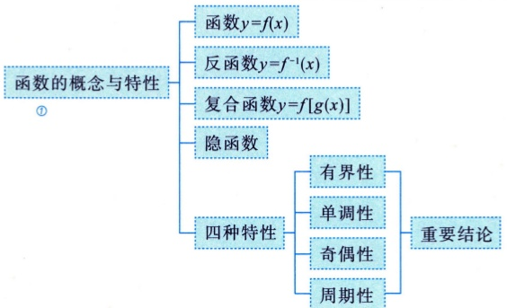
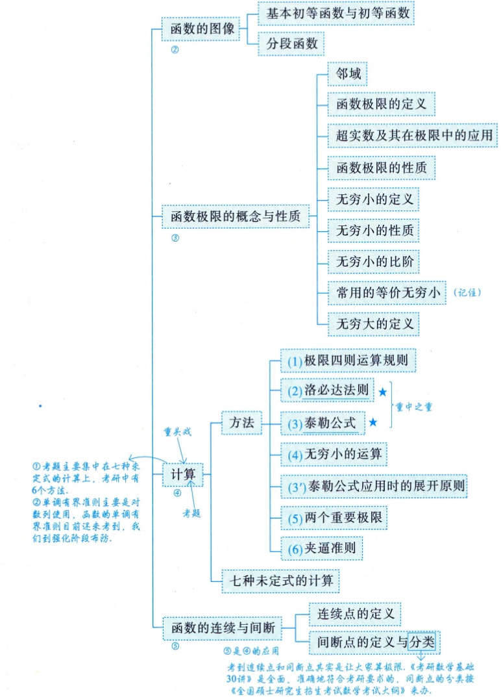

# 第1讲　函数极限与连续

> 《考研数学基础 30 讲 · 高等数学分册》第 1 讲 ｜ 拆分版总目录（对应原书 p.1–3）

## 一、题型、目标与重难点

- **题型**：选择题、填空题、解答题
- **目标**：①理解函数的概念，掌握函数的表示法，会建立应用问题的函数关系；②了解函数的有界性、单调性、周期性和奇偶性；③理解复合函数及分段函数的概念，了解反函数及隐函数的概念；④掌握基本初等函数的性质及其图形，了解初等函数的概念；⑤理解极限的概念，理解函数左极限与右极限的概念以及函数极限存在与左极限、右极限之间的关系；⑥掌握极限的性质及四则运算法则，掌握利用两个重要极限求极限的方法；⑦掌握极限存在的两个准则，并会利用它们求极限（仅数学一、数学二），了解极限的性质及极限存在的两个准则（仅数学三）；⑧理解无穷小量、无穷大量的概念，掌握无穷小量的比较方法，会用等价无穷小量求极限；⑨理解函数连续性的概念（含左连续与右连续），会判别函数间断点的类型；⑩了解连续函数的性质和初等函数的连续性
- **重难点**：①洛必达法则；②泰勒公式

## 二、基础知识结构

按《全国硕士研究生招生考试数学考试大纲》编写的基础知识结构——只不过把大纲中罗列的知识点做成了一个体系化的知识结构图。希望同学们每学完一讲，回过头来能够自己写出这张基础知识结构。

基础知识结构

> 注：以上是第 1 讲的全面的知识结构。学完这一讲、做完这一讲的题目之后，回过头再看这个知识结构，相信大家会有完全不同的认识——这些知识框架不再是陌生的文字，而是展现在头脑中的清晰的知识与方法。

## 三、本讲拆分目录

| # | 文档 | 内容 | 原书页码 |
| :--: | :--- | :--- | :--: |
| 1 | [函数的概念与特性](01-函数的概念与特性.md) | 函数、反函数、复合函数、隐函数、函数的四种特性 | p.4–14 |
| 2 | [函数的图像](02-函数的图像.md) | 基本初等函数、初等函数、分段函数 | p.15–27 |
| 3 | [函数极限的定义与性质](03-函数极限的定义与性质.md) | 邻域、极限的 24 个定义、超实数、极限的性质 | p.28–41 |
| 4 | [无穷小与无穷大](04-无穷小与无穷大.md) | 无穷小的定义与性质、无穷小的比阶、等价无穷小、无穷大 | p.42–46 |
| 5 | [极限的计算方法](05-极限的计算方法.md) | 四则运算、洛必达法则、泰勒公式、两个重要极限、夹逼准则 | p.47–54 |
| 6 | [七种未定式](06-七种未定式.md) | 七种未定式、化简先行、抓大头 | p.55–64 |
| 7 | [连续与间断点](07-连续与间断点.md) | 连续点的定义、间断点的定义与分类 | p.65–68 |
| 8 | [基础习题与解答](08-基础习题与解答.md) | 习题 1.1–1.16 及解答 | p.69–75 |

## 四、这套拆分稿怎么用

1. 先看 `01`（函数的概念与特性）和 `02`（函数的图像）——这两份是“原材料”，概念性内容多，适合通读、做笔记。
2. `03`、`04` 是全讲的地基：24 个极限定义、超实数视角、无穷小的比阶，务必逐句读懂，不要跳。
3. `05`、`06` 是计算主体（四则、洛必达、泰勒、七种未定式），建议配合《1000 题》按题型刷。
4. `07` 连续与间断点最短，但几乎年年考，重点看“间断点分类表”。
5. 最后用 `08` 的 16 道题自测，再做《张宇考研数学题源探析经典 1000 题》基础篇。

> 本拆分稿相对原始 OCR 稿的全部修改，见 [修订说明](09-修订说明.md)。原文完整备份见 [_备份/01-第1讲-函数极限与连续.原始OCR.md](../_备份/01-第1讲-函数极限与连续.原始OCR.md)。
