# 第1讲 函数极限与连续（一）　函数的概念与特性

> 原书 p.4–14 ｜ 拆分版 1/8 ｜ 函数、反函数、复合函数、隐函数、函数的四种特性
>
> [总目录](00-第1讲-导读与知识结构.md) ｜ 下一节 [函数的图像](02-函数的图像.md) →

---

## 一、函数的概念与特性

### 1 函数

单值函数

设  $x$ 与  $y$ 是两个变量， $D$ 是一个给定的数集，若对于每一个  $x \in D$，按照一定的法则  $f$，有一个确定的  $y$ 值与之对应，则称  $y$ 为  $x$ 的函数，记作  $y = f(x)$，称  $x$ 为自变量， $y$ 为因变量，称数集  $D$ 为此函数的定义域，定义域一般由实际背景中变量的具体意义或者函数对应法则的要求确定，称  $\{f(x) \mid x \in D\}$ 为值域。

#### 注　单值函数与多值函数

事实上，上述定义的函数是单值函数，若给一个 $x_{1}$，对应一个 $y_{1}$；给另外一个 $x_{2}$，对应另外一个 $y_{2}$，这叫一对一[见图1-1(a)]。若给定 $x_{1}$， $x_{2}$（ $x_{1} \neq x_{2}$），它们对应同一个y，则称多对一[见图1-1(b)]，所以函数可以一对一，也可以多对一，这叫单值函数。

但是，若一个x对应一个 $y_{1}$，又对应另一个 $y_{2}$，也就是一对多，这叫多值函数[见图1-1(c)]，它不在上述定义中.

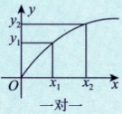

(a)

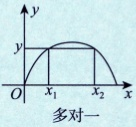

(b)

(c)

> **【原书插图缺失】** 图 1-1(c)“一对多（多值函数）”的示意图在 PDF 转换时没有被截取。请对照原书第 3 页：同一条铅直线上出现两个交点的曲线，就是多值函数的图形。

图 1-1

多值函数（不是我们传统意义上的函数）

我们的研究对象主要是单值函数。

★数与形：如何判断一个函数是单值还是多值呢？数与形是辩证统一的关系，用铅直画线法—作铅直线，若任一条铅直线与 $f(x)$至多有一个交点，则 $f(x)$为单值函数。

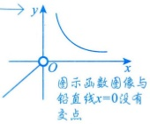

**例 1.1** 设  $f\left(x+\frac{1}{x}\right)=\frac{x+x^{3}}{1+x^{4}}$，则当  $x \geq 2$ 时， $f(x)=$ ___.

**解** 应填 $\frac{x}{x^{2}-2}$.

<!-- page: 4 -->

$$
f\left(x+\frac{1}{x}\right)=\frac{x+x^{3}}{1+x^{4}}=\frac{(x+x^{3})/x^{2}}{(1+x^{4})/x^{2}}=\frac{x+\frac{1}{x}}{x^{2}+\frac{1}{x^{2}}}=\frac{x+\frac{1}{x}}{\left(x+\frac{1}{x}\right)^{2}-2}
$$

于是当 $x\geq2$时， $f(x)=\frac{x}{x^{2}-2}$.

**方法总结** 将 “ $x+\frac{1}{x}$” 视为整体，找出对应法则.

**公式**  $x^{2}+\frac{1}{x^{2}}=\left(x+\frac{1}{x}\right)^{2}-2$

**注** 以后会经常用到，给出复合函数，把它写回原来的函数，这样的考法也较常见.

★**例 1.2** 设函数 $f(x)$的定义域为 $(0,+\infty)$，且满足 $2f(x)+x^{2}f\left(\frac{1}{x}\right)=\frac{x^{2}+2x}{\sqrt{1+x^{2}}}$，则 $f(x)=$

分析将x写成 $\frac{1}{x}$，找到方程组①，②，联立，消去 $f\left(\frac{1}{x}\right)$即可.

**解** 应填 $\frac{x}{\sqrt{1+x^{2}}}$

 $$ 2f(x)+x^{2}f\left(\frac{1}{x}\right)=\frac{x^{2}+2x}{\sqrt{1+x^{2}}}, $$

将①中x写成 $\frac{1}{x}$，则

 $$ 2f\left(\frac{1}{x}\right)+\frac{1}{x^{2}}f(x)=\frac{1+2x}{x\sqrt{1+x^{2}}} $$

由①×2-②× $x^{2}$，得 $3f(x)=\frac{3x}{\sqrt{1+x^{2}}}$，则 $f(x)=\frac{x}{\sqrt{1+x^{2}}}$

**方法总结** 用所给关系式，造出方程组，解出所需的量.

**公式** 对应法则与所用的自变量无关，如 $f(x)=x^{2}$，则 $f\left(\frac{1}{x}\right)=\left(\frac{1}{x}\right)^{2}$

**注** 若给  $f(x) + xf(-x) = x$，应学会写  $f(-x) - xf(x) = -x$，消去  $f(-x)$，得  $f(x) = \frac{x + x^{2}}{1 + x^{2}}$。由结论

考生既要掌握单值函数，同时也要会根据给出的复合函数表达式，求出相应的对应法则.

## 2 反函数 → 前提：符合铅直画线法

设函数  $y = f(x)$ 的定义域为  $D$，值域为  $R$。如果对于每一个  $y \in R$，必存在唯一的  $x \in D$，使得  $y = f(x)$ 成立，则由此定义了一个新的函数  $x = \varphi(y)$，这个函数称为函数  $y = f(x)$ 的反函数，一般记作  $x = f^{-1}(y)$，它的定义域为  $R$，值域为  $D$。相对于反函数来说，原来的函数也称为直接函数。以下两点需要说明。

第一，严格单调函数必有反函数，比如函数  $y = x^2 (x \in [0, +\infty))$ 是严格单调函数，故它有反函数  $x = \sqrt{y}$。

第二，若把  $x = f^{-1}(y)$ 与  $y = f(x)$ 的图形画在同一坐标系中，则它们完全重合。只有把  $y = f(x)$ 的反函数  $x = f^{-1}(y)$ 写成  $y = f^{-1}(x)$ 后，它们的图形才关于  $y = x$ 对称。事实上，这也是字母  $x$ 与  $y$ 互换的结果。

 $$ \begin{aligned} 如 y=x^{2}(x\geq0) 与 y=\sqrt{x} 关于 y=x 对称 \end{aligned} $$

**注**（1）单值函数（符合铅直画线法）才谈反函数.

(2) 有反函数的函数不一定是单调函数。比如

 $$ f(x)=\begin{cases}x,&x\geqslant0,\\\frac{1}{x},&x<0,\end{cases} $$

其图像如图 1-2 所示，其反函数即为  $f(x)$ 本身，但  $f(x)$ 不是单调函数。

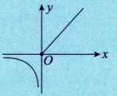

图 1-2

判断一个函数是否具有反函数：用水平画线法。

水平画线法——在符合铅直画线法的条件下，作水平直线，若任一条水平直线与 $f(x)$至多有一个交点，则 $f(x)$有反函数.

口诀：

{

    铅直直线定单、多（单值函数、多值函数），

    水平直线定反、直（反函数、直接函数）。

}

重要关系：

$$
\begin{cases}f[f^{-1}(x)]=x,\\f^{-1}[f(x)]=x.\end{cases}
$$

如： $e^{\ln2^{x}}=2^{x}$

**例 1.3** 求函数  $y = f(x) = \ln\left(x + \sqrt{x^2 + 1}\right)$ 的反函数  $f^{-1}(x)$ 的表达式及其定义域.

**分析** 对数函数是一个极为重要的研究对象，三个基本公式要掌握 $(a, b > 0)$

 $$ \begin{cases}\ln ab=\ln a+\ln b( 积变和 ),\\\ln\frac{a}{b}=\ln a-\ln b( 商变差 ),\\\ln a^{b}=b\ln a( 幂次变倍数 ).\end{cases} $$

<!-- page: 6 -->

**解** 直接由  $y = \ln\left(x + \sqrt{x^2 + 1}\right)$ 解出  $x = f^{-1}(y)$ 会很麻烦，现采用下述方法。

 $$ -y=-\ln\left(x+\sqrt{x^{2}+1}\right)=\ln\frac{1}{x+\sqrt{x^{2}+1}} $$

$$ \frac{ 分母有理化 }{\ln\frac{\sqrt{x^{2}+1}-x}{\left(\sqrt{x^{2}+1}+x\right)\left(\sqrt{x^{2}+1}-x\right)}}=\ln\left(\sqrt{x^{2}+1}-x\right) $$

所以

 $$ \mathbf{e}^{-y}=\sqrt{x^{2}+1}-x, $$

再由  $y = f(x)$ 的表达式有

 $$ \mathrm{e}^{y}=\sqrt{x^{2}+1}+x, $$

②-①，得

 $$ x=\frac{1}{2}\big(\mathbf{e}^{y}-\mathbf{e}^{-y}\big), $$

交换上式中x, y的位置后就是 $y = f(x)$的反函数，即

 $$ y=f^{-1}(x)=\frac{1}{2}\left(\mathrm{e}^{x}-\mathrm{e}^{-x}\right),-\infty<x<+\infty. $$

**方法总结** 利用对数的性质，巧妙地反解 x。

**公式**  $\ln(x+\sqrt{x^{2}+1})$ 是常见的奇函数.

**注** (1) 函数  $y = \ln\left(x + \sqrt{x^2 + 1}\right)$ 叫作反双曲正弦函数，其图像如图 1-3(a) 所示。函数  $y = \frac{e^x - e^{-x}}{2}$ 叫作双曲正弦函数，其图像如图 1-3(b) 所示。考生应记住这两个函数的图像。

(a)

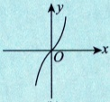

(b)

图 1-3

> **【原书插图缺失】** 图 1-3(a)(b) 两个子图（反双曲正弦、双曲正弦）转换时只截到一个，请对照原书第 6 页一起看。

(2)  $y = \frac{e^{x} + e^{-x}}{2}$ 叫作双曲余弦函数，其图像如图 1-4 所示，它是偶函数，是一种特殊的悬链线。达·芬奇在画《抱银貂的女子》时，曾仔细思索过女子的脖子上戴的项链的形状是什么函数，可惜他一生都未能明白，在他去世近200年后，约翰·伯努利解决了这个问题。那不是抛物线  $y = x^2$，而是悬链线  $y = \frac{a}{2} \left( e^{\frac{x}{a}} + e^{-\frac{x}{a}} \right)$，取  $a = 1$，便是  $y = \frac{e^x + e^{-x}}{2}$。

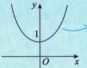

图 1-4

这个函数没有反函数

<!-- page: 7 -->

三个重要函数：①  $y = \ln(x + \sqrt{x^2 + 1})$，②  $y = \frac{e^x - e^{-x}}{2}$，③  $y = \frac{e^x + e^{-x}}{2}$（2023年考查过）

(3) 以后会知道如下 3 个重要结论.

①当  $x \to 0$ 时， $\ln\left(x + \sqrt{x^2 + 1}\right) \sim x$。即当  $x \to 0$ 时，反双曲正弦函数  $\ln(x + \sqrt{x^2 + 1})$ 与  $x$ 是等价无穷小。

洛必达法则推出

当  $x \to 0$ 时，  $\sin x \sim x$， $\tan x \sim x$， $\ln(x + \sqrt{x^2 + 1}) \sim x$， $\cdots$。

② $\left[\ln\left(x+\sqrt{x^{2}+1}\right)\right]^{\prime}=\frac{1}{\sqrt{x^{2}+1}}$，于是 $\int\frac{1}{\sqrt{x^{2}+1}}dx=\ln\left(x+\sqrt{x^{2}+1}\right)+C$。记住这个结果

③由于  $y = \ln\left(x + \sqrt{x^2 + 1}\right)$ 是奇函数，于是

$$
\int_{-1}^{1}\left[\ln\left(x + \sqrt{x^2 + 1}\right) + x^2\right] \, \mathrm{d}x = \int_{-1}^{1} x^2 \, \mathrm{d}x = \frac{2}{3}
$$

.

③是在预告未来，未来会用到在第1讲中讲到的知识，同时我们要明白一个道理：我们现在在讲基础，基础要慢慢去打，你所有的东西实际上是一个联系的整体。假如不知道 $y=\ln(x+\sqrt{x^{2}+1})$这个函数，不知道它的图像，不知道它的性质，那么在后面去学习的时候就会遇到困难，反过来说，如果知识掌握得很扎实，那么后面学到极限、导数、积分、面积等，就能很快速地把问题解决了，从而可以掌握强大的基础知识，再学会做题，就可以应对综合题了。

### 3 复合函数

设函数  $y = f(u)$ 的定义域为  $D_1$，函数  $u = g(x)$ 在  $D$ 上有定义，且  $g(D) \subset D_1$，则由

 $$ y=f[g(x)],\quad x\in D $$

确定的函数称为由函数  $u = g(x)$ 和函数  $y = f(u)$ 构成的复合函数，它的定义域为  $D$， $u$ 称为中间变量。考生要重点掌握复合的方法。三层复合函数  $h[f[g(x)]]$

**例 1.4** 设  $f(x) = x^2$， $f[\varphi(x)] = -x^2 + 2x + 3$，且  $\varphi(x) \geq 0$，求  $\varphi(x)$ 及其定义域与值域。

**解** 由题设条件知， $f[\varphi(x)]=\varphi^{2}(x)=-x^{2}+2x+3$，于是  $\varphi(x)=\sqrt{-x^{2}+2x+3}$。

由 $-x^{2}+2x+3\geqslant0$，即 $(x-3)(x+1)\leqslant0$，知 $\varphi(x)$的定义域为 $[-1,3]$.

又  $\sqrt{-x^{2}+2x+3}=\sqrt{-(x-1)^{2}+4}$，当 x=1 时， $\varphi(1)=2$ 为最大值，显然  $\varphi(-1)=\varphi(3)=0$ 为最小值，故  $\varphi(x)$ 的值域为  $[0,2]$。

**方法总结** 将  $\varphi(x)$ 视为一个整体  $\square$，由  $f[\varphi(x)]$ 已知，可求出  $\varphi(x)$

**公式** 若  $\varphi^{2}(x)=g(x)$，则  $\varphi(x)=\pm\sqrt{g(x)}$

**例 1.5** 设

$$
g(x)=\begin{cases}2-x, & x\leq0, \\ 2+x, & x>0,\end{cases}
$$

$$
f(x)=\begin{cases}x^2, & x<0, \\ -x-1, & x\geq0,\end{cases}
$$

 则  $g[f(x)]=$ ___.

**分析** 数与形结合.

华罗庚先生说：“数无形时少直觉，形少数时难入微，数形结合百般好”。

**解** 应填

$$
\begin{cases}3+x,&x\geqslant0,\\2+x^{2},&x<0.\end{cases}
$$

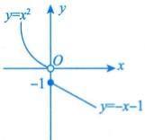

 $$ g[f(x)]=\begin{cases}2-f(x),f(x)\leqslant0,\\2+f(x),f(x)>0,\end{cases} $$

当 $f(x)\leq0$时， $x\geq0$，此时 $f(x)=-x-1$；当 $f(x)>0$时，x<0，此时 $f(x)=x^{2}$

综上，

 $$ g[f(x)]=\begin{cases}2-(-x-1),&x\geqslant0,\\2+x^{2},&x<0\end{cases}=\begin{cases}3+x,&x\geqslant0,\\2+x^{2},&x<0.\end{cases} $$

**方法总结** 画出内层函数的图形，数形结合。

### 4 隐函数

前面讲了单值函数和多值函数的区别

 $F(x,y)=0$ 在上述区间内确定了一个隐函数  $y=y(x)$.

多值函数不适用于铅直画线法，比如，上图有两个交点，则不满足铅直画线法，这个对应的就是多值函数，不能确定隐函数，能确定隐函数就不能是多值函数，这是基本概念，关于隐函数存在定理，我们后面专门讲。

如  $x + y^{3} - 1 = 0$ 就表示一个隐函数，且可显化为  $y = \sqrt[3]{1 - x}$；再如  $\sin(xy) = \ln \frac{x + e}{y} + 1$ 也表示一个隐函数，但不易显化，很难写出  $y = y(x)$ 或  $x = x(y)$。

一般来说，由  $F(x, y) = 0$ 所确定的隐函数求  $y(x_0)$，若代入  $x_0$ 易求出  $y(x_0)$，则直接求之；若不易求出  $y(x_0)$，则用观察法。如：方程这个东西，解无定法，观察得之，有时“显然”，有时超越方程

无解析解，只有数值解。

①设函数  $y = y(x)$ 由方程  $\ln y - \frac{x}{y} + x = 0 (x > 0)$ 确定，当 x = 2 时， $y(2) = 1$

方程  $\ln y - \frac{2}{y} + 2 = 0$ 是可观察的，用画图法，如图 1-5 所示。

由  $\ln y = \frac{2}{y} - 2$，得

$$
\begin{cases} z = \ln y, \\ z = \frac{2}{y} - 2, \end{cases}
$$

看两条曲线交点。

 $\ln y + e^{x-1} = 1$，显然可看出，y = 1 时成立，画草图

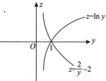

这些都是考研真题里面出现过的形式。

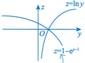

图 1-5

②设函数  $y = y(x)$ 由方程  $\ln y + e^{y-1} = \frac{x}{2}$ 确定，当 x = 2 时， $y(2) = 1$

<!-- page: 9 -->

**注** 考研试题中常出现这种问题，考生要重视.

隐函数问题先给大家提到这里，与之相关的隐函数存在定理，以及隐函数存在定理所推出的公式法等，我们到后面再去讲。

★★★5 函数的四种特性→考研中怎么去使用这些特性呢？微积分是利用极限这个工具研究函数、函数的导数及积分的四种特性

(1)有界性.

设 $f(x)$的定义域为 $D$， $\underline{\text{数集}}$  $I\subset D$。如果存在某个正数 $M$，使对任一 $x\in I$，有 $|f(x)|\leq M$，则称 $f(x)$在 $I$上有界；如果这样的 $M$不存在，则称 $f(x)$在 $I$上无界。

**注** (1) 从几何上看，如果在给定的区间，函数  $y = f(x)$ 的图形能够被直线  $y = -M$ 和  $y = M$ “完全包起来”，则为有界；从解析上说，如果找到某个正数  $M$，使得  $|f(x)| \leq M$，则为有界。

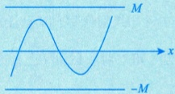

区间I

能画圆则画圆，不易画圆，我们就用解析法，去找正数M.

(2)有界还是无界的讨论首先需指明区间I，不知区间，无法谈论有界性.比如 $y=\frac{1}{x}$在 $(2,+\infty)$内有界，但在 $(0,2)$内无界.

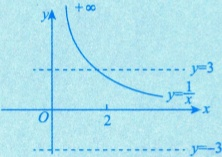

(3)事实上，只要在区间I上或其端点处存在点 $x_{0}$，使得 $\lim_{x\to x_{0}}f(x)$的值为无穷大，则没有任何两条直线y=-M和y=M可以把I上的 $f(x)$“包起来”，这就叫无界.考研中常出这样的题目，比如例1.17.

**例 1.6** 证明函数  $f(x)=\frac{x}{1+x^{2}}$ 在  $(-∞,+∞)$ 内有界.

补充： $x^{2}=\left|x^{2}\right|=\left|x\right|^{2}$

 $$ \begin{aligned}&x^{3}\neq\left|x^{3}\right|=\left|x\right|^{3},\\&\left|x\right|=\sqrt{x^{2}}.\\ \end{aligned} $$

**分析** 当  $x \neq 0$ 时， $\left|f(x)\right| = \frac{|x|}{1 + x^2} \overset{\text{分子分母同除}}{=} \frac{1}{\frac{1}{|x|} + |x|}$ 或者用  $\left|x\right| = \sqrt{x^2}$

若求  $\left[\left|f(x)\right|\right]'$ 呢；

证 方法一 当 $x\neq0$时，

 $$ \left|f(x)\right|=\frac{\left|x\right|}{1+x^{2}}=\frac{1}{\frac{1}{\left|x\right|}+\left|x\right|}, $$

$$ \begin{aligned}\left[\mid f(x)\mid\right]^{\prime}=&\left[\sqrt{f^{2}(x)}\right]^{\prime}\\ =&\frac{2f(x)f^{\prime}(x)}{2\sqrt{f^{2}(x)}}=\frac{f(x)f^{\prime}(x)}{\mid f(x)\mid}.\end{aligned} $$

$$ \begin{aligned} 再如：f(x)&=2x+\sqrt{x^{2}+2x+1}\\&=2x+\sqrt{(x+1)^{2}}\\&=2x+\left|x+1\right|.\end{aligned} $$

<!-- page: 10 -->

由不等式 $\frac{a+b}{2}\geq\sqrt{ab}(a,b>0)$，有 $\frac{1}{|x|}+|x|\geq2\sqrt{\frac{1}{|x|}|x}|=2$，即 $|f(x)|\leq\frac{1}{2}$。

当x=0时， $f(0)=0$．综上，函数 $f(x)$在 $(-∞,+∞)$内有界．

方法二 当  $x \neq 0$ 时， $\frac{1 + x^{2}}{2} \geqslant \sqrt{1 \cdot x^{2}} \Rightarrow |x|$，则  $1 + x^{2} \geqslant 2|x|$，故  $\frac{1}{1 + x^{2}} \leqslant \frac{1}{2|x|}$，则

 $$ \left|f(x)\right|=\frac{\left|x\right|}{1+x^{2}}\leqslant\frac{\left|x\right|}{2\left|x\right|}=\frac{1}{2}\ . $$

当x=0时， $f(0)=0$．综上，函数 $f(x)$在 $(-∞,+∞)$内有界．

**方法总结** 用基本不等式，找 M，使  $|f(x)| \leqslant M$。

 $$ \frac{a+b}{2}\geqslant\sqrt{ab}(a,b>0);\quad\frac{2}{\frac{1}{a}+\frac{1}{b}}\leqslant\sqrt{ab}\leqslant\frac{a+b}{2}\leqslant\sqrt{\frac{a^{2}+b^{2}}{2}}(a,b>0). $$

(2) 单调性.  $\rightarrow$ 整个考研数学，离不开单调性这个话题

设 $f(x)$的定义域为D，区间 $I\subset D$。如果对于区间I上任意两点 $x_{1},x_{2}$，当 $x_{1}<x_{2}$时，恒有 $f(x_{1})<f(x_{2})$，则称 $f(x)$在区间I上单调增加。如果对于区间I上任意两点 $x_{1},x_{2}$，当 $x_{1}<x_{2}$时，恒有 $f(x_{1})>f(x_{2})$，则称 $f(x)$在区间I上单调减少。

**注**（1） 以上是定义法，是充要条件。

(2) 后面会看到，在考研试题中常常用求导的方法来讨论函数在某个区间上的单调性，但是定义法不可以忘记。试题中也常用到如下定义法的判别形式，请考生留意。

对任意 $x_{1}, x_{2} \in D, x_{1} \neq x_{2}$，有

f(x) 是单调增函数  $\Leftrightarrow (x_{1}-x_{2})[f(x_{1})-f(x_{2})]>0$；

严格单调减  $\Leftrightarrow$

f(x) 是单调减函数  $\Leftrightarrow (x_{1}-x_{2})[f(x_{1})-f(x_{2})]<0$；

f(x) 是单调不减函数  $\Leftrightarrow (x_{1}-x_{2})[f(x_{1})-f(x_{2})]\geq0$；

f(x) 是单调不增函数  $\Leftrightarrow (x_{1}-x_{2})[f(x_{1})-f(x_{2})]\leq0$。

在考研数学中，函数的单调性虽然是基础知识，但也会有综合应用。

**例 1.7** 设  $f(x)$ 在  $(-\infty, +\infty)$ 上有定义，任给  $x_1, x_2, x_1 \neq x_2$，均有  $(x_1 - x_2) \cdot [f(x_1) - f(x_2)] > 0$，则以下函数一定单调增加的是（ ）。

(A)  $|f(x)|$

(B)  $f(|x|)$

(C)  $f(-x)$

(D)  $-f(-x)$

**分析** 由条件知  $f(x)$ 是严格单调增加函数，利用图形的变换，去讨论其他函数的单调性.

<!-- page: 11 -->

保留 $f(x)\geq0$部分， $f(x)<0$部分去掉，关于x轴对称过来

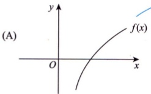

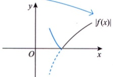

保留 $x \geq 0$部分， $x < 0$部分消去，关于y轴对称

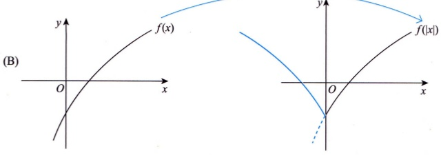

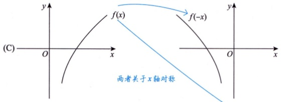

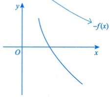

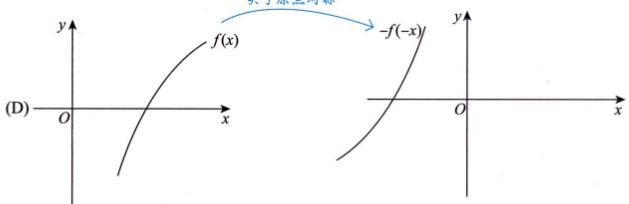

**解** 应选(D).

由上述注的(2)知， $f(x)$是单调增函数，又 $f(-x)$与 $f(x)$的图像关于y轴对称， $-f(-x)$与 $f(x)$的图像关于原点对称[见附录1(2)的②，③]，可知 $f(-x)$单调减少， $-f(-x)$单调增加. $|f(x)|$是否具有单

<!-- page: 12 -->

调性与 $f(x)$的正负相关， $f(|x|)$为偶函数，在 $(-∞,+∞)$上无单调性[见附录1(2)的⑤，⑥]，故选(D).

**方法总结**  $f(ax)$， $af(x)$ 等可参考附录 1.

**公式**  $f(x)$ 与  $f(-x)$ 关于 y 轴对称； $f(x)$ 与  $-f(x)$ 关于 x 轴对称； $f(x)$ 与  $-f(-x)$ 关于原点对称。

(3) 奇偶性.  $\rightarrow$ 这个是四大特性中最重要的性质，原因：①题目易出；②对称差.

设 $f(x)$的定义域 $D$关于原点对称（若 $x\in D$，则 $-x\in D$）。如果对于任一 $x\in D$，恒有 $f(-x)=f(x)$，则称 $f(x)$为偶函数。如果对于任一 $x\in D$，恒有 $f(-x)=-f(x)$，则称 $f(x)$为奇函数。我们熟知的是，偶函数的图形关于 $y$轴对称，奇函数的图形关于原点对称。

 $\underline{\text{注}}$那么,怎么做题呢? 要想会做题需要有: ①原材料(我们正在学习的各种基础知识); ②技术. 我们继续来看原材料.

(1) 前提：定义域关于原点对称。

(2) 基本类型.

① $f(x)+f(-x)$必是偶函数.

如  $\frac{e^x + e^{-x}}{2}$.

双曲余弦，记住图像

如  $\sqrt[3]{(1+x)^2} + \sqrt[3]{(1-x)^2}$

② $f(x)-f(-x)$必是奇函数.

 $$ \frac{\mathrm{e}^{x}-\mathrm{e}^{-x}}{2}\quad\rightarrow\quad\frac{y_{A}}{O}\quad x $$

双曲正弦  $\xrightarrow{\text{反函数}}$  $y = \ln(x + \sqrt{x^2 + 1})$ （反双曲正弦）

如  $\ln \frac{1 + x}{1 - x} = \ln(1 + x) - \ln(1 - x)$.

对任一函数  $f(x)$，令  $u(x)=\frac{1}{2}[f(x)+f(-x)]$， $v(x)=\frac{1}{2}[f(x)-f(-x)]$，则  $u(x)$ 是偶函数， $v(x)$ 是奇函数。由

 $$ f(x)=\frac{1}{2}\left[f(x)+f(-x)\right]+\frac{1}{2}\left[f(x)-f(-x)\right]=u(x)+\nu(x), $$

可知任何一个函数都可以写成一个奇函数与一个偶函数之和的形式。（重要结论）

③ $f[\varphi(x)]$（内偶则偶，内奇同外）.

若内层是偶，不管外面函数，复合起来一定是偶函数，这是内偶则偶；若内层是奇，则复合函数奇偶性与外层函数奇偶性一致，这是内奇同外

<!-- page: 13 -->

奇[偶]⇒偶. 如sinx².

偶[奇]⇒ 偶. 如  $\cos(\sin x), |\sin x|$.

奇[奇] $\Rightarrow$奇. 如 $\sin\frac{1}{x}$， $\sqrt[3]{\tan x}$.

偶[偶]⇒ 偶. 如  $\cos |x|, |\cos x|$.

非奇非偶[偶]⇒偶. 如 $e^{x^{2}}$,  $\ln |x|$.

④一个特色： $\left[\ln\left(x+\sqrt{x^{2}+1}\right)\right]^{\prime}=\frac{1}{\sqrt{x^{2}+1}}$

★⑤ $f(x)$ 奇  $\Rightarrow$  $f'(x)$ 偶  $\Rightarrow$  $f''(x)$ 奇  $\Rightarrow$  $\cdots$ . 见例 3.1.

(偶) (奇) (偶)

求导一次，奇偶性互换.

从直观上解析：（数与形）

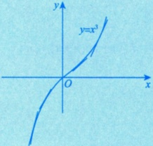

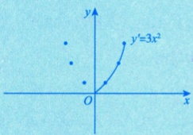

⑥ $f(x)$ 奇  $\Rightarrow$  $\int_{0}^{x}f(t)dt$ 偶．微积分的研究主体：导数，积分（偶）（奇）

⑦设对任意的x, y，都有 $f(x+y)=f(x)+f(y)$，则 $f(x)$是奇函数，证明见例1.8.

隐含条件 ← 恒等式

**例 1.8** 设对任意 x, y，都有  $f(x+y) = f(x) + f(y)$，证明： $f(x)$ 是奇函数。

**分析** 用定义法.

证 令 x = y = 0，则  $f(0) = f(0) + f(0)$，于是  $f(0) = 0$，再令 y = -x，则  $f(0) = f(x) + f(-x)$，即  $f(-x) = -f(x)$，故  $f(x)$ 是奇函数。

**方法总结** 用定义法证明  $f(-x) = -f(x)$.

**公式**  $f(x)+f(-x)=0$，则 $f(x)$为奇函数.

(4) 周期性.

设 $f(x)$的定义域为D，如果存在一个正数T，使得对于任一 $x\in D$，有 $x\pm T\in D$，且 $f(x+T)=f(x)$，则称 $f(x)$为周期函数，T称为 $f(x)$的周期，一般指最小正周期。

<!-- page: 14 -->

#### 注　周期性的重要结论

①若 $f(x)$以T为周期，则 $f(ax+b)$以 $\frac{T}{|a|}$为周期.

②若 $g(x)$是周期函数，则复合函数 $f[g(x)]$也是周期函数，如 $e^{\sin x}$， $\cos^2 x$等。

 $$ \cos^{2}x=\frac{1+\cos2x}{2},\quad 则 \quad T=\frac{2\pi}{\left|2\right|}=\pi. $$

★③若 $f(x)$是以T为周期的可导函数，则 $f'(x)$也以T为周期．见例3.1.

★④若 $f(x)$是以T为周期的连续函数，则只有在 $\int_{0}^{T}f(x)dx=0$时， $\int_{0}^{x}f(t)dt$也以T为周期．见例

9.25.

**例 1.9** 设函数  $f(x)$ 在  $(-\infty, +\infty)$ 上满足  $f(x) = f(x - \pi) + \sin x$. 证明： $f(x)$ 是以  $T = 2\pi$ 为周期的周期函数.

**分析**证 $f(x+2\pi)=f(x)$即可.

证 多次利用题目等式条件，得到  $f(x+2\pi)=f(x+\pi)+\sin(x+2\pi)=f(x)+\sin(x+\pi)+\sin(x+2\pi)=f(x)$，故  $f(x)$ 以  $T=2\pi$ 为周期。

两条腿走路：（1）知识：（2）解题

**方法总结** 若  $f(x+2\pi)=f(x)$，则  $f(x)$ 是以  $2\pi$ 为周期的周期函数。

**公式**诱导公式： $\sin(x+2\pi)=\sin x$， $\sin(x+\pi)=-\sin x$。

 $\underline{\text{注}}$ 希望考生在学习过程中，记具体例子.这些例子的记忆可以帮助我们很好地理解各种各样的方法，同时有实实在在的例子记在脑子里，可以形成一个解题思路，这是非常重要的.很多人以为例子不要记，只要会即可，其实不然.你要形成数学的思维习惯，一定要记一些具体的例子.

要用典型的例子与习题撑起来我们的知识与方法，这是给大家的建议。

---

> [总目录](00-第1讲-导读与知识结构.md) ｜ 下一节 [函数的图像](02-函数的图像.md) →
