# 第1讲 函数极限与连续（二）　函数的图像

> 原书 p.15–27 ｜ 拆分版 2/8 ｜ 基本初等函数、初等函数、分段函数
>
> ← 上一节 [函数的概念与特性](01-函数的概念与特性.md) ｜ [总目录](00-第1讲-导读与知识结构.md) ｜ 下一节 [函数极限的定义与性质](03-函数极限的定义与性质.md) →

---

## 二、函数的图像

### 1 基本初等函数与初等函数

我们在学习分部积分法时，有口诀：反对幂指三.

基本初等函数：常数函数、幂函数、指数函数、对数函数、三角函数和反三角函数。

(1) 常数函数．→易考“找交点个数”或在概率论中求概率 $P\{g(X) \leq y\}$．

 $y=A$，A为常数，其图形为平行于x轴的水平直线（见图1-6）。

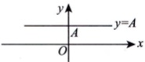

图 1-6

<!-- page: 15 -->

如求  $\ln x - \frac{x}{e} + a = 0$ 实根的个数其实就是求直线 y = a 与曲线  $y = \frac{x}{e} - \ln x$ 交点的个数.

在数学一和数学三学习的概率论中： $Y = g(X)$， $Y = y$， $g(X) \leq y$ 即  $Y = g(X)$ 在 Y = y 直线下方 X 的取值范围.

(2) 幂函数.

 $y = x^{\mu} (\mu \text{是实数})$.

**注** (1)  $y = x^\mu$ 的定义域和值域取决于  $\mu$ 的值。当  $x > 0$ 时， $y = x^\mu$ 都有定义。

(2) 常用的幂函数（见图 1-7）.

 $$ y=x,\ y=x^{2},\ y=\sqrt{x},\ y=x^{3},\ y=\sqrt[3]{x},\ y=\frac{1}{x} $$

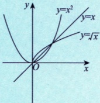

(a)

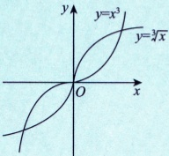

(b)

图 1-7

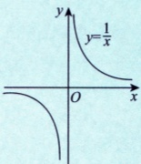

(c)

(3) 当 x > 0 时，由 y = x 与  $y = \sqrt{x}$， $y = \sqrt[3]{x}$， $y = \ln x$ 具有相同的单调性且与  $y = \frac{1}{x}$ 具有相反的单调性，故

①见到  $\sqrt{u}$， $\sqrt[3]{u}$ 时，可用 u 来研究最值。

考得最多

★②见到  $|u|$ 时，由  $|u| = \sqrt{u^2}$，可用  $u^2$ 来研究最值； $\underline{\text{√u^2}}$ 与  $u^2$ 具有相同的最值点。

★③见到  $u_1u_2u_3$ 时，可用  $\ln(u_1u_2u_3) = \ln u_1 + \ln u_2 + \ln u_3$ 来研究最值。

考得频率不高

 $$ \ln(x^{\frac{1}{3}}y^{\frac{1}{2}}z^{\frac{1}{5}})=\frac{1}{3}\ln x+\frac{1}{2}\ln y+\frac{1}{5}\ln z $$

④见到 $\frac{1}{u}$时，可用u来研究最值（结论相反，即 $\frac{1}{u}$与u的最大值点、最小值点相反）.

利用以上①~④，可使得计算简单方便.以上4点是我们在研究最值问题时的一个非常有用的技巧——简洁美.

**例 1.10** 设  $0 < x < \frac{1}{2}$，求  $y(x) = x^6(1 - x)^2(1 - 2x)^4$ 的最大值点.

**分析** 多项相乘（除）乘方（开方）的式子⇒取对数⇒计算⇒线性运算.实现“简洁美”！

## 解 取对数，得

 $$ \ln y(x)=6\ln x+2\ln(1-x)+4\ln(1-2x)\ . $$

<!-- page: 16 -->

令

 $$ \frac{\mathrm{d}\left[\ln y(x)\right]}{\mathrm{d}x}=\frac{6}{x}-\frac{2}{1-x}-\frac{8}{1-2x}=\frac{24x^{2}-28x+6}{x(1-x)(1-2x)}=0 $$

即  $12x^{2}-14x+3=0$，解得  $x=\frac{7\pm\sqrt{13}}{12}$，因为  $\frac{7+\sqrt{13}}{12}>\frac{1}{2}$ 不符合题意，又  $\lim_{x\to0^{+}}y(x)=\lim_{x\to\left(\frac{1}{2}\right)^{-}}y(x)=0<y\left(\frac{7-\sqrt{13}}{12}\right)$，故  $y$ 的最大值点为  $x=\frac{7-\sqrt{13}}{12}$。

**方法总结** 遇到多项相乘（除）函数的最值问题，常用对数求导法.

**公式**  $(\ln x)' = \frac{1}{x}$， $[\ln(1-x)]' = \frac{1}{x-1}$， $\{f[g(x)])' = f_g' \cdot g_x'$。

 $\underline{\text{注}}$希望同学们明白，做例题不是念一个题，把答案一抄这么简单，而是大家通过做这个题目，在不同的阶段可以有不同的收获.例如，在它的分析阶段你要学会什么，在它的解题过程中你要学会什么，然后在整个题目学完之后，你通过这个题目提高了哪些方面的解题能力.只有通过这样的学习，你才能快速地提高自己的解题水平.

(3) 指数函数.

 $y = a^{x} (a > 0, a \neq 1)$ [见图 1-8(a)].

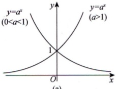

(a)

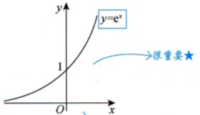

(b)

图 1-8

 $$ \lim_{x\to a}e^{x} $$

$$ \lim_{x\to\infty}\mathbf{e}^{x}= $$

答案： $+∞$ 或 0，(×) 立即拒绝。违背了函数极限的唯一性（不存在）

 $$ x\rightarrow+\infty,\ e^{x}\rightarrow+\infty $$

$$ x\to-\infty,\ e^{x}\to0 $$

**注**(1)定义域： $(-∞,+∞)$，值域： $(0,+∞)$

(2) 单调性：当  $a > 1$ 时， $y = a^{x}$ 单调增加；当  $0 < a < 1$ 时， $y = a^{x}$ 单调减少。

(3) 常用的指数函数： $y = e^x$ [见图 1-8(b)].

<!-- page: 17 -->

(4) 极限： $\lim_{x\to-\infty}e^x=0,\lim_{x\to+\infty}e^x=+\infty$

> 小贴士：“$\infty$” 这个符号，一般认为是英国数学家沃利斯（J. Wallis，1616—1703）开始使用的。

“∞”不是常数，那它归到哪里呢？“∞”实际上是一个广义的数，是一个特殊的存在。在很多定理中，“∞”的作用与任意常数的作用是一样的，比如后面我们会学的“夹逼准则”，如

 $$ \begin{aligned}y_{n}&\leqslant x_{n}\leqslant z_{n}\\\downarrow&\quad\Downarrow\quad\downarrow\\n\rightarrow\infty,a&\Longrightarrow a\Longleftrightarrow a\\+\infty&\Longrightarrow+\infty\Longleftrightarrow+\infty\\-\infty&\Longrightarrow-\infty\Longleftrightarrow-\infty\end{aligned} $$

(5) 特殊函数值： $a^{0}=1$， $e^{0}=1$

考： $e^{x}-1=e^{x}-e^{0}$，神秘的数字“1”和“0”，这个是解题时常见的包装。

统一类→后面就可以用“拉格朗日中值定理”的学习捅破这层“窗户纸”。

(6) 指数运算法则.

 $$ \left|x\right|^{3n}=\left(\left|x\right|^{3}\right)^{n}=\left(\left|x^{3}\right|\right)^{n} $$

$$ a^{\alpha}\cdot a^{\beta}=a^{\alpha+\beta},\frac{a^{\alpha}}{a^{\beta}}=a^{\alpha-\beta},\left(a^{\alpha}\right)^{\beta}=a^{\alpha\beta},\left(ab\right)^{\alpha}=a^{\alpha}b^{\alpha},\left(\frac{a}{b}\right)^{\alpha}=\frac{a^{\alpha}}{b^{\alpha}}, $$

$$ \therefore\mathrm{e}^{\tan x}-\mathrm{e}^{\sin x}=\mathrm{e}^{\sin x}(\mathrm{e}^{\tan x-\sin x}-1) $$

其中 a, b 是正实数， $\alpha, \beta$ 是任意实数。

(4) 对数函数.

 $y = \log_a x (a > 0, a \neq 1)$ [见图 1-9(a)] 是  $y = a^x$ 的反函数.

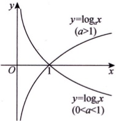

(a)

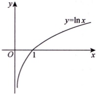

(b)

图 1-9

**注**（1）定义域： $(0,+\infty)$，值域： $(-\infty,+\infty)$

(2) 单调性：当  $a > 1$ 时， $y = \log_a x$ 单调增加；当  $0 < a < 1$ 时， $y = \log_a x$ 单调减少。

(3) 常用的对数函数： $y = \ln x$（自然对数： $\ln x = \log_e x$， $e = 2.71828\cdots$）[见图 1-9(b)]。

(4) 特殊函数值： $\log_{a}1=0$， $\log_{a}a=1$， $\ln1=0$， $\ln e=1$

 $$ \therefore c-2>0 $$

神秘的数字 “0” 和 “1”，实现 “统一美” “简洁美”

如  $e^{x_n}-1=e^{x_n}-e^0$， $\ln x_n=\ln x_n-\ln1$。

<!-- page: 18 -->

再如，

 $$ \begin{aligned}&\frac{\ln\left(e+\frac{1}{x}\right)-1=\ln\left(e+\frac{1}{x}\right)-\ln e}{}\\ &\quad\rightarrow\quad=\ln\left(1+\frac{1}{\mathrm{e}x}\right)．这个转化是极为有意义的 \\ \end{aligned} $$

又如  $\lim_{x\to\infty}x\left[\ln\left(e+\frac{1}{x}\right)-1\right]=\lim_{x\to\infty}x\cdot\frac{1}{ex}=\frac{1}{e}$。如果你考虑用洛必达法则，那么就舍近求远了。

考研需要区分度，考生要掌握一些解题技巧。从辩证法去看，实现“统一美”。

(5) 极限： $\lim_{x\to0^{+}}\ln x=-\infty,\quad\lim_{x\to+\infty}\ln x=+\infty$

当 x→+∞ 时， e^x→+∞ 的速度越来越快， ln x→+∞ 的速度越来越慢．

(6) 常用公式： $x = e^{\ln x}(x > 0)$， $u^y = e^{\ln u^y} = e^{\nu \ln u}(u > 0)$

 $x^x = e^{\ln x^x} = e^{x \ln x}$，从而可看到， $x^x$ 是初等函数。

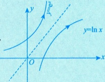

(7) 对数运算法则. 积变和

①  $\log_{a}(MN)=\log_{a}M+\log_{a}N$（积的对数 = 对数的和）.

② $\log_{a}\frac{M}{N}=\log_{a}M-\log_{a}N$（商的对数=对数的差）.

③  $\log_{a}M^{n}=n\log_{a}M$， $\log_{a}\sqrt[n]{M}=\frac{1}{n}\log_{a}M$（幂的对数=对数的倍数）.

一定要用好对数的运算法则，如： $e^{\ln\sqrt{f^{2}(x)-f(x)+1}}=\sqrt{f^{2}(x)-f(x)+1}$

常考：当x>0时，

中值定理（拉格朗日中值定理）证明

 $$ \ln\sqrt{x}=\frac{1}{2}\ln x;\quad\ln\frac{1}{x}=-\ln x;\quad\ln\left(1+\frac{1}{x}\right)=\ln\frac{x+1}{x}=\ln(x+1)-\ln x $$

利用例 1.11，学习解题技巧。

**例 1.11** 已知  $e^x = \sum_{n=0}^{\infty} \frac{x^n}{n!}$， $x \in \mathbb{R}$，则  $2^x = (\quad)$。

(A)  $\sum_{n=1}^{\infty} \frac{(x \ln 2)^n}{n!}$

(B)  $\sum_{n=0}^{\infty} \frac{(x \ln 2)^n}{n!}$

(C)  $\sum_{n=1}^{\infty} \frac{(\ln 2)x^n}{n!}$

(D)  $\sum_{n=0}^{\infty} \frac{(\ln 2)x^n}{n!}$

**分析**  $2^{x}=e^{\ln 2^{x}}=e^{x\ln 2}$

**解** 应选(B).

由于  $2^{x}=e^{x\ln2}$，又  $e^{x}=\sum_{n=0}^{\infty}\frac{x^{n}}{n!}$， $x\in\mathbb{R}$，因此  $2^{x}=\sum_{n=0}^{\infty}\frac{(x\ln2)^{n}}{n!}$

**方法总结**  $\mathrm{e}^{x}=\sum_{n=0}^{\infty}\frac{x^{n}}{n!}$，广义化： $2^{x}=\mathrm{e}^{x\ln2}=\sum_{n=0}^{\infty}\frac{(x\ln2)^{n}}{n!}$

<!-- page: 19 -->

**公式**  $e^{x}=\sum_{n=0}^{\infty}\frac{x^{n}}{n!}, x\in\mathbf{R}$

**注** 理工类以及自然科学中，当然会用到  $e^{x}=1+x+\frac{x^{2}}{2!}+\frac{x^{3}}{3!}+\cdots$；在社会科学中，也经常会看到这个式子，因为多项式是最简单的。

三角函数与反三角函数这里公式多，杂，是区分度比较高的部分

(5)三角函数.

拱的面积为2.

①正弦函数与余弦函数.

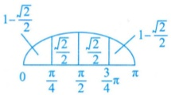

正弦函数  $y = \sin x$ [见图 1-10(a)]，余弦函数  $y = \cos x$ [见图 1-10(b)]。

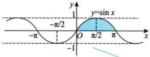

(a)

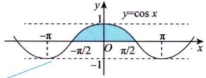

这两个面积是相等的

(b)

图 1-10

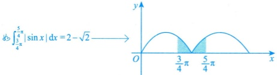

**注** (1) 定义域：均为  $(-\infty, +\infty)$，值域：均为  $[-1, 1]$.

当  $x \to 0^{+}$ 时， $\sin x \leq 1$， $\sin x < x$。

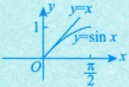

(2) 奇偶性： $y = \sin x$ 是奇函数， $y = \cos x$ 是偶函数， $x \in (-\infty, +\infty)$.

(3) 周期性： $y = \sin x$ 和  $y = \cos x$ 均以  $2\pi$ 为最小正周期， $x \in (-\infty, +\infty)$

(4) 有界性： $|\sin x| \leqslant 1$， $|\cos x| \leqslant 1$

(5) 特殊函数值：

$$
\sin 0 = 0, \sin \frac{\pi}{6} = \frac{1}{2}, \sin \frac{\pi}{4} = \frac{\sqrt{2}}{2}, \sin \frac{\pi}{3} = \frac{\sqrt{3}}{2}
$$

 $$ \sin\frac{\pi}{2}=1,\sin\pi=0,\sin\frac{3\pi}{2}=-1,\sin2\pi=0, $$

$$ \cos0=1,\cos\frac{\pi}{6}=\frac{\sqrt{3}}{2},\cos\frac{\pi}{4}=\frac{\sqrt{2}}{2},\cos\frac{\pi}{3}=\frac{1}{2}, $$

<!-- page: 20 -->

$$ \cos\frac{\pi}{2}=0,\cos\pi=-1,\cos\frac{3\pi}{2}=0,\cos2\pi=1. $$

(6)  $\sin^2 \alpha + \cos^2 \alpha = 1$. ★

恒等变形的一个办法，如： $\sin^2 \alpha + \cos^2 \alpha = 1$， $\sqrt{\sin^2 x - \cos^2 a} = \sqrt{1 - \cos^2 x - \cos^2 a} = \sqrt{\sin^2 a - \cos^2 x}$，命题老师常用“手段”。

②正切函数与余切函数.

正切函数  $y = \tan x$ [见图 1-11(a)]，余切函数  $y = \cot x$ [见图 1-11(b)]。

 $$ \tan x=\frac{\sin x}{\cos x},\cot x=\frac{\cos x}{\sin x}=\frac{1}{\tan x}. $$

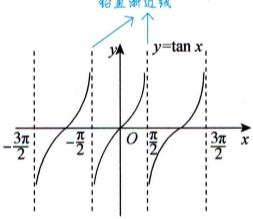

(a)

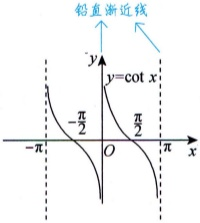

(b)

图 1-11

**注** (1) 定义域： $y = \tan x$ 的定义域为  $\left\{ x \mid x \neq k\pi + \frac{\pi}{2} (k \in \mathbb{Z}) \right\}$； $y = \cot x$ 的定义域为  $\{ x \mid x \neq k\pi (k \in \mathbb{Z}) \}$。

值域：均为 $(-∞,+∞)$.

(2) 奇偶性： $y = \tan x$ 和  $y = \cot x$ 均为奇函数（在其定义域内）.

(3) 周期性： $y = \tan x$ 和  $y = \cot x$ 均以  $\pi$ 为最小正周期（在其定义域内）.

(4) 特殊函数值：

 $$ \tan0=0,\tan\frac{\pi}{6}=\frac{\sqrt{3}}{3},\tan\frac{\pi}{4}=1,\tan\frac{\pi}{3}=\sqrt{3}, $$

$$ \lim_{x\to\frac{\pi}{2}^{-}}\tan x=+\infty,\quad \lim_{x\to\frac{\pi}{2}^{+}}\tan x=-\infty,\quad \tan\pi=0,\quad \tan2\pi=0, $$

$$ \lim_{x\to0^{+}}\cot x=+\infty,\quad \lim_{x\to0^{-}}\cot x=-\infty,\quad \cot\frac{\pi}{6}=\sqrt{3},\quad \cot\frac{\pi}{4}=1,\quad \cot\frac{\pi}{3}=\frac{\sqrt{3}}{3}, $$

$$ \cot\frac{\pi}{2}=0,\quad \lim_{x\to\pi^{-}}\cot x=-\infty,\quad \lim_{x\to\pi^{+}}\cot x=+\infty,\quad \cot\frac{3\pi}{2}=0. $$

> 注意：$\lim\limits_{x\to\frac{\pi}{2}}\tan x$、$\lim\limits_{x\to0}\cot x$ 作为**双边**极限是不存在的（左右极限一个 $+\infty$、一个 $-\infty$），答题时不要写成 $=\infty$。

<!-- page: 21 -->

③正割函数与余割函数.

正割函数  $y = \sec x$ [见图 1-12(a)]，余割函数  $y = \csc x$ [见图 1-12(b)].

 $$ \sec x=\frac{1}{\cos x},\csc x=\frac{1}{\sin x} $$

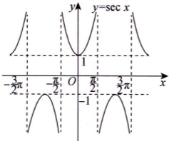

(a)

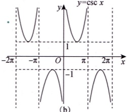

(b)

图 1-12

**注** (1) 定义域： $y = \sec x$ 的定义域为  $\left\{ x \mid x \neq k\pi + \frac{\pi}{2} (k \in \mathbb{Z}) \right\}$； $y = \csc x$ 的定义域为  $\{ x \mid x \neq k\pi (k \in \mathbb{Z}) \}$。

值域：均为 $(-∞,-1]∪[1,+∞)$

(2) 奇偶性： $y = \sec x$ 为偶函数， $y = \csc x$ 为奇函数（在其定义域内）.

(3) 周期性： $y = \sec x$ 和  $y = \csc x$ 均以  $2\pi$ 为最小正周期（在其定义域内）.

(4)  $1 + \tan^2 \alpha = \sec^2 \alpha$;  $1 + \cot^2 \alpha = \csc^2 \alpha$.★非常重要

(6) 反三角函数.

①反正弦函数与反余弦函数.

反正弦函数  $y = \arcsin x$ [见图 1-13(a)]，反余弦函数  $y = \arccos x$ [见图 1-13(b)]。

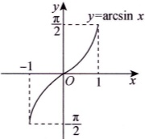

(a)

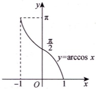

(b)

图 1-13

 $y = \arcsin x$ 是  $y = \sin x \left( -\frac{\pi}{2} \leq x \leq \frac{\pi}{2} \right)$ 的反函数， $y = \arccos x$ 是  $y = \cos x (0 \leq x \leq \pi)$ 的反函数。

<!-- page: 22 -->

#### 注　主值区间

 $y = \arcsin x$ 的主值区间为  $\left[-\frac{\pi}{2}, \frac{\pi}{2}\right]$， $y = \arccos x$ 的主值区间为  $[0, \pi]$.

(2) 反三角函数的恒等式有

$$ \sin(\arcsin x)=x,\quad x\in[-1,1];\qquad \cos(\arccos x)=x,\quad x\in[-1,1]. $$

$$ \sin(\arccos x)=\sqrt{1-x^{2}},\quad x\in[-1,1];\qquad \cos(\arcsin x)=\sqrt{1-x^{2}},\quad x\in[-1,1]. $$

$$ \arcsin(\sin x)=x,\quad x\in\left[-\frac{\pi}{2},\ \frac{\pi}{2}\right];\qquad \arccos(\cos x)=x,\quad x\in[0,\ \pi]. $$

$$ \arcsin x+\arccos x=\frac{\pi}{2}\quad(-1\leqslant x\leqslant 1). $$

注：$\arcsin x+\arccos x=\dfrac{\pi}{2}$ 这条结论要记住，讲中值定理时会再证明。而 $\arcsin(\sin x)$、$\arccos(\cos x)$ 这类“反三角套三角”的式子，必须先把内层角化到主值区间内，再用诱导公式（见例 1.12）。

(3) 特殊函数值：

 $$ \arcsin0=0,\arcsin\frac{1}{2}=\frac{\pi}{6},\arcsin\frac{\sqrt{2}}{2}=\frac{\pi}{4},\arcsin\frac{\sqrt{3}}{2}=\frac{\pi}{3},\arcsin1=\frac{\pi}{2}, $$

$$ \arccos1=0,\arccos\frac{\sqrt{3}}{2}=\frac{\pi}{6},\arccos\frac{\sqrt{2}}{2}=\frac{\pi}{4},\arccos\frac{1}{2}=\frac{\pi}{3},\arccos0=\frac{\pi}{2} $$

**例 1.12** 设  $y = \sin x$,  $0 \leq x \leq 2\pi$，求其所有单调区间上的反函数.

分析分单调区间，分别讨论反函数（用诱导公式）.

只有当x落在 $\left[-\frac{\pi}{2}, \frac{\pi}{2}\right]$上时，才有反函数 $x = \arcsin y$， $y \in [-1, 1]$。

**解** 当  $0 \leqslant x \leqslant \frac{\pi}{2}$ 时，对  $y = \sin x$，有  $x = \arcsin y$， $y \in [0, 1]$，此时反函数为  $y = \arcsin x$， $x \in [0, 1]$。

当  $\frac{\pi}{2} < x \leqslant \frac{3\pi}{2}$ 时（见图 1-14），有  $-\frac{\pi}{2} < x - \pi \leqslant \frac{\pi}{2}$，此时  $\sin(x - \pi) = -\sin(\pi - x) = -\sin x = -y$，于是有  $x - \pi = -\arcsin y$，故  $x = \pi - \arcsin y, y \in [-1, 1)$，此时反函数为  $y = \pi - \arcsin x, x \in [-1, 1)$。

当  $\frac{3\pi}{2} < x \leq 2\pi$ 时（见图 1-14），有  $-\frac{\pi}{2} < x - 2\pi \leq 0$，此时  $\sin(x - 2\pi) = \sin x = y$，于是有  $x - 2\pi = \arcsin y$，故  $x = 2\pi + \arcsin y, y \in (-1, 0]$，此时反函数为  $y = 2\pi + \arcsin x, x \in (-1, 0]$。

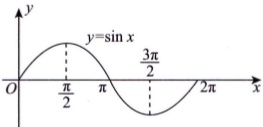

图 1-14

<!-- page: 23 -->

**方法总结**  $\arcsin x$ 的主值区间是  $\left[-\frac{\pi}{2}, \frac{\pi}{2}\right]$

**公式** 若  $y = \sin x$,  $x \in \left( \frac{\pi}{2}, \frac{3}{2}\pi \right)$, 则  $x = \pi - \arcsin y$.

**注**（1） 用处：如二重积分中，

 $$ \int_{-1}^{0}\mathrm{d}y\int_{\pi-\arcsin y}^{2\pi+\arcsin y}f(x,y)\mathrm{d}x $$

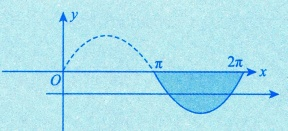

后面我们讲二重积分时再讲．

(2) 现在来回答大家：为什么不写成一个分段函数？会出现以下情况.

$$ y=\begin{cases}\arcsin x, & x\in[0,1],\\ \pi-\arcsin x, & x\in[-1,1],\\ 2\pi+\arcsin x, & x\in(-1,0].\end{cases} $$

> 注意：这样拼出来已经不是函数了——同一个 $x$ 会对应多个 $y$（如 $x=\frac{1}{2}$ 同时对应 $\arcsin\frac{1}{2}$ 和 $\pi-\arcsin\frac{1}{2}$），图形就是图 1-15。所以反函数必须**按单调区间分别写**，不能这样合并。

这样的图形是什么呢？如图 1-15 所示。

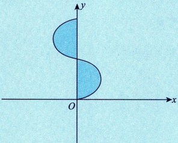

图 1-15

这个图就是  $y = \sin x$ 在  $[0, 2\pi]$ 的沿  $y = x$ 镜像的函数，就变成多值函数了。

②反正切函数与反余切函数. $\star\star$非常重要的函数

反正切函数  $y = \arctan x$ [见图 1-16(a)]，反余切函数  $y = \operatorname{arccot} x$ [见图 1-16(b)]。

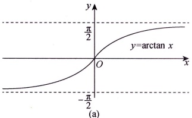

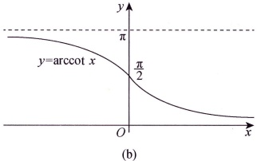

图 1-16

<!-- page: 24 -->

$y = \arctan x$ 是  $y = \tan x \left( -\frac{\pi}{2} < x < \frac{\pi}{2} \right)$ 的反函数， $y = \operatorname{arccot} x$ 是  $y = \cot x (0 < x < \pi)$ 的反函数。

#### 注　定义域：均为 $(-\infty,+\infty)$

值域： $y=\arctan x$ 的值域为  $\left(-\frac{\pi}{2},\frac{\pi}{2}\right)$， $y=\operatorname{arccot} x$ 的值域为  $(0,\pi)$.

(2) 单调性： $y = \arctan x$ 单调增加， $y = \operatorname{arccot} x$ 单调减少。

若  $a_{n}>0$， $\arctan a_{n}+a_{n}=\arctan b_{n}$，则  $\arctan b_{n}-\arctan a_{n}=a_{n}>0$（因  $y=\arctan x$ 是单调增加函数），因此  $b_{n}>a_{n}>0$，若  $b_{n}=a_{n-1}$，则  $\{a_{n}\}$ 有下界且单调减少，从而  $\{a_{n}\}$ 极限存在。

若再加条件 $\lim\limits_{n\to\infty}b_{n}=0$，则由 $0<a_{n}<b_{n}$ 及夹逼准则得 $\lim\limits_{n\to\infty}a_{n}=0$。

命题老师给的关系式一般都需要做逆运算：

该加的，他减；该减的，他加；该乘的，他除；该除的，他乘，等等，这些都是需要作恒等变形的。命题老师通过做逆运算来迷惑你，要跟他唱反调，这是非常重要的解题经验。

(3) 奇偶性： $y = \arctan x$ 为奇函数（在其定义域内）.

(4)有界性：两个函数在其定义域内有界， $-\frac{\pi}{2} < \arctan x < \frac{\pi}{2}$， $0 < \operatorname{arccot} x < \pi$。

(5) 性质： $\arctan x + \operatorname{arccot} x = \frac{\pi}{2} (-\infty < x < +\infty)$。这个也是以后会讲到

(6) 特殊函数值：

 $$ \arctan0=0,\arctan\frac{\sqrt{3}}{3}=\frac{\pi}{6},\arctan1=\frac{\pi}{4},\arctan\sqrt{3}=\frac{\pi}{3}, $$

$$ \operatorname{arccot}0=\frac{\pi}{2},\operatorname{arccot}\sqrt{3}=\frac{\pi}{6},\operatorname{arccot}1=\frac{\pi}{4},\operatorname{arccot}\frac{\sqrt{3}}{3}=\frac{\pi}{3} $$

(7) 极限：

 $$ \lim_{x\to-\infty}\arctan x=-\frac{\pi}{2},\lim_{x\to+\infty}\arctan x=\frac{\pi}{2},\lim_{x\to-\infty}\operatorname{arccot} x=\pi,\lim_{x\to+\infty}\operatorname{arccot} x=0 $$

(7)初等函数.

由基本初等函数经过有限次的四则运算，以及有限次的复合步骤所构成的并且可以由一个式子所表示的函数称为初等函数。

<!-- page: 25 -->

**注** (1) 初等函数的定义域可以是一个区间，也可以是几个区间的并集，甚至可以是一些孤立的点。例如， $y = \sqrt{\cos \pi x - 1}$ 的定义域是  $\{x \mid x = 0, \pm 2, \pm 4, \cdots\}$。

★ (2) 幂指函数  $u(x)^{\nu(x)} = e^{\nu(x)\ln u(x)}$ 也是初等函数，如 x > 0 时， $f(x) = x^x = e^{x\ln x}$ 是初等函数，其图形如图 1-17 所示。具体作图过程见例 5.12。

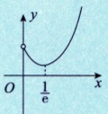

等到学完工具后再画图，如 $x^{2}$， $x^{2x}$， $x^{3x}$的图像都类似。

图 1-17

### 2 分段函数

在自变量的不同变化范围中，对应法则用不同式子来表示的函数称为分段函数。需要强调一句，分段函数是用几个式子来表示的一个（不是几个）函数。一般来说，它不是初等函数。分段函数的典型形式如下：

 $$ f(x)=\begin{cases}\varphi_{1}(x),&x>x_{0},\\a,&x=x_{0},\\ \varphi_{2}(x),&x<x_{0}\end{cases} 或 f(x)=\begin{cases}\varphi(x),&x\neq x_{0},\\a,&x=x_{0}.\end{cases} $$

分段函数很重要，原因在于其形式的复杂性所带来的命题的丰富性。后面会看到，不论是求极限、求导数，还是求积分，出现最多的研究对象之一便是分段函数。

 $$ 分段函数是非常重要的一个命题素材。\angle $$

下面列出三个重要的分段函数.

①

$$
y=|x|=\begin{cases}x,&x\geqslant0,\\-x,&x<0\end{cases}
$$

称为绝对值函数，如图1-18(a)所示.

|x|既然是分段函数，那它是不是初等函数呢？是，因为 $|x|=\sqrt{x^2}$，一般来讲，分段函数不是初等函数，但 $|x|$是一个特例。

②

$$
y=\mathrm{sgn}x=\begin{cases}1,&x>0,\\0,&x=0,\\-1,&x<0\end{cases}
$$

称为符号函数，如图 1-18(b) 所示。对于任意实数 $x$，有 $x=|x|\operatorname{sgn}x$（即 $|x|=x\operatorname{sgn}x$）。

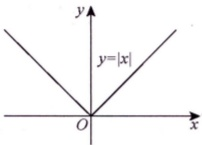

(a)

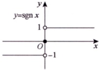

(b)

图 1-18

③ $y=[x]$称为取整函数.先给出定义:设x为任一实数,不超过x的最大整数称为x的整数部分,记作 $[x]$.如

 $$ \left[0.99\right]=0,\left[\pi\right]=3,\left[-1\right]=-1,\left[-1.99\right]=-2. $$

因此，取整函数  $y = [x]$ 的定义域为  $\mathbb{R}$，值域为  $\mathbb{Z}$。它的图形如图 1-19 所示，在  $x$ 为整数值处图形发生跳跃。

<!-- page: 26 -->

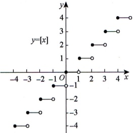

图 1-19

**注** ★★★ (1)  $[x+n]=[x]+n$，其中  $n$ 为整数。

★ (2) x-1 < [x] ≤ x

★ (3)  $\lim_{x\to0^{+}}[x]=0$;  $\lim_{x\to0^{-}}[x]=-1$

★★★ (4) 换一种说法，“Y = i + 1 当且仅当 i ≤ X < i + 1，i 为整数，则 Y = [X] + 1”考生要牢记。

**例 1.13** 设 [x] 表示不超过 x 的最大整数，则  $y = x - [x]$ 是（）.

(A) 无界函数

(B) 单调函数

(C) 偶函数

(D) 周期函数

**解** 应选(D).

由于 $y(x+1)=x+1-[x+1]=x+1-([x]+1)=x-[x]=y(x)$，即 $y(x)$ 是周期为 1 的周期函数，其图形如图 1-20 所示，故选 (D).

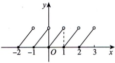

图 1-20

**方法总结**  $x-[x]$：x 的小数部分，是以 1 为周期的函数。

**公式**  $[x+n]=[x]+n$， $[x+1]=[x]+1$

**注** (1)  $y = x - [x] = \{x\}$

 $$ 1.99-\left[1.99\right]=0.99, $$

<!-- page: 27 -->

$$ -1.99-\left[-1.99\right]=-1.99+2=0.01 $$

-1.99 的整数部分是 -2，

-1.99 的小数部分是 0.01 .

(2)  $y = \sin x$，其图形如图 1-21 所示。

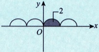

图 1-21

(3)  $y = \left| \arcsin(\sin x) \right|$，其图形如图 1-22 所示。

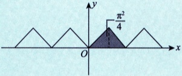

图 1-22

以后我们算积分的相关题目，这些图都有重要的应用。

---

> ← 上一节 [函数的概念与特性](01-函数的概念与特性.md) ｜ [总目录](00-第1讲-导读与知识结构.md) ｜ 下一节 [函数极限的定义与性质](03-函数极限的定义与性质.md) →
