# 第1讲 函数极限与连续（三）　函数极限的概念与性质

> 原书 p.28–41 ｜ 拆分版 3/8 ｜ 邻域、极限的 24 个定义、超实数、极限的性质
>
> ← 上一节 [函数的图像](02-函数的图像.md) ｜ [总目录](00-第1讲-导读与知识结构.md) ｜ 下一节 [无穷小与无穷大](04-无穷小与无穷大.md) →

---

## 三、函数极限的概念与性质

我们首先要厘清极限的概念，概念懂了，后面的性质是显然的，计算就会遵循概念和性质，从而不会出错。

### 1 邻域

① $\delta$ 邻域. 设 $x_{0}$ 是数轴上一个点，$\delta$ 是某一正数，则称 $(x_{0}-\delta,\ x_{0}+\delta)$ 为点 $x_{0}$ 的 $\delta$ 邻域，记作 $U(x_{0},\delta)$，即

 $$ U(x_{0},\delta)=\left\{x\left|x_{0}-\delta<x<x_{0}+\delta\right.\right\}=\left\{x\mid\left|x-x_{0}\right|<\delta\right\}, $$

其中点  $x_{0}$ 称为邻域的中心，  $\delta$ 称为邻域的半径.

② 去心 $\delta$ 邻域. 点 $x_{0}$ 的去心邻域记作 $\overset{\circ}{U}(x_{0},\delta)=\{x\mid 0<|x-x_{0}|<\delta\}$，即把中心点 $x_{0}$ 从 $\delta$ 邻域中挖掉。

③左、右  $\delta$ 邻域.  $\{x | 0 < x - x_{0} < \delta\}$ 称为点  $x_{0}$ 的右  $\delta$ 邻域, 记作  $U^{+}(x_{0}, \delta)$;  $\{x | 0 < x_{0} - x < \delta\}$ 称为点  $x_{0}$ 的左  $\delta$ 邻域, 记作  $U^{-}(x_{0}, \delta)$.

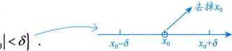

④邻域与区间（区域）. 邻域当然属于区间（区域）的范畴，但事实上，邻域通常表示“一个局

<!-- page: 28 -->

部位置”，比如“点 $x_{0}$的 $\delta$邻域”就可以称为“点 $x_{0}$的附近”。于是，函数 $f(x)$在点 $x_{0}$的某 $\delta$邻域内有定义也就是函数 $f(x)$在点 $x_{0}$的附近有定义，这个“附近”到底有多近多远，既难以说明也没有必要说明。

**注** (1) 邻域是区间（区域），但是这个区间是为定义极限才创建的区间。

(2) 关于邻域的一组概念非常重要，因为我们将要“在一个局部位置”细致地研究问题。

### 2 函数极限的定义

设函数$f(x)$在点$x_0$的某一去心邻域内有定义.若存在常数$A$,对于任意给定的$\varepsilon>0$（不论它多么小），总存在正数$\delta$,使得当$0<|x-x_0|<\delta$时，对应的函数值$f(x)$都满足不等式$|f(x)-A|<\varepsilon$,则$A$叫作函数$f(x)$当$x\to x_0$时的极限，记为

 $$ \lim_{x\to x_{0}}f(x)=A 或 f(x)\to A(x\to x_{0}). $$

写成 “  $\varepsilon - \delta$ 语言”：  $\lim_{x \to x_0} f(x) = A \Leftrightarrow \forall \varepsilon > 0, \exists \delta > 0$ ，当  $0 < |x - x_0| < \delta$ 时，有  $|f(x) - A| < \varepsilon$

文字语言：任给的 $\varepsilon>0$，总能找到 $\delta$邻域，使得我们的距离小于你这个尺度。

**注** 符号 “∀” 是英文 Arbitrary(任意的) 的首字母上下方向倒着写出来的；符号 “∃” 是英文 Exist(存在) 的首字母左右方向倒着写出来的.

画图理解．如图 1-23 所示．

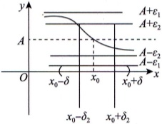

图 1-23

任给  $\varepsilon_{1}>0$，再给  $\varepsilon_{2}>0$，……，再给  $\varepsilon_{n}>0$，当  $\varepsilon$ 一直取下去，越来越小，两条线越来越近。不管有多近，总能找到一个小邻域，使得在该邻域内，除了  $x_{0}$ 之外，曲线被夹在宽度要多小有多小的这两条线中，则称  $x\to x_{0}$， $f(x)\to A$。这就是魏尔斯特拉斯给的极限的标准语言。

<!-- page: 29 -->

**注** 函数极限一共有 24 个定义：自变量趋近方式有 6 种，函数趋近方式有 4 种，如下表。

| 趋向方式 | $f(x)\to A$ | $f(x)\to\infty$ | $f(x)\to+\infty$ | $f(x)\to-\infty$ |
| :--- | :--- | :--- | :--- | :--- |
| $x\to x_0$ | $\forall\varepsilon>0,\exists\delta>0$，当 $0<\vert x-x_0\vert<\delta$ 时，$\vert f(x)-A\vert<\varepsilon$ | $\forall M>0,\exists\delta>0$，当 $0<\vert x-x_0\vert<\delta$ 时，$\vert f(x)\vert>M$ | $\forall M>0,\exists\delta>0$，当 $0<\vert x-x_0\vert<\delta$ 时，$f(x)>M$ | $\forall M>0,\exists\delta>0$，当 $0<\vert x-x_0\vert<\delta$ 时，$f(x)<-M$ |
| $x\to x_0^{+}$ | $\forall\varepsilon>0,\exists\delta>0$，当 $0<x-x_0<\delta$ 时，$\vert f(x)-A\vert<\varepsilon$ | $\forall M>0,\exists\delta>0$，当 $0<x-x_0<\delta$ 时，$\vert f(x)\vert>M$ | $\forall M>0,\exists\delta>0$，当 $0<x-x_0<\delta$ 时，$f(x)>M$ | $\forall M>0,\exists\delta>0$，当 $0<x-x_0<\delta$ 时，$f(x)<-M$ |
| $x\to x_0^{-}$ | $\forall\varepsilon>0,\exists\delta>0$，当 $0<x_0-x<\delta$ 时，$\vert f(x)-A\vert<\varepsilon$ | $\forall M>0,\exists\delta>0$，当 $0<x_0-x<\delta$ 时，$\vert f(x)\vert>M$ | $\forall M>0,\exists\delta>0$，当 $0<x_0-x<\delta$ 时，$f(x)>M$ | $\forall M>0,\exists\delta>0$，当 $0<x_0-x<\delta$ 时，$f(x)<-M$ |
| $x\to\infty$ | $\forall\varepsilon>0,\exists X>0$，当 $\vert x\vert>X$ 时，$\vert f(x)-A\vert<\varepsilon$ | $\forall M>0,\exists X>0$，当 $\vert x\vert>X$ 时，$\vert f(x)\vert>M$ | $\forall M>0,\exists X>0$，当 $\vert x\vert>X$ 时，$f(x)>M$ | $\forall M>0,\exists X>0$，当 $\vert x\vert>X$ 时，$f(x)<-M$ |
| $x\to+\infty$ | $\forall\varepsilon>0,\exists X>0$，当 $x>X$ 时，$\vert f(x)-A\vert<\varepsilon$ | $\forall M>0,\exists X>0$，当 $x>X$ 时，$\vert f(x)\vert>M$ | $\forall M>0,\exists X>0$，当 $x>X$ 时，$f(x)>M$ | $\forall M>0,\exists X>0$，当 $x>X$ 时，$f(x)<-M$ |
| $x\to-\infty$ | $\forall\varepsilon>0,\exists X>0$，当 $x<-X$ 时，$\vert f(x)-A\vert<\varepsilon$ | $\forall M>0,\exists X>0$，当 $x<-X$ 时，$\vert f(x)\vert>M$ | $\forall M>0,\exists X>0$，当 $x<-X$ 时，$f(x)>M$ | $\forall M>0,\exists X>0$，当 $x<-X$ 时，$f(x)<-M$ |

> 这 24 种情况最好能自己默写一遍：分清 $\varepsilon$ 与 $\delta$、$X$ 与 $M$ 各管什么，考场上才不会把 “$|f(x)-A|<\delta$” 这种错误写出来。

**例 1.14** 已知  $\lim_{x\to0}\frac{f(x)}{x^{2}}$ 存在，且函数

 $$ f(x)=\frac{x-\sin x}{x}+x^{2}\lim_{x\to0}\frac{f(x)}{1-\cos x} $$

<!-- page: 30 -->

则  $\lim_{x\to0}\frac{f(x)}{x^{2}}=$（ ）.

(A) $-\frac{1}{3}$ (B) $\frac{1}{3}$ (C) $\frac{1}{6}$ (D) $-\frac{1}{6}$

**分析** 令  $\lim_{x\to0}\frac{f(x)}{x^{2}}=A$，建立方程.

**解** 应选(D).

记 $\lim_{x\to0}\frac{f(x)}{x^{2}}=A$，且当 $x\to0$时，

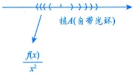

$$ \frac{f(x)}{x^{2}}=\frac{x-\sin x}{x^{3}}+\lim_{x\to0}\frac{f(x)}{1-\cos x}, $$

其中 $\lim\limits_{x\to0}\dfrac{f(x)}{1-\cos x}=\lim\limits_{x\to0}\dfrac{f(x)}{x^{2}}\cdot\dfrac{x^{2}}{1-\cos x}=A\cdot 2=2A$，

则 $A=\lim\limits_{x\to0}\dfrac{x-\sin x}{x^{3}}+2A=\dfrac{1}{6}+2A$，故 $A=-\dfrac{1}{6}$。

### 3 超实数及其在极限中的应用

下面讲一个极为重要的概念及其应用，帮助考生进一步深刻理解“极限”。

实数系 R 中有如下公理：

若对任意大的自然数 n，均有  $\left|x\right| < \frac{1}{n}$，则 x = 0 。这使得实数系 R 中不存在非零无穷小量及其倒数——无穷大量。

(1) 定义.

①非零无穷小量与无穷大量.

若对任意大的自然数 n，均有  $\left|x^{*}\right| < \frac{1}{n}$ 且  $x^{*} \neq 0$，则  $x^{*}$ 为非零无穷小量，其倒数  $\frac{1}{x^{*}}$ 为无穷大量.

②超实数.

设 $x_{0}$为任一实数，则 $x_{0}+x^{*}$为有限超实数， $x_{0}+\frac{1}{x^{*}}$为无穷超实数（无穷大量）.

③超实数系 $R^{*}$

实数系 R，非零无穷小量  $x^{*}$，无穷大量  $\frac{1}{x^{*}}$ 构成超实数系  $R^{*}$。 $x_{0} + x^{*}$， $x_{0} + \frac{1}{x^{*}}$ 不在实数系 R 中。

(2) 实数与超实数的关系（见图 1-24）

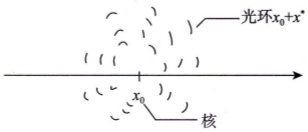

图 1-24

<!-- page: 31 -->

在实数轴上任取一点 $x_{0}$，称为核.

 $x_{0}+x^{*}$ 是以  $x_{0}$ 为核的有限超实数，称为核  $x_{0}$ 的光环，由于  $x^{*}$ 是任意一个非零无穷小，故  $x_{0}$ 的光环有无穷多个.

为方便，记  $X^* = x_0 + x^* = \text{std}(X^*) + [X^* - \text{std}(X^*)]$， $x_0 = \text{std}(X^*)$ 也称为超实数  $X^*$ 的标准实数部分， $x^* = X^* - \text{std}(X^*)$ 即为非零无穷小量。

如  $x_0 = 0$， $x_1^* = \sin x(x \to 0)$，则  $X_1^* = x_0 + x_1^* = \sin x(x \to 0)$ 是

以 0 为核，以  $\sin x$ 为无穷小量的超实数。

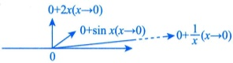

如 $x_{0}=0$， $x_{2}^{*}=2x(x\rightarrow0)$，则 $X_{2}^{*}=x_{0}+x_{2}^{*}=2x(x\rightarrow0)$是以0为核，以2x为无穷小量的超实数.

如  $x_{0}=0,\quad x_{3}^{*}=\frac{1}{x}(x\rightarrow0)$，则  $X_{3}^{*}=x_{0}+x_{3}^{*}=\frac{1}{x}(x\rightarrow0)$ 是以 0 为核，以  $\frac{1}{x}$ 为无穷大量的超实数.

如  $x_{0}=0,\quad x_{4}^{*}=\frac{1}{x^{2}}(x\rightarrow0)$，则  $X_{4}^{*}=x_{0}+x_{4}^{*}=\frac{1}{x^{2}}(x\rightarrow0)$ 是以 0 为核，以  $\frac{1}{x^{2}}$ 为无穷大量的超实数.

显然，上述 4 个超实数到它们的核的距离  $|\sin x|$， $|2x|$， $\left|\frac{1}{x}\right|$， $\left|\frac{1}{x^2}\right|$ ( $x \to 0$) 均不是实数， $|\sin x|$， $|2x|$ ( $x \to 0$) 是比任何正实数都小的量， $\left|\frac{1}{x}\right|$， $\left|\frac{1}{x^2}\right|$ ( $x \to 0$) 是比任何正实数都大的量。

(3) 超实数与极限的关系与运算.

先举个例子.如

 $$ \lim_{x\to0}\frac{\sin x}{x}=1, $$

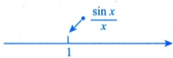

其中，① $\frac{\sin x}{x}$ 在未作极限运算时，为 $\underline{\text{实数运算}}$.

② $\lim_{x\to0}\frac{\sin x}{x}$称为 $\underline{\text{趋核运算}}$，此时的 $\frac{\sin x}{x}$称为 $\underline{\text{超实数}}$， $\lim_{x\to0}\frac{\sin x}{x}$的结果为 $\underline{\text{其核值1}}$。于是★设 $\lim_{x\to x_0}f(x)=A$，其运算（及其运算顺序）为

a.  $f(x)$ 为实数运算.

b.  $\lim_{x\to x_0}f(x)$ 为趋核运算，A 为核值，当 A 唯一时，称趋核运算存在， $\lim_{x\to x_0}f(x)$ 存在；否则称趋核运算不存在， $\lim_{x\to x_0}f(x)$ 不存在.

如  $\lim_{x\to0}\frac{(x-x)}{x}=\lim_{x\to0}0=0$

（实数运算：$\frac{x-x}{x}=0$；然后趋核运算：$\lim\limits_{x\to0}0=0$，核值为 $0$）

再如 $\lim\limits_{x\to0}(x-\sin x)$：如果先把 $\sin x$ 换成 $x$，得 $\lim\limits_{x\to0}(x-x)=0$，这当然是错的。原因在于 $\lim\limits_{x\to0}(x-\sin x)$ 首先要作**实数运算**，而 $\sin x\neq x$，即 $x-\sin x\neq x-x$，故后面的趋核运算就无从谈起。

<!-- page: 32 -->

又如，计算  $\lim_{x\to\infty}\frac{\left(1+\frac{1}{x}\right)^{x^{2}}}{e^{x}}$，若写

$$
\lim_{x\to\infty}\frac{\left(1+\frac{1}{x}\right)^{x^{2}}}{e^{x}}=\lim_{x\to\infty}\frac{\left[\left(1+\frac{1}{x}\right)^{x}\right]^{x}}{e^{x}}=\lim_{x\to\infty}\frac{e^{x}}{e^{x}}=1
$$

显然也是错误的。因为， $\lim_{x\to\infty}\frac{\left(1+\frac{1}{x}\right)^{x^{2}}}{e^{x}}$ 的第一步，要作  $\frac{\left(1+\frac{1}{x}\right)^{x^{2}}}{e^{x}}$ 的实数运算，即

 $$ \frac{\left(1+\frac{1}{x}\right)^{x^{2}}}{\mathbf{e}^{x}}=\frac{\mathbf{e}^{x^{2}\ln\left(1+\frac{1}{x}\right)}}{\mathbf{e}^{x}}=\mathbf{e}^{x^{2}\ln\left(1+\frac{1}{x}\right)-x} $$

第二步，再作  $\lim_{x\to\infty}e^{x^{2}\ln\left(1+\frac{1}{x}\right)-x}$ 的趋核运算.

上述错误是将 $\frac{\left[\left(1+\frac{1}{x}\right)^{x}\right]^{x}}{e^{x}}$中的 $\left(1+\frac{1}{x}\right)^{x}$换成了e，而在实数运算中， $\left(1+\frac{1}{x}\right)^{x}\neq e$

**注** 有考生会问，等价无穷小替换的方法是否违背上述规则呢？举例来说，

 $$ \lim_{x\to0}\frac{1-\cos x}{x^{2}}\overset{\text{等价无穷小}}{=}\lim_{x\to0}\frac{\frac{1}{2}x^{2}}{x^{2}}=\frac{1}{2}, $$

这里是不是在实数运算中将  $1 - \cos x$ 写成了  $\frac{1}{2}x^{2}$？是否犯了错误？

请注意，如果认为  $\lim_{x\to0}\frac{1-\cos x}{x^{2}}=\lim_{x\to0}\frac{\frac{1}{2}x^{2}}{x^{2}}$ 是在实数运算中进行的，显然是错误的.

这与  $\lim_{x\to0}(x-\sin x)=\lim_{x\to0}(x-x)$， $\lim_{x\to\infty}\frac{\left(1+\frac{1}{x}\right)^x}{e^x}=\lim_{x\to\infty}\frac{e^x}{e^x}$ 的错误是一样的.

事实上， $\lim_{x\to0}\frac{1-\cos x}{x^{2}}$是这样算的：

实数运算（把 $1-\cos x$ 写成 $\frac{A}{x^{2}}\cdot\frac{1-\cos x}{A}$ 的形式，其中 $A=\frac{1}{2}x^{2}$）：

$$ \frac{1-\cos x}{x^{2}}=\frac{\frac{1}{2}x^{2}}{x^{2}}\cdot\frac{1-\cos x}{\frac{1}{2}x^{2}}=\frac{1}{2}\cdot\frac{1-\cos x}{\frac{1}{2}x^{2}} $$

趋核运算，

 $$ \lim_{x\to0}\frac{1-\cos x}{x^{2}}=\lim_{x\to0}\frac{\frac{1}{2}x^{2}}{x^{2}}\cdot\lim_{x\to0}\frac{1-\cos x}{\frac{1}{2}x^{2}}, $$

<!-- page: 33 -->

由于当 $x\to0$时， $1-\cos x$与 $\frac{1}{2}x^{2}$是等价无穷小量，即它们趋核速度相同，用趋核运算来刻画，即 $\lim_{x\to0}\frac{1-\cos x}{\frac{1}{2}x^{2}}=1$，故 $\lim_{x\to0}\frac{1-\cos x}{x^{2}}=\lim_{x\to0}\frac{\frac{1}{2}x^{2}}{x^{2}}\cdot1$，这是此问题的正确来由。

1- $\cos x$与 $\frac{1}{2}x^{2}$趋核速度相同

显然，上述 $\lim_{x\to0}\frac{1-\cos x}{\frac{1}{2}x^{2}}=1$涉及“趋核速度”，需要详细说一说。

(4) 趋核速度.

既然一个核值 $x_{0}$周围有无数个光环，这些光环的本质区别是什么呢？这就要提出“趋核速度”的问题了.

比如，如图 1-25 所示.

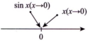

图 1-25

 $\sin x(x \rightarrow 0)$ 与  $x(x \rightarrow 0)$ 均以 0 为核值，且趋核速度相同，则用下式来刻画这种关系：

 $$ \lim_{x\to0}\frac{\sin x}{x}=1 $$

$\sin x(x \rightarrow 0)$ 与  $x(x \rightarrow 0)$ 趋缓速度相同

于是，有下面的结论：

若 $f(x)(x\to x_0)$与 $g(x)(x\to x_0)$均以0为核值，则 $\lim_{x\to x_0}\frac{f(x)}{g(x)}=a\neq0\Leftrightarrow f(x)(x\to x_0)$与 $g(x)(x\to x_0)$趋核速度相同.

 $\lim_{x\to x_0}\frac{f(x)}{g(x)}=0\Leftrightarrow f(x)(x\to x_0)$ 比  $g(x)(x\to x_0)$ 趋核速度快.

 $\lim_{x\to x_0}\frac{f(x)}{g(x)}=\infty\Leftrightarrow f(x)(x\to x_0)$ 比  $g(x)(x\to x_0)$ 趋核速度慢.

(5) 极限四则运算规则.

这也称为超实数趋核四则运算规则。

设  $\lim_{x\to x_0}f(x)=A,\quad\lim_{x\to x_0}g(x)=B$ ，则有

 $$ \lim_{x\to x_{0}}\left[f(x)\pm g(x)\right]=A\pm B $$

②  $\lim_{x\to x_0}f(x)g(x)=AB$;

<!-- page: 34 -->

③  $\lim_{x\to x_0}\frac{f(x)}{g(x)}=\frac{A}{B}(B\neq0)$.

事实上，由于 $f(x)$， $g(x)$的趋核运算值均为其实数核值，故如

 $$ \lim_{x\to x_{0}}\left[f(x)+g(x)\right]=\lim_{x\to x_{0}}f(x)+\lim_{x\to x_{0}}g(x)=A+B $$

显然成立，比如

 $$ \lim_{x\to0}(x+\sin x)=\lim_{x\to0}x+\lim_{x\to0}\sin x=0+0=0, $$

$$ \lim_{x\to1}\frac{\sin x}{x}=\frac{\lim\limits_{x\to1}\sin x}{\lim\limits_{x\to1}x}=\frac{\sin1}{1}=\sin1 $$

下面说明两种情况.

① $f(x)$， $g(x)$中恰有一个不存在核值.

设  $\lim_{x\to x_0}f(x)=A$， $\lim_{x\to x_0}g(x)$ 不存在或为无穷大量，则

a.  $\lim_{x\to x_0}\left[f(x)\pm g(x)\right]=A\pm$ (不存在或 $\infty$) = 不存在或 $\infty$ 实数运算为平 不存在或 $\infty$ 作有限平移，依然为移运算 不存在或 $\infty$.

如  $\lim_{x\to0}\left(\frac{\sin x}{x}+\sin\frac{1}{x}\right)$，其中  $\lim_{x\to0}\frac{\sin x}{x}=1$， $\lim_{x\to0}\sin\frac{1}{x}$ 不存在（在 -1 到 1 之间振荡），则  $\lim_{x\to0}\left(\frac{\sin x}{x}+\sin\frac{1}{x}\right)=$

 $\frac{1+ 不存在 }{ }=$ 不存在．

仅供理解，不要写出来.

b.  $\lim_{x\to x_0}\frac{f(x)g(x)}{}$ = A·(不存在或 $\infty$).

①实数运算

②为放缩运算

这里的趋核运算有多种情况。

(i) 如  $\lim_{x\to0}x\sin\frac{1}{x}$，其中  $\lim_{x\to0}x=0$， $\lim_{x\to0}\sin\frac{1}{x}$ 不存在.

此时 A=0 ，可以将 “-1 到 1 之间振荡” 的情形压缩成 0 ，故  $\lim_{x\to0}x\sin\frac{1}{x}=0$ 。有界振荡 =0 。此时极限存在，即趋核运算值为 0 。

(ii) 如  $\lim_{x\to\infty}\sin\frac{1}{x^{2}}\cdot x$，其中  $\lim_{x\to\infty}\sin\frac{1}{x^{2}}=0$， $\lim_{x\to\infty}x=\infty$，理由同 (i)， $\lim_{x\to\infty}\sin\frac{1}{x^{2}}\cdot x=0$

(iii) 如  $\lim_{x\to0}\cos x\cdot\sin\frac{1}{x}$，其中  $\lim_{x\to0}\cos x=1$， $\lim_{x\to0}\sin\frac{1}{x}$ 不存在。此时 A=1，放缩结果不变，故  $\lim_{x\to0}\cos x\sin\frac{1}{x}$ 不存在。

c.  $\lim_{x\to x_0}\frac{f(x)}{g(x)}=\lim_{x\to x_0}f(x)\cdot\frac{1}{g(x)}$，讨论与b.类似.

<!-- page: 35 -->

② $f(x)$， $g(x)$均不存在核值.

设  $\lim_{x\to x_0}f(x)$ 不存在或为  $\infty$， $\lim_{x\to x_0}g(x)$ 不存在或为  $\infty$，则

$$ \lim_{x\to x_0}\big[f(x)\pm g(x)\big]\qquad\big(f(x)、g(x)\ \text{都不存在核值}\big), $$

这里的趋核运算有多种情况。

(i) 如  $\lim_{x\to0}\left(\frac{1}{x}-\frac{1}{x}\right)=\lim_{x\to0}0=0$，其中  $\lim_{x\to0}\frac{1}{x}=\infty$

> 注意：这里必须先作实数运算 $\frac{1}{x}-\frac{1}{x}=0$，再作趋核运算得 $0$；不能拆成 $\lim\limits_{x\to0}\frac{1}{x}-\lim\limits_{x\to0}\frac{1}{x}$（两个“不存在”相减，拆开就没有意义了）。

此时要明白，应先算实数运算，且因不符合拆开的条件，不能拆开算。

(ii) 如  $\lim_{x\to0}\left(\frac{1}{x}-\frac{2}{x}\right)=-\lim_{x\to0}\frac{1}{x}=\infty$。易知，趋核运算可能存在，亦可能不存在。

b. $\lim\limits_{x\to x_0}\big[f(x)g(x)\big]$，其中 $f(x)$、$g(x)$ 的趋核运算值都不存在或为无穷大。

这里的趋核运算有多种情况。

(i) 若取

$$
f(x)=\begin{cases}1, & x \text{ 为有理数}, \\ -1, & x \text{ 为无理数},\end{cases}
$$

$$
g(x)=\begin{cases}1, & x \text{ 为有理数}, \\ -1, & x \text{ 为无理数},\end{cases}
$$

则 $\lim\limits_{x\to0}f(x)$ 不存在，$\lim\limits_{x\to0}g(x)$ 不存在，但 $f(x)g(x)\equiv1$，故 $\lim\limits_{x\to0}f(x)g(x)=1$。

(ii) 若取  $f(x) = \sin \frac{1}{x}$， $g(x) = \cos \frac{1}{x}$，则  $\lim_{x \to 0} f(x)$ 不存在， $\lim_{x \to 0} g(x)$ 不存在。而  $f(x) g(x) = \sin \frac{1}{x} \cos \frac{1}{x} = \frac{1}{2} \sin \frac{2}{x}$，故  $\lim_{x \to 0} f(x) g(x)$ 不存在。

(iii) 若取  $f(x)=\sin\frac{1}{x}$， $g(x)=\frac{1}{x}$，则  $\lim_{x\to0}f(x)$ 不存在（在 -1 到 1 之间振荡）， $\lim_{x\to0}g(x)=\infty$，而  $\lim_{x\to0}f(x)g(x)=\lim_{x\to0}\frac{1}{x}\sin\frac{1}{x}$。

若  $x=\frac{1}{n\pi}$， $n=1,2,\cdots$，则实数运算  $\frac{1}{x}\sin\frac{1}{x}\bigg|_{x=\frac{1}{n\pi}}=n\pi\sin n\pi=0,\lim_{x\to0}f(x)g(x)=0$;

若 $x=\frac{1}{2n\pi+\frac{\pi}{2}}$， $n=1,2,\cdots$，则实数运算

 $$ \frac{1}{x}\sin\frac{1}{x}\bigg|_{x=\frac{1}{2n\pi+\frac{\pi}{2}}}=\left(2n\pi+\frac{\pi}{2}\right)\sin\left(2n\pi+\frac{\pi}{2}\right)=2n\pi+\frac{\pi}{2},\quad\lim_{x\to0}f(x)g(x)=\lim_{n\to\infty}\left(2n\pi+\frac{\pi}{2}\right)=\infty. $$

此处，趋核运算的结果既有实数 0，也有无穷大量，称为“无界变量”。

(iv) 显然， $\infty \cdot \infty = \infty$.

<!-- page: 36 -->

c.  $\lim_{x\to x_0}\frac{f(x)}{g(x)}=\lim_{x\to x_0}f(x)\cdot\frac{1}{g(x)}$

讨论与b. 类似.

综上所述，可列表如下：

<table border=1 style='margin: auto; word-wrap: break-word;'><tr><td style='text-align: center; word-wrap: break-word;'>条件</td><td style='text-align: center; word-wrap: break-word;'>结论</td></tr><tr><td style='text-align: center; word-wrap: break-word;'>$f(x)$， $g(x)$均存在核值</td><td style='text-align: center; word-wrap: break-word;'>$f(x) \pm g(x)$， $f(x) \cdot g(x)$， $\frac{f(x)}{g(x)}$（ $g(x)$核值不为0）均存在核值</td></tr><tr><td style='text-align: center; word-wrap: break-word;'>$f(x)$， $g(x)$中恰有一个不存在核值</td><td style='text-align: center; word-wrap: break-word;'>$f(x) \pm g(x)$不存在核值； $f(x) \cdot g(x)$可能存在核值，也可能不存在核值； $\frac{f(x)}{g(x)}$可能存在核值，也可能不存在核值</td></tr><tr><td style='text-align: center; word-wrap: break-word;'>$f(x)$， $g(x)$均不存在核值</td><td style='text-align: center; word-wrap: break-word;'>$f(x) \pm g(x)$， $f(x) \cdot g(x)$， $\frac{f(x)}{g(x)}$均可能存在核值，也可能不存在核值</td></tr></table>

### 4 函数极限的性质

(1) 唯一性.

如果极限  $\lim_{x\to x_0}f(x)$ 存在，那么极限唯一。任何一个实数，周围有无数个光环。

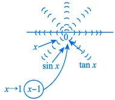

前面表中的24种情况

#### 注　函数极限存在的充要条件

> 极限与 $f(x_{0})$ 天生没关系（$f$ 在 $x_{0}$ 处甚至可以没有定义）。

$$ \lim_{x\to x_0}f(x)=A \iff \lim_{x\to x_0^{+}}f(x)=\lim_{x\to x_0^{-}}f(x)=A\qquad(\text{“双向趋近”：左右两个方向都要到达 } A), $$

$$ \lim_{x\to x_0}f(x)=A \iff f(x)=A+\alpha(x),\quad\text{其中}\ \lim_{x\to x_0}\alpha(x)=0. $$

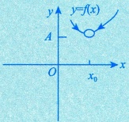

$$ \text{一个超实数} = \text{实数（核）} + \text{超实数（光环）} $$

①对于 $x\to\infty$，意味着 $x\to+\infty$且 $x\to-\infty$；两个方向

②对于 $x \to x_{0}$，意味着 $x \to x_{0}^{+}$且 $x \to x_{0}^{-}$。

我们称这个细节的问题为自变量取值的“双向性(有正有负)”，基于此，我们看几个重要的函数极限问题.

<!-- page: 37 -->

①  $\lim_{x\to\infty}e^x$ 不存在，因为  $\lim_{x\to+\infty}e^x = +\infty$， $\lim_{x\to-\infty}e^x = 0$，根据 “极限若存在，必唯一”，得原极限不存在。

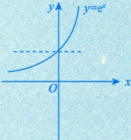

② $\lim_{x\to0}\frac{\sin x}{|x|}$不存在，因为

$$
\lim_{x\to0^{+}}\frac{\sin x}{|x|}=\lim_{x\to0^{+}}\frac{\sin x}{x}=1,\quad\lim_{x\to0^{-}}\frac{\sin x}{|x|}=\lim_{x\to0^{-}}\frac{\sin x}{-x}=-1
$$

③  $\lim_{x\to\infty}\arctan x$ 不存在，因为  $\lim_{x\to+\infty}\arctan x=\frac{\pi}{2}$， $\lim_{x\to-\infty}\arctan x=-\frac{\pi}{2}$

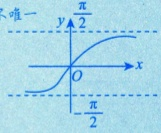

④ $\lim_{x\to0}[x]$不存在，因为 $\lim_{x\to0^{+}}[x]=0,\lim_{x\to0^{-}}[x]=-1$

[x]为不超过x的最大整数，也就是x的整数部分.

⑤分段函数分段点两侧表达式不同，需分别求左、右极限。

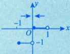

在实际考试中，主要是这些函数：一个是指数函数，一个是带绝对值的函数，也就是分段函数。如果分段函数在分段点处两端的解析式不同，是需要分别求左、右极限的，这个考点在研究生考试中几乎是必考的。所以考生不仅要知道这些唯一性，而且研究生考试中更会通过这些具体的例子去考查考生对唯一性的认识。

**例 1.15** 当 $x\to1$ 时，函数 $\dfrac{\mathrm{e}^{\frac{1}{x-1}}\ln\vert 1+x\vert}{(\mathrm{e}^{x}-1)(x-2)}$ 的极限（　）.

(A) 等于 1 (B) 等于 0 (C) 为  $\infty$ (D) 不存在且不为  $\infty$

**分析**　$x\to1$ 时，关键看 $\mathrm{e}^{\frac{1}{x-1}}$ 的走向（$\frac{1}{x-1}\to\infty$，必须分左右）：

- $x\to1^{+}$ 时，$x-1\to0^{+}$，$\frac{1}{x-1}\to+\infty$，$\mathrm{e}^{\frac{1}{x-1}}\to+\infty$；
- $x\to1^{-}$ 时，$x-1\to0^{-}$，$\frac{1}{x-1}\to-\infty$，$\mathrm{e}^{\frac{1}{x-1}}\to0$。

注意：这里不能“用一个非常非常小的正数去代替”$x-1$。后面会专门讲无穷小的概念——它不是一个很小很小的数，而是无限趋于零的变量。

**解** 应选(D).

函数  $\frac{\mathrm{e}^{\frac{1}{x-1}}\ln|1+x|}{(\mathrm{e}^{x}-1)(x-2)}$ 在 x=1 处没有定义，在 x=1 的两侧表达式虽然相同，但是注意到当  $x \to 1$ 时， $\frac{1}{x-1}$ 左、右极限不相等，因此应该考虑单侧极限。

<!-- page: 38 -->

$$ \lim_{x\to1^{-}}\frac{\mathrm{e}^{\frac{1}{x-1}}\ln\left|1+x\right|}{(\mathrm{e}^{x}-1)(x-2)}=0, $$

$$ \lim_{x\to1^{+}}\frac{\mathrm{e}^{\frac{1}{x-1}}\ln\left|1+x\right|}{(\mathrm{e}^{x}-1)(x-2)}=-\infty, $$

可知当 $x\to1$时，函数 $\frac{\mathrm{e}^{\frac{1}{x-1}}\ln\left|1+x\right|}{(\mathrm{e}^{x}-1)(x-2)}$的极限不存在且不为 $\infty$，故选(D).

**方法总结** 遇到  $e^{\infty}$，需讨论  $e^{+\infty}$ 和  $e^{-\infty}$

**公式**  $\lim_{u\to+\infty}e^{u}=+\infty,\lim_{u\to-\infty}e^{u}=0$

**注** 对于上述  $\lim_{x\to1}e^{\frac{1}{x-1}}$ 的情形，由于  $\lim_{x\to1^{+}}\frac{1}{x-1}$ 与  $\lim_{x\to1^{-}}\frac{1}{x-1}$ 不相等，因此不能忽视左极限与右极限，否则会导致错误，这是这类问题经常出现错误的原因。

**例 1.16** 设

$$
g(x)=\begin{cases}2-x,&x\leq0,\\2+x,&x>0,\end{cases}
$$

$$
f(x)=\begin{cases}x^{2},&x<0,\\-x-1,&x\geq0,\end{cases}
$$

 则 $\lim_{x\to0}g[f(x)]$ ___.

(A) 为 3          (B) 为 2          (C) 为 1          (D) 不存在

这个题已见过，例1.5，分段函数的复合方法，有前世今生，越往后学越轻松，这个题还有连续剧，后面再说解应选(D).

由例 1.5 可知，

 $$ g\left[f(x)\right]=\begin{cases}3+x,&x\geqslant0,\\2+x^{2},&x<0.\end{cases} $$

又  $\lim_{x\to0^{+}}g[f(x)]=\lim_{x\to0^{+}}\frac{(3+x)}{1}=$  $3\neq\lim_{x\to0^{-}}g[f(x)]=\lim_{x\to0^{-}}\frac{(2+x^{2})}{1}=2$ ，故  $\lim_{x\to0}g[f(x)]$ 不存在 .

这是超实数这个超实数的极限结果是2

**方法总结** 分段函数在分段点处的极限要考虑左、右极限.

**公式** 若  $\lim_{x\to x_0}f(x)\neq\lim_{x\to x_0}f(x)$，则  $\lim_{x\to x_0}f(x)$ 不存在.

两件事：①抽象证明，方法（技巧）重要。②具体例子理解。

(2) 局部有界性.

如果  $\lim_{x\to x_0}f(x)=A$，则存在常数 M 和  $\delta$，使得当  $0<|x-x_0|<\delta$ 时，有  $|f(x)|\leq M$。

**注** (1) 证  $\lim_{x \to x_0} f(x) = A \Leftrightarrow \forall \varepsilon > 0, \exists \delta > 0$，当  $0 < |x - x_0| < \delta$ 时， $|f(x) - A| < \varepsilon$。

则  $|f(x)| = |f(x) - A + A| \leqslant |f(x) - A| + |A|$ 。取  $\varepsilon = 1$， $|f(x)| \leqslant 1 + |A| = M$ 。

(2) 这个 $M$ 必须是个确定的数, 比如 2023 年考研试题中出现 $|b_n| \equiv |b_n - a_n + a_n| \leqslant |b_n - a_n| + |a_n|$（是整个过程中的最关键环节）, 下面 4 条都有可能在考场出现.

<!-- page: 39 -->

① 若 $\lim f(x)$ 存在（这里的“$\lim$”指 $x\to x_0$、$x\to x_0^{-}$、$x\to x_0^{+}$、$x\to\infty$、$x\to-\infty$、$x\to+\infty$ 这六种过程之一），则在相应的极限过程中 $f(x)$ 有界。值得注意的是，极限存在只是函数**局部有界**的充分条件，并非必要条件——如 $y=\sin x$ 在任意区间上有界，但 $\lim\limits_{x\to+\infty}\sin x$ 不存在。

②若  $y = f(x)$ 在  $[a, b]$ 上为连续函数，则  $f(x)$ 在  $[a, b]$ 上必定有界。

这里直观上给大家介绍连续：在黑板上拿粉笔点 A 点，一直到 B 点，中间不要离开黑板。

上界与下界都不是唯一的，下面这条极为重要。

★③若 $f(x)$在 $(a,b)$内为连续函数，且 $\lim_{x\to a^{+}}f(x)$与 $\lim_{x\to b^{-}}f(x)$都存在，则 $f(x)$在 $(a,b)$内必定有界.

④有界函数与有界函数的和、差、积仍为有界函数。（商没有这个结论）

**例 1.17** 在下列区间内，函数 $f(x)=\frac{x\sin(x-3)}{(x-1)(x-3)^2}$有界的是（）.

(A) $(-2,1)$ (B) $(-1,0)$ (C) $(1,2)$ (D) $(2,3)$

**分析** 考查开区间上的连续函数的有界性.

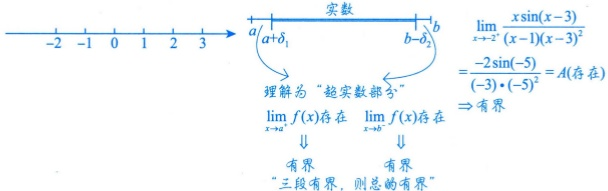

**解**　应选(B).

所给选项皆为开区间，因此不能直接利用连续函数在闭区间上的有界性定理.可以考虑在开区间两个端点处函数的极限是否存在.

由于 $f(x)$在 $x_{1}=1,x_{2}=3$处没有定义，因此当 $x\neq1,x\neq3$时， $f(x)$为初等函数且为连续函数．又由

 $$ \lim_{x\to1}f(x)=\lim_{x\to1}\frac{x\sin(x-3)}{(x-1)(x-3)^{2}}=\infty, $$

$$ \lim_{x\to3}f(x)=\lim_{x\to3}\frac{x\sin(x-3)}{(x-1)(x-3)^{2}}=\infty, $$

可知在区间端点为 1 或 3 的开区间内， $f(x)$ 均为无界函数，故选 (B).

**方法总结** 若  $f(x)$ 在  $(a, b)$ 内是连续函数，且  $\lim_{x\to a}f(x)$， $\lim_{x\to b}f(x)$ 都存在，则  $f(x)$ 在  $(a, b)$ 内必定有界。

**公式** 若  $\lim_{x\to0}f(x)$ 存在，则存在  $\delta>0$，当  $x\in(a,a+\delta)$ 时， $f(x)$ 有界。

<!-- page: 40 -->

★★★(3)局部保号性。（这个太重要了，极限的3个性质中最重要的一个）

如果  $f(x) \to A(x \to x_0)$ 且  $A > 0$ （或  $A < 0$），那么存在常数  $\delta > 0$，使得当  $0 < |x - x_0| < \delta$ 时，有

$$ f(x)>0\quad\left(\text{或 } f(x)<0\right). $$

如果在 $x_0$ 的某去心邻域内 $f(x)\geqslant0$（或 $f(x)\leqslant0$），且 $\lim\limits_{x\to x_0}f(x)=A$，则 $A\geqslant0$（或 $A\leqslant0$）。

**记忆口诀（重要）**

- **脱帽**（严格不等式可以“摘帽子”传给函数）：$\lim\limits_{x\to x_0}f(x)>0\Rightarrow$ 在 $x_0$ 的某去心邻域内 $f(x)>0$；$\lim\limits_{x\to x_0}f(x)<0\Rightarrow$ 局部 $f(x)<0$。
- **戴帽**（函数的非严格不等式可以“戴帽子”传给极限）：局部 $f(x)\geqslant0\Rightarrow\lim\limits_{x\to x_0}f(x)\geqslant0$；局部 $f(x)\leqslant0\Rightarrow\lim\limits_{x\to x_0}f(x)\leqslant0$。

> 反过来不成立：局部 $f(x)>0$ 只能推出 $\lim f(x)\geqslant0$（例如 $f(x)=x^{2}$ 在 $x\to0$ 时）。

 > 若取 $\varepsilon=2A$，只能得到 $-A<f(x)<3A$，推不出 $f(x)>0$，所以这样取 $\varepsilon$ 不够精确。

lim我=你：即使给我整个世界，我也只在你身边

**证** 由 $\lim\limits_{x\to x_0}f(x)=A\ (A>0)$，即对任意  $\varepsilon>0$，存在  $\delta>0$，使得当  $0<|x-x_0|<\delta$ 时，有  $|f(x)-A|<\varepsilon$。取  $\varepsilon=\frac{A}{2}>0$，即有  $|f(x)-A|<\frac{A}{2}$，所以  $f(x)>\frac{A}{2}>0$，证毕。

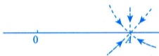

四面八方均可到来，以A为核心，A自带光环

问题：超实数的标准实数部分都大于零，那这些超实数都怎么样呢？

答：它们与 A 的距离无限小，从而它们一定大于零。

**注** 只要核心大于零，它的所有光晕都大于零.

如 $\lim\limits_{x\to+\infty}\frac{1}{x}=0$，这个 $0$ 就是它的标准实数部分。

即使 $f(x)>0$，它的极限也有可能等于零，即存在 $f(x)>0$，使 $\mathrm{std}[f(x)]=0$。对于大于零的超实数，它的标准实数部分有可能是零。0的右边是有光晕的

**例 1.18** 已知  $f(x)$ 在 x=0 的某个邻域内连续，且  $\lim_{x\to0}\frac{f(x)}{1-\cos x}=-1$，则存在  $\delta>0$，（）.

(A) 当  $x \in (-\delta, 0)$ 时， $f(x) > 0$；当  $x \in (0, \delta)$ 时， $f(x) < 0$

(B) 当  $x \in (-\delta, 0)$ 时， $f(x) < 0$；当  $x \in (0, \delta)$ 时， $f(x) > 0$

(C) 当  $x \in (-\delta, 0)$ 时， $f(x) > 0$；当  $x \in (0, \delta)$ 时， $f(x) > 0$

(D) 当  $x \in (-\delta, 0)$ 时， $f(x) < 0$；当  $x \in (0, \delta)$ 时， $f(x) < 0$

**分析** 本题考查保号性，在考研中经常出类似的题，本题关键在于极限是负数.

**解** 应选(D).

由于

<!-- page: 41 -->

$$ \lim_{x\to0}\frac{f(x)}{1-\cos x}=\lim_{x\to0}\frac{2f(x)}{x^{2}}=-1 $$

故  $\lim_{x\to0}\frac{f(x)}{x^{2}}=-\frac{1}{2}<0$ ，由极限的局部保号性可知，在 x=0 的某去心邻域内有  $\frac{f(x)}{x^{2}}<0$ ，即  $f(x)<0$ ，从而选 (D).

**方法总结** 见到  $\lim_{x\to0}f(x)=A<0$，则利用保号性：当  $x\in\dot{U}(x_{0},\delta)$，有  $f(x)<0$。

**公式**  $1-\cos x \geq 0$

---

> ← 上一节 [函数的图像](02-函数的图像.md) ｜ [总目录](00-第1讲-导读与知识结构.md) ｜ 下一节 [无穷小与无穷大](04-无穷小与无穷大.md) →
