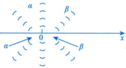
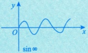
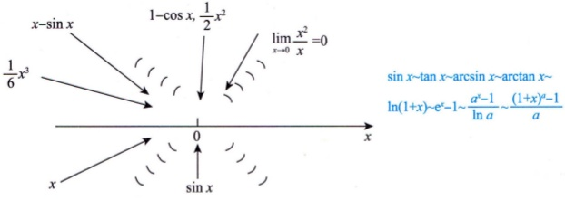
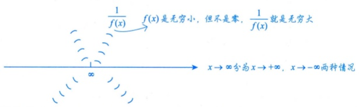

# 第1讲 函数极限与连续（三·续）　无穷小与无穷大

> 原书 p.42–46 ｜ 拆分版 4/8 ｜ 无穷小的定义与性质、无穷小的比阶、等价无穷小、无穷大
>
> ← 上一节 [函数极限的定义与性质](03-函数极限的定义与性质.md) ｜ [总目录](00-第1讲-导读与知识结构.md) ｜ 下一节 [极限的计算方法](05-极限的计算方法.md) →

---

## 三、函数极限的概念与性质（续：无穷小与无穷大）

### 5 无穷小的定义

如果当  $x \to x_0$（或  $x \to \infty$）时，函数  $f(x)$ 的极限为零，那么称函数  $f(x)$ 为当  $x \to x_0$（或  $x \to \infty$）时的无穷小，记为

$$ \lim_{x\to x_0}f(x)=0\quad\left(\text{或}\ \lim_{x\to\infty}f(x)=0\right). $$

> 提醒：$0$ 本身也是无穷小——它是唯一的“常数无穷小”，也是阶数最高的无穷小；而通常说的无穷小是一个**极限过程**，即 $f(x)\to0$。

**注**（脱帽法） $\lim_{x\to\infty}f(x)=A\Leftrightarrow f(x)=A+\alpha$，这里 $\lim_{x\to\infty}\alpha=0$，即 $\alpha$是 $x\to\bullet$时的无穷小。

把 A 换成 0，为什么要单独讲这个定义呢？因为它有特殊的、重要的地位和意义。

从牛顿、莱布尼茨开始，无穷小一直是一个无法解释的、必须回避的话题，包括第二次数学危机的产生，为什么大主教批判牛顿，牛顿都不敢讲话呢？因为对于无穷小是什么，他讲不出来，他一会儿让无穷小为零，一会儿让无穷小又不能为零，当无穷小在分母上，它就不能为零。然后，牛顿算出一个结果，加上一个无穷小，他就把无穷小扔掉了，无法解释！所以到了后来，才出现了魏尔斯特拉斯的 $\varepsilon-\delta$语言。在前面讲极限时，讲过超实数系，这里来简单复习下，从数学上来讲，

 $$  有理数 \xrightarrow{\quad\sqrt{2}\quad} 实数 \xrightarrow{\quad\sqrt{-1}\quad} 复数 . $$

现在又遇到问题了，这个无穷小怎么表示呢？牛顿、莱布尼茨没有想到，这是因为历史局限性．即便后来的柯西和魏尔斯特拉斯给出了数学分析中的标准极限定义，他们也没有想到，把实数系再扩展成超实数系．

超实数系里面是什么呢？首先是我们所学到的实数，除了这些实数之外，还引入了无穷小量和无穷大量的概念．一旦无穷小量、无穷大量进来了，这个实数系就变成了超实数系．我用最通俗的语言讲给大家，不过也不要深究，因为这需要强大的数理逻辑的底子．

超实数系告诉我们，任何一个实数 $x_{0}$，自带光环，边上有无限个以它作为极限的超实数。

<!-- page: 42 -->

超实数：

①  $\lim f(x) = \mathrm{std}[f(x)]$。实数部分（最终归属）

例：当 $x\to0$ 时，$\mathrm{std}(\sin x)=0$，即 $\sin x$ 是以 $0$ 为核值的超实数。

②  $\lim f(x)=0$

如：

 $$ \lim_{x\to0}\sin x=0\ , $$

$$ \lim_{x\to0}(\mathrm{e}^{x}-1)=0, $$

$$ \lim_{x\to0}\tan x=0, $$

$$ \lim_{x\to0}\ln(1+x)=0\quad. $$

不是实数

它们是无限趋于零的，但是又描述不出它到零的距离到底是多少。所以在超实数系中，就增加了所谓的无穷小量。

问题：无穷小如何描述它的超实数部分与实数部分呢？

 $\lim_{x\to\cdot}f(x)=A\Leftrightarrow f(x)=A+\alpha$ （A 是超实数的实数部分）.

无穷小的实数部分是零，无穷小是超实数.

### 6 无穷小的性质

①有限个无穷小的和是无穷小.

简单组常用

 $$ 0<\left|\alpha_{1}+\alpha_{2}\right|\leqslant\left|\alpha_{1}\right|+\left|\alpha_{2}\right|\rightarrow0 $$

无穷个无穷小的和可能不再是无穷小了，如第8讲习题8.4的注，

 $$ \lim_{n\to\infty}\left(\frac{1}{n+1}+\frac{1}{n+2}+\cdots+\frac{1}{n+n}\right)=\ln2\quad.\quad( 专门学 ) $$

通俗理解：人多力量大。

②有界函数与无穷小的乘积是无穷小.

若 $\left|\alpha_{1}\right|\leqslant m,\alpha_{2}\rightarrow0$ ,则

 $$ 0\leqslant\left|\alpha_{1}\bullet\alpha_{2}\right|=\left|\alpha_{1}\right|\bullet\left|\alpha_{2}\right|\leqslant m\bullet\left|\alpha_{2}\right|\rightarrow0 $$

考研数学对分析问题的能力有一定的要求，如果想把数学学好，在《考研数学基础 30 讲》中，凡是给予证明的，它往往是今后解决问题要用到的解题方法或过程，不会很难但都比较经典，要认真学一学.

<!-- page: 43 -->

③有限个无穷小的乘积是无穷小.

 $$ \alpha_{2}\rightarrow0\Rightarrow|\alpha_{2}|<1\xrightarrow{ 常用 } $$

$$ 0\leqslant\left|\alpha_{1}\alpha_{2}\right|<\left|\alpha_{1}\right|\bullet1\rightarrow0. $$

如

夹逼到0

### 7 无穷小的比阶

在讲极限概念时，柯西也好，魏尔斯特拉斯也好，比牛顿和莱布尼茨的进步只是用了一个不等式，可是他们也没有讲  $\alpha$ 到 0 的距离到底有多少， $\beta$ 到 0 的距离是多少？不过我们可以尝试从  $\alpha$， $\beta$ 的阶数比入手。

设在自变量的同一变化过程中， $\lim\alpha(x)=0$， $\lim\beta(x)=0$，且 $\beta(x)\neq0$，则

①若  $\lim_{\sqrt{\frac{\alpha(x)}{\beta(x)}}}$ = 0，则称  $\alpha(x)$ 是比  $\beta(x)$ 高阶的无穷小，记为  $\alpha(x) = o(\beta(x))$；

 $\alpha(x) \rightarrow 0$ 的速度比  $\beta(x) \rightarrow 0$ 的速度快

②若  $\lim_{\beta(x)} \frac{\alpha(x)}{\beta(x)} = \infty$，则称  $\alpha(x)$ 是比  $\beta(x)$ 低阶的无穷小；

★③若  $\lim\frac{\alpha(x)}{\beta(x)}=c\neq0$ ，则称  $\alpha(x)$ 与  $\beta(x)$ 是同阶无穷小；

最重要的是③与④

★④若  $\lim_{\beta(x)} \frac{\alpha(x)}{\beta(x)} = 1$，则称  $\alpha(x)$ 与  $\beta(x)$ 是等价无穷小，记为  $\alpha(x) \sim \beta(x)$；

“等价”不是相等，如  $\lim_{x\to0}\frac{\sin x}{x}=1\neq0$，而  $\lim_{x\to0}\frac{x-\sin x}{x^{3}}=\frac{1}{6}$.

> 如 $\lim\limits_{x\to0}\dfrac{\sin x}{x}=1$，其标准实数部分 $\mathrm{std}\left(\dfrac{\sin x}{x}\right)=1$，这正是 $\sin x\sim x$ 的含义。

⑤若  $\lim_{x\to0}\frac{\alpha(x)}{\left[\beta(x)\right]^{k}}=c\neq0,k>0$ ，则称  $\alpha(x)$ 是  $\beta(x)$ 的 k 阶无穷小 .

并不是任意两个无穷小都可进行比阶的。例如，当 $x\to0$ 时，$x\sin\frac{1}{x}$ 与 $x^{2}$ 虽然都是无穷小，但是却不可以比阶——既无高低阶之分，也无同阶可言，因为 $\lim\limits_{x\to0}\frac{x\sin\frac{1}{x}}{x^{2}}=\lim\limits_{x\to0}\frac{1}{x}\sin\frac{1}{x}$ 不存在。

$$ \lim_{x\to0}\frac{x\sin\frac{1}{x}}{x^{2}}=\lim_{x\to0}\frac{1}{x}\sin\frac{1}{x}, $$

> 这个极限不存在：$x\to0$ 时它一会儿跑到无穷大、一会儿跑到 $0$，所以这种“不专一”的超实数被定义为**无界变量**。

<!-- page: 44 -->

∞是超实数，也可以理解∞是一个广义的数，作为实数系上的一个特殊的数（双重身份）.

通俗地讲，极限存在，就说明超实数找到了家，找到了标准实数部分，任何超实数在确定的趋向下都有唯一的家，即有唯一的核心，核心如果不唯一了，极限自然就不存在了。

在这种情况下，比阶就出问题了，这是柯西、魏尔斯特拉斯也解决不了的问题。用极限可以预言到所有情况吗？答案是否定的，两个超实数速度一会儿这个快，一会儿那个快，它们在较量中，会出现一会儿这个的实力强，一会儿那个的实力强的情况，并不是总是沿着简单的情况出现的，一会儿 $\infty$，一会儿0。那就是说当 $x\to0$时， $x\sin\frac{1}{x}$与 $x^{2}$，它们的力量是有对比的。

### 8 常用的等价无穷小

当 $x\to0$时，常用的等价无穷小有

 $$ \sin x\sim x,\tan x\sim x,\arcsin x\sim x,\arctan x\sim x,\ln(1+x)\sim x,\mathrm{e}^{x}-1\sim x, $$

$$ a^{x}-1\sim x\ln a,\underbrace{1-\cos x}_{ 唯一的一个2次方 }\sim\frac{1}{2}x^{2},\left(1+x\right)^{a}-1\sim ax $$

如图 1-26 所示，0 作为实数，周围的无限个光晕紧密团结在核中心的周围。

图 1-26

**注** 使用时一般都要做广义化：可将 x 替换为趋向于 0 的函数，请灵活使用。

如

 $$ \lim_{x\to0}\frac{\sin x}{x}=1 $$

$$ \lim_{g(x)\to0}\frac{\sin[g(x)]}{g(x)}=1\;; $$

$$ \lim_{ 狗 \to 0}\frac{\sin( 狗 )}{ 狗 }=1\quad. $$

<!-- page: 45 -->

### 9 无穷大的定义

如果当 $x \to x_0$（或 $x \to \infty$）时，函数 $|f(x)|$无限增大，那么称函数 $f(x)$为当 $x \to x_0$（或 $x \to \infty$）时的无穷大，记为

同无穷小，也是一个极限过程

一定无界，但无界不一定是无穷大量

超实数

 $$ \lim_{x\to x_{0}}f(x)=\infty\quad( 或 \lim_{x\to\infty}f(x)=\infty) $$

**注** 无穷小与无穷大的关系.

在自变量的同一变化过程中，如果 $f(x)$为无穷大，则 $\frac{1}{f(x)}$为无穷小；反之，如果 $f(x)$为无穷小，且 $f(x)\neq0$，则 $\frac{1}{f(x)}$为无穷大。

用除法的新颖观点来理解“无穷”.

**例 1.19** 设 $x\to0$ 时，$e^{\tan x}-e^{\sin x}$ 与 $x^{n}$ 是同阶无穷小，则 $n$ 为（　）。

(A) 1　　(B) 2　　(C) 3　　(D) 4

当 $x\to0$ 时，$e^{\tan x}-e^{\sin x}=e^{\sin x}\left(e^{\tan x-\sin x}-1\right)$，其中 $e^{\sin x}\to1$（以 1 为标准实数部分）。这类题往往要提公因式，凑出 $e^{\text{狗}}-1$ 的形式（数学中的恒等变形）。

$$ \mathrm{e}^{\text{狗}}-1\sim\text{狗}\quad(\text{狗}\to0) $$

**解** 应选(C).

当 $x\to0$时，

> 注：此处还没讲泰勒公式，暂时不用泰勒展开，改用恒等变形。

$$ \mathrm{e}^{\tan x}-\mathrm{e}^{\sin x}=\mathrm{e}^{\sin x}\left(\mathrm{e}^{\tan x-\sin x}-1\right)\sim\left(\tan x-\sin x\right)=\tan x\left(1-\cos x\right)\sim\frac{1}{2}x^{3} $$

因此选(C).

**方法总结**  $e^{\tan x} - e^{\sin x}$，通常要提公因式出现  $e^{\alpha} - 1$ 的形式。

**公式** 当  $x \to 0$ 时，  $\tan x - \sin x = \tan x (1 - \cos x) \sim \frac{1}{2} x^{3}$

<!-- page: 46 -->

---

> ← 上一节 [函数极限的定义与性质](03-函数极限的定义与性质.md) ｜ [总目录](00-第1讲-导读与知识结构.md) ｜ 下一节 [极限的计算方法](05-极限的计算方法.md) →
