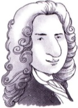
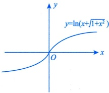

# 第1讲 函数极限与连续（四）　极限的计算方法

> 原书 p.47–54 ｜ 拆分版 5/8 ｜ 四则运算、洛必达法则、泰勒公式、两个重要极限、夹逼准则
>
> ← 上一节 [无穷小与无穷大](04-无穷小与无穷大.md) ｜ [总目录](00-第1讲-导读与知识结构.md) ｜ 下一节 [七种未定式](06-七种未定式.md) →

---

## 四、极限的计算

在学习了极限的定义和性质，尤其是了解了超实数的理论后，我们对于极限的计算方法有了一个完整、全面和深刻的认识。更为重要的是，今后在计算极限时，就不会再犯错误，什么位置该替换，什么位置不能替换，就能从一个新的角度，更加全面地去分析。

### 1 方法

(1) 极限四则运算规则.

若  $\lim f(x)=A,\ \lim g(x)=B$ ，那么

①  $\lim[kf(x)\pm lg(x)]=k\lim f(x)\pm l\lim g(x)=kA\pm lB$，其中k，l为常数.

②  $\lim[f(x)\cdot g(x)]=\lim f(x)\cdot\lim g(x)=A\cdot B$ 。特别地，若  $\lim f(x)$ 存在，n 为正整数，则

 $$ \lim\left[f(x)\right]^{n}=\lim_{n\to\infty}\underbrace{f(x)\cdots\cdots\cdots\cdots f(x)}_{n 个 }=\left[\lim f(x)\right]^{n}. $$

③  $\lim_{x\to0}\frac{f(x)}{g(x)}=\frac{\lim_{x\to0}f(x)}{\lim_{x\to0}g(x)}=\frac{A}{B}(B\neq0)$

上面定理可以用一句话概括：当 $f(x)$与 $g(x)$极限都存在时，函数的加减乘除的极限分别等于极限的加减乘除（除要求分母的极限不为零）.

★**例 1.20** 证明：(1) 若  $\lim_{x\to0}\frac{f(x)}{g(x)}=A$，且  $\lim_{x\to0}g(x)=0$，则  $\lim_{x\to0}f(x)=0$；

(2) 若  $\lim_{x\to0}\frac{f(x)}{g(x)}=A\neq0$ ，且  $\lim_{x\to0}f(x)=0$ ，则  $\lim_{x\to0}g(x)=0$ .

**分析** 恒等变形.

证 (1) 由于  $f(x)=\frac{f(x)}{g(x)}\cdot g(x)$，则

 $$ \lim f(x)=\lim\frac{f(x)}{g(x)}\cdot g(x)\overset{\text{四则运算法则}}{=}\lim\frac{f(x)}{g(x)}\cdot\lim g(x)=A\cdot0=0 $$

(2) 由于  $g(x) = \frac{f(x)}{g(x)}$，则

$$
\lim_{x \to 0} g(x) = \lim_{x \to 0} \frac{f(x)}{\frac{f(x)}{g(x)}} = \lim_{x \to 0} \frac{f(x)}{\lim_{x \to 0} \frac{f(x)}{g(x)}} = \frac{0}{A} = 0
$$

.

**注** 以上结论非常重要，以后在有关定参数的题目中可直接使用，如下例.

**例 1.21** 设  $\lim_{x\to0}\frac{\sin x}{e^x-a}(\cos x-b)=5$，则  $b=$（ ）.

(A) -4 (B) -3 (C) -2 (D) -1

<!-- page: 47 -->

(♂分析) 先利用例 1.20 的结果求出 a 的值，再用等价无穷小的代换求 b 的值.

**解**　应选(A).

 $\lim_{x\to0}\frac{\sin x}{e^x-a}(\cos x-b)=5\neq0$，由例1.20的(2)知， $\lim_{x\to0}(e^x-a)=0$，故a=1，此时原极限变为 $\lim_{x\to0}\frac{\sin x}{e^x-1}(\cos x-b)=\lim_{x\to0}(\cos x-b)=1-b$，故b=-4。

**方法总结** 若  $\lim_{x\to0}\frac{f(x)}{g(x)}=A\neq0$，且  $\lim_{x\to0}f(x)=0$，则  $\lim_{x\to0}g(x)=0$。

**公式** 当 $x \to 0$时， $e^x - 1 \sim x \sim \sin x$。

**例 1.20** 的两个结论，是用四则运算规则证明的，所以可以把刚才的解题方法归结为极限的四则运算规则：加减乘除的极限只要存在，就等于极限的加减乘除。考生们在刚开始复习要记住它，不要认为它简单就轻视，前面用超实数分析了“不存在 + 不存在”为什么可能存在，这部分内容不是那么容易理解的，不是听一遍就能完全搞懂，需要不断地、反复地思考和实践。

后面我们会遇到复杂的极限情况，那么怎么处理这些复杂情况呢？需要请两个了不起的数学人物“登场”，他们是洛必达和伯努利。

(2) 洛必达法则.

法则一 设①当 $x \to a$（或 $x \to \infty$）时，函数 $f(x)$及 $F(x)$都趋于零；

② $f'(x)$及 $F'(x)$在点a的某去心邻域内（或当 $|x|>X$，此时X为充分大的正数）存在，且 $F'(x)\neq0$；

③ $\lim_{x\to a}\frac{f'(x)}{F'(x)}$（或 $\lim_{x\to\infty}\frac{f'(x)}{F'(x)}$）存在或为无穷大，则

洛必达

(1661—1704)

 $$ \lim_{x\to a}\frac{f(x)}{F(x)}=\lim_{x\to a}\frac{f^{\prime}(x)}{F^{\prime}(x)}( 或 \lim_{x\to\infty}\frac{f(x)}{F(x)}=\lim_{x\to\infty}\frac{f^{\prime}(x)}{F^{\prime}(x)}). $$

法则二 设①当 $x\to a$（或 $x\to\infty$）时，函数 $f(x)$及 $F(x)$都趋于无穷大；

② $f'(x)$及 $F'(x)$在点a的某去心邻域内（或当 $|x|>X$，此时X为充分大的正数）存在，且 $F'(x)\neq0$；

③ $\lim_{x\to a}\frac{f'(x)}{F'(x)}$（或 $\lim_{x\to\infty}\frac{f'(x)}{F'(x)}$）存在或为无穷大，则

 $$ \lim_{x\to a}\frac{f(x)}{F(x)}=\lim_{x\to a}\frac{f^{\prime}(x)}{F^{\prime}(x)}( 或 \lim_{x\to\infty}\frac{f(x)}{F(x)}=\lim_{x\to\infty}\frac{f^{\prime}(x)}{F^{\prime}(x)}). $$

这两个是用柯西中值定理证明的。

后面讲了柯西中值定理，再回头证明这个洛必达法则

<!-- page: 48 -->

**注** 法则二不是洛必达的，也不是伯努利的，实际上是柯西给的，但是为了称呼的统一性，都归到洛必达法则了.

历史故事: 洛必达(1661—1704)法国人, 洛必达法则不是洛必达的, 而是他老师约翰·伯努利(1667—1748)的.

1694年，约翰·伯努利要结婚，洛必达送给他一个大礼包，他说“你结婚去吧，给你一笔钱，不用还，给我一篇论文就可以了”，然后伯努利欣然接受，主动拿着论文找到洛必达，一手交钱，一手交论文，这篇文章就被无情的卖掉了，是什么文章呢？就是大家看到的“洛必达法则”。这个法则实际上是伯努利在1694年卖给了洛必达，这是历史上的真事。有个人还在里面瞎掺和，那个人叫莱布尼茨（1646—1716），莱布尼茨是伯努利的老师，伯努利真正的学生是欧拉，这里面混进了洛必达。莱布尼茨听伯努利说“洛必达很有钱”，就主动找到洛必达，“孩子，我还有论文呢，你要不要？”而洛必达来者不拒，“来来来，买”。所以几乎在同一时间，洛必达还在世界上发表了一篇论文，叫“行列式的概念”。行列式的概念是谁给的呢？“莱布尼茨”；谁发表的呢？“洛必达”；世界上第一本微积分教材谁出的呢？“洛必达”。洛必达可以称之为“伟大的”数学知识的传播者，他把数学大家的创作汇总起来出成书了。

**注** (1) 一般来说, 洛必达法则是用来计算 “ $\frac{0}{0}$” 型或者 “ $\frac{\infty}{\infty}$” 型未定式的, 不是 “ $\frac{0}{0}$” 型和 “ $\frac{\infty}{\infty}$” 型, 就不能用洛必达法则.

(  $\frac{?}{\infty}$ 亦可直接用洛必达法则 . 但是这个不在考研范围内 .)

(2) 如果极限  $\lim_{x \to a} \frac{f'(x)}{F'(x)}$ 仍属于 “ $\frac{0}{0}$” 型或者 “ $\frac{\infty}{\infty}$” 型，且  $f'(x)$， $F'(x)$ 继续满足洛必达法则的条件，则可以继续使用洛必达法则，即  $\lim_{x \to a} \frac{f(x)}{F(x)} = \lim_{x \to a} \frac{f'(x)}{F'(x)} = \lim_{x \to a} \frac{f''(x)}{F''(x)}$．可多次使用

(3) 如果  $\lim_{x \to a} \frac{f'(x)}{F'(x)}$ 不存在也不为  $\infty$，不能推出  $\lim_{x \to a} \frac{f(x)}{F(x)}$ 不存在也不为  $\infty$，简单一点说就是：

对于  $\lim_{x\to a}\frac{f(x)}{F(x)}=\lim_{x\to a}\frac{f'(x)}{F'(x)}$，“右存在，则左存在；但左存在，并不意味着右一定存在”。比如说，

 $$ \lim_{x\to0}\frac{x^{2}\cdot\sin\frac{1}{x}}{\quad x}=\lim_{x\to0}x\cdot\sin\frac{1}{x}=0 $$

存在，而如果使用洛必达法则，会有

 $$ \lim_{x\to0}\frac{x^{2}\cdot\sin\frac{1}{x}}{x}=\lim_{x\to0}\left(2x\cdot\sin\frac{1}{x}-\cos\frac{1}{x}\right), $$

这个极限显然不存在.这是一个很细致、很隐蔽的问题，稍不注意就可能出错.

<!-- page: 49 -->

#### 例 1.22　证明

(1) 当  $x \to 0$ 时，  $\ln\left(x + \sqrt{1 + x^{2}}\right) \sim x$;

(2) 当  $x \to 0$ 时， $1 - (\cos x)^{a} \sim \frac{1}{2} ax^{2}$， $a \neq 0$。

**分析**　求极限 “ $\frac{0}{0}$” 型，用洛必达法则.

**证** (1) 由于 $\lim\limits_{x\to0}\dfrac{\ln\left(x+\sqrt{1+x^{2}}\right)}{x}\overset{\text{洛必达}}{=}\lim\limits_{x\to0}\dfrac{\frac{1}{\sqrt{1+x^{2}}}}{1}=1$，因此当 $x\to0$ 时，$\ln\left(x+\sqrt{1+x^{2}}\right)\sim x$。

(2) 当  $x \to 0$ 时，

$$ \lim_{x \to 0} \frac{1 - (\cos x)^a}{\frac{1}{2} a x^2} \overset{\text{法则}}{=} \lim_{x \to 0} \frac{-a (\cos x)^{a-1} (- \sin x)}{a x} = \lim_{x \to 0} (\cos x)^{a-1} = 1 $$

证毕。

**方法总结** 用洛必达法则解决 “ $\frac{0}{0}$” 型未定式.

**公式** 当  $x \to 0$ 时，  $\ln(x + \sqrt{1 + x^2}) \sim x \sim \sin x \sim \tan x \sim \arctan x \sim e^x - 1 \sim \ln(1 + x)$.

当  $x \to 0$ 时，  $1 - (\cos x)^{a} \sim \frac{1}{2} ax^{2}$，  $a \neq 0$ ，如：当  $x \to 0$ 时，  $1 - \cos x \sim \frac{1}{2} x^{2}$，  $1 - \sqrt{\cos x} \sim \frac{1}{4} x^{2}$

这个题目的价值：①练习了洛必达法则；②得到了两个重要结论。

这两个重要结论，在未来会经常出现。

凡是在《考研数学基础 30 讲》中给出的结论，都可以直接用，不必证明，这都是一些常见的、经典的结论。

下面还有一个话题. 当遇到 “ $\frac{0}{0}$” 型未定式时, 是看分子、分母中谁趋于零的速度快, 在超实数体系中, 以 0 作为标准实数部分的超实数它们的比值是多少? 比如:

 $$ \mathrm{std}\left(\frac{x-\sin x}{x^{3}}\right)=\frac{1}{6}, $$

$$ \lim_{x\to0}\frac{x-\sin x}{x^{3}}=\frac{1}{6} $$

在考研数学中，无穷小的关键是阶数，无穷小争先恐后趋于0，趋于0的速度是不一样的。接下来我们讨论无穷大的比阶问题，用例1.23来说明。

**例 1.23** 设 $f(x)=\ln^{10}x$,  $g(x)=x$,  $h(x)=\mathrm{e}^{\frac{x}{10}}$, 则当 $x$ 充分大时, 有( ).

(A)  $g(x) < h(x) < f(x)$

(B)  $h(x) < g(x) < f(x)$

(C)  $f(x) < g(x) < h(x)$

(D)  $g(x) < f(x) < h(x)$

**分析** 用洛必达法则，计算极限.

**解** 应选(C).

<!-- page: 50 -->

因为  $\lim_{x\to+\infty}\frac{g(x)}{f(x)} = +\infty$， $\lim_{x\to+\infty}\frac{h(x)}{g(x)} = +\infty$，所以当 x 充分大时，有  $f(x) < g(x) < h(x)$。

故选项 (C) 正确。

**注** ①当 $x \to +\infty$时，有 $\ln^{\alpha} x \ll x^{\beta} \ll a^{x}$，其中 $\alpha, \beta > 0, a > 1$，符号“ $\ll$”叫远远小于；②当 $n \to \infty$时，有 $\ln^{\alpha} n \ll n^{\beta} \ll a^{n} \ll n! \ll n^{n}$，其中 $\alpha, \beta > 0, a > 1$。记住，考试时直接用

像上面这些公式必须要记住 . 在微积分中，有一个很要紧的问题，就是趋于零的函数，谁快谁慢，趋于无穷大的函数，谁快谁慢，这些问题解决好了，很多难题就迎刃而解 . 知识是有连续性的，它总是一环扣一环，其他方向如果欠缺，可能是因为这里的题目就掌握得不是太好 .

(3) 泰勒公式.

设 $f(x)$在点x=0处n阶可导，则存在x=0的一个邻域，对于该邻域内的任一点x，有

 $$ f(x)=f(0)+f^{\prime}(0)x+\frac{f^{\prime \prime}(0)}{2!}x^{2}+\cdots+\frac{f^{(n)}(0)}{n!}x^{n}+o(x^{n}). $$

泰勒（1685—1731）

（英国数学家）

泰勒公式背后的思想比拉格朗日中值定理的思想更精确。泰勒有一个非常直接的观点，就是可以用多项式（表达式最简单的）来表达任何一个函数（当然这个函数可导性要好）。

泰勒有一双火眼金睛，一眼看穿所有函数.

如

$$
\sin x = \sin 0 + (\sin x)^{\prime}\big|_{x=0} \cdot x + \frac{(\sin x)^{\prime\prime}|_{x=0}}{2!} x^2 + \frac{(\sin x)^{\prime\prime\prime}|_{x=0}}{3!} x^3 + o(x^3)
$$

即 $\sin x=x-\frac{x^{3}}{3!}+o(x^{3})$。

再如

$$
\sec x = \sec 0 + (\sec x)^{\prime}\big|_{x=0} \cdot x + \frac{(\sec x)^{\prime\prime}|_{x=0}}{2!} x^2 + \frac{(\sec x)^{\prime\prime\prime}|_{x=0}}{3!} x^3 + o(x^3)
$$

即  $\sec x = 1 + \frac{x^2}{2} + o(x^3)$。

下面给同学们看个真题。

当  $x \to 0$ 时， $\sec x$ 与 2 次泰勒多项式  $g(x)$ 之差为  $o(x^2)$，则  $g(x) = 1 + \frac{1}{2} x^2$。

即 $\sec x=1+\frac{1}{2}x^{2}+o(x^{2})$（注意展开式中没有 $x^{3}$ 项）。

同理可得如下重要函数的泰勒公式.

 $$ \sin x=x-\frac{x^{3}}{3!}+o(x^{3}), $$

$$ \cos x=1-\frac{x^{2}}{2!}+\frac{x^{4}}{4!}+o(x^{4}), $$

$$ \arcsin x=x+\frac{x^{3}}{3!}+o(x^{3}),\qquad\tan x=x+\frac{x^{3}}{3}+o(x^{3}), $$

$$ \arctan x=x-\frac{x^{3}}{3}+o(x^{3}),\qquad\ln(1+x)=x-\frac{x^{2}}{2}+\frac{x^{3}}{3}+o(x^{3}), $$

8个都要“背”，泰勒公式熟记于心，都要“一站直达”

 $$ \mathrm{e}^{x}=1+x+\frac{x^{2}}{2!}+\frac{x^{3}}{3!}+o(x^{3}),\quad(1+x)^{\alpha}=1+\alpha x+\frac{\alpha(\alpha-1)}{2!}x^{2}+o(x^{2}). $$

<!-- page: 51 -->

我们要泰勒公式，也要洛必达法则，但泰勒公式是远远优于洛必达法则的。不仅是因为泰勒公式用多项式逼近可导函数的方法意义深刻，还因为其计算的简洁性。

**注** 从数学命题的角度对以上公式进行处理，可得到一组“差函数”的等价无穷小代换式，如  $x - \sin x = \frac{1}{6}x^3 + o(x^3)$，则  $x - \sin x \sim \frac{1}{6}x^3 (x \to 0)$，同理有

 $$ \arcsin x-x\sim\frac{1}{6}x^{3}(x\rightarrow0),\tan x-x\sim\frac{1}{3}x^{3}(x\rightarrow0),x-\arctan x\sim\frac{x^{3}}{3}(x\rightarrow0) $$

等，并可将这些公式广义化，如第一个公式广义化为：狗- $\sin$狗 $\sim\frac{1}{6}$(狗) $^3$(狗 $\rightarrow$0)，其余类似。

(4) 无穷小的运算.

设 m, n 为正整数，则

①  $o(x^{m}) \pm o(x^{n}) = o(x^{l}), l \geq \min\{m, n\}$ （加减法时低阶“吸收”高阶）.

如： $\frac{o(x^{2})-o(x^{3})=o(x^{2})}{它说了算}$，对于无穷小来说，次数越小越大.对于无穷大来说，次数越大越大.

② $o(x^{m})\cdot o(x^{n})=o(x^{m+n}),x^{m}\cdot o(x^{n})=o(x^{m+n})$（乘法时阶数“累加”）.

③ $o(x^{m})=o(kx^{m})=\underline{k\cdot o(x^{m})},k\neq0$且为常数（非零常数相乘不影响阶数）.

 $o(x^{2})=2o(x^{2})$ 记号运算不是符号运算， $o(x^{2})-o(x^{2})=o(x^{2})$

这种题在数学三卷子中考过。

**注** 在后面泰勒公式的应用中，会对上述高阶无穷小的运算提出要求，请考生学会正确书写.

(5) 泰勒公式应用时的展开原则.

有了展开原则，就可以有强大的能力解决计算问题了。

泰勒公式：

 $$ f(x)=f(0)+f^{\prime}(0)x+\frac{f^{\prime \prime}(0)}{2!}x^{2}+\cdots+\frac{f^{(n)}(0)}{n!}x^{n}+o(x^{n}). $$

再深刻一点讲，以后会遇到无数个可导函数可以由统一的式子表达时，需要对这个表达式进行研究，它就会成为无穷多个向量，在三维空间中可以由向量 i, j, k 表示，线性代数中称其为三维空间的一个基，它可以表示三维空间中的任何一个向量，即三维空间中的任何一个点。

再如：一维点可以比大小，但平面点（空间点）是不能比大小的，所以后面遇到多元函数会用偏导数退化为一维来研究。

 $$ \left\{x^{0},x^{1},x^{2},\cdots,x^{n},\cdots\right\}, $$

幂函数是所有可导函数的一个基，体现“统一美”.

有句话是有道理的，微积分学得好坏，将决定未来走得有多远，光看一个公式，很多人看法层次是远远不同的，很多东西需要慢慢去体会。

<!-- page: 52 -->

$$ \begin{aligned}&\left\{\begin{aligned}x_{n}\cos x_{n+1}&=\sin x_{n},\\ &\cos x_{n+1}\end{aligned}\right.\rightarrow\cos x_{n+1}=\frac{\sin x_{n}-\sin0}{x_{n}-0}=\cos\xi\Rightarrow0<\xi<x_{n}\\ &\\ &\cos a_{n}-a_{n}=\cos b_{n}.\\ &\left.\begin{aligned}\cos a_{n}-\cos b_{n}&=a_{n}>0,0<a_{n},b_{n}<\frac{\pi}{2},\\ &\quad\downarrow\quad\downarrow\quad\downarrow\\ &\quad\downarrow\quad\downarrow\quad\downarrow\\ &\quad\downarrow\quad\downarrow\quad\downarrow\\ &\quad\downarrow\quad\downarrow\quad\downarrow\\ &\end{aligned}\right.\\ \end{aligned} $$

如：

逼近到0

数学题的最高境界就是那些最简单的地方，不是庞然大物或者是用非常复杂的技巧。大道至简才是考研数学的本质。

这种题是考研的压轴题，但是大家也不要急.在命题老师眼里，他给的东西，他想的东西最简单，最朴素的 $\cos x$在 $\left(0,\ \frac{\pi}{2}\right)$内递减，一个中学生也知道啊！但几百万考生，大部分考生都没想到.

而且命题老师又说“不定积分”大家少做啊！因为在命题老师的知识体系中，他是深刻知道世界上能做出来的积分是寥寥无几的，世界上不能做出的积分，多得想象不到。再换句话说，几乎不定积分都没法做，那我们就把他喜欢出的那几个思想、方法掌握了，最基本的东西把握好了，那么考试就成功了，这就叫方向，不做无用功。

① $\frac{A}{B}$型，适用“上下同阶”原则.

具体说来，如果分母(或分子)是x的k次幂，则应把分子(或分母)展开到x的k次幂，可称为“上下同阶”原则。

例如，计算 $\lim_{x\to0}\frac{x-\ln(1+x)}{x^{2}}$

由于

 $$ \begin{aligned}&\text{↔不破 }\\ &\ln(1+x)=x+o(x),\ln(1+x)=x-\frac{x^{2}}{2}+o(x^{2}),\\ \end{aligned} $$

$$ \ln(1+x)=x-\frac{x^{2}}{2}+\frac{x^{3}}{3}+o(x^{3}), $$

因此

 $$ \lim_{x\to0}\frac{x-\ln(1+x)}{x^{2}}=\lim_{x\to0}\frac{x-\left[x-\frac{x^{2}}{2}+o(x^{2})\right]}{x^{2}}=\lim_{x\to0}\frac{\frac{x^{2}}{2}}{x^{2}}=\frac{1}{2} $$

这里顺便得到了一个重要的等价代换式  $x - \ln(1 + x) \sim \frac{1}{2} x^{2} (x \to 0)$.

 $$ x-\ln(1+x)\sim1-\cos x\sim\frac{1}{2}x^{2}\quad(x\rightarrow0) $$

同理

 $$ x-\sin x\sim\frac{x^{3}}{6}(x\rightarrow0), $$

$$ \arcsin x-x\sim\frac{x^{3}}{6}(x\rightarrow0), $$

$$ \tan x-x\sim\frac{x^{3}}{3}(x\rightarrow0), $$

<!-- page: 53 -->

$$ x-\arctan x\sim\frac{x^{3}}{3}(x\rightarrow0), $$

均可由“上下同阶”原则得到.

②A-B型，适用“幂次最低”原则. $A+B=A-(-B)$

具体说来，即将 A, B 分别展开到它们的系数不相等的 x 的最低次幂为止.

例如，已知当 $x\to0$时， $\cos x-e^{-\frac{x^{2}}{2}}$与 $ax^{b}$为等价无穷小，求a,b.

用泰勒公式， $\cos x=1-\frac{x^{2}}{2!}+\frac{x^{4}}{4!}+o(x^{4})$， $e^{-\frac{x^{2}}{2}}=1-\frac{x^{2}}{2}+\frac{1}{2!}\frac{x^{4}}{4}+o(x^{4})$

显然，将  $\cos x, e^{-2}$ 展开到  $x^{4}$ 时，其系数就不一样了，使用“幂次最低”原则，展开到此项后，进行运算，得

 $$ \cos x-\mathrm{e}^{-\frac{x^{2}}{2}}=\left[1-\frac{x^{2}}{2!}+\frac{x^{4}}{4!}+o(x^{4})\right]-\left[1-\frac{x^{2}}{2}+\frac{1}{2!}\frac{x^{4}}{4}+o(x^{4})\right]=-\frac{1}{12}x^{4}+o(x^{4}), $$

于是可知  $\cos x - e^{-\frac{x^{2}}{2}} \sim -\frac{1}{12} x^{4} (x \to 0)$，故  $a = -\frac{1}{12}$，b = 4。

到此为止，整个泰勒公式就学习完了，在一般计算中，四则运算法则，洛必达法则，泰勒公式就够了，除此之外常用的，还有两个重要极限。

(6) 两个重要极限.

 $$ \lim_{x\to0}\frac{\sin x}{x}=1,\lim_{x\to\infty}\left(1+\frac{1}{x}\right)^{x}=e\quad. $$

#### 注　常考变量广义化

 $$ \lim_{ 狗 \to0}\frac{\sin 狗 }{ 狗 }=1,\lim_{ 狗 \to\infty}\left(1+\frac{1}{ 狗 }\right)^{ 狗 }=e $$

如取狗 $=\frac{1}{x}$，则“狗 $\to0$”即“$x\to\infty$”，于是 $\lim\limits_{x\to\infty}\frac{\sin\frac{1}{x}}{\frac{1}{x}}=1$，也就是 $\lim\limits_{x\to\infty}x\sin\frac{1}{x}=1$。

再如取狗 $=x$，则“狗 $\to\infty$”即“$x\to0$”，于是 $\lim\limits_{x\to0}(1+x)^{\frac{1}{x}}=\mathrm{e}$。

<!-- page: 54 -->

(7)夹逼准则.适当放缩已知不等式.题设条件

如果函数 $f(x)$， $g(x)$及 $h(x)$满足下列条件：

①  $h(x) \leqslant f(x) \leqslant g(x)$;

② $\lim\limits_{x\to x_0}g(x)=\lim\limits_{x\to x_0}h(x)=A$，

则 $\lim\limits_{x\to x_0}f(x)$ 存在，且 $\lim\limits_{x\to x_0}f(x)=A$。

（把 $A$ 换成 $+\infty$ 或 $-\infty$，结论同样成立。）

夹逼准则，说成两边夹，三明治定理都不太准确，没有突出“逼”，叫“迫敛定理”是可以的。

**注** 常见的一个问题：设任意的 x，总有  $h(x) \leqslant f(x) \leqslant g(x)$，且  $\lim[g(x) - h(x)] = 0$，则  $\lim f(x)$ 是否一定存在？答案是否定的。 $\lim[g(x) - h(x)]$ 存在并不能说明  $\lim g(x)$， $\lim h(x)$ 都存在，从而也不能保证  $\lim f(x)$ 存在。

例如，当 x > 0 时，取  $h(x) = x + \frac{1}{x+1}$， $f(x) = x + \frac{2}{x+1}$， $g(x) = x + \frac{3}{x+1}$，则  $h(x) < f(x) < g(x)$，且  $\lim_{x \to +\infty} [g(x) - h(x)] = 0$，但  $\lim_{x \to +\infty} f(x)$ 不存在。

---

> ← 上一节 [无穷小与无穷大](04-无穷小与无穷大.md) ｜ [总目录](00-第1讲-导读与知识结构.md) ｜ 下一节 [七种未定式](06-七种未定式.md) →
