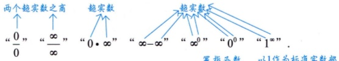
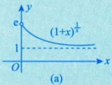
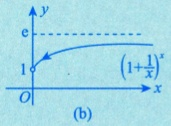
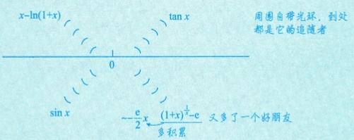

# 第1讲 函数极限与连续（四·续）　七种未定式的计算

> 原书 p.55–64 ｜ 拆分版 6/8 ｜ 七种未定式、化简先行、抓大头
>
> ← 上一节 [极限的计算方法](05-极限的计算方法.md) ｜ [总目录](00-第1讲-导读与知识结构.md) ｜ 下一节 [连续与间断点](07-连续与间断点.md) →

---

## 四、极限的计算（续：七种未定式）

### 2 七种未定式的计算

七种未定式中，都是超实数的状态，我们算过七种超实数是否有一个标准实数部分。

考研的函数极限计算题一般归纳为七种未定式： $\rightarrow$“未定”是由你来定，有可能存在有可能不存在

★★★题型：直接计算、反求参数、已知某一极限求另一极限、无穷小的比阶等。

在表达式中，有一些未知参数，已知这些超实数的极限值，来求这些未知参数，这是一种常考的反问题

解题思路如下.

已知一个超实数的极限值，给出另外一个超实数，另外一个超实数跟这个超实数有联系，有区别，需要找到它们的联系和区别，从而用已知来求解未知

在考研数学中，可能无穷小比阶的考题考的是最多的

①化简先行.

拿到极限计算的问题，不要直接开始就洛必达法则，泰勒展开等等。实际上，先做一些化简，有的时候化简完了，这个题目就非常简单了，在考研中是专门出过这种题的，比如说2023年有道大题就是，第一步要化简，如果不知道化简的话，那个题太复杂了。有哪些化简办法呢？

（例如极限不为 0 的因子 $\cos x\to1$、$\mathrm{e}^{x}\to1$，可以先算出“提走”，别让它掺和进后面的运算。）

<!-- page: 55 -->

化简的常见手段：

a. 提出极限不为 0 的因式；
b. 等价无穷小代换；
c. 恒等变形——基本的如提公因式、拆项、合并、分子分母同除变量的最高次幂等；高级的如变量代换（换元法），包括负代换、倒代换等。

需要强调的是，很多问题不化简就硬算，计算会非常复杂，甚至根本算不出来。

如：

$$
\lim_{x\to0}\left(\frac{1+\sin x}{x}-\frac{1}{\mathrm{e}^x-1}\right)=\lim_{x\to0}\left(\frac{1}{x}-\frac{1}{\mathrm{e}^x-1}\right)+\lim_{x\to0}\frac{\sin x}{x}
$$

 解题的方法，我们不能蛮干，一定要注意这些细节，细节决定成败。

②判断类型（运算类型）.

用在函数中，难度就很高了，对于这种问题呢，《考研数学基础30讲》里面也会提及，我会给大家一个完整的全面的归纳

③选择方法（洛必达法则、 $\underline{\text{泰勒公式}}$、 $\underline{\text{夹逼准则等}}$）

→太重要了，“火眼金睛”泰勒

(1) “ $\frac{0}{0}$” “ $\frac{\infty}{\infty}$” “ $0 \cdot \infty$”.

**例 1.24**  $\lim_{x\to0^{+}}\frac{(1+x)^{\frac{1}{x}}-e}{x}=$ ___.这是考研中喜欢出的一种类型（提前告诉存在了，实际上问是几）

**分析** “ $\frac{0}{0}$”，先做恒等变形， $u(x)^{v(x)} = e^{v(x)\ln u(x)}$。碰到幂指函数，一定用 e 抬起来。

**解** 应填  $-\frac{e}{2}$

$$ \begin{aligned}\text{原极限}&=\lim_{x\to0^{+}}\frac{\mathrm{e}^{\frac{1}{x}\ln(1+x)}-\mathrm{e}}{x}=\mathrm{e}\lim_{x\to0^{+}}\frac{\mathrm{e}^{\frac{\ln(1+x)}{x}-1}-1}{x}\\&=\mathrm{e}\lim_{x\to0^{+}}\frac{\frac{\ln(1+x)}{x}-1}{x}=\mathrm{e}\lim_{x\to0^{+}}\frac{\ln(1+x)-x}{x^{2}}\\&=\mathrm{e}\lim_{x\to0^{+}}\frac{-\frac{1}{2}x^{2}}{x^{2}}=-\frac{\mathrm{e}}{2}.\end{aligned} $$

**方法总结** 碰到幂指函数，用 e 括起来， $u(x)^{\nu(x)} = e^{\nu(x)\ln u(x)}$

**公式** 当  $x \to 0$ 时， $\ln(1+x)-x \sim -\frac{1}{2}x^{2}$

**注**  $f(x)=(1+x)^{\frac{1}{x}}$ 在 x>0 时有以下性质：

① $f(x)$单调减少；② $\lim_{x\to0^{+}}f(x)=e$；

 $$ \lim_{x\to0}(1+x)^{\frac{1}{x}}=e\quad\lim_{x\to\infty}\left(1+\frac{1}{x}\right)^{x}=e $$

★③ $(1+x)^{\frac{1}{x}} - e \sim -\frac{e}{2} x (x \to 0^{+})$．刚才的例1.24

这个结论太重要了，0 是一个重要的实数。

<!-- page: 56 -->

考研复习的方法很重要，如基础阶段只做“1+1=2”这肯定是不行的。必须在基础阶段，扎扎实实地落实到考研数学的命题当中，掌握他们喜欢考的这些表达式，这个是很重要的。

**例 1.25** 求极限  $I=\lim_{x\to\infty}\frac{a_nx^n+a_{n-1}x^{n-1}+\cdots+a_1x+a_0}{b_mx^m+b_{m-1}x^{m-1}+\cdots+b_1x+b_0}$，其中  $a_n(\neq0)$， $b_m(\neq0)$ 为常数。纸老虎

**分析** 有理函数的极限问题，抓主要矛盾。找“带头大哥”，若“带头大哥”次数一致，结果就是系数比，就能很快速地把问题解决了。

**解** 若 n=m，则

 $$ I\overset{\text{上下都除以 }x^{n}}{=}\lim_{x\to\infty}\frac{a_{n}+\frac{a_{n-1}}{x}+\cdots+\frac{a_{1}}{x^{n-1}}+\frac{a_{0}}{x^{n}}}{b_{m}+\frac{b_{m-1}}{x}+\cdots+\frac{b_{1}}{x^{n-1}}+\frac{b_{0}}{x^{n}}} $$

$$ \begin{aligned}\overset{\text{四则运算法则}}{=}\frac{\lim\limits_{x\rightarrow\infty}\left(a_{n}+\frac{a_{n-1}}{x}+\cdots+\frac{a_{1}}{x^{n-1}}+\frac{a_{0}}{x^{n}}\right)}{\lim\limits_{x\rightarrow\infty}\left(b_{m}+\frac{b_{m-1}}{x}+\cdots+\frac{b_{1}}{x^{n-1}}+\frac{b_{0}}{x^{n}}\right)}=\frac{a_{n}}{b_{m}};\end{aligned} $$

若n>m，则

$$
I=\lim_{x\to\infty}\frac{x^{n-m}\left(a_{n}x^{m}+a_{n-1}x^{m-1}+\cdots+a_{1}x^{m-n+1}+a_{0}x^{m-n}\right)}{b_{m}x^{m}+b_{m-1}x^{m-1}+\cdots+b_{1}x+b_{0}}=\lim_{x\to\infty}x^{n-m}\cdot\frac{a_{n}}{b_{m}}=\infty;
$$

超实数，特殊的不存在

这两种情况出现概率很小

若 n < m，则

$$
I = \lim_{x \to \infty} \frac{a_n x^n + a_{n-1} x^{n-1} + \cdots + a_1 x + a_0}{x^{m-n} \left( b_m x^n + b_{m-1} x^{n-1} + \cdots + b_1 x^{n-m+1} + b_0 x^{n-m} \right)} = \lim_{x \to \infty} \frac{1}{x^{m-n}} \cdot \frac{a_n}{b_m} = 0
$$

.

综上，

$$
\lim_{x\to\infty}\frac{a_{n}x^{n}+a_{n-1}x^{n-1}+\cdots+a_{1}x+a_{0}}{b_{m}x^{m}+b_{m-1}x^{m-1}+\cdots+b_{1}x+b_{0}}=\left\{\begin{array}{ll}\frac{a_{n}}{b_{m}},&n=m,\\ \infty,&n>m,\\ 0,&n<m.\end{array}\right.
$$

**方法总结** 抓大头.

$$
\lim_{x\to\infty}\frac{x^{3}+x^{2}-1}{0\cdot x^{3}+2x^{2}+2}=\infty,\quad\lim_{x\to\infty}\frac{0\cdot x^{3}-x^{2}+2}{1\cdot x^{3}-x+1}=0
$$

 补一个“带头大哥”（但不要写卷子上）

**公式**

$$
\lim_{x\to\infty}\frac{a_{n}x^{n}+a_{n-1}x^{n-1}+\cdots+a_{1}x+a_{0}}{b_{m}x^{m}+b_{m-1}x^{m-1}+\cdots+b_{1}x+b_{0}}=\left\{\begin{aligned}&\frac{a_{n}}{b_{m}},&n=m,\\&\infty,&n>m,\\&0,&n<m.\end{aligned}\right.
$$

<!-- page: 57 -->

本题的结果要记住，以后直接使用，这就是通常说的“抓大头”：当 $x\to\infty$ 时，分别抓分子、分母中关于 $x$ 的最高次项，忽略其他项。如

$$ \lim_{x\to-\infty}\frac{\sqrt{4x^{2}+x-1}+x+1}{\sqrt{x^{2}+\sin x}}=1\qquad(\text{这里 }x<0,\ \text{故}\ \sqrt{4x^{2}}=\vert 2x\vert=-2x). $$

另外特别注意：若 $x\to0$，则应分别抓分子、分母中关于 $x$ 的**最低**次项。

**例 1.26** 设函数  $f(x)=\lim_{n\to\infty}\frac{x^2+nx(1-x)\sin^2\pi x}{1+n\sin^2\pi x}$，则  $f(x)=$ ___.

**分析** 这道题是近几年常考的用极限来定义对应法则的题。在本讲开头，我讲过一些求对应法则的内容，可以由关系式或复合函数的表达式求对应法则。在这里再加一条，由极限求对应法则。用什么样的题目来创造这些对应法则，这需要通过做题逐渐地积累起来。

找特点：抓带头大哥，n在变，x在求极限过程中视为常数.

**解** 应填

$$
\begin{cases}x^{2},&x=0,\pm1,\pm2,\cdots,\\x(1-x),& 其他.\end{cases}
$$

当  $\sin \pi x = 0$ ，即 x = k （整数）时， $f(x) = \lim_{n \to \infty} \frac{x^2 + nx(1 - x) \cdot 0}{1 + n \cdot 0} = x^2$;

当  $\sin\pi x \neq 0$ ，即  $x \neq k$ （整数）时，

$$
f(x) = \lim_{n \to \infty} \frac{\frac{x^2}{n} + x(1 - x) \sin^2 \pi x}{\frac{1}{n} + \sin^2 \pi x} = \frac{x(1 - x) \sin^2 \pi x}{\sin^2 \pi x} = x(1 - x)
$$

综上，

$$ f(x)=\begin{cases}x^{2},&x=0,\pm1,\pm2,\cdots,\\ x(1-x),&\text{其他}.\end{cases} $$

**方法总结** 主要关注 n 前面的系数.

**公式** 当 $x$ 固定、$n\to\infty$ 时，$n\cdot 0=0$（含 $n$ 的项被系数 $0$ “吃掉”）。

这个题目精彩的地方在于：若 $n$ 的系数为零，即 $\sin^{2}\pi x=0$，此时含 $n$ 的项全部消失，结果就是 $x^{2}$。

这个题目有“前世今生”，后面我们仍会用到它。这个例子记住了，后面再遇到类似由这种用极限定义函数的问题不在话下，这是构造函数的最高难度了，不会再超过这个难度。

**例 1.27** 已知极限 $\lim\limits_{x\to0}\dfrac{\tan 2x+xf(x)}{\sin x^{3}}=0$，则 $\lim\limits_{x\to0}\dfrac{2+f(x)}{x^{2}}=（　）$。

(A) $\dfrac{13}{9}$　　(B) $4$　　(C) $\dfrac{10}{3}$　　(D) $-\dfrac{8}{3}$

**分析** 建立已知和未知的联系.一是脱帽法,二是泰勒展开.

**解** 应选(D).

<!-- page: 58 -->

方法一 脱帽法.

 $$ \lim_{x\to0}\frac{\tan 2x+xf(x)}{\sin x^{3}}=0, $$

则 $\frac{\tan 2x + xf(x)}{x^{3}} = \alpha(x)$，其中 $\alpha(x)$为 $x \to 0$时的无穷小。因此

 $$ f(x)=\frac{x^{3}\cdot\alpha(x)-\tan2x}{x} $$

$$ \lim_{x\to0}\frac{2+f(x)}{x^{2}}=\lim_{x\to0}\frac{2+\frac{x^{3}\cdot\alpha(x)-\tan2x}{x}}{x^{2}} $$

故

 $$ \begin{aligned}&\overset{\text{通分}}{=}\lim_{x\to0}\frac{2x-\tan2x+x^{3}\alpha(x)}{x^{3}}\\ &=\lim_{x\to0}\frac{2x-\left[2x+\frac{1}{3}(2x)^{3}+o(x^{3})\right]+x^{3}\alpha(x)}{x^{3}}=-\frac{8}{3}.\\ \end{aligned} $$

方法二 泰勒展开.

由  $\lim_{x\to0}\frac{\tan2x+xf(x)}{\sin x^{3}}=0$ ，得

 $$ \lim_{x\to0}\frac{2x+\frac{1}{3}(2x)^{3}+o(x^{3})+xf(x)}{x^{3}}=0, $$

故

 $$ \lim_{x\to0}\frac{2+f(x)}{x^{2}}=-\frac{8}{3} $$

**方法总结** ①用好泰勒公式.

②已知极限，用脱帽法可解出 $f(x)$

**公式** 当狗→0时，狗−tan狗~− $\frac{1}{3}$狗 $^{3}$.

脱帽法：若  $\lim_{x\to0}f(x)=A$，则  $f(x)=\boxed{A}+\alpha(x)\left(\lim_{x\to0}\alpha(x)=0\right)$。

**例 1.28** 求极限 $\lim\limits_{x\to1^{-}}\ln x\ln(1-x)$。

**分析**　先看一个更简单的“$0\cdot\infty$”型：$\lim\limits_{x\to0^{+}}x\ln x$。

$0\cdot\infty$ 型的通用办法：把其中一个因子放到分母上，凑成 $\dfrac{0}{0}$ 或 $\dfrac{\infty}{\infty}$。

$$ \lim_{x\to0^{+}}x\ln x=\lim_{x\to0^{+}}\frac{\ln x}{\dfrac{1}{x}}\overset{\text{洛必达}}{=}\lim_{x\to0^{+}}\frac{\dfrac{1}{x}}{-\dfrac{1}{x^{2}}}=\lim_{x\to0^{+}}(-x)=0. $$

把谁放到分母上是有讲究的：**设置分母有原则，简单因式才下放**。

- 简单因式：$x^{\alpha}$、$\mathrm{e}^{\beta x}$、$\sin bx$ 等（求导后变简单，可以放分母）；
- 复杂因式：$\arctan x$、$\arcsin x$、$\ln x$ 等（求导后更复杂，不要放分母）。

<!-- page: 59 -->

这个题实际上是个小综合题，注意两点：

①等价代换；②换元.

这不是一个非常简单的问题，而是一个具有一定综合性，也有一定可以讨论的余地的一个好题目，它在以后还有很多用处。

**解** 这是 “ $0 \cdot \infty$” 型未定式，注意一个事实：当  $x \to 0$ 时， $\ln(1+x) \sim x$，将其广义化，得

 $$ \ln(1+u)\sim u(u\to0), $$

于是在考研中常考的一个式子是 $\ln x=\ln(1+x-1)\sim x-1(x\rightarrow1)$，则这个公式出现的频率会更高

 $$ \begin{aligned}\lim_{x\to1^{-}}\ln x\ln(1-x)&=\lim_{x\to1^{-}}\ln(1+x-1)\ln(1-x)\\&=\lim_{x\to1^{-}}(x-1)\ln(1-x)\\&\overset{\text{令 1-x=t}}{=}-\lim_{t\to0^{+}}t\ln t=0\end{aligned} $$

极限换元（有二换）：

①表达式中的超实数换：

②极限符号的底下换

**注** 事实上，当  $\alpha > 0$ 时，

$$
\lim_{x \to 0^+} x^{\alpha} \ln x = \lim_{x \to 0^+} \frac{\ln x}{x^{-\alpha}} = \lim_{x \to 0^+} \frac{x^{-1}}{-\alpha x^{-\alpha-1}} = -\frac{1}{\alpha} \lim_{x \to 0^+} x^{\alpha} = 0
$$

本题中  $\alpha = 1$。

只要是x的正次方即可， $\alpha>0$

 $$ \lim_{x\to0^{+}} $$

$$ \ln x=0 $$

趋于无穷大速度太慢了

 $x$的升一亿方根. $x^a \rightarrow 0$的速度很慢了，都能抵消掉 $\ln x \rightarrow \infty$的速度

一般形式： $\lim_{x\to0^{+}}x^{\alpha}\ln^{\beta}x=0(\beta,\alpha>0)$， $\lim_{x\to0^{+}}\sqrt{x}\ln^{2}x=0$

**例 1.29** 求  $I = \lim_{x \to 0} x \left[ \frac{10}{x} \right]$，其中  $[\cdot]$ 为取整符号。

分析该问题的解决用“夹逼准则”.[∞]特殊不存在.

**解** 当  $x \to 0$ 时， $\frac{10}{x} \to \infty$，对于  $[\infty]$，此时想到极限计算的利器——夹逼准则（当常规求极限的方法——比如等价无穷小代换、泰勒公式、洛必达法则——无法使用时，一定要能够想起这个“两边夹击”的重要方法）。

根据 $x-1<[x]\leq x$，有

于是

 $$ \begin{cases}x>0 时 , 有 10-x<x\bullet\left[\frac{10}{x}\right]\leq10,\\x<0 时 , 有 10-x>x\bullet\left[\frac{10}{x}\right]\geq10.\end{cases} $$

可见，无论 x > 0，还是 x < 0，不等式两边均可趋于同一极限，故  $I = \lim_{x \to 0} x \left[ \frac{10}{x} \right] = 10$

<!-- page: 60 -->

$\underline{\text{注}}$这个题目还是蛮难的，从考试的角度看，还是要把这个取整函数搞明白，以前的数学一，大题中考过取整函数，现在就是考的频率不高了，但是一旦出现，都是很有区分度的。命题老师对这种题也是很青睐的。有了这种具体问题，大家才知道这些公式怎么用，对于这些抽象性的，或者是比较困难的理论和方法，一定要有实际的例子作为支撑，把抽象和具体紧密地结合起来，这样对知识的把握会更加的扎实和可靠。

(2) $“\infty-\infty”$

对于“ $\infty-\infty$”型未定式，一般有两种思路．

①如果函数中有分母，则通分，将加减法变形为乘除法，以便于使用其他计算工具（比如洛必达法则），见例1.30.

②如果函数中没有分母，则可以通过提取公因式或者作倒代换，出现分母后，再利用通分等恒等变形的方法，将加减法变形为乘除法，见例 1.31.

**例 1.30** 极限  $\lim_{x\to0}\left[\frac{1}{\ln(1+x)}-\frac{1}{x}\right]=$（ ）.

(A)2 (B) $\frac{3}{2}$ (C)1 (D) $\frac{1}{2}$

分析“ $\infty-\infty$”常见考题： $\lim_{x\to0}\left(\frac{1}{x}-\frac{1}{0}\right)$.简洁美，统一美.

**解** 应选(D).

所给极限为“ $\infty-\infty$”型，先变形，化为“ $\frac{0}{0}$”型.

方法一 洛必达法则.

 $$ \begin{aligned}&\lim_{x\rightarrow0}\left[\frac{1}{\ln\left(1+x\right)}-\frac{1}{x}\right]=\lim_{x\rightarrow0}\frac{x-\ln\left(1+x\right)}{x\ln\left(1+x\right)}\\=&\lim_{x\rightarrow0}\frac{x-\ln\left(1+x\right)}{x^{2}}=\lim_{x\rightarrow0}\frac{1-\frac{1}{1+x}}{2x}\\=&\lim_{x\rightarrow0}\frac{x}{2x\left(1+x\right)}=\lim_{x\rightarrow0}\frac{1}{2\left(1+x\right)}=\frac{1}{2}.\end{aligned} $$

方法二 泰勒公式.

 $$ \begin{aligned} 原式 &=\lim_{x\to0}\frac{x-\ln(1+x)}{x\ln(1+x)}\\&=\lim_{x\to0}\frac{\frac{1}{2}x^{2}}{x^{2}}=\frac{1}{2}\ .\end{aligned} $$

故选(D).

**方法总结** 对于“ $\infty-\infty$”型的题目，如带分母，常常可以考虑通分。越是复杂和困难的情形，泰勒公式越

<!-- page: 61 -->

能体现它的优越性。

**公式** 当  $x \to 0$ 时， $x - \ln(1 + x) \sim \frac{1}{2} x^{2}$

**注** 作为常见考题，在历年的考研数学题中，总会出现什么情况呢？命题老师觉得这个题是送给你的，送你们一些分数，叠高分数底线，提高点下限，可是很多同学他不要，他说：“老师，我不好意思要这个分数。”这个实在不应该，这是基本问题，它常考，这种分数一定要拿到手.下面我们来看没有分母怎么办.

**例 1.31** 求极限  $\lim_{x\to+\infty}\left[x^{2}\left(\mathrm{e}^{\frac{1}{x}}-1\right)-x\right]$.

**分析** 对于“ $\infty-\infty$”型，若无分母可以考虑倒代换，造出分母，或者考虑提公因式出来。

解

$$ \text{原式}=\lim_{x\to+\infty}x\left[x\left(\mathrm{e}^{\frac{1}{x}}-1\right)-1\right]\overset{\text{令 }u=\frac{1}{x}}{=}\lim_{u\to0^{+}}\frac{\mathrm{e}^{u}-1-u}{u^{2}}. $$

> 设置分母有原则、简单因式才下放：这里把 $u^{2}$ 留在分母，分子 $\mathrm{e}^{u}-1-u$ 用泰勒展开或一次洛必达都很轻松；若一上来就对原式洛必达，分子、分母求导只会越来越烦琐。

$$ \lim_{u\to0^{+}}\frac{e^{u}-1-u}{u^{2}}=\lim_{u\to0^{+}}\frac{e^{u}-1}{2u}=\frac{1}{2} $$

或者直接用公式：当  $u \rightarrow 0$ 时， $e^{u} - 1 - u \sim \frac{1}{2}u^{2}$

**注** 建议考生把这类题也练练，在《张宇考研数学题源探析经典 1000 题》中布置了这类题目，一定要把里面的每一道题反复地练，熟练地掌握这类题目的计算，为全面的综合题的学习、解题打下坚实的基础.

(3) “ $\infty^{0}$” 和 “ $0^{0}$”

**例 1.32** 求极限  $\lim_{x\to+\infty}\left(x+\sqrt{1+x^{2}}\right)^{\frac{1}{x}}$

**分析** 幂指函数的恒等变形： $u(x)^{v(x)} = e^{v(x)\ln u(x)}$

**解** 这是 “ $\infty^{0}$” 型未定式，是幂指函数的极限，对于 “ $\infty^{0}$” 和 “ $0^{0}$” 型这两种未定式，一般来说，用恒等变形

 $$ \lim u^{\nu}=\mathrm{e}^{\lim\nu\ln u}\overset{\text{记}}{=}\exp\{\lim\nu\ln u\}, $$

将其化成“ $\frac{0}{0}$”“ $\frac{\infty}{\infty}$”“ $0\cdot\infty$”这三种类型，然后计算，故原式= $\exp\left\{\lim_{x\to+\infty}\frac{1}{x}\ln\left(x+\sqrt{1+x^2}\right)\right\}$

<!-- page: 62 -->

因为

$$
\lim_{x\to+\infty}\frac{1}{x}\ln\left(x+\sqrt{1+x^{2}}\right)=\lim_{x\to+\infty}\frac{1}{x+\sqrt{1+x^{2}}}\left(1+\frac{x}{\sqrt{1+x^{2}}}\right)=\lim_{x\to+\infty}\frac{1}{\sqrt{1+x^{2}}}=0
$$

所以  $\lim_{x\to+\infty}\left(x+\sqrt{1+x^{2}}\right)^{\frac{1}{x}}=\mathrm{e}^{0}=1$

(4) “ $1^{\infty}$”型 $\rightarrow$ 简化公式：$\lim u^{v}=\mathrm{e}^{\lim (u-1)v}$

**例 1.33** 求极限  $\lim_{x\to0}\left(\frac{e^{x}+e^{2x}+e^{3x}}{3}\right)^{\frac{e}{x}}$

**分析**　“ $1^{\infty}$”型未定式，用好公式 $\lim u^{v}=\mathrm{e}^{\lim (u-1)v}$。

**解** 这是 “$1^{\infty}$” 型未定式，是幂指函数的极限。若 $\lim u^{v}$ 属于 “$1^{\infty}$” 型，则有一个重要且简单的计算方法：$\lim u^{v}=\mathrm{e}^{\lim (u-1)v}$。（这类问题不用去凑重要极限 $\lim\limits_{x\to0}(1+x)^{\frac{1}{x}}=\mathrm{e}$，用这个公式更快。）

推导如下：利用第二重要极限公式  $\lim_{x\to\infty}\left(1+\frac{1}{x}\right)^x=e$ ，得

 $$ \lim u^{\nu}=\lim\left\{\left[1+\left(u-1\right)\right]^{\frac{1}{u-1}}\right\}^{(u-1)\nu}=e^{\lim\left(u-1\right)\nu}, $$

故

 $$ \begin{aligned} 原式 &=\exp\left\{\lim_{x\to0}\frac{\mathrm{e}}{x}\left(\frac{\mathrm{e}^{x}+\mathrm{e}^{2x}+\mathrm{e}^{3x}}{3}-1\right)\right\}=\exp\left\{\lim_{x\to0}\frac{\mathrm{e}}{3}\left(\frac{\mathrm{e}^{x}-1}{x}+\frac{\mathrm{e}^{2x}-1}{x}+\frac{\mathrm{e}^{3x}-1}{x}\right)\right\}\\&=\exp\left\{\frac{\mathrm{e}}{3}\left(\lim_{x\to0}\frac{\mathrm{e}^{x}-1}{x}+\lim_{x\to0}\frac{\mathrm{e}^{2x}-1}{x}+\lim_{x\to0}\frac{\mathrm{e}^{3x}-1}{x}\right)\right\}=\mathrm{e}^{\frac{\mathrm{e}}{3}(1+2+3)}=\mathrm{e}^{2\mathrm{e}}.\end{aligned} $$

**注** 整体“抄”，不要只算指数部分  $\lim_{n\to\infty}v(x)[u(x)-1]$，免得忘记！

(5) 泰勒公式.

泰勒公式是极为重要的，它在处理“ $\frac{0}{0}$”型未定式时，很好用.

★**例 1.34** 设当 $x \to 0$时， $e^x - (ax^2 + bx + 1)$是比 $x^2$高阶的无穷小，则（）.

(A)  $a = \frac{1}{2}$,  $b = 1$

(B)  $a = 1$,  $b = 1$

(C)  $a = -\frac{1}{2}$,  $b = -1$

(D)  $a = -1$,  $b = 1$

**分析** 在无穷小比阶相关问题中，可优先考虑“泰勒公式”。

**解** 应选(A).

<!-- page: 63 -->

方法一 由泰勒公式可知

 $$ \mathrm{e}^{x}=1+x+\frac{x^{2}}{2!}+o(x^{2}) $$

由题设可知

 $$ \lim_{x\to0}\frac{\mathrm{e}^{x}-(ax^{2}+bx+1)}{x^{2}}=0, $$

即

 $$ \lim_{x\to0}\frac{\left(\frac{1}{2}-a\right)x^{2}+\left(1-b\right)x+o\left(x^{2}\right)}{x^{2}}=0,\quad\frac{o\left(x^{2}\right)}{x^{2}}=0 $$

则 $a=\frac{1}{2}$，b=1

方法二 由洛必达法则可知

 $$ \lim_{x\to0}\frac{e^{x}-(ax^{2}+bx+1)}{x^{2}}=\lim_{x\to0}\frac{e^{x}-2ax-b}{2x} $$

若 $b\neq1$，上式右端趋于无穷，从而左端也趋于无穷，与原题设矛盾，所以b=1。因此

 $$ \lim_{x\to0}\frac{\mathrm{e}^{x}-2ax-b}{2x}=\lim_{x\to0}\frac{\mathrm{e}^{x}-1}{2x}-a=\frac{1}{2}-a=0, $$

故  $a=\frac{1}{2}$，所以应选(A).

**公式** 当  $x \to 0$ 时， $e^{x} = 1 + x + \frac{x^{2}}{2!} + o(x^{2})$

**例 1.35** 设函数 $f(x)=\frac{\sin x}{1+x^{2}}$在x=0处的3次泰勒多项式为 $ax+bx^{2}+cx^{3}$，则（）.

(A) a=1, b=0,  $c=-\frac{7}{6}$

(B)a=1,b=0,c= $\frac{7}{6}$

(C)a=-1,b=-1,c=- $\frac{7}{6}$

(D)  $a = -1, b = -1, c = \frac{7}{6}$

**解** 应选(A).

方法一 由于在x=0处有泰勒展开式

 $$ \sin x=x-\frac{x^{3}}{3!}+\cdots,\frac{1}{1+x^{2}}=1-x^{2}+x^{4}-\cdots, $$

因此

 $$ \frac{\sin x}{1+x^{2}}=\left(x-\frac{x^{3}}{3!}+\cdots\right)\left(1-x^{2}+x^{4}-\cdots\right)=x-\frac{7}{6}x^{3}+\cdots $$

又由题设知，在x=0处有

 $$ \frac{\sin x}{1+x^{2}}=ax+bx^{2}+cx^{3}+\cdots, $$

所以

 $$ a=1,b=0,c=-\frac{7}{6}. $$

<!-- page: 64 -->

故选(A).

方法二 由题设可得在 x=0 处

 $$ \sin x=(1+x^{2})(ax+bx^{2}+cx^{3}+\cdots), $$

所以

 $$ \lim_{x\to0}\frac{\sin x}{x}=\lim_{x\to0}(1+x^{2})(a+bx+cx^{2}+\cdots)=a, $$

故a=1

又因为  $\sin x$ 为奇函数，所以 b = 0，从而可得

 $$ \sin x=(1+x^{2})(x+cx^{3}+\cdots), $$

故

 $$ c=\lim_{x\to0}\frac{\sin x-(1+x^{2})x}{x^{3}}=\lim_{x\to0}\frac{\sin x-x}{x^{3}}-1=\lim_{x\to0}\frac{\cos x-1}{3x^{2}}-1=-\frac{7}{6} $$

故选(A).

**注** 此题 $f(x)$是奇函数，既然写“=”，则两边性质是一样的，相同的函数，即左边是奇函数，所以右边不能有偶次方，故 $b=0$，(C)，(D)排除.

---

> ← 上一节 [极限的计算方法](05-极限的计算方法.md) ｜ [总目录](00-第1讲-导读与知识结构.md) ｜ 下一节 [连续与间断点](07-连续与间断点.md) →
