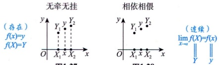
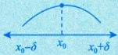
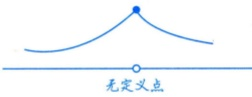
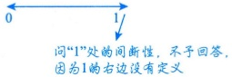
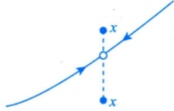
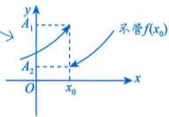
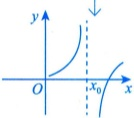
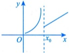
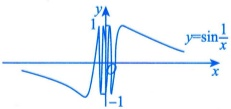
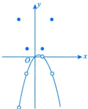

# 第1讲 函数极限与连续（五）　连续与间断点

> 原书 p.65–68 ｜ 拆分版 7/8 ｜ 连续点的定义、间断点的定义与分类
>
> ← 上一节 [七种未定式](06-七种未定式.md) ｜ [总目录](00-第1讲-导读与知识结构.md) ｜ 下一节 [基础习题与解答](08-基础习题与解答.md) →

---

## 五、连续与间断点

### 1 连续点的定义

设函数 $f(x)$在点 $x_{0}$的某一邻域内有定义，且有 $\lim_{x\to x_{0}}f(x)=f(x_{0})$，则称函数 $f(x)$在点 $x_{0}$处连续.

什么叫函数连续？先说什么叫函数存在.存在是说，给了一个x，就有一个y对应在那里(见图1-27)，它附近的点X们所对应的Y们也是如此，它们只是在那里，无牵无挂；连续是说，Y们充分靠近y（见图1-28），它们彼此的距离小到无法用任何小的正实数表达，只能用超实数“无穷小”来衡量，它们并不只是在那里，它们相依相偎.

图1-27

图1-28

所以，函数存在，是 $y$ 和它附近的 $Y$ 们无牵无挂地待在那里；函数连续，则是这些 $Y$ 与 $y$ 相依相偎。连续并不是“真的连着”——连续只是 $Y$ 彼此充分靠近而已，也可以说，连续本身是一种“离散”。我们对于客观事物的刻画，严格来说都是一种近似，只是看这种近似的代价是否可以接受。

<!-- page: 65 -->

**注**（1）当需要讨论左、右极限时，用以下结论：

 $\lim_{x\to x_0^+}f(x)=\lim_{x\to x_0^-}f(x)=f(x_0)\Leftrightarrow f(x)$ 在点  $x_0$ 处连续．

(2) 连续性运算法则.

①(连续性的四则运算法则)设 $f(x)$与 $g(x)$都在点 $x=x_{0}$处连续，则 $f(x)\pm g(x)$与 $f(x)g(x)$在点 $x=x_{0}$处连续，当 $g(x_{0})\neq0$时， $f(x)/g(x)$在点 $x=x_{0}$处也连续.

两个函数如果在同一个点 $x_{0}$处连续，则它们的和差积商在这点也是连续的

②(复合函数的连续性)设  $u = \varphi(x)$ 在点  $x = x_0$ 处连续， $y = f(u)$ 在点  $u = u_0$ 处连续，且  $u_0 = \varphi(x_0)$，则  $f[\varphi(x)]$ 在点  $x = x_0$ 处连续。

容易理解，不做证明，有些不需要证明，有些可能是超纲的

③(反函数的连续性)设 $y=f(x)$在区间 $I_x$上单调且连续，则反函数 $x=\varphi(y)$在对应的区间 $I_y=\{y\mid y=f(x),x\in I_x\}$上连续且有相同的单调性.

★ (3) 设  $f(x)$ 在点  $x = x_0$ 处连续，且  $f(x_0) > 0$ （或  $f(x_0) < 0$），则存在  $\delta > 0$，使得当  $|x - x_0| < \delta$ 时， $f(x) > 0$（或  $f(x) < 0$）。这句话非常重要！

### 2 间断点的定义与分类

以下设函数 $f(x)$在点 $x_{0}$的某去心邻域内有定义.

讨论间断点只看无定义点和分段点，一个初等函数在其定义区间内都是连续的.

区间  $[a, b]$ 上连续，是指 a 处（左端点）右连续，b 处（右端点）左连续。

间断点中，无单侧间断的概念(考研数学中).区间端点是不考虑间断的.

(1) 可去间断点.

若  $\lim_{x\to x_0}f(x)=A\neq f(x_0)(f(x_0)$ 甚至可以无定义），则  $x=x_0$ 称为可去间断点。（可补间断点）

 $f(x)=\left\{\begin{aligned}&\frac{\sin x}{x},&x\neq0,\\&1,&x=0,\end{aligned}\right.$ 则  $f(x)$ 在 x=0 处就连续

<!-- page: 66 -->

**注** 只要修改或者补充  $f(x_0)$，使得  $f(x_0) = A = \lim_{x \to x_0} f(x)$，就会使得函数在点  $x_0$ 处连续，于是，这个点叫作可去间断点，也叫作可补间断点。

(2) 跳跃间断点.

若  $\lim_{x\to x_0^{-}}f(x)$ 与  $\lim_{x\to x_0^{+}}f(x)$ 都存在，但  $\lim_{x\to x_0^{-}}f(x)\neq\lim_{x\to x_0^{+}}f(x)$，则  $x=x_0$ 称为跳跃间断点。可去间断点和跳跃间断点统称为第一类间断点。

第一类间断点在考研中是要求考生区分的。第一类间断点只有可去间断点和跳跃间断点。

**注** 按此定义，跳跃间断点和 $f(x_{0})$的值无关.

(3) 无穷间断点.

若 $\lim\limits_{x\to x_0}f(x)=\infty$ 或 $\lim\limits_{x\to x_0^{+}}f(x)=\infty$ 或 $\lim\limits_{x\to x_0^{-}}f(x)=\infty$，则 $x=x_0$ 称为无穷间断点。如点 $x=0$ 为函数 $y=\frac{1}{x}$ 的无穷间断点；也就是说，$x_0$ 点的左、右极限至少有一个为无穷大。

说明：

①无穷间断点，不是说这一点的值是无穷大，是说这一点的左、右两侧，至少有一个极限值趋向无穷大.

②无穷间断点是第二类间断点.

(4) 振荡间断点.

若  $\lim_{x\to x_0}f(x)$ 振荡不存在，则  $x=x_0$ 称为振荡间断点，如函数  $y=\sin\frac{1}{x}$ 在点  $x=0$ 处没有定义，且当  $x\to0$ 时，函数值在 -1 与 1 这两个数之间交替振荡取值，极限不存在，故点  $x=0$ 为函数  $y=\sin\frac{1}{x}$ 的振荡间断点。

无穷间断点和振荡间断点都属于第二类间断点。（第二类还有其他，但与考研无关）

把间断点的判别总结成一张表——研究对象只有三个量：左极限、右极限、$f(x_{0})$。

| 左、右极限 | 与 $f(x_{0})$ 的关系 | 类型 |
| :--- | :--- | :--- |
| 都存在且相等 | 恰好等于 $f(x_{0})$ | 连续 |
| 都存在且相等 | 不等于 $f(x_{0})$，或 $f(x_{0})$ 无定义 | 第一类：**可去**间断点 |
| 都存在但不相等 | 无关 | 第一类：**跳跃**间断点 |
| 至少有一个不存在（无穷大 / 振荡） | 无关 | 第二类：**无穷** / **振荡**间断点 |

<!-- page: 67 -->

**例 1.36** 已知

$$
f(x)=\begin{cases}(\cos x)^{x^{-2}},&x\neq0,\\a,&x=0\end{cases}
$$

在x=0处连续，则 $a=$___。

**分析**  $\lim_{x\to x_0}f(x)=f(x_0)\Leftrightarrow f(x)$ 在  $x_0$ 处连续.

**解** 应填  $e^{-\frac{1}{2}}$

$\lim\limits_{x\to0}f(x)=\lim\limits_{x\to0}(\cos x)^{x^{-2}}=\mathrm{e}^{A}$，其中 $A=\lim\limits_{x\to0}\frac{\cos x-1}{x^{2}}=-\frac{1}{2}$，故 $\lim\limits_{x\to0}f(x)=\mathrm{e}^{-\frac{1}{2}}$。

又 $f(x)$在x=0处连续，所以 $a=\lim_{x\to0}f(x)=\mathrm{e}^{-\frac{1}{2}}$.

**方法总结** 计算  $\lim_{x\to x_{0}}f(x)$ 即可.

**公式** $\lim u(x)^{v(x)}=\mathrm{e}^{\lim v(x)[u(x)-1]}$（$1^{\infty}$ 型专用）

**例 1.37** 函数  $f(x)=\frac{\mathrm{e}^{\frac{1}{x-1}}\ln\left|1+x\right|}{(\mathrm{e}^{x}-1)(x-2)}$ 的第二类间断点的个数为（ ）.

(A) 1          (B) 2          (C) 3          (D) 4

**分析** 找无定义点和分段函数的分界点，求  $\lim_{x\to x_0}f(x)$，进而判断间断点类型.

**解** 应选(C).

本题考查初等函数的连续性、间断点、间断点分类等基本概念，考查利用等价无穷小替换及洛必达法则求极限的方法，是一道考查基本概念和简单运算的题目.

 $f(x)$ 的定义域为  $\left\{x \mid x \in (-\infty, +\infty), x \neq -1, x \neq 0, x \neq 1, x \neq 2\right\}$，而初等函数在定义域内是连续的，所以该函数的所有间断点是 -1, 0, 1, 2. 由于

 $$ \lim_{x\to-1}f(x)=\lim_{x\to-1}\frac{\mathrm{e}^{\frac{1}{x-1}}\ln\left|1+x\right|}{(\mathrm{e}^{x}-1)(x-2)}=-\infty, $$

$$ \lim_{x\to2}f(x)=\lim_{x\to2}\frac{\mathrm{e}^{\frac{1}{x-1}}\ln\left|1+x\right|}{(\mathrm{e}^{x}-1)(x-2)}=\infty, $$

由例 1.15 知，

$$ \lim_{x\to1^{+}}f(x)=-\infty, $$

$$ \lim_{x\to0}f(x)=\lim_{x\to0}\frac{\mathrm{e}^{\frac{1}{x-1}}\ln\left|1+x\right|}{(\mathrm{e}^{x}-1)(x-2)}=-\frac{1}{2\mathrm{e}}\lim_{x\to0}\frac{\ln(1+x)}{\mathrm{e}^{x}-1}=-\frac{1}{2\mathrm{e}}, $$

因此 x=0 是函数的可去间断点，而其余 3 个点均为函数的第二类间断点，故选 (C).

**方法总结** 间断点找无定义点和分段函数的分界点.

**公式**  $e^{\infty}$ 要分  $e^{+\infty}$， $e^{-\infty}$

<!-- page: 68 -->

**注** 这个题目的计算量还是比较大的，对于极限计算，命题老师的要求还是比较高的.

★**例 1.38** 设函数 $f(x)=\lim_{n\to\infty}\frac{x^2+nx(1-x)\sin^2\pi x}{1+n\sin^2\pi x}$，则 $f(x)$（）.

(A) 处处连续

(B) 只有第一类间断点

(C) 只有第二类间断点

(D) 既有第一类间断点，又有第二类间断点

**分析** 去掉极限符号，找出对应法则。

**解** 应选(B).

由例 1.26 可知，

 $$ f(x)=\begin{cases}x^{2},&x=0,\pm1,\pm2,\cdots,\\x(1-x), 其他 .\end{cases} $$

可见 $f(x)$有第一类间断点，没有第二类间断点，故选(B).

**方法总结** 求分段函数的分界点的极限值，进而判定间断点类型. 若  $\lim_{x\to x_0}f(x)$ 存在，但  $\lim_{x\to x_0}f(x)\neq f(x_0)$，则  $x_0$ 为  $f(x)$ 的可去间断点.

**注** 学好基础知识任重道远，数学成绩的提高，第一要靠理解，第二要通过做题，逐渐提高解题能力.

第 1 讲就到这里。考生们需要做两件事：① 把整讲讲过的概念、知识、定理、方法好好复盘、练熟；② 把《张宇考研数学题源探析经典 1000 题》基础篇全部做完。

---

> ← 上一节 [七种未定式](06-七种未定式.md) ｜ [总目录](00-第1讲-导读与知识结构.md) ｜ 下一节 [基础习题与解答](08-基础习题与解答.md) →
