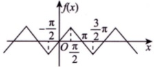

# 第1讲 函数极限与连续（六）　基础习题与解答

> 原书 p.69–75 ｜ 拆分版 8/8 ｜ 习题 1.1–1.16 及解答
>
> ← 上一节 [连续与间断点](07-连续与间断点.md) ｜ [总目录](00-第1讲-导读与知识结构.md)

---

## 六、基础习题精练

### 习题

1.1 若  $\lim_{x\to0}\frac{\sin x+xf(x)}{x^{3}}=0$，则  $\lim_{x\to0}\frac{1+f(x)}{x^{2}}$ 为（）.

(A) 0

(B)  $\frac{1}{3}$

(C)  $\frac{1}{6}$

(D)  $\infty$

1.2 设  $f(x)$ 在  $(-∞, +∞)$ 内有定义，且  $\lim_{x \to ∞} f(x) = a$，

$$
g(x) = \begin{cases} f\left(\frac{1}{x}\right), & x \neq 0, \\ 0, & x = 0, \end{cases}
$$

 则（）.

(A) x=0 必是  $g(x)$ 的第一类间断点

<!-- page: 69 -->

(B) x=0 必是  $g(x)$ 的第二类间断点

(C) x=0 必是  $g(x)$ 的连续点

(D)  $g(x)$ 在点 x=0 处的连续性与 a 的取值有关

1.3 设函数 $f(x)=\frac{1}{\mathrm{e}^{\frac{x}{x-1}}}-1$，则（）.

(A) x=0, x=1 都是  $f(x)$ 的第一类间断点

(B)x=0,x=1 都是  $f(x)$ 的第二类间断点

(C) x=0 是  $f(x)$ 的第一类间断点，x=1 是  $f(x)$ 的第二类间断点

(D) x=0 是  $f(x)$ 的第二类间断点，x=1 是  $f(x)$ 的第一类间断点

1.4 函数  $f(x)=\lim_{t\to0}\left(1+\frac{\sin t}{x}\right)^{\frac{x^2}{t}}$ 在  $(-\infty,+\infty)$ 内（）.

(A) 连续

(B) 有可去间断点

(C) 有跳跃间断点

(D) 有无穷间断点

1.5 设函数  $f(x)=\lim_{n\to\infty}\frac{1+x}{1+x^{2n}}$ ，关于该函数的间断点，下列结论正确的是（）.

(A) 不存在间断点

(B) 存在间断点 x = 1

(C) 存在间断点 x = 0

(D) 存在间断点 x = -1

1.6 设函数 $f(x)=\frac{x}{1+x}$， $x\in[0,1]$，定义函数列：

 $$ f_{1}(x)=f(x),f_{2}(x)=f[f_{1}(x)],\cdots,f_{n}(x)=f[f_{n-1}(x)]\quad(n=1,2,3,\cdots) $$

则 $f_{n}(x)=$ ___.

1.7  $\lim_{x\to0^{+}}\frac{1-\sqrt{\cos x}}{x(1-\cos\sqrt{x})}=$ ___.

1.8  $\lim_{x\to\infty}\left(\frac{x+2}{x-1}\right)^x=$___.

1.9 已知 a > 0, b > 0，则  $\lim_{x \to +\infty} x \left( a^{\frac{1}{x}} - b^{\frac{1}{x}} \right) =$ ___.

1.10 设函数

$$
f(x)=\begin{cases}\dfrac{1-e^{\tan x}}{\arcsin\dfrac{x}{2}},&x>0,\\ae^{2x},&x\leq0\end{cases}
$$

 在x=0处连续，则a=___.

1.11 设  $f(x) = \arcsin(\sin x)$，画出  $f(x)$ 的图形.

<!-- page: 70 -->

1.12 求极限  $\lim_{x\to0}\left(\frac{e^{x}+xe^{x}}{e^{x}-1}-\frac{1}{x}\right)$.

1.13 求极限  $\lim_{x\to0}\left(\frac{a_{1}^{x}+a_{2}^{x}+\cdots+a_{n}^{x}}{n}\right)^{\frac{n}{x}}$，其中  $a_{i}>0, i=1,2,\cdots,n$

1.14 已知  $\lim_{x\to0}\left[a\frac{2+\mathrm{e}^{\frac{1}{x}}}{1+\mathrm{e}^{\frac{4}{x}}}+(1+|x|)^{\frac{1}{x}}\right]$ 存在，求 a 的值.

1.15 设  $\lim_{x\to0}\frac{\ln(1+x)-(ax+bx^{2})}{x^{2}}=2$，求常数 a, b.

1.16 求常数 a 和 b 的值，使得函数  $f(x) = x - (a + b \cos x) \sin x$ 在  $x \to 0$ 时是 x 的 5 阶无穷小.

### 解答

1.1 (C) 解 方法一

$$
\lim_{x\to0}\frac{\sin x+xf(x)}{x^{3}}=\lim_{x\to0}\frac{\sin x-x+x+xf(x)}{x^{3}}=\lim_{x\to0}\frac{\sin x-x}{x^{3}}+\lim_{x\to0}\frac{x+xf(x)}{x^{3}}
$$

 $= -\frac{1}{6} + \lim_{x\to0}\frac{1+f(x)}{x^{2}} = 0$,

则 $\lim_{x\to0}\frac{1+f(x)}{x^{2}}=\frac{1}{6}$.故选(C).

方法二 对  $\sin x$ 使用泰勒展开，

 $$ \lim_{x\to0}\frac{\sin x+xf(x)}{x^{3}}=\lim_{x\to0}\frac{x-\frac{1}{6}x^{3}+o(x^{3})+xf(x)}{x^{3}}=\lim_{x\to0}\frac{1+f(x)}{x^{2}}-\frac{1}{6}=0 $$

故  $\lim_{x\to0}\frac{1+f(x)}{x^{2}}=\frac{1}{6}$ 。故选 (C).

方法三 由  $\lim_{x\to0}\frac{\sin x+xf(x)}{x^{3}}=0$ ，得  $\frac{\sin x+xf(x)}{x^{3}}=0+\alpha$ ，其中  $\lim_{x\to0}\alpha=0$ ，于是得

 $$ xf(x)=-\sin x+o(x^{3}). $$

故  $\lim_{x\to0}\frac{1+f(x)}{x^{2}}=\lim_{x\to0}\frac{x-\sin x+o(x^{3})}{x^{3}}=\frac{1}{6}$ 。故选 (C).

1.2 (D) 解 因为  $\lim_{x\to0}g(x)=\lim_{x\to0}f\left(\frac{1}{x}\right)=\lim_{x\to\infty}f(x)=a$，而  $g(0)=0$，所以当 a=0 时，函数  $g(x)$ 在点 x=0 处连续；当  $a\neq0$ 时，函数  $g(x)$ 在点 x=0 处不连续，故选 (D).

1.3 (D) 解  $f(x)$ 非分段函数，只需讨论函数的无定义点 x=0,1 。因为

<!-- page: 71 -->

$$ \lim_{x\to0}f(x)=\lim_{x\to0}\frac{1}{\mathrm{e}^{\frac{x}{x-1}}-1}=\infty, $$

$$ \lim_{x\to1^{+}}f(x)=\lim_{x\to1^{+}}\frac{1}{\mathrm{e}^{\frac{x}{x-1}}-1}=0,\lim_{x\to1^{-}}f(x)=\lim_{x\to1^{-}}\frac{1}{\mathrm{e}^{\frac{x}{x-1}}-1}=-1, $$

故 x=0 是  $f(x)$ 的第二类间断点，x=1 是  $f(x)$ 的第一类间断点．故选 (D).

1.4 (B) 解 这是 “1” 型未定式，于是

 $$ f(x)=\lim_{t\to0}\left(1+\frac{\sin t}{x}\right)^{\frac{x}{t}}=\mathrm{e}^{\lim_{t\to0}\frac{x^{2}}{t}\cdot\left(1+\frac{\sin t}{x}-1\right)}=\mathrm{e}^{\lim_{t\to0}\frac{\sin t}{t}}=\mathrm{e}^{x},\quad x\neq0 $$

又 $f(x)$在x=0处无定义，且 $\lim_{x\to0}f(x)=\lim_{x\to0}e^x=1$，故x=0是 $f(x)$的可去间断点。选(B)。

1.5 (B) 分析 函数  $f(x)=\lim_{n\to\infty}\frac{1+x}{1+x^{2n}}$ 是以 x 为自变量的函数，但是当  $n\to\infty$ 求极限时，x 则被看成一个常数（参数），根据 x 的不同取值求出极限，求完极限后 x 又恢复变量的本来身份。

因为分式中有 $x^{2n}$，所以应先把x=-1和x=1作为分段点将函数写成分段函数，然后讨论函数的间断点.

**解** 当 $\left|x\right|<1$时， $\lim_{n\to\infty}x^{2n}=0$，所以 $f(x)=1+x$；当 $\left|x\right|>1$时， $f(x)=\lim_{n\to\infty}\frac{1+x}{1+x^{2n}}=0$．

又 $f(1)=1,\ f(-1)=0$，所以

 $$ f(x)=\lim_{n\to\infty}\frac{1+x}{1+x^{2n}}=\begin{cases}0,&x\leq-1,\\1+x,&-1<x<1,\\1,&x=1,\\0,&x>1.\end{cases} $$

由此可知x=1为间断点.故选(B).

 $$ 1.6\quad\frac{x}{1+nx}(n=1,2,3,\cdots)\quad 解 \quad f_{2}(x)=f[f_{1}(x)]=\frac{f_{1}(x)}{1+f_{1}(x)}=\frac{\frac{x}{1+x}}{1+\frac{x}{1+x}}=\frac{x}{1+2x}. $$

$$ f_{3}(x)=f\left[f_{2}(x)\right]=\frac{f_{2}(x)}{1+f_{2}(x)}=\frac{\frac{x}{1+2x}}{1+\frac{x}{1+2x}}=\frac{x}{1+3x}, $$

由数学归纳法得 $f_{n}(x)=\frac{x}{1+nx}(n=1,2,3,\cdots)$

1.7  $\frac{1}{2}$ 解 原式

$$
=\lim_{x\to0^{+}}\frac{1-\cos x}{x(1-\cos\sqrt{x})(1+\sqrt{\cos x})}=\lim_{x\to0^{+}}\frac{\frac{1}{2}x^{2}}{x\cdot\frac{1}{2}x\cdot(1+\sqrt{\cos x})}=\frac{1}{2}
$$

<!-- page: 72 -->

**注** 若想到了例 1.22 的 “当  $x \to 0$ 时， $1 - \cos^a x \sim \frac{a}{2} x^2$， $a \neq 0$”，则解题就更简单了。

1.8  $e^{3}$ 解

$$
\lim_{x\to\infty}\left(\frac{x+2}{x-1}\right)^{x}=\lim_{x\to\infty}\left(\frac{1+\frac{2}{x}}{1-\frac{1}{x}}\right)^{x}=\frac{\lim\limits_{x\to\infty}\left(1+\frac{2}{x}\right)^{x}}{\lim\limits_{x\to\infty}\left(1-\frac{1}{x}\right)^{x}}=\frac{e^{2}}{e^{-1}}=e^{3}
$$

**注**  $\lim_{x\to\infty}\left(1+\frac{a}{x}\right)^{bx+d}=e^{ab}$ 是常用的公式.

相仿，

 $$ \lim_{x\to\infty}\left(\frac{x+a}{x-a}\right)^{x}=\lim_{x\to\infty}\left(\frac{1+\frac{a}{x}}{1-\frac{a}{x}}\right)^{x}=\frac{\lim\limits_{x\to\infty}\left(1+\frac{a}{x}\right)^{x}}{\lim\limits_{x\to\infty}\left(1-\frac{a}{x}\right)^{x}}=\mathrm{e}^{2a} $$

上述两种表达式变形是求极限运算的常见技巧，为固定模式的求解方法，应熟记。

1.9  $\ln\frac{a}{b}$ 解 利用变量代换．令 $\frac{1}{x}=t$，则

 $$ \lim_{x\to+\infty}x\left(a^{\frac{1}{x}}-b^{\frac{1}{x}}\right)=\lim_{t\to0^{+}}\frac{a^{t}-b^{t}}{t}=\lim_{t\to0^{+}}(a^{t}\ln a-b^{t}\ln b)=\ln\frac{a}{b}(a>0,b>0) $$

1.10 -2 解 因为  $f(x)$ 在 x=0 处连续，所以  $\lim_{x\to0^{+}}f(x)=\lim_{x\to0^{-}}f(x)=f(0)$. 又

 $$ \begin{aligned}\lim_{x\rightarrow0^{+}}f(x)&=\lim_{x\rightarrow0^{+}}\frac{1-\mathrm{e}^{\tan x}}{\arcsin\frac{x}{2}}=\lim_{x\rightarrow0^{+}}\frac{-\tan x}{\frac{x}{2}}=-2,\\\lim_{x\rightarrow0^{-}}f(x)&=\lim_{x\rightarrow0^{-}}a\mathrm{e}^{2x}=a,\end{aligned} $$

所以a=-2.

1.11 解  $f(x+2\pi)=\arcsin[\sin(x+2\pi)]=\arcsin(\sin x)=f(x)$，故  $f(x)$ 以  $2\pi$ 为周期。

当 $x\in\left[-\frac{\pi}{2},\frac{\pi}{2}\right)$时，有 $\arcsin(\sin x)=x$;

当 $x\in\left[\frac{\pi}{2},\pi\right)$时，有 $\pi-x\in\left(0,\frac{\pi}{2}\right]$，则

 $$ \arcsin(\sin x)=\arcsin[\sin(\pi-x)]=\pi-x; $$

当 $x\in\left[\pi,\frac{3}{2}\pi\right)$时，有 $x-\pi\in\left[0,\frac{\pi}{2}\right)$，则

 $$ \arcsin(\sin x)=\arcsin[-\sin(x-\pi)]=\pi-x. $$

<!-- page: 73 -->

故在 $\left[-\frac{\pi}{2},\frac{3}{2}\pi\right)$上，

$$
f(x)=\left\{\begin{aligned}&x,&x\in\left[-\frac{\pi}{2},\frac{\pi}{2}\right),\\&\pi-x,&x\in\left[\frac{\pi}{2},\frac{3}{2}\pi\right),\end{aligned}\right.
$$

于是在 $(-∞,+∞)$上，

$$ f(x)=\arcsin(\sin x)=\begin{cases}x-2k\pi,&x\in\left[-\frac{\pi}{2}+2k\pi,\ \frac{\pi}{2}+2k\pi\right),\\ (2k+1)\pi-x,&x\in\left[\frac{\pi}{2}+2k\pi,\ \frac{3}{2}\pi+2k\pi\right),\end{cases}\quad k\in\mathbb{Z}. $$

其图形如图 1-29 所示.

图 1-29

1.12 解 利用等价无穷小量代换， $e^{x}-1\sim x(x\rightarrow0)$，则

 $$ \begin{aligned}\lim_{x\rightarrow0}\left(\frac{\mathrm{e}^{x}+x\mathrm{e}^{x}}{\mathrm{e}^{x}-1}-\frac{1}{x}\right)&=\lim_{x\rightarrow0}\frac{x\mathrm{e}^{x}(1+x)+1-\mathrm{e}^{x}}{x(\mathrm{e}^{x}-1)}=\lim_{x\rightarrow0}\frac{x\mathrm{e}^{x}(1+x)+1-\mathrm{e}^{x}}{x^{2}}\\&=\lim_{x\rightarrow0}\frac{3x\mathrm{e}^{x}+x^{2}\mathrm{e}^{x}}{2x}=\lim_{x\rightarrow0}\frac{3\mathrm{e}^{x}+x\mathrm{e}^{x}}{2}=\frac{3}{2}\ .\end{aligned} $$

**注** 下面的做法是错误的：

 $$ \begin{aligned}\lim_{x\to0}\left(\frac{\mathbf{e}^{x}+x\mathbf{e}^{x}}{\mathbf{e}^{x}-1}-\frac{1}{x}\right)&=\lim_{x\to0}\left(\frac{\mathbf{e}^{x}+x\mathbf{e}^{x}}{x}-\frac{1}{x}\right)\\&=\lim_{x\to0}\frac{\mathbf{e}^{x}+x\mathbf{e}^{x}-1}{x}=\lim_{x\to0}(2\mathbf{e}^{x}+x\mathbf{e}^{x})=2\end{aligned} $$

1.13 解 因为  $\lim_{x\to0}a_{i}^{x}=1$ ，所以原极限为 “ $1^{\infty}$” 型未定式.

方法一 使用洛必达法则求极限.

 $$ \begin{aligned}\lim_{x\to0}\left(\frac{a_{1}^{x}+a_{2}^{x}+\cdots+a_{n}^{x}}{n}\right)^{\frac{n}{x}}&=\exp\left\{\lim_{x\to0}\frac{n}{x}\left(\frac{a_{1}^{x}+a_{2}^{x}+\cdots+a_{n}^{x}}{n}-1\right)\right\}\\&=\exp\left\{\lim_{x\to0}\frac{a_{1}^{x}-1}{x}+\lim_{x\to0}\frac{a_{2}^{x}-1}{x}+\cdots+\lim_{x\to0}\frac{a_{n}^{x}-1}{x}\right\}\\&=\exp\{\lim_{x\to0}(a_{1}^{x}\ln a_{1}+a_{2}^{x}\ln a_{2}+\cdots+a_{n}^{x}\ln a_{n})\}=a_{1}a_{2}\cdots a_{n}.\end{aligned} $$

方法二 凑成第二个重要极限（“1 $^{\circ}$”型未定式都可以凑成第二个重要极限），在计算过程中使用洛必达法则.

<!-- page: 74 -->

$$ \lim_{x\to0}\left(\frac{a_{1}^{x}+a_{2}^{x}+\cdots+a_{n}^{x}}{n}\right)^{\frac{n}{x}}=\lim_{x\to0}\left(1+\frac{a_{1}^{x}+a_{2}^{x}+\cdots+a_{n}^{x}-n}{n}\right)^{\frac{n}{a_{1}^{x}+a_{2}^{x}+\cdots+a_{n}^{x}-n}\cdot\frac{a_{1}^{x}+a_{2}^{x}+\cdots+a_{n}^{x}-n}{x}}, $$

其中

 $$ \lim_{x\to0}\frac{a_{1}^{x}+a_{2}^{x}+\cdots+a_{n}^{x}-n}{x}=\ln(a_{1}a_{2}\cdots a_{n}),\lim_{x\to0}\left(1+\frac{a_{1}^{x}+a_{2}^{x}+\cdots+a_{n}^{x}-n}{n}\right)^{\frac{n}{a_{1}^{x}+a_{2}^{x}+\cdots+a_{n}^{x}-n}}=e, $$

所以，原式 $=a_{1}a_{2}\cdots a_{n}$

1.14 解 因为  $\lim_{x\to0}\left[a\frac{2+\mathrm{e}^{\frac{1}{x}}}{1+\mathrm{e}^{\frac{4}{x}}}+(1+|x|)^{\frac{1}{x}}\right]$ 存在，且

 $$ \lim_{x\to0^{+}}\left[a\frac{2+\mathrm{e}^{\frac{1}{x}}}{1+\mathrm{e}^{\frac{4}{x}}}+(1+|x|)^{\frac{1}{x}}\right]=\lim_{x\to0^{+}}\left[a\frac{2+\mathrm{e}^{\frac{1}{x}}}{1+\mathrm{e}^{\frac{4}{x}}}+(1+x)^{\frac{1}{x}}\right]=0+\mathrm{e}=\mathrm{e}, $$

$$ \lim_{x\to0^{-}}\left[a\frac{2+\mathrm{e}^{\frac{1}{x}}}{1+\mathrm{e}^{\frac{4}{x}}}+(1+|x|)^{\frac{1}{x}}\right]=\lim_{x\to0^{-}}\left[a\frac{2+\mathrm{e}^{\frac{1}{x}}}{1+\mathrm{e}^{\frac{4}{x}}}+(1-x)^{\frac{1}{x}}\right]=2a+\frac{1}{\mathrm{e}}, $$

所以

 $$ \mathbf{e}=2a+\frac{1}{\mathbf{e}}, $$

解得

 $$ a=\frac{\mathbf{e}}{2}-\frac{1}{2\mathbf{e}}. $$

1.15 解 原极限

$$
=\lim_{x\to0}\frac{x-\frac{1}{2}x^{2}+o(x^{2})-ax-bx^{2}}{x^{2}}=\lim_{x\to0}\frac{(1-a)x-\left(\frac{1}{2}+b\right)x^{2}+o(x^{2})}{x^{2}}=2
$$

从而

 $$ 1-a=0,\ -\left(\frac{1}{2}+b\right)=2\ , $$

解得 a=1,  $b=-\frac{5}{2}$

#### 注　本题还有一个值得借鉴的解法

根据泰勒公式容易得： $x - \ln(1 + x) \sim \frac{1}{2} x^2 (x \to 0)$（请考生记住此式），故想办法把分子凑出这种形式。

 $$ \begin{aligned}2=&\lim_{x\rightarrow0}\frac{\ln(1+x)-(ax+bx^{2})}{x^{2}}=-\lim_{x\rightarrow0}\frac{x-\ln(1+x)-x+(ax+bx^{2})}{x^{2}}\\=&-\lim_{x\rightarrow0}\frac{x-\ln(1+x)}{x^{2}}-\lim_{x\rightarrow0}\frac{(a-1)x}{x^{2}}-\lim_{x\rightarrow0}\frac{bx^{2}}{x^{2}}=-\frac{1}{2}-b-\lim_{x\rightarrow0}\frac{(a-1)x}{x^{2}},\end{aligned} $$

故 a-1=0，得 a=1。因而  $-\frac{1}{2}-b=2$，得  $b=-\frac{5}{2}$

<!-- page: 75 -->

1.16 解 先作恒等变形： $f(x)=x-a\sin x-\frac{1}{2}b\sin 2x$，再利用泰勒展开式，由

 $$ \sin x=x-\frac{x^{3}}{6}+\frac{x^{5}}{120}+o(x^{5}), $$

$$ \sin2x=2x-\frac{(2x)^{3}}{6}+\frac{(2x)^{5}}{120}+o(x^{5})=2x-\frac{4}{3}x^{3}+\frac{4}{15}x^{5}+o(x^{5}), $$

可得

 $$ f(x)=(1-a-b)x+\left(\frac{a}{6}+\frac{2b}{3}\right)x^{3}-\left(\frac{a}{120}+\frac{2b}{15}\right)x^{5}+o(x^{5}). $$

欲使在  $x \rightarrow 0$ 时，函数  $f(x)$ 是 x 的 5 阶无穷小，则  $\left\{\begin{aligned}&1-a-b=0,\\&\frac{a}{6}+\frac{2b}{3}=0,\\&\frac{a}{120}+\frac{2b}{15}\neq0,\end{aligned}\right.$ 解得  $a=\frac{4}{3}, b=-\frac{1}{3}$

---

> ← 上一节 [连续与间断点](07-连续与间断点.md) ｜ [总目录](00-第1讲-导读与知识结构.md)
