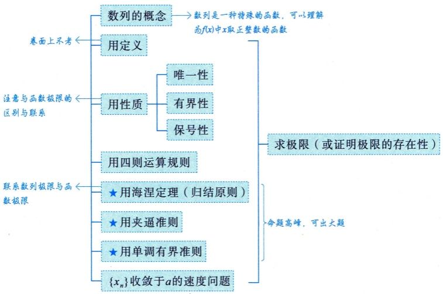

# 第2讲　数列极限

> 《考研数学基础 30 讲 · 高等数学分册》第 2 讲 ｜ 拆分版总目录（对应原书 p.1–2）

## 一、考题、题型、目标与重难点

- **考题**：证明数列极限的存在性
- **题型**：选择题、填空题、解答题
- **目标**：①理解数列极限的概念；②掌握数列极限的性质及四则运算规则；③掌握数列极限存在的两个准则，并会利用它们求极限
- **重难点**：①海涅定理的应用；②通过放缩利用夹逼准则求极限；③单调有界准则证明极限存在

## 二、基础知识结构

## 三、本讲拆分目录

| # | 文档 | 内容 | 原书页码 |
| :--: | :--- | :--- | :--: |
| 1 | [数列的概念](01-数列的概念.md) | 数列、子列、等差/等比数列、单调与有界、常见求和、例2.1 | p.2–4 |
| 2 | [数列极限的定义](02-数列极限的定义.md) | 极限的定义、子列与收敛、唯一性/有界性/保号性、例2.2–2.4 | p.4–7 |
| 3 | [收敛数列的性质与四则运算](03-收敛数列的性质与四则运算.md) | 收敛数列三大性质、极限四则运算、例2.5–2.6 | p.7–8 |
| 4 | [海涅定理](04-海涅定理.md) | 海涅定理、归结原则的三种用法、例2.7–2.8 | p.8–10 |
| 5 | [夹逼准则](05-夹逼准则.md) | 夹逼准则、放缩技巧、例2.9–2.11 | p.10–13 |
| 6 | [单调有界准则](06-单调有界准则.md) | 单调有界准则、单调性判别五法、例2.12–2.15 | p.14–19 |
| 7 | [收敛速度与定义辨析](07-收敛速度与定义辨析.md) | 收敛速度、ε 与收敛速度的区别、例2.16–2.18 | p.19–21 |
| 8 | [基础习题与解答](08-基础习题与解答.md) | 习题 2.1–2.8 及解答 | p.21–23 |

## 四、这套拆分稿怎么用

1. 先看 `01`（数列的概念）：数列、子列、等差/等比、单调与有界，是后面所有内容的地基；例 2.1 是“基本不等式证有界”的模板，要会默写。
2. `02` 是全讲最需要啃的：ε–N 定义、子列与收敛的关系、三大性质。定义部分最容易被选择题考“换个说法还成不成立”。
3. `03`、`04` 偏工具：四则运算规则（尤其“不存在 ± 不存在”）、海涅定理（把数列极限转成函数极限后就能用洛必达/泰勒）。
4. `05`、`06` 是两道大轴：夹逼准则考“放缩”，单调有界准则考“证明存在 + 求极限”。放缩的常用不等式那一节要反复看。
5. `07` 最短，但近几年选择题常出“ε 相关”的辨析题，注意结论：**极限定义里不能对收敛速度提要求**。
6. 最后用 `08` 的 8 道题自测，再做《张宇考研数学题源探析经典 1000 题》基础篇。

> 本拆分稿相对原始 OCR 稿的全部修改，见 [修订说明](09-修订说明.md)。原文完整备份见 [_备份/02-第2讲-数列极限.原始OCR.md](../_备份/02-第2讲-数列极限.原始OCR.md)。
