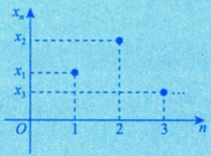
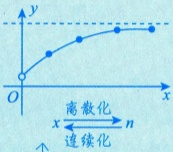

# 第2讲 数列极限（一）　数列的概念

> 原书 p.2–4 ｜ 拆分版 1/8 ｜ 数列、子列、等差/等比数列、单调与有界、常见求和、例2.1
>
> [总目录](00-第2讲-导读与知识结构.md) ｜ 下一节 [数列极限的定义](02-数列极限的定义.md) →

---

## 1 数列的概念

对每个 $n \in \mathbb{N}_+$，如果按照某一法则，对应着一个确定的实数 $x_n$，这些实数 $x_n$按照下标 $n$从小到大排列得到的一个序列

 $$ x_{1},x_{2},x_{3},\cdots,x_{n},\cdots $$

就叫作数列，简记为数列 $\{x_{n}\}$

数列中的每一个数叫作数列的项，第n项 $x_{n}$叫作数列的一般项（或通项）.

在几何上，数列 $\{x_{n}\}$可看作数轴上的一个动点，它依次取数轴上的点 $x_{1},x_{2},x_{3},\cdots,x_{n},\cdots$（见图2-1）.

> 提示：图 2-1 把数列的各项画在数轴上，$x_n$ 随 $n$ 增大而向某个点靠拢——这正是数列极限要刻画的现象。

图 2-1

**注** 数列一定有无穷多项.

数列的本质是“整标函数”

数列  $\{x_{n}\}$ 可看作自变量为正整数 n 的函数

 $$ x_{n}=f(n),n\in\mathbf{N}_{+}. $$

当自变量 n 依次取 1, 2, 3, … 一切正整数时，对应的函数值就排列成数列  $\{x_{n}\}$

### 注　子列

从数列  $\{a_{n}\}$:  $a_{1}, a_{2}, \cdots, a_{n}, \cdots$ 中选取无穷多项，并按原来的先后顺序组成新的数列，称新数列为原数列的子列，记为

 $$ \{a_{n_{k}}\}\colon a_{n_{1}},a_{n_{2}},\cdots,a_{n_{k}},\cdots, $$

其中下标 $n_{1}, n_{2}, \cdots, n_{k}, \cdots$为正整数.

例如，若  $n_{k}(k=1,2,\cdots)$ 分别取 2k 和 2k-1，则得到数列  $\{a_{n}\}$ 的两个子列

 $$ \{a_{2k}\}\colon a_{2},\;a_{4},\cdots,\;a_{2k},\cdots;\;\{a_{2k-1}\}\colon a_{1},\;a_{3},\cdots,\;a_{2k-1},\cdots, $$

<!-- page: 3 -->

这两个子列的项在原数列中交错出现。

(2) 等差数列.

首项为  $a_{1}$，公差为  $d(d \neq 0)$ 的数列  $a_{1}, a_{1} + d, a_{1} + 2d, \cdots, a_{1} + (n - 1)d, \cdots$.

①通项公式 $a_{n}=a_{1}+(n-1)d$

②前 n 项的和  $S_{n}=\frac{n}{2}\left[2a_{1}+(n-1)d\right]=\frac{n}{2}(a_{1}+a_{n})$

(3) 等比数列.

首项为  $a_{1}$，公比为  $r(r \neq 0)$ 的数列  $a_{1}, a_{1}r, a_{1}r^{2}, \cdots, a_{1}r^{n-1}, \cdots$.

①通项公式 $a_{n}=a_{1}r^{n-1}$

②前 n 项的和

$$
S_{n}=\begin{cases}na_{1},&r=1,\\\dfrac{a_{1}(1-r^{n})}{1-r},&r\neq1.\end{cases}
$$

③常用  $1+r+r^{2}+\cdots+r^{n-1}=\frac{1-r^{n}}{1-r}(r\neq1)$ →有限项和不会发散，收敛和发散的概念，只在无穷项时会涉及

这两个求和公式针对的前n项和，即有限项和，当讨论无限项和时，需要使用无穷级数理论

(4) 单调数列.

若对所有正整数  $n$，有  $a_{n+1} \geqslant a_n (a_{n+1} \leqslant a_n)$，则称数列  $\{a_n\}$ 为单调不减（不增）数列。将  $\geqslant (\leqslant)$ 换成  $> (<)$，则称为单调递增（递减）数列。单调递增数列与单调递减数列统称为单调数列。

(5) 有界数列.

若对所有正整数  $n$，存在正实数  $M$，有  $|a_n| \leq M$，则称数列  $\{a_n\}$ 为有界数列。

证明数列有界的几种方法：

① 找 $M$，使得 $|a_n|\leqslant M$；

② 放缩法；

③ 找最值；

④ 基本不等式法。

(6) 一些常见数列前 n 项的和.

$$ \text{①}\ \sum_{k=1}^{n}k=1+2+3+\cdots+n=\frac{n(n+1)}{2} $$

$$ \text{②}\ \sum_{k=1}^{n}k^{2}=1^{2}+2^{2}+3^{2}+\cdots+n^{2}=\frac{n(n+1)(2n+1)}{6} $$

$$ \text{③}\ \sum_{k=1}^{n}\frac{1}{k(k+1)}=\frac{1}{1\times2}+\frac{1}{2\times3}+\frac{1}{3\times4}+\cdots+\frac{1}{n(n+1)}=\frac{n}{n+1} $$

> ③ 是怎么算出来的？——**裂项相消**：
>
> $$ \frac{1}{k(k+1)}=\frac{1}{k}-\frac{1}{k+1}, $$
>
> 于是 $\sum\limits_{k=1}^{n}\frac{1}{k(k+1)}=1-\frac{1}{2}+\frac{1}{2}-\frac{1}{3}+\cdots+\frac{1}{n}-\frac{1}{n+1}=1-\frac{1}{n+1}=\frac{n}{n+1}$，
> 从而 $\lim\limits_{n\to\infty}\sum\limits_{k=1}^{n}\frac{1}{k(k+1)}=\lim\limits_{n\to\infty}\frac{n}{n+1}=1$。

<!-- page: 4 -->

(7) 一个重要数列  $\left\{\left(1+\frac{1}{n}\right)^{n}\right\}$ 的结论：

①单调递增有上界.

②  $\lim_{n \to \infty} \left(1 + \frac{1}{n}\right)^n = e.$

当 n 无限增大时（即  $n \to \infty$ 时），对应的  $x_{n} = f(n)$ 是否能无限接近于某个确定的数值，这就是我们接下来要研究的数列极限。

**例 2.1** 设  $0 < x_1 < 3$,  $x_{n+1} = \sqrt{x_n(3 - x_n)}$ ( $n=1, 2, \cdots$), 证明数列  $\{x_n\}$ 有界.

**分析** 针对  $\sqrt{A(B-A)}$ 形的式子，可以使用基本不等式.

**证** 因为  $0 < x_{1} < 3$，所以  $x_{1}, 3 - x_{1}$ 均为正数，从而

$$ 0<x_{2}=\sqrt{x_{1}(3-x_{1})}\leqslant\frac{x_{1}+(3-x_{1})}{2}=\frac{3}{2}. $$

设  $0 < x_k \leq \frac{3}{2} (k > 1)$，则  $0 < x_{k+1} = \sqrt{x_k (3 - x_k)} \leq \frac{1}{2} (x_k + 3 - x_k) = \frac{3}{2}$，由数学归纳法知，对任意正整数  $n > 1$，都有  $0 < x_n \leq \frac{3}{2}$，即数列  $\{x_n\}$ 有界。

---

> [总目录](00-第2讲-导读与知识结构.md) ｜ 下一节 [数列极限的定义](02-数列极限的定义.md) →
