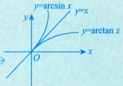
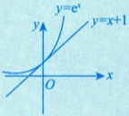
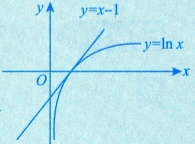
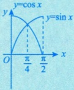
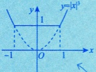

# 第2讲 数列极限（五）　夹逼准则

> 原书 p.10–13 ｜ 拆分版 5/8 ｜ 夹逼准则、放缩技巧、例2.9–2.11
>
> ← 上一节 [海涅定理](04-海涅定理.md) ｜ [总目录](00-第2讲-导读与知识结构.md) ｜ 下一节 [单调有界准则](06-单调有界准则.md) →

---

## 6 夹逼准则

如果数列  $\{x_{n}\}$， $\{y_{n}\}$ 及  $\{z_{n}\}$ 满足下列条件：

①从某项起，即存在  $n_{0} \in \mathbb{N}_{+}$，当  $n > n_{0}$ 时， $y_{n} \leqslant x_{n} \leqslant z_{n}$;

②  $\lim_{n\to\infty}y_n=a,\lim_{n\to\infty}z_n=a$

> $\{x_n\}$ 被 $\{y_n\}$、$\{z_n\}$ 两边“夹住”，而两边的极限都等于 $a$，所以 $\{x_n\}$ 也只能趋于 $a$（把 $a$ 换成 $+\infty$ 或 $-\infty$，结论同样成立）。

则数列  $\left\{x_{n}\right\}$ 的极限存在，且  $\lim_{n\to\infty}x_{n}=a$

**注**　放缩的常用方法如下（其中①、②为“已知方法”，其余多为题设条件给出的方法）。

(1) 利用简单的放大与缩小.

<!-- page: 11 -->

**(1) 利用简单的放大与缩小**

$n$ 项相加时，可以统一“放大到最大项、缩小到最小项”：

$$ n\cdot u_{\min}\leqslant u_{1}+u_{2}+\cdots+u_{n}\leqslant n\cdot u_{\max}\qquad(u_{i}>0); $$

若各项非负、只需上界，则

$$ u_{\max}\leqslant u_{1}+u_{2}+\cdots+u_{n}\leqslant n\cdot u_{\max}\qquad(u_{i}\geqslant0). $$

**(2) 利用重要不等式**

① 设 $a,b$ 为实数，则 a. $\left|a\pm b\right|\leqslant|a|+|b|$；b. $\big||a|-|b|\big|\leqslant|a-b|$。

可以将上述不等式 a. 推广为 n 个实数的情形，即

 $$ \left|a_{1}\pm a_{2}\pm\cdots\pm a_{n}\right|\leqslant\left|a_{1}\right|+\left|a_{2}\right|+\cdots+\left|a_{n}\right|. $$

② a.  $\sqrt{ab} \leqslant \frac{a + b}{2} \leqslant \sqrt{\frac{a^{2} + b^{2}}{2}}(a, b \geqslant 0)$

还有 $|ab|\leq\frac{a^{2}+b^{2}}{2}$，例如，若 $u_{n}>0$，则 $\frac{u_{n}}{n}=u_{n}\cdot\frac{1}{n}\leq\frac{u_{n}^{2}+\frac{1}{n^{2}}}{2}$

b.  $\sqrt[3]{abc} \leqslant \frac{a + b + c}{3} \leqslant \sqrt{\frac{a^{2} + b^{2} + c^{2}}{3}}$ (a, b, c  $\geqslant 0$)

③设  $a \geqslant b \geqslant 0$，则

$$
\left\{\begin{array}{l} 当 m > 0 \text{ 时}, a^{m} \geqslant b^{m}, \\ \text{当 } m < 0 \text{ 时}, a^{m} \leqslant b^{m}.\end{array}\right.
$$

④若 0 < a < x < b, 0 < c < y < d，则  $\frac{c}{b} < \frac{y}{x} < \frac{d}{a}$

考研中考过：当  $n\pi < x < (n+1)\pi$， $2n < S(x) < 2(n+1)$ 时， $\frac{2n}{(n+1)\pi} < \frac{S(x)}{x} < \frac{2(n+1)}{n\pi}$

注例 当  $n \leqslant x < n+1$ 时， $2n \leqslant f(x) < 2(n+1)$，则  $\lim_{x \to +\infty} \frac{f(x)}{x} =$ ___。

 $$ \frac{1}{n+1}<\frac{1}{x}\leqslant\frac{1}{n} $$

**解** 由于  $\frac{2n}{n+1} < \frac{f(x)}{x} < \frac{2(n+1)}{n}$，当  $x \to +\infty$ 时， $n \to \infty$，根据夹逼准则，得  $\lim_{x \to +\infty} \frac{f(x)}{x} = 2$。

⑤  $\sin x < x < \tan x \left(0 < x < \frac{\pi}{2}\right)$.

⑥  $\sin x < x (x > 0)$.

考研中考过：当  $x_n > 0$ 时， $x_{n+1} = \sin x_n < x_n$，故  $\{x_n\}$ 单调减少。

⑦当  $0 < x < \frac{\pi}{4}$ 时， $x < \tan x < \frac{4}{\pi}x$ 。证明见习题 6.9.

<!-- page: 12 -->

⑧当  $0 < x < \frac{\pi}{2}$ 时， $\sin x > \frac{2}{\pi}x$ 。证明见例 6.19.

⑨  $\arctan x \leqslant x \leqslant \arcsin x (0 \leqslant x \leqslant 1)$

可考：当  $x_{n}>0$ 时， $x_{n+1}=\arctan x_{n}<x_{n}$，故  $\left\{x_{n}\right\}$ 单调减少。

⑩　$e^{x}\geqslant x+1$（任意 $x$）

可考：当  $x_{n+1} = e^{x_n} - 1$ 时，由  $e^{x_n} - 1 \geq x_n$，得  $x_{n+1} \geq x_n$，即  $\{x_n\}$ 单调不减。

⑪  $x - 1 \geq \ln x (x > 0)$。

可考：当  $x_n > 0$ 时，若  $x_{n+1} = \ln x_n + 1$，由  $\ln x_n + 1 \leq x_n$，得  $x_{n+1} \leq x_n$，即  $\{x_n\}$ 单调不增。

⑫  $\frac{1}{1 + x} < \ln \left(1 + \frac{1}{x}\right) < \frac{1}{x} (x > 0)$ 或  $\frac{x}{1 + x} < \ln (1 + x) < x (x > 0)$。

(3) 利用闭区间上连续函数必有最大值与最小值.

(4) 利用压缩映射原理。（简化版）

原理一 对数列  $\{x_n\}$，若存在常数  $k$ ( $0 < k < 1$)，使得  $|x_{n+1} - a| \leq k|x_n - a|$， $n = 1, 2, \cdots$，则  $\{x_n\}$ 收敛于  $a$。

**证**  $0 \leqslant |x_{n+1} - a| \leqslant k |x_n - a| \leqslant k^2 |x_{n-1} - a| \leqslant \cdots \leqslant k^n |x_1 - a|$，由于  $\lim_{n \to \infty} k^n = 0$，根据夹逼准则，有  $\lim_{n \to \infty} |x_{n+1} - a| = 0$，即  $\{x_n\}$ 收敛于  $a$。

原理二 对数列  $\{x_n\}$，若  $x_{n+1} = f(x_n)$， $n=1,2,\cdots$， $f(x)$ 可导， $a$ 是  $f(x) = x$ 的唯一解，且对任意  $x \in \mathbb{R}$，有  $|f'(x)| \leq k < 1$，则  $\{x_n\}$ 收敛于  $a$。

**证**  $\left|x_{n+1}-a\right|=\left|f(x_{n})-f(a)\right|$

拉格朗日中值定理  $\left|f'(\xi)\right|\left|x_{n}-a\right|\leqslant k\left|x_{n}-a\right|$，其中  $\xi$ 介于  $a$ 与  $x_{n}$ 之间，

由原理一，有  $\{x_{n}\}$ 收敛于 a .

以上原理一、二是特殊的压缩映射过程，考生在使用它们时，要写出证明过程。如例 2.15。

(5) 利用题设条件来推证（这往往是解答题的第 1 问）.  $\longrightarrow$ 例2.11

**例 2.9**  $\lim_{n\to\infty}\left(\frac{1}{n^{2}+n+1}+\frac{2}{n^{2}+n+2}+\cdots+\frac{n}{n^{2}+n+n}\right)=$ ___.

**分析**　分母不一样不能相加减，通分又太复杂，故可以利用放缩将分母化成相同的。需要注意：分母越大，分数越小。

把分母写成一样的： $小 \leq \sum_{i=1}^{n} \frac{i}{n^{2} + n + i} \leq$ 大.

**解** 应填 $\frac{1}{2}$

<!-- page: 13 -->

分子不变，将分母放缩成相同的，则

 $$ \frac{n(n+1)}{2(n^{2}+n+n)}\leqslant\frac{1}{n^{2}+n+1}+\frac{2}{n^{2}+n+2}+\cdots+\frac{n}{n^{2}+n+n}\leqslant\frac{n(n+1)}{2(n^{2}+n+1)}, $$

又  $\lim_{n\to\infty}\frac{n(n+1)}{2(n^2+n+1)}=\lim_{n\to\infty}\frac{n(n+1)}{2(n^2+n+n)}=\frac{1}{2}$，所以根据夹逼准则，原式  $=\frac{1}{2}$

找带头大哥

**例 2.10** 求极限  $\lim_{n\to\infty}\sqrt[n]{a_1^n+a_2^n+\cdots+a_m^n}$，其中  $a_i(i=1,2,\cdots,m)$ 都是非负数.

**解** 设  $a = \max\{a_1, a_2, \cdots, a_m\}$，则

 $$ a^{n}\leqslant a_{1}^{n}+a_{2}^{n}+\cdots+a_{m}^{n}\leqslant m\bullet a^{n}, $$

即  $a \leqslant \sqrt[n]{a_{1}^{n} + a_{2}^{n} + \cdots + a_{m}^{n}} \leqslant a \cdot m^{\frac{1}{n}}$，且  $\lim_{n \to \infty} m^{\frac{1}{n}} = 1$．故

 $$ \lim_{n\to\infty}\sqrt[n]{a_{1}^{n}+a_{2}^{n}+\cdots+a_{m}^{n}}=\max\{a_{1},a_{2},\cdots,a_{m}\} $$

> **注**　这是一个结论，应当记住。

如当  $0 < a < b$ 时，

$$
\lim_{n \to \infty} (a^{-n} + b^{-n})^{\frac{1}{n}} = \lim_{n \to \infty} \sqrt[n]{\left(\frac{1}{a}\right)^n + \left(\frac{1}{b}\right)^n} = \frac{1}{a}
$$

（这里 $0<a<b$，故 $\frac{1}{a}>\frac{1}{b}>0$。）

又如当 $0\leqslant x\leqslant\frac{\pi}{2}$ 时，

$$ \lim_{n\to\infty}\sqrt[n]{\sin^{n}x+\cos^{n}x}=\begin{cases}\cos x, & 0\leqslant x\leqslant\frac{\pi}{4},\\[4pt] \sin x, & \frac{\pi}{4}<x\leqslant\frac{\pi}{2}.\end{cases} $$

> 这是“用极限来定义函数”的方法之一。

再如

$$
\lim_{n\to\infty}\sqrt[n]{1+|x|^{3n}}=\begin{cases}1,&|x|\leq1,\\|x|^{3},&|x|>1.\end{cases}
$$

约束式

**例 2.11** 设  $0 < a_n < \frac{\pi}{2}$， $0 < b_n < \frac{\pi}{2}$， $\cos a_n - a_n = \cos b_n$，且  $\lim_{n \to \infty} b_n = 0$，求  $\lim_{n \to \infty} a_n$， $\lim_{n \to \infty} \frac{a_n}{b_n^2}$

(1) 分清约束式、关系式和定义式；(2) 做一至两步的逆运算；(3) 联想一些经典形式。

**解** 由 $\cos a_n-\cos b_n=a_n>0$，得 $\cos a_n>\cos b_n$；又 $\cos x$ 在 $\left(0,\frac{\pi}{2}\right)$ 上单调减少，故

$$ 0<a_n<b_n. $$

由 $\lim\limits_{n\to\infty}b_n=0$ 及夹逼准则，得 $\lim\limits_{n\to\infty}a_n=0$。

又因为 $a_n\to0$、$b_n\to0$，联想到 $1-\cos x\sim\frac{1}{2}x^{2}\ (x\to0)$，于是把所求极限拆成两部分：

$$ \frac{a_n}{b_n^{2}}=\frac{1-\cos b_n}{b_n^{2}}\cdot\frac{a_n}{1-\cos b_n}, $$

其中 $\dfrac{1-\cos b_n}{b_n^{2}}\to\dfrac{1}{2}$；而由 $1-\cos b_n=a_n+(1-\cos a_n)$ 得

$$ \frac{a_n}{1-\cos b_n}=\frac{a_n}{a_n+(1-\cos a_n)}=\frac{1}{1+\dfrac{1-\cos a_n}{a_n}}\longrightarrow1, $$

故

$$ \lim_{n\to\infty}\frac{a_n}{b_n^{2}}=\frac{1}{2}\times1=\frac{1}{2}. $$

---

> ← 上一节 [海涅定理](04-海涅定理.md) ｜ [总目录](00-第2讲-导读与知识结构.md) ｜ 下一节 [单调有界准则](06-单调有界准则.md) →
