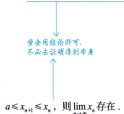
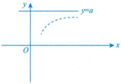
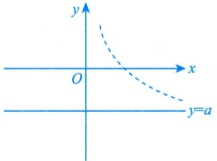
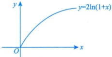
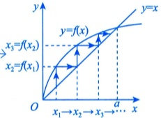
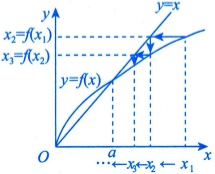
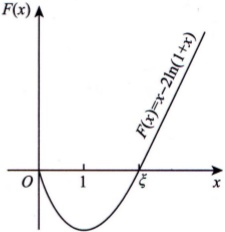
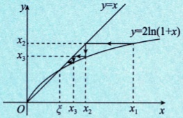
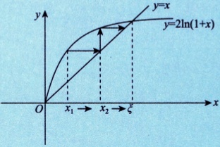
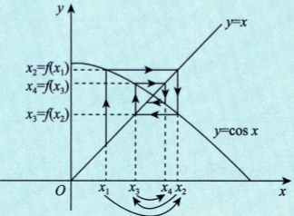

# 第2讲 数列极限（六）　单调有界准则

> 原书 p.14–19 ｜ 拆分版 6/8 ｜ 单调有界准则、单调性判别五法、例2.12–2.15
>
> ← 上一节 [夹逼准则](05-夹逼准则.md) ｜ [总目录](00-第2讲-导读与知识结构.md) ｜ 下一节 [收敛速度与定义辨析](07-收敛速度与定义辨析.md) →

---

## 7 单调有界准则

> 单调有界准则是讨论数列极限存在的两个最重要的准则之一，另一个是夹逼准则。

单调有界数列必有极限，即若数列 $\{x_n\}$ 单调增加（减少）且有上界（下界），则 $\lim\limits_{n\to\infty}x_n$ 存在。

单调有界数列必有极限，即若数列  $\{x_{n}\}$ 单调增加（减少）且有上界（下界），则  $\lim_{n\to\infty}x_{n}$ 存在。

不等关系

单调有界准则其实包含两种情况（涉及不等关系，是数学中的难点），第1种情况数列单调增加并且有上界；第2种情况，数列单调减少并且有下界。在这两种情况下数列极限都是存在的，使用的时候需要注意，当证明出来数列单调增加时，只需要再去证明数列有上界即可，无须再去证明有下界，同样如果证明出来数列有上界，则只需要再去证明数列单调增加即可，第二种情况同理。

记： $x_{n} \leqslant x_{n+1} \leqslant a$，则  $\lim_{n \to \infty} x_{n}$ 存在.

学会用结论即可。不必去证明准则本身

 $a \leqslant x_{n+1} \leqslant x_n$，则  $\lim_{n \to \infty} x_n$ 存在。

证明数列 $\{x_{n}\}$单调性的常用方法：

★ a.  $\underline{x_{n+1}-x_{n}}>$ 0 或  $\frac{x_{n+1}}{x_{n}}>$ 1（同号）.

作差法用得较多.

★ b. 利用数学归纳法.

**一题一练①** 设 $c=2\ln(1+b)$，$b>a>0$，且 $a$ 是方程 $x-2\ln(1+x)=0$ 的唯一非零解，证明 $c>a$。

**分析** 由题知， $c=2\ln(1+b)$， $a=2\ln(1+a)$。

令 $f(x)=2\ln(1+x)$， $f'(x)=\frac{2}{1+x}$，则当x>0时， $f(x)$单调递增.

由 b > a > 0 ，得  $2 \ln(1 + b) > 2 \ln(1 + a)$，故 c > a

**一题一练②** 设单调递减数列 $\{x_n\}$ 满足 $x_{n+1}=2\ln(1+x_n)$，$n=1,2,\cdots$，$x_1>a>0$，且 $a$ 是 $x-2\ln(1+x)=0$ 的唯一

<!-- page: 15 -->

非零解．证明： $\{x_{n}\}$ 收敛．

**分析** ①验： $x_{1}>a>0$

②设： $x_{k}>a>0$

③证： $x_{k+1}>a>0$

 $$ x_{k+1}=2\ln(1+x_{k}),\ 2\ln(1+a)=a\ . $$

由于 $f(x)=2\ln(1+x)$在x>0时单调递增，因此 $2\ln(1+x_k)>2\ln(1+a)$，故 $x_{k+1}>a$，于是 $\{x_n\}$有下界。再由 $\{x_n\}$单调递减，知 $\{x_n\}$收敛。

★ c. 利用重要不等式（见夹逼准则的注(2)）.

→用得不多

d.  $x_{n}-x_{n-1}$ 与  $x_{n-1}-x_{n-2}$ 同号，则  $\{x_{n}\}$ 单调.

★ e. 利用结论： $x_{n+1}=f(x_n)(n=1,2,\cdots), x_n\in$ 区间 I.

无法确定是单调递增还是单调递减

若 $f'(x)>0, x\in$区间 $I$，则数列 $\{x_n\}$单调，且

$$
\begin{cases} 当x_2>x_1\text{时，数列}\{x_n\}\text{单调增加，} \\ 当x_2<x_1\text{时，数列}\{x_n\}\text{单调减少。} \end{cases}
$$

 $f(x)$单调增加 证明见例2.13

可以通过例题帮助理解结论

若 $f'(x)<0, x\in$区间 $I$，则数列 $\{x_n\}$不单调。

 $f(x)$ 单调减少

**例 2.12** 设  $0 < x_{1} < 3$,  $x_{n+1} = \sqrt{x_{n}(3 - x_{n})}$ ( $n = 1, 2, \cdots$), 证明数列  $\{x_{n}\}$ 的极限存在, 并求此极限.

**分析** 证明这种由递推形式给出的数列的收敛性, 一般都是根据“单调有界数列必收敛”这一准则进行证明; 在证明了极限存在的前提下再求极限.

**证** 由例 2.1 知数列 $\{x_n\}$ 是有界的，对任意正整数 $n>1$，都有 $0<x_n\leqslant\frac{3}{2}$（这一步用的是基本不等式 $\sqrt{ab}\leqslant\frac{a+b}{2}$，$a,b>0$）。

再证明  $\{x_n\}$ 单调：当  $n > 1$ 时，

$$ \begin{aligned}x_{n+1}-x_{n}&=\sqrt{x_{n}(3-x_{n})}-x_{n}=\sqrt{x_{n}}\left(\sqrt{3-x_{n}}-\sqrt{x_{n}}\right)\\&=\sqrt{x_{n}}\cdot\frac{3-2x_{n}}{\sqrt{3-x_{n}}+\sqrt{x_{n}}}\geqslant0,\end{aligned} $$

> 这里用了分子有理化：$\sqrt{3-x_n}-\sqrt{x_n}=\dfrac{3-2x_n}{\sqrt{3-x_n}+\sqrt{x_n}}$；又由 $x_n\leqslant\frac{3}{2}$ 得 $3-2x_n\geqslant0$，且 $\sqrt{x_n}\geqslant0$、$\sqrt{3-x_n}\geqslant0$。

即  $x_{n+1} \geqslant x_{n}(n > 1)$，所以数列  $\left\{x_{n}\right\}(n > 1)$ 是单调增加的。

根据单调有界数列必有极限的准则知 $\lim_{n\to\infty}x_{n}$存在，设其为a，则

$$ a=\lim_{n\to\infty}x_{n}=\lim_{n\to\infty}\sqrt{x_{n-1}(3-x_{n-1})}=\sqrt{a(3-a)}, $$

解得 $a=\frac{3}{2}$ 或 $a=0$。由于 $\{x_n\}$ 单调增加，且 $x_n>0$，故 $a>0$，舍去 $a=0$。

（这里是对递推式 $x_{n+1}=\sqrt{x_n(3-x_n)}$ 两边取极限。）

<!-- page: 16 -->

$$ \lim_{n\to\infty}x_{n}=\frac{3}{2}. $$

**例 2.13** 设  $x_{n+1}=f(x_{n})$，则以下命题正确的是（）.

①若 $f(x)$单调增加，且 $x_{1}<x_{2}$，则数列 $\{x_{n}\}$单调增加

②若 $f(x)$单调增加，且 $x_{1}>x_{2}$，则数列 $\{x_{n}\}$单调减少

③若 $f(x)$单调减少，且 $x_{1}<x_{2}$，则数列 $\{x_{n}\}$单调增加

理解见例2.15的注.

④若 $f(x)$单调减少，且 $x_{1}>x_{2}$，则数列 $\{x_{n}\}$单调减少

(A) ①② (B) ①③ (C) ②③ (D) ②④

**解**　应选(A).

对上述命题逐个分析，如下.

对于①，若 $f(x)$单调增加，且 $x_{1}<x_{2}$， $x_{2}=f(x_{1})$， $x_{3}=f(x_{2})$，则 $f(x_{1})<f(x_{2})$，即 $x_{2}<x_{3}$，又 $x_{3}=f(x_{2})$， $x_{4}=f(x_{3})$，此时 $f(x_{2})<f(x_{3})$，即 $x_{3}<x_{4}$，…，依次类推，便知数列 $\{x_{n}\}$越来越大，即单调增加。

对于②，若 $f(x)$单调增加，且 $x_{1}>x_{2}$， $x_{2}=f(x_{1})$， $x_{3}=f(x_{2})$，则 $f(x_{1})>f(x_{2})$，即 $x_{2}>x_{3}$，又 $x_{3}=f(x_{2})$， $x_{4}=f(x_{3})$，此时 $f(x_{2})>f(x_{3})$，即 $x_{3}>x_{4}$，…，依次类推，便知数列 $\{x_{n}\}$越来越小，即单调减少.

> 可参考例 2.15 的图形化理解。

对于③，若 $f(x)$单调减少，且 $x_1 < x_2$， $x_2 = f(x_1)$， $x_3 = f(x_2)$，则 $f(x_1) > f(x_2)$，即 $x_2 > x_3$，又 $x_3 = f(x_2)$， $x_4 = f(x_3)$，此时 $f(x_2) < f(x_3)$，即 $x_3 < x_4$， $\cdots$，依次类推，便知数列 $\{x_n\}$是摆动的，不单调。

对于④，若 $f(x)$单调减少，且 $x_1 > x_2$， $x_2 = f(x_1)$， $x_3 = f(x_2)$，则 $f(x_1) < f(x_2)$，即 $x_2 < x_3$，又 $x_3 = f(x_2)$， $x_4 = f(x_3)$，此时 $f(x_2) > f(x_3)$，即 $x_3 > x_4$， $\cdots$，依次类推，便知数列 $\{x_n\}$是摆动的，不单调。

**例 2.14** (1) 证明方程  $x = 2 \ln(1 + x)$ 在  $(0, +\infty)$ 内有唯一实根  $\xi$;

(2) 对于 (1) 中的  $\xi$，任取  $x_1 > \xi$，定义  $x_{n+1} = 2 \ln(1 + x_n)$， $n = 1, 2, \cdots$，证明  $\lim_{n \to \infty} x_n$ 存在，并求其值。

**证** (1) 令  $F(x) = x - 2 \ln(1 + x)$， $x > 0$，则

$$ F^{\prime}(x)=1-\frac{2}{1+x}=\frac{x-1}{1+x}=0\quad\Longrightarrow\quad x=1, $$

得 x=1 是  $(0, +\infty)$ 内的唯一驻点，且当 0<x<1 时， $F'(x)<0$， $F(x)$ 单调递减；当 x>1 时， $F'(x)>0$， $F(x)$ 单调递增。

<!-- page: 17 -->

又  $F(0)=0,\quad F(1)=1-2\ln2<0,\quad F(+\infty)=\lim_{x\to+\infty}\left[x-2\ln(1+x)\right]=+\infty>0$

如图 2-2 所示，故  $F(x)$ 在  $(0,1)$ 内无零点，在  $(1,+\infty)$ 上有唯一零点，因此原方程在  $(0,+\infty)$ 内有唯一实根  $\xi$。

(2)由(1)得 $\xi=2\ln(1+\xi)$， $\xi>0$．令 $x_{n+1}=f(x_{n})$， $f(x)=2\ln(1+x)$

①验： $x_{1}>x_{2}>\xi$

 $$ x_{2}=2\ln(1+x_{1}),\ 2\ln(1+\xi)=\xi, $$

图 2-2

因为 $x_{1}-2\ln(1+x_{1})>0$，故 $x_{1}>2\ln(1+x_{1})=x_{2}>2\ln(1+\xi)=\xi$。

②设： $x_{k-1}>x_k>\xi$。

③证： $x_{k}>x_{k+1}>\xi$

由②知，

 $$ x_{k+1}=2\ln(1+x_{k})>2\ln(1+\xi)=\xi, $$

$$ x_{k}=2\ln(1+x_{k-1})>2\ln(1+x_{k})=x_{k+1}\qquad(\ln(1+x)\ \text{为增函数}), $$

故得证 $x_{k}>x_{k+1}>\xi$。

综上， $\{x_{n}\}$ 单调递减有下界，于是

设 $\lim\limits_{n\to\infty}x_{n}=a$。

在 $x_{n+1}=2\ln(1+x_{n})$两边取极限，有 $a=2\ln(1+a)$

又由(1)知， $\xi$是 $x=2\ln(1+x)$在 $(0,+\infty)$内的唯一实根，故 $a=\xi$

**注** 题目解答过程需要背诵。考生可画出如图 2-3 所示的情形，加深理解。

图 2-3

引申：若题目改为  $x_1 < \xi$，则如图 2-4 所示。

<!-- page: 18 -->

图 2-4

**例 2.15** (1) 证明方程  $x = \cos x$ 在  $\left(0, \frac{\pi}{3}\right)$ 内有唯一实根 a；

(2) 设  $-1 \leqslant x_1 \leqslant 1$，定义  $x_{n+1} = \cos x_n$， $n = 1, 2, \cdots$，证明  $\lim_{n \to \infty} x_n$ 存在，且极限值就是 (1) 中的 a

**证** (1) 令  $F(x) = \cos x - x$， $x \in \left(0, \frac{\pi}{3}\right)$，则

 $$ F(0)=1>0,\ F\left(\frac{\pi}{3}\right)=\frac{1}{2}-\frac{\pi}{3}<0, $$

且  $F'(x) = -\sin x - 1 < 0$，故  $F(x)$ 单调递减，于是存在唯一的  $a \in \left(0, \frac{\pi}{3}\right)$，使得  $F(a) = 0$，即  $a = \cos a$，方程在  $\left(0, \frac{\pi}{3}\right)$ 内有唯一实根 a。

(2)由题知， $x_{n+1}=\cos x_{n}$，由于 $-1\leqslant x_{1}\leqslant1$，则 $x_{n+1}=\cos x_{n}\leqslant1$，且 $x_{n+1}=\cos x_{n}>0$，故 $0<x_{n}\leqslant1<\frac{\pi}{3}$（$n>1$）。

令 $f(x)=\cos x$，显然 $f(x)$ 在 $\left(0,\frac{\pi}{3}\right)$ 内单调减少，于是 $\{x_{n}\}$ 不单调，下面直接估计 $\left|x_{n+1}-a\right|$：

$$ \begin{aligned}\left|x_{n+1}-a\right|&=\left|\cos x_{n}-\cos a\right|\\&\overset{\text{拉格朗日中值定理}}{=}\left|-\sin\xi\right|\cdot\left|x_{n}-a\right|\\&\leqslant\frac{\sqrt{3}}{2}\left|x_{n}-a\right|\quad\left(\sin\frac{\pi}{3}=\frac{\sqrt{3}}{2}\right)\\&\leqslant\left(\frac{\sqrt{3}}{2}\right)^{2}\left|x_{n-1}-a\right|\\&\quad\vdots\\&\leqslant\left(\frac{\sqrt{3}}{2}\right)^{n}\left|x_{1}-a\right|,\end{aligned} $$

> 这就是“压缩映射”：每迭代一步，误差至少缩小为原来的 $\frac{\sqrt{3}}{2}$ 倍。

<!-- page: 19 -->

其中  $\xi$ 介于  $a$ 与  $x_n$ 之间，当  $n \to \infty$ 时， $\left(\frac{\sqrt{3}}{2}\right)^n |x_1 - a| \to 0$，故由夹逼准则，有  $x_{n+1} \to a$，即  $\lim_{n \to \infty} x_n = a$。

**注** 考生可画出如图 2-5 所示的情形，加深理解。

图 2-5

---

> ← 上一节 [夹逼准则](05-夹逼准则.md) ｜ [总目录](00-第2讲-导读与知识结构.md) ｜ 下一节 [收敛速度与定义辨析](07-收敛速度与定义辨析.md) →
